# 016：P16 - 来自Cyrus Hall的客座讲座 - 异构分布式系统

## 概述
在本节课中，我们将学习异构分布式系统。我们将首先定义什么是异构分布式系统，然后探讨这类系统是如何随着时间演进而发展的，最后介绍构建和管理这类系统的一些核心原则与经验法则。

---

## 第一部分：什么是异构分布式系统？

上一节我们介绍了课程背景，本节中我们来看看异构分布式系统的定义。

### 经典分布式系统
一个分布式系统是多个进程为了某个共同目标而协同工作。它们之所以是“分布式”的，是因为这些进程不共享内存空间，可能运行在不同的机器上。这类系统通常依赖于某种时间和顺序概念（例如向量时钟），并做出接受决策（例如，是否可以接受这条消息？这个决策是否达成共识？）。

当服务语义聚焦且处于受控环境中时，这类系统通常运行良好。然而，它们难以扩展到广域网。

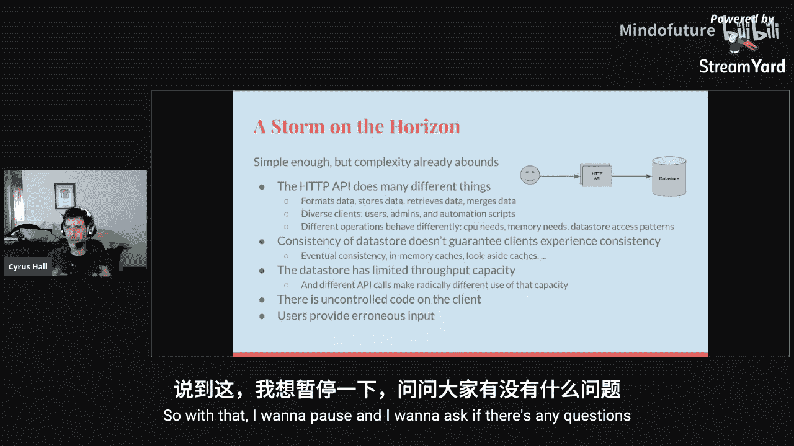

### 更极端的分布式系统
这导致了更极端的分布式系统，例如对等网络和传感器网络。它们仍然是多个进程为共同目标工作（例如，管理互联网路由表的边界网关协议）。这些系统通常是最终一致的，并且决策通常以贪婪算法的方式做出，旨在在系统停止变化时达成最终的全局一致性。

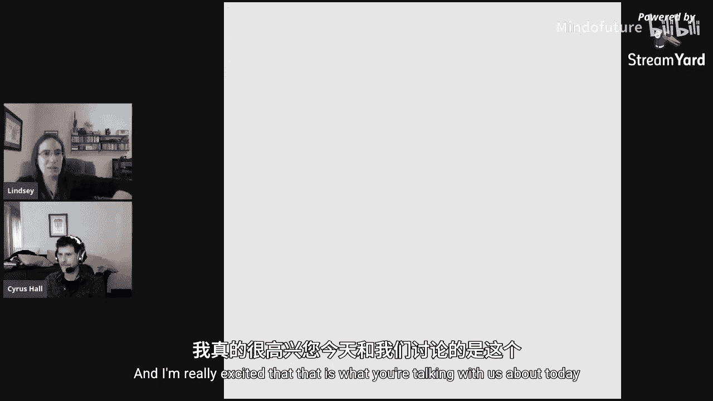

### 一阶系统
我们将上述讨论的系统称为**一阶系统**。它们具有单一目的，没有共享内存空间，并且所有进程运行相同的算法。这里的“相同算法”指的是作为算法定义一部分的不同角色（例如，Paxos中的领导者）。

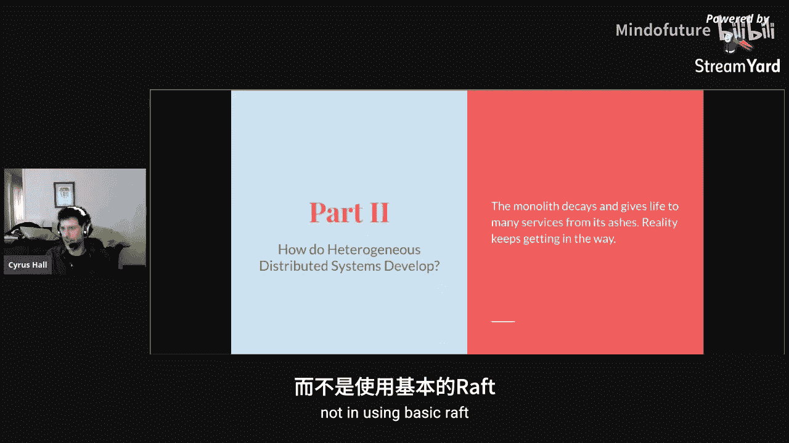

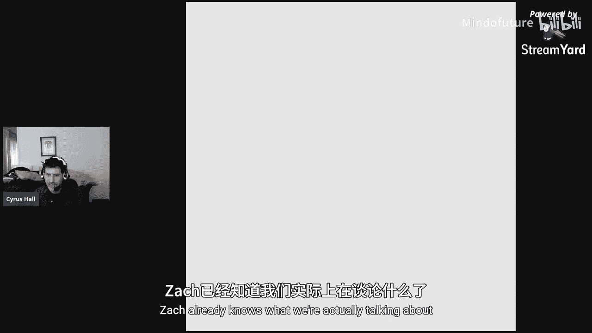

以下是一阶系统的例子：
*   **共识与复制**：Paxos、Raft、Google文件系统、S3、DynamoDB。
*   **网络**：BGP、RIP等路由协议，以及Tor等覆盖网络。
*   **可靠性协议**：TCP（可被视为一种分布式系统）。
*   **对等网络**：分布式哈希表、Gossip协议、BitTorrent。

### 异构分布式系统
一个**异构分布式系统**由多个一阶系统（或非分布式组件）组合而成。其行为不仅由各个一阶组件的行为决定，也由它们组合的方式决定。组件组合主要由人工完成，而组件间的交互往往会导致复杂的故障模式。处理异构分布式系统的核心挑战之一就是应对这些复杂的故障模式。

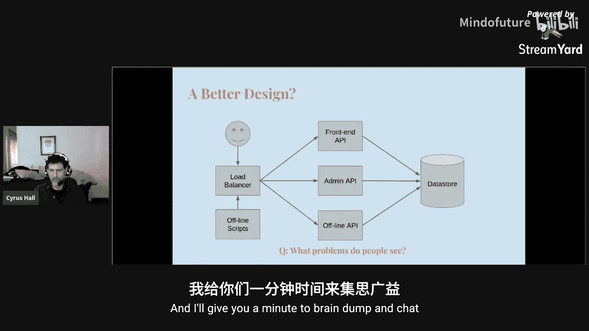

### 一个简单的网络规模示例
考虑一个典型的初创公司网站的第一天：一个HTTP API（可能运行多个进程）连接到一个数据存储（如Postgres）。HTTP API本身（多个进程运行相同代码）就是一个分布式系统，数据存储可能是另一个。它们共同构成了一个简单的异构系统。

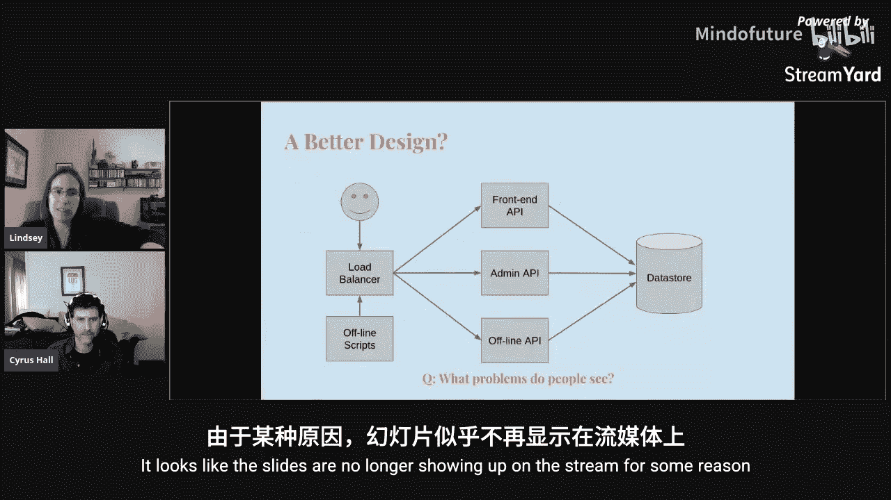

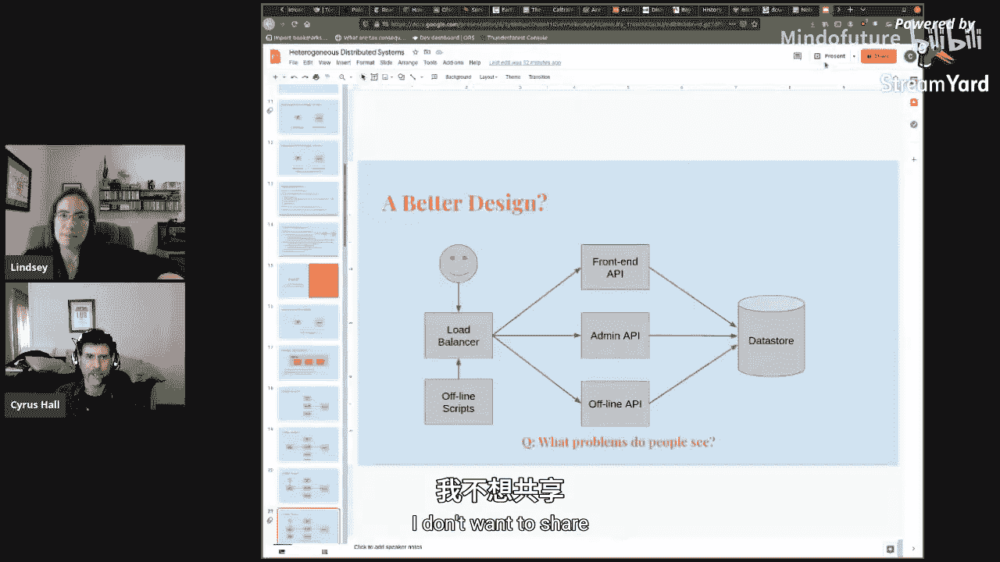

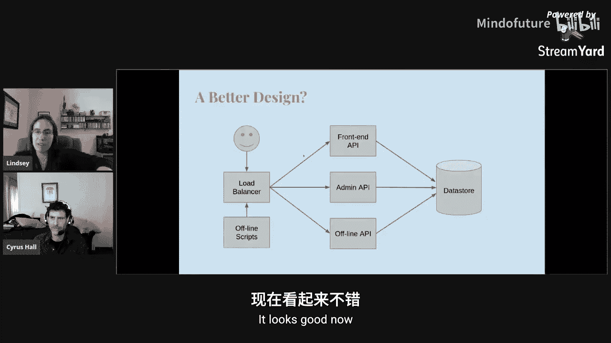

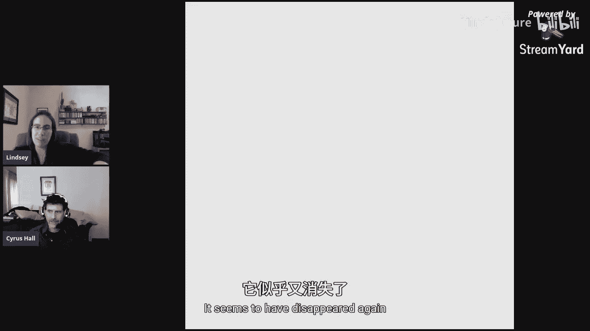

然而，即使在这个简单系统中，复杂性也已存在：
*   API可能承担多种功能（渲染首页、管理页面等）。
*   数据存储的一致性并不保证客户端体验的一致性（API、客户端缓存可能干扰）。
*   数据存储容量有限，不同的API调用以不同方式使用该容量。
*   客户端是不可控的代码，可能提供错误输入。

---

## 第二部分：这类系统如何发展？

上一节我们定义了异构分布式系统，本节中我们来看看它们是如何在实践中演进的。

### 单体架构的兴起
回到我们简单的初创公司网站：一个HTTP API（单体）连接到一个数据存储。这就是所谓的**单体架构**，即所有API调用都塞进一个单一系统，通常连接到一个单一数据存储。

但如果我们审视这个HTTP API内部，它实际上包含多个具有不同属性的组件：
*   **前端API**：在线、低延迟要求。
*   **离线API**（如每日聚合任务）：可接受高延迟、可能消耗大量内存、对后端负载重。
*   **管理API**：通常是上述两者的混合。

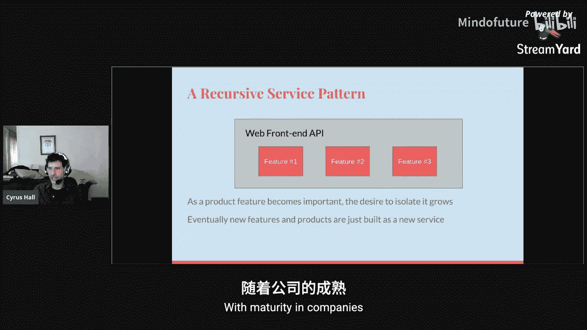

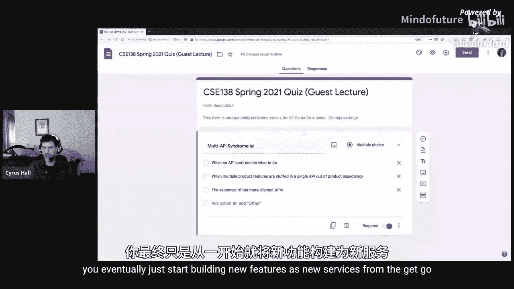

### 第一次演进：服务拆分
我们可以递归地应用之前的思路，将HTTP API拆分成多个更能反映不同使用模式的服务：前端API、管理API和离线API，它们都通过负载均衡器与数据存储通信。

负载均衡器的作用是：
*   为客户端提供一个统一的访问入口。
*   进行故障检测（例如，通过ping机制），将故障实例移出服务池。

然而，这个设计存在明显问题：
*   **后端问题**：数据存储是所有API的单点故障。可变的请求模式（如离线任务锁定表）和突发的流量高峰（如病毒式事件）可能拖垮整个系统。资源管理是分布式的，各API需要了解彼此的请求模式以避免相互影响，这又引入了强耦合。
*   **前端问题**：负载均衡器本身是单点故障，同样面临负载问题。此外，缓存（负载均衡器可能缓存）会带来隐私和安全问题，因为用户数据可能被缓存在各处。

核心关注点是**可用性**（系统响应时间的百分比）和**弹性**（系统在故障中保持可用的能力）。弹性取决于故障隔离、冗余与易扩展性以及负载管理。

需要注意的是，高可用性指标（如HTTP 200响应）并不保证返回数据的正确性。有时，完全失败（硬故障）比返回错误数据的部分失败（软故障）更好。

### 第二次演进：更进一步的解耦
一个更进一步的迭代设计是：分离API、分离负载均衡器、复制数据存储，并让离线API使用副本。这看起来更好，体现了**递归服务模式**：随着重要性的增长和新功能的添加，我们会自然地将单个功能和产品拆分出来。

需要区分**系统**和**服务**：
*   **系统**：实现单一技术功能的分布式系统（一组进程）。
*   **服务**：实现产品功能的系统（分布式或非分布式）集合。例如，聊天服务由实现代理、API、数据库等的系统组成。

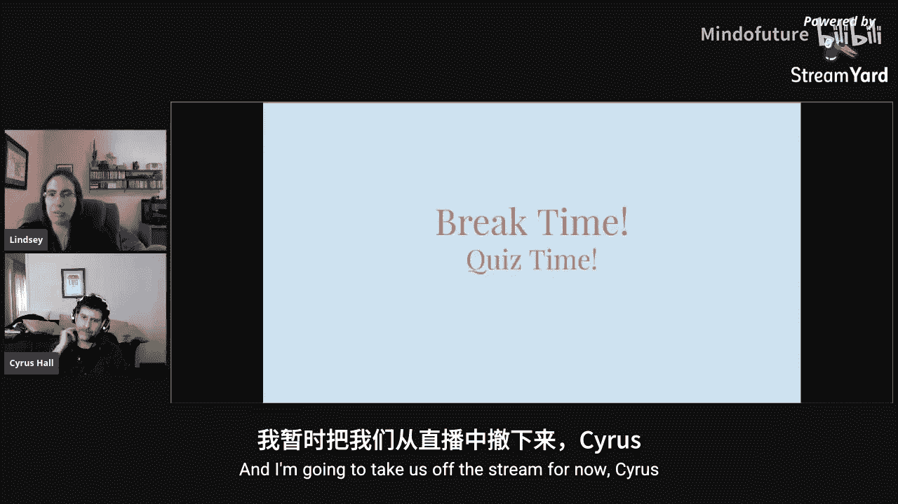

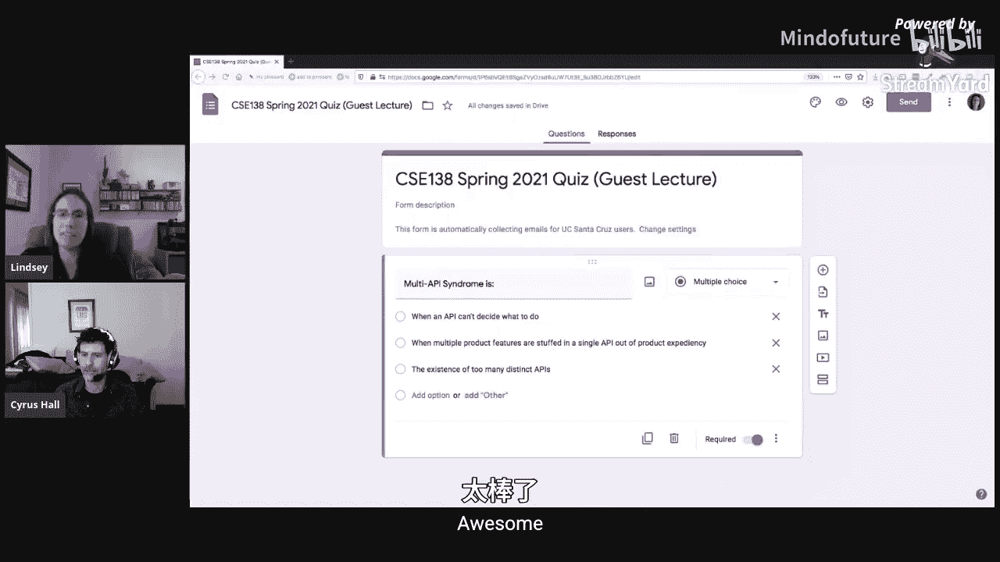

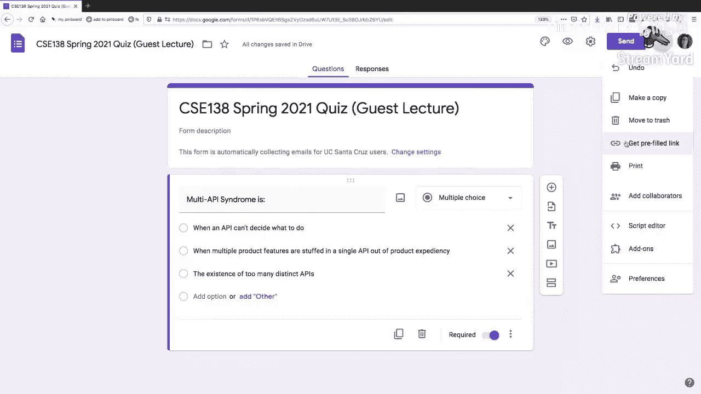

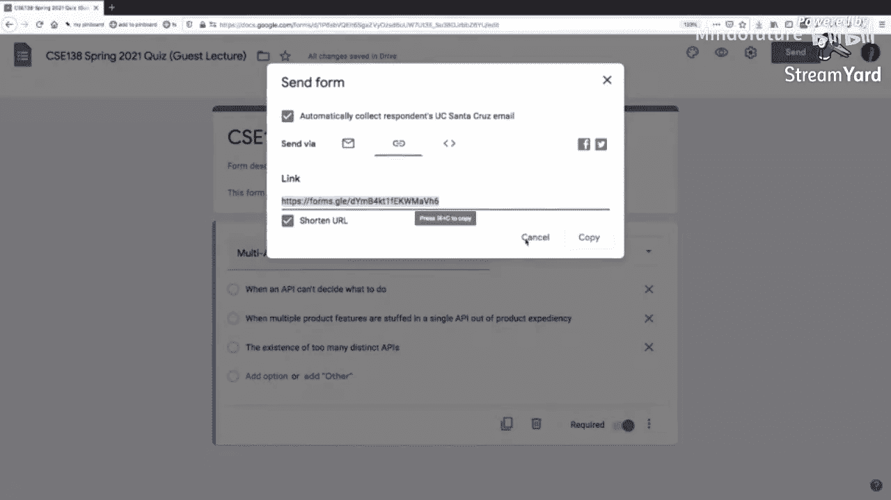

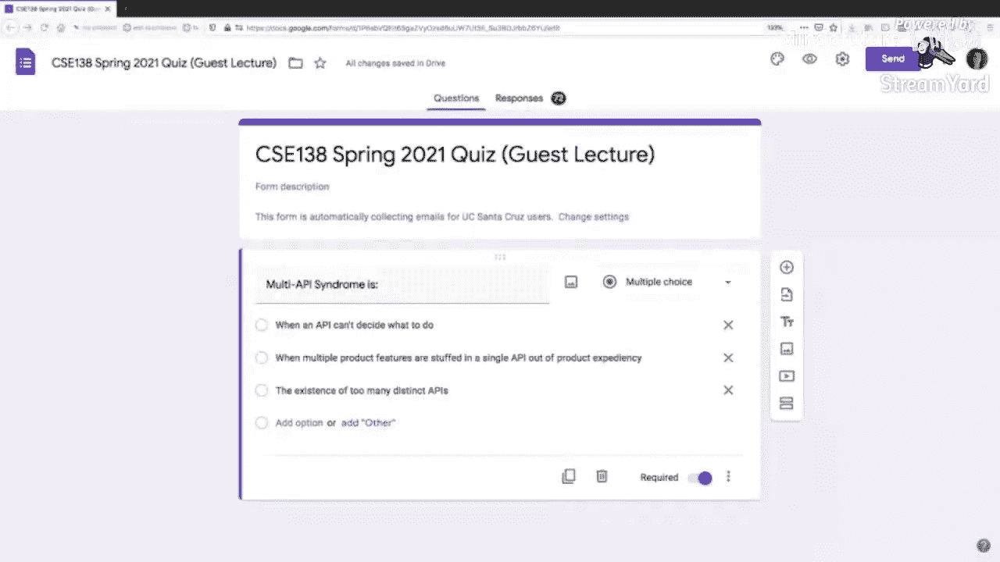

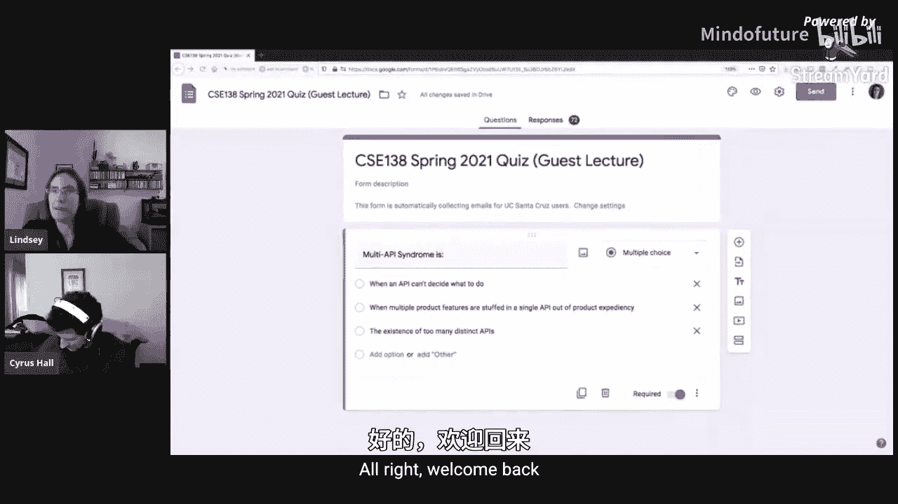

### 现实的演进
然而，实际的第二次迭代很少像理论设计那样整洁。在业务高速增长期，工程师每天可能都在处理运营和停机事件，但往往没有时间进行根本性修复，因为产品变更和新功能的需求迫在眉睫。这导致：
*   大多数服务仍采用自己独特的弹性和故障策略。
*   工程师流动会产生知识缺口。
*   新接手的维护者可能不理解原有的机制。

一个更现实的第二次迭代可能看起来像这样：
*   离线API曾拖垮前端，因此被移出负载均衡器，脚本直接调用它。
*   数据存储变慢，有人引入了回写缓存（如Memcached或Redis）。
*   为了进一步缓解，在API内部又添加了内存缓存。

这引入了新的问题：
*   缓存一致性：内存缓存、回写缓存和数据存储之间的数据可能不一致。
*   不同前端API进程的内存缓存互不同步。
*   离线脚本绕过负载均衡器，使得负载均衡器无法对其流量进行调控，故障检测的责任也转移到了脚本本身。

### Twitch的案例
当Cyrus在2012年加入Twitch时，视频系统基本上是一个在单一数据中心运行的、包含5个核心系统的单体架构（起源于2009年）。到2020年，它已演变为包含超过120个服务的微服务架构，每个服务又由多个系统（如负载均衡器、API、数据存储）组成，总计约300个系统，运行在多个区域。原有的单体直到2022年4月才最终下线，存活了12年。

采用云环境（如AWS）有助于标准化，因为云服务内置了协同工作的组件和特定的设计理念。

---

## 第三部分：理念与经验法则

上一节我们看到了系统演进的复杂性，本节中我们来看看如何应对这种复杂性。核心理念是：接受失败、拥抱错误、尽可能保持无状态、并进行隔离。

以下是构建和管理异构分布式系统的一些高级原则：

1.  **单一职责**：每个系统或服务应只关注一个核心问题。这有助于降低复杂性、依赖关系和故障影响范围。
2.  **松耦合**：系统间应尽可能松散耦合。这与单一职责原则紧密相关。
3.  **易于维护**：这不仅指代码可维护性，还包括系统语义易于测试。能够验证系统行为是否与之前一致至关重要。
4.  **独立且可重复部署**：
    *   **独立**：可以仅部署对目标系统的更改，而无需同时部署其依赖项。这降低了部署复杂性和故障风险。
    *   **可重复**：部署相同代码应产生完全相同的结果。不一致的部署结果会难以判断系统状态。
5.  **清晰的文档**：记录系统和服务的行为与语义，以便在人员更替时知识得以保留。

### 关于松耦合和重试的深入探讨
让我们聚焦于松耦合，并讨论一个重要的经验法则：**重试是危险的，尽量避免。**

在异构系统的上下文中，当请求失败时，我们通常不清楚失败的具体原因（是负载均衡器问题、网络问题还是后端过载？）。盲目重试可能会：
*   给已经过载的组件增加更多负载，可能使其完全崩溃。
*   如果操作是非幂等的（例如，`Increment` 命令），可能导致数据不一致。

**示例：Memcached的Increment操作**
1.  初始值 `x = 0`。
2.  请求 `Increment x by 1`。
3.  操作成功（`x` 变为 1），但返回时出现错误。
4.  客户端重试 `Increment x by 1`。
5.  操作再次成功（`x` 变为 2），但可能再次返回错误。
6.  结果：`x` 的实际值（2）与预期值（1）不一致。

**经验法则：**
*   **尽量使请求无状态/幂等**：对于上述例子，应使用 `Get` 获取当前值，在本地计算新值，然后用 `Set` 存储。这虽然成本更高，但保证了语义正确性。
*   **如需事务语义，使用成熟的服务**：不要尝试在自己的服务中构建事务。
*   **尽早传播错误**：收到错误后，不要立即重试，而是将错误返回给原始请求者。让他们决定是否以及如何重试。这有助于减轻系统压力。
*   **结合主动负载控制**：在进程实例中维护一个出站请求队列。如果队列已满，说明依赖的服务可能正忙，此时应直接拒绝新请求并返回错误，而不是尝试处理并增加后端压力。
*   **如果必须重试，使用退避策略**：但要注意，重试可能导致请求状态在系统中快速累积，有内存耗尽的风险。

### 补充：速率限制
每个服务都有其可持续的峰值负载。基于此，可以设置一个速率限制器（通常在负载均衡器层面），只允许一定比例（如95%-98%）的峰值负载进入生产系统。这可以在不涉及业务逻辑的情况下，平滑流量高峰，防止服务因过载而性能非线性下降直至崩溃。速率限制与主动负载控制相辅相成，分别保护自身服务和依赖服务的健康。

---

## 总结
本节课中我们一起学习了异构分布式系统。我们了解到，复杂的业务流程和生命周期自然会导致复杂的异构系统。阻碍业务发展并非正确的权衡。相反，我们需要运用隔离、松耦合、单一职责、谨慎处理重试、实施速率限制等工具和技术，以在故障发生时（故障必然会发生）降低风险和影响。工程不仅是编写代码的技术过程，也是一个需要与产品、业务方持续沟通和平衡的社会过程。