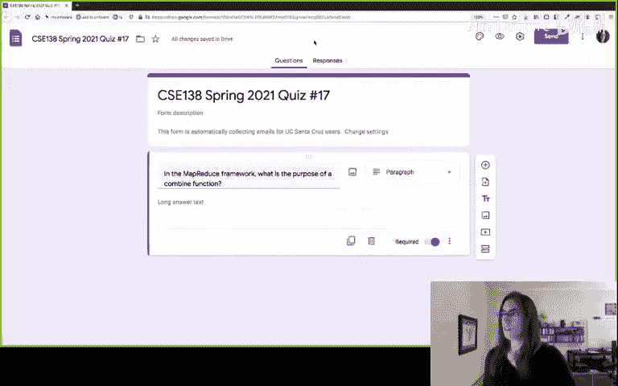
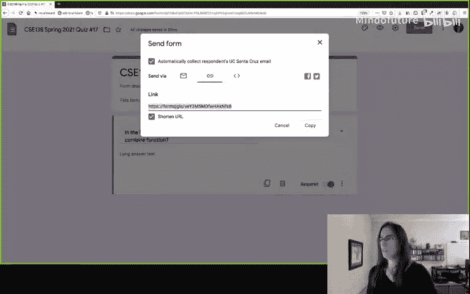
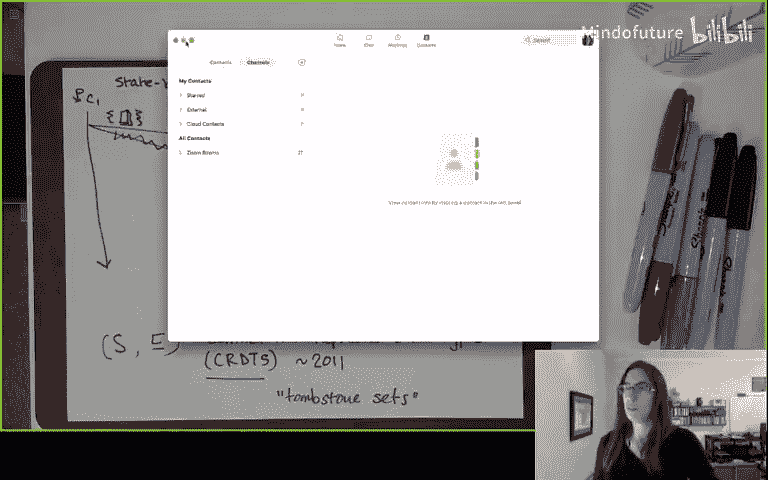

# 018：P18-L17 - MapReduce总结与副本冲突解决的数学原理 🧮

在本节课中，我们将总结MapReduce框架，并深入探讨副本冲突解决背后的数学原理。课程最后，我们将了解如何利用这些原理来设计无需共识协议即可解决冲突的分布式系统。

---

## 课程剩余安排 📅

上一节我们介绍了课程的整体进度，本节中我们来看看最后一周的具体安排。

以下是本学期剩余的计划：
*   今天是第17讲，我们将讨论MapReduce，并开始讲解副本冲突解决的数学原理。
*   如果今天能完成所有内容，那么周四的课程将全部用于解答期末考试相关问题，并进行一场“问我任何事”的问答环节。
*   周五，第四次编程作业截止。
*   下周四是期末考试。

关于期末考试，你至少有3小时答题时间。题目数量不会比期中考试多太多，总分为120分，相对而言你有更多时间来完成。

## 关于第四次编程作业的说明 📝

第四次编程作业的一部分是进行同伴评估。

以下是关于同伴评估的详细信息：
*   请查看并填写同伴评估表，以评估你的队友在项目中的贡献。
*   评估表链接可在作业描述和Zulip的公告中找到。
*   填写评估表不会花费太长时间，其中包含一些多项选择题。
*   请注意，我们要求你评估的是队友在**这个特定项目**中的贡献，而不是评估他们本人。
*   评估内容包括：他们的行为是否合作且乐于助人、是否完成了分内工作、是否积极参与团队活动、是否倾听并支持其他成员、以及工作是否准确及时。
*   为了激励你完成评估，我们将在你为**每一位**队友提交评估后，才会公布第四次作业的成绩。

## 关于课程反馈 📢

在讨论评估的同时，请务必填写课程评价。

关于课程评价，我想说的是：
*   可操作的反馈很有价值。我非常希望听到关于这门课程哪些方面有效、哪些方面无效的反馈。
*   如果你有改进建议，我们很乐意听取。请提供具体的、可操作的反馈。
*   例如，与其简单地说“我不喜欢这些作业”，不如具体说明你不喜欢什么，以及你希望如何改进。
*   请将反馈集中在我们可以控制的事情上，例如课程内容、作业设计等，而不是我们无法控制的事情，如上课时间。

## MapReduce 阶段回顾 🔄

现在，让我们进入正题，总结并回顾上次课关于MapReduce的讨论。

首先，回顾一下MapReduce作业的三个阶段：**Map阶段**、**Shuffle阶段**和**Reduce阶段**。

### Map阶段

Map阶段是程序员提供的Map函数在所有数据上运行的阶段。

Map函数的**类型**是什么？即，它的输入和输出类型是什么？概念上，Map函数接收一个输入键值对，并输出一组中间键值对。

例如，在上次课创建倒排索引的例子中，输入可能是 `(文档ID, "文档内容")`，输出则是一组形如 `(单词, 文档ID)` 的中间键值对。

如果我们要进行词频统计，Map函数会输出每个单词及其计数（通常为1），例如 `(单词, 1)`。

### Shuffle阶段

Map阶段之后是Shuffle阶段。

Shuffle阶段发生了什么？数据根据键进行哈希分区，并被发送到相应的Reduce工作节点进行处理。

具体来说，决定中间键值对发送到哪个Reduce工作节点的分区函数通常是：`hash(key) mod R`，其中 `R` 是Reduce工作节点的数量。

需要重申的是，在MapReduce的设定中，Reduce工作节点的数量 `R` 在作业期间通常是固定的，因此这种基于哈希的分区方式是可行的。

### Reduce阶段

Shuffle阶段之后，数据到达了Reduce工作节点，Reduce阶段开始。

Reduce函数的**类型**是什么？Reduce工作节点拥有自己分区内的数据。所有具有相同键的中间键值对都会到达同一个Reduce工作节点。

Reduce函数接收一个特定的键，以及与该键关联的所有值的集合，然后产生一组输出值。

输出取决于具体的Reduce计算。例如：
*   在倒排索引的例子中，输入可能是 `(单词, [文档ID列表])`，Reduce函数可能只需将这个列表写入GFS。
*   在词频统计的例子中，输入可能是 `(单词, [1, 1, 1, ...])`，Reduce函数需要将这些值相加，得到总计数。

## Combiner函数与结合律 ⚙️

让我们更深入地讨论一个优化点：Combiner函数。

假设一个Map工作节点需要统计单词“dog”的出现次数。如果使用论文中的词频统计Map函数，对于句子“My dog is the best dog and the fastest dog”，它会输出三个 `("dog", 1)` 中间键值对。

在Shuffle阶段，这三个键值对都会被发送到负责键“dog”的Reduce工作节点，然后相加得到3。

这种方式的问题在于，发送这三个元组需要消耗网络带宽。我们可以在Map工作节点本地先将它们相加，然后只发送 `("dog", 3)`。这样，Reduce工作节点再将来自不同Map工作节点的本地计数相加即可。

这种优化之所以可行，是因为我们进行的操作（加法）是**结合律**的。结合律意味着 `(A + B) + C = A + (B + C)`。

如果Reduce操作是结合律的，我们就可以在Map工作节点上提前进行部分计算（Combiner），从而减少Shuffle阶段需要传输的数据量。

如果Reduce操作不是结合律的（例如求平均值），那么这种提前计算的方式可能会导致错误的结果，因为 `average(average(A, B), C)` 不一定等于 `average(A, B, C)`。

## 为什么Google不再主要使用MapReduce？ 🤔

有人提出了一个好问题：为什么Google不再主要使用MapReduce？

MapReduce并没有完全消失，而是被**泛化**了。你可以查阅2010年的一篇名为《FlumeJava: Easy, Efficient Data-Parallel Pipelines》的论文，其中介绍了Flume系统。

为什么需要Flume？因为MapReduce框架的结构化很强（Map-Shuffle-Reduce-输出到存储）。有些计算很难塞进这个结构，你最终可能需要串联多个MapReduce作业。

在MapReduce作业之间，数据需要写回GFS，然后被下一个作业读入。如果这些作业只是整个计算流水线的中间阶段，那么反复的中间存储和读取会非常慢。

Flume泛化了MapReduce，它允许更灵活地调度这些计算链，避免了每次中间结果都必须落盘的性能开销。因此，MapReduce更多是进化而非被淘汰。

## 共识的成本与强收敛性 💸

接下来，我们将话题转向副本冲突解决的数学原理。首先，我们需要讨论一下共识的成本。

在分布式系统中，我们经常讨论副本一致性问题。假设有两个副本，都可以接收更新。

如果我们需要强一致性，可以使用共识协议（如Paxos）来决定每个事件的顺序。但这需要大量的消息传递，成本很高。

共识协议只有在**事件顺序至关重要**时才值得使用。然而，很多时候，我们需要的安全属性不是强一致性，而是**强收敛性**。

强收敛性意味着：如果副本收到了相同的更新集合（无论顺序），那么它们的状态最终会一致。

对于许多应用（如购物车），强一致性是过度的，强收敛性就足够了。这可以避免共识带来的高昂成本。

## 偏序集与最小上界 📐

为了形式化地讨论强收敛性，我们需要引入一些数学概念：偏序集和最小上界。

**偏序集** 由一个集合 `S` 和一个定义在 `S` 上的二元关系 `≤` 组成，该关系满足：
*   **自反性**：对于所有 `a ∈ S`，有 `a ≤ a`。
*   **反对称性**：如果 `a ≤ b` 且 `b ≤ a`，则 `a = b`。
*   **传递性**：如果 `a ≤ b` 且 `b ≤ c`，则 `a ≤ c`。

偏序集意味着并非所有元素都是可比较的。一个经典例子是某个集合的所有子集构成的集合，其上的偏序关系是“子集包含关系”。

给定偏序集中的两个元素 `a` 和 `b`，它们的**上界** `u` 是满足 `a ≤ u` 且 `b ≤ u` 的元素。
在所有这些上界中，如果存在一个元素 `l`，使得对于 `a` 和 `b` 的任意上界 `v`，都有 `l ≤ v`，那么 `l` 称为 `a` 和 `b` 的**最小上界**。

如果一个偏序集中，任意两个元素都存在最小上界，那么这个结构被称为**并半格**。

## 应用到副本冲突解决 🔗

现在，我们将这些数学概念应用到分布式系统中。

假设副本的状态是某个并半格中的元素。当两个副本收到冲突的更新时，它们不需要运行共识协议来决定顺序，而是可以简单地计算它们当前状态的**最小上界**，并将结果作为合并后的新状态。

例如，在购物车场景中，状态可以是商品集合（即集合的幂集，这是一个并半格）。添加商品对应于向集合中添加元素。两个副本状态的合并就是取它们集合的**并集**，这正是集合包含偏序下的最小上界操作。

这种无需共识的冲突解决方法，正是**无冲突复制数据类型**（Conflict-free Replicated Data Types, CRDTs）的核心思想之一。上面描述的是**基于状态的CRDTs**。

## CRDTs的挑战：删除操作 🗑️

然而，CRDTs并非万能。当我们引入**删除操作**时，情况会变得复杂。

如果简单地将状态视为集合，合并操作取并集，那么一个在某个副本上被删除的项目，可能因为另一个副本尚未收到删除操作，而在合并后重新出现（这就是Dynamo论文中“已删除商品重现”的问题）。

处理删除的常见技巧是使用**墓碑集合**。每个副本不仅跟踪已添加元素的集合，还跟踪已删除元素的集合。合并时，对两个集合分别取并集，然后从添加集中减去删除集。

但这带来了新问题：状态会不断增长（墓碑需要被永久保存吗？）。此外，如果添加一个元素，删除它，然后再添加它，简单的墓碑机制会认为它已被删除（因为删除优先）。要支持这种场景，可能需要引入计数器等更复杂的机制。

最终，为了垃圾回收墓碑，可能还是需要共识协议来让所有副本就某个清理点达成一致。

## 总结 📚

本节课中我们一起学习了以下内容：

1.  **MapReduce总结**：回顾了Map、Shuffle、Reduce三个阶段，以及Combiner函数如何利用结合律来优化性能。
2.  **共识的成本**：认识到强一致性（通常需要共识）成本高昂，而许多应用只需要强收敛性。
3.  **冲突解决的数学原理**：引入了偏序集、最小上界和并半格的概念。我们了解到，如果副本状态构成一个并半格，就可以通过计算最小上界来合并状态，从而无需共识即可解决冲突。
4.  **CRDTs简介**：介绍了基于状态的CRDTs如何利用这一原理，以及处理删除操作时面临的挑战（墓碑集合、状态增长）。

分布式系统是复杂的，但理解这些基础原理能帮助我们设计出更高效、更合理的系统。