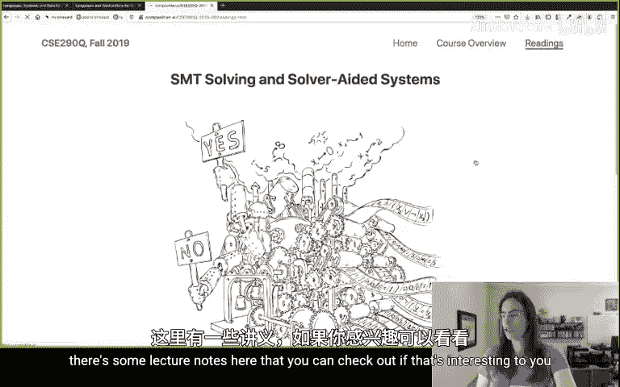
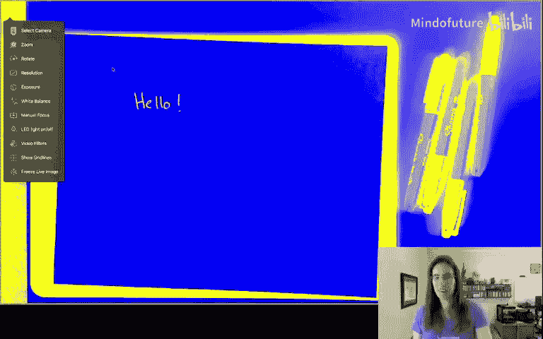
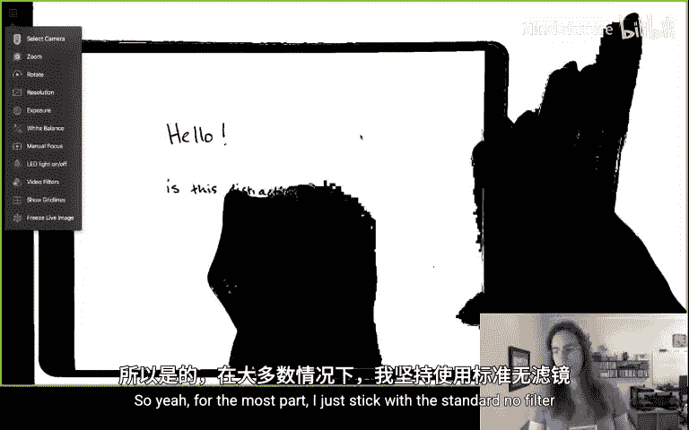
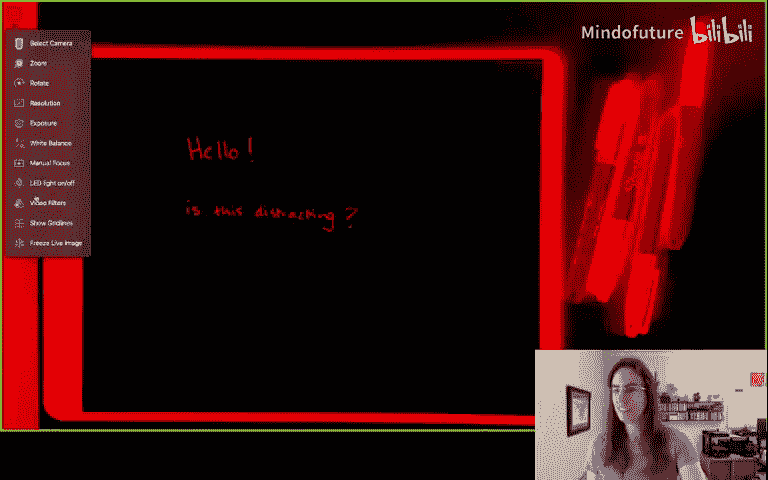

# 019：问答环节

在本节课中，我们将回顾课程内容，并回答学生提出的各种问题，涵盖课程材料、技术工具、职业发展以及个人兴趣等多个方面。

## 概述

这是本课程的第10周，也是最后一次讲座。本节课没有新的教学内容，主要进行课程公告和问答环节。我们将回答学生关于课程内容、分布式系统测试、编程语言选择、职业建议以及个人经历等方面的问题。

## 课程公告与资源介绍

首先，我想向大家介绍我们加州大学圣克鲁兹分校的研究小组——语言、系统与数据实验室（LSD Lab）。这个实验室汇集了对系统、分布式系统、操作系统、数据库系统和编程语言等不同研究主题感兴趣的研究人员和学生。我的研究背景是编程语言，后来转向分布式系统领域。目前，我的研究兴趣是利用编程语言技术来形式化验证分布式系统的行为。

### 相关课程与博客

在我来到UCSC的头几年，我有幸教授了一些与我的研究相关的研究生课程：
*   **2018年秋季**：我教授了一门名为“分布式编程的语言与抽象”的课程。课程网页仍然在线，上面列出了该主题领域的一系列有趣论文。
*   **我的学生和我共同撰写了一个博客**，其中包含了一系列由我们编写和编辑的博文。这些博文涵盖了许多我们在本季度课程中讨论的主题。

### 特别主题课程

*   **2019年秋季**：我教授了另一门研究生专题课程，主题是“SMT求解与分布式系统”。SMT求解器是一种强大的工具，如果使用得当，可以帮助我们推理分布式系统这类具有巨大状态空间的问题。这门课程涉及SMT求解及其应用，不仅限于分布式系统，还包括测试生成、程序合成等领域。

## 学生问答环节

现在，我将回答大家提出的问题。问题范围很广，从课程 logistics 到个人兴趣都有。

### 关于课程安排与工具

**问题：辅导课下周还会继续吗？**
我不确定。课程工作人员没有义务在期末考试周继续提供辅导。部分人员可能会选择继续，但建议你提前与他们确认。

**问题：你最喜欢的IDE或文本编辑器是什么？**
我使用Emacs。这主要是出于习惯，因为我在本科时它很流行。Emacs非常可定制，几乎可以做任何你想做的事情。

**问题：你最喜欢的编程语言是什么？对于本课程的团队项目，你推荐什么语言？**
对于团队项目，最重要的因素是**什么能帮助团队更好地协作**，这取决于团队成员的熟悉程度。Peter Norvig的建议是“学习你朋友正在使用的语言”，这很有道理，因为拥有一个可以交流和获得帮助的社区非常重要。
就个人而言，我很喜欢Rust。目前为了研究，我在使用Haskell，主要是因为现有工具适合我要做的SMT增强类型系统方面的工作。我也非常推荐Racket，它是一个功能强大、社区友好的Scheme语言变体。
对于本课程的项目，Python是最受欢迎的选择，它有很好的框架。Go也被称为“系统编程的Python”，构建Web服务非常直接。Java也有很好的API，不应被完全排除。

### 关于个人背景与兴趣

**问题：能谈谈你的音乐学位吗？**
我本科时双修了音乐和计算机科学。我是一名歌手，在非疫情期间，我会与硅谷交响乐团合唱团一起演出。唱歌和教学在某种程度上都是表演。

**问题：你做过结合音乐和计算机科学的事情吗？**
我学习过一些电子音乐，其中涉及的工具本身就像不完整的编程语言。虽然我没有深入研究，但我认为音乐记谱法的研究很有趣，不同文化和时代的记谱系统有不同的特性，这与编程语言设计有相似之处。

### 关于分布式系统测试

**问题：有哪些用于测试分布式系统的工具或框架，特别是模拟复杂网络条件（如分区、高延迟）的？**
测试分布式系统确实非常困难。我们提供的测试脚本远不足以发现所有错误。理想情况下，你需要能够系统性地测试所有消息交错、机器故障组合的工具。
*   **混沌工程**：在生产环境中注入故障进行测试，这能让你在真实运行环境中观察系统行为。
*   **工具推荐**：可以看看开源框架**Jepsen**，它用于向分布式系统注入一系列故障（如网络分区）以发现错误。还有像**基于溯源的故障注入**这类研究，它试图通过选择最可能暴露错误的故障类型来缩小搜索空间。
*   **可观测性工具**：确保系统正常工作的第一步是了解系统正在发生什么。目前业界在分布式系统可观测性方面有很多很酷的工具和实践，这是一个新兴领域。

**问题：你为什么选择使用纸笔和文档相机教学？**
最初是出于 necessity（去年突然转为线上教学，我没有平板电脑）。我习惯了在教室黑板上书写，文档相机能最接近那种体验。后来我发现它很好用，学生反应也不错。现在我不只用于教学，和学生会面讨论时也会用它来画图，这类似于线下使用白板。

### 关于数据库与职业发展

**问题：你对关系型数据库和NoSQL数据库有什么看法？**
这完全取决于你的使用场景和问题约束。
*   **关系型数据库**（如PostgreSQL）具有丰富的数据模型和完整性约束，但在大规模分布式场景下，维护这些约束会带来复杂性。
*   **NoSQL数据库**（如Dynamo的键值模型）数据模型扁平简单，使得处理分布式一致性和容错更容易，因为键值对之间是独立的。
第一步始终是问自己：**你真的需要一个分布式系统吗？** 对于很多场景，单机关系数据库可能就足够了。只有当你处理像亚马逊那样规模的数据时，才需要开始认真考虑可用性等问题，此时扁平数据模型会变得非常有帮助。有时人们会尝试在NoSQL系统上重建关系模型，这又会带来新的设计考量。

**问题：有哪些值得关注的使用分布式系统的大公司？**
大公司（如Google、Microsoft、Netflix、Amazon）处理的问题规模是独一无二的，这会催生像MapReduce这样的新工具。在这些地方工作能接触到别人没有的问题规模。
但很多很酷的工作也发生在不那么大的公司。例如，**Fastly**就在使用Rust做很酷的分布式系统工作。支付行业虽然数据总量可能不大，但每笔交易都极其重要，这带来了不同的权衡和基础设施设计考量。**游戏行业**也以极具创意的方式解决硬核的分布式系统问题，只是它们有自己的文化和词汇。

**问题：你最喜欢的分布式系统研究论文是哪篇？**
课程中选取的MapReduce和Dynamo论文是文献中的标准，它们展示了分布式系统工作的不同方面，虽然有些年头了，但仍是经典。
我个人更喜欢**80年代和90年代的论文**。那时的研究预见到了我们今天在容错、网络分区等方面的关切，在当时更多是理论兴趣，但现在与日常软件工程实践深刻相关。这些老论文中有很多深刻的见解。

### 其他问题

**问题：课程中哪个主题最难讲/最难学？**
这取决于个人。有些讲座内容非常深刻和微妙。例如，第一次讲Paxos时我非常紧张，需要投入大量精力准备例子。经过几次授课后，我感觉好多了。
我发现，**要真正做好作业，必须理解讲课材料**。这让我感到欣慰，因为这意味着这些理论材料不仅具有知识上的趣味性，而且非常实用。过去一年，因为要验证因果广播的实现，我对它的理解也加深了。

**问题：能讲讲章鱼表情符号的故事吗？**
这个梗源于**Recurse Center**社区，他们早期就使用了Zulip。有人发现章鱼表情符号可以“托起”其他表情，非常可爱，于是在社区内流行起来。因为RC是Zulip的早期用户，Zulip将章鱼表情放在了默认表情选择区的前列。后来，这个用法传播到了其他使用Zulip的社区。
当我们开始在UCSC举办西海岸版的Bang Bang Con会议时，我们决定使用章鱼作为标志，既因为它是RC的内部梗，也因为章鱼很符合圣克鲁兹和西海岸的精神（圣克鲁兹有章鱼公共艺术，UCSC著名的分布式存储系统Ceph名字也来源于头足类动物）。于是就有了章鱼托起感叹号的标志。

**问题：对于毕业后想保持联系的同学，你有什么建议？**
**请保持联系！** 教授们很高兴听到学生们如何将所学知识应用于实际工作中。这对于我教的这类课程尤其让我开心。
此外，如果几年后你决定重返校园读研究生，你需要来自了解你、能评价你研究潜力的教授的推荐信。如果你毕业后一直保持联系，教授就能为你写出更有力的推荐信。即使你不再踏入校园，保持联系、分享近况也是一件很棒的事。

## 总结与告别

在本节课中，我们一起回顾了课程的相关资源，并解答了大家关于技术、职业和个人的各类问题。感谢所有同学在这一年困难情况下的坚持与付出，特别感谢我们出色的课程工作人员（Patrick, Aria, Abha等）的卓越工作。
对于即将毕业的同学，祝你们前程似锦。请记住保持联系，随时告诉我你们的近况。祝大家期末考试顺利，圆满完成最后一个作业！
再见！