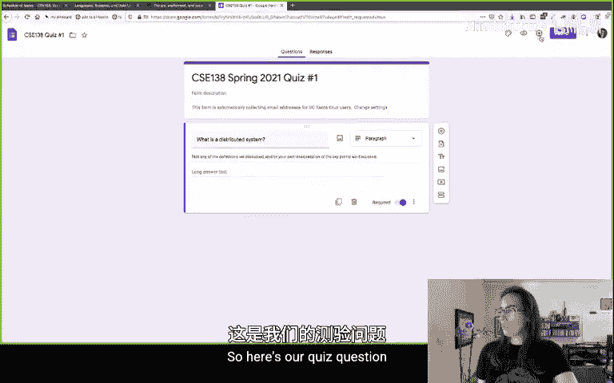
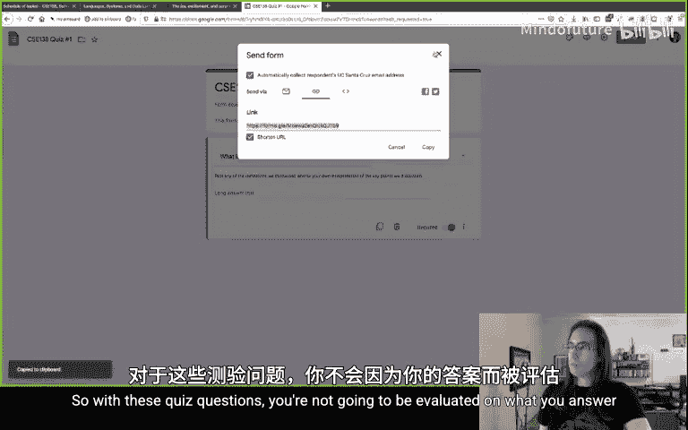
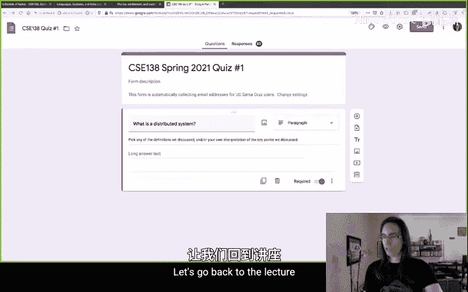

# 【加州大学】分布式系统-CSE138（Distributed-Systems）-p01-P01-L1---logistics-administrivia-distributed-systems---what-and-why--BV1eGdLYjETJ_p1-

Make sure the stream comes up。All right， looks like the stream is live。Cool， okay。

 so welcome to distributed systems， hopefully those of you who are on Zoom can hear me。

The first thing you'll notice is that the Zoom chat is disabled。

 that's because we won't be using Zoom chat instead we're going to be using Zollip for everything。

So if you're enrolled in this class， you should have gotten an invitation to zullip。

 I think most of you are on it already。According to my。Messages on Zullip。

 about 80 people have already signed up。 so that's good。 That's most of who's enrolled in the class。

 And if you look on the。Lectures， stream。On Zullip， there's a topic for lecture one。

So hopefully you see that。And this is what we're going to be using for chat during the course instead of Zoom chat。

 this is good because it means that the chat is persistent。

And you won't lose it the course or when the lecture ends。

 and you can ask questions about stuff that we talked about in the lecture after the lecture ends using this chat。

All right， it looks like people are finding the lecture chat on Zooullip， that's great。

If you're new to Zullip， hopefully it'll be kind of familiar， it's kind of similar to Slack。

 it's kind of similar to Discord。And hopefully it won't be too complicated。

 a lot of people are already using it with a plum。All right， so let's get started。

Hopefully you can also see that I'm sharing my document camera here。嗯。So I got to tell you all。

 this is the first time during the pandemic that I've taught of course in the afternoon。

In the afternoon， I do not have childcare and I have a three year old daughter。

There's a small but real chance that my daughter could pop in at any moment。

 I hope you like toddlers I also have a cat， the cat is less likely to come in because the cat can't open doors but it still could happen。

So just to warn you， those things could occur。So I want to start。

I want to start by just giving an agenda for today。 So we're going to talk about。Logistics。

Administrative stuff。Expectations。And then we're going to start getting into the actual content of the course。

Distributed systems。What？And why？And if you could mute yourself on Zoom if you're not talking right now。

 that'd be great。Alright。So。Let's start with the administrative stuff。First of all。

 if you haven't found it yet， we have a course website。Composition。al/cE。One， three， eight。2021。

03I like to do things in public so our public course overview and public schedule and all that stuff is there if you have not checked out the course website yet I encourage that you do so。

A lot of what we do in this course is going to be done in public。So the lectures are public。

 the schedule for the course is public， even things like the expectations for grading will be public。

 the assignments will not be public， so assignments are one thing that are private but just about everything else is public and to me this makes things a lot more fun。

 it means that you know people around the world can see what we're doing and participate。

So so this is how I like to do things rather than keeping everything all locked up in our course management system so this is a public web page that you can go and check out on that page right now the main things are the course overview and the schedule so hopefully。

Some of you have already taken a look at those。And thanks to those of you who have。

 I'm not going to read over everything for you in the course overview and schedule。

 but I'm going to hit the highlights and then you can take the time to check it out on your own。

 I recommend that you read the course overview yourself from top to bottom because there's a lot of info in there that you might find useful。

But I'll just go over the highlights right now。So first of all， me， I'm Lindsay Cooper。

I've been here at UC Santa Cruz for。How long， I guess is my third year？And。

Well I wasn't expecting to tell you the truth that I was going to be teaching this course online for the second time。

 this is the second time that I have taught this course online。

 I taught it online last spring as well， and if you had told me back then that I was going to be teaching it online again。

 I would have been pretty sad， but that's the situation that we're in，And。You know。

 now this means that a third of my career here at UCSC has been teaching online。

Hopefully not that much more， but we'll see。So my research is in the area kind of the combination of programming languages and distributed systems。

 I like to say that I work on solving systems problems with programming languages solutions。

So if you want to know more about me and my research， I would love to talk with you more about it。

 probably in office hours or you you can ask me questions on Zulip or wherever。

I probably won't spend too much time talking about my research during regular lectures because we need this time to talk about our kind of main course content。

 but you know if we get to the end and the end of the course and there's time。

 then maybe I will talk about my own stuff a little bit。

 we'll see it depends also on what you're interested in that kind of thing。So that's me。

We also have some great course staff。So I want to briefly introduce them to you。

 we have two teaching assistants， both of them are people that I have worked with before and who I trust and who I think are great。

 so one of our teaching assistants is AB。And the other is Patrick。

Both of them are going to be holding discussion sections， the discussion sections are optional。

 so you're not required to go， but discussion sections are a good place to go if you have questions about homework。

 especially once the homework assignments start coming out or if you have questions about any of the course content。

嗯。They also， in addition to the sections， our TAs are going to hold office hours and the times for those are listed on the course overview as well and you can check that out。

Oh I forgot to mention I too will be holding office hours。

 but I haven't decided exactly when that will be yet。

 so I will update the course overview when I get that sorted out。

SoSome folks are asking some questions about where the best place to watch lecture is if you're enrolled in the class。

Yeah， I mean， you have a choice between Zoom and Twitch。

 so you're right that things might be less laggy on Twitch actually， interestingly enough。嗯。

And but there is this downside right that T shows ads from time to time。

 and I have nothing to do with that I can't。Control it， and I certainly don't make any money from it。

So。mI apologize for the ads， if you want an ad free experience which you're entitled to as a student。

 then go with Zoom。😊，嗯。Hopefully that answers that question。All right， back to Co Step。

 so these are our wonderful TAs。We also have some tutors and we have four tutors。

I'm just going to list their first names here。We have Aria。Matthew。Argin。And。Vne。

The role of the tutors is to hold tutoring sections and those are going to be advertised on Zooullip and probably also listed in the list of Zoom sessions that you can find on Canvas。

And also to answer questions on Zlip， basically anytime that you have them。

If you need to reach the core staff， there is a zlip shortcut for that。At mention。C staff。On Zullip。

And that will reach all these people。At once。And this is really the way to go。

 like if you need to talk to the course staff， if you have a question for the staff。

Rather than trying to contact each of us individually do this。

And then you'll be able to talk to us all。Questions about any of this stuff so far。All right。Yeah。

 so well， I guess that's up to the Ts if they want to record their own。

 but I you know I wouldn't count on it happening and so office hours。Certainly not。

 I think office hours are intended to be more of a that's like if you want to know what happens at office hours。

 you should come to office hours。And then sections again that's going to be up to the Ts and what they want to do I don't think that those recordings would be much help to you anyway。

 because the questions that will be answered in office hours will usually be pretty specific to the person asking so。

There would be no reason to sit through hours and hours of video for that instead。

 you know if you have a question。Ask it on Zulip or come to office or yourself to get your question answered rather than watching extra videos。

All right， so。Other logistical stuff。 So just in general。

 zullip is the way to do things in this course。 So we're not going to be using。Canvas announcements。

 we're not going to be using piazza we're not going to be using email very much instead Zoolip will take the place of all those things we will be using Can for grades and we will be using Can for distributing assignments but for basically everything else Zoolip is the place to go so if you have not yet done so you should enable notifications for the announcement stream on Zullip。

So announcements is a stream where we're going to post like course announcements and things that you should know。

 I'm going to try to keep from spamming it， it's going to be stuff that you actually need to know。

So if I have things to say that aren't so essential。

 I'll probably post them in the general stream or somewhere else， but for things that。

Are really important for everybody to know I'll put them in announcement。

You should set up your Zooup notifications so that you get those announcements as far as other channels。

 I don't care if you turn on notifications or not， you can do whatever works for you and Zooup is nice in that it lets you configure notifications on this per channel basis so you can set it up however you want it。

All right， let's see before I get into course content stuff。Let's see。 Is there any other？

Logistical stuff that I want to cover。How about this。I want to mention。If you have a disability。

And you need accommodations for this course talk to me about it so there are both official and you know accommodations that we can offer through the disability Re Center and you can also contact me even if you don't have a DRC letter and there's some kind of accommodation that you want to ask for you can talk to me about it and I am very eager to help you get the most out of the course I've gotten know a lot of people have talked to me about how they've you know they've might not have necessarily known that they had a learning disability until they started taking online courses。

And you know I myself I took an ADHD evaluation the other day and it turned out I had moderate ADHD symptoms so and you know it' in the end like doesn't really matter if you have a diagnosis or not。

 I still want to run the course in the way that is most helpful so that said if you can get that authorization letter to get things like accommodations on tests and so on。

 then that's really useful to have so it's not too late you can still talk to the DRC about getting accommodations and you know if you do think you might need something something like accommodations for extra time on exams then I suggest talking to them sooner rather than later。

So there's a link you know， hopefully you know， most of you know about this already。

 but there's a link on our course overview to the DRC where you can learn more about what they have to offer and I encourage you to do so。

Okay。So let's talk a little bit about what we're going to actually be doing in this course。

So this is a course。That's about fundamental concepts of distributed systems， what does that mean？

So first of all， what is a distributed system？I'm going to start。

With a definition that was originally intended as a joke。But。

I think that there's like so many good jokes， there's truth to this joke。So。

The definition that's a joke is。A distributed system is a system where I can't get my work done because some computer somewhere that I've never even heard of has failed。

And this definition comes from Leslie Lamport， who is often thought of as the father of distributed systems。

 so somewhere somewhere a computer has failed。That I've never even heard of。

 and because of that I can't get my work done， that's a distributed system。

Now he meant this as a joke， of course。There's a lot of truth to this joke。

 So we're going to try to explore and write down a definition of distributed systems that kind of。

Explains you know why， why did he make this joke。 So here's one definition。

And this is a definition from。Martin Kpman。Who's another？Really。Great distributed systems educator。

 And so he says a distributed system。Is。Running on several nodes。

We'll talk about what a node is in a second。Connected by a network。And。Characterized by。Pial。Failure。

Partial failure。 So what do I mean by that？So if the failure is partial。

 this must mean that some parts of the system are broken， while other parts are okay。

Or sometimes broken or maybe broken。And furthermore。

 it's often impossible to know what exactly is broken。

Or it's least impossible for the software to know what's broken。

So we'll come back later in the course to what we mean exactly by this idea of impossible for the software to know。

But let me go back to this here when I say nodes， what is a node？

We can think of a node as being a computer or an instance of some software running on a computer。

W which communicates with other nodes。In a network in order to accomplish some sort of task。

So these are the two key pieces of Ktman's definition。

 he says the distributed system has to be running on several nodes or several computers and that partial failure is a key characteristic of this system。

And I think this is a pretty good definition， it kind of captures the key things about that joke from Leslie Laport that we heard a second ago。

 there are multiple computers， no， one of them here， one of them somewhere else。

And there's failure and failure is endemic to this system。

So that's what I think a distributed system is。What about you。

 do you have any ideas about what should what should fall under this definition of distributed systems if you have a thought then go ahead and put it in Zullip or you can say it out loud if you want to。

Parallism， yeah， okay。So if we have multiple computers， right？Then we certainly have the potential。

Of。Doing computation of using that resource right， of these multiple computers to do computation faster。

 right so parallelism is a resource that we can use to get tasks done faster if we use it well。

Somebody else suggests partitioning tasks across multiple nodes， yeah okay。In this course。

 we're going to be talking about algorithms that are designed to run on more than one computer。

And when there's a lot of work to do， you can get it done faster if you split up the work。Okay。

 now folks are talking about fault tolerance。Good， okay， yep， because of this partial failure。

 we're certainly going to want to talk about how to deal with that partial failure。So this is great。

 folks are talking about speeding up work by partitioning the work across multiple nodes and talking about fault tolerance and so on。

So， and these are things that people have brought up in the past when I've taught this course。

 and people have even said things like multiple computers running as a single computer。

And so these definitions I think are good and these are all things that we're going to talk about。

 but I would also caution you that these kinds of definitions are very optimistic right so you know of course we want our distributed systems to be fault tolerant。

We want to be able to take advantage of this resource of parallelism。

 but also we have to keep in mind that。No， a lot of distributed systems don't tolerate faults very well。

 a lot of distributed systems don't take advantage of parallelism very well and part of what we're going to be spending a lot of time talking about in this course is the kind of failures that can occur and the way that we need to design distributed algorithms defensively in order to guard against those kinds of failures。

All right。I want to talk a little bit more about this concept of partial failure。

So I say that partial failure is when some parts of a computation or some parts of a system could be broken。

 while other parts are okay。So that's kind of interesting， right？

Not what we're normally used to dealing with。And so if you were just talking about a single machine。

 for example。Then， well， we typically think of， no， if one part of a computation fails。

 then it all fails。So a traditional example of this I know everybody here has taken 130。

 so you know a little bit about operating systems， so when an OS kernel panics。

 that means that some part of the OS has failed， right？And。Now the OS has crashed。

 so some part has failed， and because some part has failed。

 the whole thing fails and you have to start over。So normally on a single machine。

 we don't talk about this concept of partial failure。

This notion of partial failure comes up more the more computers that we have。So。

There are some different philosophies here， and I want to contrast two ways of thinking about this。

So one philosophy is what I'm going to call the cloud computing philosophy。

And the other one is what I'm going to call the。High performance computing。Philosophy。

So let's talk about the high performance computing philosophy first or the HPC philosophy。

So a typical approach in this HPC philosophy。Is to treat partial failure as total failure。

So if one part of a computation fails， then that's it， start over。

And a typical thing to do in these settings is to use what's called checkpointing。

So checkpointing is one way to deal with these inevitable failures， right。

 so if you have some computation running on many machines。And a machine fails。

Then if you've been taking snapshots of that computation as you go along。

 which is what we mean by checkpointing。Then。When a failure occurs。

 you can go back to the point that you've checkpointed and resume the computation from there。

 so this is a way of dealing with failure。On the other hand， there's this cloud computing philosophy。

And this differs from the HPC philosophy in that rather than treating a partial failure as a total failure。

 we。Treat partial failure。As expected。And work around it。So in this approach。

 if you've got a bunch of machines， then one of them fails。Then you keep going。

 you find a way to keep going。Even though a machine has failed or maybe several machines have failed。

So。Why would you choose to do one of these or the other？So this HPC philosophy。

Can work pretty well if you don't have too many machines， right？

If failure doesn't happen that often and you don't have too many machines， then this could be okay。

 right， let's say you have four computers。And they're all talking to each other。

 and you don't expect a failure to happen all that often。You know， maybe once in a while。

 one of the computers will fail。But if you're checkpointing as you go along and you don't expect those failures to happen that often anyway。

 then this can be an okay way to go， you know， one of the machine fails。

 it's okay to start over from wherever your last checkpoint was。

But let's say that instead of having four computers， you have 400，000 computers。

This increases the likelihood that any given computer is going to fail or or sorry。

 it doesn't increase the likelihood that any given computer is going to fail。

 but it increases the likelihood that some computer is going to fail， right？

Because the more computers you have， other things being equal。

 the more likely it is the computer is going to fail at some point。If you have a lot of computers。

 the more computers that you have， you would really like to be able to keep operating in the event of a failure。

So these are both considered approaches to distributed systems， and they're both good approaches。

The cloud computing philosophy， what we think of as this idea of expecting failures and working around failures and designing algorithms in this defensive way that can tolerate failures。

This is kind of what you need to do if you really have a lot of computers。

 and so this is what this approach is what we're going to be spending most of our time talking about in this course。

Because in a big enough system， the probability is high that something's broken。

 there's a great quote about this。From Warner Vogels。Who's the CTO of Amazon？And he says。Very simply。

 everything fails。All the time。So if you're in a world where you expect everything to fail all the time。

Then the way to go is to put the extra effort and to design your algorithms。

 design your systems in a way that expects that failure and can work around it。

That's what we're going to be concentrating more of our attention on in this course。

Questions about that so far。哦。All right。Okay， so I've been talking and talking and talking about failure。

Let's。Talk about what we mean by that， what are some ways in which a distributed system could fail？

Well。Let's think about a very， very simple distributed system。So let's say we just have two machines。

M1 and M2。It's the simplest distributed system that I can think of。And。

Let's say that these two machines are running a very simple algorithm。

 the simplest algorithm I can think of that involves both these machines is。

M1 wants to make a request to M2 and get a response。So let's say that M1 wants to ask M2。

What's the value of x？Maybe x is some variable that's stored on M2。And then maybe I2。

Believes that x is 5。So M2 will respond。So it's a super simple exchange of messages。

What could go wrong？In this incredibly simple distributed system， what do you think。

 what are some of the ways in which this could go wrong？All right。

 we're starting to get some good answers here。Okay。So。

One of the responses here is M2 never receives the request。

So what are some reasons why M2 might not receive the request？嗯。It could get lost on the way to M2。

So let's just start listing out ways in which this could go wrong。The request for M1 gets lost。

 it never gets to M2。Why would this happen it could happen for all sorts of reasons。

 maybe a VAho comes along and takes out the cable that goes between M1 and M2。

This is less likely to happen if M1 and M2 are in the same data center。

 but if they're on opposite sides of the world， there are a lot of things that could go wrong。

requestquest could get lost from one to the other。Okay。Oh here's an interesting one。

 somebody suggests， what if X is updated during the request so maybe you make a request。

And then meanwhile， over here。The value of M2 changes。

 so you get back an answer that's different from whatever M2 thinks the answer is。

 or maybe you get back this answer5， but in the time that it takes for that answer to get back to you。

 maybe X changes over here， maybe somebody else comes along and update X。

So that would be a concurrency issue。嗯。Now those sorts of issues still are in play。

 even on a single machine。Right， so you could still have multiple threads that are trying to access the same memory if you have multiple threads that are sharing memory。

 and so you could still have those sorts of concurrency issues even on one machine but we will talk about that stuff in this course now here because we only have these two machines。

I'm imagining just for this very simple picture and I'm imagining that there's not another machine over here that's also。

Sending updates。That are setting X to something else。But that could happen， right。

 and that is something that we're going to have to think about as we get further along in the course。

What else could go wrong？Somebody said corrupt transmission， so that's an interesting one。

 I'm actually going to put something about that。At the end here。We'll come back to that one。Okay。

 so what are some of the other things that could go wrong？

Here's something that hasn't been mentioned yet， but it's kind of similar to point number one。

What if the request from M1 is just really， really slow？So maybe it doesn't get lost。

But maybe it just takes a really， really long time to get there。 Well。

 no M1 can't wait forever to get an answer back， how long should it wait？

We don't really have a great answer to that question。

So maybe it's just slow and note that this slowness could happen in the network。

Or maybe this slowness could happen on M1 side， maybe M1 has a queue where it's queuing up messages to be sent out。

Or maybe the slowness could happen on M2 side， maybe M2 has a queue where it's receiving messages。

 so this slowness could happen in the network or it could happen on either one of these machines。

And you might not know。If you're the application on M1 that's trying to figure out what the value of x is。

 you might not be able to tell from your point of view which kind of slowness you're dealing with。

Here's another one that somebody just suggested in chat。

 M2 could receive the request but it could fail while trying to process the request。So。M2 crashes。

What if M2 gets the request for M1 and then immediately crashes right。

 so there was nothing wrong with the network network was fine， message got there quickly。

 but then M2 crashed upon receiving the message， who knows why？

Maybe it had nothing to do with the message， maybe it was a crash for some other reason。

What else let's say that the message gets to M2 promptly， Let's say that M2 doesn't crash。

And responds。But we still have problems， right because？

What if M2 is what if the message is slow getting back， right？Actually。

 there's a couple of different issues here。So one could be M2 is just slow to respond， right。

 and the slowness is purely M2's fault。So maybe M2 is super backed up with requests。

And it can't get a response back promptly。And then we could have slowness in the network on the way back from M2 to M1。

 so response。From M2 is slow。And then the response could also just get lost， right？Okay。

 this last one， corrupt transmission， this could mean lots of different things。But。

Let me give one example of something that could go wrong。What if M2 has been compromised， right？

What if M2 lies to M1？Or what if there's some other kind of interference where you send a message。

 but some kind of an attacker comes along and corrupts the message somehow？

These things are known as what's called Byzantine faults。Yeah。

We're not going to be spending a huge amount of time on this。

 but we'll talk about this later in the course。All right。

 so I think that these things cover most of the things that people were suggesting that could have gone wrong here。

嗯。We didn't really talk too much like these don't really cover this situation where you might have another machine here because adding a third machine adds even more complication。

 but even just in this situation with these two machines。

 look at all the different things that can go wrong。So。Here's my question for you。If you were M1。

And you send this request。To M2， and you don't get a response back。Do you have any way of knowing？

Which of these things went wrong here？What do you think？Yeah， so okay， you could take a guess。

Maybe you have some historical data about things that have gone wrong。

You can check network interfaces， somebody suggests。

 can you go into a little bit more detail about that？Yeah， okay。

 you can check if you have network access， sure。Yeah so。

Certainly like if you can't send a message out at all。Then that's a problem， right。

 if you're M1 and you can't send a message out at all， then you know that there's a problem。

But if you're able to send a message and then you don't hear back。

You really don't have much of a way to know which of these things could have gone wrong。

 You could have successfully sent the message and then it could have gotten lost on the way to the other machine。

 It could have just been slow。 Maybe the other machine crashed。

 Maybe the other machine is just slow to respond。Maybe the response is slow or maybe the response got lost。

Or。Maybe it's a Byzantine fault where maybe M2 is malicious， right。

 maybe M2 got your request just fine and is just refusing to answer。

So I'm kind of categorizing corrupt transmission under there too。

 because Byzantine faults include both corrupted transmissions and also just M1 having any kind of arbitrary or malicious behavior。

So we could differentiate between different kinds of Byzantine faults and we'll talk about that more later when we talk about fault classifications。

 but for now we're kind of letting this be its own category of bad things。So。

You really don't have a whole lot of way to tell。What happened， right？

And so this is so important that I'm going to write it down separately。

If you send a request to another node。And don't receive a response。It is impossible。

For you to know why。It's impossible for you to know for sure。That makes our life pretty hard。

 doesn't it？As people who are trying to build distributed systems and design distributed systems。

So what do real systems do， how do real systems deal with this problem？

What do you do when you make a request to another machine？Okay， a couple of suggestions here。

 ask again if it fails。And wait for an act to be received， okay？So how long do you wait？

When you say ask again if it fails。How long do you wait before asking again， right？Yet it depends。So。

You need to have some sort of notion of what's called a timeout， right？So what's a timeout？Good。

 yeah， somebody just suggested set a time up。What is the timeout？After some amount of time。

If there's no response。Give up and assume failure and maybe try again。But。

Why might it be wrong to assume failure？Sure， yeah， the node could still be working。

Or the message could just be slow in the network。Yeah， so this is an imperfect solution。

So how long should your timeout be， right？As somebody just suggested in chat。

 if the time load's too short， you might never get the answer。If you ask for an answer。

And you assume failure。Before there's been enough time for that message to get to the other machine。

Then you might be in trouble， how long does it take for a message to get around the world？

Well let's just say that it takes 100 milliseconds。Maybe it takes 150 milliseconds。

If your timeout is 10 milliseconds， but you're talking to a machine on the other side of the world。

 then good luck， right？So this is not a great solution。Here's another reason why it's not great。

Suppose that instead of just asking what the value of x is。Suppose you were doing this。

Suppose that your message was to Icrement X over here on M2。So x was5 before。

And then your increment shows up。Now x is6。And maybe M2 is supposed to send some sort of an acknowledgement。

If you send the increment and it times out。What happened。

 do you know whether the increment happened if your request time's out？Well。Maybe not， right？

What if the。Message that you sent gets over there， and the increment hurt occurs。

 And then this acknowledgeknowledgment， this O message hits lost on the way back to you， well。

Then that means that your X duly got incremented over here on M2。

 you never got the acknowledgecment so from your point of view， over on M1， it didn't happen。

 even though it actually did。So。From your point of view， you see that your request timed out。

And that can happen even though the request actually took effect。

So if you're M1 and you don't get that okay response。You don't know whether the increment happened。

 If you get the response， then you can assume it happened， but。Assuming no Byzantine faults， right。

 assuming that there are no men in the middle attacks or anything like that。嗯，不。

If you don't get that response， maybe the increment happened and maybe it didn't。

 and it would be wrong for you to assume that it did or that it didn't。

So there's a lot of uncertainty here。Uncertainty is a fundamental characteristic of distributed systems。

And that's what we mean when we say it's impossible for you to know why you didn't receive a response。

 and if it's a message that has some sort of side effect over here on M2。

Then you really don't know whether that side effect took place or not。 So yeah。

 well we're going to be talking more later about。Avoiding requests that do side effects， right。

 Sometimes you won't be able to avoid side effects。 but in this setting。

Where you have all this uncertainty。Avoiding side effects is one of the key tools in your toolbox to avoid bad things。

Questions about any of this。Yeah， so there was a great question in chat just now。

 doesnn't the timeout out add additional overhead right Yeah。

 so if you choose a timeout that's really long，Then it means you can get less work done than you might like now if you have to wait for that timeout to expire before you can do something else。

Then you might really be throtling the amount of work that you can get done。On the other hand。

 if you choose a timeout that's too short。Then。You're also going to be in trouble。

So there's not any perfect answer here。I can't tell you what kind of timeout would be appropriate for a given situation。

And we're going to be talking about and most of the time in this course。

 we're going to be talking about networks where we don't know。

How long it takes for a message to get from one place to another。

 we're going to be talking about networks where the latency from one machine to another could be arbitrarily long。

So in that kind of a setting。There's no good answer for how long our timeouts should be。All right。So。

I didn't mention this earlier， but this is the first time that I've taught this course Tuesday。

 Thursday rather than Monday， Wednesday， Friday， so if this were Tuesday or if this were a Monday。

 Wednesday Friday course， it would only be 65 minutes long and we would be coming to the end of the first lecture right now。

 but this is a Tuesday， Thursday course and so our lectures are 95 minutes。I have to say。

 I think 95 minutes is really long， especially for an online course。And。

I you know I want to make sure to give you breaks so the way that we're going to do this is I'm going to post a quiz question in the middle of every lecture and we'll take a 10 minute break and during that 10 minute break what you should do is try to answer the quiz question and then you know do whatever you need to do go get some water。

 get some coffee， get up and stretch but。And in my opinion。

 95 minutes is too long to sit staring at a computer。

 so try to get your eyes away from the screen at some point。So。It's about time， I think。

 for our first quiz question。And the way that we're going to do this is there's a Google form。

I will post the link to it on Zoolip and I'll also just share the question right here。So let's see。😔。

So here's our quiz question， hopefully you can see it and I'm also going to share the link on Zooip right now。

So with these quiz questions。嗯。

You're not going to be evaluated on what you answer。

You're only going to be evaluated on whether you answer。

So I don't want you to stress about it too much， I just want you to do your best。All right。

 I've just posted the link on Zulip in our lecture one chat topic。So go ahead and answer。

And I'm going to set a timer for 10 minutes。And in about 10 minutes， we will resume。

Have a good break。About two minutes to go on the timer。All right。

 10 minute timer just went off for me。Hopefully you had a chance to stretch your legs。

 get your eyes away from the screen for a second。Let's go back to the lecture。

We just got done talking about。How real systems try to cope with this impossibility of knowing why a request might have failed。

And how timeouts are what we're forced to do， but how timeouts are an imperfect solution。

So one of the biggest causes of uncertainty in this particular example is network latency。

So what do I mean by that？I mean， the time that it takes for a message to get。

From one machine to another。If we were lucky enough to know that there was some sort of maximum delay for messages between M1 and M2。

 then that would make our lives a whole lot easier， right？If we knew， for example。

 that there was a maximum delay。Of D， where D is some units of time。Between M1 and M2。

Then that would be great， right， because then we could know that we could rule out certain kinds of problems。

So for example， let's say that the maximum delay is D。

And let's say that the maximum time that M2 spends processing a request is R。If that is the case。

 if the maximum delay between M1 and M2 is D and the maximum time that M2 might spend processing a request is R。

Then what should M1 pick for a timeout when it's sending a request to M2？

How long of a timeout should it have？What do you think？Good， yeah， so somebody just said 2 D plus R。

So this is great to know， right， earlier we were saying that it's hard to know how long a timeout should be。

But if we know how long this maximum latency is between these machines and we know how long M2 is going to take。

 now we know exactly how long our timeout needs to be， right？

That rules out a lot of uncertainty that we had before。It still。

 of course it doesn't solve all our problems， right， M2 could still crash。

And we could still have network connections fail， right because of Bho could still take out a network cable。

 but this would solve a lot of our problems。Unfortunately。Most of the time we cannot do this。

So we can make a guess at what D should be。And we can make a guess at what our should be。

But most of the time we don't know right so somebody just asked how do you figure out the maximum latency and the answer is honestly most of the time you can't you can collect statistics over time so earlier I was saying what if you have a machine on the other side of the world。

 let's say it takes 150 milliseconds for a message to get there well。

Or for a message to get there and back Well， no， that 150 is based on maybe statistics that we gather over time。

 so that gives us some idea。But but that might。That might not necessarily be what always happens。

 right？And it might be an average， but not a maximum， right？So。

This isn't really something that we can normally have。And for the most part， in this course。

 we're going to be talking about networks that are known as asynchronous networks。

 I'll talk about this more in a minute， but in an asynchronous network。

There is no maximum latency between nodes， so we want to design our systems in a way that tolerates that asynchrony。

So my colleague， Peter Alvaro likes to say that in distributed systems。

 we have to deal with both partial failure and unbounded latency。And in fact。

 this is how Peter defines distributed systems。So Peter's definition。

So most of the time we're not going to be lucky enough to have this information and again。

 you know we can make a guess and maybe that guess is going to be good enough most of the time。But。

It's not going to be correct all the time and some of the time we're going to experience weird behavior and the more machines that we have。

 the more likely it is that any machine at any given time is going to be doing something weird so。

Most of the time we can't do this， instead we have to design our algorithms and design our systems in such a way that we tolerate unbounded latency and that's really hard to do it means that a lot of stuff that we might like is impossible。

So a lot of things that you want in distributed systems turn out to be impossible and you have to try to do your best to deal with them regardless。

Okay， so。Doom and gloom， right， I've been talking about all this terrible stuff。

All these ways in which a very simple distributed request response protocol could fail。

All this dealing with unbounded latency。Sounds really painful， doesn't it。

 who wants to deal with this？So why would you want a system like this given how horrible they are。

 given how miserable they can be to program？Why would you want any of this。

 why would you want a distributed system？Why deal with all this pain？

So I want to throw this question out to you。Why deal with all this pain。

 why are you taking this painful course？Why would anyone deal with all this pain？

Folks are saying honestly， I'm taking the course because distributed systems sound cool， okay？😊。

It's really cool pain。Yeahok。So one good suggestion here is。

Throwing many computers at a problem can solve it faster。

 So one reason to deal with all this pain is。You want to make things faster。

Sometimes you can make things faster by using more computers。

And we'll talk about this more later on in the course as well。

 especially when we talk about map reduce near the end of the course， oh。

 but yeah sometimes you want to make things faster。And sometimes to make things faster。

 you have to use more computers then。Look， you've ended up with a distributed system。All right。

 what are some other reasons why you would deal with all this pain？Well。Maybe you have no choice。

 right， why would you have no choice？Maybe you。You need multiple machines because you have more data than can fit on one machine。

There's no way right， there's no way to do the computation that you want to do on a single machine。

 you can scale up that computer， you can try to be able to scale it up as much as you can and often that's the right way to go right load up one machine with as much memory as you can as much storage as you can and try to keep that using that one machine until further notice right but。

At some point that stops scaling。Just like at some point you can't build a skyscraper any higher at some point you have to build another building。

And and we'll talk more about that later too， but yeah。

 one reason to deal with all this pain is because you just have more data than you can fit on one machine and so you need multiple machines and now all of a sudden you have to deal with the reality of distributed systems。

So some folks are talking about reliability。Yeah， okay。It's interesting， right。

 because we just talked about all this notion， all this kind of failure， right。

 all this kind of failure that can occur。But on the other hand。

If you just have a single machine and that machine dies。Then you're screwed， right。

 if all your data was just on that one machine。And then that machine dies。Too bad。

 no more data for you。More machines could give you reliability right。

 and we'll talk about that later on in the course when we start to talk about replication and so on。

So anytime that you deal with， let's say。Gmail or Google Drive。In any of those tools？

There's more than one copy of your data， you don't see it。

But behind the scenes in a Google data center somewhere。

 there's more than one copy of all of those emails， there's more than one copy of those files。

 so that if a machine fails that's storing your data。

 there will be another one there and your emails or your files won't be lost forever。

Same goes for I mean we're using Zolip right now， I'm not sure what Zulip uses。

 I imagine maybe they use AWS， so maybe they use Amazon Web services for storing data。

 so when I post a cat picture on Zullip，There's more than one copy of that cat picture now somewhere in the world。

 right of course there' with a copy on my computer， but now that it's on Zlip。

 that cat picture is now copied and replicated in multiple places。

And so we get some reliability out of using a distributed system。

 of course there's a trade off because now that there are these multiple copies。

 those copies have to be kept in sync with each other and we'll talk about that more when we when we discuss。

Replication in a minute or a little bit later in the course。All right。

 somebody just mentioned throughput， yeah。If I have one machine here and somebody else has another machine in Tokyo。

And so I happened to be in the Bay Area。嗯。If somebody in。

Oregon needs to make a request to either me or the person in Tokyo。

Who is it better for them to make a request to？It's probably better if they make the request to me。

 right？Meanwhile， somebody else who's in Kyoto， they should probably make the request to the person in Tokyo。

So。That adds a level of of。呃。我。Availability。If the data is close to whoever needs it。

And that's only possible if you have multiple copies of the data so that a certain copy can be close to whatever client needs it。

And that's also how systems like Amazon S3 and so on are designed。

 there're going to be multiple copies of that cat picture around the world for anybody who might need it wherever they need it。

 so that you don't have to wait 100 milliseconds for the cat picture and instead maybe you only have to wait 10 milliseconds or 20。

So reliability throughput。I'm throwing a bunch of words out here。

We haven't necessarily defined all of these terms， and these are all going to be things that we spend the rest of the term talking about。

 so I'm not going to write down definitions for all this stuff right now。Instead。

 I just want to give you a general idea of why this pain of distributed systems is worthwhile。

 and we're going to be exploring all these topics as we go through the course。

So in the 15 minutes or so that we have left， I want to talk a little bit about how this course is going to be structured and again this is information that is part of the course overview which you should read。

 but knowing that not everybody absorbs information by reading or whatever。

 I want to spend a little time talking about it right now。So。Maybe a good way to explain this is。

Is to talk about the components of your grade in this course。

There's kind of four things that we want to be concerned with。Surveys and lecture quizzes。

 like the quiz that you just did a minute ago。These are going to be 10% of your grade。

So this is you know kind of a small percentage but it's not nothing right and these should be basically three points so as I mentioned before。

 I'm not going to grade you on the content of what you write in your response to the lecture quiz going I'm only going to grade on the existence of your response so。

You know， if I ask a question in a lecture quiz and you have no idea and you write， I have no idea。

 you actually still get credit for that， so there's no reason not to respond。

Surveys here I also mentioned surveys so some of you have already filled out the start of course survey thank you in the past I've always done these surveys and I never made them a component of the grade before which meant that people didn't necessarily do them so I decided this time you know even though I don't like grading on this sort of thing I decided to get people to do the start of course survey and later there will be a middle of the course survey I decided to make them worth a small number of points so。

If you haven't yet done the survey， please do it by Friday。I assure you it's not very hard。

Yeah so this is basically 10% of your grade is basically free points。

 if you come to lecture and you fill out these lecture quizzes and you fill out these surveys。

 those are free points for you。Translated into points。

 this means 50 points in the way that we do points in this class。There's going to be two exams。

 a midterm and a final。So the midterm is going to be 20%。The final is going to be 24% of your grade。

So this is 100 points。This is 120 points。I'm telling you all this right now because I like to be very transparent about how things are going to work。

 So altogether this is。44%。Or 220 points。And then there is very importantly， the course project。

Which is all the rest of the points。And the course project is going to consist of four assignments。

So。w0 points for the first assignment and 70 points。Each for the rest。

So the way that the course project is going to work is you're going to work in groups。

Not for assignment one， assignment one is going to be done by yourself。

 it's going to be relatively easy。And assignment one is going to come out this Friday。嗯。After that。

You'll be asked to form groups。So groups are going to be。Two to three people。

We are asking you to form your own groups。We'll be talking more about that a little bit later。

 but you can start thinking now about who you might like to work with in a group。

And I've created a channel on。Sorry， not a channel they're called streamams on Zoolip。

 I've created a stream on Zoolip where you can try to find teammates for your group for the course project。

Of course， the next question is obviously， what is the course project about？So。Oh， sorry。

 somebody made a correction here， yeah， this shouldn't have been 320， this should have been 230。

Thanks for checking my arithmetic。Alright， so。Yeah， so what's the course project all about？

For the course project， you are going to work together with your group to implement a distributed system。

In particular， what you're going to build is a key value store。So。

Kind of like that picture that we saw before。Where M1 was requesting a value。

Or rather it was requesting， it was making a request on a key， it was making a request on X。

 and it was getting back of value， which was five。You're going to build that。Except。

It's going to be more sophisticated， so you're going to be building a distributed sharded key value store and we'll talk about what that means。

 but the kind of important components of this are that your key value store is going to have multiple replicas so that value of x is going to be stored on multiple nodes。

And then it's also going to be sharded， which means that the set of keys and values that get stored could be different on one of those nodes than on another。

 so not every machine necessarily has exactly the same set。

And that gets back to what I was talking about a little while ago when I said that sometimes with distributed systems。

 you can't fit all the data on one machine。So in a real distributed system。

You might have this situation where you want to have a key value store。

 but you can't fit all your key value pairs on one machine。

 and so the way to deal with that is to do what's called sharding the data across multiple partitions and so the key value store that you implement for this class is going to be able to handle that。

So just a rough sketch of what the assignments are going to involve。

And this is extraordinarily high level。So assignment1。

We're going to be using what's called Docker if you're not familiar with Docker。

 you will become familiar with it in the first assignment。

 so Docker is a platform for what's called containerization。

So assignment one is basically about learning to use Docker。

And this is not going to be material that we really cover in lecture。

 rather you're going to be learning this by reading the documentation yourself。

 which we're going to share with you。And figuring it out underground。

You may use any programming language， any framework。

 any tools that you want instead so we're not going to grade you on your choice of any of that stuff we're not going to pick favorites we can give suggestions about what popular choices have been the in the past。

 but I'm not going to endorse any particular choice instead what you're going to do is implement a web service that presents a certain API and then we're going to test it by making requests against that API and checking what the responses are so behind the scenes you can implement your web service using whatever language you want whatever framework you want and so on。

So this is great for you because it gives you and your team a lot of freedom about how you do things。

 but it also means that you have to make some design choices。

Now is a good time just maybe start asking some questions about you know what kind of programming language your teammates might want to use。

 what kind of tools do you want to use and so on and you know I'll talk a little bit more as the course goes along about what typical choices have been in the past。

 but again I'm not going to endorse particular things， it's completely up to you。

So that's assignment1。Assignment two， you're going to do a simple， let's say。

 not distributed key value sort。So KVS here is short for Key value store。Assignment three。

That's where we're going to get into replication。Which is going to improve the fault tolerance of our key value store。

And assignment four。That's where we're going to get into sharding or partitioning。

 which is going to improve the scalability of our key value store。And in the end。

You will have implemented a non trivial distributed system together with your team。

So all this is going to intersect with the kinds of things that we talk about in lecture。

 but we will not be going over the details of how to do this in lecture。

We're not going to teach you how to code， you already know how to code if you're here in this class so and like I said。

 we're not going to tell you what language to use， we're only going to tell you what API to em and then you get to make a lot of the choices after that。

So somebody asked can we work solo so that's something that has been allowed in the past， however。

 I don't recommend it， and so we're mandating actually that the project has to be done in groups of two to three。

The reason for that is well， honestly fault tolerance right。

 so what if something happens to one of the people in your group right。

 what if they have some sort of emergency and they have to deal with family issues for a while。

In the past， if you were working by yourself and you have to deal with something like that。

 then you would really be in trouble so we're trying to set up the course in such a way that there's some kind of fault tolerance so some member of your group ends up unable to contribute for a little while。

 then the group can still continue on and then that person can pick back up later。

Another question that was just asked is， what are the most used languages and frameworks？

I have some thoughts on this， but because we're so close to the end of。End of this lecture。

 I'm going to save it for maybe next time or instead I'll just answer this question offline on Zullip and I think also the course staff is more qualified to speak on this than I am because some of all the tutors have taken the course before so they know what was done。

You know， let me just say， so two really popular choices for language are Python and go。

So Python obviously is what we teach our intro courses here。Here at UCSC。

Basically everybody knows Python there are frameworks that are available for both of these languages go is a really nice choice。

 you might not have learned it in the regular curriculum here but that you can learn it。

 I don't want any of this to sound like I'm endorsing either of those two languages at the expense of other choices people have done this project successfully in Java。

 they've done it successfully in node or in other words JavaScript。

 people have done it successfully in C， although I don't necessarily recommend it。

And there are other options as well so you can do it in Hakell so you really have a lot of choices and we're not going to tell you what to do somebody else just asked should we find teammates now or after assignment one well you could start thinking about where to find teammates now we will not ask you to finalize your team until the end of week two so you don't have to find your your team until the end of week two。

嗯。So you don't have to run out and find a team immediately。

 but I wouldn't wait until the very last minute either because you don't want to be stuck without a team。

All right， any other questions on that？嗯哼。😊，So as I mentioned。

 people have done the project before N C， but I honestly don't recommend it。

 I think you're making your life too hard if you try to do it in C and you might ask， you know， well。

 this is a systems course， why aren't we writing C？

It is a systems course and we're doing a systems project。

 but the kinds of concerns that we're dealing with in this course are different from what you're dealing with in 130。

So that's why we don't mandate that you use C。All right。

It's 455 so we should call it quits for today thank you for joining for this first lecture the video should be available basically immediately and I'm going to post links to Twitch so you'll be able to watch that video it's going to get archived on YouTube later。

😊，And thank you， I really appreciate everybody's participation in the chat and。I'm really happy。

 I'm excited。I'll see you next time on Thursday and take care。

