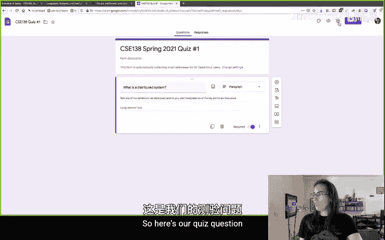
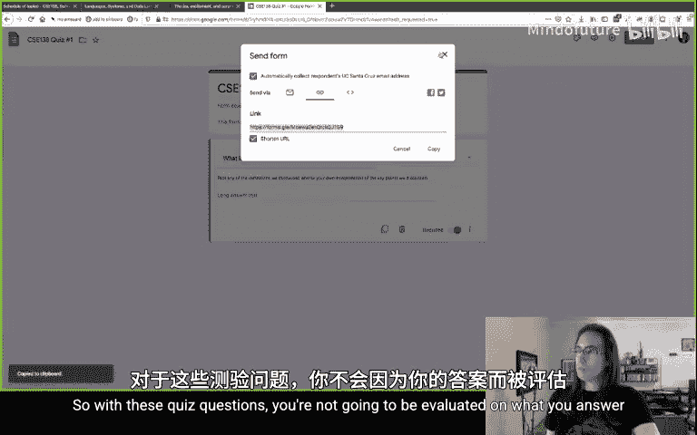
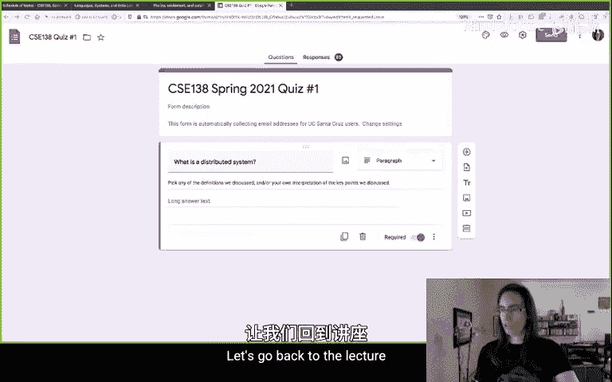

# 分布式系统：CSE138：P01-L1 - 课程介绍与分布式系统初探

在本节课中，我们将学习本课程的基本安排，并初步探讨分布式系统的核心概念、挑战及其存在的意义。

## 课程安排与期望

首先，我们来了解本课程的后勤安排和期望。

### 课程沟通平台

我们将使用 Zulip 作为主要的课程沟通平台，替代 Zoom 聊天功能。Zulip 的聊天记录是持久的，方便大家在课程结束后回顾和提问。

### 课程网站与公开性

课程网站是公开的，包含课程概述、时间表等信息。除了作业是私密的，大部分课程内容，包括讲座和评分标准，都将公开分享。

### 课程团队

我是 Lindsay Cooper 教授，研究方向是编程语言与分布式系统的结合。我们还有两位优秀的助教（AB 和 Patrick）以及四位辅导员（Aria, Matthew, Argin, Vne），他们将负责讨论课、答疑和 Zulip 上的问题解答。

### 课程资源与通知

Zulip 的 “announcements” 频道将发布重要的课程通知，建议你开启该频道的通知。其他频道可根据个人需求设置。

### 特殊需求

如果你有残疾或需要特殊安排，请与我联系。无论是通过残疾资源中心（DRC）的正式渠道，还是直接与我沟通，我都非常乐意帮助你。

## 分布式系统：是什么与为什么

上一节我们介绍了课程的基本安排，本节中我们来看看分布式系统的核心定义及其存在的价值。

### 什么是分布式系统？

分布式系统的一个经典（略带玩笑）定义是：一个分布式系统是指，我无法完成工作，因为某个我从未听说过的计算机发生了故障。这个定义由分布式系统先驱 Leslie Lamport 提出，它揭示了分布式系统的核心挑战：**部分故障**。

一个更正式的定义来自 Martin Kleppman：
*   一个分布式系统运行在多个**节点**上。
*   这些节点通过网络连接。
*   其关键特征是**部分故障**。

**节点**可以是一台计算机，或运行在计算机上的一个软件实例，它们通过网络通信以完成某项任务。**部分故障**意味着系统中的某些部分可能损坏，而其他部分运行正常，并且软件通常无法确切知道哪里出了问题。

### 分布式系统的挑战：不确定性

让我们通过一个最简单的两节点系统（M1 和 M2）来理解分布式系统的挑战。假设 M1 向 M2 发送请求“x 的值是多少？”，并期望得到响应“x=5”。

在这个简单的交互中，许多环节都可能出错：

以下是请求-响应过程中可能出现的故障类型：
1.  **请求丢失**：M1 发出的请求在网络中丢失，从未到达 M2。
2.  **请求延迟**：请求到达 M2 的过程异常缓慢。
3.  **节点故障**：M2 在收到请求后、处理请求前崩溃。
4.  **处理延迟**：M2 处理请求的过程异常缓慢。
5.  **响应丢失**：M2 发出的响应在网络中丢失。
6.  **响应延迟**：响应返回 M1 的过程异常缓慢。
7.  **拜占庭故障**：消息在传输中被篡改，或 M2 恶意行为（如撒谎）。

最关键的问题是：如果 M1 发送请求后没有收到响应，它**无法确定**具体是哪种故障导致了这个问题。这种**不确定性**是分布式系统的根本特征之一。

为了应对无响应，现实系统通常采用**超时重试**机制。但这并非完美方案：
*   如果超时设置过短，可能在响应到达前就错误地判定为失败。
*   如果超时设置过长，会降低系统吞吐量。
*   更重要的是，对于会产生“副作用”的请求（例如“将 x 加 1”），即使请求实际已生效但确认消息丢失，客户端也无法得知操作是否成功。

### 为何需要分布式系统？

既然分布式系统如此复杂且充满挑战，我们为什么还需要它呢？

以下是构建分布式系统的主要动机：
*   **性能/并行性**：通过多台计算机并行处理，可以更快地完成任务。
*   **数据规模**：当数据量超过单台机器的存储或处理能力时，必须使用多台机器。
*   **可靠性/容错性**：通过在多台机器上存储数据的多个副本，即使部分机器故障，数据也不会丢失，服务仍可继续。
*   **地理分布/低延迟**：将数据或服务部署在全球多个地点，可以让用户从地理上最近的节点获取数据，减少延迟。

## 课程结构与项目概述

了解了分布式系统的“为什么”之后，我们来看看本课程将如何帮助你掌握它。

### 评分构成

你的最终成绩将由以下几部分组成：
1.  **调查与课堂测验 (10%)**：包括课程开始/中期调查以及每堂课中的测验（仅要求参与，不评判内容对错）。
2.  **两次考试 (44%)**：期中考试 (20%) 和期末考试 (24%)。
3.  **课程项目 (46%)**：这是本课程的核心，包含 4 个作业。

### 课程项目：构建分布式键值存储

你将与 2-3 名队友组成小组，共同实现一个**分布式、分片、复制的键值存储系统**。

以下是四个作业的简要介绍：
*   **作业 1：Docker 与 Web 服务**：个人完成。学习使用 Docker，并实现一个提供指定 API 的简单 Web 服务。你可以使用任何编程语言和框架。
*   **作业 2：单机键值存储**：实现一个非分布式的简单键值存储。
*   **作业 3：复制**：为键值存储添加复制功能，以提高其容错性。
*   **作业 4：分片**：为键值存储添加分片功能，将数据分布到多个节点上，以提高其可扩展性。

通过这个项目，你将亲身体验设计并实现一个非平凡的分布式系统。

---

本节课中我们一起学习了课程的基本安排，探讨了分布式系统的定义、其固有的不确定性与挑战，以及我们忍受这些复杂性所要追求的目标——性能、规模、可靠性和地理分布。同时，我们也了解了本课程的核心实践部分：通过小组项目构建一个真实的分布式键值存储系统。下节课我们将深入更多分布式系统的核心概念。