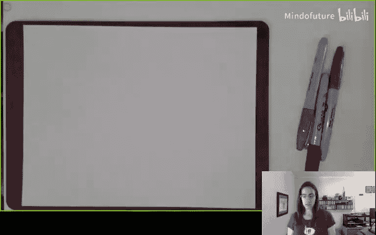
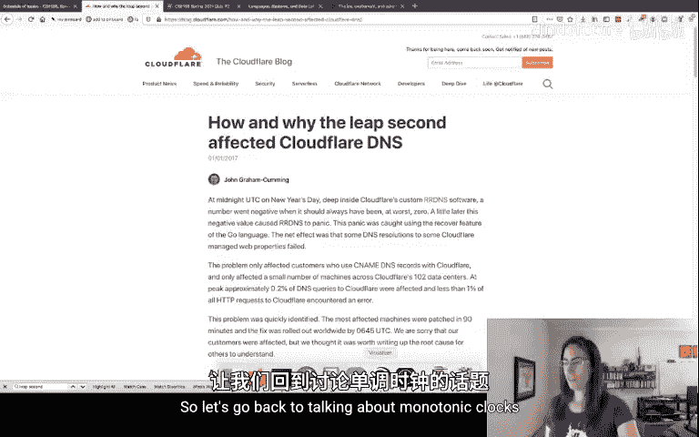
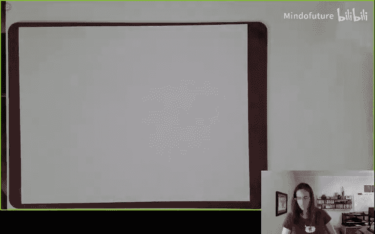
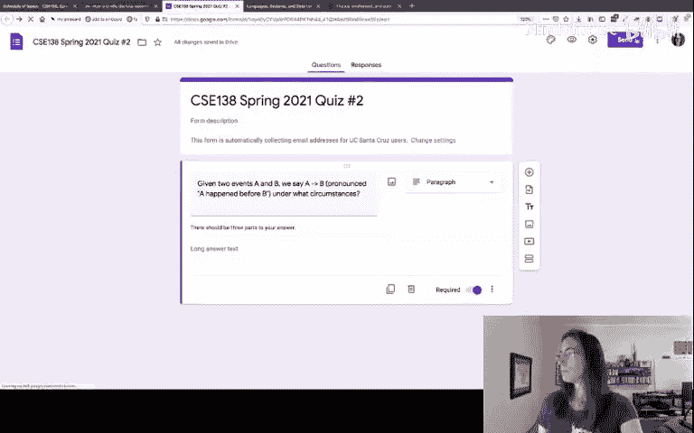
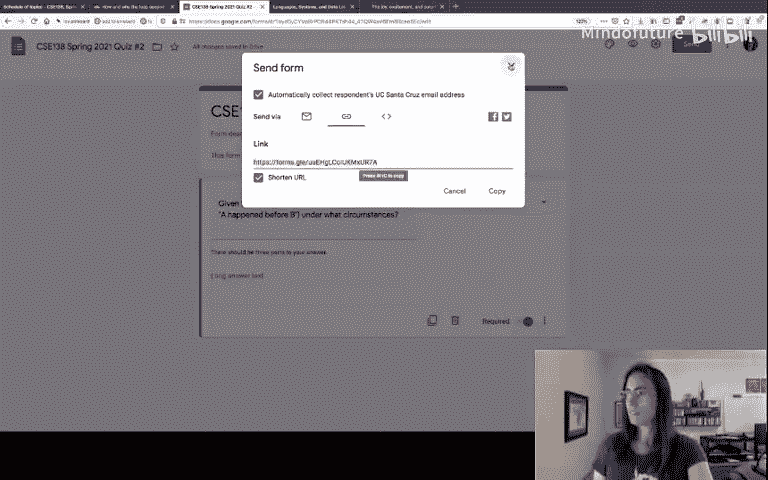
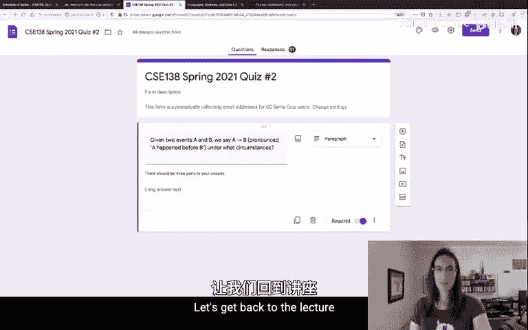
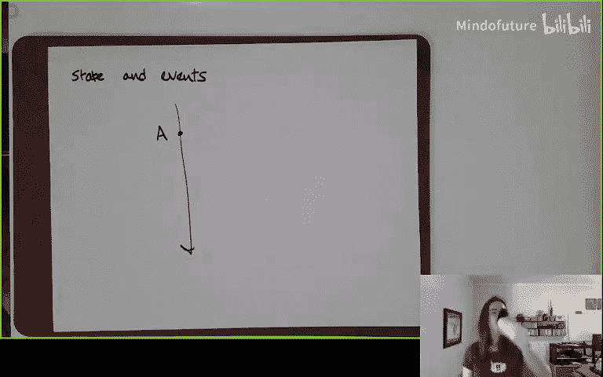
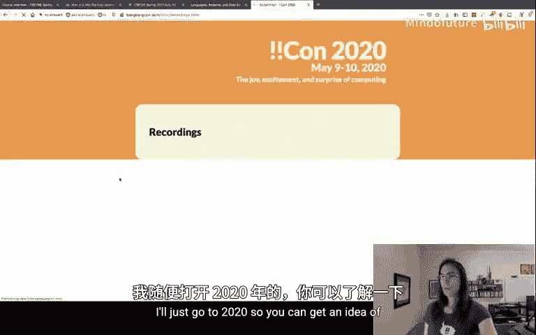

# 【加州大学】分布式系统-CSE138（Distributed-Systems）-p02-P02-L2---time-and-clocks,-causality-and-happens-before,-network-models--BV1eGdLYjETJ_p2-

All right， it looks like we're live。Great， so welcome to day two。Thanks for joining us again。Today。😊。

We're going to talk about。A few things。So here's our agenda for today。

 we're going to talk about time and clocks。Lampport diagrams。Network models。Casality。And。

Happens before。And state。And events。And I'll explain what all this stuff means。

 and if we have time at the end， I'm going to do some announcements。Before we jump into this。

Any questions left over from last time？Oh， I should probably start a lecture stream for today。

 shouldn't I？Oh， somebody else started it when awesome， thank you。Great。😊，Okay。

 questions from last time。Going once， going twice， Oh yeah， go ahead。Sure， please。嗯哼。😊，Twitch。

tv/ Lindsay Cooper。rightLet me write that down here。Yep， you can find all this on Zullip as well。

All right， no other questions， let's jump in。Today， we're going to start by talking about time。

And clocks， and so let me begin by asking you a question。嗯。

What do we use time for when you're writing software？WhatOr let me put it a different way。

 what do you use clocks for， what are some things that you use clocks for in the context of developing software？

Scheduling， okay。So。What do we mean by scheduling？

Somebody has suggested scheduling。Scheduling what？Yeah， assigning start and n times two things。

This class begins at 320 pm Pacific time。So we use clocks to say when something will happen， right。

 so that we all know to be here at this time。So。This class。Starts at three。20 PM PT。

This is one thing we use time for we use it for marking particular points in time。

Or what are some other examples of this？You could say like。This item。In my browser cache。Exples。

On April 1。2021。At 8 PMm PT。For example。So these are marking particular points in time。

Or this error message in the log file。Has a timestamp。Of whatever。

It sounds like somebody needs to mute themselves。All right。

 so these are examples of things that you could use clocks for marking points in time。

WhatWhat else do we use clocks for other than this？Any thoughts？All right， yeah。

 that's very annoying， let me see if I can mut everybody。All right， sorry about that。Yeah。

 so the person you just asked about chat， yeah， we're using chat on Zooollip for everything。

Back to time。So。What else do we use clockX for other than marking points in time？

One other thing that we do is。Durations or intervals of time。So。This class is 95 minutes long。Or。

This request will time out。In five seconds。So you get the idea， so a couple of notions of。

What we use clocks for marking points in time。And then tracking durations or intervals of time。

So these are kind of fundamentally different things and we can use different kinds of clocks to do both of these things。

So computers have a couple of different kinds of clocks。In particular。

They have both what are called time of day clocks。And。Monionic clocks。So time of day o'clock。

Is not so good for measuring things like durations or intervals。

 So time of day clock quite simply tells you what time of day it is。嗯。😊。

It can be synchronized between machines。Using something like。NTP or network time protocol。

 which you can look up if you want to。And I say that it's not so good for measuring durations or intervals of time。

 why would that be the case？Anyone know？Too slow is the suggestion。So。

I'm actually going to say that it's not bad， but it's actually another reason。

The reason why time of day clocks are maybe not so great， so somebody just said。

 possible fluctuation is good。Time of day clocks can actually jump。Forward。Or backward。

This is perhaps a little bit surprising。If you think that time is always going to move forward in a straight line。

Unfortunately， it doesn't， or at least our ways of measuring time with time of day clocks don't give us that。

So。If you've never heard of the notion of a leapse， for example， you might want to go look it up。

 it's kind of interesting and if you want to read about a really fun distributed systems bug。

Look up the Cloudflare Leap second bug from 2016。They did a blog post about it。

 let me bring it up here。So this is a great blog post。

 actually this was published on January 1st 2017， How and why the LeEAPse affected Cloudfled DNS。

So I'm not going to go into all the details here， but this is fun to read if you want to read about a really fun distributed systems bug that amounted to somebody using a time of day clock when they should have been using a monotonic clock。

 so let's go back to talking about monotonic clocks。

A monoonic clock only goes forward。So a monotonic clock actually is pretty good for measuring things like durations or intervals。

But it's not so good for marking particular points in time。Why is that the case？Well。

 the trouble is that。A monotonic clock is only meaningful on a particular machine。

You can try and experiment right now， so try this。In Python。

Run your Python interpreter and do import time。And then call。Time。montonic。

Somebody try this right now and tell me what you get。Okay， so one person got。13。965， something。

 something， something， and somebody else got。Two， three， eight， six six one。

I'm actually a little bit surprised by this one， I'm surprised that it would be such a low number。

All right， so people are getting some different things here。They're all different。

So why do we all have different？Moitonic clock values。

 it's because the value of the monoonic clock isn't comparable。

 it's not it's not comparable between different machines。

 so it's the absolute value of this number is meaningless in terms of trying to do comparisons between machines。

It's just a number that， so for example， in Python。

 I think it's the number of milliseconds since you restarted your machine。嗯。So。

Not comparable between machines。So you shouldn't expect it to agree。So。Of these two kinds of clocks。

 time of day clocks and monotonic clocks。Which do you think are useful in implementing distributed systems？

We can try to figure it out。So。Time of day clocks。And monoonic clocks are the two kinds of physical clocks that we have。

So we can make this little two by two grid here。And then the things that we would want to do with clocks are。

Measuring points in time。And then measuring intervals or durationerations。So what's good for what？

So are time of day clocks good for measuring intervals and durations？What did we just say？No。

 they're not so good for that。Because of what we just said about how time of day clouds can jump forward and backward and if you look at that great。

Sorry about this， if you look at that great Cloudflare blog post that I mentioned。You'll see that。

What happened was that somebody was trying to use a time of day clock in a setting where they really should have been using a monotonic clock。

A clock ended up going backward at a time when the software wasn't expecting it to。

 because we expect monotonic clocks to only move forward。so。

Time of day clocks are really not so good for intervals and durations。Monionic clocks are fine。Okay。

 what about measuring points in time？Can you do that with monotonic clocks？Nope， yeah so。

If we were trying to use monotonic clocks to say what time class starts， that would be unhelpful。

 right， because everybody has their own monotonic clock。Okay。Should I be putting a happy face here？

For time of day clocks and points in time。Do we want to use time of day clocks for marking points in time and distributed systems。

 I would love it if I could put a happy face in this square。Unfortunately， I kind of have to put up。

Face like that。Because as we're about to see。Time of day clicks are okay for measuring points in time。

Only okay。So。Monetonic clocks are great for implementing distributed systems why because we can use them to implement timeouts like we talked about last time and timeouts are something that we often need。

 but they're not so good for comparing between machines Why are time of day clocks not。

Useful for points in time。Well， I think we can explain it very straightforwardly。

So let's say we have two machines。And， let's say that they both。Currently think that x is5。

And I'll draw some lines here representing the passage of time on these two machines。

So let's say that M1 thinks that this is 3 pm。No。Maybe M1 and M2 are synchronized over andTP。

 if that's the case， then their clocks are probably pretty close to being in sync。

 but not necessarily perfectly in sync， so maybe M2 thinks that 3 pm is right here。Well。

Let's say that M1 sends M2 a message。To increx。So that increment， let's say， takes place here。

 and now x is6。Let's say that these machines are supposed to take a snapshot of what they're doing at 3 pm。

Well。E one' snapshot looks like this。M2s snapshot looks like this。

We go and compare the snapshotts later on。M2's snapshot says that x is6。

Why does it say that x is6 because， well， it says， I got this message before 3 pm from M1 that told me to increment X。

 so I did。Meanwhile， M1 is over here。That never happened。And one didn't know about it。So。

Depending on what happens during this interval。We could get in a lot of trouble by using time of day clocks for marking points in time in distributed systems。

So。The trouble is that the timestamps don't agree with the order in which these events actually occurred。

 and this could cause all kinds of problems in real systems。

 even causing database rights to be dropped and stuff like that。

 so time of day clocks aren't so useful for measuring or marking points in time in a distributed system。

Some systems do it anyway。So this column's looking pretty bad， right？

We know monoatonic clocks aren't good for this purpose， and time of day clocks are merely okay。

So somebody just asked in chat， whyhy is 3 pm different for the two different machines in time of day clocks well？

It's because even if we're using something to synchronize clocks like NTP。

 it can't necessarily be perfect， right so machines are going to disagree。

Now I want to push back on something that somebody just said in chat which mentioned time zones。

 So this isn't necessarily this isn't about time zones。

 all these let's say all these machines are using UTC。 So the issue isn't time zones。

 that's certainly an issue with distributed systems of humans who are trying to rendezvous at a particular time。

 but with these computers， we can assume they're all using UTC。 So time zones are not the issue here。

 The issue is that these machines clocks aren't perfectly synchronized。 and we cannot。

 no matter what we do， we can't get them to be perfectly synchronized。

So really the issue here is that we're trying to use physical clocks。

 so both time of day clocks and monottonic clocks are what are known as physical clocks。

And in this course， we're going to be talking about how to throw this out and use a radically different notion of a clock called a logical clock。

So we're not going to be measuring time of day， and we're not going to be measuring intervals of time either。

Instead。We're only going to be measuring。The order of events。

We'll be discussing this idea quite a lot this quarter。So a fundamental question。

When talking about ordering of events is what event happened before another event？

So let's say that we have two events。A and B。And they could be anything at all。

Maybe there are rights to a database， but they could really be anything。

And let's suppose that I know that event A happened before event V。

Let's introduce a little bit of notation for this， we'll write AarrowO B。And this is pronounced。

A happened before B。Okay。If I know that A happened before B。How is it useful。

 what can I do with that information， What do you think？By the way， a minute ago。

 somebody said they were on Twitch and they couldn't hear the student talking。

 that's actually intentional so。I'm not streaming our Zoom meeting to Twitch。

 I'm just streaming myself to Twitch and that's on purpose because I don't want to compromise anybody's privacy by putting their video and audio on the Twitch stream。

 so the Twitch stream is just me。All right。Yeah， so what does it tell me that A happened before B。

 in particular， what does that tell me about what caused what or what might have caused what？Good。

 okay， somebody just said。A could have caused B。Do we know for sure that A Coast B， no？

Absolutely not， but it might have。And somebody else just added。B could not have caused A。Good。

So this notion of causality， in this case that A could have caused B。

 but B could not have caused a is very important in distributed systems， why。

 why is this so important， how does it help us？What do you think？Yeah。

 so somebody said we know the sequence of events yeah。

 so how is that useful information Well one way could help us is debugging right。

 let's say that I'm looking at my distributed system and I have some sort of bug like one machine thinks that x is5 and the other machine thinks that x is 6。

Well， it's helpful at that point to be able to look back at all the events that have occurred and try to figure out what may have caused x to be6 or what caused x to be 5。

So in particular， like if we look back at this picture here。

These time of date clocks weren't all that helpful to us， right？But。

If we can figure out that it was this increment here。That caused x to B 6 over here。

 And we know that that happened before。This。In the of this logical in the sense of logical clocks。

 in the sense of that happened before relation。Then that's useful information。

 it helps us understand what happens。So this notion of H before isn't going to answer all our questions。

 but it will at least let us rule out some things that definitely didn't cause a bug。

It's also useful for designing systems in the first place。

 even before you get to the stage of debugging， because if you can design a system。

In such a way that if you know that an event A happened before an event B。

Then you can design the system in a way that will never allow users to see event B before they see event A。

 and we'll talk more about that soon。ok。So this is one of the most important concepts in this course。

And what we want to do is。Because time is going to be so important and the order of events is going to be so important。

 we want to introduce a sort of visual language for talking about what happened before what。

And if you think about those figures that I was drawing in lecture last time that looked like this。

The trouble with that kind of a picture is that coming back and looking at it now。

I can't tell what happened before what， right？ I don't know which of these messages came first and which of these messages came second so。

Instead of drawing pictures that way， we're going to introduce a new sort of visual language for talking about the execution of a distributed system that will let us talk about T。

So for that， we're going to use。What are known as Lamport diagrams？

These are also known as spacetime diagrams。If you want an especially cool sounding name。In fact。

 we already did see a Laport diagram a second ago when I was drawing arrows。So。

This visual language for talking about time is very simple。The idea is that a process。Is a line。

It's got a discrete beginning and it goes on forever。So this is a process。

Events are dots on the line。Let's say that this process represents machine one。

So we'll give some names to these events here。If I pick two dots on this line， let's say x and z。

Could X have caused Z？Sure。Yeah。😊，Could Z have caused x？No。Did X Kzy， well， maybe。We don't know。

So given any event， all I have to do to find its cause or its possible cause is to look before it on the line。

If I want to know why an event happened。Something above it was responsible。So in this case。

 y also happened before Z？And X happened before y。But it actually gets more complicated than this。

 right， because we don't have just one machine， we have multiple machines in a distributed system。

And because these machines。Don't share memory and can't read each other's minds。

They have to communicate with each other by sending and receiving messages。

 so let's add a couple of more machines to this picture。So now we have three machines。

And let's add some messages。So maybe M2 has a。Message that it sends。To M1。Maybe M1 sends 1 to M0。

Maybe M1 also sends wind to M2。And message sends and receives are also events。In fact。

 they're very important kinds of events。Given this picture is a guide。

Let's try to come up with a general definition for when one event happens before another。

We already talked about part of it， right， so we know that。X happened before Z。

Because they're here on the same process line and x is higher up on the line。

 so that's the first part of the definition。So given any two events。We say。A happened before B。Yes。

Any of the following are true。So if A and B occur on the same process line。there's more。

Anybody want to try to guess the next part of the definition？I'll give you a hint。

 it has to do with these messages being sent and received。HSomebody just asked in chat。

 so do the different processes have different space times。

 I'm not exactly sure I know what that means。Well。Let's see。Let's call this event P right here。

Let's call this 1S。So if P is when you send a message。And S is when you receive a message。

Receiving a message has to come。After it was sent， right， it couldn't possibly be before。

Has to be after。So。We can also say A happened before B if。诶。Is a send event。

And B is the corresponding receive event。So P happens before S here。

There's one more part to this definition。Can anybody guess what it might be？I'll give you a hint。

What if we want to talk about it happens before relationship between P？And Z。Can we do that？

Transitivity， good。So the last part of the definition is。Let's say that we have some other event。

Call it C。So if A happens before C， some event C， and C happens before B。

 then we can say that A happens before B， what this last part of the definition does。

Is it makes this happens before relation transitive。

 What that means is that I can put together these first two parts of the definition。 So， for example。

We know that P happens before S because P is a message send and S is the corresponding receive。

 We know that S happens before y， because they're on the same process line here with S。First。

We know that Y happens before Z because again， they're on the same process line and plugging all those all together。

Using this transitivity property。We can see that P happens before Z。

So that's the definition of the happens before relation。Later on。

 we're going to talk about how to compute what's in the happens before Re so that if we have some event。

Then we can figure out what events happened before it and the cause of that event must be somewhere in the events that happened before。

So somebody just askedCan an event be a send event or a receive event or both， so great question。

Here we have some events that are like this one here， P for example。

 is a send event and S is a receive event， these ones here like X， Y and Z。These are neither。

 so I would call these internal events。So those are still events。

 but there are neither sends nor receives， they're events that are internal to this process and what。

And an event couldn't be both ascend and receive， and it would have to be one or the other。Okay。

So now that we've introduced this notion of H before。Let let me show you a classic Laport diagram。

It involves some strong language。So let's say that we have Alice， Bob and Carol。

Let's say that Alice sends a message。To Bob and Carol。And El says。Bob smells。Alright。Well。

 Bob gets this message， right？And he can't let this stand， so Bob has to respond to this。

So Bob responds with。Fuck you， El。Now the question here is。What does Carol think， right？

Carol is receiving this very rude message from Bob。What do you think Carol is thinking at this point？

Carol has not yet seen this earlier message that prompted the comment from Alice or the comment from Bob rather。

Now， Carol's probably a little bit confused at this point。This is what's known as a causal。Anomaly。

Generally speaking， anomalies are things that make you gohuh。

 and Carol is certainly sayinghu in this case。So we're going to talk about how we can use the concept of happens before to rule out anomalies like this。

By the way。Why did this Bob smells message take so long to get to Carol over here？Sure。

 Alice could be far away， it could be any number of reasons which we talked about last time a message could just be slow。

 right， recall it we talked about how a distributed system experiences unbounded latency。

And if we're not careful in designing our systems， then latency will lead to bugs， actually。

It's probably going to lead to bugs no matter what。

 but certain problems are going to be solvable in this setting of unbounded latency。

Let me back up a second somebody asked another question about the。Previous drawing I did。诶。Yes。

 so somebody thought why would both ascend and receive event。 No。

 it's actually neither it's an internal event。 So P is ascend。 S is a receive X， Y。

 Z are in internal events， these ones I didn't give names to。

 but these two are sends and these two are receives。

Feel free to ask more questions if that didn't make sense。Okay， so。Moving on from there。

This concept of unbounded latency is going to cause a lot of problems if we're not careful。

 and that brings us to talking about network models。It would really make life easy。

 We talked about this a little bit last time if we knew that there was some fixed amount of time that it took for a message to get from Alice to its intended recipient。

 right？If we had that kind of a network。Then it would be called a synchronous network。

And synchronous networks do exist， but they aren't the kind that we're going to be spending most of our time on in this course。

 I'm going to define it anyway just so that we have a definition。

 but then we won't spend much more time talking about it so to be precise a synchronous network。

Is one where。There exists。And。Some N。Where n is in units of time。Such that。No message。Takes longer。

Then N。Units of time to be delivered。That's what a synchronous network is。Let us speak no more。

Of the synchronous network model。What other network model is there？An asynchronous network。

What do you think an asynchronous network is？Unbounded latency， good yeah。

Specifically in an asynchronous network。Is one where？There exists。No N。Such that。

No message takes longer。T end units of time。You get the idea， it's the same as above。

So we're going to be spending most of our time in this class talking about。

The asynchronous network model。Not because it makes our life easy， because it certainly doesn't。

 but because this is the more realistic approach。So。

If I were going to ask you to implement a protocol。

And youd need to pick a network model to work with。

What network model are you going to pick to make sure that the protocol that you're implementing is robust？

And I'm using this word protocol by that I just mean。

A of rules that computers use to communicate with each other。

So if you want to make sure to implement a robust protocol。

You're going to pick the network model that is the least forgiven。Right。

Because you want to try to make sure that your protocol works even under the worst conditions。

So you're going to pick the asynchronous network model。And so in this course。

 we're going to be spending most of our time focusing on the asynchronous network model and not making any assumptions about this sort of maximum latency of messages that we would get in a synchronous network。

There's also something if you want to go look it up on your own。

 there are so called partiallyynchronous networks。And there are different ways of defining partially synchronous。

 but one way of defining a partially synchronous network is。There is some end。

Such that no message takes longer than n units of time to be delivered。

 but you don't know what it is， you don't get to know in advance what that n is。So。

That turns out to be a useful notion， especially for certain kinds of verification tasks。嗯。

But we're not going to be talking about that very much in this course。

 it's something that you can check out on your own if you're interested。All right。So。

I want to pause at this point and take our 10 minute break。Any questions before we have a pause？

All right， one person asked， why， why are we not speaking about the synchronous network model， yeah。

 I know， wouldn't it make our lives nice if we could unfortunately。

 you know the internet should not be thought of as a synchronous network。So well。

 we want things to work on the Internet， right， so we have to use and the thing is。In practice。

 sometimes you can pick an N that makes sense most of the time。

But if you want to implement protocols that are always going to do what you say they do。

Then it makes a lot of sense to use this less forgiving network model。

That will force you to design the protocol in such a way that。

It will be robust too this unbounded message latency。All right， with that。

 let's take our break and I'll put up today's quiz question。

All right， I've posted the link。In chat。

Go ahead and take a stab at the quiz and I'll start our 10 minute timer。

And be sure to stretch your legs and get your eyes away from the screen for a minute。

 and I'll see you back here at 421。All right， the 10 minute timer just went off for me。

Looks like just about everybody answered the quiz， so that's great。Let's get back to the lecture。

Okay so。The quiz question was about that happens before relation， let's recap。

The definition of the happens before Re。So we'll talk about two events， A and B。So。If a。

And we occur on the same process。With A before B。Then A happens B B。So that would be like this。

 right？If you have a Laport diagram consisting of。A process and you have a couple of dots on that process line and A is higher up than B then you know that A happens before B。

 By the way， the way that I always draw Laport diagrams is to have time going down like this。

 but you'll see people do it in all kinds of different styles， sometimes you'll have。

Time going this way or that way or even up。But this is how I always draw them every time I draw a Laport diagram in this class。

 time will be moving downward。So that's the first part of the definition。

Somebody tell me what the second part is。That's right。

 those are two internal events on this particular line。

So sending and receiving are things that happen between。Processes， right？

So if you have something like this。If this is A and this is B。

So A is aend event and B is the corresponding receive event。Then we know A happens before B。

And then what's the last part of the definition？I think there's a little bit of confusion in the chat right now because when people were saying A is a send event and B is a receive event。

 I think they were giving the second piece of the definition here。

 they weren't talking about this A and B up here。Right。

The last part is if you have some other event C。Such that you know A happens before C and C happens before B。

Then you know that A happens before B。And that's what lets you tie together all this with transitivity so you could have something like this。

Where you could have A happening before C because A is acend and C is a receive。

And then maybe B is this other event down here。Well。

 then we know that A happens before B also because we can put together these two happens before relationships between A and C and C and B to get that A happens before B。

So。Let's go back to the picture that we were showing a minute ago。It had a bunch more events on it。

So if I pick two events here。Lets let me actually give some more names to some of these events。

So what names have I not used here yet， let's have this be。Q R。

So we already talked about some pairs of events and how they're related， right。

 we talked about how x and Z are related。 So we talked about that。

 we talked about how Y and Z are related。X and Y。PNS。How about。R and Z are those events related？

By the happens before Re？No。They're not， so it's not the case that。R happens before Z。

And it's also not the case that Z happens before R。So。Sorry， R here。

So we can write a little not happens before like this。When this is the case for two events。

We say that they're concurrent。And there are several more pairs of concurrent events in this picture。

 what's another pair of concurrent events？P and X， good， yeah。

So we can't say anything about whether P， we can't say that P happened before x。

We can't say that X happened before P。Because they're on different machines， right。

 and these machines don't share a clock。So。Even though we've drawn this picture like time going downward like this。

 and you might think that x is a little bit below P， right if we're looking at this。

A horizontalal axis like this。That doesn't actually mean anything in terms of determining what happened before what。

 because there isn't some common notion of time across all these processes。

 So we cannot say that P happened before X， nor can we say that X happened before P。

 They're concurrent。So we'll talk about this a little bit more next time and we'll get into a little bit of the math。

But that's the happens before relation。And this is going to be something we spend a lot of time talking about in this course。

So theres something else on my agenda， which was to talk about state and events。So。

Oh before I do that， somebody just asked somebody asked， so these are three monotonic clocks。

 interesting questions。We talked about monotonic clocks and we talked about time of day clocks。

 but those are both physical clocks。So when you call time。monttic， for example， in Python。

 that's telling you something like the number of milliseconds since you last restarted your machine。

 but it's still a notion of physical time， it's still a notion of milliseconds or seconds so that's not the notion of time that we're dealing with here。

 we're just dealing with this happens before relationship between events and starting next time we're going to be working with we're going to be defining a mechanism that's a logical clock that that will let you。

Determine。The happens before ordering of events so what I've done here is given a definition for this happens before relation。

 but I haven't yet told you how to compute the happens before relation if I give you a whole bunch of events I haven't told you how to compute。

What happens before what， and so next time we're going to be talking about logical clocks and that will let you actually determine how to figure out what happens before what。

Okay。So let's talk about state and events。So。We already kind of talked about events， right。

 like a dot on a lampport diagram is an event。But what about state， we haven't talked about that yet。

So。What is a state， like when you study computer architecture， for example。

 what do you think would be included if I talk about the state of a machine？

Well， think back to the picture that I do on day one of class， right？

Where we had M1 asking them two questions。Well， we said M2 knew that x was5， right？Oh good。

 so people are asking some are giving some good answers to your， so the question was what is a state。

 what do we mean when we talk about the state of a machine？So this right here。

 saying that x is 5 is part of state， right， it's something that this machine knows。

 so state could be like the contents of memory or the contents of registers and so on。

But in this world of distributed systems where we just have events that are occurring on a timeline like this。

 how do we talk about state？Well， I am going to argue that。A dot on these diagrams is also a state。

So maybe you know， this is M2。And it knows that x is 5。How did it know that x was5？

I'm going to argue that。Whatever the contents of this computer's memory are at a certain point。

It's completely determined by all the events that have happened up until then。So。

Maybe there's another event here that happens to be a message being received， right？

Maybe M1 is over here。Maybe M' sent a message that said。To set x to5。In this case， x already was5。

But maybe it sends another message later。So we'll give some names to these events。

 let's say these are events， A B and C， all of these these messages here， I don't know what A was。

 maybe it was some sort of an internal event doesn't really matter， but the point is。

The contents of this machine's memory， in this case， the value of x。

Is completely determined by all of the events that have happened up until then。

So we can always work out what state we're in。By looking back at the sequence of events。

So if we were to lassso up all these events that have occurred on M2。

And kind of look at them out of context。We didn't say what A was， maybe A was。呃。

Maybe A was it doesn't really matter。So A， I don't know what it was， B was。Set x to five。

C was set x to6。We can look at those events in some sort of a log。And replay them。And at the end。

 we'll know that x was6， right， so we can always work out。

What state we're supposed to be in by looking back at the events that have happened？

Can we do the reverse like if I just told you this， if I just told you that x was6。

 do you know the sequence of events that led to that？No。

 because there are a lot of different ways that you could have gotten to this state where X is6。

And we have limited resources， right， so in practice。

 we probably aren't going to keep a log of everything that happened ever。

So with the limited resources that we have， no， we probably cannot reconstruct all the events that have ever occurred just given。

The state that we're in now。 However， if we have the events， we can get the state， so。

It's kind of nice to be able to keep that log around for as long as we can， right。

 assuming that you have enough resources to be able to do so， because if you need the state。

 you can always get it from that sequence of events。But if all you have is the state。

Then you can't reconstruct the sequence of events from that。

So somebody just asked do events cause changes in state well yeah。

 so these are events that indeed cause this event happened to cause a change in state Now some events wouldn't cause a change in state right if you receive a message but all it does is ask the value of x。

 then that doesn't give you a state change although。If you wanted to。

 you could log that event right and then it would be a change in the state of the log， I suppose。

 but some events are going to make a meaningful state change and others aren't。So。

And that kind of gets back to this concept of when you know what the state is。

 you don't know what sequence of events might have led to that if we're in this state where x is6。

Then we don't know if the sequence of events that have happened would be were like， you know。

 one process sending us a message that set the state to six and then  a thousand messages being received that were just queries about the value of x。

Or if there were a sequence of events that were alternating。

 setting x to  six and five and six and  five and six and five。

 and then at the moment that we happened to look at the state， it happened to be six。

 so we can't tell what that history is just from looking at the state in the given moment。Yeah。

 so the question just asked in chat was， is the only thing in the state is the value of x？嗯。

For this one， yeah， I mean that's all that's all the state that I'm talking about here if this were key value store。

 then you would probably have more key value pairs that you cared about right you might also have a value of Y and so forth。

When we draw these Laport diagrams， so if we were being really。

 really disciplined about how we drew Laport diagrams。

 they would consist only of processes and events and messages， and that would be it。

But some of the time we're going to cheat and we're going to write down little pieces of state like this。

Like this， right， this piece of state here is something that I wrote down。

Extraneous to the rest of this Laport diagram。But I'm going to argue that it's sort of a shorthand for events that could have occurred。

 either because somebody else sent us messages earlier。

 either some series of events occurred that led to X being。Set to five。

 whether because they were messages that receive， or some sort of eternal events occurred that set x to 5。

 maybe there was an internal event when M2 started up that said have x be 5 from the beginning。

So we're going to cheat a little bit in some of the lampport diagrams that we draw in this course by writing little pieces of state like this。

 but I just want you to know that if you wanted to。

 you could boil everything down to events and you could write down all of the individual events that led to that state。

 so this is cheating， but I think it's a legal way of cheating because if you wanted to。

 you could fill in the events that led to that state。All right。😊。

So somebody just asked a good question in chat， they said。

 would we be able to reconstruct the series of events that led to the current state if we knew that one and only one event could lead to that state well okay so。

Yeah， I suppose so， but also there could have been events that never had any effect right so like we said。

 if in this case if there were some queries in the value of x。

 then those might never have been logged right。Do you care that those occurred well maybe you don't care if all you care about is what the value of x is。

 but maybe you care about the queries that are occurring if you want to know how heavy the load on M2 is so you know whether you need another machine。

So。I guess it depends what context you're in。What kind of events you care about？All right。

 I think that's it for course content for today， I want to spend the rest of the time talking about some course business and announcements。

So。Let's switch to。The course overview for a minute。

This is something that I am kind of uns to talk about， my least favorite topic。Academic integrity。

So actually， I'm going to talk about academic integrity on assignments first because this is kind of the more immediately relevant topic because our first assignment comes out tomorrow。

一。So。In this course。We want you to discuss your work with others， right？But。

Everything that you turn in has to be your own work。So if it's assignment one。

 it has to be your own independent work， assignment  one is not done in a team。

If it's assignments two through four， then it has to be the independent work of your team。

If you do otherwise。You will fail the course， so you can ask for advice from the TAs and tutors and me and your classmates。

 but you can't copy from anyone else。So。We are asking you to document the process that you used to carry out the assignments as follows。

And this is going to be covered in the assignment description too。

 and also this is all on the course website so you can go read it。

 but here's what we're asking you to do。When you turn in your assignment。

 there is going to be a read me file that we ask you to include。

 and you have to include the following sections。Once you're working with a team。

 you have to include a section called Team Con， and this is going to list every member of your team and what they did on the assignment。

So hopefully every member of your team is in agreement about who did what by the time you turned in your assignment。

You don't have to do this for assignment one because assignment one is going to be done on your own。

But for assignments， two through four。You have to list what every member of the team。

 who every member of the team is and how they contributed to the assignment。

We're asking you to put an acknowledgement section that's going to list the people that you discussed the assignment with and you got help from。

So aside from keeping you honest， this is also just the polite thing to do right you want to acknowledge the people who you got help from so list every person that you talk to and the concept that they help with and this includes core staff if you talk to core staff or people on chat or so on。

And then finally， there's going to be a section that we asked for called citations。

 and this is for citing sources that you used， so for anything that you need to look up。

 we're asking you to document where you looked it up。

So the policy that we're adopting in this course is something that Professor Ethan Miller suggested and it's that。

Copying but citing， if you copy something but you cite it， that's not considered academic misconduct。

If you copy something from Stack Overflow and you cite it， then。

You may get less credit for that right In fact， if you copy everything。

 you won't get any credit for it， and that's what the course staff is here to decide。

 You won't get any credit for somebody else's code， but。But if you cite it。

 then that's not considered cheating。So we really don't want to nail you for cheating。

So you know cite your work and that's the way to avoid running a foulul of any accusations of misconduct。

 we don't want to accuse you of misconduct and you don't want to get accused of misconduct。

 so that's going to be the policy in this course。And if you want to read this and understand it in more detail。

 everything that I just said is on the course overview page on the course website。

 it's also going to be included in the assignment description case you in case you need。

To review it again。But hopefully the policy is pretty straightforward。

And then when we get to a little bit closer to exams。

 then we'll talk about academic integrity on exams and so on。

 I don't think I need to talk about that right now。Like I said， this is my least favorite topic。

I really hate that this is an issue and I think most of you also hate that this is an issue and you would rather not be spending time on this unfortunately we have to I had a couple of cases of academic integrity that I had to pursue in this class last year and I would really rather not do that again so。

Make life easy for us， make it so that I don't have to do the thing that I hate doing and pursue these violations of academic integrity by just citing everything that you use。

 anything that you have to look up， document where you looked it up， anybody that you talk to。

 say who you talk to if you do that you'll be in good shape。All right。With that over with。

 I'm going to talk about something that's much， much， much more pleasant。So。I want to share with you。

So my research group here at UC Santa Cruz is called the Languages Systems and Data Lab or the LSD Lab for short。

 we have a website， it is lsd。ucsc。edu。And this is our website so I'm sharing this with you because if you want to know anything about my research or what I do。

 you can find my webpage linked from here and you can also find the stuff that my colleagues do so the languages systems and data lab is not just me it's a collection of students and faculty who are working in the areas of programming languages。

 systems and databases and the intersection of those research traditions so if that sounds interesting to you then I urge you to go check out our website and see what we're up to and in particular I want to point you to the languages systems and data seminar so this is a weekly meeting。

Where we meet to discuss。Interesting topics in the areas of programming languages。

 systems and databases and topics related to that， so bridging into formal methods and verification and security and beyond。

So the goal of this seminar is to encourage interactions and discussions between people in these areas。

 we have a lot of external as well as internal speakers and you can get course credit for it so there's a two credit course we meet every Friday at noon for an hour and 15 minutes and if you're interested you should let me know because is it's an easy way to get to pass fail credits and it's fun it also another thing about these meetings is that we always start with 15 minutes of social time so you'll get a chance to to talk with students and faculty and especially grad students who are in the LSD lab and and learn about who they are and what they do and if you're an undergrad you won't be the only undergrad there we have a lot of undergrads who join us and we'd love to have more。

So in particular， the next talk on our schedule is going to be Alrin Montana。

 who's a grad student that works with Peter Uvaro and he's going to be speaking on Friday。

If this sounds like fun to you， then let me know and I'll make sure that you get the information。

 we also have a mailing list that you can request to join。

And this by the way is open to anybody in the world so you don't have to be an enrolled UCSC student in order to attend these talks。

 so if you're not a student， you can join this mailing list called UCSC LSD seminar notes and this is for anyone in the world if you sign up for that mailing list you'll get the talk invitations for people who are at UCSC we have an internal mailing list as well。

So。If you're interested please check that out， we would love to see you there it's lots of fun and if you register for the course credit it's a very kind of low effort way to get a couple of credits that you really don't have to do anything other than attend the talks。

All right， I have another thing to discuss let's see in the five minutes that we have left and this is something that I'm if possible even more excited about。

 so I happen to be the organizer of a conference of Lightning talks about the Jo excitement and surprise of computing and this is called B bangang con so we pronounce the name of this conference Bang Bang Con it's written with two exclamation points and as you see I' am wearing my B Bang Con shirt today。

So Bing Bing K is a conference that consists exclusively of lightning talks that are 10 minutes long about any computing related topic that brings people to and joy。

And。It's happening this May， the week of May 15th through 22nd。

 and our call for talk proposals is open。So。If you think that you might like to give a 10 minute talk。

About any computing related topic that brings you joy。Then go to Bangbangcon。

com and I will also share this link in chat。And look at our call for talk proposals。

 so the call for proposals is open now for another week， it's open until April 8th。

And you can submit a talk proposal about。Literally any computing topic that is interesting。

 and our requirement is that there has to be at least one exclamation point in the title of your talk。

So if you look a little bit at like what we've done historically it's been all over the map so there have been talks about games。

 there have been talks about kind of classic retrocomp there have been talks about interesting mathematical concepts that intersect with computing。

 there have been computational art projects， it's awesome so when you go to this website you can also see all of our past talk recordings。

 we've been doing this， this is the eighth year that we've been doing this so we have a lot of past talks I'll just go to 2020 so you can get an idea of like some of the titles of talks that people have given in the past notice that all of them have an exclamation point in their name so this is what we do right we ask people to come and talk for 10 minutes about anything that brings them delight that has to do with computing。

And I think it's incredibly fun， so I'm sharing this with you because。For one thing。

 I think that some of you might have talk proposals that you should submit。

 and if so then spend a little time thinking about it and look at our call for proposals。

The other reason I'm sharing it with you is because I hope that you'll attend。

 So this is going to be a pay what you want conference， meaning that。

We're going to have a suggested donation but you can also attend for free if you want to so there's not going to be any sort of expensive registration fee instead you can pay whatever you afford including nothing so it should be accessible to students and everyone and it's going to be happening in midMa so I'll advertise when when registration opens up that hasn't happened yet because we're still at the point of collecting talk proposals and selecting a program but。

I hope that some of you will consider applying or attending。All right。That's it for today。

And the first assignment is going to be posted tomorrow。

So if you have questions about the first assignment after it comes out。

 I hope you'll be asking them on Zullip， also sections are happening on Monday and sections are a great place to go if you have questions about the homework。

See you next week。