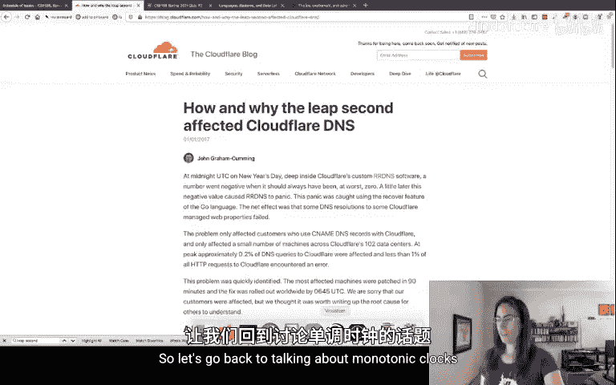
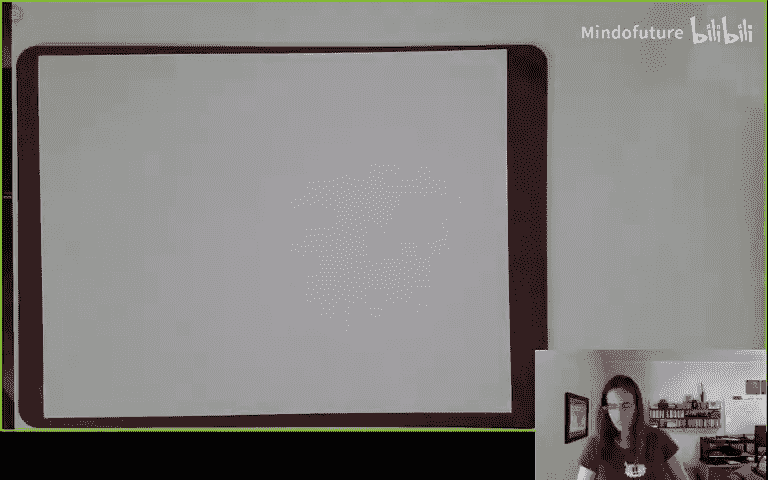
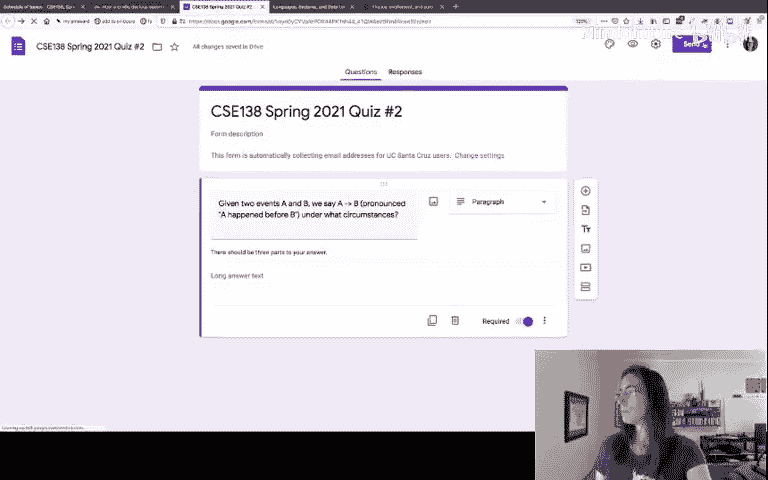
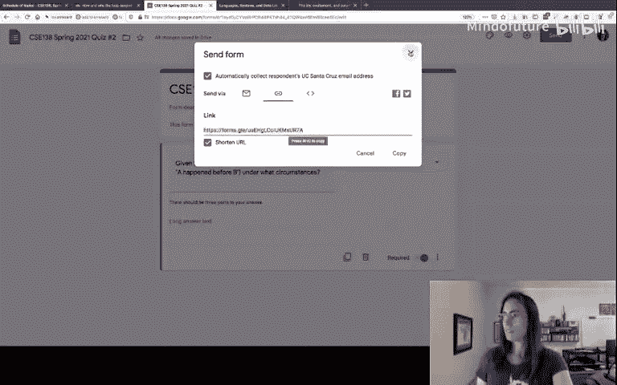
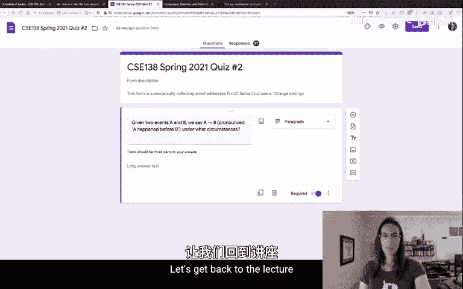
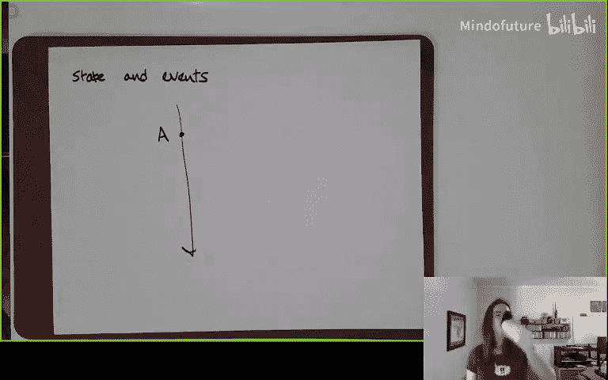

# 分布式系统：P02：时间、时钟与因果关系 🕰️

在本节课中，我们将要学习分布式系统中关于时间、时钟和事件顺序的核心概念。我们将探讨物理时钟的局限性，并引入逻辑时钟和“happens-before”关系来理解系统中的因果关系。

## 时间与时钟

在软件开发中，我们使用时钟主要有两个目的：
1.  **标记特定的时间点**。例如，本课程在太平洋时间下午3:20开始。
2.  **测量时间间隔或持续时间**。例如，本课程时长为95分钟。

计算机通常有两种物理时钟：
*   **墙上时钟**：告诉你当前的时间（例如，通过NTP同步）。它可能向前或向后跳变（例如闰秒），因此不适合精确测量时间间隔。
*   **单调时钟**：只向前移动，适合测量时间间隔（例如，实现超时机制）。但其数值在不同机器间没有可比性，因此不适合标记时间点。

在分布式系统中，使用物理时钟（无论是墙上时钟还是单调时钟）来标记事件发生的**绝对时间点**并不可靠，因为不同机器的时钟无法完美同步。

## 逻辑时钟与“Happens-Before”关系

由于物理时钟的局限性，在分布式系统理论中，我们转而使用**逻辑时钟**。逻辑时钟不测量具体时间，只关心事件的**先后顺序**。

核心问题是：如何定义事件A发生在事件B之前？

我们引入 **`A → B`** （读作“A happens before B”）关系。以下是其定义，满足以下任一条件即可认为 `A → B`：
1.  **同一进程内**：如果事件A和B发生在同一个进程上，并且A在B之前执行。
2.  **消息发送与接收**：如果事件A是发送一条消息，事件B是接收同一条消息。
3.  **传递性**：如果存在某个事件C，使得 `A → C` 且 `C → B`，那么 `A → B`。

这个关系帮助我们理解系统中的**因果关系**：如果 `A → B`，那么A可能导致了B，但B绝不可能导致A。

## Lamport图（时空图）

为了直观地展示分布式系统中进程、事件和消息，我们使用**Lamport图**（也称时空图）。

*   **进程**：用一条垂直线表示。
*   **事件**：用进程线上的一个点表示。事件可以是内部计算、发送消息或接收消息。
*   **消息**：用从发送事件指向接收事件的箭头表示。

在Lamport图中，时间默认向下流动。根据“happens-before”的定义，我们可以分析图中任意两个事件的关系。

如果两个事件既不满足 `A → B`，也不满足 `B → A`，则称它们是**并发**的。

## 网络模型

消息传递的延迟特性直接影响系统设计。我们主要讨论两种网络模型：

1.  **同步网络模型**：存在一个已知的时间上限N，任何消息的传递延迟都不会超过N。
    *   **公式**：`∃N, ∀消息, 传递时间 ≤ N`
2.  **异步网络模型**：消息传递延迟没有上限，可能任意长。
    *   **公式**：`¬∃N, ∀消息, 传递时间 ≤ N` （即不存在这样的N）

虽然同步模型让问题更简单，但**异步模型更符合互联网等现实网络**。为了使协议更健壮，我们通常基于更严苛的异步模型进行设计。

## 状态与事件

在Lamport图的视角下：
*   **事件**是图中基本的点（发送、接收、内部事件）。
*   **状态**（如变量`x=5`）是某一时刻进程所知信息的快照。

关键点在于：**当前状态完全由该进程上所有已发生的事件序列决定**。给定完整的事件日志，我们可以重现任何历史状态。然而，仅凭当前状态，通常无法反推出导致该状态的具体事件序列。

---

本节课中我们一起学习了分布式系统中时间概念的演变，从有缺陷的物理时钟转向逻辑时钟。我们掌握了定义事件顺序的“happens-before”关系及其可视化工具Lamport图，并了解了异步网络模型这一重要的系统假设基础。这些概念是理解后续分布式算法和协议的基石。