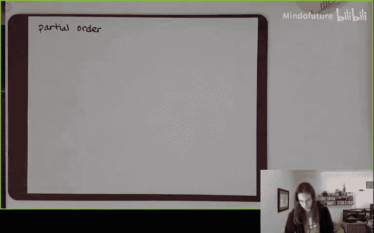
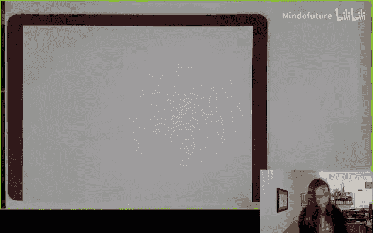
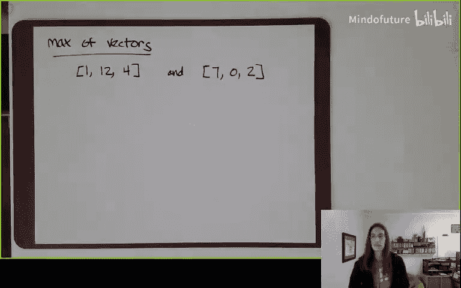

# 【加州大学】分布式系统-CSE138（Distributed-Systems）-p03-P03-L3---partial-orders,-total-orders,-Lamport-clocks,-vector-clocks--BV1eGdLYjETJ_p3-

じ？Okay， it looks like we're live。Welcome to Week two。I'll put an agenda up for today。By the way。

 I feel like I should mention something that I mentioned this last week and it's kind of been eating at me。

 so I said that I don't have childcare and that's not entirely true。

What is the situation is that my partner and I have。

Childcare outside of our home in the morning and then in the afternoon we trade off taking care of our daughters。

 so my daughter is at home， but it's not as though I'm leaving her completely unsupervised during this time。

In fact， my partner is taking care of her。But she might wander in at some point。

 so in fact I kind of hope she does because I want people to get to meet her。

 but hopefully it won't be an every day。All right。So。On the agenda for today。We're going to recap。嗯。

It happens before。Relation for last time。Today we're going to talk about。

Partial orders and total orders。Lampport plot。And vector clock。

I think that should be enough for today。All right， so last time we covered a lot。

The happens before relationship is the particular thing that I would like to recap。

 so could somebody recap the definition of the happens before Re for me？

You can either shout it out or type something to zoo it。

When do you know that two events are related back often？Good， okay， so there's kind of three cases。

 right？So if you have two events。That are。In the same process。And A happens before B in that process。

then you know。A happens before you generally。Second case is。If A is aend。

And B is the corresponding receive。Then you know it happens before。

And the third case is what makes the relation transitive。If you had， for instance。

A message send that was event A。I receive。The corresponding received call that B。And see here。

Actually， let's call this 1 C and this one B。Then you know what happens before B because these two events are related by Happ before and so are these。

 or maybe it would look like this。Here again， A happens before。

So those are the pieces of the happensens before Re and you can put them together。

 so if you've got a bunch of events，You can use this definition to figure out what happened before what？

Or at least you could if you had an efficient way to compute what's in that happens before Re。

 so we'll talk about that today。Before getting to that。

Let's just put up a bunch of events and remind ourselves。How we can talk about。

Events being related or not related， So if we had three machines。Or three notess。Look。

 just put a whole bunch of events and messages here。Okay。

 so what are some of the relationships between events in this picture？嗯。For example。

 if I were to pick out。A and E。Are those events related by the Hopins before Re？Sure， yeah。

 because we can follow this line here from A to B and then E comes after B on the same process line。

It happens before you。What about？D。And a。No， those ones were notcular。So。If you look at A here。

If you try to follow what are all the places you can get from a， well。

 you can get to B and you can get to E， but you can't follow this line backward。You could get to FNG。

So。We can' we don't have that A happens before D， and then similarly for D。

We can't get to A from D either。So it's not the case that A happens before D。

 nor is it the case that D happens before A。So instead， we would say that A and D are concurrent。

And sometimes that's written like this。So in general， if you have a whole bunch of events here。ABC D。

 EFGH。So you have this set of events， right？And you have this relation。

That relates some of the events to other events， but there's not necessarily going to be a relationship under the H before relationship for every pair of events that you can account。

Mathematically speaking。What would you call？That happens before we。Does anyone know？嗯。Yeah。

 it's transitive for sure， it is transitive relation。But there's a name for this kind of relation。

Good， yeah， somebody just mentioned it's a partial order。

So does anybody here know what the definition of a partial order is？Well， let's go over it together。

By the way， it's going to turn out that that happens before relation is actually not quite a partial order。

 according to the rules that I'm about to give you， so we'll see why in just a moment。

So a partial order is actually two things。Glued together。So first， it's a set。Let's call it S。

Together with。A binary relation。Which is often。Written using something like this that looks like less than or equals。

That lets you compare things from the setup。And has the following property。Help me out here。

 what are the properties that the binary relation and a partial order is supposed to have？

Anyone know？I'll give you the first one for free。Relexivity， so that means。For every element of us。

Let's call it A。A is related to itself。What else？What else is going to be true about the binaryre and parts of earth。

 if you don't know you can look it up on Wikipedia。Somebody just said， okay， somebody said symmetry。

Interesting， so symmetry would be a property of it if it was an equivalence relation。

 but it's not going to be an equivalence relation。Antiymetertry good。So what does antisymmetry mean？

Well， let's see that I have。Some A and B。That are members of the set。And let's see that。

If I want to claim that。If A is related to B by the relation。And B is related to A。

What has to be true about A and B then？Yeah， that's right， good。So a has to be equal。

So if I'm going to go around saying that a is less than an equal to B。

 and B is also less than or equal to a well。The only way that can be true is if A and B are're the same。

 so that's what antisymetry says。And the last part。Transitivity。

 which we actually already talked about quite a bit in the context of happens before。

But it's something that's actually through every partial order。And transitivity just says that。R。A。

 B， and C。That happened to be elements of this set as then。The thing is related to B。

And these related to C。Then A is related to C。So there are lots and lots and lots and lots of relations that are partial orders。

It's a pretty ubiquitous notion that comes up all over the place in computer science。嗯。

It happens before it's just a particular way let's glanced back at the definition。

Of course you'll order here and just try to spot check to see whether it makes sense to say that happens before。

It is a partial order， and I'll give you a spoiler， which is that it's actually not quite。Okay， so。

Is that happens before relation to partial alert well？First of all。

 we need to be talking about a set right so when we talk about happens before。

What set are we talking about？That's right， yeah， we're talking about the set of events。

So just like in this picture we just saw here。We have a set of events here， how many events， 1，2，3。

45，67 eight， we have eight events here。So that we'll be talking about the set of events in a particular execution。

So。Back to the definition of personal order。So in this case， the set just looks like this。

Looks like a set to me。ok。And the relation that relates those events。

That happens before relation is supposed to have all of these properties。Well， yeah。

 let's take the easy one first， right？Is the happens before relation transive？That's right， yeah。

 absolutely it is。It's right there in the definition of happens。You just。So。Check。

We got that covered。What about antisymmetry？Well， this says， okay。

 so for all A and B that are in the set， so pick out any two events from there。

 this says if A is related to B and B is related to A， then A equal B。So let's see。

If you picked out two events from here， let's say like D and E， okay？If D happens before E and E。

Tappens before duty。Does that even make sense to talk about， like is there any situation in which？

One event happens before the other and also the opposite。Like going back to this picture here。

Does it make any sense to say that？Here， I mean， it's clear from looking at this that D happens before E。

 but does it ever make sense to say one event happens before the other and then also the opposite？No。

 yeah， that's not possible。So。What that means in terms of the definition of partial order for us is。

This is actually what we call vacously true。So we have this antisymmetry property。

But that happens before we。Okay， so we have those two criteria。What about reflexivity？Given an event。

Any event here， let's say G。Does it make sense to say G happens before G？It doesn't make sense to me。

 what would that even mean？If I were to say G happens before G or A happens before A， no。

 it's not clear what it would mean for an event to happen before itself。So。This is not true。

 so this here， these check marks。And x's here are。Particularly to do with the happens before e。

So we're checking to see whether happens before is actually a partial order according to these criteria。

 and it turns out that it's not because it's not reflexible。

So happens before is not quite a partial order。Rather。

 it's what's known as an irreflxive partial order。So when you're talking about an irreflxive partial order。

It's sometimes also called a strict partial order， but I prefer to use the word earrelexive just to emphasize the fact that reflexivity is the property that we use。

So it happens before is an earflxed partial。But you'll often hear people， including me。

Just saying it's a partial order， so I'm letting you know that it does in fact。It is， in fact。

 not quite a partial order according to the definition of partial order。

It's fine to say partial order as long as people know what you mean。

But I wanted to give the real definition of partial order here because it's such a ubiquitous concept and we're going to see it so often that it's useful to know。

So。Why don't we talk about something that is， in fact an example of a partial order。

 truly a partial order and not merely an irreflexive partial？So a good example of that。It is。

Set containment。Or set inclusion。As it's sometimes called。So in this case。The set。Yes。Would be。

The set of all subsets。Of a set， so let's say that the set that we're talking about is。ABC like that。

 so then S。Would be the set of all subsets of that。

 so we've got like the empty set and then the set containing A， set containing B。Se containing C。

Its set with A and B。A and C。B and C， and then the set containing all three。So that's our set S。

This set has。One， two， three， four five， six seven， eight elements and we can order those。

By sudden clue。Which would look something like this。So at the bottom。You can put the empty set。

One level up from that， you've got the that containing A， B and C。Above that， you have。

The two element sets。And then。At the top。This third of all three。Classic example of a partial order。

So why is it a partial order？Not because those three properties are true， right？So reflexivity。

 antismmetry， and transitivity for example。If we were to just look at a particular element here of us。

That element。Is a subset of itself， not a strict subset。

 but it's a subset of itself the same is true for anything else here。

 it's considered a subset of itself。So we have reflexivity。What about antisymmetry？

Somebody just asked in chatp， how is a set of three letters of par and order？So this here。

Is the set that we're taking subsets of？So the partial order is on this set S。

 which is the set of all subsets of that。So this set S that has eight elements here， that set。

Can be ordered by set increase。And so what we're doing is we're definingying this set inclusion order。

On the set X， which is the set of subsets of this setup。

So we just looked at this relationship which was reflexivity。

What about antismmetry so antismmetry says that。In this case。

 it would be if something is a subset of something else。And also the opposite。

Then they have to be equal。So yeah， so in this case， for example。嗯。

I can't come up with anything here where something is a subset of something else and also the opposite of is true without them being the same。

So。For example。The set containing A and B is a subset。Of the set containing A and B。

 and also the opposite the tree willll notice that they're the same。And that would have to be。Okay。

 somebody just asked in chat so S is the partial order well almost。

 so we just said what is a partial order it's two things glued together。

 so a partial order is a set together with a binary relation。So the partial order in this case。

Is the combination of S？And this binary relation on elements of us。So we could write it like a pair。

Its。And then what about the last part of transitivity， well， in this case。

 transitivity would be something like well。The set containing A is a subset of the set containing A and B。

I that containing A and B？Is a subset of the set containing a B and C？Therefore。

 we can put those two pieces together and get that the set containing A is a subset of the set containing A B and C。

So we got all three， we have that this particular partial this particular binary relation is refleive。

Anti symmetric and transitive， so that means that we have a partial order。Now notice that。

Not everything here is comparable， right by the relations so in other words。

If I were to just take the set containing A。And the set containing B。

Neither of those is a subset of the other。So you're going to have some elements in general。

 in a partial order， you may have elements that are not comparable。Yes。So。

What does that have to do with us well， for us？When we're talking about。

Our favorite relation that happens before Re。Elements that are not comparable are exactly the ones that the happens before Re says。

Are concurrent。So if we go back to。The picture that we were showing a second ago。

Of a whole bunch of events that happen in an execution of a distributed system。Like we said。

 some of these events are going to be concurrent， like A and D， for example。

So those are events that aren't ordered by the partial order。

A total order is different if you have a total order， then every pair of events is ordered。

But we don't have that here。Instead， we have a partial。I'll bring back this picture for a second。

So this is a real genuine example of partial order that has all the properties。Reflexxivity。

 antiymmetry and transitivity。And that happens before relationship is just a little different because it doesn't have that reflexivity。

So the happens to before relationships is it's what we call an irreflxive partial order。

 but in every other way， it's a partial。Questions about this。OK。

Let's come back to our definition of what happens before relation here it is one more time。

Just a pictorial difference。But I think that's good enough for us。

If A and B are events in the same process。A comes before B on that process。

 then we have A happens before B。If A is acend and B is the receiver that goes with it。

 then A happens before B。And。Then the transitivity part。

 so if A happens before C and C happens before B， then A happens。

There were a couple of good questions just now in chat so one person asked what's the difference between a partial order and a partially ordered set there's not really a difference so。

A partial order， like we said， is a set together with a binary relation。Right。So。

Partialally ordered set。Same thing。And sometimes people call it a post set。For short。

 which just means partially ordered set。So same thing， it's a set。Together with a relation。

That lets you compare elements。Of that set， but as we saw。Maybe not all the elements are conquered。

And just somebody else asked，Could I reiterate the difference between a partial order and a total book as well？

Going back to this picture of our example。Of a par order。Which was set containment that we just saw。

Notice that there are some elements of S here， like pick out these two elements， for example。

 the set containing A and the set containing B。That aren't comparable according to this binary relation。

 so we can't say that A is a subset of B， nor can we say that B is a subset of A。

So that can happen in a partial order where some elements may not be comparable。On the other hand。

 if it's a total order。Every element is going to be comparable what's an example of a total order Can somebody give me one？

an example that what's the simplest example that you can think of of something that's totally ordered？

The alphabet， okay？The second attain element， yeah。

So the example that I was going to go with was the natural numbers， which somebody just mentioned。

If I were to try to order the natural numbers。If I were to draw a picture。

They just go in a straight line， right？So there's not any situation where you have two numbers and it's like。

 oh well， these are not comparable， right， it's always going to be the case that if you paper out two numbers from the set of natural numbers。

You know， any N and M。Either。呃呃呃。If they're different， right？嗯。

Then either N is going to be less than M。OrM is going to be less than it， right？

That's always going to be true。It's a total order。So there's no ambiguity there。

mOr even if they're not distinct， right？But this is true。So。

That's different from a partial orderver and you may have some elements that are not comparable that way。

And。Our favorite example of that is in a distributed execution where you have a bunch of events。

You might not be able to say that。One event happens before the other。嗯。Nor can you say the reverse。

 so that's exactly the situation where events are。And so you don't have this total order of events in a distributed execution unless you do something more to try to impose it。

Okay。So this leads into our next topic。So last time we talked about clocks， right？And。In particular。

 we mentioned a couple of different kinds of physical clocks。So physical clocks encompassed。

Time of day clocks。And monotonic clocks。But we also talked about problems with using physical quas。

So what did we say that the alternative was to using physical clocks？Logical quote， so that's right。

So。Let us speak no more of physical plots。So this is an entirely different notion of clock。

They will not tell us anything about time of day， and they will not tell us anything about time elapsed。

 instead they will only tell us about the ordering of events。

So we're going to be talking about a couple of different kinds of logical plots。

The simplest kind of logical clock that I'm aware of。It's called a land port。

And a Li clock is just a way of assigning numbers to events。In a distributed execution。So。

The notation that we'll use for this is if you have an event， let's say event A。Then the Laor clock。

Of this event is' going to be written。LlC of A。So what is a lampper clock， what do it mean。

 what do lamp per quax tell you？Well， a lamp part clock is going to be some integer。

 actually a natural number， that's going to be assigned to an event。So a limbberg qua might be three。

So let's say that the land per clock obey is。What does that mean， what does that three tell you？

Here's the rule。This was called the clock condition。You。😊，A happens before B。Then。

The lampport clock of A is less than the Laport clock of B。

So this is the happens before relation that we've been talking about。And this is La work。

So we say that Laport clocks。Or。Consistent。With。Pusity。

That means that if theres a causal relationship between A and B。That is very happened before B。

 that's what it means for us。Then we know that the Laport clock of a is going to be less than the Laport clock of。

So let's。Put a whole bunch of events up and try to assign land work clocks to them。

Let's stick with our three machines。So here's the algorithm for assigning Laport quas to events。

First。Every process has to keep a counter。Iitnitially it to zero。Second。On every event on a process。

 that process is going to increment its counter by one。Third step is when you send a message。

You need to include。Whatever your current counter is along with the message。

What do you think step four is going to be？I'll give you a hint， it starts。When receiving a message。

What do you think happens then？对二。So presumably it's going to have something to do with that。

Counter that got included with a message when it got sent， right in step three。

If a process is going to be including a counter value along with the message it's sending。

 then presumably that has to get used somehow on the receiving end。

So that's exactly what's going to happen。So the receiver。Is going to。Do the following。

When receiving a message。A process。Seets its counter。2。The maximum。Of the local。

And the received counters。Plus one。Let's work through。

All of these events up here using this algorithm。So。

Every process has to keep a counter initial as to zero。I guess I won't call it X， I'll call it LCC。

Okay。What happens first？M zero。Is sending a message here， that's an event， right？

So what does M0 have to do？Right， so this was an event， so following step two here。

This process has to increment its counter by one so its counter is going to become one。

And it's going to include。That clock value。Along with the message。We get here to。

 and I'll just put one right here to save it。That's the lymph clock value of this。We get here。

To machine one。Machine one receives a message。What does it do？It's current。Lper clock value is zero。

It's getting a message here with a Laport clock value of one。Which one's bigger？Well。

 one is bigger than zero， right， so it's going to compare the two。

It's going to pick the one that's bigger， that's this max part down here。

 so we're taking the maximum of our local。Lhor clock， which was zero and they received one。

 which was one。So the bigger one was one， and then we're going to add one to that。

So the lampport qua value now becomes two for this effect。

And it's going to update its local clock to that。What happens here for this next event on M1。

 somebody tell me。Yeah。Proros M1 or a machine one is going to go to three。

This event gets a landport clock value of three and that gets sent along。So here。

Machine two gets the message， what does Ma  two do？Right。

 so it's going to compare its local land port clock value。To the one that was just your seat。

 which was three。Three is bigger than zero， so three wins。And then we add one。

 so this length clock value of this event here is going to be four。We're going to update this to For。

And we keep going from here， so this event is another event on M2。So we get to increment there。

That gets sent along here。Five hits here now we're comparing five to one。Five is bigger than one。

So five wins， and then we improve into bed。Great， we've just assigned Laport clockck values to all of the events in our system。

So we have this way of now assigning numbers to events。And we know。That if A happens before B。

Then the Laport clock of a。Is less than a laor clock fee。In other words。

 lampper Cros are consistent with causali。So let's take a quick look at this and let's see if we think that's true。

Well。This event here we know happened before this one。

 right because they're on the same process line and indeed。One is less than six。Likewise。

This event here happened before this one， right because？

This one is aend and this is a corresponding receive， and indeed when we look at the lampport clocks。

 we see that three is less than four。So if you look at any pair of events here， you'll see that。

If a happened before B， then the lamp per clock of A will be less than the lamp per clock of B。

 so it checks out。And it's what we want， it's consistent with causality。By the way。

In some formulations of this algorithm。呃。You'll see it done differently。

 so sometimes messenger receives do not get counted as events。

So here we chose to count message receives as events。

 but if you weren't counting message receives as events。Then you could do that。

And then the algorithm would be the same except that you wouldn't have to do this plus one here。

So if you've ever seen something like this before and it didn't have the plus one。

 then that might be why。But were today we're going to go with this notion of counting message receives as events。

 and so this is what the La Court clock algorithm。Okay。So we have this nice property， right。

 that if a happens before B， then the La clock of A is less than the La clock。

What about the other way around？If the length per clock of A is less than the length per clock of B。

 do we know that A happens before B in general？We actually don't。Well。

 it's a little bit of a trick question because in this picture。It happens to be the case that。

Whenever we have a landport clock that's less than another landport clock， like say four and six。

 for example， four is less than six， and it happens to be the case in this particular picture。That。

For all the pairs where that's the case， we can also look back and say。

The one with Laportt Qua of four happened before the one with Laportt Qua of six and so on。But。

Perhaps surprisingly， it turns out that this is not the case in general。So here's an example。

So let's say again that we have。Three machines。And we'll do another Laport diagram。

Let's do it like this。Okay， so let's walk through the steps of the Laport clock algorithm again and let's try to assign Laport clocks to all of the events。

So in case you still need it， here's the Liport clock algorithm。Like that。

Hopefully you can see most of this picture。Above this is just the。

Names of the three processes like that， so nothing's really being hidden from you。Okay。

 so we want everybody to keep a counter right， that's initialized to zero。So。So let's start out。

 let's just start trying to assign land work clocks to these events。So this one here on M1。

Is the first event happening on this process？So it should get an increment。

That becomes one Lame per clock of this event is one and then that gets sent along。

What happens over here， this is M2。Well。We're going to compare zero with one， one is winning。

And then we add one to that， so the landport clockk value of this event is two。

What happens next here on M2？Oops I forgot to update this here， yep。

 so this event's link clock value is three。Three gets sent along with the message all the way over to N0。

M0 is going to compare the three with zero， three is going to win because it's bigger。

So then the link clock value， oops， but we forgot something because there was an internal event up here。

So internal events count too。So this is also going to get a Liport or actually， let me ask you。

 what's going to be the Liport clock value of this event up here？

This is the very first event on process。AndDra。It happens to be an internal event。

 but it doesn't really matter。So what's the link import plot value of that effect？One， good。

So that's going to be the input portfolio there。Now we get to this event here。

I'll try to put this all on there。In view。So what's going to happen？

When machine Ze receives this message with a Laport quaq value of three and it compares to its own La port qua。

Right， so three is bigger than one。So the landlor clerk of that event will be four。

Here's another internal event， so that one gets five。Coming back over here to machine two。

What's going to be the Liport clock value of this event right here？

I think I'll move the rules out of the way because I think we all pretty much know what they are now。

So what's going to be the lymphic clock value of this one？That one's going to be four good。

F is going to get sent along。We'll come here， machine one。Oops， I forgot to update these over here。

Machine one had a input quaq value of one before that's going to get compared with four。

Out of one in four or four wins。And then we add one to that， so that's going to have five。

Here's the next event on N number1。That one's going to be six。And finally six get sent on here。

And our very last one， we have six here， we have five here， six and five get compared。

And six is bigger than five， so six wins， and then we had one to that。Okay。

 so we've assigned Laer plot values to all of the events in this execution according to the algorithm that we just gave。

So let me draw your attention to a particular pair of events for it。Let's look at this one here， A。

 let's call it A。And let's look at this one here， which we'll call be。

So the landport clock of A here is one。And the landport clock of B is five。But did A happen before B？

So here's a trick for knowing whether one event on a Lameport diagram happened before another one。

On a landport diagram， if you can reach。B from A。Then you know what happened before B。

So if I can follow lines from A to get to B。Then I know the day happened。

But that's not the case here， right？If I were to start a day。And follow arrows。I cannot get to be。

I could start here。And get to be。Or here or here。But I can't get there from here， right？

So in this picture， you cannot reach event B from event A。

 so you cannot say that A happened before B， even though its lamp work clock is bigger。So。

Even though。We have this thing that says that。If A happened before B。

Then the lampput clock of A is less than the lampput clock of B。It's not。The case。That。

It's a landport clock of A。Is less than the rank type of B。Then it happens。

So somebody asked a question a little while ago。呃。On Zoolip about really what we mean by。Causeality。

Like when I say A。Arow B。Somebody else， does this mean A caused B？

Or does it just mean A happened before B or what？Good question。

What it means is that A potentially comes。So it didn't necessarily cause it。But we see。

Potentially cause。We can certainly say happened before。Whether it actually caused this event。

 whether it actually caused me is another question。But you know that it could have been a cause。

 so that's why we say potential causalality。Thanks for asking that。

So I think part of the reason we were asking that is because a little while ago when I wrote this down。

I wroteThe landport clocks are consistent with causality。

 so if I wanted to be really pedantic about it。I could say landmelor quas are consistent with potential causal all。

So because of what I just showed coming back to this picture。

Where we assigned landmark clocks to all these events， but we found that。

Even though this lamp per clock of this event here is bigger than this one， that doesn't mean。

That this one happened before this one。So we say that。

Although lineport clocks are what we call consistent with causality or consistent with potential causality。

We say that Labro plugs do not characterize causal。So。Mathematically speaking。

Consistent with causality。Or potential causality。If you want to be precise about it。Means。

It very happens before B。Then。The logical clock。Of a is less than。Theeological philosophy。

That's what it would mean to be consistent with causality and Laper clocks happens。Yeah。

But another desirable property is what we call。Characterizes causal。And that means that。

If the logical clock。Of a。It's less than the logical clock would be。Then。A happens before me。

And land Court clerks do not have this property。Sad face。So。It's a little bit of a bummer， right。

 landport clocks are pretty convenient。In the sense that it's pretty easy to run those steps of that algorithm that I gave a minute ago。

 it's pretty easy to assign landport clocks to events。So it sure would be nice。

If we had both ways of this relation here， it would be really nice if Glenbot Qua were both consistent with causality and if they characterize causality。

Sadly， that's not true。So。What good are they then， somebody just asked this great question in Zab。

 what's the point of Li clock？So what could we still use them for？Why would you ever want to use it？

Well we do know this， right？We have that if A happens before B。

 then the logical qua of a is less than the logical quark of the， so this is a logical implication。

What's something that you can do？With an implication。Anytime you have a logical in。

 what's something you can do with it？Now I mean， like some people are laughing at this question about so what's the point of import clocks。

 but that it's a damn good question， right， what is the point？不。

Here's what you can do with an implication。Anytime？

Anytime you have an implication like PM plays Q like this。

You can take what's called its contrapoitive。So if PN plays Q， in this case， that means that not Q。

Employs not people。So this notation here means not。For those aren't familiar。So that's kind of nice。

 so that's something that you can do。Coming back to the main port plots。Well。

 the implication that we had was this， right？A happens before B。Implies that the Laport clock of A。

Its less than a rank。Well， if we plug that in here。Then we have。This is P and this is Q， right？

So here's our queue。Heres ourRP。And then if we have， if it's not the case。

But the Lameport clock of A。Is less than1 for clock feet。Then it's not the case。

Mating happens before。And this is still pretty useful information。

If it's not the case that the lamper clock of A is less than the lamper clock of B。Then。

We can rule out the possibility。The A happens before B now。

That doesn't tell us everything we might want to know， right。

 we still don't know exactly what the relationship is here。

 so it might be the case that no B happens before A or it might be the case that A and B are concurrent。

We don't know which it is。But that's still pretty nice to know。

 it's nice to know that it couldn't possibly be the case that A happens before B。In this situation。

 if we use the counter pocket， so that's what land port quas can be used for。

They can rule out things as not heaven。It's still not everything that you might want to know。

But it's nice。It's fairly easy to compute。So if you look at。What we did in misfigure here。

When we were assigning land work clocks to all these events。

This is a pretty low overhead algorithm right all the additional information that we had to tack on to these messages as they were getting sent around here was one number。

So that's really nice， right if you only have to tack on one number。Then。

That's not too much overhead。And。It may not tell you everything that you want to know。

But in distributed systems everything is a trade off right， if you want to know more。

 you would need to pass around more information and that would cause。

Youd use it more bandwidth and it might not be worth it， honestly。

So landmark clocks are pretty nice because they're a low overhead way to get some information about the ordering of events。

 and that's nice。So that's what Lamport quas her for， they were invented by Leslie Lamport。

Who I mentioned on day one of class。Is the father of distributed systems？

In a paper that was published in 1978。And you can go look it up yourself if you want。

 look up Laport 1978， the paper is called Time clocks and the Ordering of events in a distributed system。

So this paper is parts of this paper remain deeply relevant today。

 other parts of it are not so relevant， but it it's considered。

One of the highlights of the distributed systems literature of all time。

So it's a fun one to look at if you're interested in some historical perspective。All right。So I goof。

And I didn't。Set up a quiz for today。My excuse is that I just got my first vaccineian shot yesterday。

And my arm really hurts。And。I'm not thinking straight， so I failed to set up a quiz for today。

 but I still think that you deserve your 1 night。So we're going to take our 10 minute break。

And when we come back from our break， we will talk about a different kind of logical claw that in fact。

Not only。Is consistent with causality， but also characterizes causality unlike Li。

So let's do our 10 minute break starting now I'll set a timer and when we come back we'll talk about a different kind of electrical clock。

 see you in 10 minutes。Yeah。Okay， fine。A equals B， A is B A。Yeah。That's true。

 I did not define equality。Sure， yeah。嗯。Yeah， in fact。

 the LSD seminar was attended by a few students from our class last week。

 so hopefully we'll get even more this next time。I think you were。有。呃，我没这个。Yeah， so Patrick。

 the only change I would make would be to say。For partial order。

 the binary relation may only be defined for some pairs。A total order is also a partial order。

It's just the special case of partial order where in fact you。

Have the relation defined for every pair。So every total order is also a partial order。

But not every partial order is a total order， does that make sense？Right。Ahu， I think so。All right。

 we're going to start again in a minute。All right， one minute is up。

Will everybody got a chance to get their eyes away from the screen？

I really do mean it when I tell people to get eyes away from the screen。

It's not enough of a break for your eyes to just look at something else on the screen。

 you should really look away from the screen。Otherwise， it's just more stress for your eyes。哎。

So we just got done talking about Lameport Cox and we said。

That the relationship between Laneport clocks anything happens before Re is this。In other words。

 landport clocks are。Consistent with causalazli。And the other direction。

The characterizes causality direction， the direction that would go like this。Is not true。

So it sure would be nice if we had some kind of logical clock。

That did exactly characterize causality， that did characterize that happens before relationship。

Probably。It exists and it gets used all the time in distributed systems。It's called a vector clock。

So here's the property that's true of vector。Or。If a happens before B。

 then the vector clock of a is less than the vector clock of B。And also。

If the vector clock of a is less than the vector clock of B， then a happens before B。

 so that's if and only if this time。We have both directions of this implication。

 not just if like we had before， but if and only if this is big， this means that。Vectctor clocks。

Are consistent with causality and characterize causality。O。So how do they work。

 what's the definition of a vector。Remember， a lampport clock is just an integer right that's associated with an event。

So given the name， vector Clarks。What do you suppose of vector car？A clock using vectors， okay。

 that's one answer。嗯。Well， if a lampor clock is just one integer。

A vector pluguck is going to be a vector。So this is the way that it works。First of all。

We're going to say that every process。Keepaps a vector。Of vintages initialized to zero。

How many do you think， how big is this vector going to be？Good。Yeah。

 the suggestion is as many entries as we have processes that's exactly right。

So there's going to be one entry in this vector for every process。Good。

 so if you had three processes。Then every process's vector clock would start out like this。今月 zero日几。

Initially。O。So just like with Laort clocks that we just saw。

 we're going to use vector clocks to count events。But they're going to be more informative。

Good one important。So next part of the definition。On every event。Process increments。Its own position。

And it's vectorable。I grew integers here， but they could really just be natural numbers。

You're never going to go negative。By the way， when I say on every event。

 this includes internal events as well as well as sens and seeds。All events。

 Suns receives an internal event。Next up。When sending a message。The process includes。

It's current vector clock。So just like we saw with lampport clocks a little while ago。

With lampor clocks， when you send a message， you're going to attach the lamport clock to it。

Same with vector clock when you send a message， you're going to attach this extra thing to the message。

 which is your current vector clock。And this is going to happen after the increment that happened in set。

Because asend is an event。Okay， that covers sending。What about receiving？

This is the most interesting part。Anybody have a guess at what happens？

With vector clocks when we receive a message。Indexing the vector， well。

 that's certainly going to be involved。That's right， so you're getting a message。

And it's got a vector clock attached to it right， you've got to do something with that vector clock that you're receiving。

 right？And somehow it's probably going to involve comparing that to whatever vector clock you have yourself。

So what will we do well？When receiving a message。Process will update。To the maximum。

Of the local vector clock。And then receive。So this is it's Ellen。

And this is the V that was on the message。And it's also going to increment its own。

Position and it vector clock。According to S2， because receiving is also anything。

So this is all going to happen。Just like here， we're going to say。Because receives our events。

So that's the vector clock out。Somebody just asked a question so they said。Wait。

 but on the Laor diagram， don't we end up with a vector at the end as well。

 so I think they were talking about。With lampport clocks。

So this is a little different with Laport clocks every event。

Is going to get associated with just a single number。So if you wanted to， right， you could think of。

The lamp work clock of every process right and put them together and think of that being a vector。

But this is going to be a little different in this case， instead of just keeping one number。

 every process is going to keep a vector。And every event is going to get associated。

so there was just a question is step four element wise， right？

We're doing this MA operation here on vectors， but we haven't defined。

What it means to take the maximum vector。So let's do that now。

So if somebody just correctly anticipated in chat it's going to be point wise maximum。

 so for instance， if I have two vectors in there let's say one。12 and four。And。Say seven， zero。

 and two。Then what's the maximum of those two going to be？

Good， yeah。So it's going to be what's called point wise maximum or element wise maximum。Okay， good。

So coming back to this。The vector plot's algorithm here。We only have three more minutes for today。

 so we're going to have to save an example run of this algorithm for next time。

But let's talk a little bit just about what this means。So we said that。With lambmblor clocks。

We're using them to count events that happen right。

 but we get more information out of vector clocks than we do out of blank coat clocks so for example。

If the landport clock of an event is just saved。The number five。Then all that tells you is。

Five events have occurred。includingncluding this event that has the clock value of five。

 that's all it tells you five events have occurred it doesn't say anything about where those events might have occurred。

 it just says that five events have occurred。But if you had a vector clock。For example。

 like if you had5， zero， zero。So let's say that these are。

Entries in this vector clock are each representing Alice， Bob and Carolroll。

This vector clock of 500 describes a world。In which Alice has seen five events。

And Bob and Carol haven't seen it。Or another way to put that is it's a world where we know about five events that have happened on Alice and we don't know about any events that have happened for Bob and Peril。

So this gives us more information than just the plain old number five。

And it turns out that this additional information is going to be exactly what we need to know to get that characterization of causality that we wanted to have out of logical plots。

So sadly， we're almost out of time and we're going to have to save an example run of this vector clock algorithm for next time。

And next time we're also going to talk more about how you compare vectors。

hich is kind of related to what I just said about the max operation。嗯，被。

That will have the state be safe for next time。In the meantime。

I know that you're hard at work on an assignment one。

 some people have already started forming their teams for assignment two and beyond。

 remember that you need to do that by Friday。And if you have questions about assignment one。

 please please please ask them on Zip also be sure to go to section so I know a lot of people got a lot out of Gnda Patrick's section yesterday。

And Ahe has his section tomorrow， so that's a great place to go。have questions about the homework。

Otherwise， keep asking questions on Zooic。Talk to us if you need help。

And remember to get your teams together。All right， I will see you on Thursday。Take care。

