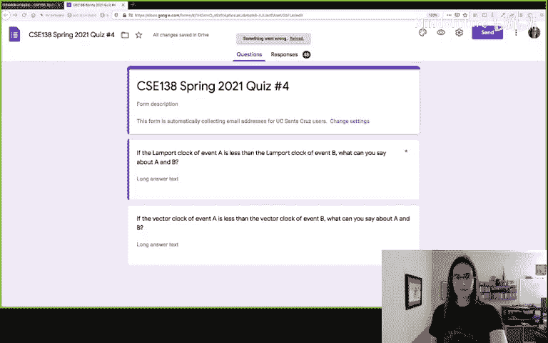
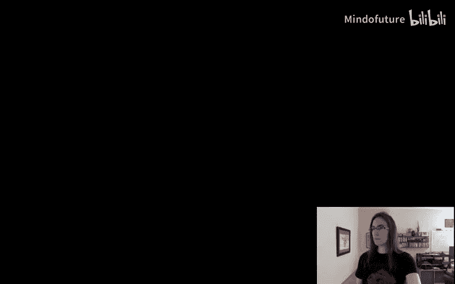
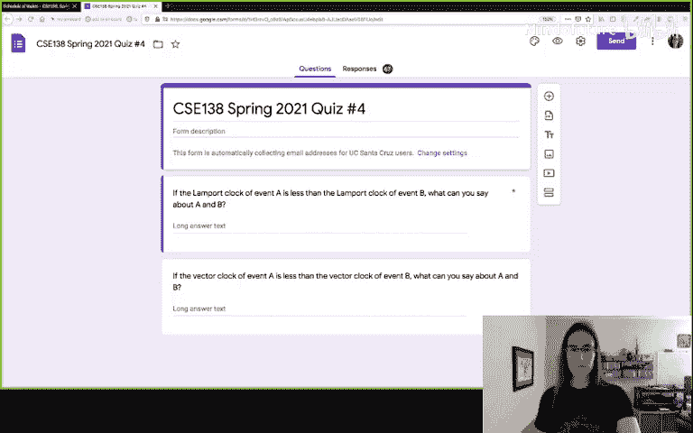
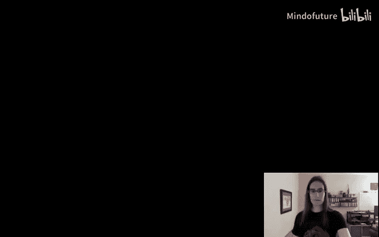
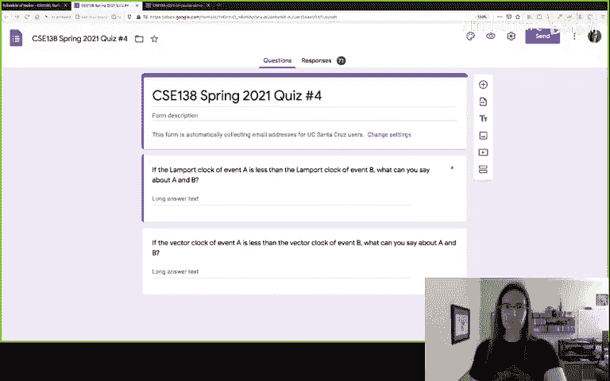
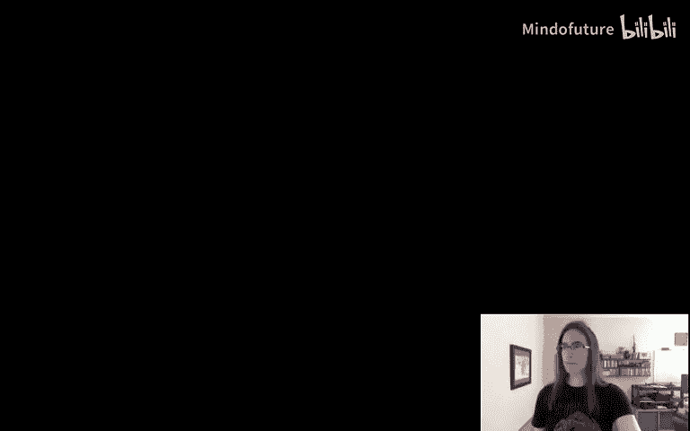
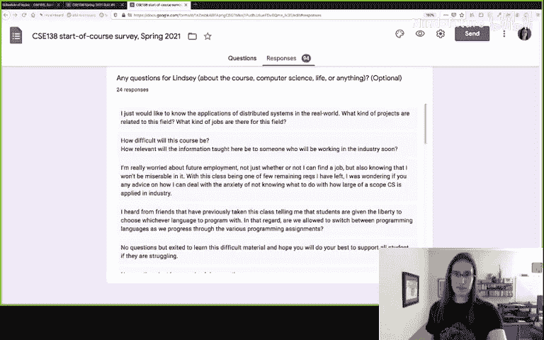

# 【加州大学】分布式系统-CSE138（Distributed-Systems）-p04-P04-L4---vector-clocks,-FIFO-causal-totally-ordered-delivery--BV1eGdLYjETJ_p4-

When I hit that start streaming button， because if I start talking immediately。

 then something at the beginning of the stream will get cut off。

But it looks like the stream just came up on Twitch， so we are ready to go。

Welcome to the end of week two。And let me put up an agenda for today。So we'll do a brief recap。

Of landport clocks。Which we talked about last time。嗯。

Then we'll finish our discussion of vector clocks。I shouldn't say finish our discussion because we'll be talking about vector Cls。

Quite frequently。But we'll continue our discussion of vector clocks。I think we're going to get to。

Let's see。After we do that， we're going to talk about。Executions and Pro of executions。

And from there。I think we'll get to。Delivery guarantees， which will include。Ffo delivery。

Causeal delivery。And totally ordered delivery。If we get through all of that， if there's time。

Then I'm going to start to answer some questions。From the start of course survey。Which will be fun。

So I hope we have time for that。If not， we might have to put it off till next week， all right。

 let's jump in。So last time we talked about Laport clocks。诶。

What's the relationship between landport clocks and causality？Well。

The relationship that we wrote down last time is this。If A happens before B。

Then we know that the LAport clock of a is less than the landport clock of B。

So what about the other direction？If the Laport clock of A。Is less than the landport clock of B。

Is this true？We talked about this last time， so somebody remind me。No。

So this is in fact not the case， and we saw an example of that last time。

And we could write down an even simpler example。So last time we looked at a kind of a fancy example with a lot of events。

 but we could look at an even simpler one。So let's just say we have a couple of machines here and let's say that we have。

Let's say a bunch of internal events。Over here。On this machine。

 so if we were to give Laport clocks to these events， recall it with Laport clocks。

 everybody starts with their process initialized to zero。And then you increment on every event。

 so this would have a Lameport clock of one and a Laport clock of two。嗯。3，4。And so on。

So let's say that it happens to be the case that over here there's a message send。

And it goes to here。Well， this one would also have a lampport clock of one。

 this event on machine two， because it's the first event that happens on that process。And then。

Of course， as we talked about before， the Laport clock gets sent along with the message under the Laport clocks algorithm that we discussed。

 the message gets over here， the Laport clock on this process is four。

 compare for with one and four wins。And then increment that by one。

 so this gets a lamper clock of five。But if we were to look at two events on here， like say this one。

And this one。What's the happens before relationship between these two events。

 do they have a happens before relationship？Yeah， these events are not related by the happens before relation。

 that's right。 So even though this event over here has a Laport clock of four and this one had a Laport clock of one。

 we can't say that this one。Happened later， right， we can't say that this one happened before this one。

Because landport clocks don't give us enough information to know that。

It would be nice if we had a way of assigning logical clocks to events that does tell us exactly。

What happened before what， And that exists。 And we talked about it last time。

 It's called vector clocks。 So with vector clocks， you have。Both ways of this relationship。

So this is。A two way implication， which is really， really nice to have。

And we talked last time about the algorithm for assigning vector clocks to events。

 So what we didn't have time to do before is look look at a。Exampled。

So let's go through an example of assigning vector clocks to events and then we'll talk about it。

So I'm a little bored of names like M0 and M1 and M2， so let's talk about our friends。Alice。

 Bob and Carol。Okay， let's put in a bunch of events up here。And messages。I think that's enough。

All right， so let's try to remember the algorithm that we talked about last time。So the first step。

Is that every process is going to keep a vector。Of vintages that's going to be initialized to zero。

And recall from last time that there's going to be one entry in this vector for every process that's in the system。

 so in this case there's going to be three entries。

So everybody's going to keep a vector initialized to zeros。

And now we can go through and start assigning vector clock values to all these events。

So let's look at this first event here on Car。So。It's an event， happens to be a message send。

And so Carol wants to count it。As an event that's occurred that she knows about。

 an event that's occurred on her process。 So what is Carol going to update her vector clock to。

 What do you think？These entries in this vector clock， by the way， correspond to Alice。

 Bob and Carol in that order。That's right， yeah， so Carol's going to update her vector clock to。Z，01。

Carol's message gets over here to Bob。Bob's vector click is currently at all zeros。

What is Bob going to do， Well， this receive is an event。

 So Bob wants to update his own entry in his vector clock。To take note of that event。

 but also this vector clock from Carol got sent along with the message。So what Bob is going to do is。

He's going to update his own entry。So it's going to be 01。

 but then he's also going to take that one from Carol and combine it with his own entry and take the maximum of the two。

So his entry is now going to be 011。So what he did was he first incremented his own position to get 010。

 and you could write that in as a sort of intermediate step if you want to。

And then he combines that 010 with Carols 001 and takes the pointwise maximum of every entry there to get this。

 which is his vector clock， which is going to be the vector clock associated with this event。

All right， so that's what Bob does for his very first event。What's next。

 what's going to be the vector clock for Bob's next event？Looks like somebody already put it in chat。

So it's going to be  zero21。That's right， yeah， so when we did Laport clocks it was a little different。

 we were saying max plus one and that's because that plus one， if you think back to Laport clocks。

 the reason why we had to do a plus one with Laport clocks was to count the receive。

 so the receive counts as an event， but Bob has already counted his receive right because that's what this one right here represents。

So that the receive is getting counted， that's what this is， and the fact that this event happened。

 and then this one also carries over information about this other event that happened way over here。

So in some sense， you can look at this vector clock。

 look at the entries here and see well Bob knows about a total of two events at this point。

 he knows about the event that just happened on his own process and he knows about this event that happened over here on Carroll Furthermoremore。

 he knows that this one happened on his process and he knows that this one happened on Carroll's。

 so he knows about one of his own events and he knows about one of Carroll's events。So we get here。

 Bob has incremented his own vector clock because this is an event。

 it's aend so he wants to increment his own position， and then that gets sent along。

What is going to be Alice's Victorclock right here for her first event， somebody tell me。Good， yeah。

 it's going to be one， two， one。Why is it one2 one。

 because the one is because the increment for herself， right。

 because she just received this message and that counts as an event？

And then the two and the one come from。This message that was sent along。

 and so that vector clock gets combined， we take the pointwise maximum of all the positions。

 so it's one2 one。Then there's another event on Alice， she's going to increment her own position。

 so this first position turns into two， the other two positions stay the same。

What happens here on Bob？For the third event on Bob， what's the vector clock of that one going to be？

Good， yep。0，3，1。You know， normally it takes longer in the quarter for my markers to start running out。

 it feels like this marker is starting to run out very early in the quarter。

Luckily I've got backup markers。All right， so that event has a vector clock of 031。

 the vector clock tags along with the message， it gets here to Carol Carol's current clock was 001。

 We're going to combine that with the 031。And we're going to make sure to count this event because it's an event so it has to get counted。

So Carol's position gets incremented by one。So we can again put an intermediate value here if that helps us think about it。

So that's what would happen if Carol just incremented her own position。

 and we're going to combine that with the 031 that came along here。

So what does Carol's vector clock turn into here？Good。Z，3，2。

Hopefully you're starting to get the idea。So I haven't written down the steps of the algorithm。

 which we did because we did that last time but。I'll try to summarize it again。

 so step one everybody starts with a vector initialized all zeros and it's the same length as the number of processes that they are so in this case we have three processes so three entries in the vector。

Any time you have an event on your process， you increment your position in the vector clock。

 This means， of course， that you have to know which your position is， right。

 So that's information Everybody had better agree that。

Alice's position is the first position here and Bob is the second and Carol's is the third。

 so it would be very bad if the processes were confused about who。

Was which entry in the vector clock？So that's an important thing that these processes have to have agreement on before you run this algorithm。

And that's something that we can talk about a little bit more later。

So you increment every time you have an event， whether it's a send， receive or internal event。

 I didn't put any internal events on this one， but those would get counted as well。If we had them。

And then whenever you receive a message。You're going to combine the received vector clock with your current vector clock by taking the pointway maximum of every position。

And so pointwise maximum just means that looking at every entry。

 you take the maximum of the two numbers that are at that position。

So let's go ahead and fill out some more of these here。So this one is going to be。

 Carol is going to be having her third event， so033。That's going to get passed along on this message。

Here we're combining 033 with Alice's local vector clock by now Alice's position has been incremented for this event。

 so it would be three2 one for the intermediate value if you want to write that down。

I'm putting these in parentheses to show that these are like intermediate this would typically be done like in the same step as you're combining with this value。

 but I'm writing it down here just to make this a little bit easier to reason about so32，1。

 take the pointwise maximum of that and 033 so we get。3， three， three。Over here， we had2，2。

1 that got sent along here。Here we are at Bob。Combine 221 with 031。

 making sure to increment bo's local。Entry。InOr his entry for himself and we get。2， four，1。

Here's another event on Bob。So this one is going to have to be 251。That gets sent along here。

What's this one going to be， somebody tell me this is the let's see 1234th event on Carol。

 what's the vector clock going to be for the fourth event on Carol？Yep。

 so the first entry will be two combined two with zero， two wins。For the next entry， five and three。

 five wins。And then for the third entry， which is Carol's entry。

 we increment it to get four and four is bigger than once， 254， good。There's one last event on Carol。

 this one gets255。That gets sent here。And here's our very last event on Alice。

So somebody tell me what the vector clock for Alice's last event is。Good， four or five five。

By the way， I got this picture from Wikipedia。So if you。Were to look at the。

Victor C's article on Wikipedia。There's an image a lot like this， or at least there used to be。Okay。

 so now that we've gone through this rather tedious process of assigning vector clocks to every event here。

 let's just go back and look at a couple of events and and see。

What the vector clocks tell us about those events？So。Here's an event。On Bob。Right here。

 I'll call it event A。Look at event A。What if I wanted to know which events happened before event A？

We know from the happens before relation that everything that occurs before it。

On its own process line happened before A。So look at what the clocks of those events are， right？

 So this event had a clock of 0，3，1， and this one had a clock of 021。This one had a clock of 011。

Well， what else？There's these events over here on Alice， so this one we know happened before A。

Just by looking at the way that the messages go， right， so we know this event。Happened before A。

Because it's ascend and A is the corresponding receive。And then this one happened before that one。

So transitly， that one must have happened before A。And then there's this one over here on Carol。

 which happened before this one， so transitly that one must have happened before A。ok。

So I've circled a whole bunch of events here。That all happened before A。

And we can give a name to all those events， in fact。I can circle them all here。These are the causal。

History。Of a。So what do you notice？About the vector clocks of all of these events that are in A's causal history。

Is there anything？To take note of about the vector clocks of those events and how they compare to A's vector clock。

Very good， yeah so。They're all smaller vector clocks than a。

If we look at the elements of each of these vectors， they're all going to be。Less than or equal to。

The value of a， so 0，31， for example， that's less than 2，4，1 in every position。

 less than or equal to 24，1 in every position。Similarly over here。

 221 is less than or equal to 241 in every position， 001。

 less than or equal to 241 in every position。So they all have smaller vector clocks likewise。

If we were to go and look at all of the events that we know that are causalably later than A。

So this one， for example， we know is causally later than A。And then what's causally later than that。

 will this one？And this one。Is that it？I think that might be it。

 So these are the events that are causally later than a。

 What do we see when we look at their vector clocks， Well， we see that they。Have values that are。

Greater than or equal to A's vector clock in every entry。So I can circle these up as well。

There's not really a name for this set of events， I guess I could call it the causal future of AA or something like that。

Oh。But。You get the idea， right， these are things that we can see happened later than A。

 according to the happens before relationship。Oh you're right。

 somebody just pointed out that this I missed one， good。Didn't even see that one。That's right。

 that one counts as later than A because it happened after this one here。

And we know that that one happened before。Cool， thanks for catching me on that。

So there's some events that I haven't circled here yet。So I have one more color left。

So let's circle them with this other color。And I apologize if you。

If you don't see the difference between these colors， this is just the colors that I have available。

So what's going on here， Well， if you look at the vector clocks on these events。Well what do we have。

 we have 0，3，2 on this one。Bigger than the vector clock of A in some places。

 in particular the last entry， but smaller in other places。

 so it's neither smaller nor bigger overall。Similarly here。

 we have an entry that's bigger in the last position。

 but smaller in the first two positions and then here。We have an entry that's。

Bigger in the first and the third positions and smaller in the second position。

 So what does that mean？Well， these events let's say this one， for example， su。The entry of 3，3，3。

If we don't try to compare it to24，1。Or I should say the vector clock of 333。

 and I try to compare it to 241。So this isn't true， we can't say that it's less than like that。

And this isn't true either。So what does that mean about these two events？That's right。

 these events are concurrent。We say that these events are concurrent。So this one and this one。

 I'm kind of out of room on the picture， so I don't really have room to add the word， but。

I'll write it down here。Concurrent or。Caussly independent。So this is great。Because now。

If we want to know。About the happens before relationship between any two events？

We don't have to think about graphs and reachability and all that stuff。

 all we have to do is compare a bunch of numbers in a vector。

And it turns out that computers are really， really good at comparing vectors of numbers。

 It's one of the things that they're best at。😊，Vectctor clocks are great。

 they're really widely used in distributed systems。

 and they help us precisely reason about causality。Any questions about this？All right。Good。

So the next thing I want to talk about， let's see。So way're back。At some point yesterday。

I briefly mentioned the word protocol。What did we say a protocol is？

So I defined it as a set of rules。That processes used to communicate with each other。In particular。

It's a set of rules that tell you。What messages that you can send？

And that has to be in terms of what messages you've received， Okay。

 so here's a really simple protocol。You could have a protocol where one machine。

 well let's say Alice。Can wake up。And send a message to Bob。That says。Hi， how are you？

And then we can say that our protocol tells us that Bob must respond with。Good， thanks。

So this is a Laport diagram that describes a particular run of that protocol that I just described。

So。Let's just say that the protocol is in general， any machine at any time can wake up。

 send the message， hi， how are you？And when a machine gets that message。

 it must respond with good thanks。So that's one run of this protocol。

 here's another run of the protocol。So this time， it's exactly the same except this time Bob was the one who initiated the protocol。

So these are both valid runs of that protocol that I just described。What about this？

Would you call this a valid run of the protocol？Somebody just asked in chatd。

 am are these examples using UDP？I left that unspecified here。

 so let's assume that there's no underlying protocol going on here。Yeah so。It's kind of a weird case。

 right， this last case here。If I'm asking if this is a valid run of the protocol。

Has the protocol been violated well？The thing is that these lions go on indefinitely， right？

So it's not necessarily that the protocol has been violated。

 we might have just interrupted the protocol in the middle。

So maybe what this diagram actually looks like is more like this。So。In terms of Laport diagrams。

Is there any difference between this？And the first one that I drew over here。No。

So distance doesn't mean anything on these diagrams。And for that matter。What if it looked like this？

What if Bob sent？His response to Alice way up here。But for whatever reason。

 it took a very long time to get to Alice。It might seem to Alice as though Bob is being a little rude。

 It would be very awkward， right， like， hi， how are you？Good， thanks， right。

 Like it would be pretty awkward， even though Bob tried to respond promptly but。

There's no difference in terms of landport diagrams between any of these。So。

When I talk about a run of a protocol and I draw one of these things。

You could understand that this might mean different things in terms of physical clocks。

 but they all mean the same thing in terms of logical clocks。

 that is with regard to the ordering of messages， they're the same。But nevertheless。

 there are infinitely many La port diagrams that describe correct runs of this protocol。 So。

 for instance， you could have any number of back and forth exchanges， right， you could have。

Alice saying hi， how are you， Bob's saying good thanks， you could have the same thing again。

Maybe you could have Bob initiate it。So there's also no protocol violation in that picture， right？

I didn't bother to write actually write out theH how are you， good thanks on every line here。

 but the point is there's no violation of the protocol in this picture。

There are infinitely many different executions that I could write down。That are。

Correct executions of this particular protocol， which doesn't have a name。诶。

And what you can do though， is you can draw a diagram that characterizes a violation of the protocol。

 So here's a violation of the protocol。If Alice were to just say。Good， thanks。

Without any initial message from Bob， that one would be a protocol violation。So。

So it's useful sometimes to think of。Violations of some protocol。As being embodied by a diagram。

 and that's something that we're going to do a lot in this class。

If I'm going to talk to you about a protocol， sometimes it's very hard to describe the behavior of the protocol。

In terms of a picture that describes what that protocol does。

 because theres so many different ways to draw a picture of what the protocol does。 So instead。

 sometimes it's much easier to draw a picture of what not to do。

So a diagram can characterize that protocol violation in some kind of meaningful way。

So let's see an example of that。For something other than just this simple，H， how are you。

 good thanks protocol， let's look at a protocol or let's look at a property that we really。

 really care about。In distributed systems。Oh。So here's a particular correct in this property。

Of execution。Ordered delivery。Actually， you know what， I'm not going to call it。

 but I'm going to call it PIFO delivery。If a process。Sends。Message。M2， after。Message M1。

Any process delivering both。Delivers M1 first。No， so this is going to be confusing unless I talk about what this notion of deliver means。

So we've already talked about sending and receiving。And those are pretty intuitive。

So sending a message。Is something that a process does？We'll say something you do。And receiving。

Is something that happens to you。So you don't control。When messages。will arrive， right？

They just do or they don't。But delivering。Is distinct from receiving。So delivering a message。

Is something you can do with the message you receive。So a protocol can wait to deliver a message。

Until the right time， it can wait to deliver a received message until the appropriate time。

 So if you want， if somebody is sending you messages and you're receiving them。

You can queue up those messages until you decide it's time to read them。

This is actually a very important mechanism。😊，Why might you want to do this。

 why might you want to queuee up a message and not look at it yet？Any thoughts on that？

Somebody asks can we only deliver one at a time？ Yeah， let's assume for now that。

Message sends and receives and delivers are just individual messages。

We can talk a little bit later about sending multiple messages at once。

 but let's continue to assume that when you receive a message it's just one message and when you deliver a message it's just one message Of course you could receive or deliver several in a row。

Yeah， so why would you want to queue up a received message and not deliver it immediately just somebody suggests maybe you can get further messages that would change what you might want to deliver yeah。

 so that's a good point。So in particular。Let's keep this PIFO delivery definition right here。

A violation of FIFO delivery could look like this。So what's going on here？Well。

Ellice sent two messages。To Bob。Let's say that this one is M1。And this one is M2。

That's the order that she sent them in。But then， Bob。Is receiving M2 first。If Bob delivers M2 first。

 then that would be a violation of PIFO delivery。FIFO by the way stands for first and first Out。

So you can think of FiIFO delivery。As establishing。A sort of first in， first out。

Channel between two processes。Great question。 How does Bob know that M1 was sent before M2？Well。

 let's try to figure it out what if we wanted to enforce this property of PIFO delivery in our distributed system。

There had better be some way for Bob to find out。When he gets that M2。

We want Bob to not deliver it immediately， right， we want him to cu it up。

And wait until he gets the message that was supposed to come before it。And then。

 and only then can he deliver M2？So。How could we establish that。

 what could we do to implement Pfo delivery okay， somebody just asks or somebody points out we can check the vector clock。

That's true and you could get PIFO delivery that way。

 but there's actually an even simpler thing that you can do。And as a distributed systems implementer。

 this is， in fact not something that you're going to have to do very often。

Does anybody know why it is that you won't have to worry about this very often？So to be clear。

 vector Cls would do the trick。But if all we needed was FiIFO delivery。

 then vector clocks would actually be overkill， so we'll talk more about that in a little while。嗯。

Somebody asked， is it abstracted away from us， yeah in some sense？

The reason why you wouldn't have to worry about this very much in your day to day life as a distributed systems implement。

It's because it's already part of TCP。If you go and look at the TCP spec， you can learn about it。

In the spec they call it order delivery， I actually don't like that name。

 I prefer to call it PIO delivery because that makes it a little bit more clear。

It's already part of TCP so you don't personally have to enforce this property。If you're using TCP。

 if you're using UDP， then you would have to if you wanted it to be true。

But if you need this property， if you need five foot delivery。

 maybe it makes sense to use TCP instead of using UDP or some other protocol that doesn't enforce this。

So for the most part， in your day to day life as a distributed systems person。

 you won't have to worry about this too much。So that's order delivery or PIO delivery。

 as I like to call it。How would one go about？Enforcing。PIO delivery if you did have to enforce it。

For whatever reason， like let's say that you aren't using TCP。How would you go about it？

How would you go about implementing something that would enforce this？Or let me put it this way。

For maybe some of you have taken networking。Maybe you talked a little bit about the implementation of TCP。

Oh， what does it do to enforce this property？Think back to if you took networking think back to what you talked about in that class。

Good sequence numbers， yeah， so the usual approach。For implementing FIFO delivery。

Is something like sequence numbers？Which works something like this。

So you're going to tag your messages。With。The sender ID。So in this case， this message would say， hey。

 I'm from Alice。And senders。Sequence number。And。Centers increment their sequence number after sending a message。

So。That's what happens on the sender's end， what does the receiver do？

It's going to look at the sequence number that comes on a message and it's going to check。

What is the sequence number compared to the previously received message from that sender？

So if a received message sequence number。Is。The sequence number。

Of the previous message from that sender。Plus1。Deliver it。So what would happen here？

Alice is going to be tagging her messages with sequence numbers。

So this one is the first one that she's sent here。It's going to get tagged with a sequence number of one。

This is her second one。 It's going to get tagged with a sequence number of。Wops， I got that wrong。

This one's going to get tagged with sequence number of two。

Hopefully you can see that this one corresponds to this message and this two corresponds to this one。

So message two comes along， it arrives at Bob， it has a sequence number of two Bobs going to look at that sequence number。

嗯。And he's going to say， oh， well， I haven't received any messages from Alice yet。

So this can't be right， I shouldn't deliver this one yet。

 I'm going to queuee it up for later delivery later message one is going to come along。Bob will say。

 okay。I'll go ahead and deliver this one， and at that point he can look back at the queue and then deliver the previous message。

From Alice。So that's how sequence numbers work。Some people are asking really good questions in chat right now。

 so one person asks， are we also worrying about the message possibly being corrupted？Absolutely not。

 so that would be a Byzantine fault and we are not taking Byzantine faults into account here。

 neither does TCP。There's another great question， what if a message gets lost in the middle， great。

 so yeah， suppose a message gets lost， what happens then？Well。Let's say Alice is going along。

 sending her messages to Bob， so this one has sequence number of one， Bob gets it and delivers it。

There's another one with a sequence number of two and Bob gets it and delivers it。

Alice sends message three， but then for whatever reason， that message gets lost。

So then what happens will？Alice will go and try to send message four， right？

What happens on Bob's end？Yeah， exactly。 So Bob's going to buffer that message， right。

 He's going to queue it up for later delivery because he probably figures， oh， well。

 I've already delivered messages1 and2 from Alice。There must have been a message three because here's the message tagged with four。

 so I'm just going to buffer this。Maybe message five comes along later。

 he's got to buffer that one too。And so on forever， right。

 so the later messages would get buffered forever if the message gets lost。

So this strategy of using sequence numbers for FiIFO delivery。Only works well。

If you also have what's called reliable delivery。So it turns out TCP has both。

So reliable delivery is something that we're going to talk about a little later in the course after we talk more about fault tolerance。

So well， just for the sake of argument， though， let's say that you didn't have reliable delivery。

 Well， do you have any other options here well？I mean one thing that you could do。

Is if you get these messages from Alice， like these later ones here， messageage four， message five。

 and so on。Well， one option is to just。Go ahead and deliver them， right？

But then how would that get you into trouble？Yeah， exactly， so maybe message three wasn't lost。

 right， we talked about this on day one of class。You don't have any way of knowing if a message is lost or just delayed for a really long time。

 So what if message3 actually。Showed up later， right？ Well， then what's going to happen。 Well。

 then Bob's going to have to make a choice， right， He already delivered messages 1，2，4， and 5。

 What is he going to do， Is he going to drop that message when it arrives。

Is he going to deliver it even though it's out of order？I think you'd have to drop it right。

 because if you're trying to enforce FiIO delivery。

 then it would now be a violation of PIFO delivery to deliver Me three after Me4 and five。

 so you'd have to drop it at this point。So。Bob's faced with a difficult choice here， right。

 he can either violate the property of FIO delivery。

By delivering the message when he receives it out of order， or he can drop the message。

And another possibility is that he could try to do something in between， right， like he could say。

 well， I'll buffer messages for a while， right， maybe I'll have a buffer of a certain fixed size。

 and I'll buffer these messages for a while。But at some point the buffer is going to fill。

 and then I'm going to have to go ahead and deliver them。

 even though I don't have all the ones that came before。So in practice。

 buffers sometimes are a fixed size， and so you have to do things like that。So。In practice。

 if you want PF delivery， you also need this other property of reliable delivery and we're going to be talking about this much more later in the course。

Here's another point to make about PIO。What if this happens？Let's say Bob drops all these messages。

Is PIFO delivery being violated in this picture？No。

No messages are actually getting delivered over here。

So this is another case of that vacuous truth that we talked about last time。

 So this execution vacuously。Satisfies。The PIO delivery property。But this is extremely unsatisfying。

 isn't it？😊，If I were to say， yeah， you can implement a system that gives you PIFO。

 just drop all the messages， right， PIFO delivery isn't being violated， Great job， you get an A。

That's really unsatisfying， so later in the course we're going to be talking a little bit more about this。

Okay， we're almost done with our discussion of PIFO delivery。

Any other ideas for implementing PIFO other than sequence numbers？Can you think of another way？

Other than using sequence numbers that we could make sure that our messages are getting delivered in FIFO order。

Yeah， okay， somebody suggests timeouts， could you go into a little bit more detail about how that would work？

ok。So the suggestion is that we could use timeouts and that each individual message would have a timer attached to it。

So it sounds to me like what you're suggesting。Is something like this。Ella sends a message to Bob。

So I'm not sure exactly what you mean by the message would have a timer attached to it right because a timeout would be something that Alice would have on her ground right。

 so I'm not sure what it would mean to having a timer attached to a message。

But here's something that Alice could do。Alice could wait for Bob to acknowledge the message。

For every message that Alice sent to Bob。Alice could require that Bob sent back an acknowledgeknowment。

Like this。So that would be message one for Alice。Then for the next one， once again。

Bob would need to act。Before Alice was able to send her next message and so on。

So Alice would be waiting for something to happen， right。

 She would be waiting to get this acknowledgeknowment back from Bob， meaning， O。

 I delivered the message。And only then would she be able to send her next one？

Notice that this is kind of nice because it means that there's no need for Alice to send the sequence number over to Bob instead。

All she has to do is get back that acknowledgement before she sends the next message。

 it turns out this can give you PIFO delivery。But are there any downsides of doing it this way？

Great point， yeah， it's slow， using acknowledgeledments could be slower because。

Alice has to sit here and wait for this message to come back。

 so this round trip has to occur right before Alice is allowed to send her next message。

Whereas with this other picture that we had a second ago。When Alice was doing sequence numbers。

She can just send these messages and just keep firing them off without having to wait for any response from Bob。

So。This approach of requiring an act from Bob is nice in some ways because it eliminates the need to send along a sequence number。

 but it's also really slow。So。It's not necessarily good if you have a lot of messages to send。Yeah。

 there's this additional issue of the act possibly getting lost right， so once again。

 if the act gets lost， then it's as though the message were never received or it's as though the message were never delivered as far as Alice is concerned。

So she could sit here forever waiting for an act In practice。

 she'd probably have to have a time out and then send the message again。

 But then you get into more difficulties with。Messages being duplicated and so on。Okay。

 so we've talked about a couple of ways to implement FiIO delivery。

I would like to pause at this point and do our quiz question for today。So。

Let's set our 10 minute timer and let's return at 434。And I put two questions on the quiz for today。

make up for the fact that there was no quiz last time。So keep in mind you should answer both。

 but you get credit for writing down anything at all。So I will share the link to this。All right。

 let's take our 10 minute break。And I'll see you in 10 minutes at。434。

All， let's start up in one more minute。All right。It's 434， welcome back。

There's a few fewer responses to the quiz than usual。

 I don't know if that's because fewer people are here or just because it's hard so we'll leave it up for the rest of class just in case you need a little bit more time to fill it out。

Well let's come back to talking about。About delivery guarantees。So。

We just got done talking about PIFO delivery and we talked about a couple of ways to implement it。

Let's talk about something that's maybe a little bit more interesting than PIO delivery。

So a different kind of delivery guarantee that you might want。

And I think maybe some of you anticipated it a little bit when you mentioned vector clocks。

So as usual， when talking about。Vectctor clocks， we're talking about causality。

So we just got done talking about PIFO delivery now we're going to be talking about what's called causal delivery。

My handwriting is a little bit weird there。Hopefully you can read it。

My colleague Peter Alvaro is from New Jersey and he's got a specific way of pronouncing this word causal it comes out like causal when he says it。

And he uses the word quite often。All right， so what's causal delivery， what does that mean？

It's got to be something like， you know don't deliver a message until you've delivered all of the messages that are in the causal history of that message right。

 so we just saw a picture a little while ago when we were talking about vector clocks of the causal history of a message right so to bring this back for just a second。

Or the causal history of an event rather。This would mean that。In case， for whatever reason。

 let's say that Carol's message to Bob over here got delayed， right？Well。

 that message had a vector clock that was established by car， right， It had a vector clock of 0，0，1。

 which means that it should causally precede this message over here from Alice。

 So causal delivery should say。That， Bob。Is not going to deliver this message from El？

Until he's delivered every message in its causal history， including this one back here from Carol。

 so let's take a look at what that would mean。So to be precise。We want to say。If message ones。Send。

Happened before。Message2 send。Then。Message ones receive。Or delivery rather。What happened before。

Message 2 is delivery。So going back to that。Picture that we saw a little ago of a violation of FiIFO delivery。

Let me ask you a question。Is this violation of PIFA delivery？Also， a violation of causal delivery。Hh。

 that's an interesting point， somebody says not yet， why do you say not yet？

So these are messages that have been， oh， maybe you're saying not yet because you're saying okay。

 maybe you're saying maybe these messages were received but not yet delivered。

 let's say that these messages already were delivered。In that case。

 would you say that this violation of PIFO delivery is also a violation of causal delivery？Okay。

 we got a yes。Why， why is this a violation of causal delivery also？If we look back here。This message。

 the send of this message happened before the send of this other one， right。

 So this is M1 in this case， and this is M2。 We can tell that this。

 this message send happened before this one because they're on the same process line with this event first。

 So that means that。The delivery of M1 ought to happen first， according to causal delivery。

 so it turns out that this violation of PIO delivery is also。A violation of causal delivery。

So we already talked about ways to enforce FiIFO delivery。

It would be really nice if enforcing fiIFO delivery also took care of causal delivery for us in general。

 but sadly， it turns out that it doesn't， there are cases。

Where something might not be covered under PIO delivery that are nevertheless violations of causal delivery。

 so let's go back to our Bob Ss example。So if you recall， we had Alice， Bob and Carol。

Al is sent a message。To Bob and Carol that said Bob smells。And then Bob responded。

With a message of his own。And recall that Carol over here was confused when she got this message。

So what property is being violated here？Is there a violation of FIFO delivery in this picture？

What do you think？So if you need a reminder of the definition of PIFO delivery here it is so PIFO delivery says。

If a process sends message M2 after M1， any process delivering both。Delivers M1 first。

So does it look like a violation of PIFO delivery is happening in this picture here。

 this is kind of a subtle question， so take a minute to think about it。Yeah。

 turns out the answer is no。So why not？Think about what FIFO delivery says。

PIFO delivery is talking about two messages that are being sent by the same process。

 a particular process sends message M2 after message M1。

And then there's the same process that is supposed to deliver both。

And it's supposed to deliver them in the order sent。

 so it has to do with two messages being sent by the same process and being delivered by the same process。

But that's not what's going on here。If you just look at this picture。

There isn't any process in this picture that receives two messages from the same originating process。

So Alice is sending her message that gets to Bob， right？

Bob is sending her message that gets to Bob and Carol。

 Bob is sending his message that gets to Alice and Carol。

 but there's no place where a particular person is sending two messages。

To the same receiving process。So this is not a violation of FIFO delivery， in fact。

But it is a violation of causal delivery。So what does this mean？

We already talked about how PIFO delivery is already given to us in some sense for free。

By protocols like TCP， so if we're implementing our distributed systems on top of an underlying protocol like TCP。

 we're in pretty good shape as far as PIFO delivery is concerned。But sadly。

 you can have violations of causal delivery like this one。That aren't violations of FIFO delivery。

 so sadly TCP does not rule out situations like this。

A guarantee of PIA delivery by itself will not prevent this problem。

This violation of causal delivery。All the interesting violations of causal delivery like this one。

Require three or more processes to demonstrate。So let's look really closely at this and make sure we understand why it's a violation of causal delivery。

Here's where Alice's message was sent， right， it got sent back here。So this is M1。

 and really both of these messages from LliS are M1。They're both the same message。

 so we call them both them one。Likewise with Bob， both of these messages are M2。

So over here on Carol。M2 arrives first， followed by M1。But M2s send back here。

 if you look at the causal history。Of M2 send。It contains。The send of M went back here。

So M1 cent happened before M2 cent。So if we wanted causal delivery， it had better be the case。

That M1's delivery happens before M2's delivery， and so if these messages are getting delivered here in this order。

Casal delivery is being violated。A great question， somebody asked asks so PIFO delivery is a subset of causal delivery。

 that's right， yeah， so if you're guaranteeing PIFO delivery。

 you're ruling out some of the violations of causal delivery。But not all of them。

We're getting close to the end for today。But I've talked about so far。

 I've talked about two different。Correctness properties of executions， so let me put that up again。

So we talked about FiIFO delivery。And causal delivery。

We also talked about a way to enforce PIFO delivery。

 we talked about sequence numbers and we talked about acknowledgements。

 so those are ways to enforce FIFO delivery。We have not yet talked about how to enforce causal delivery。

 but we did talk about vector clocks， and so I'll give you a big hint enforcing causal deliver is going to involve vector clocks。

And I imagine that if you think about it a little bit。

 you can imagine how we're not going to have time yet today to talk about how you implement causal delivery using vector clocks。

 we'll talk about that next time。But if you want to， you can think about it a little bit on your own。

There's one more correctness property that you might want。That I want to mention here。

And it's called Toally ordered deliveryli。So here's a definition of totally ordered delivery。

By the way， you should not think of this as being an exhaustive list。Of correctness。

 property is of executions。These are just three particular properties that。

Are going to be particularly relevant to us。Okay， back to totally order delivery。This says。

If a process。Delivers。M1。And then。M2。Then。哦。Processes。Deliverring both M1 and M2。Deliver M1 first。

What would it look like to violate total ordered delivery？So here's an example。

This one's going to involve four processes。So let's say that this process sends。A message。

To these two。We could call this1 M1。And let's say that this process sends a message to these two。

You could call it M2。So what's going on here？And let's say that these messages are being delivered。

I suppose I should give names to these processes also just to make it a little bit easier。

So P1 sent a message to P2 and P3。P2 got the messages and P4 also sent a message to P2 and P3 P2 got M1 first and M2 second。

P3 got M2 first and M1 second。So in this case， the processes are delivering the messages in an order that disagree。

 so this is what's called a violation of totally ordered delivery。

When would this come up in real life？Well， I'll give you a brief example。What if P1 and P4 are？

Clients that are interacting with a database。Let's say it's a key value store。

And there's two replicas of this key value store。So here's a little database picture for you。

And maybe。Message one and message two are doing writing to some key in the key value store。

And maybe they're writing different values of the key。

 So maybe this client over here is trying to write。A value of 1 for x。

 and maybe this client over here is trying to write a value of 2。What happens well？

This replica is going to get the right of 1 for x first。Then it's going to get the right of two。

 so at the end of this。Execution。This replica will think that x is 2， mean。

 this one over here got this right second， so this one will think that x is 1。

So now the replicas disagree。This is something that can come up。If you lack total ordered delivery。

All right， we only have three minutes left， I think that's probably about enough material for today。

So just to recap， we talked about three of these correctness properties of executions。

 we talked about five foot delivery and we talked about some ways to enforce it。

And then we talked about causal delivery， and we didn't talk about a way to enforce it yet。

But we sort of hinted at the idea that vector clocks would be important。

 and so we'll talk more about that next time。And then we talked about totally ordered delivery。

 And we looked at this as example of a violation of totally ordered delivery。

 And we haven't at all talked about how to。How to enforce total order delivery。

Turns out that's a hard problem， so that's something we're going to have to come back to。

I want to spend the last two minutes that we have doing something a little bit more fun。

Which is answering some of the questions that folks asked。In the start of course survey。

So let's flip to that。All right， so the last question on the start of course survey was。

Any questions for me about anything？And so we got a variety of questions。

 and I just want to look at this first one here， so the question was I would just like to know the applications of distributed systems in the real world。

 what kinds of projects are related to this field， what kinds of jobs are there for this field。

So let me tell you a couple of things， so one is that in this class we've typically had a lot of external guest speakers from either from people who work in industry and work with distributed systems or sometimes we have a panel of recent UCSC grads who talk about their experiences and these are usually people who've taken the course and are talking about what they're doing in their jobs now。

I want I really， really want to fit in something like this in this course this quarter unfortunately the Tuesday Thursday schedule makes it tough because we only have 20 rather than 30 lectures。

 so it's unfortunately that makes it really hard to give up a lecture for a guest speaker。

But i'm trying my best so right now I have one slot set aside for a guest speaker and it's either going to be a panel of recent grads who are going to come and tell you about what they do or it's going to be somebody from industry who's not necessarily UCSC grad so I'm looking forward to that but just in general you know I hope that stuff like this picture and this example of。

Repllicated database and I hope that the stuff that we talked about on day one of class and so on gave you a little bit of insight into the answer for this question。

 but the short answer is this is deeply relevant to practice and。

Graduates who know about this stuff are very much in demand。

 in fact I've asked a friend to pass along some job postings that I can share with you all soon。

And I hope that the second question here is how difficult will this course be and how relevant will this information be so I mean I think the answer to both of those are well I think it is going to be fairly challenging。

 I think this course is going to present a challenge to many of you but I think that it's going to be worth it and I keep hearing from people who have graduated and say that this course helped them a lot。

 in fact I keep meaning to put up some testimonials that I've received on the course webpage maybe I'll do that this weekend。

You know， I thought this was going to be more fun because there's some fun questions further down in here。

 but the first two questions were kind of heavy。All right。

 maybe next time we're going to get to the little bit further down the list and we'll be able to get to some of the more fun questions that I know some of you submitted。

 but we're out of time for today， so let's wrap up。

Thank you and remember that the first of all that the first assignment is due tomorrow at midnight and that you need to be sure to join a team so if you haven't done so yet be sure to join a team and Patrick asked me to point out that the form for team signups is editable so in case you made a mistake you can edit the form so be sure to do both of those things finish assignment one and sign up for your team by tomorrow we're over time so let's wrap up for today。

And I'll see you next time。

