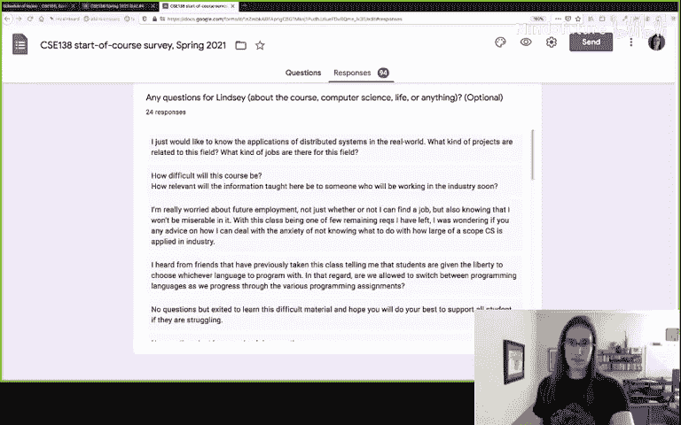

# 分布式系统：P04：向量时钟、FIFO、因果与全序交付 📚

在本节课中，我们将要学习向量时钟的完整概念，并探讨分布式系统中几种重要的消息交付保证：FIFO交付、因果交付和全序交付。我们将通过具体的例子和算法来理解这些概念，并了解它们在实际系统中的应用和实现方式。

## 向量时钟回顾与深入 🔄

上一节我们介绍了Lamport时钟，它能够捕捉因果关系的一个方向：如果事件A发生在事件B之前，那么A的Lamport时钟值小于B的。然而，反之则不成立。这意味着仅凭Lamport时钟，我们无法精确判断两个事件是否真正存在因果关系，还是仅仅是并发事件。

为了克服这个限制，我们引入了向量时钟。向量时钟提供了因果关系的双向判定：事件A发生在事件B之前，当且仅当A的向量时钟小于B的向量时钟（在向量比较的意义上）。这是一个非常强大的特性。

### 向量时钟算法示例

让我们通过一个具体的例子来回顾向量时钟的分配算法。假设系统中有三个进程：Alice、Bob和Carol。每个进程维护一个向量，初始化为 `[0, 0, 0]`，分别对应Alice、Bob和Carol的本地事件计数。

以下是算法的核心步骤：
1.  **初始化**：每个进程的向量时钟初始化为全零。
2.  **本地事件**：每当进程发生一个事件（发送、接收或内部事件），它将自己对应的向量分量加1。
3.  **发送消息**：发送消息时，进程将当前的向量时钟附加在消息上一起发送。
4.  **接收消息**：当进程收到一个消息时，它首先将自己对应的分量加1（因为接收本身是一个事件），然后将其本地向量与消息携带的向量进行逐分量比较，取最大值，更新为自己的新向量时钟。

通过这个算法，我们可以为系统中的所有事件分配一个唯一的向量时钟。比较两个事件的向量时钟，我们可以精确判断它们的因果关系：
*   如果向量V的**所有**分量都小于或等于向量W的对应分量，并且**至少有一个**分量严格小于，则V对应的事件发生在W对应的事件之前。
*   如果两个向量无法比较（即一个在某些分量上大，另一个在另一些分量上大），则对应的事件是并发的。

向量时钟是分布式系统中用于推理因果关系的核心工具。

## 协议、执行与交付保证 ⚙️

在深入讨论具体的交付保证之前，我们需要理解“协议”和“执行”的概念。一个**协议**是一组规则，规定了进程间如何通信，特别是基于已接收的消息可以发送哪些消息。一个**执行**（或一次运行）则是遵循协议规则所产生的一系列事件和消息交换的具体实例，可以用时空图来表示。

交付（Delivery）是区别于接收（Receive）的概念。接收是消息到达进程的网络事件，而交付是进程决定处理该消息的应用层事件。协议可以控制何时交付已接收的消息，这为实现各种交付保证提供了可能。

### FIFO（先进先出）交付 🚶‍♂️🚶‍♂️

第一种重要的交付保证是FIFO（First-In-First-Out）交付。

**定义**：如果一个进程先发送消息M1，后发送消息M2，那么任何**交付**了M1和M2的进程，都必须先交付M1，后交付M2。

**违反FIFO交付的示例**：
```
Alice (发送M1) ----> Bob
Alice (发送M2) ----> Bob
```
如果Bob先交付M2，后交付M1，就违反了FIFO保证。

**实现方式**：
实现FIFO交付的常见方法是使用**序列号**。
1.  发送方为发送给同一接收方的每条消息附加一个单调递增的序列号。
2.  接收方维护一个预期序列号。当收到消息时，如果其序列号等于预期序列号，则立即交付并递增预期值；否则，将其缓冲，直到收到预期序列号的消息。

另一种方法是使用**确认（Acknowledgements）**：发送方只有在收到上一条消息的确认后，才发送下一条消息。这种方法无需序列号，但会显著降低吞吐量，因为引入了往返延迟。

需要注意的是，**TCP协议已经在其传输层提供了FIFO（有序）交付保证**，因此在使用TCP的系统中，应用开发者通常无需自己实现此功能。

### 因果交付 ⛓️

FIFO交付保证的是来自**同一个发送者**的消息顺序。因果交付则是一个更强、更全局的保证。

**定义**：如果消息M1的发送**发生在**消息M2的发送之前（即 `send(M1) -> send(M2)`），那么M1的交付也必须发生在M2的交付之前（即 `deliver(M1) -> deliver(M2)`）。

**关键点**：因果交付关注的是所有消息之间的因果顺序，而不仅仅是来自同一进程的消息。


**违反因果交付的经典示例（“Bob有味道”问题）**：
1.  Alice 发送消息 “Bob有味道” 给 Bob 和 Carol。
2.  Bob 收到后，发送消息 “你才臭” 给 Alice 和 Carol。
3.  由于网络延迟，Carol 可能先收到 Bob 的回复 “你才臭”，然后才收到 Alice 的原始指控 “Bob有味道”。
在这种情况下，Carol 看到的消息顺序与因果关系不符（回复先于原消息被交付），这违反了因果交付，但**并未违反**FIFO交付（因为两条消息来自不同的发送者）。

**实现提示**：因果交付通常需要借助**向量时钟**来实现。进程在交付消息前，需要检查该消息的因果历史（通过向量时钟表示）中的所有消息是否都已交付。我们将在后续课程中详细讨论其实现。

### 全序交付 🗂️

最强的交付保证之一是全序交付。

**定义**：如果某个进程先交付消息M1，后交付消息M2，那么所有**交付**了M1和M2的进程，都必须以相同的顺序（先M1，后M2）进行交付。

**违反全序交付的示例**：
假设有一个主从复制的数据库，两个客户端同时向两个副本发送更新。
*   客户端1发送 `SET x=1` 给副本A和B。
*   客户端2发送 `SET x=2` 给副本A和B。
如果副本A先交付 `x=1`，后交付 `x=2`，最终 `x=2`；而副本B先交付 `x=2`，后交付 `x=1`，最终 `x=1`。两个副本状态不一致，这就是全序交付被违反的后果。

全序交付对于维持分布式系统（如分布式数据库、状态机复制）的一致性至关重要。实现全序交付是一个复杂的问题，通常需要共识算法（如Paxos、Raft）的支持，这将是本课程后续的重点内容。

## 总结 📝

本节课我们一起深入学习了向量时钟，并通过它理解了分布式系统中的三种核心消息交付保证：
1.  **FIFO交付**：保证来自同一发送者的消息按发送顺序交付。可通过序列号或确认机制实现，且通常由TCP等网络协议提供。
2.  **因果交付**：保证所有因果相关的消息按因果顺序交付。它比FIFO更强，需要向量时钟等机制来实现。
3.  **全序交付**：保证所有进程对消息的交付顺序达成全局一致。这是最强的一致性保证之一，是实现强一致性系统的关键，通常需要复杂的分布式共识算法。



理解这些交付保证及其层次关系，是设计和分析可靠、一致分布式系统的基础。在接下来的课程中，我们将探索如何具体实现因果交付和全序交付。