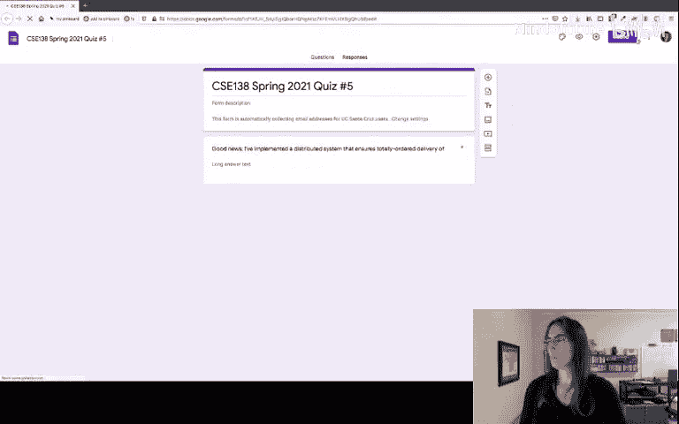
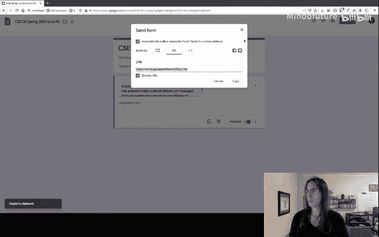
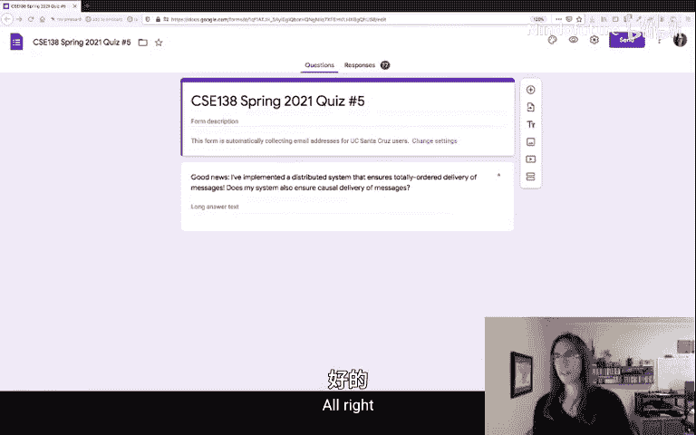

# 【加州大学】分布式系统-CSE138（Distributed-Systems）-p05-P05-L5---recap-of-FIFO-causal-TO-delivery,-implementing-causal-broadcast--BV1eGdLYjETJ_p5-

Okay， it looks like we're live。All right， welcome to Week three and day Five。Of distributed systems。

 if you've stuck with us this far。Congratulations。20% done with the course， it's pretty amazing。

Alright。So today we' have a lot to get through， and I'm actually not sure if we're going to get through it all because。

Even though this is material that I've taught before。

 I'm going to try to teach it in a slightly different way than I've done before。

So this is a bit of an experiment and we'll see how we do。

So I'm going to put this pretty ambitious agenda up。

And we'll just see if we managed to get through it all。

So first we're going to recap the delivery properties that we talked about last time。

If you recall last time we talked about how to implement PIO delivery。

 but we didn't talk about how to implement the other delivery properties that we talked about。

 which were causal delivery and total order delivery。

We're going to talk about implementing a particular kind of causal delivery。

 which is called causal Bro。And this word causal here should be a big hint that this is going to involve vector clocks。

Then we're going to zoom out and look at uses of causality。In distributed systems。

 And then we're going to look at a different application for causality， which is called the。

Chandy Laport。Snapshot algorithm。So this is ambitious。

Let's see if we have enough time to get through all of it。By the way。

 so I know that different people like to ask questions in class in different ways。

 I know that some people like to type things in and if that's you。

 then know you can go ahead and type things in in Zoom chat or sorry not in Zoom chat。

 please don't use Zoom chat but in Zooip chat。If you are uncomfortable typing something into Zooullip。

 you can always like in the public chat， then you can always send me a private message on Zooullip。

And you can also just ask questions out loud。 so I notice that not too many people are doing that。

 but you can if you want to。 And sometimes that's a good way to communicate like if I ask you a question。

 it can be a lot faster to just say something than to type So please feel free to to communicate by voice if you want to I would say no you don't have to raise your hand because somebody just asked on chat do you have to raise your hand I would say no for two reasons one I don't think that many people are going to be speaking out loud。

 so I don't think it's going be a huge issue。 And if there's a little bit of overlap I'm not too worried。

 And then the other reason is just to tell you the truth。

 I don't have time I'm always to look at who's raising their hand So。Let's just try。

 you know speaking out loud if you want to， and if it goes poorly today， we can always adapt。

All right， so let's jump right in， we're going to recap the delivery properties that we talked about last time。

So。I'll start a new page for this because I think we're going to need a lot of room。

So we talked about three different properties and so one of them was if you recall from last time one of them was called Fifo delivery or first in first out delivery and here's a picture of。

A violation of FiIO delivery。And recall from before。

That when you're talking about these kinds of properties。

 sometimes it's easier to draw a picture of what's not supposed to happen。 So it's easier to sum up。

呃。🤢，viols， or it's easier to sum up what FiIO delivery means by drawing a picture of what it means to violate PIFO delivery。

 that's easier than drawing pictures of all the infinite many executions that do respect FiIFO delivery。

So there's a question which is should you feel free to unmute to ask questions， yes。

 feel free to unmute to ask questions or answer a question。So that's a violation of FiIO delivery。

 we also talked about causal delivery， so here's a picture of our classic violation of causal delivery。

And finally， we talked about totally ordered delivery， so here's that。So in each case。

 it's a little bit easier to talk about them by drawing a picture of what doesn't happen under each of these。

Delivery。Properties。Okay， so。Yeah， go ahead。嗯。Yeah that's right， so the question was。

 are there protocols that we can use to ensure that these violations don't happen and the answer is absolutely yes。

 so last time we talked about ways to make sure that you have FiIFO delivery。

 in other words ways to prevent this sort of violation。

 and this time we're going to talk about how to prevent violations of causal delivery under certain circumstances。

Preventing violations of totally ordered delivery is actually a bigger topic。

 so we'll get to that a little bit later in the course。

Okay so somebody asked a really good question last time in chat。

 which was about it was something like， oh， is FiIFO delivery a subset of causal delivery？

It actually looks like this， so these are properties of executions。

 remember that a Laport diagram is an illustration of an execution of a distributed system。

 so when we talk about like observing fiIO delivery or observing causal delivery。

 the thing that observes that property is an execution。

So one way to talk about this is to draw a big picture。Where I've got this big circle here。

 and this is all executions。So absolutely anything could happen in an execution that's in this circle。

 you could have PIFO delivery be violated， for example。

 you could have totally ordered delivery be violated， anything could happen， so I'll put。Ylo。Here。

Anything can happen。Within that。A subset of those。Are going to be executions that observe fiIFO delivery。

And within that。There's going to be a subset of that。

Which are the executions that observe causal delivery？

So if it's an execution that observes causal delivery， if it's in this circle here。

 notice that it's also going to observe PO delivery。But if it observes pO delivery。

 it doesn't necessarily observe causal， so that's the relationship between those two。

So here's a question for you。Where do you think that totally ordered delivery would go in this picture？

Any ideas？Just a second。How's that？Yeah， I don't know what happened。 Zoom just check up。 Okay。

 it should be fine now Okay， so where do you think？

The circle would go for executions that observe totally order to deliver any thoughts on that。

The answer is a little bit weird。So one person says。

 should it be in here inside executions observing causal delivery？Somebody else says。

 would it go in the Yolo bubble？Somebody else is inside the FiIFO delivery bubble， so yeah。😊。

You're actually all right， in a sense， because。Executions observing totally ordered delivery would go。

Like this。So this is a little bit weird， right， we don't have this。A total hierarchy。Of executions。

Instead， you could have an execution that observes totally ordered delivery， but doesn't observe FFO。

On the other hand， you could have an execution that observes totally ordered delivery and observes PIFO。

 but not causal， or you could have one that observes totally ordered delivery and causal and PIFO。

 so there's like the zone in here。Which I。Highlight in green。And this would be。

To put a little legend on this picture here。This one would be executions。With both。Totally ordered。

And causal delivery。And on the other hand。You could have some executions that are in this zone out here。

And let's do different kind of hash marks here。Because I know that not everybody can see the difference between the。

The， the colors。So these would be executions that are totally ordered， but not FiIFO。

So that's kind of interesting right， so what would be an example of an execution that is totally ordered but not？

FifO。So let's look at a picture of an execution that would fall into that red zone。

So it could be something like this。Maybe you've got three processes。

And process one here sends messages。And let's say it sends messages to process two and process three。

 so let's say it does like this。And then。Later， it also sends messages to process two and process three and those go like this。

So do you see what's going on here， so the way that I did it was process one sent。

These two messages we could call them M1 and M2， the order at which they arrived at process 2 here was flipped around。

 so process 2 got message 2 and then message 1。And process 3 also got M2 and then M1。

So in some sense， processed who got the messages in the wrong order。

 so that's a violation of PIFO clearly。But then so did process three。

 it also got the messages in the wrong order。The messages arrived in were delivered in the wrong order。

 but consistently the same at every process so that。Observes totally ordered delivery。

 To ordered delivery says that if a particular process delivers messages in a certain order。

 then so does everybody else who delivers those messages。

 so this would be an execution that falls into this funny looking red zone here。

And so this is just to show you that there's not a total hierarchy of these kinds of delivery guarantees。

 so you can have executions that observe totally ordered delivery。

 but don't observe causal or even FIFO delivery。And。When we look at total ordered delivery。

 one thing that we're going to be thinking about is。

Do we also guarantee causal delivery with with our algorithms for ensuring totally ordered delivery that'll come later in the course。

 so because that's not necessarily something that you get for free when you implement totally ordered delivery。

 that's something that you would have to give extra thought to unlike with causal。

 if we're implementing a causal delivery mechanism， you get fiIO delivery for free。

 as you can see from the way that these circles are nested， not so with totally ordered delivery。

So that's a quick recap of the delivery guarantees or the guarantees。

TheThe properties of executions that we talked about last time。

 any questions on that before we move on？Mmhmm。😊，Is sending different from delivering？

Was the question。 Yeah， so recall how we talked about。 So what delivery means is。Let's say that you。

诶。Get a message。And。We've talked about what sending and receiving mean。

So if P1 sends a message and P2 receives it。So P1 chooses when to send the message。

 they can choose whether and when to send the message。

P2 doesn't have any choice in the matter of whether they。Whether they receive the message or not。

 that receiving is just something that happens to you。But here's the way to think about delivery。

Think about it as there being a little mail clerk。That's hanging out here。嗯。On this process。

 who is deciding for every message received， deciding。

Should I deliver this message to its intended recipient or not。

 so all incoming messages go into the mail room and the mail clerk's job is to choose to deliver them to the addressee or not。

So you as a process， get you don't get to choose if you receive messages。

 just like you don't get to choose if you receive mail。

 but you get to choose whether to deliver that message。

 so delivery is something that happens on the receiver's end with a received message。

Choosing whether or not to take that message and apply it。

So the way that we have been drawing that on our LAport diagrams is by putting a check mark when we say a message has been delivered。

So yeah， sending and delivering are very different， sending is something that the sender does。

Delivery is something that the receiver may do with a received message。Okay， so。

Let's move on from there。And the next thing that it's on our agenda。Is。Implementing causal broadcast。

So this is the first time that I have used this word broadcast， I think。

 so let's take a moment to talk about what that means。So far。

 when we've been talking about messages being sent and received。We've mostly meant that。

There's one sender and one receiver。So。There's a name for messages like that。

And they're called unuchcast messages。Sometimes also called point to point。One send。One receiver。

However， I have been cheating a little because in some of the Laport diagrams that I've drawn。

We've had a situation where there's one sender and multiple receivers。So that's called multicast。

And then a special case of multicast。Is broadcast。Where one sentence。And everyone receives。

So as many processes as there are in the system， everybody gets a broadcast message。

So we saw that already， in fact， when we talked about。Violations of causal delivery。

 so in our classic picture。呃。When Alice sends her。Bob smells message。And Bob responds。

Notice that this message from Alice actually has two recipients。

 so we only think of it as one message。We call this message M1。

 even though it M1 is both of these arrows here， so this is a single message。

 but it's a broadcast message because it's being sent to everybody likewise this one is also a broadcast message and we can call this1 M2。

So。It turns out that if you were in a setting where all of your messages are broadcast messages。

That makes it relatively straightforward to ensure causal delivery。

 so the algorithm that we're going to look at today for ensuring causal delivery is an algorithm that only works in the setting where all messages are broadcast messages。

By the way， I said here everyone receives。So。Is there anything being left out of this picture up here when I said that everyone receives the messages。

 what do you think？Great， yeah， so the。The answer is that the sender ought to be included in everyone。

 or at least in many broadcast algorithms， the sender is included。

 so if we were going to be really pedantic about it。

 then we could draw a little arrow here that shows Alice sending the message to herself as well。

 and then Bob sending the message to himself。Most of the time。

 we don't put those little self arrows in the picture just because it complicates the picture too much。

But。In general， when we talk about broadcast， we mean sending to everybody。

 including yourself that could vary depending on the setting and on who's talking about it。

 but that's generally what we mean。So just to contrast broadcast with multicast。

This other picture that we looked at a second ago that was a violation of totally ordered delivery。

 this one happens to be multicast and not broadcast right because we've got messages here that are being sent。

To multiple participants， but not all of the participants， so this would be an example of multicast。

Where you have a message that has more than one recipient。Somebody just asked in chat。

 is there something for multiple senders and a single receiver？I mean， I don't think so， right。

 like I mean you could have。Something like this where processes zero and one are both sending to process two。

 but I think that would just be considered two point to point messages don。

I don't have a special name for that， you could maybe give a special name to some kind of bigger communication pattern where you have you know maybe one message going out from one process to everybody and then everybody acknowledging that one。

But that would be。That would be more specific， so no。

 I don't think there's a word in particular for this kind of thing。Yeah， I don't know。

Maybe you would call it gather or something like that。I don't know。Anyway。Let's talk about broadcast。

 so we want to figure out how we can implement an algorithm that will prevent this sort of anomaly from happening。

And recall that the bad thing that happens here is Carol's confusion when she gets this message that's from Bob before she gets the message from Alice that causally preceded it。

So this is the part that I'm a little bit uncertain about because I'm teaching this in a different way than I've taught it before。

 but I'm going to take a stab at it and we'll see how we do the reason I'm teaching it in a different way is because in the time since I last taught this class a year ago。

 I've actually done a lot of thinking about this problem because in fact。

 Patrick and I have been thinking about it a lot in our research so。

So there's a different way that I want to talk about it than I did last year and we'll see how it goes。

So。Recall that we talked about vector clocks before。

 and I want to briefly talk about the vector clocks algorithm again with a minor twist。

And the twist is going to be， don't。Count。Message receives as events。

So before we were using vector clocks to count up events that had occurred on different processes and keep track of how many events had occurred on which processes。

 and we did that by counting events that occurred both the sends and the receives and the internal events this time we're going to do it a little differently and we're not going to count the message receives。

 because it turns out that we don't have to for this particular algorithm so it's going to go like this。

嗯。Yeah， so I'll say it like this winter process。Send。A message。ItIncrements。Its own position。

And it's vector clock。I guess I should write down the first step that every process keeps a vector clock。

That's the same as before。So every process keeps a vector clock that's initially all zeros。

When a process sends a message， it's going to increment its own position in its vector clock。

 so whichever entry in the vector clock belongs to that process， it's going to increment。

And it's going to include。The updated vector clock。With the message。

So that's the same as we talked about before。And then。We're going to say。When a process。

Delivers a message。It updates its vector clock。To the point wise maximum。Of its local vector clock。

And the received。Victor Clark on the message。So that's it。

Let's look at a brief example of an execution。That uses this protocol。

So maybe you've got three processes。And so everybody's going to keep a vector clock that's initially zero。

All right， let's say that process one sends a message。

And these are only going to be broadcast messages。So I'm going to leave out the self arrows here。

 but you can kind of pretend that they're there。So this is an event。

 this is a message being sent by process1， and so it's going to increment its own position。

And then that 10，0 vector clock is going to get sent along。Like that。

Along with the regular content of the message， this vector clock is going to tag along as metadata with the message。

Metadata is just kind of additional data that goes with it。

And then you could imagine maybe over here， process three is sending one。

So this one would get updated to 001。And then once again， that's going to tag along。

This is the updated vector clocks algorithm。So we're looking at the vector clocks algorithm that we had before and we're updating it slightly。

So I haven't quite gotten to enforcing causal delivery yet。So the question was。

 are we doing causal delivery or are we doing causal broadcast， well。

 we're not really doing either yet， we're just kind of setting things up。So。What happens here， well。

 process one is going to receive this message， it's going to have a vector clock attached of 001。

 and it's going to update its vector clock。And it's going to do that by taking the pointwise maximum of the two it's a little bit different from before because before we were counting message receives as events。

 so we're not doing that here， notice that we're just taking the pointwise maximum of the two and we're not counting the receive as an event。

And likewise over here， this 100 is going to come along。This message is going to get here。

We'll again take the pointwise maximum。And so on。 so you can imagine more messages getting sent here。

 but so this is just an example execution that uses this updated slightly different vector clocks protocol that's really the same as before except that。

There's this twist which is that we're no longer counting message receives as events。

 These are still vector clocks anytime you use vector clocks because the point of vector clocks is to count events right so anytime you use vector clocks an important question to ask is。

What do you want to count as an event？So it turns out that in this case。

 we're not going to count receives as events， so when we get to the end of this execution here。

The vector clock。On an event or on a process like this， like P1 has 101。

This you can think of this as meaning。It's like a count of all the sends that we know about from everybody。

 so process one at this point knows about one message that its sent and it knows about one message that process3 sent。

And process 3 at this point also knows about one message that process one sent and one message that it sent itself。

That's the way that you interpret the meaning of vector clocks in this setting。

Notice that also I use the word deliverlis here。嗯。Instead of receives and that's going to be important because we're about to use this updated vector clocks algorithm to talk about how we're going to implement。

诶。Casal delivery。So the question that somebody just asked was。

Are we talking about causal delivery or are we talking about causal broadcast。

 so let me try to distinguish between the two。So causal delivery is the property that we care about。

Casal Bro is an algorithm that we are going to be implementing。

Which enforces causal delivery in the case where all messages are all broadcast messages。

 so let me write that down in case it was a little bit unclear or vague。

 So causal delivery is the property we care about。 It's a property of executions。

And causal broadcast。Is an algorithm。That gives you causal delivery。

In a setting where all messages are broadcast messages。So you might naturally wonder at this point。

 how would I get causal delivery if I'm in a setting where all messages are not broadcast messages？

So that's a damn good question。And my somewhat unsatisfying answer to that is that we're not going to talk about an algorithm for that。

 we're not going to talk about an algorithm for general causal delivery because it's more involved and more annoying。

So instead。We're just going to talk about this algorithm for causal broadcast。

 and it turns out that the basic ideas behind a general causal delivery algorithm are similar。

 but they're more tedious and annoying。So for now， we're going to stick with just talking about an algorithm for causal broadcast and that it turns out。

 is going to be good enough to help us。Avoid things like this Alice Bob Carroll situation。Because。

As you can see from looking at the picture， those were broadcast messages。

 so this algorithm for causal broadcast is going to be good enough to rule out。This kind of anomaly。

Questions about that。All right。So。Let's see。I think with this particular way of。

Explaining causal broadcast。I think the best way to do it。Is the following。

I'll draw a picture of an execution。That does the bad thing that we don't want。

And let me try putting some vector clocks。呃。🤢，On these events。So that we can see。

How we can use vector clocks to implement causal broadcast。So once again。

Everybody's going to start with zeros。Process one will send this message。

Vectctor clock gets sent along。So recall from the algorithm that we just saw。We said。

When a process delivers a message， it's going to update its vector clock to the pointwise maximum of its local vector clock and the received vector clock on the message。

So coming back to this picture。Let's look at what would happen if we just delivered everything right away as soon as we received it。

 well then process two would get this message。And it would update its vector clock。

Because it's taking the pointwise maximum of 10，0 and its local vector clock， which is just 0，0，0。

 So it's going to update to。1，0，0。The next thing that it does is it sends a message。So it's going to。

Increment its own position because it's sending a message。That message will get here。

And I didn't actually write the vector clocks on the messages， but I could。

Just to make it very explicit。This message from P2 gets to P1， it's going to look at these two。

 and it's going to take the pointwise maximum， so the maximum of 1 and 1 is 1。

 the maximum of0 and 1 is 1， maximum of0 and 0 is0。Here。The maximum of 110 and 00，0 is 110。And here。

The maximum of 110 and 100 is 110。So we know， right， that this。Event。Was where the badness happened。

Right， because。We know that this event over here。On process one causally preceded the send of this event here on process  two。

 we know that because we know about causality and we know about happens before。

 so we know that this one happened before this one and yet。

If we're calling this message message one and this one message two。And yet。

 message two is arriving first on Pre 3。So here's my question for you。

You know that this is what you want to prevent right。

 you know that you want to prevent message two from getting delivered before message1 over here on Pre 3。

 this is the bad thing。How can you use the vector clock value that's coming on message 2？

To tell you what you're allowed to deliver and what you should not deliver right away。

So there's another question in chat which is I'm confused between delivered and received。

 are we assuming that when a message is received， it's considered to be delivered So in this picture I drew here。

I haven't。Showed you how to enforce causal broadcast yet。In this picture here。

 we're just we're not giving any attention to causal delivery。

 we're just delivering everything in this picture as soon as we get it。

But that's clearly not the way to go right， it's clearly not the right thing to do to just deliver everything as soon as you get it。

 because if you did that， then you could end up in a situation like this where process3 is delivering this message too soon。

So what we would like to do is somehow be able to make use of this handy。

Vectctor clock information that's tagging along on these messages to tell us。

When is a message O to deliver and when should it be kept in reserve？And in particular。

 what I would like to make happen is。Instead of delivering this message when it gets right here to process 3。

I would like to queuee it up。And sort of。Delay delivering of it。

Until after this other one has been delivered。So。How would we accomplish that？

And that's kind of the key question that we have to figure out in order to implement causal broadcast。

How are we going to。Choose whether to deliver a message。

So there's starting to be some good suggestions in chat here。

Should we only deliver a message that has a vector clock less than or equal to the most recently received one？

嗯。Yeah， so another one has to do with。If you get this， and I like this suggestion a lot。

 if you get this message that has a 110 on it， well， what does that mean？Well。

 the message came from P2。And this one right here。Is an indication that。P2 has sent one message。

 but look， your vector clock at this point is only 0，0，0。

 You don't know about any messages from anybody at this point。 So this 110 comes along。Well。

 what does that mean and it means that P2 knew about this other message on process 1。

 and that's what that first one means？So that should be a big fat warning to you when you receive a message with a vector clock of 110。

The sender knew about something that you didn't know about。So that seems like a problem， right？

Whereas this one here， this one came from P1。It had a clock of 100。Well， that seems okay， right。

 there's the one which。Represents the fact that P1 sent a message right。

 but it gets here and that should be fine right like that's the only thing that's different about this vector clock from yours is the knowledge of that sent message that is in fact this message itself。

So that one seems okay and this one doesn't seem okay。So what we want to do。For causal broadcast。

We want to。Define。A condition。I'll call it the deliverability condition。Whoops， deliver a bill。30。

Condition that tells us。If a received message。Is or is not okay to deliver。

And this deliverability condition is going to use the vector clock on the message。

So without further ado。Here's the deliverability condition that we want。

We're going to say that a message。M。Is deliverable。诶。At a process P。If。

There's going to be two parts of this。So first we want to look at the vector clock。Of the message。

In the particular sender's position。So。I'm going to say。

 so if this is the vector clock of the message， I'm going and recall a vector clock of messageM is just。

Vectctor Vis， I'm going to index into it。At a particular K。

 that's going to give us a particular position in the vector。That has to be。Equal to。

The vector clock。Of P， that's the process that's receiving the message。At position K plus1。

So in other words。The vector clock that's coming in on the message。In the receiver's position。

It's got to be one bigger than whatever the receiver has in that position。And this is。嗯。嗯。

And K here is the centerer's position。So this is if k is the sender。

 and then the other part of this definition is。For every other K。

So for every other index into the vector clock。That's not the position of the sender。

The entry on that position and message has to be less than or equal to。

The vector clock on the process。So just a little explanation of the notation here。嗯。VCM。Is。

The VC coming in on the message。And VCP。Is the VC on the process？So two pieces to this definition。

And together， they make up the deliverability condition， I should say here。

So K here is going to range over all the entries。So n is the number of entries in the vector clock。

 K is going to be an index into that vector clock。So that's going to be the deliverability condition。

Putting that together。With what we talked about a little while ago with our updated vector clock algorithm。

We're going to use this as a way to decide whether to deliver a message that we've gotten。

And let's see how well that works。By looking at an example。So I'll move this here。

So we can still see our definition of deliverability。And。

Let's go back to our classic Alice Bob Carroll example。Once again。So Els is going to send。

Bob is going to send in response to that。Ohoops，1，1，0。Here is Carol。Carol has received a message。

And the little mail clerk that's hanging out here on Carol has to decide whether or not to deliver that message。

 How is the mail clerk going to make that decision。Well。

 they're going to check the deliverability condition。So is the message deliverable well？

It's got a VC of 110。And Carol's current vector clock is 000。

Carol will look at this or Carol's mail clerk will look at this and say， okay。Well。

In the sender's position， which is Bob's position right here。It's one bigger than my。So that's good。

 right， conditionition one checks out。So in the sender's position。

The vector clock on the message is one bigger than whatever my current vector clock is。

 So the first condition checks out， but then the other condition。You see this。 So this says。

In every other position。The vector clock on the message has to be less than or equal to whatever my vector clock is on my process。

 and that is where we have a problem because this one right here violates that。So。

Carol's mail clerk will say no， I will not deliver this message right now。Instead。

 it's going to be stuck into a queue for delivery later。And we sometimes call that the delay queue。

So this one goes into the delay queue。ALittle while later， Alice's message shows up at Car。

 it has a VC of 110。Or sorry， 100。Carol looks at it。Does it？

Does it observe this first property of deliverability？The entry in the sender's position。

Is one bigger than Carol's current entry of 000， so that checks out。

And then the other property is that in every other position it has to be less than or equal to what Carol has。

 and indeed it is it's got zeros in those positions and so does Carol， so it's good to go there。

And then， so Carol can deliver that one。Now Carol's local vector clock is updated， right。

 so this becomes a one。So now this message that got delayed earlier。

Now the mail clerk can go back and say， oh， well， now my process vector clock has changed， right？

Now my process clock is 100。The vector clock on this original message from Bob was 110。

 does it meet the criteria？嗯。I've got a clock of 100。

 indeed this one is one bigger from mine in the sender's position。

 and in every other position it's less than or equal to mine。

 so this message from Bob can now be delivered。And so this。No turns into a yes。

And so we're in good shape。So what just happened here。Is that Carol got a message from Bob？

And her mail clerk decided to delay it until this other one had been delivered。And then finally。

 it was okay to deliver the。The message。From Bob after the one from Alice。That's causal delivery。

Let's walk through another example just to make sure that we understand。So here's a fun one。So。

Let's say that we have。Wndsay。呃啊系。And Patrick。So I'm really bad about keeping track of my belongings and I lose them all the time。

So。Let's say that I。Lost my phone。Actually， let's say that I lost my keys。Because if I lost my phone。

 I wouldn't have a way to send a text to Aey and Patrick， let's say that I lost my keys。So。

I send a message to them。I lost my keys。And let's say that it goes like this。So they get the message。

And let's say they so okay， so let's say Aha gets this message from me。 I lost my keys。

 and this is the first event on me so。I'm going to increment the vector clock right。

 and so that updated vector clock is going to go along on the message。Sure。Sorry about that。

Hopefully it's clear now。I don't know why it comes out of focus every now and then。Okay， so。

Is this message safe to deliver when it gets to AI？Right here。Under causal delivery。

 is it safe to deliver？What do you think？いep。So we're going to go ahead and deliver it。

UpPa vector clock gets updated。His process clock gets updated to 100。 What about it， Patrick。

 is it safe to deliver for him too？Yeah， that should be fine also。Okay。So then。

Let's say that I find my keys。And I'm really happy。So I then send another announcement。

Saying that I found my keys。And this one's going to have a VC of 200。Because it's event。

 the second message that I've sent， and I don't know about any sense from anyone else。

So it's going to have a vector clock of 200。The message gets here， is this one okay to deliver？Yeah。

 this one should be fine。And if you think back to the delivery conditions that we talked about a second ago。

 why is it fine， Well， it's fine because it's one bigger。

Then ofs current vector clock in the sender's position， so it's two instead of one。

 so it's one bigger there， and it's less than or equal in every other position。

So if you think back to that deliverability condition we talked about earlier， everything checks out。

And we're good to go， we can deliver the message。But then let's say that Ajai sends a friendly response。

To me and Patrick， so let's say that he says。Yay。Well， this is a message send。

So it's got to be counted in the vector clock。His own position is going to get incremented。

Likewise over here。I received the message for Mobha。Should I deliver this message。I should。

Why should I deliver it because it's one bigger than my current vector clock of 000 or sorry my vector clock is 200。

 This one's one bigger in the sender's position， which is this position right here。

And it's less than or equal to me in every other position， so this one's good to go。

But what happens over here？Patrick gets the message of Yea。If we were not doing causal delivery。

Then this would be kind of a rude message to send， right？

Because the last thing that Patrick heard was that I lost my keys。And then Aba is saying， yay。

So that's not really a nice thing to say in response to somebody losing their keys， thankfully。

Causal delivery prevents us from being so rude because when we compare that vector clock of 210 with our own clock。

We see that it's bigger。Thenhan us in the sender's position or by one。

W which is this the second position here， so it's bigger by one in that position。

 but it doesn't observe the other property that we want。

 which is that it's less than or equal to us in every other position。

 so this one should not get delivered and instead it's going to get cud。200 comes along。

 is this one safe to deliver？It is。So this one's good。We update to 200 for our vector clock。

 and now finally the queued message。Can be delivered。

And now that Patrick knows that I lost my keys and I found them。

 now finally we get the message from Moai， which says yaea。

 and so now the message can be delivered down here。And now our queue is empty。

 so there was a fantastic question。And chat a second ago， which was how big do you make the queue？

And that's a really good question， right， if messages are piling up。

Let's say that Aba sent a bunch of messages that for whatever reason arrived at me or arrived at Patrick rather。

Before mine。So if he had sent a whole bunch of messages here。That we're right here。

How big does that Q have to be？Well， we hope that。It's not actually so many messages that it's going to overflow the queue right。

 and so Patrick and I actually implemented a cu like this。For a project that we worked on recently。

And。There's a lot of factors to consider here， like how far apart are all of these nodes and how often do you anticipate their being message delays。

 but yeah， unbounded message cues can be a problem in distributed systems。

 ask any early programmer about that。But。We hope that for the most part。

 these cues won't get too large。So。There's a couple of interesting things to think about here。

 now one is like how do you guarantee that you never deliver a message too soon Well。

 I've just sketched out an algorithm for that guarantee。

But another thing to think about is how do you make sure that messages don't get stuck in the delay queue forever？

So that would be what's called a liveness guarantee and that one's actually a little bit harder to prove。

So。One way to implement something that， you know， this is kind of like when we were talking about FIFO before。

 when we talked about PIFO delivery。If I just dropped every received message on the floor， then。

It wouldn't be violating PIO because I wouldn't be delivering any messages in the wrong order。

 I would not be delivering them at all。But that wouldn't give us what we really wanted。

 which is which would be to deliver the messages， but to deliver them in a given order。

 So that's what's called a liveness property to make sure that messages do eventually get delivered。

 and we're going to be talking about this notion of a liveness property much more a lot later in the course。

All right， I think that's about time for a break because we've been talking quite a lot。

 so let's do our 10 minute break now。And I'll switch over to our quiz question and let's resume at。

4 38。嗯。Google says I've been signed out just a moment。

 I'll post a link into this question in just a second。Okay， I think I've been signed in again。

Sorry about that。

Okay。So here's the link to the quiz in Zullip。And I'll see you in 10 minutes at 438。

Two minute warning。Right。

It's 438， so welcome back。So I mentioned before that our schedule was ambitious when I said we were going to talk about the Chandy Laport snapnapshot algorithm today。

 and indeed I don't think that we're going to have time to talk about it in the 17 minutes or so that we have left at least not in great detail。

 but we can talk about it a little bit。So。Let's set the stage and then we'll come back next time and talk about it in a lot more detail。

So。Snapshots of distributed system。So。One thing that I've mentioned a couple of times in this class。

Is that。In a distributed system。Processes have state， right， and that state can be thought of as。

know， the collection of the events that have occurred on that process， right？

So if you've got a bunch of different processes here， maybe they each have some events and you know。

 maybe there's some message sends and some message receives and possibly some internal events。

So everybody's got their own state。Individual processes have states and we can say that the state of a process amounts to all the events that happened on it up to a particular point。

But how do I want， how could I talk about the global state of this system。

 What if I want to talk about the state of all of these processes at once？Well。

 that's a little bit harder to do。So if we had a globally synchronized time of day clock。

Then we could say， okay， everybody take a snapshot of yourself at 3， 20 pm。

But my 320 PMm is not necessarily the same as your 320 PMm。

 and note that I'm not talking about time zones here。

 I'm just talking about different clock synchronization， so you can assume that everybody's using。

 say UTC， but even so。My notion of a particular time is not going to be exactly the same as yours。

So you could get this kind of badness right， where if you have two processes。And you know。

 maybe process one has had some events， and then this is 3， 20 pm。On process one。

And then maybe process two has some events。And let's say this one here is。

Receive of a message that was sent after 320。From process  one。

 at least as far as process 1 thinks of 320， but maybe right here is where 320 is。

According to presses 2。Well， if I were trying to snapshot state by saying everybody take a snapshot of yourself when you think it's 320。

 then process 2 snapshot would look like this。But process one snapshot would look like this。

So Pres too would say， oh， well， I received this message。Process when would be thinking， what？

There was no message， not in my snapshot。So according to process1。

 this thing that process 2 claimed happened never happened。We can't do that。

We cannot use time of day clocks to take snapshots。

 clearly they're not going to be useful to us in that setting。

 so what we need is an algorithm that will allow us to take a global snapshot of a distributed system that makes sense。

 but without using these kinds of time of day hacks。So。It's a little bit tricky。

 and there are some ways to take a snapshot that makes sense。And other ways that really don't。

But here's a property that I would really like to have be true。So if you have two events， A and B。

Where A happens before B。And B is in the snapshot。Then what do you think should be true？That's right。

A should be in the snapshot too。So notice this use of the Happ before relation yet again。

 it's another place where the happens before relation is going to be useful to us。

So how do we accomplish that？How do we design an algorithm that will let us take a snapshot of a distributed system？

That will。Ensure that this property is true， where if you have an event that's in a snapshot。

 any event that happened before it is going to be in the snapshot as well。

So we're going to be talking about a classic algorithm。For doing that。

 for taking a snapshot of a distributed system。And in fact， this is the pioneering algorithm。

For taking snapshots of distributed systems， it's called the Chy。Lampport algorithm。

So it's called the Chandy Laport algorithm because it's named after two。

Famous distributed systems people， one of them of course is Leslie Lamport who we've already talked about a couple of times。

 he's the namesake of Laport diagrams and Laport clocks。

 so obviously he's made a lot of important contributions to distributed systems。

 the other person is Monnie Chandy so。So Mo Chandy and Leslie Lamport。Whoops。呃。

Developed this algorithm， I think this was published in 1985。But you can fact check me on that。

 it was something some time around that。So because we don't have a whole lot of time left today。

 I'm not going to be able to go into all the details of the algorithm。

 but I want to just give you a little bit of a flavor of it。So。

Anytime you talk about the Chandy Laport algorithm， you have to tell the origin story。Supposedly。

 Chandy and Laport were hanging out one night over dinner。

 and they were talking about this problem of how would you compute？A distributed global snapshot。

And so apparently they'd had like a little too much wine and they couldn't really figure out how to solve the problem right then。

And supposedly， according to Laport。He came up with the solution in the shower the next morning。

And he。was so happy and he hurried over to Chandy's office to talk about it with him。

 and Chandy was already in the office and waiting for him there with the same solution。

So apparently they both figured this out independently。And so that's why we give them both credit。So。

Let's talk about what the algorithm does。And again， we won't have time for all the details today。

 but let's talk about it at a high level。So before we start。

 we're going to need a piece of terminology， which is new。

And that's the notion of what's called a channel。So a channel can be thought of as。

Connection from one process to another。So。If you have processes， P1 and P2。

 sending and receiving messages。Then we have two channels in this case。

 there's the channel from P1 to P2 and there's the channel from P2 to P1， so channels are one way。

They go from one process to the other。So it's like a one way road。So in particular。

 like if this were event A and this were event B。And A were ascend and B where it received。

Then this message， we can call it M1 traveled through the channel from process one to process 2。

And the naming convention we're going to use for channels is going to be。The lit C。Subscripted with。

呃。Two numbers。Which are。Id of the sender。And the ID of the receiver。

So C12 is going to be the name of the channel from process 1 to Pro 2。And likewise。

 C21 is going to be the channel from。P2 to P1。So maybe I have another message here。

And let's say that it's in flight from process2 to process one。

 so we can think of that message while it's in flight as being currently in the channel。

So in this particular picture， the channel C21 has one message in it。

And the channel C12 is currently empty because there was a message that went through it earlier。

 but there isn't right now。We're going to assume that messages go through channels in PIO order。

So channels are going to act like FiIFO cues。So if process two， were to send another message。

Then the behavior is going to be that。If we can think of C21 as being a sequence of messages。

There's no passing on this one way road， so process one has to get message2 before it gets message 3。

 So the notion of FiIFO delivery that we talked about before that's kind of baked in here to this concept of channels。

All right， we have confirmation in the chat that the Chandy Landport algorithm is indeed from 1985。

 so I got it right， thank you。Okay。I don't think that we have time in the five minutes remaining sadly to really talk about how the Chandy La port algorithm works。

So。Let me pause right here to see if there's questions about anything that I've discussed so far and then we'll have to save everything for the next time。

Okay。No questions then I think we're going to conclude by just drawing a few pictures that will hopefully give you an intuition for how the algorithm works and then next time we'll talk about all the gory details。

So we want the snapshots that we take to make sense。

So let me draw a couple examples of snapshots and you can tell me whether or not you think they make sense。

So let's say that we have a couple of processes here。And a couple of messages。

So a snapshot is going to consist of the state of each process。So here's an example of a snapshot。

Press2 is going to snapshot at state like this。Process one。

 it's going to snapshot at state like this。Do you think this is a good snapshot？No。Yeah。

 we don't want this one。 Why is it bad， Well， there's this event A up here， and it happened before B。

 right， it also happened before D， and yet B and D are in the snapshot and C as well。

 C also A also happened before C transitively， but A is not being included。 Okay， well。

 here's a different snapshot of the same execution。Is this one a good snapshot？Yeah， that's right。

 so C& D aren't included。But is it a good snapshot according to the criterion that we had before？

Yeah， it turns out it is， this one is perfectly good。It might not be。

Everything that we ever dreamed of。But it doesn't violate the property that we talked about before。

 where if an event is in the snapshot， so is everything that happened before it。

 So this one is actually perfectly okay。According to our definition of what makes a good snapshot。

And then this would also be okay。So this is another perfectly legal snapshot。

And then a snapshot that had all the events too would be fine。So。

A snapshot may not tell you everything that you ever wanted to know。But you want it to be。

A consistent snapshot。 In other words， you don't want to have any weird stuff like this where you have an event that was。

In the snapshot。But then that event happened before some other event that was left out because it can be very mysterious looking at these sorts of snapshots later on to try to understand what's going on。

And the reason why is because one thing that we might want to use these snapshots for is trying to debug a problem so when we go and try to debug maybe we're trying to figure maybe maybe this message never should have been sent。

 maybe C never should have been sent over here or this call it M1。

 maybe M1 never should have been sent here and。We're trying to figure out why maybe somehow that message was sent because of A。

Well， if we're going to have any shot at debugging it。

 then A had better be included in the snapshot that we're inspecting。

So that's why we care about our snapshots being consistent。

 so next time we'll talk about the algorithm for taking these consistent snapshots。

And I will see you next time， Take care。