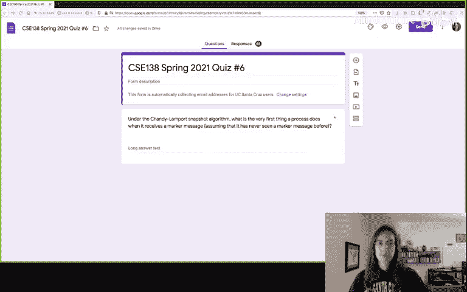
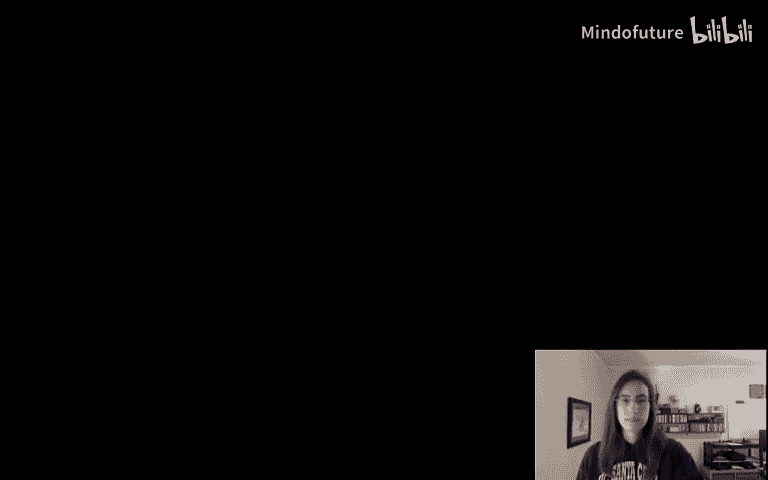
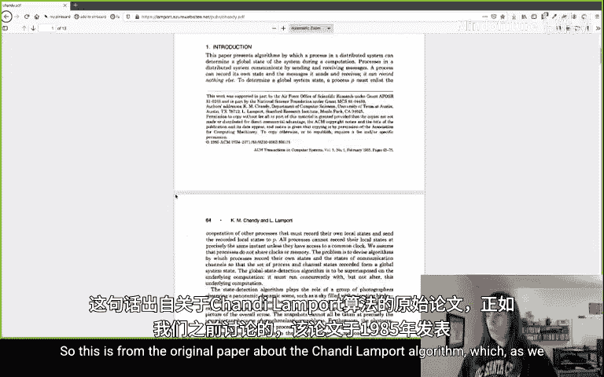

# 【加州大学】分布式系统-CSE138（Distributed-Systems）-p06-P06-L6---Chandy-Lamport-snapshot-algorithm--BV1eGdLYjETJ_p6-

Okay， stream is live here we go， Wee to Le6。So if you recall from last time。

 we ended the last lecture。Hoping to talk about the Chandy Lamportt snapapshot algorithm。

And we didn't quite get to it that was kind of ambitious to hope that we would fit it in last time with everything else that we had to talk about。

 So today we're going to come back and spend the whole time on snapshots。

And we're going to talk about this Chandy Laport's snapshot algorithm in detail。

So let's put up an agenda for today。That's a little bit of out of focus。

 let's see if we can fix that。There。Okay， so today we're going to cover。

The Chandy Laport snapnapshot algorithm。And we'll talk about。Limitations。And assumptions。

That the algorithm makes。And also properties of the snapshots that it takes。And then at the end。

 we're going to talk a little bit about。Centralized versus decentralized algorithms。

And if we have time。Then we'll get to more。Of your questions from the start of course survey。

We'll see if we get there。All right。Last time we kind of set the stage for talking about the Chandy Laport S snapshot algorithm by talking about what a snapshot is。

 so just to recap from last time。If you have some distributed execution。With a bunch of events。

Let's say that you want to record a picture of what happened in the execution。

And we talked about what kind of properties you want to have be true of that picture that you would record。

One thing that you want is if you have two events A and B。呃。Where A happens before B。

If B is in the snapshot， then a should be also。So in particular。

 like if this is an execution over here where this snapshot on processcessed 2 consisted of these two events。

Then it had better be the case that the snapshot on processcesed one includes this event here because this event happens before these。

Otherwise， your snapshot wouldn't make sense。So this would be an example of a snapshot that has this property and this property is called consistency。

 so the word consistency gets used a lot in distributed systems。

And it's important not to get too confused because it's got different meanings in different contexts。

But in the context of a snapshot， that's what consistent means。

 so this would be an example over here of a snapshot that's consistent and there's lots of other examples I could draw of consistent snapshots and then other examples that I could draw of snapshots that aren't and we looked at a few examples of that last time。

Okay， so how do you actually get a consistent snapshot？Well。

 that brings us to the Chandy Laport snapapshot algorithm。

 which is kind of the granddaddy of distributed snapshot algorithms。嗯。

And what's kind of interesting about this algorithm is that。It dates from 1985。And if you recall。

 when we talked about。Vctor clocks earlier， vector clocks didn't really。

If vector clocks existed in 1985， then they hadn't really been published or popularized。

 so Chny and Lamportt were not aware of vector clocks at the time that they invented this algorithm。

 and so the algorithm doesn't use vector clocks。There are snapshot algorithms that have been developed since then that do use vector clocks。

And some of them have different properties than the Chandy Laport algorithm。

 but we're going to look at this algorithm because this is， like I say。

 it was the original distributed snapapshot algorithm that kind of inspired a great deal of other work。

All right。Let's work through an example， and while I'm working through this example。

 I'll kind of write down the steps of the algorithm。So。Here's how to record a snapshot。

So the process of recording a snapshot can be kicked off。

By a process that we can call the initiator process。So one or more processes。

Can initiate a snapshot and this one or more part is interesting。

 we'll come back to talking about that a little bit later。嗯。So what does an initiator process do？

Well， the first thing it has to do is it records its own state。

So all the events that have happened on it。Those are at stake。At that point。

 it's going to send a special message out to the other processes and that's called a marker message。

And it's going to send that marker message out on all of its outgoing channels。

 so remember the concept of channel that we talked about before。So if you have two processes。

Let's say P1 and P2 and P1 sends a message to P2， we think of that message as going on a channel。

 which we can call C12。So recall from last time that the naming convention we used for channels is that。

This first index here is the identifier of the sender。

And the other one is the identifier is the receiver， so this message here passed through channel C1。

C12。So the initiative process is going to send a marker message out。On all its outgoing channels。

So if P1 happened to be the initiator， it would send a marker message on channel C12 There's also a channel C21。

And that would be one of its incoming channels because that's the channel from process2 to process one。

 so it can't send on its incoming channels， it can only send on its outgoing channels。

 so that's what happens。So it has to do that before it does anything else。

 like before it does any other sends or receives or anything。And then。It's going to start。Recording。

The messages it receives on all of its incoming channels。I wrote the initiator process here。

 but I'm going to change this to an initiator process because as I said， there could be one or more。

So in our example here， let's say that P1 is the initiator and let's say that it starts taking a snapshot。

 let's say that this is event A and this is B， let's say that it starts taking a snapshot a little bit after A。

Well， then it's going to record it state like this。And then it's going to send its Merer message。

So I'll do that in a different color。And I'll do a wavy line just to differentiate it。

And it only has one outgoing channel， it has its channel to process  two。

 so it's going to send that marker message over to process 2。

And then it's also going to start recording on its incoming channel， which is channel 21。O。

That's it for the initiator process。What happens when somebody receives a marker message？

There are two cases。So we'll say。When process。P i。Receives a marker message。On。Wops。On channel。Cki。

So again here， this is the channel that goes。From the sender， in this case， process PK。

To the process that we're talking about， which is process PI。So there's two cases。If it is the first。

Marker。PI has seen。Then PI will do the following。PI records its state。PI will mark。The channel。

That it got that marker message on CKI as empty。PI is going to send a marker out now on every outgoing channel。

And now it's going to。Start recording incoming messages。On all its incoming channels。Except for CKI。

So。The short version of what the process does when it receives a marker message and it's the first one it's ever seen is it records its own state。

And it starts recording incoming messages。On every channel。

 except the one that that marker message came in on。Here's the other case。Otherwise。

This is the case where PI has already seen a marker message。PI will stop recording。On channel CKI。

 which is the channel that it。Just got this marker message on。So that's it so in our example。

Let's say that。Let's throw another message in just to make it a little bit more interesting。So。

 we have。This first message， and then let's say we have another one here。So P1 was the initiator。

 it recorded its state like we talked about before。And it sent a marker message。

And maybe the marker message。Took a little while to arrive， so let's say that it arrived right here。

嗯。Somebody tell me what P2 does at this point。That's right， y。So what was just said was。

 so it records its state， so its state includes events B and C， so it's going to record those。

And now what does it have to do？That's right， so it only had one incoming message or one incoming channel right that in this case we only have two processes。

 so it only had one incoming channel， it was this particular channel here， C you1 two。

So now that channel has been marked as empty。嗯。And now。What does it have to do。

 it has to send a marker out on all its outgoing channels。

It's only got one outgoing channel and it's the channel back to P1。

 so it's going to send a marker over here。What happens on P1？So。

What does P1 do when it gets that marker message？So。To be very clear， we use this words here。

What does it mean to talk about a marker that a process has seen Well。

 seen in this case means either a marker that you've sent or a marker that you've received？So。

In this case， P1 has actually already seen a marker， right。

 because it saw the marker that it originally sent。

It sent one in the first place so we can say that it did indeed see one。

So this is not in fact the first marker message that P1 has ever seen。

 because this one over here counts as one that has seen。So we're in the second case。

And this case says PI stops recording on CKI， so P1 will stop recording on channel C21。

 which it was recording on。From before， that's what the initiator does。

 it starts recording on its incoming channels， so at this point right here， P1 can stop recording。

Are are we done at this point？P1 took a snapshot of its state and it is done recording。

 it was only recording on one incoming channel because there only is one incoming channel。And so。

It doesn't need to record anymore。 it's now stopped recording on that channel。 if you look at P2。

 it was also。It also didn't have anything to record on。

Or it doesn't have any more channels to record because。

This starts recording on all incoming channels except the one that the marker came in on。

 but there aren't any others。So we're done at this point， we have a snapshot。

So we got the state of both processes and there's nothing left to record。

Is this a snapshot that's consistent？Well， we just defined it a second ago。

 but I'll write it down again， so or I'll just tell you what it means again。

 so consistent means that。If an event is in the snapshot。

Then so are all the events that happened before it。Yeah， that's right， this is a consistent snapshot。

So the algorithm worked in this tiny example， so this is a perfectly good snapshot。

You could also imagine a slightly different scenario， though。

Imagine if this marker message right here。Had been a little faster to arrive。

 so this marker message that went from P1 to P2。Imagine if it had showed up right here。

Then what would the snapshot look like？Well， then P2 would have taken its snapshot of its own state earlier。

And so it would have done like that。And then the returning marker message would have come along。

like this。And that would have been okay too， that would have also been a perfectly legal snapshot if it just had A and B。

So somebody has a question in chat about what exactly gets recorded in a snapshot。

So what we're recording are。The events。So the event A and B and C get recorded in this snapshot。

 or had this marker message come along earlier， we would just record A and B。嗯。

If you're recording in a channel， like recording messages in a channel。

 that's then those are messages that are being recorded， but the thing that gets circled here is。

Events。Questions about this so far。Great question， yeah， so somebody asked in this picture。

 which is pretty small， so maybe we should draw a bigger version of it to illustrate this point better。

Somebody asked。What if P1 got this return marker message here and it showed up after D？

So that's a great question， so let's draw a bigger version of the picture to talk about that。

So let's suppose that this happened， suppose that P1 was an initiator。And so it took a snapshot。

 say right there。It sent its marker message over to its。On its only outgoing channel。

Suppose the marker message arrived right there。Then suppose P2 snapshotted its state。

And then the question was。What if this marker message were to do this？That would be。Bad。

 because when the marker message arrives over here on P1。P1's been。Recording on its outgoing channel。

 right， and so this message has arrived here。And so。At this point。

Are you supposed to include event D？And that would be bad， right。

 It would be very bad if event de were included in the snapshot because。

That would make the snapshot inconsistent， right， because C over here is not in the snapshot。So。

Why can this not happen？In the Chandy La Port algorithm。It has to do with the behavior of channels。

So does anybody remember from last time when we talked about channels and how they work。

 does anybody remember what we said about the ordering of messages in a channel？That's right， yeah。

 channels have fiIFO behavior。And these marker messages。Just like any other message。

 they have to go through channels， just like the regular application messages。

 so these black messages here that are these straight black lines。

 I'll call these application messages because they're part of the regular application that's running。

And then these。Wavy green ones are what I'll call marker messages。

But both kinds of messages have to go through channels。So。

This crossover here of this marker message and this application message could not happen。Right here。

Under Chandy Laport。Because channels are FIFO channels have PIFO behavior。

 which means that you can't have messages crossing over each other in the channel。

 a channels like a one lane road with no passing。So great question。In fact。

 it's a question that I've used on exams before， so that's why we don't have to worry about accidentally recording D in the snapshot because this marker message here must。

Arrive。Before this message hits。Okay。Other questions。So now I can't use that one in exams anymore。

Darn it。Yeah， of course。Yeah， so if you go back to our。Outline of what the algorithm does here。嗯。

When you get a marker message。You record your state。

So everything that had happened previously encompasses your state。

 all the events that have occurred on that process up to that point count as its state。Okay。

 so that was is this is it right， this is the algorithm。

 but the only example that we've looked at is this really really simple example with two processes and four events。

 so I would like to work through a more detailed longer example。With you。

 And so there's a bit of an anecdote to tell here。But before I do that。

 I think now would be a good moment to do our quiz question。

 so let's do our quiz for today and then after that let's come back and work through a longer and more detailed snapshot example。

So I'll put up our quiz。Oopps。Yeah， we're doing it a little earlier than usual today。

But that's because last time we did it really late， so I figure。We'll make up for that。All right。

 so let's take a 10 minute break and see you at 358。

Two minute warning。Great， welcome back。I appreciate those of you who are sharing what you're having for lunch。

Alright。So let's work through a more interesting example。Of this algorithm。

The story here is that this is an example that I've seen other people use。

So I think this example was originally due as far as I know。To Professor Indie Gupta。

And so the story here is that when I was first starting to teach this course two years ago。

 I was looking around for what people did to teach this algorithm。

 and so I was in search of slides and other teaching materials for what did people do when they taught Chandy Laport。

I kept noticing that different people's slides had the same example in them。

And I was able to trace it back to this one person who seems to have been the original source of the example。

 and what's really funny about it is that the example had a typo and everybody else who was copying and pasting this example into their slides also had the typo。

So。I have fixed the mistake， and so my example hopefully won't have that mistake。

But I can't take the original credit for coming up with this example。But somehow。

It's a popular enough example that a lot of people are using it as a teaching tool。All right。

 so here's our processes， we're going to say we have three of them， and here's our events。

And we've got some messages。All right， that should do it。

So here's the execution that we're trying to snapshot。Let's suppose that P1 is an initiator。

And let's say that it initiates the snapshot right here right after event B。

So what does P1 do when it's initiating this snapshot， somebody told me？That's right。

 it records its own state。一。😊，And that's right， the next thing that it's going to do is send out a marker。

In fact。It's going to send more than one marker， right？So what？

What processes does it have to send markers to well it has to send markers out on all？

Of its outgoing channels， so it's going to send workerss to P2 and to P3。

So let's say that that happens here。Let's say that this marker。

takes a bit longer to arrive and so let's say that it hits process 2 right there。

And what else does it have to do？What else does Pro one have to do when it initiates the snapshot？

Somebody just asked isn't the only outgoing channel to P2？At the position right after B。

Do you mean that because P2 is the only process that we've sent a message to so far， well， yes。

 Pro 2 is the only other process that we've sent a message to so far。

 but we have outgoing channels to everybody。So P1 is aware of the other processes in the system and it has outgoing channels to all of them and it has incoming channels from all of them。

 Similarlyly P2 has outgoing channels and incoming channels。To everybody。

And this actually doesn't have anything to do with whether the messages are broadcast messages or not。

 so these messages are not broadcast messages， as you can see， they're just point to point messages。

 but in order for us to do this algorithm， every process does have to be aware of all the other processes。

Okay， so。Process one has to start recording on its incoming channels。And it has two of them。

C21 and C31， so I'll just make a note of that here that we're recording on both of those channels。

By the way， here's a question for you。How many marker messages？

Is this algorithm eventually going to have descent？Six， yeah， that's a good answer。

So what about in general？Everybody's going to send one to everybody else right So process  one is going to have to send one to both of these。

 Pro 2 is going to have to send one to both of these。

 Pro 3 is going to have to send one to both of these。

So if everybody has to send one to everybody else。That's going to be how many if they're in processes。

It's not in factorial， that's a little bit of an overestimate。Yeah， that's right。

So the number of messages that get sent。Is n times。And minus1。That's a lot， right？So。

Maybe you don't want to take snapshots too often。Adds a lot of overhead to have to send all these messages around。

So I intentionally made one of these marker messages slow so that you can see that the algorithm is still going to work。

 even if it's going to take a while for this message to arrive。Okay。

So let's talk about what happens here， P3 gets the marker message， What happens？

Has P3 ever seen a marker message before？Nope， that's right， so it does what？That's right。

 it's going to record its own state。And this message landed just a bit before event J， so。

J is not included。It had two incoming channels， right。

 process three head incoming channels from P1 and P2。So it's going to mark the channel C13 as empty。

So channel C13 was one of its two incoming channels。And that one is now going to get marked as empty。

So I'll just cross it off here。To show that it's empty。We still have the other incoming channel。

Which was C23。So we're still having to record on that one。So what happens then will now。

P3 is going to have to send a Merer on its outgoing channels。So it's got two of them。

 it's got outgoing channels to process one and process two。So let's put those in。Like that。

So now things look like this。The marker message goes out to P1 and P2。

Let's look here at what's going on on P1 first。This marker message is。

 is it the first message that marker message that P1 has seen？No。Because it originally sent them。

So it's not the first marker message that P1 has seen， so what does P1 do？That's right。

So it's going to stop recording。On the channel that the marker message came in on because it's not the first marker message that it's seen。

 so it's the otherwise case in that algorithm that we wrote out before。So。Channel C31 is done。

 we no longer are recording on that。It didn't receive any messages on that channel while it was recording anyway。

 so now the state of that channel longer we're no longer recording and the state of that channel is empty。

All right。Now we can look at this marker message that went from P3 to P2。

What does P2 do when it gets this marker message？Is it the first marker message that P2 has seen？

That's right， it is。Okay， so what does P2 have to do？That's right， yeah， it records its state。

So that's going to involve all these events here。It's going to mark the state of the channel that the marker arrived on as empty。

So we'd had two。Incoming channels。嗯。From P1 and P3。嗯。It's going to mark the state of。

The incoming channel， C32。Is empty。It also had another incoming channel。C 12。

And now it has to send out its own marker messages on its outgoing channels to the other two processes。

So those marker messages are going to go out。Something like that。So here we are。

All of the marker messages that need to get sent have been sent。

All of the channels have recorded their state。So。How is it looking down here with these channels that we're recording on？

Process 1 marked channel C31 is empty， it's no longer recording there。嗯。

Prorecess 2 marked channel C32， the channel from processces 3 is empty。

Process 3 marks channel C13 as empty。Now the marker message that P1 sent way back1 is finally going to get here to P2。

So what's the deal on P2 right now， hass P2 already seen a marker message？Ah。

Somebody just pointed out that I kind of drew this poorly here， so I should have drawn this circle。呃。

Differently， so the Merer message arrived at P2 right here。

And so this circle should have been like this。Because this snapshot happened at the point when this marker message was received。

 and then these two messages here that P2 sends out， they should have been a little bit lower。

So thanks for pointing that out。So I can try to fix it here。Yeah。

 so when this marker message here finally arrives at P2。After maybe a delay。

P2 has already seen a marker message at that point。So what does P2 do？Well。

 because P2 has already seen a marker。It can now stop recording。

On the channel that that marker message came in on。So I can cross that off here。

And no messages were received on that channel， so that's going to be an empty one as well。

So now P2's job is done。It's recorded its own state and it's done recording on both of its channels。

So P2 is all set。P1 over here still needs to finish up。

So it still had this channel that it was recording on channel 21。

So it was waiting for a marker to come in。From process  two so that it could stop recording on channel 21 and look。

 there's that marker that just came in。So this is kind of an interesting case because。

When you record on a channel。You should be keeping track of messages that you received on that channel。

And it turned out that one message did come in during the time that we were recording on that incoming channel。

 so if you look at this whole。Chunk of time right here。From between when we started recording。

And right here， when we stop recording， we did indeed receive a message right here， I'll call it M1。

So。A message got recorded on Cha 21， the message who'd send was event H and whose received was event D。

So we can make a note of that actually。And now we're done recording on channel 21。

 there's nothing else to do there。And what about over here？Finally。

 process three gets the last marker that it was waiting for， it was waiting for a marker。

From process two。And it can set the final state of this channel to empty because no messages came in during the time that it was recording。

So now everybody's done， everybody has recorded their process state。

 and we also captured that this message got sent during this time。So that's kind of interesting。

 right， so we've got all these。呃。Process states which consist of sets of events。

And then we have this extra piece of information， which is that a message got sent from process 2 to process 1。

 which is captured in the state of this channel。Channel C21。So we're done。

Nobody is still recording on any channels。And the snapshot consists of。

These events that we've circled up here。Plus。Because Chhandy Lamport also records on channels。

We have this additional piece of information， which is like， oh， by the way。

 also this message got sent， but you don't necessarily have to think of that as part of the snapshot。

 the snapshot is really just these events。Okay。So if we look at this snapshot。

Does it look like a consistent snapshot？Recall that a consistent snapshot means that if an event is in the snapshot。

 then so is everything that happened before that event。

So we can kind of glance at it and see like if we look at H here， for example， well。

 what happened before H well G did and F did for sure， and then we can see that I did as well。

And then up here， we can see following arrows that B and A also happened before age。

So it looks like this is a consistent snapshot and if we wanted to。Oh， we could draw。

Sort of lying across this whole diagram。And it's going to be a little awkward because J here isn't included in the snapshot。

 so the line is going to have to kind of go in between here， but we could draw a line right here。

That kind of divides this。This execution。Into。Two pieces。So this past piece over here。

 I'll call this past。And I'll call this future。So the snapshot captures everything that happened in the past。

And it would be really bad。If there were any events that were captured in this past piece over here。

That had。Events that were in their causal history， right， that weren't in the snapshot。

 but we know that that's not going to happen because。

One of the guarantees that the Chandy La Port algorithm gives us is that snapshots will be consistent。

All right， I know that was a pretty hairy example。But that's my walkthrough of the Chandy Laport algorithm any questions about that and then i'm going to talk a little bit about the big picture of all this and。

Some properties of the snapshot that we recorded and assumptions that this algorithm makes。Okay。

 the question is， what is sent in a marker message？

So the marker message doesn't really have any content other than I'm a marker message。

So the marker message doesn't have to contain anything。 It doesn't have to have。

Any contents other than I'm a marker message because the behavior of the algorithm doesn't depend on the contents of the message。

It's just。Is the message a marker message or not？Another question in chat。

DoesDoes P1 first record its state？After。After event B， yeah。

 so we were saying here that this point right here。Happs to be when P1 initiates the snapshot。

 Now P1 could have initiated the snapshot earlier if it had initiated the snapshot earlier。

 then our snapshot would look different。But yeah， in this particular example。

 the point at which P1 recorded its state we were saying happens after event B。Other question。Okay。

 one question is， does P1 have to be the initiator， no？Not only could somebody else have initiated。

But there could have been more than one initiator。 however， if you had a different initiator。

You might end up with a different looking snapshot。

But one person says it seems like H shouldn't be in the snapshot。So。Why is that Well。

 it would have also been a legal snapshot to draw the line。I think yeah。

 it would have also been a legal snapshot had we done this？I think so， yeah that looks okay to me。

So why did it happen there， why did we take the snapshot after H。

 it's because this marker message that got sent from P3 to P2 happened to land after H。But。

Having the snapshot here doesn't make it inconsistent。

It's just that the snapshot got taken a little bit later。

 so either one would have been a legal snapshot。Okay， another great question。

 what if we had two different initiators， what if two processes started the snapshott at the same time？

Well。That wouldn't mean that。Those processes would each record their own state， right？

And then they would start sending out marker messages， so let's say that P1。

 P3 both decided to start a snapshot。And so let's say that P1 decided to start a snapshot right here。

 like we said before。And let's say the P3 decided to start a snapshot now。

Maybe it started its snapshot a little bit earlier， so maybe it started snapapshot。At this point。

Right here。Well， then。The snapshot of P3 state would look it would actually look the same。

 right because this circle here doesn't include any other events。

 so it would be drawn a little bit differently， but it would be the same set of events because Jay wasn't in the snapshot before and it's still not。

But then it might mean that P3 would then send out its marker messages a little bit earlier， right。

 because then P3 wouldn't be waiting all the way until it got a marker message。

 it would be going ahead and sending out its marker messages earlier and in fact had that happened。

Then maybe H wouldn't be in the snapshot because maybe P3's marker message would get to P2 sooner。

 So you would still end up with a snapshot that was legal。

 It turns out one of the really beautiful things about this algorithm is that even if you have multiple initiators。

The snapshot that you end up with is still a consistent snapshot。嗯。Interesting question here。

 so somebody asked so a snapshot is not the same as one moment in time。

That's the thing about distributed systems。There's not really such a thing as one moment in time。

There's no such thing as a global clock， right？So our task is to try to get everybody to independently record their state。

In a way such that when you stitch all those pieces together later。

You get something that makes sense that doesn't include any causal weirdness。

And the definition for that is the definition of a consistent snapshot that we talked about before。

So there's not really such a thing as having one moment in time across all these processes。

 the best that we can do。Is have different different processes individually take a snapshot of their own state and then manage。

That state and manage the point at which those individual process snapshots are taken through the use of these marker messages that the algorithm uses。

And here's one more question from Cha， somebody asks。

How would P1 and P2 know their channel is currently in use？

I'm not really sure what it means to say a channel is in use。But。

Maybe what you mean is how do you know if you're recording on a channel？Certainly。

 as soon as you snapchashot your own state， part of the algorithm is you start recording on all of your incoming channels。

嗯。Unless you started recording because you received a marker message， in which case。

 you start recording on all of your incoming channels except the one that you got that marker on。So。

I'm not really sure what it means to say a channel is in use but。

Maybe the question is whether you're recording on a channel or not in that case。

You start recording and then later on when you get another marker message from a given process。

 you stop recording on the channel from that process。

So I really like this question about like does a snapshot represent one moment in time or not and that actually？

Reminds me of a quote that I would like to share。This is from the original paper about the Chandy Laport algorithm。

 which as we talked about before came out。

In 1985， so there's this really beautiful paragraph from this paper that I love。

That I want to share with you。So the authors write。They say the state detection algorithm。

 and that's their algorithm， the algorithm that they're talking about that they have invented。

The state detection algorithm。Plays the role of a group of photographers observing a panoramic dynamic scene such as a sky filled with migrating birds。

A scene so vast that it cannot be captured by a single photograph。

The photographers must take several snapshots and piece the snapshots together to form a picture of the overall scene the snapshots cannot all be taken at precisely the same instant because of synchronization problems。

Furthermore， the photographers should not disturb the process that is being photographed。

 for instance， they cannot get all the birds in the heavens to remain motionless while the photographs are taken。

 yet the composite picture should be meaningful。The problem before us is to define meaningful and then to determine how the photographs should be taken。

So I really like this analogy a lot because this is exactly the situation that we have where we have to take snapshots of all these processes。

And we can't use clocks， we can't use time of day clocks。Because of synchronization problems。

 as the quote said。And furthermore， while we're operating here。

 while we're sending all these marker messages around。The application messages。

 which you can think of as the birds in this analogy are continuing to happen。So。

What we don't want is to say， okay， everybody stop sending your application messages and hold still so that we can take a snapshot。

 that would work you know if we could tell everybody to hold still。And then take a snapshott。

 we can do that， but that's really undesirable。Because then our algorithms would be slow。

 right presumably these messages are messages that we actually care about and would like to have sent sooner rather than later。

 so telling everybody to stop while we take the snapshot is rather undesirable。

 so one of the really cool things about this algorithm is that it can run while these application messages are still happening。

All right。So we've just spent a bunch of time kind of on the gory details of this particular example。

And now I want to talk a little bit about。The big picture in the time that we have remaining。So。

Actually， let's call this specifically Chandy Laport snapshots。

Because I'm not talking about every snapshot algorithm that exists， just this one。

So we had to introduce this concept of channels in order to explain this algorithm and a channel。

 like we said， it's a connection from one process to another and it can be thought of as a it's not necessarily something that physically exists。

 but it's an abstraction。So normally， like when we draw Laport diagrams。

There's not anything that we do to say that one process is connected to another， right？

We just kind of assume that they are。So if I draw a Laport diagram and I have some processes。

We just sort of。Assume that these processes can send messages to one another。

And that these messages can go back and forth between all these processes， however they want。

 and we don't have an explicit word for the thing that they travel through。But in this。

System model that we use for talking about the Chandy Laport algorithm。

 we did give an explicit name to that thing， and that name is channelnel。And not only that。

 but channels impose a limitation on how messages travel through them。So in particular。

 channels have PIFO behavior。So if process one were to send two messages。

Then you know that that channel from process1 to Pro process2， channel C12。

 you know that those messages are going to arrive in the order sent。So。

Maybe these messages are in flight and they haven't arrived yet。

So they're in the channel at this point。And you know that they're going to be M1 and then M2。

So a channel is a sequence and messages are going to travel through it in this FiIFO fashion。

That's what a channel is Well， it turns out this assumption that messages get delivered in this FiIFA order。

Has to be in place in order for the Chandy Laport algorithm to work。So。

We just saw that a little while ago。So if you have a setting where FiIFO anomalies can happen。

 if you have a setting where messages can be delivered out of PIFO order。

You're not satisfying the prerequisites to run this algorithm。

And there actually do exist snapshott algorithms that don't assume PIFO channels。

 but those algorithms have other drawbacks。And in particular。

 my understanding from the literature on this， although I'm not an expert on snapshots is that。

If you want to allow non PIO channels。Then you have to pause application messages sometimes。

 so we said that one of the really cool things about the Chandy Laport algorithm is that you don't have to do that。

So this is a really interesting trade off， I think。

You never need to pause the application messages in Shaandy Laport。But you do have to have FIO。

And a different snapnapshott algorithm might choose a different trade off。

What do you think are some other？Requirements that have to be in place in order for the Chandy Laport algorithm to work aside from this PIO assumption。

What are some other things that the Chandel La port algorithm will assume？What do you think？Great。

 guaranteed delivery， yeah。Yeah。The Chandy Laport algorithm assumes that messages aren't lost。

Or corrupted or duplicated。And it also assumes that processes don't crash。

I'm running out of room here。So。You might wonder if this is kind of a crappy distributed algorithm。

 right， because if it doesn't hold up to things like messages being lost or processes crashing。Well。

 I guess in its defense。It was the first distributed snapshot algorithm。

 and it was groundbreaking at the time。And a cool thing about it is that it doesn't require pausing of application messages and。

It still works even if messages are delayed arbitrarily long， as long as they arrive eventually。

It'll work， so that's a pretty big deal。So these are some assumptions that the Chandy Laport algorithm makes。

 so these are in other words， these are requirements。In order for this algorithm to work correctly。

Or if you like， you could call them limitations of the algorithm。

It assumes that messages aren't lost or corrupted or duplicated。

 it assumes that processes don't crash， and it assumes that channels have this FiIFO behavior。Okay。

 so that things aren't all doom and gloom， let's talk about some good things about this algorithm。

We already talked about one。Which is that。Snapshots it takes are consistent。

And so to just refresh your memory about the meaning of that， it means that for all。Events。A and B。

If A happens before B。And B is in the snapshot。So is it。So that's one good thing。

Anything else that's good here？Well。What about termination。

 do you think that the Chandy Laport algorithm is guaranteed to terminate？Well。

 so what does it have to do？Let's go back to our picture here。

It's got to record the state of every process。And it's got to record the state of every。chanhannel。

So if you're a process， pick any process， let's say you're P3。

What parts of the global snapshot are you responsible for， you've got to record your own state。

And then you also have to record on both of your incoming channels in this picture。

 you just have the two。So。If this terminates for you。

If you record your own state and you record the state of both your channels， then you're done。

So do we know that a process can take care of its own piece of the snapshot Well recording its own state is pretty easy right remember。

 we're assuming that messages。Arrive， right， We're assuming that messages don't get lost。

 and we're assuming that processes don't crash。 So given those things。Sooner or later。

Every process should receive a marker right so remember that the short version of the algorithm is that when you get your first marker message。

 that's when you record your own state。And that's the point also when you start recording incoming messages。

Assuming。That stuff that we said a little while ago about how processes don't crash and messages are reliably delivered。

You should be in good shape， right sooner or later you're going to receive a marker message and then you're going to record your piece of the state。

And then you're done with that piece of your job。The other piece is that you have to make sure to。

Finish recording on all of your incoming channels。So when are you done with that piece。

 how do you know when it's okay to stop recording on a channel？That's right。

After you receive a marker from that channel， so when you receive a marker on a channel。

 that's when it's okay to stop recording on it。So basically。

 once everybody has received a marker on all of their incoming channels， we're done。

And do we know that that happens， well yeah， because the algorithm has a process send out a marker on all of its outgoing channels？

And so one processes outgoing channel is somebody else's incoming channel。

 and we've got this assumption of reliable delivery。

 so that's my informal argument for why the Chandy Laport algorithm terminates every process has its piece of the job to get done。

And I've given you an informal argument why that particular process piece of the job will' be able to get done。

And once everybody independently does their piece， we're done。

So I can add that to our list of good things here。Also， guaranteed to termminate。

Given assumptions from before。But that message is not being lost， et cetera。Okay。

 we're not actually going to do a proof that the algorithm terminates， but if you're unconvinced。

 then I encourage you to think about it a little bit on your own。

So there's one really cool thing about this algorithm that I would like to just dwell on a little bit more。

So。We said that。It would be fine if more than one process initiates。So this is really fascinating。

What if multiple processes said at the same time， okay， I'm going to start taking a snapshot。

It turns out that that's okay， the algorithm actually works fine with multiple initiators。

So let's look at a little example of that。Let's see that we have P1 and P2。

And let's say they both decide to initiate a snapshot at the same time。

So let's say that we have events A and B over here。Let's say that we have something like this。

Let's look at what happens。So let's suppose that P2 decides to initiate a snapshot right here。

 right after B。And independently。P2 decides to initiate a snapshot right after C。This。Well。

 what do you do after you initiate a snapshott， well then you have to send markers， right？

They have to send markers to each other。So P1 is going to send it， itss marker over like that。

And P2 is going to send its marker。My diagram's a little bit crowded here。

 but hopefully you get the idea。So notice that in particular。

P2 has to send its marker before it does anything else。

 so P2 takes a snapshot of its own state and then it immediately sends it a marker。

So notice that it has to send its mark out before event D can happen。Before that can happen。

 the marker has to go up。So this works fine when they send out their markers。

 they both start recording their incoming messages， right？So you know P2。Over here。

Is going to record this incoming message right here， let's call it M1。That went from B to D。嗯。

So it's channel right here。I is going to end up with M1 in it。

They get each other's markers and then they stop recording， so P1 was also recording on channel C21。

 but it didn't have anything to record because there were no messages received on that channel so it doesn't have anything to record there。

So C21， that channel， its stayed ended up empty。Everybody finished recording their channels and everybody took a snapshot of their state and we have a complete snapshot。

 and it's a correct snapshot it's consistent。And there's no way that we could have ended up with an inconsistent snapshot in this picture if they both initiated the snapshot。

So think about what an inconsistent snapshot might look like， well， if D were included。Like。

 let's say that。Let's say we had something like this。If we just had A here and we had。

A message like this， and we had C&D here。That would be an inconsistent snapshot as we've talked about。

 because we have this event B here， which happened before D， and it's not being included here。

But this couldn't happen。Because。After P1 takes its snapshot here。

 it has to send its marker message over before it does anything else。And that marker message。

 because of PIO。It's going to have to arrive before that event D。

So this particular snapshot wouldn't happen regardless of whether P2 already。

Snapshotted at state or not。So this is really， really cool。

 this business of working fine with more than one initiator。This is actually a very big deal。

 why is it such a big deal， why do you think it's such a big deal that multiple processes can initiate this algorithm and it'll still work？

Yeah。No central control， yeah。So what if this wasn't true？

If it wasn't true that this algorithm worked fine with more than one initiator。

Let's say that I wanted to take a snapshot， right？What would I have to do？

Well first I would have to make sure that nobody else was taking one right。

 so I would have to go around to all the other processes。

 I would have to send them messages and say hey， I'm going to take a snapshot， is that okay with you？

And what if， you know， well I'm waiting to hear back from everybody。

 what if I get a message from somebody else saying hey。

 I'm going to take a snapshot right well then I have to give up on my wanting to take a snapshot or I'll have to send them a message saying no。

 stop。So then things get really chaotic right， if anybody wants to take a snapshot。

 they have to first clear it with everybody else and say。Everybody else stop。

 don't take any snapshots， it's my turn now I have the lock。So。That can cause a lot of problems。

 it can cause a lot of slowness。And it can cause a lot of chaos if you don't implement it correctly。

 So if it's not okay for multiple processes to initiate。

 then the processes need a way of deciding who will initiate and that。

In and of itself is a really hard problem in distributed systems。

 which we're going to talk about in the second half of this course。

But because this algorithm works fine with multiple initiers。

 we don't have to worry about any of that nonsense。So this is really cool。

 so processes do not have to agree on who will initiate。Instead。

 if somebody wants to initiate a snapshot， they just go ahead and do it。

If somebody else happened to also initiate one。Then maybe they'll receive a marker message from that other process。

 but that's fine。It turns out the algorithm still works if more than one initiates。

 it's not a problem。So there's a name for algorithms that have this property。And it's decentralized。

We're going to look at a couple examples of decentralized algorithms in this class。

 so Chandy Lamport is our first example。And another different example that we're going to talk about later in the course is Paxos。

Which we haven't talked about at all yet， but we'll get to that in the second half of the course。

So the Chandy Lamport algorithm is a decentralized algorithm， not every distributed algorithm is。

So but this one is。Decentralized algorithms design is often really interesting。

And they have to be designed in this really interesting defensive sort of way that's going to seem strange to people who are not used to it。

Because they have to be designed。To deal with this possible case of more than one initiator。

So the design of decentralized algorithms， I think is really interesting and if the Chandy Laport algorithm looks weird to you。

 maybe this is the first truly decentralized algorithm that you've worked with。That could be why。

So by contrast， a centralized algorithm。This could still be a distributed algorithm。

But a centralizeded algorithm。Must be initiated by exactly one process。Questions about that。Allright。

So the very last thing I want to talk about， and I think we're because I spent so much time on this is we're not going to have time to talk about。

Responses to the start of course survey today， so that's too bad， but one last thing I want to say。

We want to talk about what snapshots are for。Because we've gone to all this effort to talk about this algorithm for taking snapshots and we've bothered to。

Use a decentralized algorithm even， but what's the point， what can you do with a snapshot。

 so here's some ideas。Checkpointing。So we talked about this on day one of class， right。

 some systems have to take periodic snapshots of their state so that if they fail and have to restart。

They have a reasonable place to start from instead of having to start from scratch。

 so a snapshot algorithm could be used for this。Here's something else。Deadlock detection。

So being deadlocked， what if your system is deadlocked， well。

 that means one process is waiting for another。That's actually a bad way to draw it。Lampport diagram。

 you just have like。Two processes like this， and this is our weights for graph here where process1 is waiting for process two。

 but process two is waiting for process one。Sad state of affairs。

Deadlocks are the state of being deadlocked is a property where once it's true at one time。

 it's going to be true from that point onward as long as the system is running。

 so you can check for Dlocks by taking a snapshot。And then seeing if there's a deadlock in the snapshot。

So。If you find a deadlock in your snapshot， then。That's a way to know that your system is still currently deadlocked because if there was a deadlock then。

Even though more messages might have happened since then， there's still going to be a deadlock。

And then more broadly。Detection， whoops。Of any。What's called a stable property？

And I know we're out of time， so I'll just talk about this briefly。

So a stable property is a property that once it becomes true， it stays true。

 solock the state of being deadlocked is actually an example of that。

 but it turns out that snapshots can be good for detecting any stable property。You take a snapshot。

 you see if the property is true in the snapshot and then。

You know it's still going to be true in whatever the current state of the system is。

So snapshots are really， really useful for checkpointing and for detecting certain properties which count which are what we call stable properties and deadlock detection is a common example of that All right。

 we're out of time for today so let's conclude。And I will see you next week。

