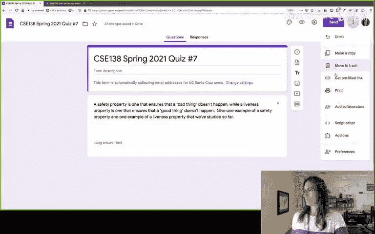
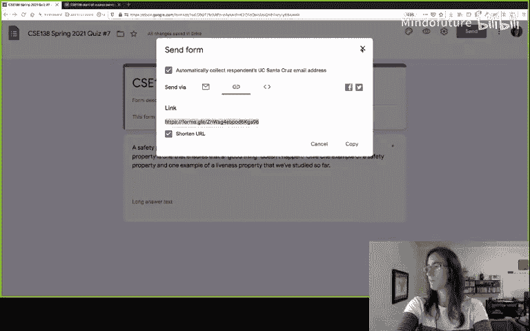
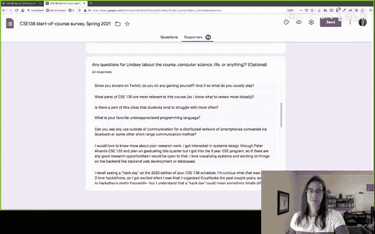

# 【加州大学】分布式系统-CSE138（Distributed-Systems）-p07-P07-L7---safety-and-liveness,-fault-models,-two-generals-problem--BV1eGdLYjETJ_p7-

YourSt is live now。Let's make sure it comes up。Great stream is live。All right， welcome to week four。

 the weeks are going by pretty fast here。I don't know about the rest of you， but。

I know I complain a lot about teaching Tuesday， Thursday and how it's harder than teaching Monday。

 Wednesday， Friday， but one kind of nice thing about it is that。Every class feels like an event。

 so it feels like a special occasion， especially Tuesdays， because I haven't seen you in so long。

It's good to see you again。Welcome back。And let's jump in。So today。You know。

I thought we were going to be done with Chandy Laport。

 we talked about it quite a lot last time and I thought we were not going to be talking about it anymore。

But then some people ask some really good questions。Over the weekend。

And then just by complete coincidence， I got an email from somebody over the weekend who was asking questions about one of my older Chandy Laport videos and that kind of just made me think that this stuff just wasn't well enough explained yet。

I think we're going to do a little bit more discussion of Chandy Laport， no more than 10 minutes。

To answer some leftover questions that people have。About the Chandy Laport snapshot algorithm。

So this will be。No more than 10 minutes， whoopss not greater than less than or equal to 10 minutes。

And then we're going to move on。😊，I want to talk about safety。And liveness。

Which are things that we've kind of touched on already。

 but we haven't really formalized our discussion of them。

 so we're going to talk about safety and liveness。And this is going to be our lead in to kind of a new section of the course where we're going to be talking about fault tolerance。

So today we're going to begin our discussion of fault tolerance，' very exciting。

And the Channey Laport stuff kind of leads into that because if you recall。嗯。

Last time we talked about。Assumptions that the Chandy Laportt Sapshott algorithm makes。

 right we talked about how it assumes that messages get delivered， for example。

 we assumed eventual delivery。Um so。That's going to be something that falls into our discussion of fault tolerance。

 so we're going to talk about reliable delivery today。And then we're going to talk about。Classifying。

Kinds of faults。And fault models。嗯。And I hope that we have time to get to the two generals problem today。

So that's what we have on our plate for today。All right， so let's get to the Chandy La stuff。

There were a couple of questions that I would like to try to touch on， so one of them was this。

 so I think there was a little bit of confusion about the notion of channels。嗯。So channels。

In shandy Laport。We assume that everybody has a channel to everybody else。In other words。

 we assume that every process can send messages to everyone else in a FiIFO manner。So。

That might not be realistic， for example， you might have， let's say you have three processes。

And I'll just draw a little picture here。Of the the network topology so maybe process one and process two can communicate with each other and process two and process three can and process three and process one can so maybe it's something like that。

 but in this case。Actually， let's say that this connection wasn't there。So let's say that。

Process one and process three can't directly communicate with each other。

 they can communicate through this other process process two， but that's it。So。

We just claimed that every process has a channel to everyone else。In Chandy Laport。

The assumption is that this graph， which we could call the network topology or the communication graph。

The graph needs to be strongly connected。Now this doesn't mean that it has to be a complete graph。

 so it doesn't have to be the case that。That all of these connections exist， if we can simulate that。

 so in other words， if process one needs to talk to process3。

 they can do it by simulating those messages by passing a message to process two here and saying this actually isn't a message for you。

 it's a message for process three。So you could fake having this arrow here by just going this way and telling process two to forward the message along。

And likewise， in the other direction。So as long as your graph is strongly connected。

You can stimulate。Having a complete graph。Were complete just means that everybody is connected to everybody else。

So this needs to be the case in order for the algorithm to work。

 so Chandy and Lamport say in their paper if the communication graph is strongly connected。Then。

We know that everybody know assuming reliable delivery。

 then we know that everybody is going to record their state because everybody's going to get a marker message sooner or later。

嗯。But I think there was a little bit of confusion about this fact。

 I think maybe people were thinking that a channel is something that's set up by sending a message through it or something。

 but you shouldn't think of a channel that way， a channel is like a road。

The cars may or may not drive on， but the road exists whether or not the cars are driving on it。

Any questions about that？Okay。And then I think the other question that people had left over。

In our Chandy Landport discussion had to do with。I to do with the difference between what gets captured in the process state and what gets captured in the channel state。

 so a snapshot kind of consists of two things right so what is a snapshot really？Well。

 when we take a snapshot。Of some execution。Like if we've got some events here and some messages here and we take a snapshot at some point。

嗯。Then。We're kind of capturing two things。 We're capturing the events that occurred。

 which which consist of。The process state。Or I should say the process state consists of the events that have occurred on every process。

But the snapapshott also captures something else， it also captures channel state。So in this case。

 if we had P1 and P2。P1 was recording messages on its incoming channel。Whi was C21。

 and then there wasn't anything to record on C21 so that channel stated up being empty。嗯。😊。

And let's say that process2 was recording its channel state， so on its incoming channel。

 which is C12。And let's say that this message right here call it M1。Got recorded。

In process to channel state。What that means is that。When you go to look at the snapshot later。

Anything that's in the channel state？Like this。Should be thought of as an in transitit message。

So the snapshot consists of， you know these events。

 we can give them names A and B on process1 and C and D on process two。

 and then also this extra piece of information that there was an intransit message from process one to process two。

Why do you think it's important to capture this sort of thing？

Somebody just asked we're assuming that channels are PIO， right， that's correct。Yeah， so。

Intrinsic in the definition of a channel is this notion that it's fiIFO， that's what a channel is。

So the question here is。Why would you care about capturing an in transit message if I took a snapshot here and my snapshot said that。

A and B happened on process 1 and C happened on process  two。

 why would you want to capture this in transit message？Somebody says you can debug better， well yeah。

 but let's try to make this a little bit more concrete。

 what's an example of some thing that might be in this in message that you might care about。Well。

 here's a classic example。Let's say that there's the system of where there's a token and only one process can have the token at a time and maybe whoever has the token has the maybe they have access to some resource that only one process is supposed to be able to access it once。

 make access to a file or they have a block on something it doesn't really matter what， in any case。

 let's say that there's one token。And you really want it to be the case that there's only one token present at any time in the distributed system。

Well， let's say that this message， message1 was a message that process one was sending to process two saying。

I'm giving up the token here， you can have it。If we didn't capture that information in the in transitit message。

 then the snapshot would be pretty confusing， right， because we'd look at this snapshot and we'd see。

 well。According to our captured state of process， one， it doesn't have the token。

And according to our captured state presses2， it doesn't have the token either。

 so the snapshot would be pretty confusing because the token would have seemed to disappear。

So that's why it's important to also capture these in transit messages in the snapshot because there could be some information that's supposed to always be true of the system and hence should be true of any snapshot of the system。

So that's why the Chandelly import algorithm also captures these intransit messages now it's kind of interesting because we know from the way that the algorithm works that if this snapshot。

 let's say that P2 happened to initiate this snapshot。

 so maybe it sent its marker message right here。A。And then the reason why this snapshot got taken down here was because maybe P1 received the Merer message right here。

 took its snapshot and then sent its。A marker message back。So。

The algorithm didn't actually finish until here。In other words。

 the algorithm didn't finish on Prees2。Until after messageage one had already arrived。

 I think this is what's confusing to some people。Because there's this period of time between when a process snapshots its own state and when the algorithm actually gets done on that process。

 so in some sense， it doesn't feel like this message is in transit anymore because the algorithm actually can't terminate until that message has come through the channel。

But in terms of this snapshot of somebody just going back and looking at this snapshot。

They don't know what happened later with these marker messages and so on。

 the marker messages aren't part of the snapshot， they're just something that the algorithm uses to compute the snapshot。

So if all I have coming to look at this later。Is this？그。I have this， that by itself。

Isn't all that helpful， so I also have this extra piece of information that M1 was in transit from process one to process2 at the time the snapshot is taken and if I know that。

Then I can go use that information to understand， oh， okay， if that message was in transit。

Then I understand that process2 is supposed to have the token。So。

That's why we have to capture the channel state。So hopefully that's helpful and if you have more questions about this。

 please ask because I don't want this to be unclear。Okay。Right， with that。

 I think we're going to move on。So。Our next topic。Safety and liveness。I'm excited to get to this。

All right。Let's really quickly recap some of those delivery guarantees that we talked about before。

 so you know we talked about FiIO delivery。Which we know rules out things like this。

So things like this won't happen under FiIO delivery。And then we talked about causal delivery。

Which rules out things like this？And we talked about totally ordered delivery。And so on。嗯。

And we talked about ways to enforce these so we talked about enforcing PIFO delivery。

 using something like sequence numbers or acknowledgements。

 we talked about enforcing causal delivery in the particular case of broadcast messages using the causal broadcast algorithm that we discussed。

We didn't yet talk about a way to enforce totally ordered delivery。

 I guess I'll draw my little diagram here for totally ordered delivery just so this picture is complete。

So we didn't yet talk about a way to enforce this one， but we talked about what it is。

So totally order delivery means you don't have that。ok。

So we've been talking about all these properties。FIfo delivery， causal delivery。

 totally ordered delivery。These are all specifications of how a system should behave。

And one thing that I want to convince you of is that these are all a particular kind of property。

 these all fall into the category of what we call safety properties。And a safety property。

 colloquially， is a property that tells you that something bad won't happen。

So these are all safety properties they all say。There's a bad thing。

And the property says the bad thing won't happen， so these pictures show the bad thing that each of these safety properties are ruling out。

There's another kind of property。And it's a liveness property。

So if a safety property says that a bad thing won't happen。

 what do you think that a liveness property will say？Good。😊，Aiveness property。Say that a good thing。

Will happen。Have we talked about any liveness properties yet。

 can you think of any liveness properties that we've discussed even a little bit in this class？

We certainly haven't discussed them to the extent that we have discussed safety properties。

But they have come up a little bit。What do you think？Wow， pretty quiet。Okay。

 let me give an example of one。Messages eventually get delivered， eventual delivery good。

Somebody put it in chat just as I was writing it out。

So that falls into this category of liveness properties。A good thing will happen。

A big hint if you're trying to figure out whether a property is a safety property or liveness property。

Is this word eventually？And you can think of the word eventually kind of implicitly being in here。

So when we say。Say that a good thing will happen， it means say that a good thing will eventually happen sooner or later。

So let's try to make it a little bit more formal with the difference is between safety properties and liveness properties。

In addition to just this sort of say that a bad thing won't happen。

 say that a good thing will happen because that's a little bit vague and I haven't stated in any formal terms what bad and good mean。

 and I don't think I can。so。Let's try to formalize this a loop， so safety properties。诶。

Which are the ones that say that a bad thing won't happen。Safety properties are properties that can。

Be violated。In a finite execution。In other words， you can point to an execution。

I'll take causal delivery as an example。You can point to an execution。And say。Right there。

Is where we went wrong， right there is where the bad thing happened。

Liveness properties on the other hand。Cannot be violated in a finite execution。Why not。

 why do you think that is？What would happen？If I tried to。Draw a picture here of an execution。

That violates eventual delivery。And how would you do it， right？Like。Maybe you have a message。And。

The message hasn't arrived over here yet。But。It's not that the property has been violated。

 it's just that it hasn't been satisfied yet。So I'm going to write that down just so it's obvious。So。

Liveness properties are actually tricky to reason about。Because。Safety properties。

 it's more straightforward。 You can look at an execution and say， oh， this execution。

Obsserves the safety property or violates the safety property。A liveness property is different。

You can look at an execution and maybe all the messages haven't been delivered yet， right？

Or maybe maybe the message arrived， right？But it's cud， right， maybe it's stuck in the delay queue。

Remember how with causal delivery， causal broadcast， we talked about how there was a delay queue。

 so messages arrive。And they're queued and they haven't come out of the queue yet。

But it doesn't mean that they're not ever going to come out of the queue。

 which just means that they haven't yet， so I cannot draw a picture of a finite execution that violates eventual delivery。

 it's not possible because it's a liveness property。So。

We know that a property is a safety property if we can point at something that violates it in a finite execution。

So all of those。Delivery properties that we talked about earlier， PIfo delivery， causal delivery。

 total order delivery， they all count as safety properties。Evenual delivery。

Messages eventually get delivered， this is the first liveness property I think that we've really talked about。

Lveness properties are usually considered much harder to reason about。

 but the trouble is you really need both。So why is it so important， like why do you need both？

What if I told you to implement？Ffo delivery。And I said。

 just worry about the safety property of FiIO delivery。Don't worry about any liveness properties。

What could you do？That's right， yeah， you could drop all the messages on the floor。

And it wouldn't violate PIO delivery。So what's needed there is a combination of safety and liveness。

 that's right， or you could just ignore all the messages on the receiving end， so yeah。

 what you could do。I。Satisfy the safety property and you could say， look。

 I duly satisfied FiIFO delivery。嗯。What grade do I get， I deserve an A。But liveness is。

Something that we care about for having systems that actually work。If I told you to just。

 if you built a system that just drops or ignores every message and doesn't deliver any。Et cea。

That satisfies。PO delivery。So safety by itself。It's pretty useless。

Nowiveness by itself is also pretty useless and we'll talk about that more later on。

 so really what you want in any given system is you want both a safety property and a liveness property。

 depending on the system。So。Let me define for you this eventual delivery thing other than just messages eventually get delivered because。

That's kind of a circular definition。Let's give it a little bit of a more formal definition。

And I'm actually going to call it reliable delivery。So here's one。Way to define reliable delivery。

I'll call this take one。Because I think we might come back and define it differently later。

 but let's try this。We'll say let P1 be a process。But。Sends a message。And。2。Process P2。

If neither P1 nor P2 crashes。Then。P2 eventually delivers。The message。

So the reason I said this was just take one of our definition was because of this piece right here。

So I think this piece might need a little bit of finesse。And in particular。

 we might need to add some other conditions there。For example。

Sometimes you'll see people say something like。If neither P1 nor P2 crashes。And。

Not all messages are lost。So this is kind of interesting right。

 why would it be that some people define this differently？Well。

 that's going to lead into the topic of fault models and fault classification。

Which we're going to talk about next， but anyway。I'm claiming that reliable delivery。

iss a liveness property。Somebody's asking about this not all messages or last thing here。Oh， yeah。

So the question is， if any aren't delivered， how is that reliable？嗯。

Maybe this will become more clear later after we talk about fault models。

I'm trying to think of the best way to answer your question。嗯。So。

We care about message M getting from P1 to P2。But it might take a few attempts。

There's nothing in here that says that it couldn't take a few attempts。So。Maybe。

To implement eventual delivery， P1 has to keep trying over and over。

And maybe the first five attempts get lost， but if the sixth one succeeds。

Then the messages has been delivered and we're in good shape。

So that's why we say not all messages are lost here。If all the messages are lost， then。

There's no hope。But if not all of them are lost， then the message has a chance of getting through。

Okay， so why is this a liveness property well， it says that a good thing eventually happens。

 which is the eventual delivery of this message。And we know that it can't be violated in a finite execution。

Because。Even if P1。Is making lots of attempts。To deliver room。And all those attempts are failing。

It doesn't mean that it's not going to succeed on the next try。

So I can't draw a picture of a finite execution in which this reliable delivery property is being violated。

So that means that it can't be a safety property。And every property it turns out。

 is either safety or liveness or a combination of the two。So because it can't be safety。

 it's got to be liveveness。Questions about that。Sometimes I advertise that the Twitch stream is starting on Twitter before class。

 but today I didn't。So I think we have fewer people in Titch today。HHere's a question。

 what about if we were in deadlock， then reliable delivery cannot occur？Okay， so in other words。

If process one can't。Send messages because it's waiting on something from process two。

 and I'm not sure if I understand the question exactly。Let's put that one on the stack for later。

 I'm not sure if I understand the question about what if we were in deadlock。Somebody just asked。

Will we dive deeper into why every property is either safety or liveness？That's a great question。So。

I don't think we're going to dive too deeply into it， but I can refer you to some papers。

For the moment I'm going to ask you to take on faith that。All properties。Are either safety。

Or liveness。Or a combination。All right。So we want to talk about fault models and fault classification next。

 so let me try to set the stage for this。When you're designing a system。

You need to start by making certain assumptions about the environment in which that system will operate so in particular。

If you're trying to design a system that will tolerate faults， like say。

 processes crashing or messages is being lost。You want to have some sort of an idea in mind about what kind of faults may occur。

So that you know what kind of faults you need to tolerate。

So you need some way of classifying faults or putting them in categories。

So that brings us to this topic of fault models。So a fault model。Is something that tells you。

Which categories of faults can occur？So you know which ones you have to worry about。

So if you think back to day one of class。Well， we talked about this scenario where we have two machines。

And machine one。Asks Mi to a question。And hopes to get a response。

And we talked about a bunch of different ways in which this could go wrong。

Can somebody remind me of some of those ways in which this could go wrong？

That we talked about before。Okay， the message was never received。Why。

It could get lost in the network。It could be slow。What else？Why might M1 not hear back？If you're M1。

You're sitting here。You've sent this message out into the either and you don't hear back。

 what are some of the other reasons why you might not hear back？Good， I'm too crashed。M2 is slow。嗯。

And what else the message back from M2 to M1， the response could be slow。Or it could get lost。

And then one that we kind of briefly discussed， two could lie。

So let's try to classify these faults into categories。So for this first one。

 where a message gets lost， we're going to call this an omission fault。

So a message getting lost is an omission fault。What about number two， the message from M1 being slow？

There are different choices for what to call this， I'm going to call this one a timing fault。

What about number this next one here， M2 crashed， what should we call that one？Crash fault， yeah。

 that's what I would call it。And then we can kind of fill in the rest here。

 so this one also has to do with slowness， so that's another timing fault。

This is another timing fault。What's this one where the message from M2 gets lost？Yep。

 that's another omission fault。Does anybody remember from day one of class what we called it when M2 lies？

Its a fun one。That's right， it's a Byzantine fault。So。

At least we can categorize these into these four different kinds of faults。

 this is kind of a classic way of categorizing faults， the way that I've done it here。

And there are other reasonable ways to do it。And there are more fine grand categorizations that you can make。

 but this。Set up that I have here where we have four kinds of faults， Omission faults， crash faults。

 timing faults， Byzantine faults。 This is kind of a classic taxonomy of faults that distributed systems people have been using。

For a long， long time， now at least since the '90s。

So let's try and define each of these types of faults a little bit more precisely。

So in a crash fault。This is when。A process。Fails。By halting。

And this means it stops sending or receiving any messages。So this is kind of interesting right。

 I didn't say that it had to stop having internal events。

I only said that it had to stop sending and receiving messages， but the thing is that。

If you're some other process。And you want to know whether this process is up or not， well。

 if it stop sending and receiving messages， then as far as you're concerned， it has crashed。

 even if it's still doing something by itself。So as far as any external observer is concerned。

It's crashed if it stopped sending and receiving messages。

 even though it still may be doing some sort of computation on its own。Omission faults。

A when a message is lost。And you could think of this if you want。

 as a process failing to send or receive a single message。In a timing fault。A process responds。

To late。And there are some contexts in which too early。Is also a concern。

This actually isn't going to come up very much for us because。As we'll talk about in a minute。

 for the most part， we're not going to be thinking about timing faults。

So this one is going to be less interesting to us。And then finally， a Byzantine fault。

A process behaves in an arbitrary way。Or even a malicious way。Okay。Great question yeah。

 so the question in chat is how can an outside observer process tell the difference between a crash and an omission fault。

 Yeah， good question。Let's start to talk about that a little。Let's say。

Let's say that we have some protocol， let's say I've implemented a protocol and call it protocol X。

So recall what a protocol is from before protocol is。Some set of rules for saying， oh。

 what messages a process should send。In terms of what messages it's received。

So let's say that we have Procol X that I've implemented。

 and let's say that I'm going to say that Procol X tolerates crash faults。

And let's say that we have another protocol called protocol Y。

 and Pro Y implements the same behavior as Pro X。But we're going to say protocol Y。

Tolers omission faults。So in other words， Pro X is robust to crashvas。It'll still work。

And let's say that protocol Y is robust to o mission fault。

 so it'll still work even if messages get lost， so my question for you is this。

Does Pro Y also tolerate crash faults if we say that it tolerates omission faults？

Does it also have to tolerate crash faults？What do you think？HSo one response is not necessarily。

I'm going to say that perhaps somewhat surprisingly the answer is yes。Why is that the case。

 why do we say that this protocol that tolerates omission faults also tolerates crash faults？

It turnsurns out。That。Crash faults。Are the special case of omission faults where all of the messages。

To and from a certain process get lost。So。If you tolerate omission faults。

Which are faults where a message gets lost。And I'm saying， you know。

 you can tolerate in any number of those， right？Then you also have to be able to tolerate crash faults。

 which are when all of the messages， you can think of it as being all of the messages to and from a particular process getting lost。

So protocol that tolerates omission faults also has to tolerate crash faults。

And we can draw a picture。Illustrating how these different。Categories of faults are nested。

So we can say crashvas。Or here。And omission faults。Are here， so crash faults。

End up being a subset of omission faults。All right。Let's say that I also have， and you know。

 I said earlier that timing faults are one of the categories that we care about。

 but I'm actually going to leave out timing faults for now and then we'll come back to it。So。

Let's say that we have another protocol。Pritical Z。

And protocolcol Z implements the same behavior as protocol X and Pro Y。

It also tolerates Byzantine faults。Does Proto Z also have to tolerate omission faults？HI got to know。

 So what is a Byzantine fault， a Byzantine fault says that。

A process could behave in an arbitrary way， right？Or even a malicious way。Yeah。

 so basically anything could happen。So。In fact。Byzantine faults are a superet。

A little mission faults。 And the reason why is that。A process that's exhibiting Byzantine behavior。

Could pretend to be having。These other kinds of faults， right。

 it could be pretending to lose messages or it could be pretending to craft。

So if you can tolerate Byzantine faults， then that's a superet of these other fault classifications。

 then you can tolerate omission faults and crash faults as well。So。

This protocol also has to tolerate these other kinds of faults， so we've got Byzantine faults。

Which are a superet of omission faults， which are a superet of crash faults。

Ands the reason I left some space in the middle here is because there's actually another fault classification that I kind of left out before。

So crash faults， we said before a process fails by halting。

 but let me make that a little bit more specific。So we'll say a process fails by halting。But。

Not everybody necessarily knows that。Let me try to differentiate crash faults from a different category of fault。

 which I'll call fail stop faults。So in a fail stop fault。

 a process fails by halting and everyone knows。It crashed。In a crashva。

 that's not necessarily the case。So in a crash faultult。

 we say that a process fails by halting and not everybody necessarily knows it。A failed step fault。

 you can think of it as being like。The process sends out an announcement right before crashing。

 saying， I'm going to crash now and everybody gets the announcement。

So we can actually put this other category in here。I didn't put that one in the list before because。

This one actually， it's all these are。This one didn't come up actually when we were classifying those faults that could occur in that exchange of messages between M1 and M2。

So faililtop is kind of an unrealistic fault model because in practice processes don't do that。

 right， they don't announce that they're about to crash。However。

 this is still a useful category to think about because sometimes when you're designing a system。

 it's useful to think about there being this notion of fail stop fault。

And we can kind of try to attempt to fake having this kind of fail stop fault。

By having some sort of attempt to detect failures。It turns out that those attempts to detect failures can't be perfect。

And so this is somewhat unrealistic， but I'm putting it here in the picture because。

Sometimes you'll hear this notion of faults discussed。Yeah。

 so there's a question about timing faults and the fact that I left timing faults out of the picture。

So why did I leave timing faults out of the picture？Does this is kind of a hard question。

Does anyone know why I left timing faults out of the picture， It kind of it goes back to。

Near the beginning of the class， when we discussed network models。

 and you recall we talked about the asynchronous network model and how we were going to be spending most of our time in the asynchronous network model。

So。Why do you think given that context， given that hint？

Why do you think that I left timing faults out of this picture？嗯。😊，Patrick shared this quote。

Flying is just falling slowly。And I feel like that's。Apropos。Yeah。

 so we're in this asynchronous world， right？So my claim is that in an asynchronous world。There are。

No。Timing faults。Not really。What I mean by that is。Any kind of bug， any kind of fault。

It has to be relative to a specification right， if you say that there's a bug in a piece of software。

 then that means that some sort of spec that somebody had in mind， whether it's formal or informal。

 some sort of spec is being violated， whether that spec is just the expectations in your head or whether it's something that's written down in a formal way。

A bug is a violation of some sort of specification。If we had a specification that said。

Things shouldn't take more than a certain amount of time。Then we could have timing faults， right？

Anything that violated that spec would be a timing fault。

But we don't have a specification like that in the asynchronous network model。Remember。

 an asynchronous network is one where there's no。Number N。

 such that no message takes longer than n units of time to be delivered， so in other words。

 messages can be arbitrarily slow。So。We're not going to be thinking about timing faults because in the asynchronous network model。

 which is where we're spending our time。Timing faults really don't apply。

So I haven't included them in this picture here。It's a little bit of a head scratcher， isn't it？

Alright。I think now is a good moment to pause and do our quiz question for today。

And when we come back， I think we'll have time to talk about one of my favorite distributed systems。

 thought experiments， which is the two generals problem。All right， so it's 419， let's return at 429。

 and I'll put up the quiz question right now。

You know what， yeah I just realized there's a typo on the quiz question。

This should say a good thing does happen right here。So have you already filled out the quiz。

 hopefully you。😊，诶。Knew what I really meant。All right， fixed。Right， one more minute。All right。

 it's 429， so welcome back。Okay。Before we get to the two generals problem。

 I just want to talk really briefly about。I didn' really mentioned fault models。

 but I didn't really define what a fault model is other than to tell you that it's something that tells you which kinds of faults can occur。

So， but now that we have all these different nested classes of faults defined。Now， I can。

Somewhat more formally say what a fault model is。So we can say。A fault model。Is a specification？That。

Says。What kinds of faults？A system can exhibit。And this tells you。Having trouble writing today。

 this tells you。呃。What kinds of faults。Need to be tolerated。So。If you're assuming the crash model。

Then that means that your system has to be tolerant of crashvas。

And if you're assuming the omission model。You've got to be tolerant of omission faults and crash faults。

And if you're assuming the Byzantine fault model。You have to be tolerant of Byzantine faults and all those other kinds。

So fault models are nested， just like classes of faults are。And as you move outward in this circle。

The models get less and less forgiving because more and more bad things can happen in these models as we move outwards。

So which fault model do you think that we're going to be talking about the most in this class？

That's right， yeah， we're going to focus on the omission model。Yeah， somebody just says。

 are we going to focus on the Byzantine model because it's the least forgiving， I mean， I wish。

But that class would take more than。One quarter to teach。

So we're going to be focusing on the omission model。

It's true that not as many bad things can happen as in the Byzantine model。

 but it's still a model where an awful lot of bad things can happen。

And so it's still pretty hard to implement。Algorithms that assume the omission model。

 because those algorithms have to tolerate a lot of bad things。In fact。

There are a lot of things that we would like to be able to do in distributed systems that are flat out impossible to do in the omission model。

So as an illustration of that， I want to tell you about this classic thought experiment in distributed computing。

 which is called the two generals problem。So this is a really old。Thought experiment。

 it was originally described in 1975。And in their setup in 1975。So it was published in a paper。

That is pretty little known today actually and then kind of。

Developed kind of a life of its own over the years。

But it's kind of funny because in the original paper， it wasn't about two generals。

 it was about two groups of organized criminals。And somehow it became known as the two generals problem in the intervening years。

Not sure why anyway， the idea is the following。So let's say that we have。Two generals。

Let's say General Alice and General Bob。With their armies。

And they're each encamped on a hill with their armies。And in the valley in between。

The enemy is encamped。So Alice and Bob know that neither one of them on their own is strong enough to attack the enemy。

But if they work together， they outnumber the enemy。

 so they'd like to both attack the enemy at the same time。The only problem is。

They're too far away to communicate。ThatSo the only way for them to communicate is to send a messenger through the valley where the enemy is encamped。

And that messenger will sometimes be captured by the enemy and sometimes not。

And if a messenger is captured， then of course， the message that they're carrying gets lost。

So let's walk through what would happen in the best case scenario where no messages are lost and everything goes fine。

So let's say that General El。Would like to mount an attack。 So Alice sends a message over to Bob。

And we can show that with a Laport diagram if we want to。So Elis sends a message saying。

At attack it dawn。Asking。Are you in？So let's say that Bob gets the message。So at this point。

Bob knows that Alice has proposed to attack at dawn。Well。

Should Els go ahead and attack at this point？That's right， yeah。So no。

 she should not because she doesn't know that Bob got the message， right。

 she has no way of knowing at this point whether her message got to Bob or not。So。

Somebody just said Alice needs an acknowledgement， yeah。

 so Bob should let Alice know that he got the message。So Bob says， okay， I'm in。

 attack tomorrow at dawn。Cool， okay， suppose that message gets through。

And it's received and delivered on Alice's side。Now Alice knows that Bob got her message。

Is it safe now for Alice to go ahead and attack it Don？The question is what time is it now？

You're wondering if Da has already passed， so maybe it's dawn the next day。All right。

 leaving it aside any concerns about whether Da has already happened？

Is it safe for Alice to go ahead and attack now that she's gotten the acledgments for Bob？

And some folks are saying a chat， no， it's not safe。She needs to let Bob know， that's right。

 Bob doesn't know that his acknowledgecment got to Alice。

And he also knows that if Alice doesn't see an acknowledgement， she won't attack。

So Bob can't attack right， because he only has three people。

 he can't be sure that Alice is going to attack too。So is this fixable？Okay。

 so somebody said Bob needs an acknowledgeledment that Alice got the acknowledgement Okay。

 so what if Alice sends another message？To acknowledge the acknowledgement。Okay， it's on。

Does that solve the problem？Yeah， it's not looking good， is it？No。

 because Alice doesn't know that that message got through right。

 so Bob could act that message as well。😊，But of course， he doesn't know that that act was received。

Is there any way to fix this？Smoke signals。 Yeah， let's assume that Alice and Bob are too far apart to send smoke signals。

 But yeah， so in general。I think you're even though the suggestion might have been a joke。

 you're kind of on the right track in the sense that。

If there's some kind of side channel by which Alice and Bob can communicate。

 they might be able to solve this problem。If we're in a setting where Alice and Bob can only communicate by sending these messages through the valley。

It turns out that。In the omission model。It is impossible。For Alice and Bob。Let's say Alice or Bob。

To attack。And did no。For sure。That the other will attack。

It would require sending this infinite number of acts， of acts， of acts of acts， and so on。

This boils down to one of the many fundamental impossibil in distributed systems。

 and it applies in any situation where you have two parties communicating。

And failures of communication can occur。So what are the practical workarounds to this situation？

Other than if you had some other side channel by which you could communicate。Okay。

 here's a suggestion， stop after a certain amount of acts and call it good。Yeah， so。

Although it's impossible to solve this problem， it is possible for the generals to increase their confidence that the other general will attack。

So。Here's how that might go。One way to do this would be。

Let's say Alice sends a whole bunch of messages。At regular intervals， okay， so say Alice。

Keep sending messages that say attackt it dawn。So sooner or later， say one gets through。

And Bob sends his act。At that point。Alice has gotten the a so she can stop sending messages。

So as time passes。Here on Bob。Bob can gradually grow more certain that Alice got this act because。

The longer that he goes without getting a message from her。

The more that he can be sure that she actually stopped sending them on purpose。 Now。

 it could be the case that she is， in fact， still sending them and all of them are getting lost。

 right。But we're assuming that the probability of that gets lower as time goes on。

So if the probability of all the message is getting lost。As the number of messages sent increases。

 if the probability is lower and gets lower and lower as you send more。Then after a while。No。

 Bob can be reasonably sure over here if he's not getting messages。

 he can be reasonably sure that she actually did get this and stopped sending the messages。

So it's not a perfect solution， but it's a solution that is good enough。

For practical implementations often。So Bob can be reasonably confident that Alice got the a and then the attack could go forward。

Any other workarounds？So one workaround is that。Maybe before they went and camped out on these hills。

Alice and Bob coordinated with one another in some way。

Maybe Alice and Bob both decided on their plan of attack。In person。

 in some sort of discussion and agreed on a plan。So。

That's what philosophers and logicians call common knowledge。

So I guess I'll call this page workarounds。So workaround number one。Was this probabilistic argument？

We'll call it probabilistic certainty。We're grown too。Common knowledge。

So common knowledge just amounts to Alice and Bob having planned out before that they were going to attack at a certain time。

We say that there's common knowledge of some piece of information。Let's call it let's say。

 common knowledge。We say there's common knowledge of P。When。Everyone knows P。

Everyone knows that everyone knows P。And so on infinitely。

 everyone knows that everyone knows that everyone knows P。So， common knowledge。

Is this situation of I can't write it all down here because it's infinite。

 so if there were some predetermined attack time that was common knowledge between Alice and Bob。

 that could work。But the trouble is that you cannot establish common knowledge just by sending messages in a distributed system with the omission model。

 so if they didn't set up that knowledge in advance。

There is no way for them to establish common knowledge later。

And that's one of the kind of most interesting things to me about distributed systems。

 and this is kind of beautiful fact that you can get higher up in this hierarchy， right？

You can get to the point where everybody knows a fact。

But then getting to the point where everyone knows that everyone knows that fact。takes more work。

And getting to the point where everyone knows， that。 everyone knows。

 that everyone knows and so on takes more work。 So you can't ever get to the point where。

You get this whole infinite sequence。And I can refer you to some reading material on that if you're interested。

Yeah， so Patrick points out。The way that we sketch this out with the infinite acknowledgeknowments that you would need to have to solve this problem。

Kind of looks like the definition of common knowledge。You can think of what's going on here。

 as Alice and Bob attempting to establish common knowledge。But they can't。Okay。

So whenever I talk about the two generals problem。Somebody always brings up TCP and they want to know if TCP solves the problem。

 so let's really briefly talk about that。So TCP gives you FiIFO delivery。

 which we've talked about a little bit and it gives you reliable delivery as well。

We're going to talk about the implementation of reliable delivery next time。嗯。But under TCP。

If Alice has to send a message to Bob。She can keep sending it until she gets an act from Bob， right。

 and then she's done， so TCP allows the sender of a message to have certainty that the message was received。

But it still doesn't allow us to get that common knowledge that would be needed to solve this problem。

It's kind of interesting， actually usually every time I teach this class， somebody says。

 but what about TCP， but nobody brought it up this time。I don't know。

 maybe this is a group that doesn't care as much about networking。佢。

Any questions about anything we just talked about？All right。

I think that in the five minutes that we have left。And now we're asking， what about TCP？😊。

Hopefully I addressed that question。So in the five minutes that we have left。

 no I feel bad for depriving y'all of answers to your questions on our start of course survey。

 so I thought we would do a few of those。So， you know， if you have to bail right now。

 this isn't crucial information， but you know， maybe it'll be fun。Okay。

 so questions for me about anything。What's kind of weird about this forum is that。

It seems to show me the answers in an arbitrary order， so some of these we already talked about。

 but let's just start at the top here， what is your favorite cat breed and what breed is your cat？Oh。

So I like cats， but I actually don't know very much about cat breeds。American short hair。

 is that a cat breed， whatever my cat is， it's like the most typical boring cat breed。

And I don't really have a favorite cat breed， I love all cats。All right。

 I think this next one might have been one that we talked about last time about being worried about future employment。

 I can't remember if we talked about this one before， but let me just say one thing。嗯。So。

The question here is， I want to know whether， first of all。

 whether I can find a job but also whether I won't be miserable in it。And。So to tell you the truth。

 maybe you won't love the first job you get， maybe you won't love the second job。

 maybe you won't love the third job。Life is long。You have a long time to figure it out what it is that you want to do and from every one of those experiences。

 whether it's good or bad， you're going to learn stuff from it and hopefully things will be better the next time。

So， you know， I don't think you have to figure out exactly what you want to do。

 I didn't figure out that I wanted to do distributed systems until just a few years ago。And I'm 39。

So I definitely didn't have it figured out when I graduated from undergrad。

 I didn't even take distributed systems as an undergrad， I don't think it was offered at my school。

 but even if it had been， I don't think I would have taken it because I didn't know that it was interesting back then。

So。You have a lot of time。Also something that I'm trying to do is put together a collection of distributed systems related job postings for you all。

 so I'm asking around for job postings from people I know and trying to find the ones that are most relevant to what we do in this class。

Both because I want you to see what's out there and also because I want you to see how the course is relevant to the real world。

So hopefully I'll be able to share that soon all right， so next question。😊，If magic existed。

 what type would you like to cast， I don't even know what this question means to tell you the truth。

U。Is there a kind of magic that makes you good at gardening， that's what I want？All right。

 how difficult will this course be I think this was one that we talked about earlier。

Since you stream on Twitch， do you do any gaming yourself？I don't stream any games。

But I used to not really play games， but now that I have a toddler， I play games with my toddler。

 so if you want recommendations for games that you can play with a three year old。

 I got some of those Yoshi's crafted world is really fun。We've been playing Kirby Star Ls。

 which is another really cute， really easy platformer。UmYeah。

 I don't have personally like I don't really set aside time to play games， butum。

It's a fun thing to do with my kid。All right。Last question。

 what parts of CSE 130 are most relevant to this course？I would like to answer this question。

Unfortunately， different versions of 130 are taught by different people and cover different things。

 so I know some people looked at key value stores when they took 130 and other people didn't。

 for example。So I don't really know what to tell you on that one。

 and I think that the most relevant thing is not necessarily any particular material so much as it is。

Experience doing a large scale systems programming project with a group。

 so people who have taken 130。The key thing that they take away from it is the experience of having done that。

 I think。Less so that than any particular skill or particular knowledge。All right。

 we'll have to get to this next one about underappreciated programming languages next time it's 455。

 so let's wrap up for today。And I will see you on Thursday。Take care。

