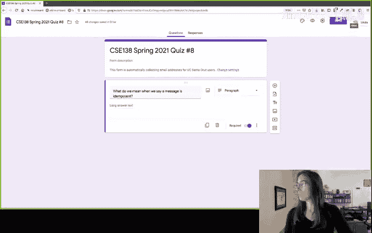
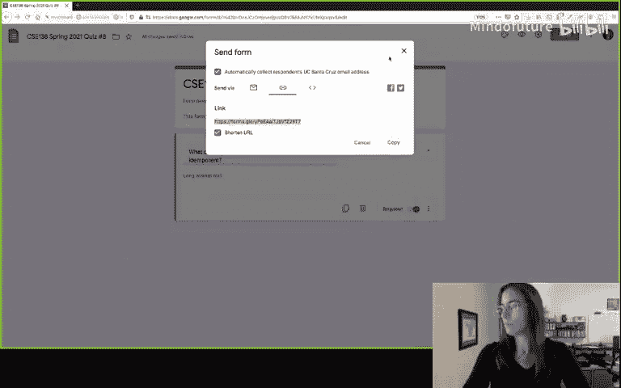
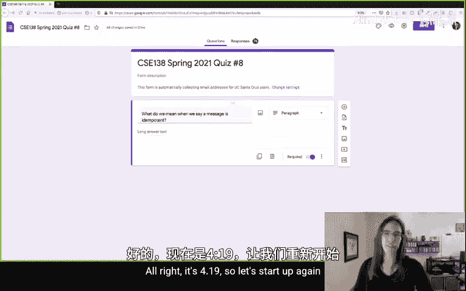

# 【加州大学】分布式系统-CSE138（Distributed-Systems）-p08-P08-L8---forms-of-fault-tolerance,-reliable-delivery,-reliable-broadcast--BV1eGdLYjETJ_p8-

All right， stream is on。Let's jump right in。Welcome to Thursday。We have a lot to cover today。

So today we're going to briefly recap。The fault tolerance or fault classification stuff that we began to discuss last time。

And I'm going to add to that a little bit by talking about forms of fault tolerance。

And then we're going to talk about implementing reliable delivery。

So we began to talk about reliable delivery last time this time we're actually going to talk about how one might implement it。

Then we're going to get to item pods。A topic that came up， I think on the first day of class。

Now we're actually going to talk about what it means。And we're going to talk about。At least once。

At most once。And exactly once。Dliivery。And then I hope we make it to discussing reliable broadcast。

And implementing reliable broadcast。So there's a lot on the agenda today， so we'd better jump in。

Okay， so fall classification， so last time if you recall， we drew a picture。About of。

Ways to classify faults。 And we ended up with something like this。 So we talked about crash faults。

Which are a subset of omission faults。Which are subsid of Byzantine faults。

And I've left some stuff out of here， like we talked about the category of fail stop faults。

 which are some sort of crash faults， and then we talked about timing faults which aren't in here。

 but these are the categories that I want to focus on the most。So。

It should be pointed out that this particular hierarchy of faults is not the whole story。

So we could subdivide some of these classes of faults further。So for instance， take Byzantine faults。

Some Byzantine faults are going to be easier to deal with than others。

What might be an example of a Byzantine fault that might be relatively easy to deal with any ideas？

And you can either say it out loud or type it into Zoolip。Or if you're on Twitch， that works too。

 Twitch chat works too。When they'd act like a crash fault， yeah， okay。Yeah。

 what would be an example so yeah， if a process is pretending to have crashed then。

The way that you might deal with a crash fault might be to。

Declare like if it seems as though a machine has crashed。

Maybe your response will be to just declare that machine dead and bring up another machine。So yeah。

 a no response kind of falls into that category too。So yeah， I mean。

 a machine that's acting as though it has crashed is indistinguishable from one that's crashed right。

 so in that case we can kind of downgrade the fault from being a Byzantine fault to a crash fault。

 What else what other examples of our cases were we can downgrade a fault to。

Kind of easier to deal with class of faults。Well， let me suggest one thing。So。

If you have a message that gets altered or corrupted in some way， then that's a Byzantine fault。

But some kinds of these alterations and corruptions could be detectable。

So there are techniques like check sums， for example。

 or error correcting codes that you can use to tell that a message has been corrupted。

And if you get a message and you can tell that it's been corrupted。

 that's much better than if you can't tell， right？So if the message is so cleverly corrupted that even your message authentication technique。

 whatever it may be， cannot tell that the message has been corrupted。

 fails to detect that corruption， then you're in trouble then。

If you can tell that the message has been corrupted。

 then you can downgrade that Byzantine fault of a message being corrupted to merely an omission fault by dropping the message on the floor and pretending that you never got it。

So really。Our picture here could distinguish between the kinds of corrupted messages that we can detect and those that we can't necessarily detect。

 so I could do an extra assertive category here。In in between omission faults and Byzantine faults。

 and I'm going to call this。Authentation。Detectable。Bizzantine faults。And what that means。Is that。

If you have gotten a message， but you can detect that it's been corrupted。

You can just drop or ignore the message。So basically。

 if you have good enough message authentication techniques。

 you can downgrade these certain kinds of authentication detectable Byzantine faults to merely omission faults。

Nomission faults are still not great。But they're better than。

Having corrupted messages so the specific details of what kind of authentication technique you might use are outside the scope of what we're talking about in this class if you wanted to know more about that then I would suggest taking a security class。

But it's important to point out that， not every Byzantine fault has to be the end of the world。

And so the bigger point here is that these particular classifications of vaults that I've written down here are not necessarily the only way to do it。

 so you could do finer grained classifications for a given application or in a given setting。

So the question in chat is so in general， narrowing it down is good well the issue is that。

Tolerating Byzantine faults。 like this bigger circle means anything could happen， right so。

If you have to tolerate Byzantine faults， then you have to tolerate a whole lot of bad behavior。

However， if you can say， well， I can tolerate authentication detectable Byzantine faults。

 it's nice to be able to say exactly what it is that you can tolerate。

 so it's nice to be able to define a classification of faults that you can or cannot tolerate。And。

It helps us reason about what exactly it is that we that we can or cannot cannot do。 I find that。

It's fairly common for people to use this term Byzantine fault when they mean something bad happened that we weren't expecting。

But in practice， it might merely turn out to be a crash fault or an omission fault that they weren't expecting。

 so the term Byzantine gets thrown around a lot by people who want to sound cool。But。

the fault that they're talking about isn't necessarily a Byzantine fault。

So I'm introducing all this terminology so that you won't be like them so that you will use these terms in the way that they're intended。

All right， and we talked about fault models as well， so just like we have this nesting of faults。

 fault classifications， we have a nesting of fault models。

 so if you're operating in the crash model you can tolerate crash faults。

 then crash faults are the kinds of faults that can occur in the fault model。

There's another question in chat， so authentication detectable Byzantine fault just means no corrupted messages。

 no authentication detectable Byzantine faults is a class of faults that may occur。

This is a class this is a。This figure is a classification of different kinds of faults that may occur。

And then you can design your system in a way that you can deal。

 you need to choose what kinds of faults you are going to be able to tolerate。

And so you would choose a fault model that corresponds to the kinds of faults that you feel it's important to be able to tolerate。

Depending on the resources that you have and the complexity budget of your software。

And so I mentioned before we're going to be spending most of our time talking about the omission fault model。

 and so omission faults are going to be what we focus our attention on。

And I want to cover something else though， I mentioned forms of fault tolerance。

Falult models might be like this。But that by itself can't possibly be the whole story， right？Because。

Let's say that。I'm trying to implement some software。And。

I want it to tolerate a given class of faults。But what does it really mean to tolerate a class of faults？

If you can tolerate a class of faults， does that mean that if one of those faults happens？

Then you behave exactly like you would have。If that fault hadn't happened。

Like let's say there's a crash fault， does it mean that your system has to keep operating exactly the way that it would have had that particular machine not crashed？

So this is an important question to ask is it's not just as simple as， oh。

 our system tolerates crash faults， for example， or our system tolerates omission faults。

The question is， what does your system do in the presence of those faults and how much does its behavior change in the presence of those faults？

So we've talked a little bit about safety and liveness properties。And what they are。

 So we talked about how a safety property says that a bad thing。Doesn't happen。

And a aliveness property says that a good thing does eventually happen。So。

If a program is going to be correct， if it's going to behave correctly。

It should satisfy both its safety and its liveness properties， right。

 so we can say a correct program。A correct program satisfies both its safety and its liveness properties。

Now what happens in the presence of faults？It would be really， really great。

let's say it's a crash flow， for example。It'd be really great if we could say that our program continues to satisfy both its safety and its liveness properties in the presence of crashvaults。

But。That's sometimes too much to ask。So。Maybe you have a program that。

Doesn't continue to satisfy its liveness properties， let's say。In the presence of a fall。

 but it does continue to satisfy its safety properties。On the other hand。

 you could have a program that only continues to satisfy its liveness properties。

 but doesn't continue to satisfy its safety properties。So the question here is really。

 how wrong does a program go in the presence of a given class of faults？

So we could introduce a little bit of terminology for this as well。And as so often。

 we can do a little two by two grid。That will help us understand。The options。

So let's say that we have a program。That in the presence of a given class of faults。

 it could be crash faults or whatever， remains both safe and live。

 so if it continues to satisfy both its safety and liveness properties。

So we can call that kind of fault tolerance masksking。Faalult tolerance。And that's the Holy Gil。

 right， that's really what you want。But unfortunately， that's not always possible。

So what if you have a system that stays safe that is continues to satisfy its safety properties in the presence of a given class of faults？

Doesn't stay live。So an example of this might be， you know， we talked about PIO delivery， right？

So safety in the case of PIFO delivery means you never get messages that are out of order， right。

 out of the PIFO order。But liveness means the liveness of an implementation of Ppho delivery might be that messages eventually get delivered。

 right？So。If in the presence of a fault， you keep your liveness properties。

 but you don't keep or sorry， if you keep your safety properties。

 but you don't keep your liveness properties， that's called failsafe behavior。Or fail safe。

Faalult tolerance。And that's。What's commonly discussed and commonly studied。

 so there's been a lot of focus in distributed systems on making sure that safety properties get preserved in the presence of faults if you can't stay live。

So be it， it's not the end of the world， but the emphasis is on ensuring that safety properties are preserved。

On the other hand。Maybe sometimes。You're willing to give up safety properties in favor of liveness。

So this would be called non mask game。Falult tolerance。And then finally， this last category。

 if you're neither live nor safe in the presence of faults， then that's just sad。

So the reason I'm talking about this is because there's really more to this picture than just these just fault classifications and there's more to say about a given program than just。

 oh， it tolerates crash faults or it tolerates omission faults。There's also the question of。

What does it mean to say that it tolerates a class of faults right what behavior will it have in the presence of those faults。

 so you know we'd love it if in the presence of faults that everything would continue to satisfy both its safety and liveness properties and then we'd have masking fault tolerance which would be really。

 really nice。But most of the time， so this is like the happy face case over here。

 but most of the time we can't have that so most of the time。

The compromise that we might choose would be to continue to preserve the safety properties。

 continue to ensure that those messages keep getting those messages don't get delivered in the wrong order。

 right， even if it means you have to stop delivering messages for a while。

 don't deliver them in the wrong order， that would be failsafe fault tolerance。

And that's often what we end up going with。And some other systems might choose a different compromise。

 right， they might say keep delivering messages， it's okay if they have to go out of order for a while。

 but keep on delivering them。Wchhi should you choose， well I can't answer that question for you。

 it's going to depend on the needs of your application and the situation that they're in。

So there's some great discussion in chat right now。哼。😊，Yeah。

 so I think Patrick has some really good insight into this having worked in industry for a while。

So he's a good person to talk to about this stuff。Sometime in office hours。

What we're going to jump into next is implementing reliable delivery。

 so if you recall from last time we began to talk about this notion of reliable delivery。

And we're going to define it again， we already defined it last time。

 but we're going to define it one more time。So recall that this is a liveness property。

So here's what we said before。Let P1 be a process。It sends a message。And。Two process P2。

If neither P1 nor P2 crashes。And then here's this parenthetical we added last time。

And not all messages are lost。P2。Eventually delivers。

So we had a little bit of a discussion last time about。

Do we need this part here where we say not all messages are lost？

So now that we've discussed fault models and fault classification。

 we can talk about this in a little bit more detail。Do we need this part？

We do if we're working under the omission model。So I mentioned that the omission model was going to be where we would be spending most of our time in this class。

 so if omission faults can happen。tThen we have to design for that。

 and so we have to define reliable delivery in a way that accounts for that in the omission model messages can get lost。

 so we have to throw in this extra clause here。The omission model is more realistic than just assumingiming the crash model。

 so we'd better stick with the omission model， so we definitely need this and not all messages are lost but。

Okay， how are we going to implement reliable delivery？If Alice has to get a message to Bob。

How can she do so reliably？Any suggestions？So here's a good suggestion， yeah。

 acknowledge messages and keep sending until you get one， yeah。

 so Alices can just keep sending over and over。Until she gets an act。

 so if Alice wants to send a message。Here's what she could do。When she wants to send a message。

She can put it in sort of buffer， like a send buffer on her side。

So she she she can implement timeouts on her side， she's got a monotonic clock so she can implement timeouts。

 and so her algorithm would go like this。Put message and sendend buffer。Whenever the timeout expires。

Send what's in the send buffer。So don't delete it from the buffer yet， just send whatever is there。

And then。When an app is received for a sent message， then you can delete it from the send buffer。

So well， this is just going to keep sending。And maybe a bunch of her messages get lost， right？

And every time the timeout expires， she's going to send again sooner or later。

If a message gets through to Bob。And he acts it。Then Alice can delete her message from the send buffer。

 and she knows that that message has been received。You see any issues with this implementation？Okay。

 so one question is how do you know how long the timeout should be， Yeah。

 so that's kind of the open question that we talked about on day one of class also。Yeah。

 Alice doesn't know how long the timeout should be particularly because we're talking about the asynchronous network model always in this class。

 we're talking about the asynchronous network model where there could be some unbounded latency between Alice and Bob so we don't know right and Alice could try to do clever things No she could she could try to。

Figure out how long it's taken in the past for Bob to acknowledge her messages and then adjust her time out accordingly。

Yeah， so certainly picking an appropriate timeout length is tough if you pick something that's too small then。

You're going to expire the time out much more often than necessary if you pick something that's too long then。

Then you might not be sending messages as often as you could。Any other problems here？

Any other issues with this implementation？Well， what about this？What if Bob's act got dropped？

Well then Alice will keep sending， right？So we know that。Eventually， some。

Some act will get through from Bob。Because oh。Were well。

 if the specification of the protocol we're trying to implement says not all messages are lost。

 right？So。Eventually， some Mac will get through here。Um。

 but what would that mean if Bob's act was dropped， it would mean that Bob would get。

This message for all is twice， right？Because eventually her message would get through again。

So this is the same message every time。So if this message got dropped。

Alice would think she had descend it again。So here's Bob is getting M twice。Is that a problem？

For Bob to get a message twice。Yeah， it depends， right， I think it depends on the message。

So not too long ago， last time when we were talking about the two generals problem and we were talking about workarounds for the two generals problem。

One of the workaround that we came up with relied on sending the message again and again。

Until we got an act。Right？So we had something like where Alice would send attack it Da。Over and over。

And let's say both of these get through， and let's say Bob got this one and acknowledged it。

 and then his act didn't land until here。So this approach relies on sending the same message over and over and again until you get an a。

And you have to assume that it's going to be okay if more than one gets through。So is this a problem？

Maybe not， right？Like if the problem here is to decide when to attack。

If Bob hears attack it Don twice。Is that so bad？They both say attack it Don。

 it's not as though this one changes what Bob is supposed to do。It just means he's。

Getting told the same thing again。So if Bob actually got this first message from Alice and he acted but then it took a while for his act to arrive。

You know， he might get an extra copy of the attack at dawn message。

But that message wouldn't actually change his mind， right， Like he's not going to say， oh， she said。

 attack at dawn twice。 That means I shouldn't really attack at Don。 No， no， no， no。

 it's not going to mean anything different for Bob in this situation。

 If he gets a duplicate of the attack at Don message。In general。

 some messages will have this property and others won't。So。

Let's say that I'm assigning a value to a key in a key value store。I'm a client。

And here's the key value store。So I send the message。Set x to three。

And let's say that that message gets duplicated。If that message gets duplicated。

 do you think that it's a problem？Yeah， I would say no， right， if I get the message on the KBS side。

And I see that I'm supposed to set x to three。AndThen a minute later。

 I also hear that I'm supposed to set x to  three。 I mean。

 is that going to be the same result as if I just got the message once， yeah。

So that's not so bad now you could say， well， this is a problem if， you know。

 maybe there's another client over here， right？Who's saying？Set x to four， right？So if I say this。

In that case， this second message did have an effect。Then we have a problem， right。

 but you know what？This first message here。From our first client。

 call this client1 and call this one client 2， the first message from client1 also could have taken longer。

 The first message from client1 also could have landed here。So。

Even if there was only one message from clientient1 and only one message from clientient2。

 you could still get into this problem where client1 overwrites client2's message。

The multiple clients issue is not actually an issue with the message getting sent twice。

It's an issue with the two clients trying to write to the same key in the key value store。

And the key value store has to apply those updates in some order。

 right's got it's got to either apply clientient one's update and then clientient2s update or it has to apply clientient2's update and then clientient one's update so somebody's going to be sad。

We'll talk more later in the course about how to deal with this kind of thing， but anyway。

My point here is that。This issue where client1 and clientient2 are both kind of fighting over what X should be is not actually an issue with the message getting set twice because the same issue could occur。

 even if client the first client only sent a message once。

 there's still some uncertainty about the order in which these two messages will land here on the KVS。

So I would argue that。This actually isn't the concern that we're dealing with right now。

So just in terms of messages from this one client。Is it a problem that we're sending multiple messages that set x to  three。

 and I would say no？I would say that if I'm getting these messages on the KVS side and I'm told that I'm supposed to set x to3。

 and then later I'm also told that I'm supposed to set x to three。

It's the same as if I had just gotten the messages once。On the other hand。

What if the message was this？What if the message is increment X， what if that one gets duplicated？

Yeah， it's no good right， because incrementing x twice is different from incrementing x once。

So the word for a message that it's okay to receive more than once。Is item potent？

And this is a word that I think some of you knew because you were already using it。

So you might be familiar with this term from math where we talk about the concept of item potent functions。

So what's an item potent function？So we say F is item potent。If。If you have a F of x。

That's the same as F of F of x。And then also， of course。

 that means it's the same as F of F of F of x and so on。

So that's what makes a function item potent if we're talking about functions in the context of this course for distributed systems。

We say that a message is item potent if it's okay to receive it more than once。

 because the effect of applying it more than once is going to be the same as the effect of applying it only once。

 so setX to three is considered an item potent message。

Incrementing a variable is not an item potent message。

And itemempotence is really important in distributed systems because generally speaking。

 a good way to make sure something gets done is to try to do it a bunch of times until at least one attempt will succeed。

So this isn't always going to be possible， so sometimes we need operations that aren't item potent。

But if we can， generally speaking， we're going to have an easier time of it when we're working with item potent operations。

So what does this have to do with reliable delivery Well it turns out that in order to implement reliable delivery。

We need to。Deliver a message more than once。Sometimes。

So reliable delivery is sometimes called at least once delivery。

So the way to make sure a message is reliably delivered。

Just deliver it a bunch of times until it gets through until you get an acknowledgement。

And it had better be the case that you figure out to deal with possible duplicates on the receiving side。

So that's why we call it at least once delivery。You can ensure that it gets through reliably。But要。

To go along with that， you have to allow for the possibility that it might get delivered more than once。

What about at most once delivery， how do you get that。

 what if you wanted to implement at most once delivery？Yeah， it's really easy， you know。

 just send a message。If it arrives， great， if not， great。Yeah。

 so drop the messages after the first one or better yet， just don't do anything right， you know。

 zero time delivery is the same as at most onces delivery。

So at most once delivery is very easy to implement。What about exactly once delivery？

So if we can have at least once and we can have at most once。Is exactly when's delivery possible？

Is that a thing we can have？Yes， it's not sounding optimistic in the chat， probably not。

So there are systems out there that claim to provide exactly one delivery。So。

What do you think they really mean if they're claiming to have exactly ones delivery。

 what do they actually mean？What do you think？Almost once， I like that。So I'll say this。

If you encounter。Systems out in the world that claim to provide exactly one delivery。

Or if you encounter people who claim that their system provides exactly one' delivery。

Usually they mean one of two things。The message is where Im potent anyway。

So maybe the messages are getting delivered more than once， but it doesn't have an effect right。

 so if the messages are right and potent。That's like our。Set X to three example。

So they're calling it exactly once。And what they mean is that the message is right imp potent anyway。

 so the behavior ends up being the same as if the message arrived exactly once。

 but that wasn't in fact what was happening。Or another possibility is。

The other possibility is that they're making an effort to deuplicate messages。

 so on the receiving end。If they get more than one of a message， they're trying to detect that。

And and remove the duplicates， that's right that's correct。

 the question in chat was they do so they do something that drops all the duplicates。

 yeah so it means they try to do something to drop the duplicates and only apply one。

This is what I think people mean when they go around claiming exactly when's delivery。

It's not something that you can really have， however。

 you can get reasonably close in practice by trying to do these things。

 but I would be skeptical of anybody who claims that their system gives you exactly one delivery like an exactly once message queue or something like that。

All right。I think now would be a good time to pause and do our quiz question。So it's 406 right now。

 let's return at 416。And here's today's quiz question。I'll see you in 10 minutes。

Great， two minute warning。All right， it's 419， so let's start up again。

Welcome back。All right， so we've been spending a lot of time talking about。Falult models。

 reliable delivery， item potent。Little bit on。Exactly once's delivery and how that's kind of not real。

The next thing that I want to talk about is。Reliable broadcast。

So let's refresh our memory from before。About what this word broadcast means。

So we defined broadcast previously， can somebody remind me what it means？Yeah。

 so it means somebody sends and everybody receives it， that's right。

And that's in contrast to unIA or point to point messages， which have one sender and one receiver。

Or multicast messages which are where one sends and many more than one receive。

 and so broadcast is a special case of multicast where one sends and everybody receives。

So we talked about broadcast communication before in the context of causal broadcast， right？

Just to refresh our memory。If we were using a causal broadcast protocol。

Then a causal anomaly couldn't happen， like if you had something like this。

And you tried to send a message like this。The causal Bro protocol would stop you from delivering this one at this point。

 instead it would get buffered。Or cute， I guess is the word that we used for it before。

And it would get bumped until later。So this message could get delivered right away。

And this message could get delivered right away， but this message here would have to get buffered and only get delivered later。

So broadcast communication means this sort of one to all communication。And if I wanted to。

 I could draw the little self arrows in here so we can see that these processes were also sending and delivering to themselves。

 but most of the time we don't bother。All right。😊，So。

The question now is how do you reliably broadcast a message？

We talked about reliable delivery a minute ago， so。

We're going to assume that there's a built in primitive to begin with that lets you send a message from one sender to one receiver。

 so we're not going to be talking in this class about how to implement sending a message from you to one receiver。

That might be something that you would study in networking or something like that。

 but assuming that you have that built in primitive。How would you go about implementing broadcast？So。

If you have a unIcast primitive。Just for sending a message to one receiver。嗯。

How do you implement broadcast？Forget even the reliable part for now。

 just how do you implement broadcast if you have this unIA primitive？What do you think？Yeah。

 just the unIcast to every process， yeah， you can implement broadcast by just sending a series of UniIcast messages。

If I。Alice want to send a message to Bob and Carol saying that Bob smells。

Then I can send it to Bob and then almost at the same time， send it to Carol。So。

If we were to zoom into this picture， we draw just one dot here because we think of this as just being one message。

 the Bob smells message。And likewise， we think of this one as just being one message。But。

Under the hood， this is actually two messages。 So if we were to zoom in to what。

Alice's process line looks like。It's actually sending a message。And then a little bit later。

It's sending another message。This is the zoomed in view of what's going on。So under the hood。

 these are actually separate UniIcast messages， but the way that I want to think about them。

Is is having the same send event。 So I want to be able to think of them that way。 And， in fact。

 we have been thinking of them that way all along。When we draw these multiple arrows with the same start point like this。

So we think of the senses as being a single event， which it should be， that's as it should be。

 but under the hood， something like this is going on。Okay。How do we make this reliable， okay。

 so reliable broadcast， let's define it。If the correct process。Delivers。M M is a broadcast message。

Then all。Correct processes， deliver M。So here。We're assuming that M is a broadcast message。

Before I get any further。What do you think this correct process thing means。

 what's a correct process？Knows how to correctly uncast， okay。

 certainly that's one thing that I might expect a correct process to do。So the last。

 the last couple of。Of days， we've been talking about reliable delivery， right， And we。

 and we talked about a couple of different versions of reliable delivery。 So once we said。No。

 reliable delivery means that if P1 sends a message to P2， then if neither P1 nor P2 crashes。

 then P2 eventually delivers the message。And then the other version that we came up with。

Said the same thing， but it also added this extra caveat that also not all messages are lost。 So why。

 why did we define reliable delivery in these two different ways。Well， it's because。

It depends what the definition that we want depends on the assumptions of the different fault models。

If your fault model is the crash model。Like we said， then message loss isn't a thing。

 so it's okay then to define this reliable delivery property without talking about message loss。

On the other hand， if you're in the omission model， then message loss can occur。

 so then you have to have this extra caveat that says not all messages are lost。

If you were in the Byzantine fault model， you'd have to have another caveat。

 you'd have to say reliable delivery is if no， P1 sends a message to P2。

And nobody exhibits any Byzantine behavior。As well as the other caveats that we had about neither crashing or not all messages being lost。

Then。Process 2 eventually delivers the message， so you have to add all these different caveats。

It'd be nice if we could define these kinds of properties in a way that's independent of the particular fault model。

That we happen to be using at the moment。And we can。

There's a way to define it that's general enough to subsume these earlier definitions。

 and that's this correct process business。So what does correct process mean。

 what does it mean for a process to be correct？It depends on your fault model。So。

If you're working in the crash model， where the bad thing that can go wrong is that a process can crash。

 a correct process is one that。Hasnt crashed。So what I've done here is I've taken the meaning of what it means to be correct in different fault models。

 and instead of sticking all of those different caveats into the definition here。

We're abstracting over it by just saying correct process。

And so whenever you see a definition like this that says correct process。

 your next question should be， what is the fault model。

 because that's going to tell you what it means to talk about what a correct process is。

That's kind of like。In security， if somebody asks， is this safe， right？

If they ask is a particular piece of software safe， the question to ask is what is the threat model。

 right， what kind of threats is it supposed to be safe against， is the software secure？

There's no way to answer that without knowing what the threat model is。This is not a security course。

 but there's something kind of analogous going on here， so with when we say is a process correct。

 the right response to that question is，What is your fault model？Okay。

So back to talking about reliable broadcasts， so this time we're just putting in this correct process terminology from the start。

And let's say just for now。That we're just working within the crash model。So message doesn't happen。

 but we do have to confront the possibility of processes crashing。So I'll say for now。Crash model。

That means that when we talk about a process being correct， we mean。A process that doesn't crash。

Okay。So suppose we have Alice， Bob and Carol。Let's say。

That Alice sends a message to Bob and Carol like this。

Let's say that Bob successfully delivers the message。However。

 let's say that Carol crashes before she can deliver the message， maybe she even received it。

But then crashed。Right here。Would that be a violation？Of reliable broadcast。No， that's right。

Carol crashed， so she's not a correct process， so it's okay that she didn't deliver the message。

What about this？So I'm going to go back to drawing。Our three processes。

 and I'll continue to zoom in here on this this you can think of this as being a single broadcast and under the hood it's these two UniIcast messages。

So let's say it sends your message to Bob。It gets delivered。

But then let's say Els crashed before sending to Carol。And Carol went along， not crashing。

Do you think this would violate the reliable broadcast property？This is kind of an interesting one。

Yeah， so keep in mind we said Reliable broadcast means if a correct process delivers M。

 then all correct processes deliver M Well， Carol' is over here。She didn't crash。

So she's a correct process。She didn't deliver the message。So。

It's kind of looking like this is not reliable broadcast。 the point of confusion here is that。

You could argue that Alice didn't actually manage to finish broadcasting the message。

 so you could argue that it's not。A broadcast message to begin with。But I mean。

 I think you can do a little better than that， right。

 because I think you could say that this is in fact， in violation of this spec。Because。

You can imagine that there's a little tag on every message that says。I'm a broadcast message。Right。

 because when this message went out， it didn't know that Alice was going to crash later。So。

It's expecting that the other broadcasts are or rather the rest of the UniIA messages are going to happen making it a broadcast。

So。Bob's gotten this message with its tag that says， I'm a broadcast。Bob is sitting here thinking。

 oh， I've gotten a broadcast。Carol must have gotten it， too， or she must be about to。

So you could say that， yeah， this is in violation of the specification。

So even if the sender crashed before sending it to everyone。

 you can tell that this message is in fact supposed to be broadcast and so you can say that something went wrong here。

Knowing that a process can crash in the middle of trying to broadcast a message。

Can anyone think of a way that we could still get reliable broadcast？So knowing this can happen。

Can we still get reliable broadcast？Take a second to think about it。All right。

Some good suggestions already， so somebody said， well， you could send to Carol after this。

 but the trouble is all has crashed here so。She's crashed， she's not coming back。

There's another great suggestion in chat， which is that Bob could send to car， yeah。

I think you're on the right track with that。So I'm going to propose the following。

When you receive a message that's supposed to be a broadcast message。You don't deliver it yet。

 instead， you broadcast it to everyone else。And only once you've done that。

 do you actually deliver it？So let's see how that would work。So let's say all is sense to Bob。

And then she crashes， so she's done。Bob gets the message。But he doesn't deliver it yet instead。

He's going to forward a copy of it onto everyone else。So if you wanted， you know。

 you could add an optimization that says that you he doesn't send it back to the sender。嗯。But。

He could also send it back to the sender， whatever。So he'll forward it to everybody else。

 and only after doing that will he deliver it himself？And Carol， when she gets the message。

She knows that she got a message from Bob， right？But she doesn't know if everybody else has it yet。

 so Carol， when she gets submitted， she's also going to forward a copy。To Elli and Bob。

And then she delivers it now El is crashed right， so she's these messages don't actually get to her。

 right because she crashed。But this is a way。That Carol can still get the message。

 even though the original sender crashed， so let's try to think of some possibilities here of things that could go wrong。

What would happen if Bob crashed？Right here。Before sending to Carol， for example。Well。

 if Bob crashed right here。Before sending to Carol， then Carol would never get the message， right。

 and so none of this stuff would happen。But then Bob would never deliver the message himself。

Because Bob doesn't deliver the message until after he's sent the message to Carol。

So then Bob would never deliver the message himself， so then nobody would be delivering the message。

 right？And remember， reliable broadcast says， if a correct process delivers the message。

 then everybody does。But if Bob crashed right here， then nobody would deliver the message。

 so the precondition wouldn't be met， so we'd be okay。So that would actually be fine。Okay。

What if Bob sent to Carol and then crashed。Like right here。Well， then。Carol would get the message。

 but now everybody's crashed except Carol。So Carol is the only correct process。

 so now whether or not she delivers the message now。

We'll still be satisfying the reliable broadcast property。

Because there's only one correct process left so she can basically do what she wants at this point。

And it won't be in violation of the reliable broadcast property。

So it turns out that this algorithm that I've sketched out works in general。

And so the way that I wrote it here， we had processes sending back to wherever they received a message from。

 and that's actually unnecessary so we can cut out that extra optimization。Or rather。

 we can make an optimization that cuts out those messages。

Is this protocol going to result in people receiving duplicate messages sometimes？Yeah， absolutely。

Yeah， I mean， suppose no one crashes， right， then we have this。Then we have Alice sending。

To Bob and Carol。We have Bob getting the message here and sending it to everybody except the sender。

 so he sends it to Carol。And we have Carol getting the message and sending it to everybody except the sender。

 so she sends it。To Elli。Actually， I did that wrong。嗯。So in this case here。

 Alice sends the message to Carol， both of these messages get through。

Carol Hill is going to send this one to Bob as well。Yeah， and I guess this one is still here。

So what happens？It looks like Bob or it looks like Carol got the message more than once。

Actually I'm confused by my own picture here， let me try it again。Sorry。

Usually I try to practice a little more。This is the setting where nobody crashed。

So Alice is going to broadcast to everybody。 Bob gets the message。 He says， okay。

 I'd better send to everybody except the sender。So I'll send it here。

Carol gets this message and says， okay， I'd better send it to everybody except the sender。

I'll send it here。And Carol gets this message and says， okay。

 I'd better send it to everybody except the sender， I'll send it here。Okay。

So Bob and Carol would each get the message twice。So here's Carol getting the message twice。嗯。

Bob got the message here and he got it again here。Alice got her own message。So。

Something that they can do。Is keep track of what messages。They've delivered， right？

So after Bob sends here。He's going to deliver the message to himself。

 and so he knows he doesn't need to deliver it again at this point。Likewise。

Alice delivered to herself here。So she's delivered the message。

 so she knows she doesn't have to deliver it back to herself if she gets it again。And similarly here。

After Carol sends a message to Elli， then she can deliver it here so she knows she doesn't have to deliver it again。

So something they can do is keep track of what messages they've delivered and then if they get one that they've already delivered。

 if they receive one they've already delivered， they don't have to deliver it again。And furthermore。

 with forwarding， if they've already delivered a message， they don't have to forward it again。Okay。

 so there's a question， what if Bob receives Carol's broadcast before he delivers to himself？

So after the protocol says that after you send。Onto everybody except the one that you got it from you deliver to yourself right then So that can be thought of as sort of an atomic thing that you do。

 you send to everybody else。 And then right after you've done that， you deliver to yourself。

 So you're wondering if it's possible that a message could sneak in between that time。 Well。

 that seems unlikely because the message would have to get all the way to Carol right and then all the way back to you before you delivered it。

嗯。So I don't think that's too much of a concern， actually。Somebody asked me to label the processes。

 well sure。So the big idea that I want to leave you with here。

Which we saw examples of both a minute ago when we were talking about reliable delivery and we said that we could accomplish reliable delivery by just sending copies of messages until you get an act。

 right？And now this time with reliable broadcast。There's kind of a big thing that's going on in both。

Oh， which is that。Folt tolerance。Often involves。Making lots of copies。So， this is kind of a。Key idea。

Of this force。Falult tolerance often involves making copies。So in the case of reliable delivery。

We were able to tolerate message loss by sending multiple copies and until at least one got through。

In the case of reliable broadcast。We were able to tolerate processes crashing by making copies of received messages and forwarding them。

Okay， somebody just asked a good question in chat， this is all just talking about the crash model。

 right， the only bad thing that I was talking about here was crashing。

Could you make this reliable broadcast protocol work in the omission model？What would you have to do？

That's right， yeah I mean， you have to be tolerant of lost messages。So how do you do that？

You kind of already know the answer because we already talked about reliable delivery。

 So the answer is。Do what you're doing here， but use the reliable delivery mechanism that we talked about before。

Of sending messages multiple times until you get an act。

 and only then consider them to have been sent。And layer。

This reliable broadcast on top of that underlying reliable delivery mechanism， so if you did that。

 you could make this reliable broadcast protocol work in the omission model too。So in this case。

 process crashing， like when we talk about a process crashing。

We're mostly worried about processes crashing in the middle of trying to do it broadcast， right？So。

You can think of that as being a kind of message loss as well。

 even though we're still just in the crash model。 But that makes sense， right。

 because we know that crash faults can be thought of as a special case of omission faults。

 Crash faults are the special case of omission faults。

 where all the messages to and from a particular process are lost。So what's going on here？

Is that we're mitigating message loss by making copies， making copies of messages。

Questions about that。Or questions about anything that we've discussed so far。Okay。

So in the five minutes that we have left。I want to ask you a question that kind of。

Branch is off of this claim， I say fault tolerance often involves making copies here。

So we've just been talking about mitigating message loss。Oh， somebody just asked。

 why does it often involve making copies？Well what did we have to do to ensure reliable message delivery。

 we had to make copies of messages， right， we had to keep on sending copies of messages until some message got through。

Likewise here。You had to make Alice or Bob had to make a copy of this message from Alice。

And forward it on to Carol， so that's how we accomplished reliable broadcast in this picture。

But what else under what other circumstances does this principle apply。

 so we've been talking about mitigating message loss。But what else in distributed systems。

 what else other than messages， do you have to be concerned about losing？No suggestions，hu。

What if you're a？What if you're a process and you know that x is 3 and y is 4？And then you crash。

Well you've lost that information， right？How do you mitigate that loss of data？

What can you do about that？You should reuse redundancy， what does that mean？

Story thinks multiple places， exactly you make copies。

If you're a process and you have some state and you crash。But if there's another copy。

 then the data isn't lost forever。So making copies can help us mitigate loss of messages。

 it can also help us mitigate loss of data or state， in other words， processes keep state。

Or equivalently processes keep data。So。We can mitigate data loss by making copies of it。

 or in other words。Replication。This is going to be our next big topic。So。If you have some state。

And you crash。Having another copy will ensure that that that state isn't lost forever。

 that's the most important reason to do replication。There are other reasons to do it too。

Like if you have more than one process， then maybe you can serve more requests， right？

You can divide up the work， so not only one process has to do all the work。

 you can also have one process close to some of the users and have the other process close to some of the other users so that you can serve your users more effectively。

But the most important reason to do it is to guard against data loss。So。

That's what replication is about。And we're going to get into talking about replication next time and we're going to start talking about techniques for replication。

Right， I will see you next Tuesday。I look forward to it。

