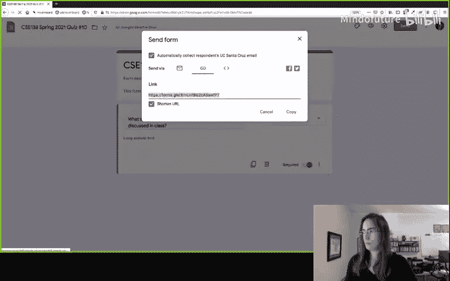
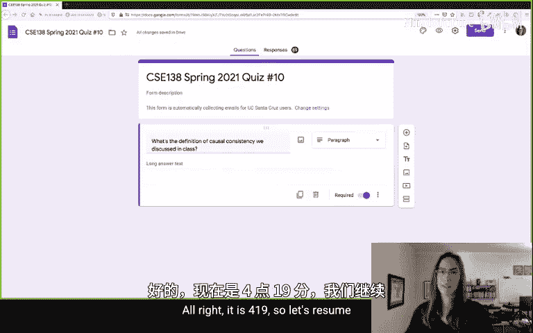

# 【加州大学】分布式系统-CSE138（Distributed-Systems）-p10-P10-L10---determinism,-consistency-models,-intro-to-consensus--BV1eGdLYjETJ_p10-

Zoom at the same time I'm looking at chat。After a year of teaching remotely。

 I'm finally beginning to learn these basic things。All right。Week six， welcome， welcome back。

I know that。That some folks struggled with the exam last week。

 and so I want to take a minute at the beginning of class today to ask you if there's anything from the exam that you'd like to discuss I have to tell you we're not done grading the exam yet。

And we're hoping to be done with it by Thursday， although I can't promise that that will definitely happen。

 we' do our best， but in the meantime， we can take a few minutes today to talk about any questions from the exam that you might have found confusing。

 so I'm going to devote a little time。At the beginning of our agenda today to that。

So if there are any questions that you thought were confusing。Just。

Maybe put the question number in chat and then we'll try to get to them。

And then we're going to jump into some new stuff。So we're going to talk for a little bit about。

Total order。And determinism。AFav topic of mine。We're going to talk about consistency models。

And this will include a few consistency models， read your rights。fi否。Causal and strong。

 we already talked about strong consistency a bit。Last week。

 and if you looked at the assignment three spec， you already read a little bit about causal consistency。

 so we'll discuss that today。And then we're going to come back a little bit。

 You remember last Tuesday， we talked about a couple of strongly consistent replication protocols we talked about。

Primary backup replication and chain replication。 So we're going to talk a little bit about dealing。

With failure。And。Strongly consistent replication protocols。

that might be all that we have time for today， but if we have time。

 that's going to lead us in really nicely to our next topics。Which are。Consensus。And。The FLP。Result。

So this is a pretty ambitious schedule， so I don't know if we'll get here。

But we'll get there if we have time。Great。😊，So let's start by giving a little bit of time to exam review。

So I have a couple of ideas for questions that I think we ought to discuss。

 but before I just launch into those are there any questions that you think that I should prioritize。

 let's say that we just have if we only give， say 10 minutes to this。

Which questions do you most want me to talk about？If any， I mean。

 maybe you don't have any questions from the exam。The causal broadcast went， yeah， okay。

So we'll talk about causal broadcast。And。We'll see how we do on that。

I think there's one or two others that were challenging。We'll jump into that verse， Okay。

 let me just bring up the exam so that I have it。Here。By the way， I got my first or rather my second。

 I got my second vaccination yesterday。So I'm feeling shockingly fine right now。

 I thought I was going to be very sick today， and I actually feel okay， maybe a little tired， but。

Let's face it， I'm actually tired every day because I'm an assistant professor with a toddler。Yeah。

 I actually feel okay。I don't have any fever or anything。

 no promises that I won't suddenly start having a fever and start hallucinating during class。

Read now I feel okay。Okay， so let's look at this causal broadcast question。From the exam。

So I think this was question。Let's see nine， maybe。I'm waitingting for Canva to load。

I use a password manager in my browser and apparently the password manager makes Canvas especially slow to load。

So I think it was I canvass is actually being very slow， but I think it was something like this。

 so I think we had。One process that sent messages something like this。And this was called M1。

So both of these were message one。And then we had a。A message here。Which we'll call M2。

And then we had a message here。Which we'll call M3。So the question was。

If all the messages in this execution were delivered right away after being received。

 then this execution would violate causal delivery。So the question was。

What would happen if you used the causal broadcast algorithm that we talked about in class to try to make this execution observe causal delivery。

 so try is a key word here。Because it turns out that you cannot quite use。

The causal broadcast algorithm that we discussed in class to make this execution observe causal delivery。

 why can anybody tell me why not？What is it about this execution that makes it so that you can't use our causal broadcast algorithm to do that？

Good， yeah， somebody， well， okay， somebody just said。Actually。

 I don't understand what somebody just said。 somebody just said M1 is not going to M3。 So these are。

Let's give these processes names so it's a little bit clearer。That's right。

 messages need to be broadcast messages。So these two messages here。

 message M2 and message M3 aren't broadcast。So because they aren't broadcast messages。

Casal broadcast won't work， so the causal broadcast protocol that we talked about actually only works if all the messages in the execution are broadcast messages。

 but the question was， what if you tried to use causal broadcast。

 like what would go wrong here if you attempted to use causal broadcast in this execution。

 so some people didn't see this， they didn't notice that there are messages in this execution that aren't broadcast messages。

And so they you know tried to carry out the algorithm anyway。

 and you'll get partial credit for doing that because that's， I mean。

 that's what the question is asking for， it's asking what happens when you try to carry out this causal broadcast algorithm。

ItTur out it won't work or it won't give you what you want。嗯。

So in what way does it not give you what you want， well let's have a look。So okay， so first。

 let's say P1 sends this message M1 and this one is a broadcast message to note that it goes to everybody。

 it goes to both P2 and P3。So the message arrives over here on P2。嗯。

It's going to have a vector clock of 100。It gets to P2。Is it deliverable， Sure。

 if we think back to what needs to be true about this message， So it's got to be。

 so P P2 is going to have a。A vector clock of all zeros to begin with， right？

So this message is one bigger in the sender's position。And it's less than or equal to the。嗯。So sorry。

 let me explain that a little better， the vector clock on the message is one bigger than P2's local vector clock in the sender's position and in every other position。

 it's less than or equal to。So that's fine， we can go ahead and deliver that one。

This one's going to have a vector clock of 200。And that one's deliverable also because this vector clock on process 2 gets updated at this point right after we deliver this message。

 so now once again it's one bigger in the sender's position less than or equal in every other position so that's fine。

 most people got this that I've seen， most people figured this out。

 they were totally fine on understanding what the vector clocks were on message1 and message2 here and that they were delivered right away on P2。

Now let's again， these aren't broadcast messages， so something's going to go wonky at some point。

 but let's keep trying to do this to try to figure it out， so here's M3。

What's going to be the vector clock on M3 Well at this point P2 has delivered two messages。

 so its vector clock is 200。It's going to increment its vector clock before sending the message。

 so the vector clock on this message is going to be 210。And most people got that that I've seen also。

 not everybody but a lot of people got that。Message gets over here。

And most people saw that this message wouldn't be deliverable right away， because。

P3's vector clock starts out with zeros， they see that we get this message。

 its vector clock is too big。So they saw that most people saw that this message is not deliverable when we get here。

 so this message gets queued。This is where people started to run into trouble， so some people said。

Well， then M3 shows up。And then this message gets uncuted and can be delivered。But here's the thing。

Look look what happened when3 was sent， when M3 was sent。

 it was sent after M1 and M2 both were received and delivered at P2。

 so notice this2 right here in the vector clock of M3。

That2 represents the fact that these two messages causally precede M3。

So M1 and M2 both causally precede M3。 So it's not enough to just deliver M1 here。 M1 will show up。

 It'll be delivered。 That's fine。 A lot of people got that。

 but that's not enough to deliver message 3， because。Message 3 is waiting on M1 and M2。

And if you look at the conditions for delivery。That's captured in those delivery conditions because the vector clock on the message that you're trying to deliver has to be it has to be exactly one bigger in the position of the sender and less than or equal to in every other position well after this M1 gets delivered you're still only at 100 so you still can't deliver this one you still can't deliver M3 and what's more you're never going to be able to because。

Process3 over here is basically waiting forever for M2 to show up。

 but M2 is never going to show up because M2 wasn't the broadcast message So what we were looking for on this question was we were looking for you to get the vector clocks on the different messages a lot of people got that。

 we were looking for you to see that message 3 got cud here。And then furthermore。

 we were looking for you to see that message one can't ever be delivered at process 3 because Pro3 is waiting endlessly for this M2 that will never show up because it wasn't broadcast so there this is a question that I think a lot of people got part of。

 but from what I've seen not too many people got all those pieces。And so it was a tricky question。

 I admit it was a pretty hard one， I think it may have been the hardest one on the exam。All right。

 how are we doing on time？I don't want to spend a huge amount of time on exam review because we have a lot of other stuff to get to today so let me。

Pause there and see if anybody else has any other exam questions that they want to talk about just really briefly。

Going once， going twice。The snapshot question， yeah， okay。Yep， that was another tough one。Okay。

 let's talk about that one really quick。I think we've already spent more time than I said we were going to spend on exam review。

 but that's okay。Stuff's important。So let's talk about the snapshot question。

This is the Chandy Laport snapshot question。So we had something like this。 we had three processes。

 and we had。A snapshot where。Each process's state had been captured。Let's see。

 I think it looked like this。Okay， so。We said that this process we'll call it P1 initiated the snapshot。

So P1 initiated the snapshot， it snapshot at its own state， it then sent out marker messages。

It sent one like this， we'll do a different color。I wanted to do the wavy lines。

 which is how I normally。Draw marker messages when I'm drawing on paper。

 I want to do the wavy lines on the exam too， but unfortunately the drawing tool that I used didn't support that。

 so I had to do dotted lines instead， I hope it wasn't too confusing。Okay， so。

Marker messages went out。嗯。This is what the snapshot looked like here。

Here's what the snapshot looked like here。Okay， so there were kind of two parts to this question。

 one question was， what's wrong with this snapshot？

And the other question was this was why would this not happen？So。The first question is easier。

 I think， so just really quickly， will somebody tell me what's wrong with this snapshot？

F is not included right， so there's an event here， F。

But F is causally before D and D is in the snapshot and we know that a consistent snapshot is one where if an event's in the snapshot。

 then everything causally precedes it ought to be in the snapshot too， so that's a problem right。

 it's a problem that F is in the snapshot so how would you fix it well one way to fix it would be to you know if F were in the snapshot。

 another way to fix it would be to leave D out out of the snapshot。

On somebody who just said the problem was that some processes didn't send their marker message so that was part of the picture too。

 but in the picture the marker messages were still in flight so after。After P3 took its snapshot。

 it sent its marker messages out。And likewise here after P2 S snapapshott at it state it sent its marker messages out。

 so those were shown as being in flight in the picture。

 so the problem wasn't that not enough marker messages got sent， that wasn't it。Right。

 so the issue for what's wrong is that this is an inconsistent snapshot because we can see that there's an event in the snapshot D here。

 but not everything that's causally before D is in there。

 so if you were to take this snapshot and show it to somebody and they would be pretty confused because there would be an event happening here but not everything that may have caused that event was there。

So why would this not actually happen？So this comes down to something that we know is an assumption that the Chandy Laport algorithm makes。

 which is that channels are PIO， so messages from one process to another have to be delivered in PIFO order。

So that means that this marker message right here that goes from P3 to P2。

This marker message here would have to land up here because according to FIF order。

 it would have to get delivered at P2 before this application message from F toD。

The snapshot on P2 would have actually been this。Which would have been a consistent snapshot。

And the reason for that is the PIFO requirement， so again， right here。

So this message may indeed have been slow this marker message from P1 to P2。

 but by the time it got there after D， this marker message would have already had to have gotten here from P3 to P2。

And P2's behavior is just to take the snapshot when it first gets a marker message。

So the snapshot that I showed earlier couldn't happen because of FIFO。

So that's what's going on there。If you have other questions about the exam。

Please stop by office hours and ask us， we're aiming to have the exam reviewed by Thursday we'll do our best。

And in the meantime。诶。I'm happy to answer any questions that you might have about the exam。

And I'm sure that the rest of the course staff is too， so come talk to us。All right。

Let's move on to the rest of our agenda because we have so much to do today。So first of all。

 before I jump right into the material。Welcome to the second half of the course。

 give yourself a pat on the back， you're done with the first half of this course， congratulations。So。

The midterm is behind you。Whether or not it went well。You did great。In the sense that you're done。So。

Congratulations， you're already done with the first two assignments。

The second two assignments are still ahead of you。Yeah， so on hard mode， right？

The second half of the course is going to be harder than the first。

 I'm not going to lie to you the second two assignments are harder than the first two。

And I think the material will only get more subtle and interesting from here。

 but you you've laid all the foundation that you need in order to understand the stuff that we're doing in the second half of the course。

 If you struggled with the material so far， now is a fantastic time to come talk to us and get help because we're here to help。

Allright。So。Let's talk a little bit。About one of my favorite topics？Which is total order。

Versus determinism。So some of you remember the picture。

That we've drawn before of an example totally of a violation of totally ordered delivery。

And my favorite way to do this picture is to pretend that we have two clients。Of a key value store。

And they're both sending messages to replicates。Let's say the client one is writing。

To the key x with the value 3， and let's say that another client is writing to that same key。

With a different value。So what goes wrong here Well， the issue is that。Different。

Events happen on different replicas in different orders。

Repla1 is going to get this update saying that x is three first next they're going to get the update that x is4 so it's going to end up thinking that x is4 Relica2 is going to get those updates in the other order it'll first get the message saying that x is4。

 then the message that x is3 will come in。So that's not great， right。

 these are supposed to be replicas that means they're supposed to agree。

 but at this point they don't agree。So imagine for a second if we had only one replica， remember。

 we talked about how the informal definition of strong consistency is that clients can't tell that the data is replicated right。

 so if you wanted strong consistency，One way to do that is to just actually have only one replica。

So let's just say there's one replica R。So what could happen here？Well。If Cl1 is sending its update。

It could happen like this。And then we'd end up in the state where x is four， right？

But it just as easily could have happened in the other order， right。

 maybe client one's message landed a little bit later。

And then we'd be in this state where x is three。So。Those are two different runs， let me be clear。

 so maybe this is a run where the message landed here and then this other run is when where the message landed here。

Even with just one replica， which probably shouldn't even be called a replica in this case because there's just one of it。

It's possible that these messages are going to arrive in different orders。

And there's not necessarily any obvious better choice out of these two runs。

So I can't look at them and say that run one is。Wrong and run two is correct， right。

 nor can I say that run two is wrong and run one was correct。

But neither of those will give you the total order anomaly。

So recall the definition of totally ordered anomaly or a violation of totally ordered delivery is that。

If a process delivers， let's call these M 1 and M2。If a process delivers M1 and M2。

 then M2 like our1 did here， then all processes that deliver both have to deliver M1 first。

 that's what the definition of totally ordered delivery is so a violation of totally ordered delivery is something like this where that doesn't happen。

So there's no violation of total order delivery happening down here。

So I want you to notice that this process art has a whole lot of control， actually。

On when to deliver messages， so R is going to establish the total order by deciding when to deliver every message it gets。

 even if this message did show on up up here。Or could say， nah。

 I don't want to apply that update yet， I'm just going to wait for a while。

Maybe I'll play it after I get this other one from client too， why I don't know。

 maybe it's decided the client one is more important。

So it could establish a different order from one run to the next。

But doing so doesn't violate this property of totally ordered delivery。

Having the order be the same from one run to the next。Would be a different property。

 and that's called determinism。So determinism is a property that is different from totally ordered delivery。

 determinism relates multiple runs of a system to each other， determinism says that on every run。

You're going to have the same outcome。So even if we have one replica， we don't have determinism。

I'll say we don't necessarily have determinism。So we do have totally ordered delivery in this situation with one replica。

 we kind of have to。But we don't necessarily have determinism。I really。

 I find determinism fascinating。I studied determinism when I was in grad school。

 I wrote a dissertation about it， so if you want to talk to me about determinism。

 I'd love to talk about it。But that's not what totally ordered delivery is。

 and I think this is an important distinction to make so you know even if you have only one replica like this。

You can't guarantee that you're going to get the same outcome every time unless you impose some sorts of additional stuff。

So when there's only one replica， it's going to establish a total order on any given run。

What we would love。What we would love is to make it so there could be multiple replicas。

 but keep this nice property of totally ordered delivery。

 We would like clients to be able to think that they're dealing with a system that does not have multiple replicas。

 That's what that's what。That's what strong consistency is。

 strong consistency is when clients can't see that the data is replicated。

 clients can't tell that the data is replicated。So。I want to spend a little time talking about。

Some of the bad things that can happen。When a client can tell that data has been replicated。

So in other words， different ways in which replicas could disagree。

So here's one of the really obvious bad things that could happen。Let's say we have our client。

Let's say we have two replicas。Let's say the client does it right。And it could even get acknowledged。

And then client does a read later。But they happened to do the read to the other replica。

My marker is running out， let me get my other one here。

So the client happens to do the read to this other replica over here。And who knows what R2 thought。

 maybe it thought that x was  for， or maybe it didn't have a value for x。

It would come back with four。So the client writes to R1 tells it that x is 5 gets an OK。

Then she tries to read X， and the read goes to some other replica that。

Thinks that x is something else or may not even know about x。

That might seem a little bit odd to this client。So the property that is being violated here is called Read Your rightss。

For RYW。For short。It's one of the most fundamental things that you might ask of any distributed storage system。

 but some just still don't give you this， some systems still don't provide it。Interestingly enough。

Here's another。Let's say that we have。Two clients this time。And two replicas。

And just to make this a little bit more interesting， let's pretend this is a bank account。

So we'll say it's a replicated bank account， maybe it's a joint bank account。

Here's our little picture of a bank here。So let's say that client one tries to do a deposit。

And she tries to deposit $50。And let's say that she gets an acknowledgement。Okay。

 now let's say she tries to do a withdrawal。And let's say that the withdrawals goes to the same replica。

So that's fine too。But。Let's say that replica 1 and replica 2。Are not being。

Quite as conscientious as you might like。In sending these updates to each other。

So let's say that this happens。Let's say that R1 passes on this update to R2。

And it passes on this update。But they arrive in the opposite order， and just for good measure。

 let's say that we started out with $0 in our account。

So what's going to happen over here on replica 2？嗯。Negative money， that's right。So。

Clt one did everything right。 She waited for an acknowledgecment。

From the bank before she did her withdrawal， she made sure that the bank acknowledged her deposit before she did a withdrawal。

 so client one didn't do anything wrong here。But if client too were to come along and do a balance inquiry right here。

Then。The response right here in this point right here， then the response would be sad。

So the deposit and withdrawal got flipped around between replica 1 and replica 2。

 and if another client happens to a read right at this wrong moment。

 that client will see that the account is overdrawn。By $40。That's no good， right。

 what if this client over here was actually some automated process that checks if accounts are overdrawn and then charges overdraft fees？

By the way， banks sometimes do try to reorder transactions in a way that's beneficial to them。

 in fact Wells Fargo got in trouble for that a few years ago。

 they tried to manipulate transaction order to maximize the overdraft fees that they were charging。

So anyway， what kind of anomaly does this look like here？With these messages crossing over。Exactly。

 yeah， it looks like a fiIO anomaly。So this is a violation of PIFO consistency。

So we can define PIFO consistency this way。Right， done。By a single process。A seen。By all processes。

In the order。They were issued。In this case， the rights were being done by client1。

And the violation of PIO consistency is that replica2 didn't see those rights in the order that client1 issued to them。

By the way， in this example， I could have left out clientient2 here and it would have still been a violation of FIFO consistency。

 it's just that having client2 here makes it especially obvious why this is bad because if there's another client who reads these updates in the wrong order。

Then we're in trouble。All right。So those are two bad things。

Here's another bad thing that could happen。Let's say again that we have two clients。And two replicas。

Let's say that the first client deposits $100。And gets an acknowledgement。Okay。

 let's say that client two over here。First， checks the balance。

And let's say that I asked that question of R one， so let's say we started at zero。Just like before。

 here's our little bank picture。So we deposited $100， now we have $100 in the bank。

 client two asks about the balance。So this is a read， right， that one was a right， this one's a read。

 we get back。Our balance。Then clientient2 tries to do a withdrawal。

And gets back a message about there being insufficient funds。So what went wrong here。

 client two came along， checked the balance， saw that there was $100 in the account and thought。

 okay， it's okay to withdraw $50 so they try to withdraw them they can't。So what went wrong。

 why did client2 think they could do a withdrawal？Yeah， so client too。

Thought they could make a withdrawal。Because they checked the balance over here。

 The balance over here was $100。 Why was it $100 because of this earlier deposit。

So if you follow the chain of events。And I'll even draw the arrows in red here to make it really obvious。

If you follow the chain of events here。You see that the deposit of $100 happened before in the sense of the happens before relation。

 this deposit happened before。The withdrawal。And so clientient too isn't doing anything wrong。

The problem is that replica2 sees the withdrawal。But it doesn't see everything that was in the causal history of it。

 Remember how we talked about causal history before。

 the causal history of an event is every event that happens before it。

 So this withdrawal event is happening here on Relica 2。

ButRelica2 hasn't seen all the events that are in its causal history in particular。

 replica2 hasn't seen the deposit， so maybe replica one even tried to tell Relica2 about the deposit。

 but the message arrived too late or something like that。This is a violation。

Of what we call causal consistency。So here's the definition of causal consistency。

So when I say rights that are related by happens before。

 I mean the translation of that is rights that are potentially causally related。

So rights that are related by happens before， meaning rights that are potentially causally related must be seen in the same。

Casal order。B all processes。So I've just talked about a bunch of different violations of different kinds of consistency guarantees。

 so all these are different consistency guarantees that I'm talking about。

 read your rights consistency， FiO consistency， causal consistency。

And before I talked about strong consistency， so all these different consistency guarantees I'm talking about。

Are progressively stronger。So we could draw a picture。

 remember how we drew a picture before where we talked about executions that observe different delivery guarantees。

 we could do the same for consistency。So I could draw。

A Venn diagram here where I have a big circle with all executions。AndWithin that， I could do。

Executions。Observing。Read your rights consistency。Within that， I could do。

Execution's observing PIFO consistency。I see that I didn't draw the circles big enough here。

 I'm going to run out of room。But you probably see where this is going this circle here is going to be。

Causal， so executions observing causal consistency。And then this one in here is going to be strong。

So hopefully that makes sense， imagine the words executions observing causal consistency here and execution's observing strong consistency here。

So these are a bunch of different。Consistency guarantees that you could have an increasing order of strength as you go from the all execution setting where there really there's no consistency guarantee to executions that have read your rights consistency to those that give you FiIO consistency to those observing causal to those observing strong consistency。

And there are in fact， more that I could add to this picture if I wanted to， many more， in fact。

 so there was a survey paper that came out a few years ago which discussed something like over 50 different notions of consistency for replicated data。

Now not all of them are nicely nested like this， in fact。

 the reason why I picked these ones to show you is because these ones do have this nice nesting。

So I promise not to make you learn about all those different 50 notions of consistency。

 honestly it's not that important for you to learn about all of them。

If you know about these four or five here， that should be good。

So I'm bringing this up because I want to emphasize that different systems make different consistency choices。

 so you might look at this and you might think， oh， well strong is the best right， you know。

 isn't this the one that's like the one that I want？But。You know， maybe not。

Why would you maybe not want to go for this very strongest level of consistency possible？

I'm starting to feel a little warm right now， I don't know if it's because of the fever from the vaccine or because I just love consistency models so much。

All right， yeah。 so people are saying some good reasons for why you might not want to go for this very strongest。

 Yeah， so an issue is that。Replas could crash， yeah。

 certainly it's harder to maintain strong consistency in the presence of replicas crashing。

And we'll talk a little bit more about that later。It takes more effort， right。

 more messages have to get sent around if you want to maintain strong consistency。

 so each of these different kinds of consistency gets harder to enforce and the more work that you have to do to enforce them。

The longer your client has to sit around waiting。For you to get back to it with an answer。

So you know， one really nice thing， if you go back to this picture that we showed a second ago of。

Of a violation of read your rights。So here。If you go back to this one here where we had this example of this one client。

 two replicas and a violation of radio rights consistency。

 now the client asked what the value of four was and she got a response to her request right away。

 she didn't have to sit there and wait for replica 1 to pass the data to replica2 and replica2 would acknowledge replica 1 and all that nonsense。

And furthermore， when she did this initial ride in the first place。

 she just got it okay back immediately from Relica 1 now。Is this bad， right。

 like is this a trade off that you're willing to ask for that replica2's data might be a little bit stale？

For some people that's absolutely not acceptable， for some systems。

 that's absolutely not acceptable and you would never want that for some other systems。

 it might be all right and it's okay if replica1 kind of， you know whenever it has time。

 it'll get the update over to replica too， but in the meantime。

 it's okay if clients can't read their rights。 So this is a trade off that it makes sense to think about notice that this client is getting answers back from the data store really quickly here and sometimes you know it's okay to get an answer that's a little bit wrong as long as it's fast。

So， you know， it's the classic trade off， do it right or do it fast。

 sometimes it's better to compromise a little bit on the right as long as you can have it be fast。

So back to this picture。So。If it's a trade off and if every one of these kinds of consistency。呃。🤢。

Borsces you to trade off， do it right or do it fast then you know what do you do right what do you pick Well a lot of people think that causal consistency is a pretty good compromise so causal consistency doesn't give you everything that strong consistency gives you。

 but causal consistency is often considered pretty good。

 so this is what we're asking you to do on the assignment。

Notice that some bad things can still happen under causal consistency。And you'll see some of that。

 maybe as you work on the assignment。It's kind of a pretty good compromise。

And there are good reasons to want to pick something weaker than strong consistency。

 so we'll talk more about that as the course goes along。All right。

 I think now is a good moment to pause and do our quiz。So let's take a 10 minute break。And。

Let's return， let's see what time is it now？

All， it's 409 right now， so let's return at 419。And I'll see you in 10 minutes。Oh yeah。

 so strong consistencyencies， the informal definition we gave last time for strong consistencyencies。

Clients can't tell that the data is replicated。And I think that's good enough。The question was。

 did we go over a definition for strong consistency？So there are more formal ways to define this。

But I think this is a good enough definition is good enough for now。Just out of curiosity。

 I'm seeing like 60 viewers on Twitch right now， and I'm seeing considerably fewer than that on Zoom。

So are folks in the class just choosing to use Twitch instead？Which is cool。

 I'm happy to have you do that。Yeah， Zoom is laggy， yeah。哼。Yeah。

 I had some students in the past who just refused to use Zoom because it's not free software。

And I don't know how sustainable that is， I mean surely the student was taking other classes that required them to use Zoom but。

Yeah， you know。Folks who are are。Dedicated to only using free software， I respect that。

There's if you're using Zoom in Firefox， then you're still using Zoom in the cloud。

Committing to not using free software， does that mean also not using cloud based proprietary software。

 I don't know。Right。嗯。All right， two minute warning。All right， it is 419， so let's resume。

So there was a good question actually on Twitch chat， somebody asked。

 are these consistency models similar？To database consistency models in terms of transaction semantics。

 so that's a good question。I want to be clear and say that we're not talking about transactions here。

If this were a database course， we'd be spending most of our time talking about transactions。

 which is when a bunch of operations either happen as a unit or not at all。

So that's actually not the setting that we're really in here and you don't have to think about transactions or any of that for the homework and the consistency models that we're discussing here in this nontransactal setting if you wanted to talk about transactions。

 I mean it's a related topic for sure， and all of this has a lot of overlap what stuff that's discussing all the time in the database world。

 but these are considered nontransal consistency models。By the way。

 I realized that I've been throwing around this word models quite a bit。

 and I don't know if people know what the word means。

 so in particular I would call all these things I would call read your rights consistency。

 PIO consistency， causal consistency and strong consistency， I would call them consistency models。

And this word model is something that I've used pretty often， right。

 we talked about network models earlier in the course。We talked about fault models as well。

 so what does a model like what does that word mean just out of unrelated to any particular kind of model like network models。

 whatever， what is a model does anyone want to try to define that word？嗯。Now。

 it doesn't have anything to do with lampport diagrams as such。So I would say that what a model is。

Yeah， okay， so this is good， somebody says of a set of behaviors or expectations， yeah， okay。

 so yeah， I would say that a model is the set of assumptions that you have in mind when you're building a system。

😊，So if we're talking about network models。We talked about two network models right we talked about the asynchronous network model and the synchronous network model。

 each of those is about an assumption， the synchronous network model is about assuming that there's a bound on message latency between a sender and a receiver。

 the asynchronous network model is about assuming there's no bound on network latency。Similarly。

 fault models are a set of assumptions about what kinds of faults can occur。

And these consistency models。Are about a set of assumptions about what kinds of executions can occur。

So。The question is， if you're a client。And you're talking to a system。

You might want to know what can you assume and not assume about the behavior of that system？

And so it helps a lot if you have this notion of a consistency model that will let you reason about。

What can you assume about the behavior of a system now with consistency models。

 these consistency models each describe some set of executions and in this case we're talking about these nested sets of executions where the kinds of executions that are allowed under each consistency model gets smaller and smaller and smaller。

Another way to think about it might be。What clients are allowed to see。

 what clients are allowed to observe。So the consistency model tells you something about what kinds of bad things a client a client might be able to see if you're if you've got。

None of these guarantees if it's just the all executions。

 then you could see all those bad things that I talked about earlier。

 you could see a violation of read your rights， like an execution out here。Could violate。

 read your rights， it could violate PIO consistency， it could violate causal consistency。

 could violate strong consistency。An execution here might violate PIFO。

Or it might violate causal or strong consistency， but you won't see that particular anomaly that I saw before that's a violation of read rights。

So consistency models tell clients something about what to expect。

And that's what we mean by the word model。In general， something about what to expect pharmacist。

 what can you assume？Allright。Let's move on to something else。So。Before the exam。We talked about two。

Replication protocols that give you strong consistency right。

 so think back to way back in those ancient times before the exam when we talked about strongly consistent replication protocols。

And the two that we talked about were primary backup。

Where you have a primary and some number of backups and chain replication。

Where you have a bunch of replicas arranged in a chain。So at the very end。Of last Tuesday。

 I talked about how both primary backup and chain replication。

Are ultimately going to have to rely on the presence of some sort of coordinator process whose job it is to know。

Who all the replicas are， what role they're playing。And keep everybody else informed of those roles。

And it also has to be able to detect failures of the replicas。 And when a replica fails。

 it has to be able to tell everybody。What the new configuration is going to be。

So for chain replication， for instance， let's say that we have three replicas。

It's going to be the coordinator's job to know who is who。

It's going to be the coordinator's job to detect failures and handle them。

And it's going to have to tell clients about who's the head and who's the tail。

 So you can imagine this other process over here。I'll call it coordinator。

So this process knows who's who， so it knows right now that the head。

Let's say is replica 1 and that the middle node is replica 2。And that the tail is replicate 3。

 so this is all state that the coordinator node knows。So。By the way。

There is an assumption here that not all of the replicas will fail if you have N replicas。

Then there's an assumption that at most n minus1 will fail， if they all fail。

 then you're completely hosed right， then forget about trying to store any data or read or write any data。

 so when we're talking about fault tolerance，We're talking about being able to withstand some number of failures。

And there's also an assumption that you can actually somehow tell when a replica has failed。

So remember how we talked about fault models a little bit before。So we talked about the crash model。

And then we said there was a subset of that that was called the failil stop。Falult model。

So before when we talked about crash faults， we said。When you have a crash faultult。

 that's when a process fails by halting。So at that point。

 it's no longer sending or receiving any messages。If you're somebody else。

You don't necessarily know that a crashed process has crashed right， maybe it's still running。

 but all the messages are to and from that are just being lost or no， maybe they're just slow， right？

So。When we're talking about chain replication， there's actually an assumption not only that processes can crash but that we can tell that they've crashed and that's what's known as the fail stop default model so if you think back to before we describe the fail stop model as a model in which processes can crash。

But we can tell that they've crashed， and this is kind of one step down from the crash model。

So in the fail stopvault model， crashes can happen and you can tell that the process has crashed in the crash model more generally。

 crashes can happen and you can't necessarily tell。So it'd be more formal about it， you could say。

In the fail stop fault model。Cashs。Can occur。And。Can be。Detected。I'll say by the environment。

Meaning other participants in the system。Do you think that this is a realistic assumption。

 this assumption that when a process crashes， you can detect it？All right， we got a know in the chat。

I would say yes and no， right， so what could you do to try to detect crashes and this is something that you're going to have to think about for the assignment right？

One thing you could do is maybe you can ask every process to periodically send you a message saying I'm alive。

And then。If you've missed a few of those in a row like if you if you。If it's been some time out。

 right， and you haven't gotten that， I'm alive message， which we could call heartbeat message。

Then maybe you declare it dead。So sometimes they're going to be wrong。It might still be alive。

 but the I'm alive message might have gotten delayed。So from time to time。

 if you're taking that approach of making processes tell you that they're alive every so often。

From time to time， you might declare a process to be dead， even though it isn't。

And if you find that that's happening a lot， then you might want to increase your timeout length。

But failure detection is its whole deep own whole deep topic that we don't have time to talk about all the details of。

 but the short version is，Perfect failure detection is impossible。

In an asynchronous distributed system， that is in an asynchronous distributed system where there's no bound on message latency。

 perfect failure detection is impossible， perfect would mean every time there's a failure you see it。

 and there's no false positives， right， no false negatives， no false positives。So every now and then。

 you're going to end up in this situation where you declare a machine dead。

 even though it's not really dead， and so you're telling it you're dead and you're dragging it away。

 kicking and screaming and it's saying no， I'm not dead， give me another chance。So。

It turns out that that's。The facts of life in an asynchronous distributed system。

 sometimes you have to declare something dead， even though it's not really dead。

But we're assuming here that we can detect failures。Fail stop fault model。So。Yeah， you can do it。

 but it means that some of the time you're going to be wrong。So。Real quick in chain replication。

 let's say that R one is the head process here。And head of the chain。

 and let's say that the coordinator sees that it fails。

So maybe it's a protocol where all of the nodes in the chain have to tell the coordinator every so often。

That they're alive， right？Let's say that the coordinator sees that the head in the chain has failed。

 what should the coordinator do？Any guess？If you happen to look at the chain replication paper that I talked about last Tuesday。

 then maybe you already know the answer。Broadcast everyone that replica one is dead， Yeah， okay。

 so what is it going to do with the configuration of the chain though？

Somebody's got to be the new head of the chain if replica 1 is down， right。

 so what is the coordinator going to replace replica1 with？That's right， yeah。

 it's going to replace it with the next in line， so it's going to take the head process out of the chain。

And it's going to make the successor to it， the new head of the chain。So in this case。

 R2 would be the head of the chain， there's no more middle node in this chain。

Maybe later if another node gets。Is brought up and then tells the coordinator that it exists。

 then the coordinator can choose toplace it in the chain。

 but at the moment this is just a chain of two nodes， which is perfectly fine。

It's fine in terms of chain replication working。Okay。What about when a tail process fails。

 what if this one fails， then what does the coordinator do。

 let's say the coordinator finds out that the tail has failed。

It's pretty similar to what happens with when the head fails。Yeah， that's right。

So if the tail process fails， the coordinator is just going to take the tail。

Out of the chain and it's going to make the predecessor the new tail so in this case。

We only had three to begin with and then the head and the tail field。 so now。

R2 is both the head and the tail。Which is fine actually we're down to just one replica。

 which is kind of no good， but in terms of chain replication working it's fine。

 it just means that now all requests are just going to go here。

So it still works in terms of the chain replication algorithm。

 it's maybe not great in terms of fault tolerance。And so at that point。

 you would hope that whoever the system administrator is who's in charge here is going to see that a couple of replicas have failed。

 maybe they get paged and they find out that all but one replica is dead and they'd better bring up another replica。

Okay， so and what about when a middle node fails， then its predecessor and its successor have to be hooked up to each other in the chain。

 but then there's no need to tell the clients anything right。

 because clients don't care about the middle nodes in the chain。If the head and the tail fail。

 however， somebody's got to inform the clients who they should be talking to。So in each case。

 if somebody fails。And the coordinator finds out that there's a failure。

 then there's some bookkeeping that has to be done。And that bookkeeping has to handle any updates。

 any rights that might have been kind of partway down the chain at the time that the failure happens。

So。I don't want to discuss that in any detail because you won't be expected to know it honestly。

 and if you're interested， you can always check out the chain replication paper。If you care。

You can look up chain replication。Sorry， I。 Bill Schneider there don't want to。Do him at disservice。

They published this in 2004， I believe。There's also a great paper that came out not too long later。

 which is called somewhatwhat amusingly。Object storage。On。Crack。CRAQ。

 the CR here stands for chain Replication， so I think this came out in 2009。

This is kind of like a slightly more modern take on chain replication if you understand chain replication。

 you can understand this。So you can look that up if you're interested in knowing the exact details of what happens when a process fails。

All right， we got a fantastic question in chat， what if the coordinator fails？What then。

And by the way。Even though I've been talking about chain replication this whole time。

For primary backup replication， there also has to be a coordinator to handle primary failures and backup failures and make sure clients know who the primary is。

 so we still have this problem， what if the coordinator fails。What the heck do you do then？

What could you do to mitigate it， what could we possibly do to be more tolerant of coordinator failures？

What do you think？😀呵哈。😊，Yeah， we could assume defeat or we could admit defeat， right。

 we could just say sorry。No more writes， no more reads。Oh。Yeah， everybody gets it off。

What if we want to do a little better than that， what could you do to be more tolerant of coordinator failures？

Well， maybe somebody else could take its place， yeah， okay， but I mean。

 these other processes they might not have had all the information the coordinator had though。

 so if it crashed，Everything that it knew was lost， right？

 Let's say you're a note in the middle of the chain。

 You know who's ahead of you and you know who's behind you， but you don't know everything else。

 right， You don't necessarily know who the head and the tail are。 What if you're just the tail。

 All you know is who's previous to you in the chain。 You don't know who the head is。

Have backup coordinators。 Yeah， have a bunch of coordinators。 so that's an interesting idea。

 Have a bunch of coordinators。Change it to Coordinators plural。Oh oh。

 but then those coordinators have to be kept consistent with each other。

Wasn't that what we were trying to do in the first place。

 we were trying to do strongly consistent replication？

Now it seems like in order to do strongly consistent replication。

 we have to do something to keep these consistent。Oh no， how are we going to do that？

So this is actually the ideal lead in to our next big topic in this course。Which is consensus。

So it's very funny if you look at the chain replication paper， this 2004 paper that I mentioned。

 which is a fantastic paper， by the way， it's one of the classics of the distributed systems literature。

One thing they say is， well， we assume the coordinator doesn't fail。So it's kind of like， really。

 you assume the coordinator doesn't fail。And then if you kind of read a little further。

 they admit that that's an unrealistic assumption， and then they explain that in the actual implementation that they did。

They have， instead of one coordinator process， they actually have a small group of coordinator processes that are themselves running a consensus protocol among them。

To make sure that they agree with one another and essentially behave as though they're a single process。

So I find this very interesting and a little bit sobering that if we want to have strong consistency。

Of replicas， which is what these replication protocols like primary backup and chain replication give you。

If you want to have the strong consistency and you also want to be tolerant of faults。

Which is probably the reason we were doing replication in the first place。

Then ultimately we end up being reliant on the consensus protocol， and that should give you pause。

Because consensus is hard。And it's expensive。So talk about reasons to not have strong consistency。

 remember this picture that we showed a second ago。If you want strong consistency。

You're going to have to deal with that， you're going to have to deal with that question of coordinators。

And that should give you pause because then you have to deal with that question of coordinators failing。

 and then you have to think about consensus between different copies of the coordinator。

So that's one reason not to have strong consistency。

 maybe if you can get away with a weaker consistency guarantee like causal consistency。

 then maybe you should。But there are times when you really do need。Strong consistency。

 and there are times when you really do need consensus。So we only have a little while left， we have。

 let's see。About 13 minutes left， we have time to talk a little bit about consensus。

So let's talk a little bit about that。When do you need consensus？

So let's talk about a bunch of scenarios that might come up when you're working on distributed systems。

So。These are all scenarios where you have many processes， or a bunch of processes。

So one possibility is you need to make sure。They deliver。The same messages in the same order。

Sorry about that。All right， so that's one possibility。Okay， here's another possibility。

You have a bunch of processes and。一 need的吗？To know。What other processes exist？

And keep those lists up to date， so whenever anybody dies or leaves the group for whatever reason。

 then everybody's list has to get updated。Or here's another possibility。

You have a bunch of processes and you want one of them。To play a particular distinguished role。

And everybody else needs to know who's playing the role。Or here's another。

You have bunch of processes and you need them to be able to take turns getting access。

To some resource that only one can have at a time。Maybe it's like a file or something。

Or maybe you have a bunch of processes。They're all participating in a transaction。

 so I mentioned database transactions a little while ago。

 so maybe they're all participating in a transaction and they need to agree on whether the transaction is committed or aborted。

These are all really hard classic problems in distributed systems。And they all have names。

So this first one。This is called the totally ordered broadcast problemop。

Sometimes also known as Atomic broadcast。I think that name is a little bit more confusing。

 so I usually say totally ordered broadcast。This one here is called。The group membership problem。

And by the way， this is very closely related to what we talked about earlier with failure detection。

So if you need to know what processes exist， that's like knowing which processes are up。

In this one here， you need one of them to play a particular role and everybody else needs to know about it。

That's called the leader election problem。This one。

 you need them to take turns getting access to something。That's the distributed。

MutualMual exclusion problem。And then this last one here。

This is the distributed transaction commit problem。

A lot of ink has been spilled in the last 50 years。About how to solve all these problems。

What do all these problems have in common？Well， they all involve。

This group of processes trying to coordinate with each other and find agreement about something。

So the thing that they're trying to agree on varies， right。

 it could be know what order to deliver the messages in， whether or not a process has failed。

It could be who the leader is in the case of leader election。

It could be who is currently allowed to access the shared resource in the case of distributed mutual exclusion。

 or it could be whether or not to commit in the case of the distributed transaction commit problem。

 so the details vary。But all of these different kinds of problems boil down to the consensus problem。

Which is the problem of getting a bunch of processes to coordinate and agree on something。

In distributed systems。The thing that makes this hard。Is。Falults and asynchrony。

 So remember how we talked at the beginning of the course how distributed systems are systems where independent components can fail。

And you're going to have unbounded latency， right because we're in the asynchronous network model。

 so those two things make the consensus problem hard。So faults in particular are what make this hard。

 I think， so crash faults and omission faults are the ones that。That we'll be considering the most。

In fact， mostly just crash faultults because it's hard enough even then。

Byzantine faults make this extra hard， we're not even going to talk about that to be honest with you。

 so if you're interested in Byzantine consensus， that's a little bit beyond the scope of this class。

 something that you might want to read about on your own once you're done with this class。So。

We're going to spend a little time talking about consensus and we're going to be talking about a classic algorithm for getting consensus。

嗯。We only have four minutes left today。But let me just try to before obviously that's not enough time to talk about a consensus algorithm。

But let's just try to talk a little bit in very， very high level about what it means to get consensus。

So。Let's say that you're trying to get some processes to agree on something。

And to make things simple。Let's say it at the thing that the processes are trying to agree on。

Is one bit。Zero or one。So every process has a say。So we could draw a box here like this。

 this is the consensus box。So every process gets to have a say。So they're all inputs to this box。

And the consensus problem。Is to design a protocol。So that the inputs go in。

 maybe one process is zero， another one is one， another once is one。

The consensus problem is to design a protocol where everybody comes out agree。

 either they all say zero。Or it would also be fine if they all say one。So that would be。

Another solution。 notice that。The consensus problem doesn't say anything about what they agree on。

 the consensus just says that they do agree。Now you might look at this and you might think。

 well that's easy， right， so one is the majority here， so we should go with one。But the trouble is。

Keep in mind that there's not some external person like us， when we're looking down at this picture。

 we're like a God who has perfect knowledge of everything that's happening。

 we see that these processes say011 and we can say。

 oh well one is obviously the majority so we can pick one。

But these processes don't have Godlike knowledge of what each other thinks。

 So these processes have to somehow coordinate among themselves in this consensus box。

And somehow come to a point where they all agree。And they have to do it in the presence of asynchrony and failure。

It's really hard。So。Starting next time， we're going to talk about one of the best known algorithms for what goes in this box。

 which is called Paxos。And we're also going to talk about what properties consensus algorithms try to satisfy。

 so we don't have time to talk about that today because we're out of time。

But next time we're going to jump right into Paxs and it's going to be fun。All right。

 I will see you on Thursday。Have a great next couple of days。

