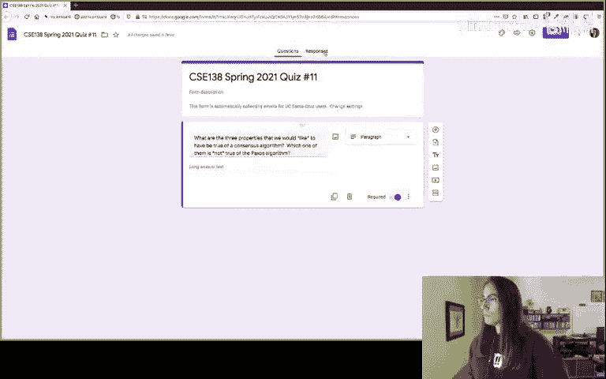
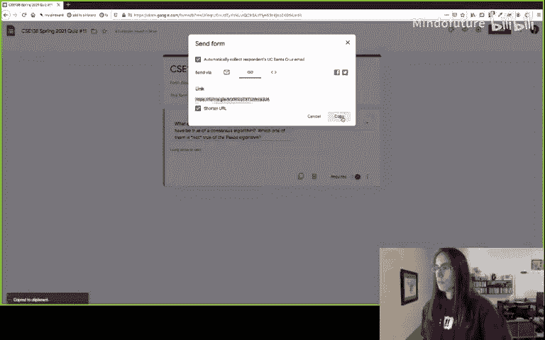
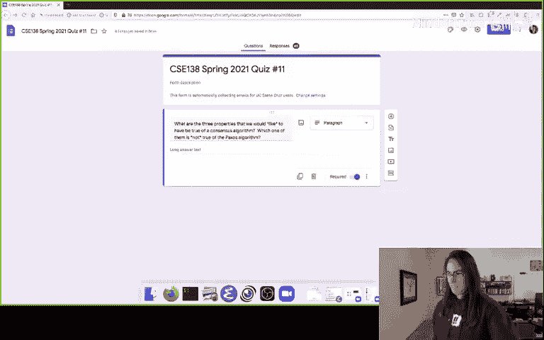

# 【加州大学】分布式系统-CSE138（Distributed-Systems）-p11-P11-L11---more-on-consensus,-the-FLP-result,-the-Paxos-protocol--BV1eGdLYjETJ_p11-

Looks like we're live。All， welcome to Thursday。So today we're going to get to some of that stuff that we didn't have time for last time。

 if you recall at the end of last time， we had an ambitious schedule where we started to talk about consensus and then I hoped we were going to get to something called FLP。

 and we didn't quite get that far。 so that's what we're going to be spending some time on today。So。

We'll keep talking about introductory stuff with consensus。

 so we're going to formally define consensus。Then we're going to talk about the FLP result。

And then we're going to do Paxos。The consensus algorithm Paxos。

 and I think we're going to start with the easy parts。And then the hard parts。

Or I'll say the interesting parts。We'll see how we do with this。

 we may not get through all of this today， but we'll see。All right。

 so if you remember at the end of last time。We started to talk about this notion。Of。Consensus。

As this box， right that had some arrows that went into it。And the consensus problem。Was。

Getting the thing on all of these era to agree when we came out。 so maybe we have a bit。

Going it either zero or one。 And we want everybody to agree。 We want them to either all say one。

Or we want them to all say zero。Neither one would be a solution to consensus。So。

We talked about this a little bit last time， but I'll just say it again， just so it's clear。

 So you might look at this and you might think， well。

 that's not hard to do if you want to have consensus just there's three inputs here， right。

 so just pick the majority。 in this case， one is the majority。 so just go with one。

Or if zero had been the majority go with zero。And indeed。

 this concept of majority is going to actually be important when we talk about consensus。

The thing that you have to remember is that theres not some external observer like me looking at this piece of paper who can look at this and make this decision of。

 oh， look， this one is a majority。 Instead， these three processes have to do the job of communicating among themselves to figure out what they think and to come up with a situation in which they all agree。

So we're going to talk about one of the best known algorithms for doing that， which is Paxos。

But before we do， let's talk a little bit about。The properties that consensus algorithms try to satisfy。

So。The first of these properties。Is。I'll start a new page for this。

 the first of these properties is termination。And I'm going to say properties that consensus algorithms try to satisfy。

For a reason。Because as we'll see， they try， but they fail， so the first of these is termination。

And termination says that。Each correct process。Eventually decides on a value。So if termination holds。

 then you're eventually going to get something。Out this end of the consensus box on every one of these lines。

 Notice that I haven't said yet anything about。What that something is。

 so I haven't said anything about them being eat the same yet all I've said is that you get something。

So if you get like a zero here and one here and here you don't ever get anything。

 then that would be a violation of termination。So that's one property that you want for sure。

Next is what's called agreement。And this says that all correct processes。呃。Decide on the same value。

So agreement says that if anybody outputs a zero， then they all do， and if anyone outputs a one。

 then they all do。So if that was a violation of termination。

Then this will be a violation of agreement if we have like。When。One， zero here。Okay。

 so let me ask you a question at this point。If these were the only two properties that you had to satisfy。

Termination and agreement。What could you do then to implement consensus if this was it that you had to satisfy？

What would be a really easy way to implement consensus then？

Somebody suggests just fail everything all the time， not sure I understand what that means。Okay。

 yeah， so good good suggestions here。 Just have everyone decide a constant。

 just have all processes output the same value always and give them one all the time。 that's right。

 So if this was all you had to do， you could just say have everybody output one。

Or have everybody output zero， ignore the input。There， consensus， done， right。

 we satisfied termination and we satisfied agreement。Well， we can't do that。

 so we need a third property。And the third one is this。It's called validity。

And sometimes it goes by other names， sometimes people call it integrity。

This is different from things like database integrity constraints。

 this is a different use of the word integrity。And sometimes it's also called non triviality。

So in this context all these different words mean the same thing， I like to use the word validity。

And the wording of validity varies。But the version of it that we're going to use will be this。

The agreed upon value。Must be。One of the proposed values。So in other words。If the inputs were。呃。

We're all zeros。Then this wouldn't be okay to have them all output one。So this could be。

This rules out the kind of situation where we just said， just have it always output a one。

So you can't do the thing where you just ignore the input and always output the same thing。

And claim to have consensus。So in some sense。These properties。Put together。

 give you a definition of consensus。 They're a definition of this thing that we want。

The behavior that we want from a consensus algorithm。

So I said that consensus algorithms try to satisfy these properties。

But it turns out that in the asynchronous network model。

And recall what the asynchronous network model is， it's when there's no bound on latency。

Between processes。It turns out that in the asynchronous network model。

 no consensus algorithm actually does satisfy all of these。Does anybody know why that's true。

 why no consensus algorithm satisfies all these in the asynchronous network model？Yeah， yeah。

 people are saying termination sounds like it could be a problem， yeah。

No consensus algorithm satisfies all three of these because it's impossible。And this was proved。

In 1983。Bye。Three authors。Michael Fisher。Nancy Lynch。And。Michael Patterson。

And it's from their names that we get the initials FLP。呃。So。

I guess there's one other qualification that I forgot to add in the asynchronous network model and。

Where crash faults can occur， so if you're in the crash fault model。

Or obviously any fault model that encompasses the crash fault model。

 so the o fault model and so on in the crash fault model and in the asynchronous network model。

You can't actually satisfy all three of these properties。

So this is a paper that you can go and look up if you want to。

 it's called Iosssibility of distributed consensus with one faulty process。

And it's one of the most classic papers in distributed systems。

 it's really interesting to take a look at， I don't want to go through the details of the proof of why this is the case。

 but this is a fact that you should know that it's not possible to actually satisfy all these things。

So。If you have to compromise。You can only have two out of three at best。

Which one of these things do you think you're going to compromise on？Termination， yeah。

 that's a good suggestion。Yeah， so you could have a consensus algorithm。

 but it doesn't necessarily terminate。Now， there are some situations in which you might make a different choice。

Interestingly。But but compromising on agreement kind of doesn't seem great right because that's what that's what we want。

 right if you're if you're okay with violating agreement， then what's the point right。

 because then you know。Why were we doing a consensus algorithm anyway。

 if we didn't care that we were getting the same value。

 and similarly for validity and that seems pretty important as well。

So it turns out that in some settings， it might be okay to compromise on agreement a little bit。

But we'll talk about that later。So。The property that Paxos compromises on is this one， termination。

And that's what you're usually going to choose， so you have a consensus algorithm。

But it doesn't necessarily terminate。So I think with that， we're probably ready。

To talk a little bit about Paxos， Oh， great question in chat。

 So the question is if it doesn't terminate， is agreement satisfied。

So agreement says all correct processes decide on the same value。So。If you don't， let's say。

 let's say you got one and one and then this process didn't produce a value here。

 so what agreement says is that if they produce a value，Then it's going to be the same。

There's a suggestion in chat about sacrificing validity。 Yeah。

 so the agreed upon value has to be one of the proposed values。 Yeah， I mean so。

It would be trivial to say， yeah， we're always going to have every process output fo， right。

 and then regardless of whether foo was what was proposed。嗯。So。

 but you could imagine other kind of less horrible ways to to give up on validity， right。

 like you could say， well， we'll attempt to we'll attempt to。Pick one of the proposed values。

 but then maybe if some timeout expires， then we'll go with some default value。

 you could imagine something like that， so that could be one way to compromise validity。

That could be interesting。Okay， so。Let's talk a little bit about Pax。

So PaXIS is a consensus algorithm。That was invented by Leslie Laport。He tried to publish it in 1990。

 but it took eight years for anybody to publish the paper。

 so it ended up first getting published in 1998。And he used a kind of weird analogy in this paper with them。

This analogy to parliamentary procedure with laws and voting and things like that。And to this day。

 some people use that terminology to explain Paxos。I prefer not to use that terminology。

 That's not my favorite。 So I'm going to avoid this stuff about laws and voting in ballots。

 And I'm instead going to stick mostly to the terminology that he adopted later on。

 So he has another paper from。2001， which he called Paxos Made simpleimple。

Which is the one that's much more often read。And so I'm going to use the terminology from this later paper。

So Paxos is really not just one algorithm， but it's a family of algorithms。

 meaning there are many variants of it or flavors of it。

 and for now we're going to just talk about boring vanilla Paxos。

And let me say also that in our discussion of what consensus means a second ago。

So we were just talking about deciding on one value right so every process comes in。

 every process is allowed to have it say， and then one value is getting decided on so that's what we're going to be talking about as well with Pas we're just going to be we're talking about the problem of deciding on a single value。

And later on， we'll talk about。How to extend that to deciding on a sequence of values。So in Paxos。

There are three roles that a process can play。And those roles are called proposepos。Acceptor。

And learner。So proposers propose values。Acceptors。Contribute to choosing from among the proposed values。

And learners。Learn the agreed upon value。So these are roles that a process can play。In Pers Now。

 in practice， a single process could take on multiple rules。Or even all of the roles。

 so one process could be all of the roles。But when you're learning PaXos。

 it's easiest to talk about the roles separately。We're going to be drawing pictures where we have processes just playing a single role。

But in practice， you could have one process that's playing more than one role。

And we're going to call any node that plays any role a Paxos node。

And node here is just a synonym for process。So there are some things that have to be kind of known in advance before the algorithm runs。

One thing is that。Pex's nodes have to be able to persist data， so they have to be able to store data。

And then。If they crash， they have to be able to get that data back。

 that's so that they don't forget what they accepted。So PxO's nodes have to be able to persist data。

That's a little different from say the key value store that you're implementing for homework。

 which is just an inmeory key value store so it doesn't persist data after a crash these are we're assuming the ability to persist data。

There's another thing that has to be true， which is that Paxos nodes have to know。

How many acceptors is a majority of acceptors。 So， for instance， if there is three。Acceptors。

 a majorities too。If there's five acceptors and majorities three。

 so all the nodes have to know how many is a majority of acceptors。

 so that information needs to be something they have somehow before the algorithm runs。All right。

 so let's look at an actual run of the algorithm。So for now， for simplicity， let's say that theres。

One proposalr。And I'll call it。P1。And let's say that there are three acceptors。We'll call them A1。

 A2 and A3， and let's say there's two learners。So every one of these is a process。 and again。

 keep in mind what I said a minute ago about how。In practice。

You could have a particular process playing more than one role， but for learning the algorithm。

 it's easiest if we draw this picture where each one of them is a separate process。

So here we've got three acceptors， so the majority of acceptors in this case is going to be two。

So let's say that our proposer， P1 wants to propose a value。

The first thing that it does is it's going to send a particular message。To a majority。

At least a majority of acceptors。So the message that it's going to send is called a prepare。Message。

And it's going to pass something along in that message。Which is called the proposal number。

So I'm going to call that n here。So it has to send what's called a prepare message with some N。

 which is its proposal number， and that has to go to the majority of acceptors。 So in this case。

 majority。Is two， it could also go to all three。Just for simplicity。

 let's just say that it sends it to 2， let's just say that it sends this to A1 and A2。

This proposal number has to be unique， nobody else can use it。So if you had multiple proposalrs。

 you would have to establish some rules in advance about who got to use which proposal numbers。

 so for example。Maybe P1 could only use odd proposal numbers and P2 could only use even proposal numbers if you had a P1 and a P2。

So that's one thing that has to be true。So it's got to store the proposal numbers that it's used and make sure not to reuse them。

 that's another reason why nodes have to persist data。When an acceptor gets。

A prepare message with a particular proposal number， it's going to look at that proposal number。

And it's going to do a check， it's going to say， did I previously promise to ignore requests with this proposal number？

If the answer is yes， it did previously promise to ignore those， then it ignores it。

So let's actually start to write down some steps of this algorithm here。

And I'll switch back and forth between this picture and。A prose version of the steps。

So we'll start with what happens on the proposers's side。Yeah。So the proposalr is going to send。

They prepare。Message with a proposal number N。To at least a majority。And then N。

 that's the proposal number。And has to be unique。And it has to be higher。Than any proposal number。

That this particular proposalr has used before。So I'll label this here， so you know what it's called。

 this is the proposal number。Notice it's just higher than any proposal number that this particular proposalr has used before。

 it doesn't have to be higher than any that's been used globally。

 that would be very bad if that were the case because then you'd have to go check in with everybody and say hey。

 have you used any proposal number that's higher than this and if you haven't then don't because now it's my turn and et cetera。

 et cetera so that would actually。Itlf require consensus， so that's no good。

 so it's just higher than any proposal number that this particular proposalr has used before。

When those prepare messages get over to the acceptor。On receiving。A prepare and message。

The acceptor is going to look at that n。And it's going to do this check。Did I previously promise？

To ignore。Requests。With this proposal number。If so。It ignores it。If not。

It now promises to ignore any request。With a proposal number lower than N。And it's going to reply。

To the proposer。With a promise。Message。Promise N。And this means。

I will ignore any request with a proposal number lower than it。So the meaning of Pro N is。

I will ignore any request。With a proposal number lower than it。That's what Proise N means。

I'm going to put a great big asterisk right here。Because that's something that we're going to have to come back to later when we talk about the hard parts。

Okay， so let's come back to our picture here。Let's actually put a real number here instead of N。

So let's say that our proposer P1 sends a prepare5。

 let's say that it sends it to these two acceptors A1 and A2。

And let's say that they both respond with a Pro five。Okay， let me take a look at chat here。Yeah。

 yeah。 Great question。 So the question about。If there are multiple proposers。

 does N have to be unique to everybody or does it just have to be unique to this one。

 it actually has to be globally unique。And so that's why you have to have the policy where like for instance。

 if you have two proposers， then one of them， you have to decide in advance who gets to use what。

 so if you had two maybe you would say one of them gets to use even numbered proposal numbers and the other one gets to use odd numbered proposal numbers or if you had three then you could say you know one of them gets to only used numbers that are modD3 or whatever。

 so N has to be unique。Globally unique， but that's something that you can kind of decide in advance by having these disjoint sets of proposal numbers that are available to every one of the proposers。

Okay， so。Coming back to our run of paxos here。So P1 has sent its prepare message。

 preparepa 5 to both A1 and A2， and they both responded with Proise 5 so we've now gotten a majority of acceptors to Proise5。

Keep in mind， five is only the proposal number， it's not the actual value we're deciding on。

But still， this is kind of an important milestone right here。Because now that we're at this point。

 we're a majority have promised five。I'm going to call it Mi one。Now that we're at this point。

There can never be a majority that promise for。Or anything less than 5。 Why is that the case， Well。

 now that a majority have promised 5， if you tried to get a majority to promise 4。Well。

 that majority would have to include one of these， right？

And they've both already promised five and recall that Pro five means I'm going to ignore any request with a proposal number lower than five。

So if somebody tried to come along at this point and get everybody to promise four。

 they wouldn't be able to or anything else less than five。A minority might still promise for。

 but it would be impossible for a majority to do so。So back to。This outline here。

So we can kind of label all this。As everything that I have on this page as。Texas。Phase one。

Up until Mile1。This marker is no good。So I didn't actually write it here。

 but this is the behavior of the proposer and acceptor during this phase。

 and you get to the end of this phase。 This phase ends when you've gotten when that particular proposalr has gotten a majority of the acceptors to reply with this promise end。

Okay。But we're not done， there's going to be another phase。So we're back to the proposer。

The proposer has collected。These promise messages for a particular proposal number from a majority of acceptors。

When it does that。We have the following。So at this point in phase2。

 let's say what has happened at this point。Proposer has received。Promise and。From a majority。

Of acceptors。For some end。For some particular end。At this point， what the proposer will do。

Is it will send。What's called an accept message？And that accept message is going to have two things and it's going to have the proposal number n。

And。It's going to have the value that you actually want to propose。And this is going to be again。

 at least。At least a majority of acceptors。So N。Is the proposal number？That was promised up here。

And Val is the actual value it wants to propose。I'm going to once again put big asterisk。

Because that's something else that we're going to have to come back to。Later on。

 when we talk about the hard parts。Okay， so back to our picture。

So so far we haven't even talked about the value we're proposing。

 we've only talked about the proposal numbers， so now we need to actually propose a value。

So let's say what value should we propose， I don't know。

 let's say that the value that we're proposing is fo。So。

Proposer one is going to send out a message and accept message。To a majority of acceptors。

 and just to keep it simple， just have it be the same two that we did before。

So here five is the proposal number and F is the value that we're proposing。And by the way。

 they don't have to be the same to acceptors that we talked to previously。

 they just have to be a majority， but just to keep this picture simple， we'll do it like that。

 Now what will the acceptors get the accept message。When the acceptors get the accept message。

Here's what happens。We'll come back to here。Talking about Paxos requires me to do a lot of back and forth。

So when the acceptor。Gets one of these accept messages。It's going to ask itself。Did I previously。

Promise to ignore requests。With this proposal number。If so。Ignores it。

Should look familiar because we just talked about that before in phase one。If not。It replies。With。

A new type of message accepted。For that particular n and that particular value。And also。Sinceends。

That message。To all the learners。So now our picture would look like this。

The accept message has gone out。The acceptors will ask。

 did I previously promise to ignore requests with this proposal number？In this case， they did not。

So they're going to reply。With accepted。And they're also going to broadcast that。To the learners。

The point。When a majority of acceptors send。This accepted message， so this point right here。

The point when a majority of acceptors have sent。Accepted messages for a particular proposal number and value。

That's the point when consensus can be said to be reached。So this is another milestone。

So from that point onward。In the run of Paxos， we have consensus on fo。

 not everybody knows it yet at that point because this is only the point at which they've sent。

 a majority of acceptors have sent this message。So not everybody knows that we have consensus。

 even the acceptors themselves don't know at that moment that we have consensus。But we do。

So from that point onward， there's kind of no going back， no matter what happens from this point。So。

And at the point when。A proposer or a learner。Gets these accepted。

Messages from a majority of acceptors。For a particular value and a particular proposal number。

 they know that consensus has been reached。On that value。 So at this point right here。At this point。

 Proposer one knows that consensus has been reached on fo。

So milestone2 is when consensus actually is reached。

 and then later there's sort of a third milestone that happens independently at the proposer and all of the learners。

 so right here and right here and right here。And that's where each of these participants know that consensus has been reached。

So we'll come back to the part that I。Rrote out earlier in case anybody still needs to see it。

Let me go back and look at chat and see if there's any questions left here。Yeah， great question。

So when we talk about a majority of acceptors。Right here， for instance。

This can be any majority of acceptors。 It doesn't have to be the same majority that we talked to before back in phase 1。

 It could actually be any majority of acceptors In the picture that I drew。

 we were talking to the same majority of acceptors in both phases。 I was talking to A1 and A2。

 both times， but it really just has to be a majority， any majority。And it's at least a majority。

 right， I could send it to all of them。Questions about this。

So I'll come back here to the picture that we drew。

So I'll write what I said before about milestone three。So milestone three would be like right here。

And milestone three is when each of those participants knows that consensus has been reached。Yeah。

 okay， another good question， do the acceptors have to send this to all the learners or do they just have to send it to a majority of learners。

 so we say that they send it to all the learners？Learner's entire role in this algorithm is to get sent the value on which consensus was reached。

Now， keep in mind that， again， roles， a particular process could play more than one role。

So maybe everybody is playing the learner role， in which case they have to send that message to everybody。

But it learners， this milestone3， like every learner is going to find out individually at the point when they've received this message that says。

 say accepted5 v， for instance， from a majority， so everybody had better know what a majority is。

 Everybody needs to know what a majority of acceptors is。When that happens。

 then they know that consensus has been reached。So。If you look back at phase one。

Here's what we wrote down for phase one。 We left this big old asterisk right here。

At the end of the behavior of the acceptor。And it had to do with the reply here。

And then for phase two， we also have a big old asterisk right here that had to do with the proposer。

So those are places that there's something that we're going to have to patch up because what we actually do in those cases is going to be a little bit more subtle than I described。

 but we're going to take our break here。And so we basically just done Pas the easy parts。

 and we're going to come back and we're going to patch up those。Asts。After the break。

So let me bring up our quiz question。

And it's 410 right now。So let's take a break until 420。哦。不。Yeah。All right， two minute warning。Okay。

 welcome back。

Okay， so。We just walked through this example run of Paxos。

But we also left a couple of big asterisks in our description of the algorithm。

 So what we do in those cases is， in fact， a bit more subtle than what we just talked about。

 So we're going to go through the whole thing again。 And this time we're going to fill in those gaps。

And with them filled in， we're going to be able to talk about some more interesting runs of Pa。

 including runs that have more than one proposer。Okay。

 so this is the example run of Paxos that we looked at a minute ago。We have one proposer。

 three acceptors， so let's just review what would have happened here。

 so the value we're trying to decide on。Or the value that P1 proposed here is fo。so。

We said there's three milestones in this run。 The first milestone comes when a majority of acceptors have promised a particular proposal number。

In this case， it was five。In that milestone， I didn't really write down what the meaning of that milestone is。

The milestone is。I'll just write it over here。A majority of acceptors have promised a particular proposal number。

And。So recall a promise of N means I'm going to ignore any request with a proposal number lower than it。

And what this means， this milestone is that the acceptors will now。

 a majority of acceptors will never accept a proposal numbered less than1。

 That's what you know when you've gotten to milestone one。

We said milestone2 is when consensus is reached。And when that that happens when a majority of acceptors have sent。

This accepted message for particular proposal number and a particular value at that point。

 consensus has been reached even though nobody knows it yet。

 so that's kind of the point of no return in this execution。For achieving consensus on that value。

And then the third milestone happens in a sort of distributed， if you will。

 fashion for every proposer or learner。 So when a proposer or learner。Gets。This message。

From a majority， an accepted message for a particular。And。

Then they know that consensus has been reached on the value。So this is kind of like easy mode Paxos。

 everything that I just showed you。So what we're going to do now is go back and fill in the couple of gaps that we had before。

To understand why we have to do something or to fill in the gaps。

 let's look at a case where there's more than one proposer。

So to make our diagram a little bit simpler。I'm going to leave out the learners for now so you can pretend they're still there。

 we're just not going to put them in the picture。Getting rid of them won't mess anything up in this example。

So we're going to say we're going to have a proposer one， and now we're also going to have anotherr。

 proposer two， and we'll stick with our three acceptors。Okay， so。Just like before。

 let's say that P1 sends out its。Prepare message。With a proposal number of five to A1 and A2。

And let's say that these acceptors respond with their promise。Okay， so。First of all。

 what would happen if Proposr2 sent something like this？

So let's say that it's sent its preparepa for message to hear。And。Let's say that it also sent it to。

Here。So what would happen then？So acceptor 2 is going to ignore right。

 because acceptor 2 already promised five， that's right， it's going to ignore。

A2 is going to ignore this message for sure。Now， A3 didn't promise anything previously。

 so A3 will respond。But recall what proposers are waiting for， right。

 they're waiting to hear back from a majority of acceptors。So。P2 would never hear back from majority。

 they would hear back from one。And so， no。They would be sitting here forever。So P2 is over here。

 keep in mind it has no idea what's going on with P1 right P2 doesn't know that P1 is over here。

Proposing things。It just knows that it sent a message and that it got no response。

 so what should it do？Well。It turns out that it's always okay。

For a proposer to just go ahead and send a higher numbered prepare message。

 so as long as the proposal number is unique， you're okay。

So here I'm imagining that P1 has claimed all of the odd numbered proposal numbers and P2 has claimed all the even numbered proposal numbers。

 but you could use any sort of scheme for this as long as it ensures uniqueness。

So P2 is sitting here， it didn't hear back from a majority。You know。

It maybe gets one back from A3 if it happened to send to A3。

 but it doesn't get the majority that it needs in order to do anything。

 so in practice the way this would work is that a proposer could have some sort of a timeout。

If it sends a prepare message to a majority of acceptors。

 and then it doesn't hear back from a majority of acceptors。Then it can time out。

And then it can send a higher numbered one。 So let's say that after a while。Pu's timeout expires。

And it decides to send a new prepare message。Well， it hasn't used6 yet and6 is the next even number so it can send to prepare six。

So let's say it sends that to here and here。It could even send to all three if it wants to。

So let's say this Pre6 goes out to all the acceptors。What do they do。

 Has any of them promised to ignore requests with a proposal number of 6。No。That's right。

They have not promised to ignore requests with the proposal number six， so they have to respond。But。

This is where that asterisk came in。So。We've actually already hit our second milestone。

In this Paxos run， because what if this was going on over here？What if well all this was happening？

What if Pros one had sent？It's accept messages here and here。

And let's say they responded with their accepted messages。So that's our milestone too。

 right that we talked about before。But wait， we just said that according to the algorithm。

None of these acceptors have promised to ignore requests with a proposal number of six。

 so they have to respond。They have to respond to this prepare six that came along。

But consensus has already been reached， they just didn't know it yet。So。What has to happen here？

Is that the acceptors。Are now obligated。To tell P2 that they already accepted a value。

So we have to do something a little bit different than we did before。

So we come back to this part where we wrote this before。And we look at what the acceptor is doing。

So when we said an acceptor when it gets a prepare end message， it asks。

 did I previously promise to ignore requests with this proposal number， if so it ignores it？If no。

Now it's going to have slightly different behavior than it did before。

 so we're going to fix that first asterisk。And I'm going to put this on a new page。

This is our first asterisk here。

So the acceptor is now going to say。When it gets the prepare end message， it's still going to say。

Did I previously promise。So you should already have this in your notes from before， this is the same。

Did I previously promise to ignore requests with this proposal number？If so。It ignores it。If not。

Now this is the part that's new。It asks。Have I。Previously。Accepted。Anything。

So this is the part that's going to be different。So I'll highlight it in red here。If yes。

It's going to respond。With a promise message。But it has to be。The proposal number of n。

 that's the end from up here。But instead of just。Just that， it's going to pass along something extra。

And it's going to be a pair of。And proveve。Or call， which is it's。Highest。Previously accepted。

Proposal number。And then。Vel， pve。Which is the previously accepted proposal value。And then if not。

It's going to reply with Pro in。Which is what it did before。

So the stuff in the red box now is the asterisk is the new stuff。So a promise message。

Has this additional component now。It only gets used in the case where the acceptor has previously accepted something。

So let's see how this looks on our picture。是。A1 and A2 get this prepare message of six。

With this algorithm that we just added this new asterisk to。What do A1 and A2 have to reply with？

That's right。Yep。They're going to reply。With a promise。six， but it's going to have this extra thing。

Which is this pair of the previously highest accepted proposal number and the value。

This one here is just going to respond with a promise six because it didn't。

Previously except anything。Okay， so now。P2 has gotten promise messages。

 it's gotten promise responses for everybody for proposal number six that it sent out。

 but only one of them is Pro 6 like this。And the other two have this extra piece of information tagging along。

 which says， okay。I promise 6， but also， by the way。

I previously already accepted proposal number five with the value fo。So。

We must have done that for a reason， right， we must be sending that information to P2 because it has to do something with that information。

So that's going to bring us to our other asterisk， so let's look at what the proposer is supposed to do when it gets promise messages。

So that's phase two。So phase 2， recall this is when a proposer has received promise and from a majority of acceptors for sumit。

So before。We said that when it's gotten that promise end message from a majority of acceptors。

 it's going to send this accept N vow message。Where and is the proposal number that was promised and Val is the actual value that it wants to propose。

So I'm going to make a couple of small corrections here。So。

How do you think that we're going to have to tweak this part of the protocol， let me ask you。

 how do you think we're going to have to change what the proposer does right here？

It's gotten a promise message from all of the acceptors。

But some of them might have this extra piece of information tagging along about what was previously accepted。

So the proposer is going to have to use this information somehow。

 what do you think it's going to have to do？Yeah， good。

 so the proposer is going to have to take into account that extra information that was included。

So in particular， it's going to have to look at。This。Pearairs that come along here。

It's going to have to look at these numbers。It's going to see whichever one is the highest。

And then the value that it has to propose。Is going to have to be the value that went with that highest。

Previously accepted proposal number。So in particular， to write it out in words。

 we're going to revise the protocol as follows。So。We're going to say when a proposer has received promised messages and this could be either kind。

I'll correct this right here， so this could be a promise of N。Sorry， there's a lot of perenss there。

When it's received either kind of promise message from a majority of acceptors for some particular end。

It's this part here that's going to have to change。It's going to send the accept message again。

 to at least a majority of acceptors where n is the proposal number that was promised。

So that's this end still。But this is the part that's going to change。

Instead of just value being the actual value that it wants to propose。We're going to say。

Val is chosen as follows。The proposer is going to have to ask itself，Did it get any of these？Pears。

For many acceptors。If it did， then the value that it's proposing is going to be the one that went with the highest NPV。

So， Val is either。The vow Pv。That went with。The highest。Enpriv。Or。If there are none of those。

 then it can do whatever it wants。So if it did get any of these pairs that indicated that something had been accepted previously。

It has to propose the value that went with the highest previously accepted proposal number。

If there aren't any of those， it can propose whatever it wants。In our picture。We're on P2。

 so P2 can now send its accept message out。It could send to every acceptor。

 but it only has to send to a majority， so let's say that it sends to A2 and A3。

It's required to propose the value fo， because that's what it was told was previously accepted。

Note that it's going to use its own proposal number of six still。

So it's going to send its accept messages out。So it's going to send six。

 but it has to propose fo because it's been told。That that was what was previously accepted。

So it didn't have to change its proposal number to five or anything like that。

 it's sticking with six， it just had to make sure that the value it proposed is the one that it's been told about。

I actually find this very funny because it's kind of like saying， oh yeah， you wanted to participate。

 sure， you can participate， so you can even use your own proposal number if you want to。

You just have to participate in exactly the way that we tell you to。So this fo right here。

 it didn't get to make that decision on its own， it had to do what it was told。Okay， well。

 what do the acceptors do now？What does an acceptor do when it gets an accept message。

 what does the protocol say？Well， it's this let's look at A3。

 it checks to see if it previously promised to ignore requests with this proposal number。嗯。

In this case， it did not。So it's going to reply with accepted。And then here again。

And we can finish off our figure。So they're going to send this message of accepted sixF。

Back to the propose and they're also going to send it out to the learners。

 I didn't have any learners on this picture。Note that this doesn't do anything to invalidate this earlier consensus。

 so earlier we achieved consensus on fo。Now we've also。Told B2 that there's consensus on food。

 right because？P2 is going to get these two messages now from majority of acceptors saying there's consensus on fo。

 it has a higher proposal number。But the value is the same。

So that's why we had to add that extra little bit of subtlety in the behavior of the proposers and acceptors。

 it had to do with this extra piece of information that had to be passed along on promises。

If an acceptor has already accepted something， it has to say so in any future promise messages。

And that's to make sure that that previously accepted value is going to get repeated and reinforced。

Right， questions about this。Right， there's a couple of questions in chat。One person asks。

Is there a way to not have to pass the value fo around more than once？So。You mean like， for example。

Like does it look like there's some redundancy here where like a2 says promise 65 fo and then we have to tell a2 what it already knew。

 right， we had to tell it what it already knew by proposing foo and then having that accepted Yeah。

 so that looks redundant， doesn't it。But look at A 3。

 the first time that A 3 found out about foo is right here。

 So A 3 didn't know about any of this other stuff。So A3 is only finding about foo for the first time right here。

So there does appear to be some redundancy， but that's because there's some overlap in the。

In the majority sets that we're dealing with here。another good question in chat。

 why did you need because the only thing that's being used here is foo， why did you need this number？

Well， the reason you need that is because。What the proposer is going to do when it gets these messages back and when it has to send its accepts。

 it's going to look at the value here that goes with the highest numbered previously accepted proposals。

 so here they happen to be the same， so we didn't really exercise that code path。

But what the proposer is going to have to do。And I'll put back this prose here so that you can see。

The way that it's going to have to choose what value？It can it can。It can propose。

Is by choosing the value that went with the highest。呃。Previously accepted N if there was one。

So in my picture， there were two that were the same。So。So that didn't really come into play。

 but if they had been different then we would need to pick the highest one。

 we would need to pick the value that went with the highest one。Okay。

There was another question in chat， another good question， the question。

What if five has been promised but not accepted yet when six is prepared？ok。😊。

So what if this hadn't happened over here？Yeah， then what would we have well？Then。

If these promises had gone out， but A1 and A2 had not yet accepted anything。

Then they would get these promised messages。And。What should A2's behavior be when it gets a prepare message？

If you look back at what we wrote down。Actually， let me do the patched version instead of the。

The unpatched version， here's the patched version。 So when it gets a prepare in。

 did I previously promise to ignore requests with this proposal number， so it's going to ignore it。

If not， then it has to ask have I previously accepted anything， well we're saying that didn't happen。

 right， we're saying it didn't previously accept anything because I just scribbled out all of that acceptance there。

It's just going to be respond with Proise 6 in that case。

 So then everybody's going to come back here with Proise 6。And at that point。

 proposepor2 can send except six with anything it wants。

 it can propose bar or whatever other value instead of food that it wants。

 so it would look a lot like this， except instead of having to propose fo。

 Propor2 would get to propose any value that it wanted。Good questions， all right。

So we're almost done for today。And next time we're going to have to wrap up our discussion of Paxos。

Just something to reflect on。呃。Between now and and next Tuesday。

 think about what those three properties were that we wanted that we wanted a consensus algorithm to satisfy。

 so those were。Termination。Agreement。And validity。And I claim to you。

That the one of these that Paxos compromises on because every consensus algorithm has to compromise on one of these。

 at least one of these under。Under the asynchronous network model and the crash fault model。

I said the Paxos compromises on termination， so it might not terminate。

So now that we have this full Paos algorithm up here in all of its glory。Think about。

What kind of a situation might lead to PXos not terminating？

And there was a great question to judge just now， like， what if this happened？Wouldn't proposer one？

Also get to propose anything it wanted， and I think you're kind of on the right track here about thinking about what might lead to Pexs not terminating。

So。We'll talk more next time about what would happen in a run of Texasex that didn't terminate。

And how could you end up in such a situation？And I don't think we have time to talk about that today。

At least I don't think I can do it in three minutes。Excellent questions going on in chat right now。

 somebody just says， what if we just had one proposalr？Yeah， if you just had one proposer。

Then things are easier in some sense， right， you don't have to deal with this sort of interleaving proposer messages。

 but also if you only have one proposer， what do you do if it crashes？So that's no good。So。

Having more than one proposer seems pretty important because you wouldn't want your sole propr to crash。

So we'll talk about that a little bit more next time。All right。

 the last thing that I want to leave you with today is that the mid course survey is out。

I know some of you have already filled it out already， so if you did， thank you。

And it's due next Tuesday at midnight， so it's only a couple of questions it shouldn't take you more than a few minutes to fill out and you get a little bit of credit for it to help incentivize you to do it。

 so I really want to hear from you。And hear how things are going， so please fill out the survey。

 tell me your thoughts。And I will do my best to read every single survey response and take them into account。

Great， thank you。See you next week。