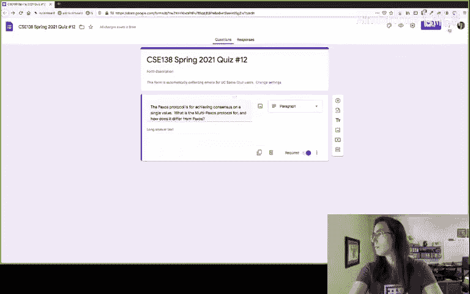
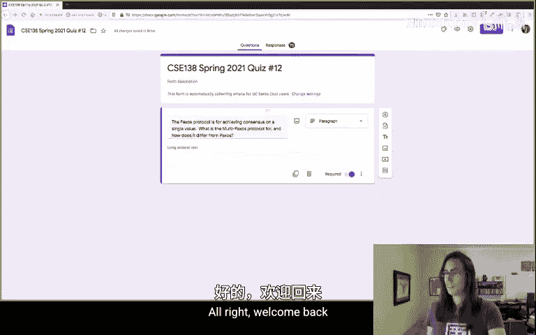

# 【加州大学】分布式系统-CSE138（Distributed-Systems）-p12-P12-L12---Paxos-and-consensus-wrap-up,-passive-active-replication--BV1eGdLYjETJ_p12-

Right， getting the stream started。Here we go。Right， welcome， welcome back。Today。

 we are going to continue the discussion that we began last time。 So if you recall from。Last week。

 we started discussing consensus and in particular we started talking about Paxos。And last Thursday。

 we spent a bunch of time。Going through。The Paxos algorithm。

 So we talked first just about kind of a simple version of the algorithm that left out a couple of the subtleties。

 and then we revised it to add back in that subtlety。

 And so we looked at it in kind of this two step process where first we looked at kind of the easy version of the algorithm。

 and then we looked at a second。Iteration of it that added a little bit more subtlety。

 particularly to deal with a situation where we had more than one proposalr。So by the way。

 I got the pedagogy that I used there where I talk about a simple version and then a slightly more sophisticated version from a really great YouTube video by Lue Cassada Tores about Paxos。

 so if you happen to see the announcement on Zullips or if you happen to see the announcements on Zullip where I linked to that video。

 I strongly recommend it in case you have any questions about Paxos。

 I think it's a really good introduction to Paxos and I borrowed my own pedagogy from that video。

Today， we're going to continue our discussion of PaXos and hopefully wrap it up。And if you recall it。

 be kind of the end of last time。We we started to get to this situation where we were talking about。

What happens if you have more than one proposer in a run of Paxos and how do you end up in a situation where a？

Where proposers are kind of fighting with each other。So before we get into that。

 let me put up an agenda for today。So we're going to。

Continue our discussion of Paxos and we're going to talk about。What I'll call dueing proposers。

And this is going to lead in to the next thing that I want to talk about。

 which is called multiplepaxos。Which sounds a bit scary， but it's actually not too bad。

And then from there， we're going to talk a little bit about。Falult tolerance in Paxos。

We're going to very briefly touch on other consensus protocols。

We're not going to look at them in any depth at all。But I want to make you aware that they exist。

And then。One final topic that I want to talk about is what's called。Passive versus active。

Replication。Another name for this is state machine replication。

And then I would like to spend a bit of time talking about some assignment three stuff at the end。

This is a little bit unrelated to the rest， so we'll try to make time for like 10 minutes of this assignment three stuff at the end。

All right， let's go。If you think back to last time。

We started talking about a scenario where we had a run of Paxos and we had。Two proposers。

 so the way that I drew it。Was and I think my black markers are running really low here。

We're getting to that point in the quarter where the markers start to run low。

But we'll see how we do。Let's say that we have two proposers， P1 and P2。And three acceptors as usual。

And let's say that we have something like this。Much like before。

 let's say that we start things out with Propor one sending its prepare messages。

So recall from last time that the first phase of PaxOos begins with a proposer sending prepare messages to a majority of acceptors。

So let's just do it the way that we did last time we sent prepare with a proposal number of five。

 we get some promises back。And mean， let's say we have this other proposal over here。

 and let's say that it sends its own prepare message。With a proposal number of six。

So let's say that that one happens to go to A2 and A3， so that'll do like so。

This one will get back a promise。What will happen here on A2。

 what will A2 do when it gets this prepare6 message？Think back to what we talked about before。

Nobody really， all right。So yeah， okay， yeah， that's right， it just promises six because。

What does a promise mean， a promise means that you're promising to ignore proposal numbers of。

You're promising to ignore messages that have a lower proposal number than that。

 well it hasn't promised seven or anything like that yet， so it can go ahead and promise six。

That's right。嗯。So then。What happens over here on P1 Well， it's finished phase1 of Pxos right here。

 so now it wants to try to get its proposal accepted。

 it's received in promise from a majority of acceptors， so now it wants to try to get something。

Accept it， so how is it going to do that， Well， it's going to send accept messages。

And those are going to have the proposal number that it got the promise from the majority from and whatever value it is that it wants to try to get accepted。

 so no fo。Let's say。So then what happens？On a1。It'll be fine。

Because A1 hasn't heard anything from P2 over here， so A1 will accept。But then what about A2。

 well A2 promised6？So what does that mean Well， it means that A2 now has to ignore any request with a proposal number lower than6。

 so A2 is just going to ignore this request here。So P1， you know， it's sitting here waiting。

 waiting to get responses from a majority and it's sad because it doesn't get the responses。

 so it'll time out。And it'll try again， so now maybe it's going to try another higher proposal number。

 so let's say it sends a preparepa seven。Yeah。And we'll come back to that in a second。Okay。

 what happens over here Well， actually let's send the responses， Okay。

 so let's say that works and let's say both A1 and A2 respond。With a promise。Great。Okay， well。

 what happened over here， well P2 also got a promise from a majority of acceptors。

 so P2 thinks that it。Can do can can try to get its requests accepted now。 So what is it going to do。

 Well， maybe it's going to say， well， I want to get。The value of bar。Accepted。

 so it sends that out to everybody。 but let's say that this accept message here lands here。On A2。

After A2 has already promised seven。 so now this one's going to respond。诶。But now this one。

Won't get a response， and so P2 will be sitting here and it'll be said。So what happened here。

 Well P1。And P2 both got through phase one just fine。

But then when they tried to send their accept messages。

 they couldn't get a majority of the acceptors on board with them to actually get the value that they want to achieve consensus on。

 accepted by a majority and the reason why they couldn't is because the other proposer who is here keeps buting in with a new prepare message with a higher proposal number and gets there before it can。

So this。Kind of scenario is what we call dueing proposers。Yeah。

And you can probably see from looking at this that this sort of thing could keep on happening forever。

The way that these messages are being interleaved。We could keep on in this situation forever where these two proposers are never able to get a majority of acceptors to respond to their accept messages。

And in this case， they both happen to be able to get a response from one acceptor。

 but one's not enough because a majority here has to be two。So consensus is never reached。

Because there's no point where a majority of acceptors send accepted messages for a particular value and proposal number。

So here's a question for you。All this non termination， so this is this could go on forever， right。

 we could run forever and never reach consensus and like we talked about before， Paxos indeed。

Viols that termination property that we wish would be true， right。

 that property that we want to have be true of every consensus algorithm。

So here's a question for you。All of this non terminationmination badness。Seems to have come about。

Because we had two proposers right， it seems to have come up because of the result because we happen to have these two proposers here。

 multiple proposers， so my question is，Why not just have one proposer？Why have two？

The question in chat was， so because of dueling proposers， is that why Pa violates termination。

 so there's a lot of scenarios that could lead to nontermination。

 but they all kind of boil down to this sort of situation in which a particular proposer is unable to get consensus。

And in fact， this isn't just true of CAxos， this is true of consensus algorithms in general。

In particular， it's true of consensus algorithms。In a setting where。

Where the network is asynchronous and where processes can crash。This kind of thing。

 and notice that you know nobody did crash here， but nevertheless， we can get into this situation。

So in regards to this question of why not just have one proposer？So what do you think， why not。

 why can't we just have one？It's good to have options， as the suggestion in chat。

somebodybody else says， okay， if there's only one proposalr。

 then you aren't really building consensus， it's just one process saying this is how it's going to be Yeah。

 okay well。Right， but when we drew that consensus box。No， and we tried to say， you know。

 here's the inputs。Here's the outputs。I don't really care how the consensus box works， right。

 like I don't care you know if one proposer wants to declare itself the leader。

And then tell the other processes how it's going to be。

 then that's okay with me if that gives us consensus。

 then that solves the consensus problem in the way that we define it。

There's a catch in what I just said， right？I just said something about a process declaring itself the leader。

 right？So。一二首。What if。What if if we only wanted to have one proposer， well。

 these processes come in right and they're all equals at first， they all come in here。

 they're all equals。If we want one of them to become the leader and we want that one to be able to tell everyone what to do。

 then we have to pick a leader， right？And picking a leader。Is itself a consensus problem？

And leader election requires consensus。If you wanted to require there to be exactly one proposer and you tried to use Paxos to figure out who that should be。

 then Paxos might not terminate， right， so you can't require that there's only one proposer because then your consensus algorithm would depend on a consensus algorithm。

Now， as a matter of fact， there are consensus algorithms。

 ands this is like not not such an unusual thing to do。

 There are consensus algorithms that have a phase that starts with。Electing a leader。

 electing one person to be the leader。 And then that person gets to do all the proposals。 Now。

 that phase might not terminate because leader election boils down to consensus。

 But then if it does terminate， then from then on， you're in good shape。

 But you aren't getting rid of the non-termination issue。

 you're kind of just pushing it into a different part of the algorithm。

 you're kind of sweeping it under the rug in one place and then it can pop up again in another place。

So。So we don't want our consensus algorithm to depend on a consensus algorithm and that's the issue with requiring that there's only one proposer。

So leader election is kind of interesting， though， right？

Last time I mentioned that it might actually make sense for some consensus protocols to choose。

terermination and validity right because remember there's these three criteria that we want we want termination agreement and validity So what if you chose termination and validity as your criteria instead of choosing agreement and validity so Paxos chooses agreement and validity it sacrifices termination。

What if you chose termination and validity？And then you're sacrificing agreement。So。

Leader election could be that right， like maybe you're okay with actually having multiple leaders chosen by your leader election protocol as long as it terminates。

So a thing you could actually do is use a leader election protocol that doesn't satisfy agreement。

But does satisfy termination and validity？Use it to pick who should be the proposer for a run of Paxos。

 and if it happens to pick multiple lit sometimes， then that's okay because Paxos still works when there are multiple proposers。

诶。And if your leader election protocol picks a single node most of the time， then that's great。Yeah。

 if this makes your head explode， then you're not the only one。But yeah this is dueling proposers。

 so this is basically an illustration of a situation in which Paxos might not terminate one way around this is to just have one elected proposer。

 but if you do try to just elect one proposer， then that election process itself might not terminate。

So you can't really get rid of the non termination possibility。

 it's going to show up one way or another。Questions about that？There was another good point in chat。

Right， so somebody said， so one reason why you might not want there to just be one proposer is what if it dies。

 right， so fault tolerance you don't want the only proposer to die。

And another good point is that maybe a new proposer shows up and doesn't know there's already a proposalr。

 right， so you like your algorithm to be robust to their being more than one。All right。

 so this is kind of a good lead in to the next thing that I want to talk about。Actually。

 which is called multiplepaxos。So we've been talking about using Pos to decide on a single value。

That's what Paxos does， you run Paxos。It'll let you decide on one value。

If you need to decide on another value， you have to run Paxos again。

And if you have to decide on another one， then you have to run it again。

 right and so if you have to decide on a whole sequence of values， then you have to run Paxos。

Again and again and again， once for every entry in that sequence。

So what if you want to decide on more than one value？

It turns out deciding on a sequence of values is a pretty common thing to want to do。

So if you think back to when I wrote down a whole bunch of example problems that all kind of boil down to consensus。

 one of those was this problem of totally ordered broadcast right。

 so what's totally ordered broadcast， that's the problem of making sure that a bunch of processes all deliver the same messages in the same order。

Think back to our picture of a violation of totally ordered delivery， right where we had。

Something that looked like this。Yeah。So this should bes by now a very familiar picture。

So if you want a totally ordered broadcast， well， we've got these two messages， right。

 there's M1 and there's M2。So if you wanted to rule out this kind of thing。

It boils down to getting everybody to agree。Which of these messages is supposed to come first and which of these messages is supposed to come second so that's really two things that you have to achieve consensus on first everybody has to agree to deliver message one first and then everybody has to agree to deliver message message two second or maybe the other way around maybe they all agree to deliver M2 first and then M one second and then maybe there's a third message that comes along and and then a fourth and they have to choose。

For those and so on。This is making sure that a bunch of processes all deliver the same messages in the same order。

So that's essentially repeated consensus right， first decide what message is first。

 then decide what message is second， then decide what message is third， and so on。

Does anybody see any problems with having to do that？There's a question from previously。

 so the question was。What is it because of dueling proposes that we can't guarantee termination of taxes。

 I would actually， I'd phrase it a little differently。 I would say that。

A situation like this with dueoling proposers。Can arise in Paxos。

 but the reason we can't guarantee termination of Paxos more generally is that we can't guarantee termination of any consensus algorithm。

In an asynchronous distributed system where processes can crash and so the reasons for that are quite technical and so that would be the FLP results。

 so I'm not going into details on that if you want to you can check out the FLP paper that I cited earlier。

 but what I want to do is give an example of how that non-termination could manifest in PaXos and it turns out in PaXOos it manifest it could manifest in this particularly dramatic way in which you have these proposes that are fighting。

So it's not a thing that's specific to PaXos， it's actually true of any consensus algorithm。

 but in Paxos it can look like this。It's not always this dramatic。Okay， so back to multiplepaxs。

Having to decide on a sequence of values is something that comes up fairly often and this question of totally ordered broadcast。

 or also known as Atomic broadcast， where you have to get everybody to agree what message to deliver first。

 what message to deliver second， message to deliver third。So。What do you have to do then。

 do you have to run Paxos every time you want to decide what slot a message goes in？

Do you see any problems with doing that？A lot of work， it's a lot of messages， right？

Even in the best case， Paxos takes a lot of messages。

Because remember what the best case looks like for Texas， it's going to look something like this。So。

You've got your proposalr。And you've got your acceptors。

You've got your propose sending out its prepare messages to a majority getting promises back。

Then sending its accept messages out。And then getting those back。So this is the best possible case。

 right， where the proposer sends out its prepare messages。Gets promises back right away。

Then it sends out it's accept messages。And then it gets those accepted right away。

But even in this best possible case where nothing goes wrong and nobody's slow and nobody crashed and there's no other proposer fighting with you。

 even in this best possible case where nothing bad happens。

 it still takes two round trips with the acceptors to just get consensus on a single valley。Right。😊。

That's slow。So is there anything that can be done？To make this better。

 if you have to get consensus on a sequence of values。

Is there anything that you can do to save time so that you don't have to go through this whole riggamar rule for every single value in the sequence of values？

Any thoughts on that？Okay， so one suggestion in chat is you could send the entire sequence in one accept message。

 Okay， so you could batch things right like if I have。

If I have 10 values that I need to get consensus on。

 I could try to just get consensus on them all at once。Yeah， okay， so that could help right。

 that helps to some extent， but what if it's an infinite sequence right。

 like what if I'm just sending a whole bunch of messages， I mean I could batch them up occasionally。

And send those as a group。So that would certainly that could speed things up。

 right on the other hand。If you。So would that would be good in some ways and bad in others right like if you fail to achieve consensus on that whole sequence then。

Then that somehow seems worse， right？But is there anything else we can do Well， so it turns out that。

As we talked about before， the so Paus has two phases， right， this is phase one。

And this is phase two。It turns out that once you've done this full run of the protocol。

 phase one and phase two。At this point。You now have this majority of acceptors on board with you。

 This proposer has this majority of acceptors on board with her。

 and she can just keep on doing phase 2。As long as she doesn't crash。

 so you can just keep on deciding on more values now that this proposer has done both phases。

 she can keep on doing phase two again。And as long as she doesn't crash， we're in good shape。

So you can keep on doing accept messages。With the same proposal number even。

 so that would look something like this and I shouldn't have written on the bottom of this diagram because I should have left space to keep drawing。

 but I'll scoot it up like this。So let's say that these processes continue。

And proposepoer one can just do another phase， right？She can send another set。Of accept messages out。

Maybe this time it it's a Val2 that she wants to get consensus on and if you want to you know you can throw in like a sequence number here right you can also add like another argument here that's like you know sequence number two that gets incremented。

And then。They'll send back accepted。So it's just phase two over again。

And it turns out this is safe to do。So if you're doing this。If at any point。

 some other proposer comes along and they decide to but in， so you P2 comes along。And they decide。

 well， you know I'm going to but in here and I'm going to send you know some higher higher numbered proposal number prepare they can't right so if they start sending proposals that are numbered n plus one right they do this。

Then。That's going to be the end of P1's reign， right， P1 will no longer be the queen。

And if they manage to get a quorum of acceptors on board with them。

 then P1 is done and you know one of her accept messages is going to get ignored and you know she'll time out and she'll have to start over again know the prepare message。

 so that'll mean that she'll have to end her reign of having of being able to only do phase two。

 but until that happens。Until that happens。She can just keep on doing phase two。

And this is known as multiplepaxs。嗯。And it's called multixios because you can use it to decide on multiple values。

 a sequence of values。so。Another way to put this。When I say that somebody else can come in here。

 right and send a prepare message and sort of interrupt the sequence。

One way to phrase that is that to say that multipaxos will degrade to just being regular plain old Paxos if some other proposer comes along and interrupts。

But the hope is that that will happen rarely。So I see now in chat。

 I think somebody said this well I was talking somebody said yeah。

 maybe the proposer could repeat phase two without having to do phase one again， and so that's it。

 So it's a nice optimization if you have more than one value that you have to decide on once you've done a full run like this you have to do that first。

 there's no way around having to do that to begin with but once you've done that。

 you can keep on doing phase two only phase two to decide on the rest of your values until and unless somebody else comes along and interrupts your your re。

You I said I wasn't going to use any of these parliamentary procedure analogies。

 but instead I'm using this monarchy analogy。I don't know what that says about my politics。

So that's multiplexis。 It's basically this scenario where we can have this optimization if we need to do。

If we need to decide on a sequence of values。Questions about that。

And I just want to mention also that the suggestion that somebody else made of。

Of deciding on kind of several values at once of kind of you know。

 queuing up several things in the sequence and then sending out。呃。

An accept message with several things at once， that that's a good thing to do too。

 and that's called batching and you could do that as well。

 that might be another optimization that you might want to do it would make sense in certain circumstances。

So multipaxos is quite often how Paxos actually gets used in practice because quite often agreeing on a sequence of values is。

The name of the game， that's what you want to do。Well。

 somebody just asked if there's multiple proposers from the beginning， wouldn't this not work well？

That's kind of so there's kind of two things here is that。

Just because you have multiple proposers doesn't mean that they both have to be proposing things all the time right so PXos allows you to have multiple proposers。

 it doesn't require you to have multiple proposers right the ability to have multiple proposers is something that PXos supports it won't go wrong right Pos won't go wrong if you have multiple proposers you could have 100 proposers and it still won't go wrong。

But and by go wrong， I mean it won't you know。It will satisfy the agreement property， right。

But it might not terminate。So。But that's a problem anyway。Oh， that's a good question。

 why do phase one at all， Yeah， why did we have to do phase one？

What would go wrong if we didn't do phase one？That might be a fun one to think about on your own。

What's the point of phase1 Well phase1 is where you say I promise what does promise end mean。

 it means I promise to ignore requests with a proposal number less than this right so if you skip phase one。

You skipped making that promise， it might be useful to think on your own about how things could go sideways if you don't do phase1。

Alright。So I think the next thing on our agenda was that we wanted to talk about a little bit about fault tolerance。

So。I've been saying a few times that。Consensus algorithms can't give you all three of those properties you want of agreement。

 validity and termination。That can't possibly be the whole story， right？Here。

 let me propose a consensus protocol to you。Have one acceptor？

Proposers propose values to the acceptor， Acor picks1。Broadcasts it to everybody， done。

 it meets all the criteria。Why can't we just do that？Bak， fault tolerance， exactly。

Why can't you have just one acceptor because it might crash？So。

We want to be able to withstand some degree of processes crashing。

So the actual impossibility result is that you can't provide all three of agreement。

 validity and termination in the asynchronous network model and in the crashash fault model。

And consensus protocols like Paxos。Tend to be designed in a very， I would say。

 what's called a defensive way so that they'll be as robust as possible to crashes。

 that's why Paxos is so complex。So even though we can't get around that impossibility result。

 we can try our best to make things work out most of the time。 Okay。

 so we can't just have one acceptor because it might crash。In my examples。

 I've been using three except。How many of those can crash？

How many of those can crash and we could still run Paxos？Good， yeah， so one， one could crash。

If you have three acceptors。What do these requests have to do well if you send a prepare message you have to hear back from a majority of acceptors right so one of them could have crashed and that's fine。

You can tolerate one accept or crashing and still have the algorithm work。

Likewise with accept messages， you have to hear back from a majority。So if you have three。

 one can crash。If you have five。Then two can crash。And so on， so in general， with Paxos。

 you can tolerate a minority。Of the Acors's crash。嗯。So the way that this is sometimes phrased。

As somebody just noted in chat is that。If F。Is the number。Of crashes， you have to tolerate。Yeah。Then。

2 F plus1。Is how many， I should say， acceptor crashes？Is how many acceptors you need？

So that's acceptors。How about proposers， how many of the proposers can crash？

Oh the question is why for five can we only tolerate two crashing because three is a majority there？

So we need to be able to get a majority， right？The proposers need to be able to get a majority of the acceptors on board with them。

 so if three crashed， then they would only ever be able to hear back from it most too so。

We can only tolerate two out of five crashing， similarly with if you have three。A majority is too。

 so one could crash and you could still make progress， but not if more than that。Great。Okay。

 so that' that's the deal with acceptors。 What about proposers， How many proposers can crash well。

All but one right， yeah， we only have to have one， so if F is the number of proposers the number of proposer failures that I want to tolerate。

 then I need F plus one proposers。So these numbers like 2 f plus one you might hear bandied about a lot when people are discussing taxes。

 so that's what they mean。So that's how Pos behaves under Cr faults， it's not that bad， right。

 it's reasonably fault tolerant。What about omission faults？How does Pexus do under omission faults？

Well。If I lose a message here and there during a run of Paxos。Is it so bad？

Let's say that Propor one sent a prepare message。And it tried to send it to a majority of acceptors。

 right， so let's say it tried to send it here。But then this message got lost for whatever reason。So。

 you know， after a while， you know， maybe it gets its promise。Here。And it'll be sitting here waiting。

 right？不。Is that so bad that's like to be expected， right？For one thing。

It could just be that there's another proposer out here who interfered right。

 so there could be another proposer who came in and sent another message and so got A2's attention before it could respond and so it had P1 doesn't know what A2 is doing as far as P1 knows the message got there and then got ignored because another proposer was intervening。

P1 totally expects this to happen， this is like a normal thing。So P1 will just be like， okay。

 whatever， I'll just send a hired numbered proposal number。

It's entirely normal in Paxas for these kinds of things to time out。

If I lose a message here and there during a run of paas。Maybe nothing will go wrong， right？Likewise。

 if I sent this to all。Of the acceptors。And maybe you know。

 maybe this one tried to respond and then that。Got lost， let's just say that got lost。

But I only need to hear back from a majority of them。

So things could still work fine if some messages get lost。If a message gets lost， either， you know。

 if I send this to all three and a message gets lost either on the way or on the way back。

It can still work。And if all my messages get lost or if you know a majority get lost。

 if somebody yanked out the network cable， right， and so all the messages here get lost。

 what do I do if I'm the proposer， will I just send another prepare message with a higher proposal number if I don't hear back after a while。

So Pxios does okay under emission faults。It might not terminate。

But then it might not terminate anyway。It's not so bad。Questions about this。

So one kind of useful thing to think about here is that framework that I sketched out before for thinking about behavior of an algorithm or a protocol under different kinds of faults right so we talked about how。

We can talk about， let's see safe and not safe。And live。And not live。

For how a particular algorithm behaves under a given class of faults。Well。With Paxos。

So termination is aliveous property， right but we didn't have termination anyway。

 even in the best case， so Pxso certainly isn't live under these kinds of faults， right？

But it's not going to tell you the wrong thing。So Pos does okay under omission faults and the worst thing that can happen is like it'll just keep running。

 right？And， you know， maybe it'll take longer to get to consensus than you had hoped。

 maybe it'll even not terminate， right？But that's just the， you know how Paxos is。

 So where does Paxos fall in this picture， if we want to say。

 how does Paxos behave under omission faults， Well。

 would it would have to go into this category of safe but not live， right， and we call this。诶。诶。

What did I call it before， did I call it failafe， I forget。

There's different terminology actually for that category， but Paxos falls into that class。

In the sense that。Under omission faults， it's not going to do the wrong thing。

 it's not going to tell you I achieved consensus when it didn't， right？

And that's often the best you can hope for。All right。

So I want to spend a very short amount of time talking about other consensus protocols。

 and we aren't going to talk about them in detail。Because my thinking is that。

Now that we've spent some time talking about Paxos， if you care about these other protocols。

 you should be pretty well equipped to go out and study them on your own if you want to。

But I want to at least mention their names。So。Let me ask you first。

 so some people were actually talking about an alternative consensus critical。Recently， on Zoolip。

 so what's an alternative to Paxos？Right， yeah， so somebody just mentioned draft。

 so raft is kind of the。The one that's perhaps most famous these days。

 but let me just mention a couple others。Zb。Also known as Zoo keep。Atomic broadcast。

Is a consensus protocol？Another one to know about is。View stamped replication。So。

I don't expect to go into the details on any of these。

 but I just want to give some citations so you can go look them up on your own if you want to。

 so raft is the most recently published of the bunch by quite a few years。

 so this was the work of Diego Ongaro。And John Osterhowt at Stanford。

And it was published in only 2014 so this is。In recent memory。

 and so this was it actually took him a while to get this published。 so this was work that。

Was happening in like 20122013。 and I remember going to a job interview in early 2014 where raft was kind of the talk of the town right then it hadn't been published yet。

 but the author the authors had posted their draft of and they were kind of shopping it around and so people were there was a lot of buzz around this concept of raft。

 So the deal with raft is that，It's intended to be。

 it's specifically intended to be easier to understand than PaXos。

 PaXos is well known for being confusing。And the whole point of raft and of the raft paper。

Is that it's supposed to be easy to understand。Part of the reason why it took them so long to publish。

 in fact， is because。Experts on consensus looked at it and said， there isn't anything new here。

 you're just explaining it in a better way。And。At this point。

 you know you might say that the consensus， if you will。

 of the community is that RAft is very similar to the consensus algorithms that have come before。

 what's special about the raft work is that they did a really。

 really good job of explaining it in a way that people could understand。

Raft in particular owes a deep debt to this work on view stamped replication。

 and this is the work of Brian Okey。And Barbara Liskov。From way back in 1988。So predating Pos。

 in fact。So。Some people who were experts on consensus kind of looked at this raft paper kind of squinted at it and thought。

 oh， this looks a lot like this previous work on view stamp replication， isn't it the same thing？

The answer is well okay， more or less， yeah， but they did an extra great job of explaining it and furthermore。

 the paper is actually so lucid that you could pretty reasonably go and implement raft just from the paper。

😊，Emphasis on understandability here。So now it's like a rite of passage for people who are interested in distributed systems to go out and try to implement raftT based on the paper it's a fun exercise to do if you think consensus is cool。

Zab。was published at some point in the late 2000s by researchers at Yahoo Research。Whoops。20s。

And this is part of zookeeper。So if you've never heard of Zookeeper。

 zookeeper is often used for coordinating a cluster of machines。And so if you think about。

 for example， on assignment three。One of the things that we ask you to do is implement this view mechanism and the view mechanism exists to tell all of the other machines who's up right。

 so the view is all about saying who's up and who's awake。

That's one of the things that in practice you would use a system like zookeeper to do。

 so in practice you wouldn't necessarily have to go implement the view mechanism yourself because you would be using some tool like zookeeper to know that sort of information。

Of course， knowing who's up and who's down again boils down to consensus， so doing it right。

 having everybody agree on who's up and who's down boils down to this problem of consensus now we aren't asking you to implement it for your own view mechanism。

 yours is more like a best effort sort of thing which is fine for the purposes of our assignment。

 but really doing this right is a consensus problem and so that's what Zab does it's the consensus algorithm used by zookeeper clusters and zookeeper is an open source project that you can go and look at and inspect the implementation of。

And they published this work as well。 so this is specific to the situation of dealing with that。

AToally ordered broadcast or atomic broadcast situation where you have to decide on a sequence of values to rule out things like this。

So that's why it's called Zookeeper Atomic Bro， this is a synonym for totally ordered broadcast。

And that's what Zap does。What all of these other consensus protocols have in common actually。

 and I just said this about that， but this is actually true for all of them。

They're all for achieving consensus on a sequence of values rather than just one。

So like multiplepaxs。So wanting to get a consensus on a sequence of values is such a common use case for consensus that that's what these other consensus protocols bake and right from the start。

So they're more like multiplepaxs。And as far as I understand it。

 they all also bake in leader election as a fundamental part of the protocol。I think。嗯。

So this is as opposed to Paxos， which works with multiple proposers。

 so you aren't required to do leader election with Paxos。 These ones do leader election first。

 which may not terminate， but if it does， then from then on。

 that leader that you picked gets to be the proposer from then on。So if you look at the raft paper。

 for example， you'll see that there's a leader election phase。

So there's a really nice paper that compares and contrasts different consensus protocols that I just want to mention briefly。

And as always， you're not required to read random papers that I mentioned in class。

 the only ones that you are expected to read are the ones that I actually assign。

 which is going to happen very soon， but this one might be a good one to look at if you care about knowing about the differences between consensus protocols。

 so it's called，诶。Viva La de Florence， if you'll excuse my poor friend's pronunciation。By。By Van Res。

Shiper。And Schneider。And this came out in 2014。So this is a paper that looks at， in particular。

 it looks at Paxos， it looks at view stamp replication， and it looks at Zab。

 and it compares and contrasts them。And it finds that they all have a lot in common。

But they also have differences。that's the best summary of it that I can give is that these are all solving the same problem。

 and so they're all kind of designed in the same。In the same style。

And they all are designed in the same sort of defensive way and you'll notice some commonalities between them and so what these authors try to do is try to try to come up with kind of a clean description of what's common and what's not common between these different protocols notice by the way。

 this came out in 2014 and they didn't even talk about raft so raft。

 as I mentioned is has a lot in common with VSR and if you read the raft paper there's a discussion of that。

Right， I think that's good for。Talking about alternative consensus protocols。

I think now is a good time to do our quiz， so let's do that and then it's 421 right now。

 so let's return at 431。So here's our quiz question for today。

There you go。See you at 431。

Great， two minute warning。All right， welcome back。

So there's this discussion discussion happening in chat right now。 so Patrick shared the raft logo。

 which looks like a raft。 so I thought I might as well mention。Why is raft called raft？

You know we were just talking about how RAft is for deciding on a sequence of values。

 just like multiplepxos and so。It's for a situation where。

You know you have some processes and you're trying to decide what order to deliver the messages in and so you know this process gets this message and this process gets this message and this one gets this one and this one gets this one and you're trying to keep the messages from being delivered in the wrong order so the way all this could work。

And I'll illustrate this here with our pictures that we usually do of our clients。And are replicas。

The way all this could work is that over here。You have your raft。Cluster。Where you have some。

Proce running raft。And so。When replica when gets a message， right？It needs to decide， you know。

 so this maybe this is the message that's。Yeah， forget that marker。

Maybe this is the message that's trying to set x to three。

 maybe this is the one that's trying to set x to four。

 and what you want is for these messages to land in these places in this order。

 What could happen here。Is that。When a replica gets a message like this。

Then it goes and tells the raft cluster， hey。I got a message。That says we should set x to three。

And meanwhile， over here， when R2 gets this message， it's going to say， well。

 I got a message that says we should set x to4。And so it'll talk to the Ra cluster and the R cluster kind of you know send a whole bunch of messages and talk among itself and you know。

 blah， blah， blah and proposers and leaders and blah， blah， blah eventually it'll say，Okay。

 we're deciding on a sequence of values here and maybe the proposals for the first slot that we're trying to slot something into。

 these are the two proposals right， one proposal was x is3， one proposal is x is 4。

 maybe the proposal X is four win， so there's a slot here kind of slot number。

So it's slot number one。X is 4 goes in that slot and likewise over here slot。One， x is4。And then。

There's another value in the sequence that we have to decide on so slot too。And of course。

 I've omitted here a whole bunch of back and forth messages， but the point is that you get this log。

On each。Of the replicas。That tells you what goes in slot1， what goes in slot2。

 what goes in slot three， and so on。So what's the point of a raft while a raft keeps the logs together。

 right？Yeah。So that's why I think it's called draftft。All right。On to our next topic。

I know we were supposed to have a strict ban on dad jokes in this course。

 but I had to include just that one。So the next thing I want to talk about。

Active versus passive replication。So。These are words that get bandied about a lot and sometimes get confused。

 and sometimes you hear people say really confusing things like。

Primary backup replication is active replication， and that's not necessarily true。

What do these things mean， so what is active replication？Active replication is when。

Let's say you've got a client。And say you've got some replicas。

 and I'm going to draw this like primary backup。Where we have a primary and two backups like this。

 but none of this is specific to primary backup。 so in fact， I'm also going to show passive。

Replication with a primary backup setup。So don't conflate。Primary backup with active。

But I'll get to that in a second， so what does active mean？Active replication means that。

You actually execute an operation on every replica where you want it to take effect。嗯。

So let's say we had a replicated bank account。So， let's say that。Maybe the client does a deposit。

Of $50。And let's say that these all had 20 bucks to begin with。So what would happen here？

The primary would get this message， what happens in primary backup， will it sends it out？

To everybody， deposit 50。And they acknowledge。Then their balance gets updated。And then， finally。

The client gets acknowledged。So this operation that deposits $50 actually got sent to all of the replicas and executed on all of them。

Alternatively， you could do this。The client sends the message。The primary。Take that operation。

Let's say it's 20 to begin with again。Executs it on itself。And then。

Sends a state update to everybody else。So it tells them update your state to 70。They say， okay。

And then finally， you acknowledge。Notice that these are both primary backup。嗯。

So why would you choose to do one these or the other？Let's say active， for example。

When do you think that active replication would be better than passive replication？Yeah， okay。

 so the suggestion in chat is。The state update could be cheaper。 Okay。

 so that's one reason why you might do passive， right， So if this operation is expensive to do。

Then you might prefer to only do it once right and then broadcast that state update to everybody else。

 I used the word backups here， but in general， this isn't just used with with primary backup replication。

 so I happen to be drawing this in a primary backup sort of way， but in general。

 this active versus passive dichotomy isn't just for primary backup。

 In fact you could draw a little 2D grid， my favorite thing。Where you could have。Active。Passive。诶。

Primary backup and chain replication。 And you could design a replication protocol that fits in each one of these boxes。

 So this is a。orthohogonal decision from whether you're doing primary backup or chain replication。

So that's a good point， yeah。Passive replication could be better if this computation is expensive to do。

 you might choose to only do it once， it might be nice to only do it once and then just tell everybody else what the update was。

So that's one reason why positive might be better。 What about active being better。

 Is there any situation where you think active would be better？

HSugtion is choose active when you don't care about time。I'm not sure what that means。

And somebodybody just said reads versus writes， but both of these are write。

 like the read path is the same for both of these， the read path would just go here。So。

There wouldn't be any difference between active and passive in terms of reads。嗯。Great point yeah。

 so one reason why you might not want to do this passive approach is if that state update is very large。

 right？If the state update is large。Then it could take a whole lot of bandwidth to send it over the network what if instead of just depositing $50。

 what if the request I was making was something like。

You multiply the contents of everybody's bank account by some factor。

 and then update everybody's bank account， so then if there are a million bank accounts。

 then the updated state would have to be the the updated balance of all those million bank accounts。

 so you'd be sending this huge thing over the network， right？And so if you did passive。

 you'd have to send that huge state update over the network， whereas with active。

 you would just be sending。The operation that just said， hey。

 update everybody's bank account in this particular way。So。

Active replication is better when the updated state might be large。

Because sending that big state update could take a lot of bandwidth。

Passive replication could be better。If the computation is expensive to do。嗯。

So another reason also why you might。What passive is what if the operation somehow depends on local process state。

 right， what if it does something like get a random number from that process， right？

So you wouldn't want to do that in an active replication sort of way because then every replica involved might pick a different random number。

 and then you would end up with even though you executed the same operation on all of them。

 if it depends somehow on that local state， then you'll end up with this non a non-deterministic result where the processes don't agree。

 so if the operation is expensive or if it depends on the local process state somehow。

 then passive is a good way to go。If the state update is going to be large。

 then active is a good way to go。So like everything else in this course。

 it's going to be a trade off。I'm bringing this up now because active replication is a synonym for what's known as state Ma replication。

And the idea of state machine replication is that you have a whole bunch of replicas that all need to have the same operations executed on them in the same order。

 and therefore they go through the same sequence of states。

Each of them carrying out the operations locally。So you could accomplish this state machine replication thing。

Using something like primary backup or chain replication with this active replication approach。Or。

You could run a consensus protocol that decides on a sequence of values。

So that would be like this raft picture that I drew here where we're keeping the logs together。

This is also state machine replication in the sense that you have a bunch of replicas。

 they all need to have the same operations executed on them in the same order。

 they all need to go through the same sequence of states in the same order。

 so one way to do state machine replication is to use a consensus protocol like this It doesn't have to be raft it could be multixis could be something else。

 but that's one way to accomplish state machine replication。And another way to accomplish it。

Is using something like primary backup or chain replication with this active replication approach。

So that's what state machine replication is all about。

 and it's a pretty frequent use case of things like consensus protocols。

So that's just something to think about especially if you look up the PaxO Made simple paper。

 it goes through the PaXO protocol and then at the end it shows this really compelling application of PaxOs。

 which is in fact state machine replication sos now you know what state machine replication means and now you know not to confuse it with passive replication。

Questions about any of that。Oh there's some good discussion going on in chat here about like various systems and whether they are active or passive and this is interesting。

 I don't know if we have time to discuss it right now because I want to get to the very last thing on the agenda for today I want to talk a little bit about assignment3。

So assignment three stuff。I rarely talk about the nuts and bolts of the assignments in class。

 but I want to do it this time just because assignment three is hard and so I want to try to alleviate confusion。

Okay， so here's one thing I want to talk about。 if you think back to when I talked about。Oh。

Different kinds of consistency。 We talked about what's called read your rights consistency。

What would be a violation of read your rights consistency？That would be like。

If a client sends an update。Like this。To a replica。Get it acknowledged。And then tries to read。

And then isn't able to read her own write。So if you look at the specification for assignment three。

We talk about causal consistency in the spec and we talk about two conditions that have to be true to have causal consistency for the purposes of the assignment。

 the first of those conditions and let me actually bring up the spec so that I can make sure that I get the wording exactly right because I don't want to lie to y'all。

So the spec says。And I hope that I have an up to date version of it here。Yeah。

 so the spec for assignment three has a couple of。诶。

Conditions in the definition of causal consistency， so let's just look at one page here。

And they're here at the top of page five。So it's the part where it says we can now define causal consistency for the purposes of this assignment。

 this first one where we say the effect of a right operation by a client on a key will always be visible to a successive read operation on key by the same client。

That is read Your rights。So we didn't put it here。 we didn't say this is called You Read Your rightss。

 but that's what it is。 So this picture that I've drawn。嗯。To come back to the picture。

Would be a violation of that property， so we want you to ensure read your rights。

And notice that read your rights。诶。s know， we talked about this notion where we have all executions。

And the executions that respect causal consistency are going to be a subset of read your rights。

So read your rights， executions and respecting read Your rights are a subset of causal consistency。

 at least for the purposes of assignment three。Now one kind of interesting to thing to think about here。

Is how does this compare with the way that we defined causal consistency in class？So in class。

 I said something like。When I tried to define causal consistency in class。

I gave a pretty standard definition。Which was。Is something like。诶。Rights。That。Have a causal order。

Are seen by all processes。In the same causal order。嗯。

And this is like a pretty standard and typical definition of causal consistency。

 but you'll notice here that I just went claiming that causal consistency subsumes read your rights。

 because there's this circle here of causal and it's like fully contained in this circle of executions that respect read your rights。

不。This causal consistency definition， look at this execution here。

 right this execution that I said was a violation of reader your rights。

If it's a violation of read your rights and this is true。

 then this ought to also be a violation of causal consistency。

 but it's not really under this definition here because the way that I've written it out here。

 causal consistency has to do only with the relationship between different rights。

And so it also has to do with reading kind of in the sense where we say seen by all processes。

 but I say rights that have a causal order， and if you're talking about the ordering of rights。

 then you're talking about there being no， at least two。

So this execution only contains one read or one write and one read。

The reason why I'm bringing this up is because really what we want to do is we want to think of causal consistency as being this plus read your rights。

And that is in fact， the way that we explained it。On the assignment spec。

 that's that first condition that we talked about。 I didn't call it read your rights on there。

 but that's what it is。 So we really want that to be true。 So just in case you were confused。 I mean。

 we still want this。And this is kind of know at the core of what most people think of when they think of causal consistency。

It starts to become very important as soon as you have more than one right。

 but we also want this RYW， we also want this read your rights thing to be true。No。

How do you actually enforce this？As we say in the spec。In order to enforce causal consistency。

The client is going to have to be involved， right？Let's say that。This happens， right。

 let's say that the client makes this right here to R1。

 gets an acknowledgement and then tries to make this query over here。

Maybe our two thought that X was two before。What we don't want is for R two to just sort of blithely respond with two。

We don't want it to be confident and wrong。In other words， which is what Patrick would say。

How do we prevent it from being confident and wrong， Well， what's going to have to happen is。R1。

 when it sends this response， it's going to have to send back that causal metadata。

That's going to say something。About the causal order of this operation。

 it's going to send back that causal metadata with the acknowledgecknowment。

 the client will get that causal metadata and it'll pass it back。In the next request。

The causal metadata will get here。And replica2 will know。

I shouldn't just respond with my old stale value。 It'll see that causal metadata。 And no。

 I'm not supposed to just respond with that。 I I'm supposed to wait until I find out from replica 1。

I'm running out of colors here， but sooner or later replica1 is supposed to send an update over here with the actual update for X。

 and at that point finally replica 2 can respond。With the correct。Read your rights。

Proroved value of x。So that's what's going on here。

And this is something that you're going to have to do all through this assignment。

 not just for read your writes， but all through the assignment。

 it's all about getting that causal metadata and then passing it back on the next request。

 so the client has to participate in the propagation of the causal metadata。

And there's more details about that in the assignment spec。All right， we're out of time for today。

 so I'm going to conclude there。We are happy to ask or we're happy to answer questions if you have any。

But we're out of time， so I will see you on Thursday。Oh sorry， yeah， Patrick just reminded me。

We we realized that there were a couple of mistakes in the spec thanks to students who pointed them out。

 so we are going to be posting if it hasn't been posted already， I haven't checked。

 but if it hasn't been posted already， we're going to be posting a slight update to the assignment spec that fixes some issues and will post the diff as well so you'll know exactly what changed and we're also going to be posting an update to to the test script that we shared and in fact that update to the test script has to do specifically with this situation So some of the time our test script。

 which is our test script is a client some of the time our test script wasn't doing this it sometimes wasn't passing the causal metadata back in subsequent requests but it should be that's behavior that you ought to be able to expect of your client so this shouldn't change anything for the way you do things really it's just we're updating the test script so that will be more well behavehaved so it'll be exactly。

Behavior that you ought to be able to expect of clients of your key value store。

So we're not trying to make things harder for you， really。

 we're trying to make things easier for you by ensuring that the test script is acting like a well behaved client。

Any quick questions about that before we wrap up， we'll check chat here。

I don't see anything too much Yeah exactly so the question was clients will send the causal metadata in getsS as well。

 yes， yes， yes， yes， they have to because this is a get here。

 so you have to make sure to send the causal metadata then to specifically so that you don't violate read your rights。

All right， thanks everybody， I will see you on Thursday。

