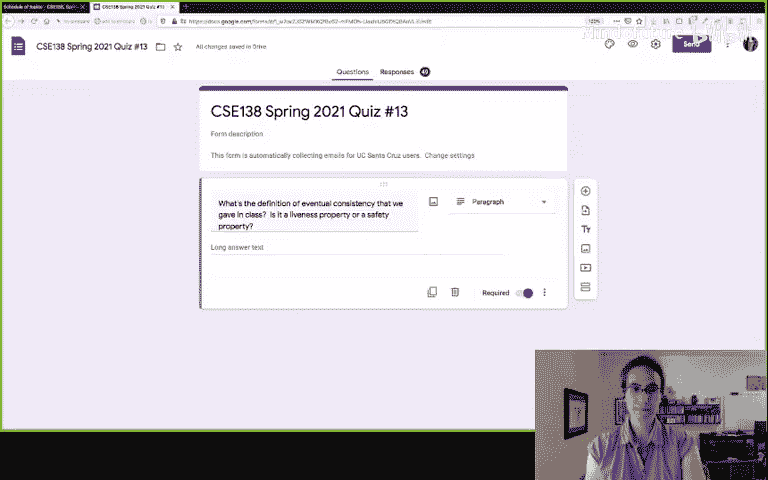
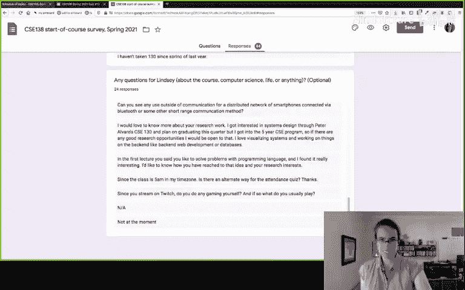

# 【加州大学】分布式系统-CSE138（Distributed-Systems）-p13-P13-L13---eventual-consistency,-availability,-conflict-resolution--BV1eGdLYjETJ_p13-

， just waiting for Twitch to say the stream is live and it looks like now the stream is live。

So let's jump in。Wow， end of week  seven。It's moving fast at this point。

 So before we before we get into the。The material for today。

 I want to take just a moment at the beginning of class to talk about。Administrative stuff。

We'll talk about where we're headed for the rest of the quarter。

And then we'll get into the meat of today。So， today。

We're going to be talking about something totally new。We're going to talk about eventual consistency。

We're going to talk about。Strong convergence， whoops。And。Strong eventual consistency。

We're going to be talking about。Application specific。Conflict resolution。And。Network partitions。

Availability。And that'll lead us into talking about。Cap， the cap trade off。

One of the most famous trade offs in distributed systems。So administrative stuff first。

We're getting to that point now in the quarter where the deadlines are coming at you fast and furious。

As you know， programming assignment three has been out for a couple of weeks and it's due a week from tomorrow。

By now， your group should have made some serious progress on the third assignment。

If you don't feel like you've made some serious progress yet。

 now is the time to really start working on it because that deadline is going to come up faster than you think。

It's especially going to come up faster than you think because。

We have a between then and now we have a reading assignment， so I'm asking you to read a paper。

 the first reading assignment that we've had for this course is for next Tuesday and I'm asking you to read the Amazon Dynamo paper。

 which is linked here from our course website so you can go and check that out。

If you were looking at this page a couple of weeks ago， it was a broken link， so sorry about that。

 but now the paper is hosted locally so the link should work fine。So。Before next Tuesday。

 you should read that paper and actually some of what we talk about today is going to give you the foundation that you need to understand the key ideas of the paper I would budget a bunch of time for this。

 especially if you're not used to reading academic research papers。

Budget something like several hours to read this paper and do understand that you don't need to understand every detail。

 but I want you to be sure to take a good look at it before next week。

 before next week's first lecture。Oh and then by the way。

 as long as I'm looking at this page I might as well mention。

 so we have the mid course survey which should have been due on Tuesday。

 but then I got a couple of panicked messages from people who said that they didn't fill it out in time and could I open it up again so that they could fill it out so I reopened the mid course survey which by the way you get a few points for doing so if it's not enough of a motivation to you to just do it because it's a good idea to kind of look at how you're doing kind of consider how you're doing in the course and think about it as if that's not enough motivation you're also getting a little bit of course credit for it so if you haven't yet filled out the mid course survey。

 please do so it's still open and I'll close it later tonight which is two days later than I said I was gonna to close it so I'm giving some extra time for you stragglers who haven't done it yet。

Any questions about schedule type stuff or what's coming up？Oh and as long as I'm talking about this。

 I might as well mention， we also have a guest speaker coming up on the 25th。

 we will have the honor of having Cyrus Hall who is formerly of Twitch and Amazon Web services to talk to us about practical distributed systems design and I'm really excited about this。

 usually every year I try to get some people from industry and Cyrus is somebody that Patrick introduced me to and so I'm really looking forward to this talk and he's given me a little bit of a preview of what it'll be about and I think it'll be great so I think you'll like it too。

So that's coming up on Tuesday， the 25th。All right。😊。

Doesn't look like anybody has any questions about any of that， so let's jump into today's material。

So。嗯。So we've been talking about consistency。In particular we've been talking about strong consistency for a few days。

 we talked about how you could use primary backup replication or chain replication to get strong consistency among replicas。

Then we talked about how strong consistency ultimately relies on consensus。

 and I really want to emphasize this。If you want to have strong consistency。Sooner or later。

And the key thing is if you want to have strong consistency and you also want to tolerate nodes failing。

呃。I should say if you want it to be fault tolerant。So if you want fault tolerance， which you do。

 because faults happen。Then you need to have some kind of consensus mechanism sooner or later。

So the trouble with strong consistency is that it's hard to enforce。

And I was just talking about this with somebody in office hours a little while ago， so there was。

 if you recall there was a question on the midterm that had to do with kind of our standard total order anomaly example that we've seen so。

 so many times。And the question said， okay， what if you had something like this and you tried to use vector clocks to solve this problem the issue here is that these messages are arriving in different orders on these different replicas。

And the question was， could you use vector clocks to solve this problem？And the answer is no。

 you cannot use vector clocks to solve this。So here's what would happen if you tried to use vector clocks here。

 and I have to apologize to the student who I tried to do this in office hours like a little while ago just off the top of my head and I think I got the vector clocks wrong because I am a human。

 not a computer。Computers are better at vector clocks than humans are。

 but let's try to do it and actually get it right this time。 Okay。

 so let's try to assign vector clocks to all the events in this execution。

 So like this one would be like 10，00。And this is the original vector clocks algorithm that we talked about where every event in here counts。

 so our one would get the message here， and so we count the receive as an event and so we do like this。

Similarly here。So all I'm trying to do here is look at this execution and try to assign vector clocks to events so I can determine。

The order of events。And so this message would get here。So at this point， the。

The vector clock on the process is 1001。That could get mergeged with this one。

 and then we increment one for the receive so it would be like 1201。Similarly over here。

 1001 is the VC on the process， and that would get merged with this one here。

 so we'd get something like 1021。So all I'm doing now is assigning vector clockX to events。

Here's my question for you， what would happen， so I've put these vector clocks here on these two events。

嗯。Do these events have an order according to their vector clocks？

What happens if we compare those two vector clocks is one of them bigger？No， that's right。

 neither one is bigger， so these two events are causally independent。

So causality tells us nothing about how to order those events。But as we've talked about before。

 what if these messages were doing something like assigning values to keys in a key values store。

 then at this point this replica would think that x was 3， because it got that message second。

AndThis replica would think that x is4 because it got that message second。 So even if you had。

Causal consistency。You could still have concurrent updates like this that would leave these two replicas differing。

And by the way， this could happen in the causally consistent key value store that you all are implementing for the homework。

 so you could have exactly this problem where these replicas end up differing。

Because the issue here was not an issue of violation of causal consistency。

 causal consistency is being respected here， the issue is something else。

 the issue is a violation of totally ordered delivery。So what do you do， what can you do about this。

 you want your replicas to be consistent， right？One option would be to run a consensus protocol。

 right， like we've been talking about。To get these replicas to agree but。As we have seen。

 consensus is expensive。It requires sending a lot of messages， and it might not even terminate。

 So there's a lot of reasons not to do consensus， So what I would much rather do。

Is avoid having to use consensus。And if you think back to a few days ago。

 when I gave a whole list of problems where I said that solving those problems required consensus。

 whether it's a problem of totally ordered broadcast like this or the problem of distributed transaction commit or the problem of leader election or the problem of distributed mutual exclusion。

 all those things， I said that you need consensus for all those things。

 but the same issue applies in all those situations where consensus is hard to do。

So quite often what you actually want to do to solve those problems。Is try to find a way。

To get around the problem so that you don't actually need consensus。So in this case in particular。

What I would really like to do instead of having to use consensus to get these replicas to agree because that sounds hard and painful and might not terminate and would take a lot of messages and be slow。

Instead of doing that， what I would really like to do is find some sort of way to make it so that the order in which these updates arrived at these replicas doesn't matter。

And often， that's the right thing to do。Cause often the order in which updates arrive。

Doesn't actually matter very much。So。You tell me what is an example of a situation in which the order of two updates wouldn't matter。

 what are two updates where you don't care what order they happen in？Okay。

 so the response here was get requests so okay。So I think that's not quite the answer I was looking for because get requests aren't updates right so what's an example of an update。

 what would be an example of a put request where the order still doesn't matter？Okay。

 so here's somebody else in chat is suggesting something really good。

 which is if we're updating two different keys。It shouldn't matter Yeah， okay， so if what if we had。

Our two clients。But just like before。Let's say that these messages arrived like so。

But let's say that。Client1 was updating the key X and clientient2 was updating the key Y。

So what would you end up with then？You can think of the state of these two replicas as being a sort of set of all the key value pairs right so on replica1 at this point。

You would just have one item in that set。You'd have the entry that says that x is4 and similarly over here you'd have this entry。

And then down here， after the second update arrived。Now there would be another element in your set。

 right？So I've written the elements of the set in different orders。

 but that doesn't matter because sets are unordered， so this and this are equal。And so。

If different keys are being updated by these different rights， then I don't really care。

That the updates land in different orders because they end up being in this the replicas end up being in the same state eventually。

I at least don't care very much。No。So let's say that we did this。

 let's say that we have a situation like this where these replicas end up in the same state once the updates have arrived on both the replicas。

Would this give you strong consistency？So is this strong consistency in this picture？

Recall what strong consistency means， which is strong consistency means that clients can't tell the data is replicated。

Oh student just asked a question they asked what kind of vector clock is being used in this diagram on top so if you remember back to when we first talked about vector clocks we talked about using vector clocks to assign。

We talked about assigning a vector clock to every event in an execution and so everything's being counted here。

 sends are being counted and receives are being counted。

 so in this case I wasn't trying to use our causal broadcast algorithm which only counts sends although that would have been I could have done that too right like if we were just to looking at these two sends。

These are the vector clocks of the sends， right， and you can tell looking at those。

 the vector clocks of just the sends， those are also concurrent。

 so you can see that these two messages are being sent concurrently。

And so that means that these messages。Don't have an order。Okay， so back to my question here。

In this picture on the bottom。Where my replicas， you know， they look different for a little while。

 and then later at the end， they look the same。 Is this strong consistency in this picture on the bottom。

 What do you think。No， it's not， why not？What makes this not strong consistency？Okay。

 so somebody is saying something in chat about linearizable order， yeah okay。

 but I think we can answer this question even by using our informal definition of strong consistency。

 which has to do with what clients can tell so yeah。

 so great answer in chat which is that a client can read data during this point right here before they both arrive at the same state a client could come along。

And read here。And then come along and read here and see that the replica is differ。

 so the client would be able to tell that the data is being replicated。

 and that violates what we want strong consistency to mean we want it to mean that clients can't tell that the data is replicated。

 So this is not strong consistency。But it still seems better than this situation that we were in up here where the replicas were both updating X and the replicas ended up different。

 right？So at least here the replicas eventually agreed， right？So it's not strong consistency。

 but nevertheless。The replicas end up agreeing in this execution。

 so we can give a name to this property， it turns out。It's called eventual consistency。So informally。

Well we can define eventual consistency。As follows， we can say replicas。Eventually agree。If clients。

Stop submitting updates。So eventual consistency means that。If clients stop submitting updates。

 the replicas will eventually come to agree。What kind of property。

Does eventual consistency look like to you， does it look like it's a safety property or does it look like it's a liveveness property？

Good， yeah。It's a liveness property。How can you tell。

 well that fact that it has the word eventual in it？Is a big， big hint， right？

 So it's a property that cannot be violated in a finite execution。 Remember。

 we said liveness properties are those that can't be violated in a finite execution。

 So in this example here that we had a second ago。嗯。Like this one up here。

 right where one replica ended up with x is 3 and one ended up with x is4。

You could still satisfy eventual consistency here if you implemented some mechanism that made these replicas agree。

 right， which would probably involve them sending more messages。

 But eventual consistency hasn't been violated in this execution up here。 Really。

 it just hasn't been satisfied yet。 You could still make this execution eventual consistent。

 This one here already is event consistent。So eventual consistency is a liveness property。Good。

So this means that if you think about all those consistency models that we talked about before。

Where we talked about like read your rights。And we talked about like FIFO。And causal。And strong。

These were all safety properties。I should say consistency guarantees。Our safety properties。

They're all things that can be violated in a finite execution。

So eventual consistency really doesn't belong in the same category as any of those other consistency guarantees that we talked about。

 it's really confusing， it's a really confusing name because it has the word consistency right here。

 so you might think that it belongs in the same category as all these other consistency guarantees。

But I would argue that it doesn't belong in that category。Because with eventual consistency。

You can't write down a finite execution where it's been violated。

 you can only write down an execution where it hasn't been satisfied yet。So really。

 I couldn't really put eventual consistency in this picture anywhere。So it really belongs。

 it's its own whole separate thing。And this is something that I think people get confused about a lot。

So eventual consistency is really its own。Separate property that shouldn't be considered in the same。

Higherarchy as these other properties。But。There actually is a safety property but we could write down。

That distinguishes between these two executions here。

So I would like to try to express the difference between this and this in a safety property。

And it turns out that you can do that。So the safety property that I want to use there。It's called。

Strong convergence。So this one is a safety property。Strong convergence says。Relic is that。

Have delivered。The same set。Of updates。Have equivalent state。So the set here is the keyword。

I didn't say that the updates had to come in the same order。

 just that they have to have gotten the same set of updates。So this actually is a property。

 this is a safety property that you can use to distinguish between these two executions up here。

So this one here。The executions have gotten the same set of updates in different orders。

 but their states differ。 So this one violates。Strong convergence。

But this one down here satisfies strong convergence。So sometimes you'll hear people talk about。

A combination， so I said down here that this execution here。

Shows us an example of eventual consistency， and I'm also saying that it satisfies strong convergence。

 so sometimes you'll hear people talk about those two properties kind of rolled into one。

And you'll hear about a system that has strong。Evenual。Consistency。

And by strong eventual consistency， they mean both eventual consistency and strong convergence。

So strong eventual consistency is a combination of the two and notice it's a combination of a livenness property and a safety property。

 So every property is either a liveness property or a safety property or a combination of the two。

 So strong eventual consistency is an example of a property that's one of those fun ones that's a mix of safety and liveness。

 So the eventual consistency piece is the liveness piece。 strong convergence is the safety piece。

Questions about any of that。So。As I mentioned a little while ago。

 you're going to be reading the Dynamo paper。For next week。

 and this is one of the most well known distributed systems papers of。This century， I would say。

So it's among the most highly sighted， it's incredibly influential， blah， blah， blah， blah， blah。

And so we're going to read it and we're going to talk about it。What we're doing today。

Is trying to introduce some concepts that I think will be useful to have in mind。As you talk about。

 so eventual consistency is one of those concepts。And。

So the Dynamo paper doesn't use this term that I just introduced a strong convergence that actually came later。

 so there were some researchers who did later work that was sort of a formalization of what the Dynamo people were doing in practice。

And they gave this term strong convergence to it， but that wasn't a term that the dynamo people use。

 so strong convergence， strong eventual consistency。

 that isn't terminology that you're going to find on newspaper， but I think eventual consistency is。

 they do talk about that。So。Coming back to this example。We sort of cheated a little bit， right。

 because when we were talking about an execution that would give you strong convergence。

We cheated in that。Our two clients in this example were updating different keys。

So that seems like a really， really easy way to get strong convergence， right？

If we're updating different keys， and then we end up with this state where。

Each replica state is just sort of a set of key value pairs。There's nothing hard about that， right。

 like there's really nothing too interesting there。So。What if we made it harder？

Can anybody think of a way that we could still have strong convergence？

That would still involve both clients writing to the same key。Any ideas。

 how could we let both clients write to X and still have strong convergence？

A suggestion in chat is periodically reset to a value， I'm not really sure what that would mean。

WellLet's make it concrete， let's say that let's change this Y to and X here。Well， okay。

 at this point we just have。X is4 over here。And at this point， we have x is 3。

What if I just change all my ys to x's here？What if I have something like that or maybe an easier way to write it is like this？

Oops。Okay， so what did I do here？Well。This replica， R1。Applied the right。It set X to four。

And then when the other update came in to CX to three。It can look at its causal history。

 see that this rate is concurrent。Right because the vector clock on here。

 as we talked about a little while ago， the vector clock on this message makes it concurrent with that other one。

It can see that this right is concurrent， and then it can just save that value of x also。

And replica R2 can do the same thing in the other order。 First， it'll set x to 3。

And then later this other update will come along and say， oh， well。There's a concurrent update X。

 I'll just save that one too。Looks like strong convergence to me， right？The trouble now though。

 of course， is that a client that's trying to do a read is going to get both values right。

 so what is the client going to do？Well。Clients。going to have to figure out what they want to do。

 right， they're going to see that there have been concurrent updates to X。

And when they try to read X。They're going to have to do any conflict resolution themselves。

How do they resolve the conflict？We can't tell them what to do。

 the appropriate way to resolve the conflict is going to have to depend on the application。

But we do have strong convergence because the replicas do indeed have the same state after delivering the same set of updates。

So there's just a question chat which is so we keep a log of different values for the same key yeah。

 pretty much except I wouldn't necessarily use the word log because if you're calling it a log that implies a sort of temporal order right when I think of a log I think of things first one thing happening and then the next thing happening and then the next thing happening and the whole point here is that these two updates were in fact concurrent。

So。What we're finding out here， if these updates weren't concurrent。

 then they wouldn't have to both be stored because if replica one could tell that these updates weren't concurrent。

 then it would know that they had a causal order and then it would say， okay。

 well I'll just apply whichever one is causally last， last， and similarly on replica to。

 it would apply whichever one is causally second， second。In this case。

 we don't have such a causal order so it's not so much that we're keeping a log of different values。

 it's just that we're keeping a set of different values。

 an unordered set of the same value of different values so we have strong convergence because the replicas have the same state but now we've kind of offloaded the problem to the client right because the client。

Coming along at this point， let's say this client。Client two， after having done her right of X's3。

 let's say she does a read now。Right here。So she's asking， what is X？And she gets back the response。

4our， and3。Does it satisfy read your rights， well， sure， because yeah。

 she's reading her own right of three？So Raer writes is fine here。Kinda。

But then there's this other value for X that apparently came in concurrently that she's now finding out about。

So。We're really offloading the problem to the client， saying， well， we have these concurrent updates。

 you figure it out， so now it's the client's job to kind of do more work here。

So here's our client kind of scratching her head about what to do next because the data store has not answered this problem for her。

 she now has to figure out on herself， it's now on her to try to solve this problem。

So let me give you an example of application specific conflict resolution that is deeply important to Amazon。

So let's say that our replicas are1 and r2。Are both storing my shopping cart？

And let's say that client won。And client too。Or're both adding things to the cart。So。

Let's say the client one is。Is my laptop。And I want to add a book to the shopping cart。

So I send a message。Saying that I want to add a book。

 and let's say that it lands like that on the replicas。So here's the book。That I'm adding。

And meanwhile， client2 is my phone。And。Let's say that I want to buy a blender。

So I add the blender to my cart。ok。So then what happens？Well， book gets added here。

 here's a set representing the contents of my cart。

So now a client does a read to ask what my card is， and by the way， the clients in this case。

 I don't necessarily mean that they're me， like me， the human being。

 rather this client could be some system within Amazon that's using a data storage service within Amazon。

So this client is not necessarily me with my web browser or me with my phone。

 but this client here could be thought of as some process that's maybe also running in the Amazon data center that's now submitting my client request as a human being to the data store。

Okay， so。At this point。The book has arrived on replica 2。

 So now we've got something here that's like。We've got a set containing a book。

And we've also got a set containing a blender。So two sets。Similarly over here。We've got the book。

And the blender。Why do they both have to be sets， well， they're sets because？

Every client thinks of the shopping cart as a set， right。

 like this client over here could also add another book and then we would have a set with two elements。

So， okay， so really this is like a set of sets here where we've got two。

Seets each representing a shopping cart。Now a client does a read to find out what the contents of the card is。

So the client is asking， what's in the cart？And they get back this set of sets that says there's one cart containing a book。

And there's one cart containing a blender。I hope you like my art。My very sophisticated drawings。

So the client has now gotten two values back from their query about what's in the cart。

 they've gotten two copies of a cart。So the first one is a book and second one is a blender。

 what do you think the client should do to resolve that conflict？So。

Good question in chat so that somebody asks。 yeah， with shopping carts， we could have duplicates。

 Yeah， so wouldn't it be like a multiet。 Yeah， so yeah， in practice。

 you could have a quantity of items that you're adding right？

 So that's that's a simplification that I'm making here。

 I'm pretending that every item in the store is something that can only be added once。

 But yeah in practice。You would have it would be something like a multiet where you had some quantity。

But for this super simple example， let's just pretend that you can add an item to a cart only once。

So what should the client do？When they get this kind of set of possible contents of the cart。

 one of which is a cart containing a book， the other one is a cart containing a blender， good。

 good answer， yeah you could merge them together。To get just one。Cart。Containing both items。

In other words， you take the union of the two sets。

This specific situation is actually discussed in the Dynamo paper about taking the union of two shopping carts。

So there's a lot more to say on this topic。And I hope I'll have time to talk about it more later on。

嗯。But this is kind of。One of the topics that's covered in the Dynamo paper。

 but we have a whole lot of other stuff that we want to do。

So we're going to have to come back to this later， maybe， perhaps a little bit later in the course。

 because there's some kind of interesting problems to consider here。

So another concept that will come up， so looking at going back to our list of you know。

 concepts that will be useful to you as you read the Dynamo paper。

 another concept that will be useful is the concept of network partitions。

And this is something that the paper will expect you to know what it means。So let's talk about it。

 what does this term mean， does anybody know？AhSo somebody suggested something in chat about to come back to this previous example。

嗯。Somebody mentioned set intersection。What if you used set intersection here instead of set Union。

 well the intersection of the set containing the book and the set containing the blender is the empty set。

 right？So you know， ask yourself why it might not make sense to use the set intersection instead of the union。

But then after you thought about that， ask yourself。

 what situations could things go wrong if you use the set union。

 so that's kind of an interesting thing to think about too。Okay， so network partition。

What does this term mean， anyone know？Great， yeah。If you have some kind of network of communicating nodes。

You can imagine a scenario。Where。Some of them。Might not be able to talk to each other。

So you could imagine some situation where maybe machine one and machine two can talk to each other。

But maybe neither of them can reach machine three。So there can't be any communication between this side and this side。

 that's a network partition。You can also have bad situations where you might have a client。

Who can connect to machines on both sides of a partition。But they can't connect to each other。

And then rarely you might have a situation where side one can send messages to side two。

 but the messages get lost if going the other way， so side two can't send messages back to side one。

 so that's also something that can occur。So basically network partitions are when you when there's some subset of nodes in the network that cannot communicate with other nodes in the network。

 note that this is，Don't confuse this with the concept of data partitioning。

 so a network partition is something bad， right， this is generally thought to be a bad thing。

When parts of a network can't communicate and data partitioning， on the other hand。

 refers to when you have more data then we'll fit on one machine so you store some data on one machine and some data on another and you have to split it and you have to make a decision about what you put where。

So that's something that you do on purpose， whereas this is a failure that you have to cope with。

So network partitions are an unfortunate fact of life。And conveniently。

 we have a way to talk about them using the fault models that we already have。

 so we just use the omission fault model and we say that any messages that cross the partition are considered lost messages。

So we kind of already have a way of talking about network partitions。

 but I want you to be aware of this term because it's used in the Dynamo paper。

And there's another piece of terminology that I want to introduce。That the paper will use。

 in fact it's right in the title of the dynamo paper。

 so the paper claims that their system is a highly available。Key value store。

The paper claims to be about a highly available system right in the title。

 so what the heck does that mean， what is availability？Any ideas？Lveness， yeah， good。

It is indeed a liveness property。We actually have seen。Something that you could call availability。

So there was an exam question about this where it mentioned this property of every request receives a response。

And the question was asking what is this property， is it safety or liveness。

 this is an example of a liveness property， so this would be a way to define availability。

This would be a way to define perfect availability Every request receives a response This actually isn't a great definition because。

You you probably want more than this right you probably also want the responses to be fast right。

 you don't just want them to be you know eventually received。

 you probably want them to be received within know some time limit or maybe you want you know at the 99。

9th percentile， you want those to be received within some time limit and a whole lot of the dynamo papers is about that。

But this is an okay starting point for talking about availability if every request receives a response。

 that's kind of like a baseline of what you might hope for。Okay。

 so let's say that you're trying to do some kind of replication。

 let's say that it's primary backup replication。Which we've already talked about provides strong consistency。

So we have a client over here， no， in a couple of。Replas。

 so let's say that we have our primary and we have our backups。Like so。

And let's say that the client decides to do a right。

But let's suppose that there's a network partition。Right here。So the primary can't reach the backups。

What does the primary do， does it acknowledge the right to the client？What do you think？

So think back to what happens normally during primary backup replication， right。

 if this network partition weren't there， then the primary would have to talk to the backups。

 the backups would have to acknowledge the primary and then the primary would respond to the client。

So here's the client。She's sitting here waiting， she doesn't know that there's a network partition over here。

What happens？Well。Normally， under primary backup replication， our primary couldn't。

Acknowledge the right。Because it would have to write to all the backups。Before。

Acknowledging the client， right， so what we would want would be for these messages to go here。

And for the backups to then respond to the primary and then for the acknowledgement to happen。

But it can't do that。If there's a network partition， so it can't respond to the client。So。

 that sucks。What would be the alternative？Well the alternative would be。

For the primary to go ahead and acknowledge the client。Even though there's a partition here。

And then you know， right to the backups later on at whatever point the partition heals。

 so at some point， hopefully you know this partition will go away。

And then the primary will be able to send the update to the backups that it had received。

But what would be wrong with doing it that way？Right。The whole point of doing this replication。

 right was supposed to be。Having more than one copy of the data， right， So if we do it right here。

And then we acknowledge it。And the primary is the only place where that right is saved well the client was probably hoping in interacting with this replicated KVS over here that once she submitted a right and got it acknowledged that that meant that the data was in fact replicated but that's not the case now our data is only here in one place and we're just hoping that this partition will heal before the primary crashes right so if the primary to were to crash at this point before that right has been replicated elsewhere。

 then the client's kind of out of luck。So so that's no good， so the backups would be inconsistent。

 they disagree with the primary， and if the primary crashes and a backup has to take over。

Then the client wouldn't see this right， even though it's been acknowledged to her。

 so that's bad too。So neither approach is ideal， right？In one of these situations。

 if there's a partition here。So this partition is the thing that's causing all the problem， right？

If we wait until the partition heals。And then finally acknowledge。

 then the client has to wait a long， long time， right。

 they have to wait some arbitrary amount of time until the partisition heals。If， on the other hand。

 we acknowledge the right immediately， and then we just send the updates to the backups later on as soon as we're able。

Then we might be giving the client bad information。So。Unfortunately。

 network partitions are a fact of life。And so we have to make a choice between these two rather unappealing options。

So the choice that primary backup。Replication makes。

Is to prioritize consistency at the expense of availability。Right。If you send a write。

And then there's a partition anywhere in here。Then。You're not going to get a response。

Until that partition heals， if it ever heals。The choice that systems like Dynamo make is to prioritize availability at the expense of consistency。

And I can't tell you that either one of these choices is better， right。It depends on your needs。

 it depends on the application。You can't have it both ways。

 and that's true regardless of the replication strategy you're using， so I could have also said。

Chain replication in here。And just more generally than this。

 let's just say that you have two replicas with the partition between them。

Let's say that you have two replicas like R1 and R2 like this。

And let's say that there's a network partition right here。

And let's say that you have a client who can talk to both。

So this isn't a primary backup type situation where there's only one primary that the client can talk to。

So that's not really the issue here， the issue is this。

 so let's say that the client first decides to talk to replica one。And does a right。

And has it acknowledged？And let's say that the client can also talk to this side of the partition。

 right， so this is one of those situations where the client can talk to both。

 but they can't talk to each other。So now the client can make a query over here。

She's asking what X is。Maybe X thought that x was4 before。

This is like that read your rights situation that we talked about last time。

So this client has done it right。And now she's trying to read her right。

What is Relica2 supposed to do？Well。It could respond with x's 4， which would violate consistency。

Because the client knows that she just wrote five for X。So this would violate consistency。Or。

Another choice that replica2 could make would be。Well。

 I can't tell you what x is until I talk to replica 1。

Because I need to make sure I know what replica one thinks before I get back to you。

But it can't talk to replica1 right now， so that would violate availability。

So this is a fundamental trade off。Now， if you want to prioritize availability。

 then sometimes you may get wrong answers， you may not be able to read your rights。

If you want to prioritize consistency， then sometimes you're going to be leaving clients hanging。

So the choice that Amazon made for Dynamo is that they want to prioritize availability。

 they're saying sometimes it's okay to get answers that are a little bit wrong。

And that's a reasonable choice to make in a lot of situations。Any thoughts on that？

Questions about that。Yeah， so in chat somebody says accurate information is more important。

 yeah for a lot of applications， absolutely， so for a lot of applications this situation。

Where we're telling the client something different than what she thought is not okay。

But for some applications， it might be fine。Especially if once this partition heals because network partitions hopefully aren't forever。

 hopefully once this partition heals， then either replica 2 can go out and proactively ask the other replicas is。

 okay， what do you think should I update my value for X and then it would get this update maybe even see that it's causally before the update that it had and then be able to update itself or replica1 could send its update to R2 after the partition heals and then we would be consistent eventually right？

So that's an option。And some of the time that's fine other times。

We want to prefer this situation where clients never get wrong information。

And we would rather not respond at all than give them wrong information。

So thats that's kind of the dilemma that we're in with availability and consistency。

 So there's a name for this trade off， this famous trade off。And it's called cap。

 so it stands for consistency。Availability。Partition tolerance。

So CA stands for consistencyency availabilityva and Partition tolerancelerance。

 and then the idea of CA is very simple， it's just if you want to be tolerant to network partitions。

Then you can't have both perfect consistency and perfect availability。

 you have to compromise a little bit one way or another。Cap is widely misunderstood。

Because some people interpret it to mean something like。呃。Consistency。

 availability and partition tolerance pick two out of three， so then people will say， oh well。

 I'll pick consistency and availability。And then that's bad right， because partitions happen。

 they're just a fact of life， like we said， so you can't really pick consistency and availability have you have to have partition tolerance。

 it's not really something that you can sacrifice in a practical system。

Another way this gets misunderstood is that people think that this is kind of an all or nothing trade off like they might think。

 okay， I'm going to have。No availability at all。 And I'm going to have perfect consistency or I'm going to have perfect availability and no consistency。

 So that kind of doesn't make sense either。 Instead。

 you shouldn't think of this as sort of a binary choice between one or the other。

 or you should think of this as more just like。Prioritizing one over another and different systems might make different choices of turning these dials of consistency is more important。

 availability is less important。Availability is more important， consistency is less important。So。

Cap is widely misunderstood， but this picture kind of sums it up。 I mean， it's not。

 it's not really that hard to understand。 It's just that。

You can't have it both ways of having perfect consistency and perfect availability and so like everything else in distributed systems。

 like I say every day， it's a trade off and you have to decide what you want to prioritize。

So the question chat is how how do network partitions heal well。

 so there could be a network partition like so just just really。

I always use the example in the class of somebody yanking out a network cable， right。

 so maybe that network cable gets plugged back in and then our network partition is healed。Um， or。

 you know， a backho took out the fiber optic cable on my street， right？So。

Those sorts of things could be。Thought of as network partitions。

But network parts are kind of an unavoidable fact of life。嗯。And furthermore。

 you don't really have to think of this network partition as being an either or thing like either the network is partitioned or it's not。

 it could just be that messages are slow， right， as far as the client is concerned。

If she's sitting here waiting for a long time， right。

 like if it takes days to get back the answer to this query， right？You know。

 so that's kind of an extreme example， right， it wouldn't actually take days but。If it did。

 but then she got an answer like the end after several days， right， that would be you know。

 that would be satisfying our definition of availability that we gave before that we said every request receives a response right。

 but it's still it's it's it's not a very satisfactory。Situation so。

So what we actually care about is more like requests being satisfied between within some reasonable amount of time。

And you'll see this discussed a lot in the Amazon paper because they've done a lot of thinking about how to measure。

And how to make sense of。Statistics about availability and how long it takes to satisfy requests and they are。

Aware of the fact that sometimes it's going to be really slow to respond to a request。The issue is。

Can you make most of the requests be fast and you can make design choices in your system that prioritize availability over consistency to make it so most of the time things are fine。

Okay， so I think now。Would be a good time to take our break。And do our quiz。So it's 424 right now。

 so let's resume at 434。And I'll share the quiz。Here's our quiz question for today。All right。

 see you at 434。Oh。Sorry about that。Okay， should be fun now。Thanks。嗯。

Yeah。嗯。嗯。All， one minute warning。All right， welcome back。So just to try to recap。Things。

That you might。Recognize。As you read the Dynamo paper。So。We just talked about availability。

And the cap trade off。So that's a big one that you'll see in the Dynamo paper。

You'll see the concept of network partitions。Also related to the above。

You'll see the concept of eventual consistency that we just talked about。

And you'll see the concept of。Resolving conflicts between replicas。In an application specific way。

In other words。That thing that we talked about where you might merge two copies of a shopping cart。

Or rather where the data store might hand two copies of the shopping cart to a client and the client would merge them together。

So that's just an example of application specific conflict resolution that's particularly important to Amazon。

 you'll see that talked about。What else what else comes up in the Dynno paper we' it'll talk about vector clocks actually。

Which you have seen a ton of in this class。So Dynamo uses vector clocks to give a logical timestamp to events。

So。Just。I know you haven't read the paper yet， but just so you know what you're getting into。

We just got done talking about how Dynamo does this eventual consistency and it tries to be highly available and it's doing this conflict resolution。

What role do vector clocks play in such a system， right。

 we talked about how vector clocks were for causal consistency。But。Vectctor clocks。

Are also useful in dynamo， even though Dynamo doesn't promise causal consistency。

 so how are they being used here？In Dynamo， vector clocks are kind of the first line of defense for conflict resolution。

 So if you had two updates like this and they weren't。Concurrent， in other words。

 if they were ordered by vector timestamps， then you wouldn't have to hand them both to the client like this。

So Dynamo makes kind of its best effort at not making the client do this sort of conflict resolution。

 so vector K come into play there。But as we've discussed so many times vector clocks don't resolve all conflicts because some things are concurrent。

 some events are causally independent or concurrent。

So what does Dynamo do when vector Cls aren't enough。

 it either lets the client take care of that conflict resolution with their own conflict resolution mechanism that they provide。

Or。Dynamo just says the last right wins。So these are all concepts that you'll hear about in the paper。

Plus， a lot more。That we haven't talked about yet。So there's going to be a bunch of stuff in the paper that we have not yet discussed。

 and we're going to be discussing that stuff next time after you've read the paper， so enjoy it。

I hope you got something out of it。And。We'll be talking a lot more about that additional stuff that we didn't cover today next time。

Okay， there's one other thing that I wanted to talk about today that I forgot to put on the agenda。

But it's pretty important， so I do want to talk about it。So as you're working on assignment three。

You're probably trying to think about。How to test your distributed system。

So we gave you a test script， right， but if you recall from the assignments spec。

We say in the spec that the test script that we provide is not even close to being exhaustive。

So we ask you to come up with your own testing strategy on your own as well。

And you'll probably want to run additional tests aside from the ones that we offer。So。

I want to just talk for a second about about testing and why testing distributed systems is so hard。

 so let's just continue using read your rights as an example， because that's。

That's something that we've been talking about a lot， and it's pretty easy to understand。

So let's say that you're a client。You've done it right。It's been acknowledged。

So here's our two replicas。And then you do a read from another replica。What。😮。

Would you do to try to ensure that your key value store。Satisfies the read Your rights property。

 How would you test this？I mean， of course， you want to make sure that you get the five back here。

But。You'll get the five back if。Repla 1 has gotten this right and then broadcast it over here right。

 so if that right has gotten over here to replica 2。

By the time that the client then does the read later on。Then you'll be in good shape， right。

 so if that right gets there in time， there's no problem。The issue would be。

What if this right was slower， what if this right landed here？

And that would be the situation that you want to guard against， so in particular。

If this right happens and then the broadcast of the right is slow to get to replica 2。

 and then the clients。Request lands over here if their read request lands over here on Relica2 before the update has happened。

What is replica2 supposed to do？One way to satisfy read your rights would be for it to wait until it gets the missing right。

And then respond to the client so if that's what the choice that it made in this latter situation where the message was slow。

 then it would have to wait to respond to the client and then respond to the client a little bit later。

 that's one way to satisfy， read your rights。You could also imagine it returning an error。

Like a 500 server error saying。Im behind， go talk to some other replica。

 So those are both different ways。Of satisfying read your rights， one of them is to just you know。

 wait for a while until you get an answer， another approach is to respond right away with an error saying。

 go talk to somebody else， I don't know， right？And then you could imagine a sort of in- between compromise where the replica maybe has some sort of timeout or they wait for a while to get that update that they have seen as missing。

 they know an update is missing right because the causal metadata that was returned here is going to come along in this next request。

So the replica is going to know that they're waiting on a message， they just haven't gotten it yet。

So。They have a choice to make， just they can wait。But they probably don't want to wait indefinitely。

But here's the issue。When you're testing your distributed system。

 you've got a bunch of containers that are running locally that are representing these different notes right those containers can probably talk to each other pretty fast right so this is what you're going to have most of the time you're going to have this top situation when you're testing your system。

Most of the time your' right is going to land up here。

You won't even ever encounter this situation where this right is slow。

So this probably won't even ever happen to you。So how can you make sure that replica tube will never do the wrong thing？

If this were slow in a production setting， how would you test that。

 how would you try to make sure that your code would do the right thing in a production setting if this message were slow？

Any thoughts on that？Good， yeah， so you could artificially delay talking to replica2。

 so this message right here， you would be taking this message。

Which would be fine in your testing setting， and you would be artificially turning it into this。

You could artificially delay or drop this message。In other words。

You could intentionally insert faults into your distributed system to try。

To test its fault tolerance。So doing that has a name and it's called chaos Engineing。

And I bring this up not to tell you that you ought to be implementing a whole chaos engineering framework when you're working on assignment three because that's a heck of a lot of work and I'm not telling you that you need to do that。

 but I am telling you that it is something that you should be thinking about。

Because in a production system。This is exactly what you would need to do in order to test in fact。

This is what Netflix is famous for doing。 So Netflix。

Helped popularize this term chaos engineering by doing it in production on their own systems。

 so obviously Netflix has a lot of interesting distributed systems。

 challenges to solve they're serving a lot of data to a lot of people， and it needs to be fast。So。

So they have this practice in their engineering culture of doing chaos engineering。

 of artificially inserting faults， in it's called fault injection。

 injecting faults into running systems to see how those systems behave and to try to surface bad behavior of those systems。

So。This is something that has gotten more popular in the last 10 years or so。

 and there have been books published about it and so on。

 and you can read articles about it and so on。Something that you will find as you work on real world distributed systems is that often in order to find bugs in the first place。

You will want to try to inject faults。And even in production systems。

 sometimes it takes a really long time before something goes wrong。

 one of my friends was working on a causally consistent or a data store that was supposed to be causally consistent。

 and he was trying to get it to exhibit some violation of causal consistency。

 and it took days of him injecting faults just like this。

 trying to throw errors at it before he could get it to actually exhibit a bug。

So and that was that was with his actually focused effort of trying to do so right。

 so in practice it could be months or years before messages get interleaved in just the right way that cause a bug to be exposed。

 so this is something to think about。When you're building distributed systems。

 if you're trying to build a fault tolerance system like a replicated system like this。

 replicated systems hide their faults， right， or I should say fault tolerance systems。

 systems that are supposedly fault tolerant。Intentionally hide their bugs。

 so fault tolerance systems can be especially hard to debug。Because。

They try on purpose to hide default faults from you。

So you might not be able to see the bugs unless you make a point of delaying the messages。

 dropping the messages， causing machines to crash， basically injecting these faults on purpose to try to see what goes wrong。

And so I find this really interesting， and if you're interested in this。

 you should look up my colleague Peter Alvaro's work。On what's called lineage driven。

Falult injection。So this is work that he published， I think in 2015 or so， but it's been。

 he's continued this line of research。And done more and more work in this vein over the last six years。

 so what this is all about is okay， you could inject faults。

 but you have a whole lot of choices for what kind of faults to inject right。

 like if I have a distributed system with a whole lot of messages like this。

 which messages should I be delaying in order to try to expose any bugs that might be there， right。

 which messages should I be dropping， which machines should I be making crash。

So there's a whole lot of choices， and there's a pretty big possibility space to explore。

 So you might not have all the time in the world。 So you might not want to try every possible combination of faults。

 right， You want to find the bugs more quickly than that。

 So this work on lineage driven fault injection or LDFI is about exactly that。 It's about trying to。

Inject faults in a strategic way so that you find the bugs more quickly。

 so in particular trying to inject faults in the places that are most likely to cause bugs to be exposed and his students have also done some really great work on this。

In the in the last six years and it's cool so I urge you to check it out if you're interested。

 but I mean even aside from that which is like cutting edge research there's a whole lot of chaos engineering stuff that's being put into practice right now today in industry so even if you don't even you know look into this research stuff you should be aware that chaos engineering exists and it's out there and it's one of the best approaches that we have for。

For making distributed systems robust to failures。A question in chatd。

 does chaos engineering have anything to do with chaos theory？I mean， I think that it's。

Not particularly I and you could probably draw some sort of loose analogy。

 but no I mean I think it's called chaos engineering because you can think of it as like some sort of nasty little elf that's in your system you know climbing around and wreaking havoc by dropping messages and crashing machines and delaying messages and so on。

 so intentionally causing chaos in order to try to make bugs that were there all the time。

 the idea is you're not trying to create bugs where they weren't before you're trying to expose the bugs that are already there that were latently there so that you can see them。

And one way to do that is to kind of intentionally cause faults that so you can see just how fault tolerant your system actually is。

So that's something that you can check out and read about on your own and hopefully working on assignment3 has gotten you thinking about these sorts of issues of testing and you'll see that the testing that we're doing is really woefully insufficient for trying to make sure that your system really is fault tolerant and that it really is that it really will respect these properties like read your rights in the event of messages being slow and so forth。

Something to think about。All right， in the last few minutes here， we have a little bit of extra time。

 so lets let's look at。The last few questions on the Start of coursese survey that I haven't yet answered because we have a few minutes left and I don't want to throw any more information at you today。

All right， let's start at the bottom because I don't think I've done these yet， okay。

 so somebody else。Since you stream on Twitch， do you do any gaming yourself， oh， you know。

 I think I already answered that one。I talked a little bit about games I play with my three year old。

UmAh okay， class is 5 AM in my time zone， I'm sorry。嗯。

I don't really have a great answer for you for that one。

In the first lecture you said you'd like to solve problems with programming languages and I found it really interesting。

 I'd like to know how that you have reached that idea and your research interests so I was always interested in PL and my first programming language in college was a functional programming language rackcet and I fell in love with it and from then on。

I was kind of sad， you know， in the middle part of my computer science degree because I had to write boring languages like Java。

 but then。I decided to go to grad school in part because I wanted to get back to doing that kind of functional programming that I was doing really early in my degree。

 so I'm one of those weirdos who likes functional programming。

It turns out that some ideas from functional programming are deeply relevant to solving the kinds of problems that we have in distributed computing and parallel computing and so you know you'll see a little of that actually when we read the next paper that we'll read for this course which is the Mares paper but I was interested just kind of purely in programming languages at first。

 I didn't think any of this other stuff was cool and then later in my dissertation or later in in my PhD work。

 I started kind of getting to know some distributed systems people and they actually came to me and told me that my work had relevance to their problems and I had no idea。

So。I really owe a great debt to the distributed systems， people who came to me and told me， hey。

 what you're doing actually has a lot to do with what we care about。

And this was at a time actually when what I was working on was。

I was having a hard time getting it accepted in the programming languages community because I kept having papers rejected Well finally the programming languages community started accepting my papers that then you know by then Id already made friends with the distributed systems people and now really I'm kind of an intersection of these two worlds and I like to solve distributed systems problems with programming languages solutions and so I'm actually working with Haskell now and I work with a really cool language called liquid hasskell which it's kind of like hasskell on steroids that gives you even stronger it can give you even even stronger guarantees richer guarantees about the behavior of your code。

So and you can use that for verifying properties of distributed systems。

 and that's exactly what I've been working on lately。So that's me。

 I guess thats sort of that also answers this next question here which is I'd love to know more about your research work。

 yeah， come talk to me if you're interested in any of that， I would love to talk about it with you。

Allright。I think that's enough for today， it's 455。I'll stop throwing ideas at you。

 I hope you enjoy the Dynamo paper and I will see you all next week， enjoy。

