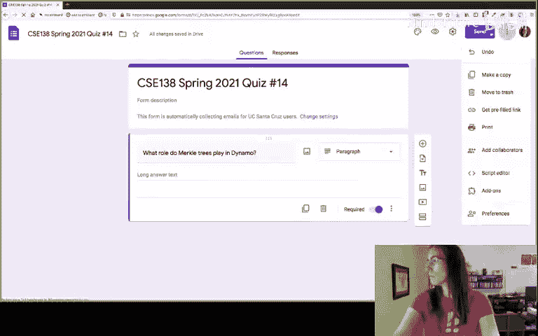
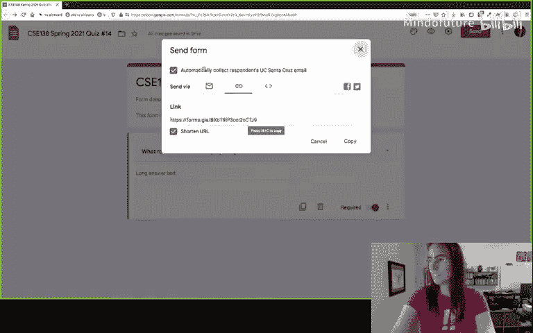
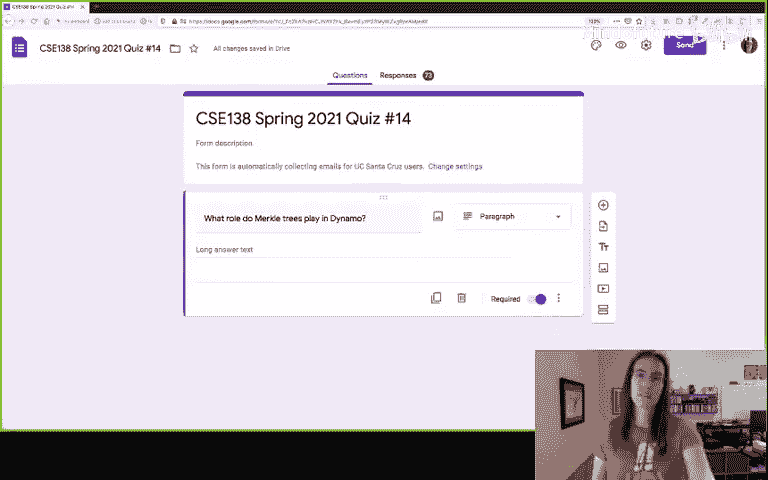

# 【加州大学】分布式系统-CSE138（Distributed-Systems）-p14-P14-L14---Dynamo---Merkle-trees,-quorum-consistency,-tail-latency--BV1eGdLYjETJ_p14-

Okay， twitchwitch says we're streaming。Welcome to Week 8。We're getting down to the end of the course。

Congratulations to all of you who haveve hung in for this long。Just three weeks to go。

So today I asked you to read the Dynamo paper。And so I want to say right off the bat if you struggled with this paper。

You're not alone， This may have been the first academic research paper that some of you have read。

At least the first that you may have read for a class。

And it's different kind of reading than you might be used to if you try to plow right through from beginning to the end。

 then that's not necessarily the most effective way to read this kind of paper。

 so we can talk a little bit about strategies for reading research papers。

 especially since we're going to have another reading assignment coming up in about a week。But。

What I want to spend most of our time on today is。Discussing some of the cool ideas that are in this paper。

 So our whole agenda today will be about。The Dynamo paper。So we're going to quickly review。

Some of the old ideas that we already talked about。Last time and previously in the course。So。

And we'll discuss how they come up in the paper。So。Review of old ideas。This will include。

Availability。Network partitions。Evenual consistency。Application specific， conflict resolution。

And there's more， right， But that's that's kind of the main highlights that we're going to talk about。

 And then we'll talk about some new things that we haven't yet discussed in the class。

 but but do come up in the paper。 So this will include。Antienttropy。With Merkel trees。Gossip。

Quorrum consistency。Till latency。And then of course， there's also more。

 but I think that's about what we'll have time for for today。All right， so let's jump in。

 I want to try to contextualize this little bit before I start talking about this whole laundry list of topics first I want to I guess I'll add something to the beginning here it's just like why？

Why are we reading this paper， Who cares？So。I want to say a little bit about why this paper is important and influential。

 So the Dynamo paper came out in 2007。And it really influenced the way in which a lot of people conducted systems research。

And so。Before this paper。There was a lot of focus on strong consistency and not only that。

But the focus was on strong consistency and especially。Unforgiving settings， like for example。

 settings where。Where there were Byzantine faults。And so。Then the Dynamo paper came along。

And they said， not only do we not care about Byzantine faults。

Not only do we not care about security right because this paper mentioned that they're only operating。

 they're talking about a context in which they're only running on machines that are in Amazon data centers and they're not worried about those machines being compromised right so they're not worried about that stuff。

 not only do we not care about any of that。We don't even care about having strong consistency。

So their priorities are very different than what a lot of the kind of preceding or popular work at the time was doing。

So in the olden days， the assumption was that of course you needed to have strong consistency and that was considered practically an answered question and so people had kind of moved on to working on other things like Byzantine fault tolerance and so on。

And then Amazon came along and their priorities were totally different。

And so this was really in some ways revolutionary， and it kind of heralded a shift in what the focus would be in systems research for the next 10。

 15 years。And I have to say I don't personally love the writing of the Dynamo paper。

 I think that some of the writing is just not great。And。

But I think it's a terrific paper to read in terms of how it connects with this class and how it touches on a whole lot of the concepts that we've already discussed。

So now that you've actually looked at the paper， hopefully。

These are some of the concepts that we've talked about so far in this class that play some sort of a role in Dynamo。

 so let's talk about these old ideas。So。Availability。This is a big one。

So how did we define availability， remind me when we talked last time。

 how did we define this notion of availability？Yeah， that's right。

 we said something like every request will receive a response。

So that's one way to talk about availability， we could also say something like every request gets a response quickly or we could talk about it in a sort of probabilistic way。

 we could say 99。9% of requests get a response quickly。

 so these are all ways to talk about availability。But to a first approximation。

 it's something like this， all requests receive a response， so if somebody wants to make an update。

 say put something in a shopping cart。Then you go ahead and let him do it， no matter what。

Network partition， no problem， you just you don't want to wait around to get acknowledgements from all the replicas。

You serve the request and you respond to the client no matter what。So that's a big one。

 and that's a huge factor in the design of dynamo。I just mentioned network partitions。

Tied to this topic of availability， so this is another big one， what is a network partition？Anybody。

All right， all right， shark seating under sea optic fiber optic cable。 Sure， Okay， yeah， yeah， yeah。

 yeah， Yeah， so， so network partition is when。You have some machines in part of the network that can't communicate with some machines in another part。

 unable to reach machines in another part。So。Some machine or machines can't talk to others。

Network partitions are temporary。And they're unintentional。

So I'm not talking about like a network topology here where you intentionally make it so one machine doesn't communicate directly with another machine。

 instead I'm talking about a situation where you have some machines that are supposed to be able to talk to each other。

 but for some temporary period of time can't。And then there's this topic of eventual consistency。

Which goes hand in hand with talking about availability and network partitions。

 if you want to offer high availability and partition tolerance。

 you may have to relax your consistency requirements。Now， as we discussed last time。

 this property of eventual consistency。Fundamentally belongs in a different category from those consistency models we talked about。

 so we talked about strong consistency and causal consistency and so on。

 eventual consistency belongs in a different category because it's a liveness property。

And it says that replicas eventually agree。More specifically， it says that if updates stop arriving。

 the replicas will come to agree。Now， this might seem like a kind of silly definition because in practice。

 updates never may stop arriving。But。It's a useful and of rule of thumb。

 so I wouldn't put eventual consistency in a hierarchy along with strong consistency。

 causal consistency and the rest， not even at the very bottom of that hierarchy because it's a different kind of property。

 all of those consistency models are safety properties， this one's a aliveness property。

So what about safety in the context of Dynamo？I think it's hard to say exactly what safety property you get from Dynamo in terms of consistency。

You'll recall we talked last time about a safety property called Str convergence。

hich is the property that if two replicas have gotten the same set of updates。

 possibly in different orders， then their states will agree， so that's a safety property。

And that's a part of what we talked about that's known as strong eventual consistency。

 which is a property that has a safety component and a liveness component。

But the Dynamo paper doesn't actually claim to offer strong convergence or a strong eventual consistency。

 in fact， those were ideas that kind of popped up a few years later。And by the way。

Amazon did not invent this concept of eventual consistency。

 So this term eventual consistency was coined by Doug Terry。

And his colleagues to describe a system that they built called Bayou。In the mid 90s。

So if you want to know more about that， look up bio， it's really interesting。But Amazon。

 although they did not invent this term eventual consistency。

 they certainly popularized it to the point that now a lot of people think that Amazon invented this concept。

 and I've been guilty of this myself， I've cited Amazon's work or work by Amazon people when I've needed to cite this concept of eventual consistency。

Okay， so。We've talked about all these things， we also talked a little bit about application specific conflict resolution。

This is that situation where you might have one replica that has something in a shopping cart like a book。

And you have another replica that has something else in a shopping cart， like a blender。And。

The client gets to figure out。What to do。With those conflicting。States。

 so the client gets to figure out that what it's actually supposed to do is take the union in the case of shopping carts。

So I don't know if you saw， but there was a little footnote in the Dynamo paper about this。

 it was actually really interesting。They say。That with the conflict resolution mechanism that they're using for shopping carts。

There's a bug。Does anybody remember， does anybody remember who might have happened to read the paper and see that footnote。

 do you remember what they said the bug is？While you're thinking about that。

 there's a question in chat based on the Dynamo paper。

Wouldn't always allowing rights be a safety property in the scenario in which systems may be failing？

So if you're talking about availability， availability is a liveness property for sure， if you want。

 you can insert the wordeven here。If that helps it look a little bit more like a liveness property to you。

If you're thinking more in terms of。Every request gets a response within a certain timeout。

 then that's starting to sound a little bit more like a safety property because that's something that actually could be violated within a finite execution that's not necessarily the classical way of reasoning about availability classically we think of availability as being a liveness property。

Okay， does anybody remember what the Dynamo Shop cart bug was？

This was only mentioned really in passing in the paper， so it's okay if you didn't。Yeah。

 that's right， so the good， so the bug is that deleted items can reappear in a cart。Why。

 why do you think that can happen？Well， it has to do with this way of resolving conflicts。

If one replica knew about。One item in the shopping cart like this book。

 and another replica knew about another totally different copy of the shopping cart containing something like this blender。

 and then the client takes the union of them。Then that's all fine and good， right？But。Let's say。

 yeah you're right， so somebody just mentions merging with an unupdated replica。

 or maybe it could be something like this。What if one of the replicas has found out about？

Both updates。Let's say one replicas found out about the book。And。The blender。And then。

So then we have this other replic over here。Which maybe just had the book。

So at that point we're still fine， right， like the union of these is still。What we want， right。

 the union of these two sets is still book and blender， one of each。

And the book has maybe been copied over here， but then let's say that this replica decides to remove the book。

So now we have an empty set here。 The empty set is being unioned with this set containing both。

And that again， gives you the book and the blender。So。The replica that did the delete。

 if the delete didn't propagate over。To the other replica before this query is made。

 then this deleted item could pop up again because there still could be a copy of it elsewhere。

 I think this is really interesting。This notion， you know。

 we talk about replication as a way to tolerate faults， right， we don't want to lose our data。

We don't want to lose our data， so we replicate it。 seems like a good idea。 however。

 when you want to get rid of something。Then replication can be your enemy。

And I was talking to a friend at Google a while ago about this who was talking about compliance with with the GDPR。

 which is a European law that has to do with privacy and not storing user data。

One of the issues that my friend was dealing with was in order to comply with the law。

They had to make sure that all copies of certain user data were removed and making sure that all copies are removed in a replicated system can be extra challenging。

So。This is really interesting right， it would seem that deletion。Is different from addition。Right。

If you're only adding items to carts， then it's not a problem。

 but it seems that the le has kind of an unusual relationship。

With this conflict resolution mechanism where we're trying to take the union of different replicas。

 so that's something interesting to think about。And we'll talk a little bit more about that a little bit later in the course if we have time。

Okay。So。Dynamo， of course， gets used for all kinds of things other than shopping carts。

So set union doesn't always make sense to do。So they let you provide your own conflict resolution mechanism。

This is just one particular example of a conflict resolution mechanism that you could plug in and use with Dynamo。

That's why we call it application specific right this is what might make sense for the shopping cart service。

But for something else。Some other mechanism might be better。You get to specify it on your own。

What does Dynamo do？If you don't provide your own conflict resolution mechanism。

 what does Dynamo do then？Does anybody remember？That's right， yeah。It takes the latest rate。

I'll say application specific conflict resolution or。LWW， which stands for last right Wins。

If you don't have any application specific conflict resolution mechanism to help it out。

Dynamo will use last right winds。So。Questions about any of that。Okay。So here's a question for y'all。

Let's just think about shopping carts for a second。2。There was a question about preference lists。

So I believe the notion of preference lists in Dynamo。

It doesn't have to do with conflict resolution in that sense。

 I believe that has to do with to whom you replicate。

So I think that was a different notion of preference。But we'll talk about that more later。

 if not today than on Thursday。Okay， so here's a question for you all。

Let's just think about shopping carts and for now， let's just think about adding items to shopping carts。

So with addition of items to shopping carts， we have this really nice property that rights commute with each other。

And we don't care about the order they arrive。 So if I add。The book。And then the blender。

That's going to be the same as if I add the blender。And then the book。

Because we're treating both of those as sets。And sets don't have an order。So。Ws commute。

 What does commutivity mean， by the way， When I say that rights commute with each other well。

If we're talking about。Grade school math， grade school arithmetic， we say that。

Addition is commutative， for example。So the addition operation is commutative。

 so that means that a plus b equals b plus a， so changing the order of the opera doesn't change the result。

So when I say that rights commute with each other。I'm sort of。

Using the notion of commutivity in a different way here。

 because I'm no longer talking about a binary operation。But it's the same basic idea that order。

Doesn't affect the result。嗯。So here's my question for you。With shopping carts。

 we have this nice commutivity of rights。And that by itself。

Is really nice because that's enough to give us strong convergence。Remember。

 strong convergence is this property that we talked about。

 which says that if you've received the same set of updates in some order。

 then your states will agree， so if the rights are commmutative， that'll give you strong convergence。

But。The Dynamo paper doesn't only do that。It also talks about vector clocks so why do we also need vector clocks Well so normally vector clocks would be for enforcing causal consistency or causal delivery or something like that。

 but they didn't promise causal consistency in this paper so what do we have the vector clocks for if we're doing shopping carts what do you need them for？

I think。It's to minimize those sort of deletion anomalies that that footnote was about。

 so the vector clocks are able to rule out most of the deletion anomalies。

You're still occasionally going to have a deletion anomaly where you've deleted something and then it reappears in the cart。

 but they have decided that they're okay with that。Okay， so。Every now and then。

You're going to get into a situation where replicas disagree。

And maybe even one of them is going to have an update that's causally later than the other。

 according to their vector clocks， or maybe they disagree because of something that vector clocks can't help with。

 Maybe they disagree because of concurrent updates， but one way or another。

You're in a situation where replicas disagree。So one of the challenges here in the first place is finding out that they disagree。

 so if I'm standing here and drawing Laport diagrams for you。

 then we have a God's eye view of what's going on in the whole system and the whole execution and you can see that there's disagreement。

But。How do。Nodes within the system figure out that they may disagree with nodes in the other system if one replica thinks。

That say x is3。Does it have any way of necessarily finding out that somebody else thinks that x is for。

 No， not necessarily。So。Dynamo has a couple of mechanisms in place。

That will allow the system to find out about and resolve those sorts of conflicts。

So I should stay here step one。Find out that they disagree。

This is not something that we've spent much time on yet in this course。

 we haven't had to think about this mostly because we've either been dealing with mechanisms that only do strongly consistent replication。

 and so we haven't had to worry about replicas disagreeing by the time that our response gets back to the client。

Or it just hasn't been our concern， right， Like when we talk about causal consistency。

 causal consistency can。Lead you to a situation where replicas do disagree because they could get concurrent updates。

 right and causal consistency。Doesn't rule out those sorts of concurrent updates。But。In practice。

 you might want to do something about it if replicas disagree。So。

Dynamo has a couple of mechanisms that we'll discuss。One of those mechanisms。It's called。

Anti entropy。Another one is called gossip。The way this works in Dynamo is。Every so often。

 say once per second。A node will randomly peg another node。

And we'll contact it and ask it what its state is。So to be very clear。

 there are two different things being discussed here when the paper talks about anti entropy。

They're talking about。Resolving conflicts。In。Application state。And by this， I mean the application。

Is a key value store。RightDynamo is a key value store。

 so by this I mean differences in the actual key value pairs that are being stored， the data。

 the actual data that's being stored。When the paper talks about gossip。

It's talking about resolving a different kind of conflict。Does anybody remember。What kind。

A state we're talking about when we talk about gossip。

Gossip is about resolving conflicts and something other than the application state does anybody remember？

What kind of state is being talked about？The view， good， yeah。

Think back to when we talked about different kinds of problems that all amount to consensus problems。

This had to do with one of those， so one of the problems that we talked about was the group membership problem。

 the problem of knowing which nodes are actually up。

 which nodes are actually participating in the system。Well。

 that's another kind of state that has to be kept consistent between replicas。

In addition to the actual data being stored， they all have to keep track of what nodes are up。

So you could call this view state。And view means。Who's up？In Dynamo。

 this is done via this mechanism called gossip。And。

The current view of membership is only eventually consistent。

 just like the data is only eventually consistent。So once per second。

There's this gossip thing where a node contacts another node to say， hey。

 what's your view of who's up and running？And gradually， they all figure it out。

What I find really interesting about this is that in the paper。

They say they used to have a mechanism that maintained a globally consistent view。

So I take that to mean that they used to have a mechanism that gave them strong consistency for views。

But then they figured out that they didn't need it。So they do gossip instead。

 and that ends up being good enough。So there's this interesting bit of historical background in the paper where they say。

 hey， we used to try to do something more challenging for trying to keep the views consistent。

 and then we figured out that we could just get away with doing this gossip thing where we just have replicas periodically contacted each other and say。

 hey， who's your view？So Dynamo has these two different。

But similar mechanisms in place for resolving conflicts in application state。

 the actual key value pairs that are being stored。And resolving conflicts in group membership state。

 meaning the nodes views of which other replicas are up and running， and yeah。

 so there's a question in chat about how this relates to what we're doing for assignment three。

The part of the assignment that involves views。You could implement something like Dynamo's gossip。

For the part of the assignment that involves the actual key value state。For that。

 we're not asking you to necessarily implement something like anti entropy because。

The why do we need antienttropy， Well， Anti entropy is for ensuring something that's actually better than causal consistency。

 You know how we talked about， you can end up in a situation where replicas disagree because of concurrent rights like this。

 this replica over here could end up。Thinking that x is4 and this one could end up thinking that x is three because clients have concurrently written those things。

 even in a causally consistent system， you could end up that way。What anti entropy does is。

It tries to resolve those kinds of conflicts。By having nodes talk to one another。

 tell each other what their state is。So in general， these two words。Are synonyms， right？

 And anti entropy is is just a kind of a fancy way to say gossip。

 But in the context of the dynamo paper， they mean different things。

 So I'm going to say synonyms in general。But they have different meanings in dynamo。Okay。

 so gossip and anti entropy are both for resolving conflicts in some kind of state。

But then you might ask yourself。Why do we need two different mechanisms。

 right if they're both for resolving conflicts in state？How are these two problems different。

 practically speaking？How is it different， how is resolving conflicts in application state？

Different from resolving conflicts in view state in terms of your practical implementation and the concerns that you might have practically speaking。

What's the difference？There must be some difference， right。

 because otherwise they wouldn't bother to have these two distinct mechanisms that they give different treatment to in the paper。

What do you think？Yeah， okay， so there's a comment that with View State。

 we need to know who's up so that we can make progress。Yeah， okay， but。

I think you might also need to know。I think you might also need to resolve a conflicts in application state to be able to make progress。

Okay。So let's think about it this way。If replicas are。

Sending around information to each other about what their current state is。

How big are those states going to be if it's the view state？How much information is that， Well。

 it's probably not very much information， right？It's just going to be like。

A list of some machines and maybe not very many， right， a handful。Maybe maybe a few dozen。It'd be。

 you know， at most， you know， 100， I don't know， not that many。

But what about application state well how many key value pairs are you talking about right。

 how many key value pairs could you have on a particular replica， you could have a whole lot。

 couldn't you。So in the case of application state。The amount of state that you're talking about。

Could be much， much larger。With this view state， you essentially just have some。Small。

List of nodes right， you have a list of some relatively small number of nodes。

 but for application state， you could have a lot of key value pairs。

Change in size means we have to change our approach right so given that these application states are so large。

 it's not going to be feasible for replicas to send their complete state to each other all the time right？

It would take a lot of bandwidth。So what do they do instead， what does Dynamo do？

To minimize the cost of data transfer。When it's trying to do this anti entropy data synchronization。

That's right， you don't want to send a gigabyte over the wire if you can help it， right？

So what does Dynamo do to make this big thing less big？Good， yeah。

Dynamo uses something called Merkel trees。Also known as hash trees。

So how does Dynamo minimize data transfer cost during anti entropy？With。Mkel trees。

Also known as hash trees。So a Merrkle tree looks something like this。

So you've got some pieces of data。Any data， in the case of Dynamo the data will be key value pairs。

 but it doesn't really matter what they are。Mkel trees will work with any kind of data。

So let's just say that I have some blocks of data。Like this。So at the leaves of the tree。

 I'm starting at the bottom of the tree and I'm going to draw， you have these chunks of data。

And then you take the hash。Of each chunk of data， using some hash function。

So those are the leaf nodes of the tree。And then。For the nonle nodes。

Every node is going to store the hash of its children。So the parent here。

It's going to combine the hash of its children somehow， so maybe we'll take the hash。Of one。

Maybe we'll concatenate it with the hash of two。And then we'll take the hash of all that。

Similarly over here。So。To make this a little bit easier to write。

 let's give some names to these things， so let's call this。This， which is one big hash value。

 let's call it A。And let's call this。Hash value B。And so then up here。

The parent of those is going to be the hash。Of A and B。And that's the root。

So these are our data right， this might be like some key value pairs。And so on。

So at the leaves of the tree， you have hashes of each chunk of data。And for the， nonle nodes。

Every node is going to store the hash of its children。So in this case。

 it happens to be a binary tree。So the non leaf nodes have two children。

And the way that I've done it is just that they're concatenating together their children's hash values。

 so this plus here could be concatenation and then take the hash of that and so on up to the root。

So this hash value up here at the root。Is incorporating information about all of the hash values under it？

What's the purpose of doing all this？Why do we bother to do all this？Right。

So we want to minimize the amount of data to compare good。

What this will do is it'll make it easier to quickly compare large amounts of data。So let's say。

 for instance， that we have two replicates。So let's say that we have replica one。

And replica  one has some key value pairs。Relica2 has some key value pairs。

And maybe replica 2 is only a little different。In particular。

 let's say that replica 2 only differs in the value of this one key y。It would be really。

 really expensive for replica1 to have to send its whole state over to replica 2 or for replica2 to send its whole state over to replica 1。

 and it especially seems ridiculous because there's only this one point of disagreement， right？

But you don't know that。Until you talk to the other replica。

How are you going to quickly find out that there's only this one point of disagreement between the replicates。

 so that's where Merkel trees come in。So in this case， no maybe。I'， I'll put this over here。So。

 maybe。This is what the Merkel tree looks like on replica 1。So this data item number two。

Is going to be different on those two replicas since。The hash of this item number two。

Is going to be different as well。 So then the parent。

Here where we're concatenating hash1 and hash2 is also going to be different on the two replicas。

 and finally the root will be different。So。To compare their state。

Replas can start by comparing the root of the Merkel tree。

 so each of these replicas will be storing this Merkel tree。

When they have to compare their state with each other during this anti entropy process。

 the first thing that they can do is merely send over this rude hash。So it's one little hash value。

That says something that kind of summarizes the whole state。Of the key value pairs at that moment。

If their hash values agree at the root then great， then you know that all the underlying data is going to be the same at that point。

If the root nodes disagree， then you have to look further for the difference。So in this case。

 you can send over these two。Next level down hashes， these two child hashes。

 like the hash here and the hash here， Well， if the replicas are like this。Then。

 they're going to agree。Let's see it was this one that was different， right。

 one this is the only one that differed between。The two replicas。

 so this this value will agree between these two replicas and so that'll tell it， okay。

 I don't have to look any further down that side of this binary tree。

 instead I need to keep looking here。So then。We'll compare those hash values and so on。

 and so you'll keep on going until you get to the point of disagreement。

So child A will differ because。Because of this value being different and so it's going to have a different hash。

So we can then zero in on a and look at its children。

 right and then figure out that it's this item number two that differs。

And we figured it out by only comparing this relatively small number of hash values。

 and we only had to send those over the network instead of sending lots and lots of data。

So Merkle trees are really nice， they're used in all kinds of systems。

 not only key value stores like this。They're really handy anytime that you have to compare large data sets。

 especially if you need to do so over a network where network bandwidth is a scarce resource。

So if you want to you can go look up Merkel trees and read about them their own on your own they're called Merkel trees because they were invented by somebody with the last name of Merkel。

 so it's kind of a silly name， I believe that individual actually has a patent on them。

 but hasht treeses is a slightly less silly name that somehow the name Merkel trees seems to have caught on。

 so that's what everybody calls them。Questions about any of that。

So another place that you might see Merkel trees used is if you want to check the authenticity of data。

If you have a copy of some data and you want to make sure that it compares to some other authentic source。

 but maybe it's a huge data set right so going through all of the data and checking the veracity of all of that data might be really expensive to do。

What you can instead do is use a mechanism like this。 It's kind of like with checkums， right。

 So if you're familiar with the notion of a checkum。

That tells you a kind of summary of some much larger piece of data。

So you can figure out does my data match yours by computing a checkup？If the checkums disagree。

 then you know that the data doesn't match now it's not a perfect。呃。Summary， right。

 maybe the check sums agree， but still the data might disagree， right？

But you do know for sure that if the check sums disagree， then so does the data。

So similarly with Merkel trees。We try to we try to use a hash function that。

 you know we try to use a uniform hash function and all that good stuff。

 it doesn't necessarily have to be a cryptographically secure hash function because as they say in the Dynamo paper they don't care about that right。

 they trust everybody involved。They only care about saving bandwidth in this paper。

 they care about minimizing data transfer costs， they're not worried。

 their threat model does not include machines being compromised， right？

But what they do care about is making sure that they don't send too much data over the network when they're trying to resolve conflicts in application state。

So that's what Merkle trees are for， one of the things that Merrkkle trees can be used for。

Any questions about that？I have a blog post that I can point you to if you're curious。

A student asked a question once。When I was teaching this course about。

What would happen if these replicas actually had？Different sets of key value pairs， right？

What if replica2？Didn't have this one。Well。How would you would you make these trees agree， right。

 like want you want the data to be organized in the same way。

Otherwise you won't otherwise the comparison of the hashes won't be meaningful。

 so I have a blog post that I can point you to that's about that。And。

I don't think it's necessarily so important for the purpose of this class。

 because it's kind of an aside， but I'll share it。Unzollip later。Okay。

So I think now is a good time to pause。And do our。Quiz question。And it's currently for14。

 so let's come back at 424。

Right。See you in 10 minutes。

Two minute wording。

Okay， welcome back。All right， shifting gears to a different topic。

So another concept that I want to touch on。We have not talked about yet in this course。

 it this concept of quorum。Consistency。So in replication strategies like primary backup or chain replication。

Clients would only talk to particular node， right， so in the case of primary backup clients only talk to the primary。

And in chain replication， clients only talk to the head for writes and the tail for reads。

 but in Dynamo， it's different。So in Dynam， the client can actually。

Talk to any replica or all of them， so no replica is going to play a distinguished role。

 so it's kind of similar actually to what you're implementing for the assignment。

So suppose that we have。Client。And let's say that we have three replicas。Os。

That's supposed to be a letter R。So in this setting， the client is actually aware。

Of all of these nodes。And the client is able to talk to any or all of them， so in some sense。

This is kind of interesting。The client actually kind of starts to resemble the primary from primary backup replication。

Because recall what the primary does in primary backup。

 it goes out and talks to all the reps and gets responses from all of them。

So if the client wanted to， it could go out and ask every note a question and get responses from all of them。

 and if it wants to know the value of a particular key， let's say it could ask all the notes。

Get responses from all of them。But how many does it have to talk to， how many should it talk to？

So in quorum systems。This is something that you can configure。

So quorum systems let you configure how many replicas you can talk to。

So there are three important variables that are configurable in a quorum system。So in。

Is the number of replicas？So here at n happens to be three。W。Which is called the right quorum。

This is how many replicas。Have to acknowledge a right。For it to be considered completed。

And then it may not surprise you to learn that they read Poum。Is how many replicas？

Have to acknowledge you。Before you can consider。A read operation to have completed。So clearly。

 W and R here are both going to be at most end。But they could be less than it。

So let me toss an idea out there。Let's suppose that we have this three replica system。

And let's say that we use the following settings。So n is three。Let's set W to3。And R to one。

So in other words， when you do it right， you have to write to everybody。And when you do a read。

 you just read from one。This is kind of a subtle question， but let me ask it this way this give you。

Strong consistency。What do you think， think about that for a moment。

Some professors like to do polls for things like this。But I mean。

 I think it's actually kind of a subtle question， so I think it's worth spending a little time talking about instead of just saying a yes or no answer。

Yeah， good question， so the question in chat is。Don't the strongly consistent replication techniques that we talked about already already demonstrate this。

 Yeah， so this kind of looks a lot。Like primary backup or chain replication。

 doesn't it with primary backup and chain replication。

 we have to do the right on everybody and we only read from one。So。

That's an argument for why this might give you strong consistency， yeah。

But I would argue that it's maybe a little bit more subtle than that， right because。

When we're talking about。Those strongly consistent replication techniques of。

Of primary backup and chain replication。We're talking about a setting where the client only is going to talk to a designated one of the replicas。

 right， the client's only going to talk to a particular one。

Then that replica's job is to go out and talk to everybody else。

 and then it's another particular replica's job， either the primary。

 if it's primary backup or the tail in chain replication to respond to the client。

And in that response recall that that's the commit point， right？

So that commit point is very important， right， the commit point is the point at which you know that everybody's gotten that right。

But。What if you have something like this？What if。What if you have concurrent rights？

So what if this client is writing to all these replicas here？Maybe writing X。

And then maybe just doing a read from one of the replicas。And this is all fine and good。

 but what if another client comes along？And maybe that client is using a similar approach。

 maybe they're also using that sort of read one。Approach and right to three approach。

When we were doing primary backup and chain replication。

Let's just let's talk about primary backup and as an example， the role of the primary。

Is to determine the order of rights。So the primary serves as a sort of synchronization point that decides on the order of rights and is going to send them out to the backups。

In that order。But there's no such synchronization point here。

So if these rights come in in a different order。Then you could still end up with replicas disagreeing。

So this sort of quorum consistency approach， this is called there's a name for this。

 it's called Read Oner All。Or Raa。For short。So this kind of approach could still。

Lead to a situation in which you don't have strong consistency。So the three rights。

Would need to occur。As a transaction that gets ordered in particular way in order for this approach to actually give you strong consistency。

 so that's an entire topic I think and I don't have really room to cover it in this course but。

In any case。嗯。This is an approach that does get used a lot。And it does give you， know。

 something good， right？It lets you make sure that your your right is saved in three different places。

 makes you lets you make sure that your right has been。

act landed on all these replicas before you do a read。

 it doesn't say anything about whether other rights may or may not sneak in。

So it's not quite the same as what you get from something like primary backup。So that's one issue。

There's also another reason not to do this。And it's the same kind of issue you get with things like primary backup or chain replication。

Which is that。It's not fault tolerant in the sense that if anode crashes or if there's a network partition here。

That separates some nodes from the client。灯。We can't consider a right to have completed。

 so if the right quorum is the same as the number of replicas。

 but there's some partition that's separating some of the replicas from the client。

Then the client can't do any rights， you can't say that the rights have necessarily completed。

And primary backup and chain replication have the same problem。

Until they detect the failure and then remove the failed node and update everybody's view and all of that stuff。

And then of course， another issue is that rights are just slow right。

 if you have to wait for everybody to acknowledge the right， and then it takes a while。

 maybe so kind of same issue as we see with primary backup and chain replication， rights are slow。So。

It may not surprise you to learn， that this read one write all setting。Is not oh。

What the Dynamo paper suggests using。So in answer to this question。

 would this give you strong consistency， I'm going to say not necessarily。And in any case。

 it's not what the Dynamo paper suggests。In fact。And you might have seen this if you looked at the experiments near the end of the paper。

 when you have three replicas， what do they actually suggest doing？

How do they suggest setting this write forum in this read forum in the Dynamo paper？

It's kind of interesting what they choose to do。So just to be clear。

 strong consistency is totally out the window， we're giving up on that with Dynamo。Exactly， yeah。

 so you want to read and write two out of the three。 So they suggest doing。

A read quoorrum of two and a write quorum of two。What does that end up looking like。

 what happens then？Well now I think。We're getting pretty complicated here。

 so maybe we should switch over to。Drawing Laport diagrams。So let's say we have our client。

And our replicas。that's better now we can talk about time， okay。

 so let's say that we do a write of a particular key and then we read it。

So let's say that I'm going to write a key， like x is5。So we said that the right quorum was two。

 so that means that I have to write to two at least， so let's say that I write to these two。

And let's say that they both acknowledge。And now I want to do a read。Well， I have to read from to。

Well。Maybe I'm lucky and I read from the same ones that I just wrote to， but maybe I'm not lucky。

 so maybe I'm going to read over here。So this is one of the ones that I。Wrote two before。

 so this one knows that x is 5， but maybe this one thought something else。

So when we get back answers。We're not necessarily going to get back from every one of our reads the same thing that we previously wrote。

 however。Notice that the read and write Qrums overlap。So。In particular。

 if you add the read and write quoorrums together， you get something that's bigger than the total number of nodes that there are。

So。You know that you're going to get at least one response。That has that latest right。No。

How do you figure out which of these is？What you actually want。

 you know five and four well that's your problem， right。

 you might not have the best conflict resolution strategy。

And that's on you to figure out as the client， but at least you know that。

Somebody's going to tell you the most recently written data。No。Sometimes。

The notion of read quorum is defined differently， so I only defined it before as how many replicas have to respond to a read operation。

Sometimes you'll see papers that say， or you'll see settings of books where they say a read quorum of two means you have to hear back from at least two with the same value。

So I've seen it defined that way in some places， but I don't think that's what the Dynamo paper means by it。

So in general， if you have this property。That the read quorum and the write quorum together are greater than the total number。

Then you know that every read quorum is going to intersect with every right quorum。

And so you know that you won't get what's known as a stale read。

 you know that somebody is going to send you back。呃。The most recently written data。

There's kind of more to say about this， but that's kind of the short version。So in quorum systems。

 you can configure these numbers。And。So。Cassandra， for example， is an example of a。

Of a data store that lets you do this。And there are others as well。So you can tune these numbers。

To kind of get what you want， right， if you want it to be really， really easy。To do rights。

Then your right quorum will be lower， but then your fault tolerance is correspondingly less right。

 like if only one replica has to respond to a right。And then that replica immediately crashes。

 then that's not great。On the other hand。If replicas are gossiping between each other。Then。

 you know replica3 over here that didn't get the right， Well， you know。

 maybe sooner or later it'll find it out， right， you know， maybe here， maybe you'll be lucky。

Maybe the right will land over here。And then you will hear back from everybody at the same time。

 but you saved time， right， because you didn't have to wait。

For that query to go all the way to replicate 3 and then for the acknowledgement to get all the way back to you just to be able to do the right in the first place。

You've saved some time， and maybe most of the time， it'll be good enough。

That's a trade off that you have to think about when you're choosing what these settings should be for R and W in a system that supports this kind of thing。

Okay， there's only one more topic that's on my agenda today。

And this is actually something that I don't always teach about。But。

I realized as I was looking back at the Dynamo paper， this is really something that's very important。

And they bring it up repeatedly。So I think it's something that we should talk about。Taale latency。

Okay， so before we talk about this， somebody refreshed my memory on how we defined latency。

What do we mean when we talk about latency？How long it takes to get a response， yeah？

Time between the start and the end of the action， time between invocation and a response。

So another way to say that is how long it takes to get a response。

So let's say that you have a system that's serving a whole bunch of requests。And， you know。

 maybe it's a key value store like Dynamo or like the one that you're implementing。

But some kind of system that responds to requests。So naturally you care about what the latency is。

 right， you want those requests to be served quickly。Well。

 let's say that you have collected some data about latency。嗯。I'll just make up some numbers here。

 so let's say that some requests only take say one millisecond。To service。And then， you know。

 if you're unlucky， some requests take a lot longer， like maybe they take 10。Milliseconds。

 and then if you're really unlucky， they might take like 100。

So let's say that you've gathered a bunch of data over time about how long it takes to respond to a request。

So， you know， if it's a fairly typical system。So maybe this axis over here is a number of requests。

So this is like a low number here， like zero， and then this is a higher number。

 like 1 thousand0 or something， let's say 100。So then you have something like。

Some kind of a curve that looks like this。Where maybe a lot of requests get served quickly。

And then you have this long tail kind of tails off like that。So。The shape of this curve。

Which you know might not be you entirely accurate or to scale or whatever。

 but you might have something that's shaped a lot like this， right where。A lot of your requests。

 you know， the great majority of them are getting served， you know， very quickly。

 and then you have this sort of long tail here。Of not very many requests。

 but those requests take a really long time。So here's the thing。Let's say that you have that picture。

And then I'll draw a different picture here。Where the labels on the axes are the same and everything's the same。

 but let's just say that the tail is a little bit shorter。So let's say that it's like this。

So let's say that this system that we're。That we're looking at the latency of is know some key value store that you're building。

 no for work。And。诶。And let's say that this is what it looks like。And your bossax asks you， well。

 what's the average latency？So I don't know the average latency here， something pretty low right。

 like I haven't worked it out exactly， but let's say that I don't know。

 maybe it's something like right here， maybe this is average， so maybe the average latency。

Is three milliseconds。What about this way？Do you think that the average latency in this picture is much different from the average latency in this picture up here？

A little bit lower， yeah。They're probably not that much lower， right？Now。

 what if this tail is really narrow， right， like what if it's really narrow？

So the average latency here might be late。Maybe it's like 2。8 milliseconds or something like that。

 right？Now those two numbers don't look all that different， do they？And of course。

 they don't look different because the great majority of the requests that you're talking about are all in this chunk over here。

It's just this tail part that differs， and so that doesn't change the average latency all that much。

But。Your boss is really unhappy with this， right， They're really unhappy with this。

And they're really happy with this， right， so why why do they like this so much better than this？

Even though the average latency is very， very similar。Well。

 it turns out maybe we were measuring the wrong thing。So we were looking at average latency。

When really， yep， whoever just anticipated and chatd that maybe we were measuring the wrong thing is correct。

So。Really what you want to look at。Is what the latency is like near the tail end of the distribution？

So you want to know something like。How slow？Were those requests， so in the Dynamo paper they really。

 they harp on this quite a lot。They say， what's the latency at I think the 99。9th percentile？Well。

 in this picture it might be really bad， it might be like 100 milliseconds。And in this one。

 it might only be like 10。So。Now， this metric is a lot more helpful， right， This metric helps us see。

What's much worse about this way of doing things？So。The 99。

9th percentile in this one might just be like right here。So in other words， if you have 100 requests。

We want to know。Well， maybe if it's a， thousand0， that'll make it a little bit easier to calculate。

If it's 1 thousand0， you want to know。The second slowest request out of those thousand。

 that's the 99。9th percentile of the distribution。 What was the second slowest request？

That is what people mean when they talk about tail latency。

The latency at the high end of the distribution of all the requests。

And they they they emphasize this in the Dynamo paper because they're very proud， understandably。

 that Dynamo has。Good tail latency because they made a particular effort to try to try to minimize this tail latency。

 Now， when I said you're looking at the second slowest request， right。They're request at 99。

9 percent if it's a， thousand00 requests， it's going to be know the second slowest out of all those requests。

 Why don't you look at the very slowest one well？It's because。In every system。

 there's going to be some weird behavior， right？So out of 1 thousand0 requests， you know。

 if there's one that took really， really， really， really， really， really long， right。

 if one request way out here took 300 milliseconds，You have to draw the line somewhere， right。

 maybe you don't care so much about that。But what they determined in this paper and more importantly from their years of thinking about it。

 was that the 99。9th percentile was something that they really could optimize for。

And then in some later work that they did， they looked at the 99。99th percentile and so on。

 but that's what they mean by that and that's why they keep emphasizing this in this paper because they're trying to encourage other people too to talk about tail latency。

And so hopefully， you know， this picture kind of makes clear what that means。

 that's why they talk about it so much。All right we're out of time for today next time we're going to talk about yet another topic that comes up in the Dynamo paper which is consistent hashing and that will take all the entire。

Class period next time， so I will see you on Thursday。And enjoy working on assignment  three。

See you in a couple of date。