# 【加州大学】分布式系统-CSE138（Distributed-Systems）-p16-P16-guest-lecture-from-Cyrus-Hall---Heterogeneous-Distributed-Systems--BV1eGdLYjETJ_p16-

Perfect， it's 320 now according to my watch so I think we can go ahead and get started so things look a little bit different today and that's because I have a guest speaker today。

 Cyrus Hall who's formerly of Twitch and AWS and he's going to be giving a guest lecture today about heterogeneous distributed systems and I'm very excited to welcome Cyrus and so Cyrus let's share your presentation。

And I think I'll drop myself off if that's okay， and I may pop back on if I have questions or if we have stuff to discuss。

Yeah， actually， yeah， I'll pop off for now and then maybe join in later， but let's welcome Cyrus。

 take it away， Cyrus。Awesome， thank you very much， so thanks for the invitation。

 thank you to Patrick for eggging me on for a solid week to do this。 It's a pleasure to do it。😊。

And thank you to everyone for coming so today I'm going to talk about something I'm entitling for this talk heterogeneous distributed。

Systems。And a little bit about me before we get going。

 so I'm a former academic who left academia after seeing my future being 10 years of post stocking。

But before then I got my master's at CU Boulder。Working on sensor networks and I also got a PhD at the University of Lugano in Switzerland on peer to peerer networks and a couple fun facts sort of related to this presentation。

 my master's advisor was the University of California Santa Cruz Dean of Engineering， Alex Wolf。

When he ran a lab at University of Colorado。And fun fact， too。

 I actually climbed a mountain in Switzerland with Leley landport， so just sort of random。😊。

Not really related facts。Over the last nine years， I spent time all of my time really at Twitch and then Amazon Web Services leaving August of last year。

During that period， I architect built and managed significant portions of the video system at Twitch。

 particularly what was called the video replication system。

 which is the system that if you're watching on Twitch is taking the video from the origin of the video system and making sure it can make it to your computer smoothly End aflow latency。

More recently， I'm doing some advising and consulting， but also just taking some time off。

So this talk， this talk has three parts， first we're going to define what is a heterogeneous distributed system。

Then we're going to talk about how do these systems develop， the way in which these systems develop。

 you sort of get built up piece by piece over time is really important understanding why they're so hard to deal with and they're so hard to build and manage。

And then we're going to go through a few principles of building onto and managing a heterogeneous distributed system and some rules of thumb。

So if there's three things I'd like you to take away from this talk。

 if you fall asleep after this slide， they're the following。

 heterogeneous systems are the natural outcome of complex products。

Products in this talk refer to features on a website or a website itself。

 or maybe a complex desktop app that has backends associated with it。

 So products are the application。Products have diverse features。

 they're not just rendering a static webage， you can buy things on them， you can chat on them。

 you can configure them to display content， you can put in your personal information。

 and this makes composing them inherently difficult or composing multiple very different pieces of functionality together。

And I also want to note that products that are aimed at humans。

 that humans consume have more diverse concerns and sometimes entirely different priorities。

Then distributed systems that are focused on very narrow computational concerns。

So let's start with part one， what is a heterogeneous distributed system？

And so we're going to talk about something I've called first order distributed systems and how they compose into heterogeneous distributed systems。

 and then we'll go through a brief web scale example。So let's start with classic distributed systems。

The distributed system is multiple processes working together towards some sort of common goal。

 they're distributed because they don't share memory space。

They're all operating in separate processes， maybe on the same machine。

 probably on different machines。Often they use some sort of a concept of time and ordering， I。

e vector clocks。And they make acceptance decisions， so can I accept this message。

 does this decision have consensus sort of acceptance is often the backbone of the conceptualization of a distributed system。

They tend to work well when service semantics are focused and when we're in a controlled environment。

So we're doing one thing typically of strong guarantees。

 but we struggle to scale to wide area networks。And so this led to more extreme， if you will。

 distributed systems， things like peer to peer networks and sensor nets。

 the sorts of networks I worked on back when I was an academic。

There's still multiple processes working together towards a common goal。

 good example of this is the border gateway protocol。

 This is the protocol that manages the routing table of the Internet。And in general。

 routing and forwarding algorithms are classic distributed systems。

They often are eventually consistent， where eventual in this case actually means likely to never pass。

There is no globally consistent view of the internet routing table doesn't exist， why。

 because routes take time to propagate。And the rate at which routes change is so fast that BGP can never catch up。

And that's okay for these more widely distributed distributed systems。

Decisions in these more extreme systems are often made in a greedy manner。

 and I meet that in an algorithmic sense， theyre greedy algorithms that are designed to lead to eventual global consistency if changes to the system stop。

Of course， changes to the system don't stop， so you never actually reach that global consistency and that's okay。

But these are still related to your classic distributed systems。

 fundamentally the processes are all focused on a common computational goal and use a common algorithm。

We don't have multiple systems that are have different goals that are using different algorithms talking to each other。

 These are systems with the same goal， same algorithm。

So I'm going to talk or refer to those kinds of systems we just talked about as first order systems。

 they have a single purpose， there's no common memory space， and they all run the same algorithm。

And when I say same algorithm， of course there are different components to an algorithm。

 so if you're running Paxs， there may be a leader that leader is going to perform different actions than the other members of the distributed system。

 but it's still the same algorithm， it's part of the definition of the algorithm。

And there's lots of examples of these first order systems。

 you have your classic consensus and replication of PaXosRft， Google F System and S3 DynamoDB。

 which I hear you just read about。But also some relational database systems fall into this too。

 if you have relational database systems that have replicas that are active。

This is a distributed system。Networking， things like routing protocols， BGEP and R。

 overlay networks like ToOR， which is an onion router。And reliability protocols。

 I would argue that TCP is a distributed system。 It's a bit of a weird one。

But it's multiple processes， common goal， it uses effectively uses timestamps。

 and there's cooperation， albeit implicit between multiple TCP connections in order to manage a segment of the network。

Also P2P， things like distributed hash cables， gossip and Bitor。

So a heterogeneous distributed system is composed of more than one first order system。

And importantly， they may be distributed systems or they may be non distributed systems。

So I toyed with calling the second order， but I threw that out because realistically these aren't just made up of distributed systems。

They're going to have a lot of distributed components。

 but then they're also going to have non replicated databases sitting in them。

 They're going to have single points of failure that are load balancers。

 So they're more complex than just a collection of distributed systems。

And a heterogeneous system's behavior is determined by the behavior of the first order components。

But also， the manner in which they are composed。So by composing these things together。

 we're changing the behavior that the system is going to express。

And I'll note that composition of components is primarily a human task。

That should always be scary to us because humans aren't very good at doing things right。

 and we'll see a lot of that later in the talk。Interactions between systems tend to lead to complex failure modes。

 And so that is really the core。Problem one is trying to solve when working with heterogeneous distributed systems。

So a quick example to sort of try to just drive the definitions home。

Here's your average web startup on the very first day， founder has an idea。

 they want to build a website for it， they download a web generation framework。

 they read the first two lines of documentation， they type in a name， the hit return。

 it generates 10，000 lines of code， they hit run， and what they've done is they've generated an HTTP API。

Probably connected to a database of some sort on the back end。

 typicallyy something like Postgres or MySQqL， I'm going to use data store just to be generic。

 Maybe this is a progressive web founder and they're using like a NosQL。

 you know database of some sort。So we have a distributed system， right？

A website doesn't just run a single process for its HTP server， there's multiple processes。

 they're running the same code， they have the same purpose。They're basically a distributed system。

 it's not as fancy or cool as paxus， but it's a distributed system。

And then we have a maybe distributed system number two， the data store。

 and together we have a heterogeneous system， so that's what we're talking about。

So it's important to talk about how diverse systems can be。

They tend to differ in a large subset of properties， they have different purpose and goals。

 but they also have different frameworks， they're using different languages。

 they may not all be talking the same API at Twitch in the video system we had systems that talked BGP。

 that talked Google Protobuff that talked HTTP。That talked something called Terp。

 which was a Twitch special sauce interface protocol。So lots of diversity。

 service discovery frameworks might be different， some services might be named of DNS。

Some services you may need to call the service discoveryy framework in order to get a reference to the service。

So composing these things together is inherently hard。

They may not exist in the same network location。In a classic distributed system。

You're running in the same data center。 You're not running Pax this wide area。

In a heterogeneous system， you have possibly classic distributed systems。

But they're going to be distributed in different locations。

 and now you have to bind them together in a useful way。And you have configuration。

Even if you have multiple instances of the same system。

 often they're configured differently and that configuration leads to differences in behavior。

 so you can't even think of them as the same。So each of these systems expresses failure in air statess and correctness differently。

 and that means hard to compose。So even if our simple system that we looked at where we really have really three components。

 we have a user making request， we have an HTTPA API and we have a data store， it looks simple。

 but it's already complex。The API likely does many different things。 It's not just。

Doesn't just have one function。 It's rendering an admin page， and it's rendering the front page。

 and it's rendering the channel page。The consistency of the data store doesn't actually guarantee consistency of experience for the client。

嗯。The HP API can get in the way， the client can get in the way， there could be in memory caching。

 there could be lecoide caches。The data store has limited capacity。

 We have all these different API calls that are making different uses of that capacity。

 This is going to become a problem。And finally， there's the client。There's uncontrolled code。

 and that means users can provide erroneous input to the system。So with that。

 I want to pause and I want to ask if there's any questions。

 I'm going to take a sip of water and scroll down to Zoolip。

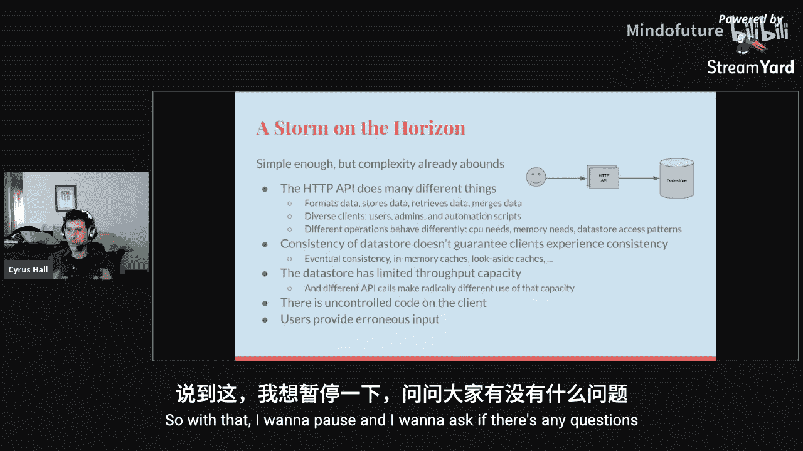

Great， so it looks like there was one。Yeah， it looks like there was one question already。

Sounds good what are failure modes sorry， I should have said at the beginning。

 you can absolutely ask questions at any time， I may just not see them until I pause and take a look。

What are failure modes？Okay， that's a great question I didn't really define that， did I。

So a failure mode is when a system exhibits some form of failure。So， for example。

 a system that's under high load could have a failure mode where some percentage of requests start to return errorsirs。

Or it could have a failure remote where it just collapses and explodes Ie the process exit runs out of memory。

 runs out of sockets， maybe on the system， so failure remote is a generic way of saying。

A system fails with some sort of behavior。So the thing that struck me。

 Cyrus as you were talking about heterogeneous distributed systems and introducing what that term means is that so。

'I'm somebody who works on verification and so often。

We find with verified software that you might verify individual components。

 but bugs still come up at the interfaces between components and so so much of the time。

Somebody will be working with this supposedly verified software and still finding that there are bugs at those interfaces and that problem is exacerbated the more of these individual components you have so of course that's the first thing that I thought of when when I saw your slide and I think there's a really great paper from Google called Paxosm Live which this also in me think of which is about their experience deploying Paxos as part of as part of the chubby lock service and you know Paxos is one thing but actually having it as a component as part of this larger system is quite another and so you know in this class we study Paxos right but then actually deploying it in this context and taking into account the complexity of the surrounding system。

Makes everything harder and I'm really excited that that is what you're talking with us about today。

Yeah， so I can actually give a quick example of that from from Twitch where。

We ended up deploying RAft in a bunch of our data centers at one point in order to store data center local information。

And we were very excited this information had previously been stored in a central database that was not replicated。

 was a single point of failure and had failed previously。

 and so the data was cached everywhere like the consistency or correctness of that caching was questionable and so now we were going to have definitive answers when we needed them as to what the appropriate configuration was。

And the system that was going to manage that information was going to be highly reliable via redundancy。

 so this was exciting。And what we found was one。Because we only had a single raft instance。

 and by instance， I mean a set of machines participating in the RAft protocol and multiple teams immediately wanted to use the service。

It was very difficult to control load on RAft， and so we started having too many people try to do consistent reads。

And then after get overloaded and get slow and you start getting errors out of it because like you get latency timeouts。

And the other thing we discovered is that。We still needed caching。

 it didn't actually solve the caching problem。Because。

Just because something is more reliable doesn't mean it's always there。

 and so you still need to be ready for failure。And a lot of our problems in deployment of that system ended up being in making sure the caching was correct。

 not in using basic raft。

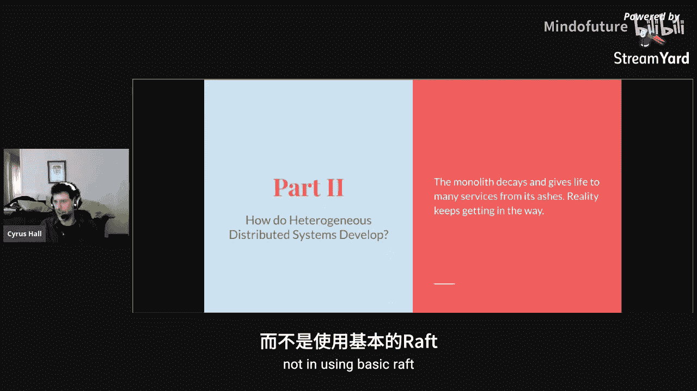

Yeah， absolutely。I'm going to check questions again really quick here。

Oh Zach already knows what we're actually talking about。

 we're actually talking about microservices versus the monolith， this is true。

So part two， how do these systems develop？And the subtitle here。

 and I'm going to explain the monolith just a second。

 the monolith decays and gives life to many services from its ashes。

 reality keeps getting in the way。So let's go back to your average web。I just made that up。

 it's not a quote， I don't know。😀は哈哈。😊，Thanks。😊，So back to your average web startup。

 just these these two services again， sorry， wrong word systems。😊。

This is classically called the monolith。And I don't totally know who originated this。

 but this is a term you're going to hear in industry。 Oh， we have a monolithic stack。

 What does that mean， It means all of their API calls are shoved into a single system。

That serves all sorts of different purposes。And probably talks to a single data store。

This is where most people start。But the reality is if we look inside that HTTP API。

 there's actually a bunch of different components， it's not just an HTTP API。

 it's a web front end API， it's probably an admin API。

 maybe there's a daily aggregation API that does long running aggregation tasks on the data store of some sort。

And these different APIs have different properties to them， The front end API， it's largely online。

 has very low latency requirements。 A user makes a request， a user needs to get information back。

Daily aggregation tasks， they're mostly actually offline， high latency is okay。

 they often take a lot of memory， so running the daily aggregation tasks actually blos the API in terms of memory utilization。

 it may have a really heavy load on the data back end。

And then the admin is usually an awkward mix of these sorts of things。So we can recursively。

Sort of apply what we did with their basic service and start breaking the HTP API into multiple services that better reflect the different modalities of use。

So here's one suggestion at a better design。We could have a front end API， an admin API。

 and an offline API all talking to the data store。Or throw a load balance in front of it。

 at this point， I'll talk briefly about load balancers。 Why do we have load balancers。

Each one of these APIs is really an instances of a process。Probably running on different machines。

 hopefully。And the client needs to have a consistent thing to address that consistent thing is the load balancer。

 and then the load balancer also often does failure detection。

 So if one of our instances in the API fleet goes down。

 the load balancer's role is to detect that usually just by some sort of ping mechanism and to take it out of rotations such that users don't get errorss。

Our users talk the load balancer。Can our offline scripts talk the load balancer。

So what problems do people see with this？And I'll give you a minute to brain dump and chat。

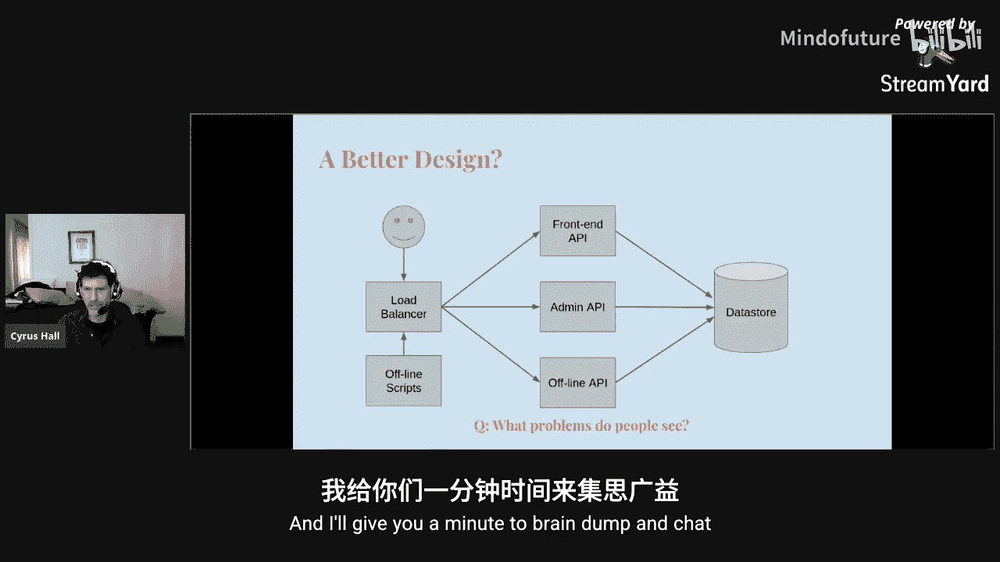

I have some thoughts， but first I want to see what other folks in the class might say。

 well there was a question actually about what are some examples of daily aggregation tasks？Yeah。

 so I can talk about that while people are thinking so a daily aggregation task is something that usually gets run for business operations so your business operations folks are going to want to know things like how many sales transactions did we have today。

 how many items were purchased， how many people came to the site。How long was their length of stay？

You know， these are important metrics for the business。

 They tell you if things are getting going well， are they going poorly， do we need to make changes。

And in small sites， these are often roll up metrics where there's a trace of transactions that are made。

 and then there's some sort of summary that goes through that trace。

 it sums it all up and makes some summary statistics。Yeah， so let's see。

 so we're getting some replies here。So Julian says single centralized data store and load balancer。

 yes， absolutely， Timothy says what if the load balancer is under too much load。Yeah。

 this is sort of a nice subclass， it's a failure mode of the centralized load balancer。诶。

Let's say the offline scripts are making a whole bunch of rapid fire requests all at once on the load balancer。

 they may deny requests from users。The opposite could be true as well。

 maybe there's a massive user spike suddenly and the offline system is airing。

Sah， if I could interrupt for one second， it looks like the slides are no longer showing up on the stream for some no okay oh now I see them on stream again。

 so suddenly it disappeared and but now it's now it's back Okay。

 let me go back into full screen again。

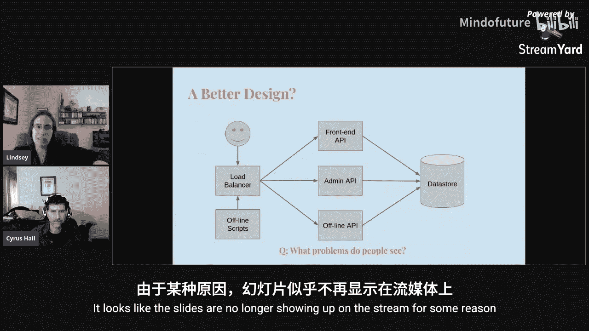

Oops not share。 I don't want to share。

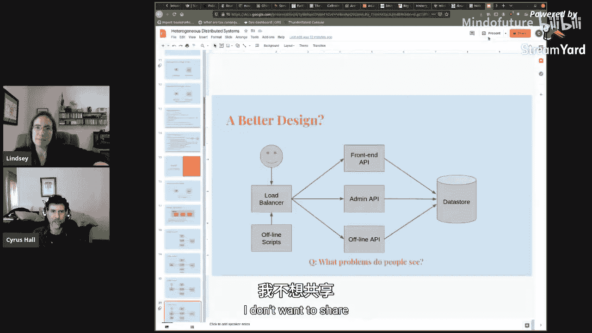

Are we good？It looks good now， okay。

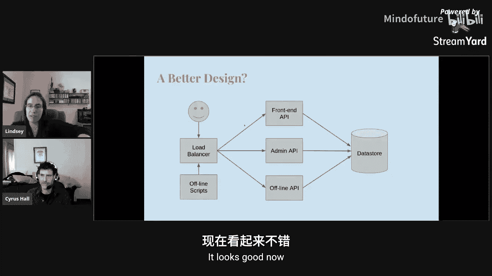

Weird。I don't know It happened there。嗯。it seems to have disappeared again Oh。

 it could be because I'm not in。

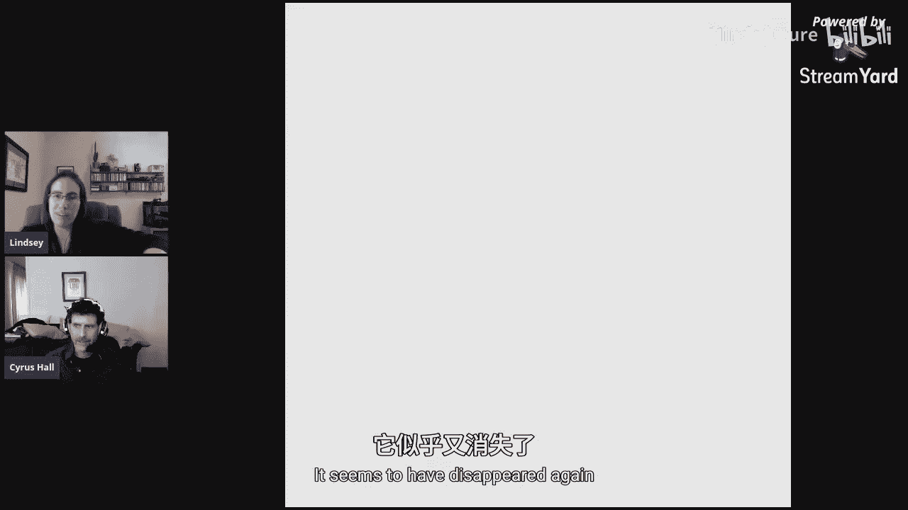

That virtual。Yeah， it's when I scroll away， I'm sorry， I'm in Linux and I'm trying to be cool for。

 you know， virtual desktops and stuff and it's not working so let me move。

Let me move Zullip up to the same screen， it might flash again for a second， but it should be back。

Okay。嗯。😊，So let's see here。 So someone had another one。 So Zach said what。

What if the API goes down and the load balancer has nowhere to route to？ThatThat's a good one。

 so what are the reasons we want to run multiple instances of each API on different machines？

Is to try to avoid the situation where we have no instances of a particular API that can still serve requests。

Of course， that can still happen。You know， if that happens， yeah， we're out of luck。

 we needed to be running more or maybe we weren't alerting and paying attention to errors that were coming up。

 that can definitely also be a problem。So yeah， let's go through。Let's go through these。

 Let's start in the back end。 So I think everyone probably saw that the data store is a single point of failure for all the APIs。

 So this is really bad。 we lose the data store， we lose all our API。

 So we don't actually have resiliency。Here。And we still have this issue of variable request patterns。

Where we're still applying very short la latency request from the front end。

 and the offline API could still be locking tables for long periods of time as it's running roll ups at the end of the day。

We're still vulnerable to spiky traffic patterns。If there's suddenly a viral event。

This happened at Twitch all the time。 There'd be a sudden， viral event that no one was expecting。

And rather than having， say，10000 people loan video in a minute。

 we'd have a million people load video in a minute。 That's a spiky traffic pattern。

 And so spiky traffic patterns。You know， it's not's going to just take down the front end API。

 it's going to take down the data store with it。I also want to note that resource management in this kind of system is distributed。

The front end API， the other APIs are each managing their request rate to the data store。

So if they're trying not to trample on each other， they're going to have to know about each other's requests or they're going to have to know about each other's patterns。

Well now we've got strong coupling again， we want to avoid that kind of hard coupling between services。

Maybe we could manage that in the API or sorry in the data store layer。And that can work。

 We could have a different user for each API， and then we could have a number of outstanding requests。

 but fundamentally， most data stores。Can't rate limit based on the complexity of the query。

 They can only rate limit based on the number of requests。 So a bad request that locks a table。

 for example， could still come in and do damage。 So that style of management tends to fail as the number of services grow。

In the front end。Most of you again， you saw that the load balancer a single point of failure。

But we also have the same sorts of load issues with the load balancer as well。

I also want to bring up briefly privacy and security concerns。

This is actually worth multiple lectures of time， and I'm not going to talk about it for the rest of the lecture。

 but I do just want to mention it really quickly。A lot of heterogeneous systems have caches all over the place。

 sometimes load balancers cash。But in general， one of the issues of heterogeneous systems is because data gets cached all over。

 trying to hedge against other systems failing。We're storing user data all over the place。

 and this brings up privacy and security concerns。Are there ways that a malicious actor can get at that data？

And it's best to separate these concerns。 So in this case， the load balancer。

 if it is caching things， could be caing the results of the offline scripts。

If those were to somehow become available publicly， that could be really bad for the business。

 It could show that the business isn't doing well。 It could expose private user data about what they purchased。

 could have all sorts of things in there that we don't want exposed。

 So this is one of these concerns。That while it exists in classical systems， privacy。

 I think is a much more upfront concern than heterogeneous systems。

So let's condense these concerns really what we're talking about here are availability and resiliency where availability is the percentage of a time that a system responds it's a very simple measurement often well。

Simple in theory， often this is called a number of nines， so you'll probably hear five nines is 99。

999% of a time。A system is available。Most companies are pretty happy if they're somewhere between three and four nines。

 honestly， and a lot of startups are happy if they're hitting 98% availability like isn't a bad place to be。

Typically， the more mature a product， the higher the desire for high availability becomes。

And then there's resilience， it sounds really similar and it is pretty close resilience is the ability of a system to remain available。

So a low resilient resilient system struggles， a high resilient system has a lot of mechanisms to remain available。

 and resiliency is the product of a lot of factors， but there are some key elements。

 One is how isolated from failure， can I make a system。

 Can I isolate my availability from my dependenciess failing。

Can I isolate myself from my requesters having issues， either sending me too much traffic？

Or having other failures。Redundancy and ease of scalability。

 a redundant system that has multiple instances or has backup copies is more likely to remain available。

 and it also tends to mean it's easier to scale。 If I'm suddenly seeing quick growth on a service。

 If I can't scale the service， I'm going to have availability issues。 If I can scale the service。

 I'm going to probably avoid the availability issues。And then load management。

 I'm going to talk about this more in the example section。

But being available may not mean a service is actually properly functioning， and this is important。

Measures of availability often are no more than did I get a 200 HP response。

 a success response effectively when I made a generic request， yes or no。

It doesn't mean that the data contained within that request was correct。😡，Maybe it return junk。

Maybe at 200 and then did return anything。This has concerning implications for failure detection。

It means that things like our load balancers that are using fairly simple mechanisms may not detect a failure。

This means failing hard。Can actually be important。Rather than failing soft， right。

 completely failing， Being completely inaccessible can be a better failure state。

 if you cannot ensure proper functioning under a partial failure than being in a partial failure state where you're returning bad data。

So let's go to a second iteration and we're getting close to a break。

 I know there's a 10 minute break coming up so we're almost there。

But let's quickly go through a second iteration of the basic website。

Where we've separated out the APIs， we've separated out our load balancers。

We've even replicated the data store。And now the offline API uses the replica rather than the main data store。

 so it should have less ability to impact us， although database replications a get weird。

 and that's not always true。And even better if the replica， if the main data store fails。

 we could even just move into a read only mode with the replica for a period of time until you can restore the primary data store。

So this seems better right， oh yeah or we could just use DymoDB and not worry about all this stuff。

 I recommend that， but most most startups don't do that。嗯。So this seems better。

And what we're seeing is a recursive service pattern。Where if we look at our web front end API。

 we're also going to find feature one and a bunch of different features there。

That we might also want to split out。For example。We have an API that's both hosting， say。

 a checkout API to purchase items and is also hosting a page render API。

One of those is more important than the other from a product perspective。

I want to make sure my website is up and rendering pages more than I actually care about the ability to check out。

Does't if I can't render pages， it doesn't matter if I can check out or not。嗯。so。

We naturally end up splitting individual features and products out as they grow in importance and as new features are added。

With maturity in companies， you eventually just start building new features as new services from the get go。

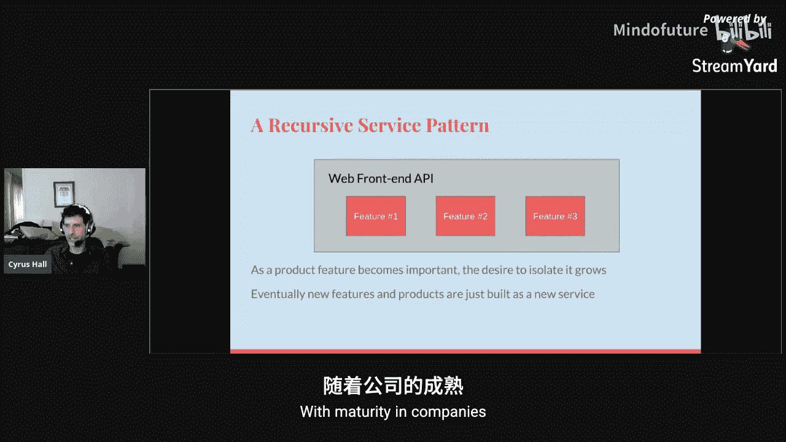

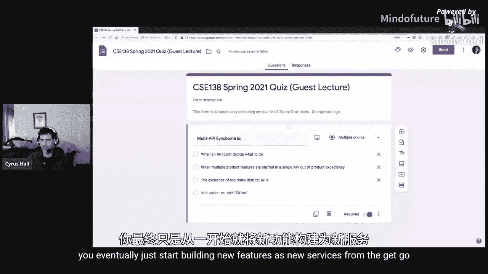

And really quick， I've been using。Service and system a bit。 and they both start with S。

 and they both sound really similar。 So I want to take a second。 and I want to just。Try to try to。

Separate them out here so a system is what we've been talking about is a distributed system it's a set of processes that implements a single technical function a service is a collection of systems distributed or not that implements a product function。

 so a chat service implements a chat feature and it consists of systems that implement proxies API。

 some sort of databu between chat nodes。Et cetera。So applying that to our second iteration。

 we really have three services here， we have a front end service。

 an admin service and an offline service， and those services consist of the load balancer。

 the API and whatever data stores we're using directly。So with that。It's breakak time。Quz time。

 I guess before we do that， let me check。The questions？There is Zullip。嗯。Oh no。

 were we having issues on Twitch as well。Only only minor issues with the。

Some of the slides we're not showing momentarily， but I think you got it sorted out。So yeah。

 let's go through some questions really quick and then we can do the quiz， Yeah， sounds good。

Why only 200 okay， shouldn't other 200 status codes also be acceptable？Absolutely。That being said。

 most。Failure detection， and I hope people don't laugh too much at this。

 but most failure detection that is actually performed。

Is as simple as calling a synthetic HP endpoint， often entitled something like Alive。Or okay。

That doesn't return any data and performs no operations and simply just echoes to under。That is。

I'm not going to call it the gold standard because it's not。

 but it is the normal behavior of most failure detection systems。

Ike says it might be useful to distinguish between hardware and software failures。I totally agree。U。

I wasn't going to dig into that to this talk， but there's。There's a lot of nuance。Yeah。😊。

There's a lot of nuance there。诶。😊，Hardware failures。 Well， there's all different types， right。

 I mean， that's part of why hardware failure is so hard to talk about。

 There's your easy hardware failure， which is your power supply dies and the machine turns off。

 That's an awesome sort of failure because it's， it's really definitive， right。

 It's like it's down and nothing responds。😊，But then you have really aknow hardware failures。

 like one of your memory dim dies。But Linux is awesome and it just keeps running mostly。

 except not entirely， and there's some really weird memory corruption errors。

Or your hard drive or SSD dies and you're actually or doesn't die die。

 but like partially dies and you start getting file system corruption and it's creeping and you don't really notice it for two months and it's your database machine。

Those kind of errors are really unfortunate， and it's why you create backups for things like data stores。

嗯。嗯。Yeah。Yeah， it's better to be resilient to failure than to try to special case failure。

 and that's a。Fine， that's like a really delicate line， and I guess a difficult statement to parse。嗯。

But be prepared to recover from failure rather than trying to manage it。 if that makes sense。

 So if you discover your database is corrupted， that's okay because you have a backup， that's recent。

Or you were using。嗯。嗯哼。😊，Yeah。Yeah， I completely agree。 I think a lot of the hardware。

 the slowly bubbling hardware failures。嗯。😊，Donong。Tend to become a concern of。Maybe they should。诶。

Of system well of distributed system engineers， they tend to be more of a concern of system operators and system engineers who are monitoring for failure as well as they can。

And who are advising distributed systems engineers。On。

How to make sure they are prepared for data corruption and other。Other sorts of phenomenon。

 So I think if you're prepared for data corruption。

Then where that data corruption comes from is a little less important， right， if it's coming from。

Software injecting bad data offers coming from ECC errors。Injecting bad data。But yeah。

 it's a difficult question， I think you have to talk specifics when it comes to hardware。嗯。

Are there common methods of soft failure detection regarding the actual data returned？

Not that I'm aware of。There could be， I'm not aware of him， I haven't seen them used in general。

There are statistical failure detection methods。That might look at very specific types of return values and check them against a known good distribution。

But that has limited applicability。And can be difficult to really set up correctly。

 So an example of that would be， let's say I want to monitor if an HP endpoint that renders a particular page is returning good data。

 I could monitor the length of the return data。So if I have a bunch of good returns and I look at that statistical distribution。

 I can then use that as a model for what good is and apply that to future returns。That works great。

 of course， unless the page changes and。Often， the binding between。

The people who are building the distributed system and the people who are designing the look and feel of the webpage and what components are on it。

 maybe they switch frameworks and it just like blowloat to the HTML or they really reduce it because they're working on latency。

嗯。Having that communication。Ahead of time and then like rebuilding that model so it doesn't alert and suddenly detect an error when there isn't one that gets really complex and hard That's a really good point。

 And yeah， I think your your point about how if you have a false positive that can get really tiresome really fast。

 especially if somebody is getting paged as a result of that and then you get into problems with。

Those pages being ignored right if they alert too often when there's not actually a problem so then you have a boy who cried wolf's situation So you so there's a there's a technical term for that slipping my mind right now I think it's called alert fatigue so。

And it's a real serious HCI issue in the design of these systems。

 so it's something that you have to watch out for。Yeah。

 having been on call for years and years and years to which I can attest that alert fatigue is very real。

啊。If he's on the line， let's hear it。Yeah， he still is alert fatigue。 I mean， Patrick。

We'll remember conversations we had on the team about which alerts turn off and I distinctly remember Patrick saying this is a useless alert it alerts too much。

 I hate it， I want this alert to die he didn't probably use that word but。

And I probably said something like yes， but occasionally it's right， which is the wrong response。

 right like that。I don't remember I just I。I just remember having these conversations with you and the rest of the team。

Right around。Some of our noisier alerts， so to give a clear example。

 the team that I managed that Patrick was on was responsible for all of our edge servers across the world。

 we managed all the HP servers， all the caching， all the intermediary caches，All the configuration。

And all the services that ran a sidecar through those HTP servers。

And we had likeness alerts that did the thing a little bit better than the generic response。

They got a random manifest for a stream on twitchw， and they tried to play it back。嗯。😊。

Sometimes streams just have weird difficulties where the inbound stream has errors and the transcoder struggles to transcode that stream into multiple renditions。

 or even to segment that stream into useful video segments。And when that happens。

 the transcoder had errors where it would output segment names that didn't actually exist。

And so then the playback check would alert saying， oh， I am failing to get data on this machine。

 alert alert theplication， something in replication is broken on this box。That's not useful。

 it's not actually a replication systems problem， it's actually the transcodeder's problem。

So building smart。Domain aware alert is really hard because you don't actually know the full domain it's not all your domain。

 you can't know everything at the point where you're doing the alert。Yeah， so Kyle asks。

 when in this process of scaling your architecture， do you care about software failure detection。

 correctness of a system under partial network failure？

Oh that's a really interesting question and I think it's very dependent on the heterogeneous system that you're talking about。

嗯。A lot of systems exist in。A single， say， cloud region。 So if you're on an AWS。

A lot of systems exist entirely within US West too。

Network partitions within that environment are significantly lower probability。

Then if you're running a heterogeneous system across multiple data centers。

Multiple geographic locations， I should say， because US West2 has multiple data centers。

 although you as a user don't really see that。嗯。In the case of Twitch。

Partial network failures were a big deal to us。We could easily end up in situations where we would lose a route to a particular DC。

 but only from a particular perspective in the network， so for example， we had an actual outage。

Last year， beginning of the year。Where services in US West too。Suddenly。

 we're unable to talk to a bare metal data center sitting out on the East Coast。

And so all of the liveness alerts went off， they said， oh， everything's dead， everything's down。

 a big alert， emergency， emergency， emergency。And yet the system seemed to be working。

Like streams where some streams were viewable， like components of the system seem to be up。

And it was a partial network partition effectively。嗯。The system was fairly resilient to it。

Not entirely out of luck， but partly because we had taken steps to avoid particular types of network failures。

 for example。Even though DNS isn't part of the network， a lot of。

Engineers think of it like it's part of the network， so we cache DNS results。系系系。U。You know。

Sutter when I say that because a lot of people say that's horrible， never ever do that。

 but it saved us so many times when DNS crashed， it's incredible。啊。

This turned out to be I have to remember this， this turned out to be a link failure。

That was misdiagnosed。Initially as a network partition。There actual US West2 could actually talk。

To the data center we thought was disconnected and I'm not remembering the specifics well enough。

 it was a very， I was actually an incident response manager for this。

And it was complex enough that no one caught it day of we actually recovered the situation without fully understanding。

The air took us a couple days to really understand what had happened。I think it involved。

A border router。Someone running code on the border router。So we're in optical states like。I mean。

 a Twitch just went all the way down to optics because we managed the optical network that the video we I mean。

 Twitch still run manages the optical network that the video runs on。

And that's really important for latency， it's really important for quality of service and having video play smoothly。

嗯。😊，But border routers are a whole beast of of themselves in that they're really not built for automation and the way automation happens is people right。

 expect scripts that log in and then do things are worse。

 they cut and paste scripts from text files into them。And yeah， that can lead to problems。All right。

 so let's， let's take the break and let's， let's do the quiz。 Yeah， that sounds good。

 So I'll put our quiz up。And let's take a 10 minute break。And yeah， so let's see now it it's 412。

 so let's return at 422。

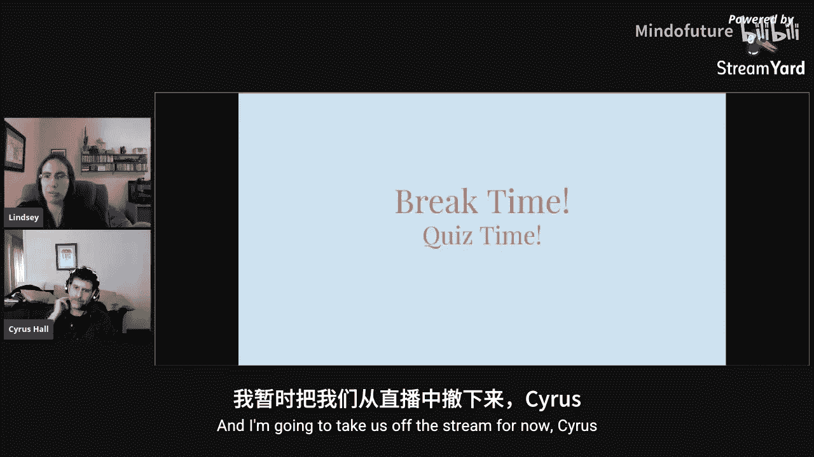

And I'm going to take us off the stream for now， Cyrus。

 but we can continue chit chatting on Zoom for 10 minutes and then resume on the stream after that。

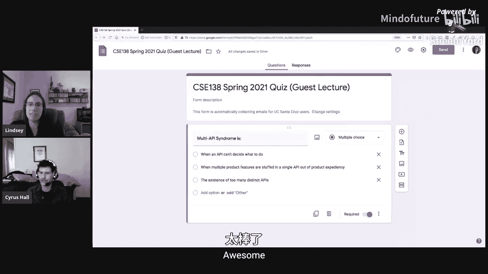

Sounds good。😊。

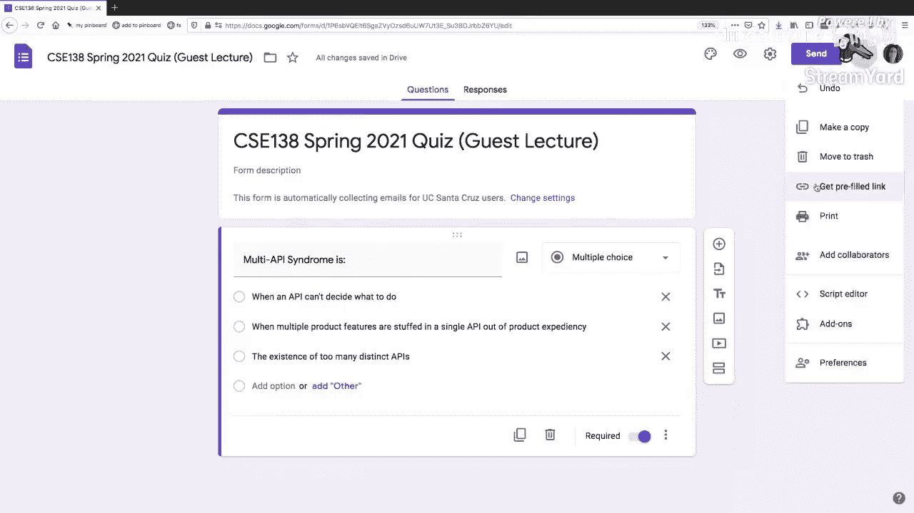

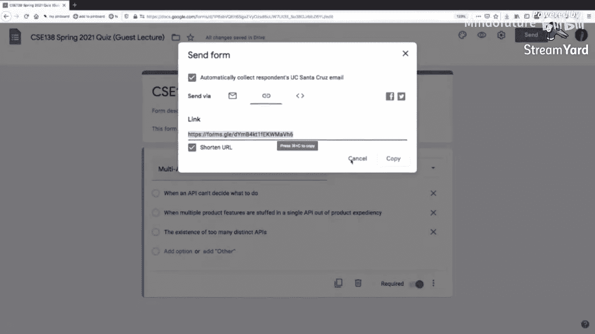

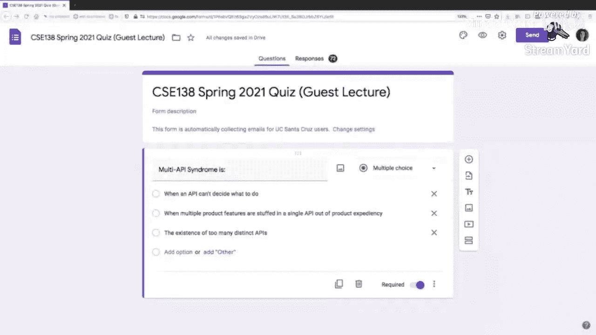

All right， welcome back。 I'm going to stop sharing this and Cyrus。

 you can bring back your presentation。 It should be back。

Yep， it's back， great perfect。And can we talk about quiz results really quick， Lindsay， absolutely。

 yeah， so let's see we got a hair over 70 responses to the quiz。Okay， yeah。 so so it looks。

 So the right answer here was the multiple product features are stuffed into one API， right？

 That is correct。 Yeah， so， so it looks like about， that's what about 60% of the responses said。

and then yeah， then like 35% said too many distinct APIs， but that， I mean。

 that's maybe kind of like half what you were talking about as well， I would say， true yeah。

 and then there was a small number of responses thought it was when an API can't decide what to do。

Which is the funny that is the director。Yeah， so four people said that it looks like。Yeah。

 so first of all I want to make clear this isn't a real term， this is a term I made up。

 I don't recommend using it。But in general， what I was describing was the fact that you have sort of these distinct subsets of APIs within a monolith that do very different things。

啊。But the second most popular response is interesting。

Because one of the problems with a what's often called a microservice architecture where every little individual business features its own service and of systems is that you do just get a heck of a lot of services and systems。

 and that can in itself be difficult to manage。So welcome back， everyone。

 I want to go back to iteration two。And I unfortunately need to tell you。

 this is not actually how iteration2 ever looks。 This is like set definitely not perfect。

 but this is way too clean for iteration2 on a site。

What actually happens is all this engineering is happening hopefully during a hypergrowth phase。

 because the companys doing really well。And you're having operational and downtime events。

Probably every day。They're not 50% of the site time。

 but they're 50% of engineerings time trying to figure out why they're happening and what to do about them。

And what to do about them is definitely not to fundamentally fix them because product changes are coming every day and sales are selling features that don't even exist yet。

 so you know they're out making million dollar contracts for a feature you need to implement in the next two months。

So the lowton voices that are sitting in the corner that are saying， you know， guys。

 we should really standardize all of this and stop doing a billion different things。

Are kindly told to shut up basically， not on those words， but like maybe sometimes on those words。

Most services are still adopting their own unique resiliency and failure strategies at this point。

And the other thing to just sort of have it as context。

 if engineers in this kind of environment burn out， they leave knowledge gaps develop。

Services that used to have owners don't have owners anymore。

 the new adopted owners don't really understand how they work。

 they may not understand the resiliency mechanisms， they may not understand the failure strategies。

So here's a more realistic second iteration。The offline API unfortunately took down the front end at some point。

 so it's been removed off the load balancer and now scripts just call the offline API directly。

The load balance are still used for both the front end and the admin API。

 the data store is slowing down so someone threw in a right back cache。

 this is typically something that looks like a nuc or Redis where results or partial results from the data store are stored in the cache。

And before making a request the data store， the front end API first checks if the right back cache has a previous result for the same query。

But， you know， the right back cash also is limited。

 So someone also threw in an in memoryory cache in the API。

 which is basically just a smaller version of the right back cache。

So what are the problems we've introduced here， and I'll pause again briefly and see if folks have spotted some interesting。

New problems we certainly still have the single points of failure in the load balancer and the data store。

 but we also know have new problems we didn't have before。Well。

 this caching here is looking a little bit suspicious。I agree。

Cashching is super sauce to use modern lingo。嗯。Your keyboard broke。

 so Alex says greater security risks with the offline scripts now being able to directly access the offline API。

Zach says caching sauce Caching is the imposter Oh boy yeah。

 I didn't mean to quite bring up that but。Yes， often caching is the imposter in that the data in the cache is actually no longer good。

And so you have。Okay， we have the SPs yes， there's the sort of failure thing。

 but we have consistency issues here， right like。Is the end memory cache consistent of the right back cash。

 What about the data store， What about the right back cash in the data store， Like， oh， my Lord。

 we have consistency issues all over the place。This isn't to say that caching is bad， it's not。

 it's an essential part of highly available systems。

 there's no way to get around using caches in highly available systems。

 however they're very difficult to get right and they almost always cause issues when they're first introduced due to consistency problems。

Yeah， I mean， as soon as you're doing caching， doing replication。

And then you have all of the bad things that come with replication。But you're doing it by hand。Right。

 so rather than taking， say， a database as the data store and having a bunch of replicas of it。

 say read replicas。And then differentiating whether you're using a read replica if you're doing something that's read or if you're going to the primary data store。

 if you're doing a write， all of which turns out to actually be quite complex to set up and manage in the real world。

And also typically requires a DBA， which I' note are in really short supply in the labor market。

since you don't have that DBA， people throw caches out the problem instead and throw engineers who may now they studying consistency or think of consistency and yeah。

 you end up with consistency problems。I'll double check here， what kind of cash is that？

So in general， the right back cash is going to be a。嗯。呃呃。A system of some sort。

 usually a mec or a Redis。It can be something like dynamo， although that's less common for a cache。

And so these are key value stores in general， they also can support， unfortunately。

 some non item potent operations and that can be a trap that people fall into。

The in memoryory cache is likely just a set of data structures within the web server。

That is shared between threads within a particular instance。

So that's the other thing to mention about the in memorymory cache is that different versions of the front end process are going to have incoherent in memorymory caches。

There isn't a in memoryory cache protocol synchronizing across the different processes here。

 they're each going to be based on the particular requests and timings of those requests that the front end API received。

There are situations in which this is perfectly okay。

 but then there's also a lot of situations in which this causes really interesting effects if a client makes multiple requests on a row and hits different front end API servers。

There's another possible issue that occurs to me here and I can't decide if this is worse in this picture or if it was worse in the first iteration so before we had the offline scripts talking to the load balancer and now we don't and at first this seems kind of simpler that they wouldn't talk to the load balancer but on the other hand。

If they're not talking to the load balancer， then the load balancer won't have the opportunity to stop the offline scripts from taking up too much traffic to the data store。

So those offline scripts， you know， if they're doing something that's not particularly essential and you have a lot of client requests to serve。

 then maybe you should you know turn them off right and you know you can always run that report tomorrow or whatever。

 but in this design there's not any it doesn't look as though there would necessarily be a way to handle that。

Yep， and it also pushes failure detection to the scripts。

Because now if one of the offline API machines dies。嗯。That that you know。

 that binding is at the level of the script itself。

 that that name like what name am I talking to rather than just talking to the load balancer。

 which is probably has a DNSC name in front of it。Just as a note to folks。

 the reason this is actually very close to what happened at Twitch with our monolith。

 this was basically iteration to what's on the screen right here。

And the reason that there wasn't a second load balancer， that load balancer cost $400，000。

 it was a piece of hardware， right no one had $400000 to buy a second piece of hardware just for some offline scripts so。

嗯。😊，So。Really， this is as much business as engineering。

These systems are in part the result of business decisions。And as engineers。

 it's important that we make our best estimates of risk and impact known to the business。

When they're asking us to modify or add things to a system。

But we have to also accept that there needs to be a healthy balance between the engineering concerns。

 the product concerns， and the business needs。This is okay。 It feels not okay。

 I think when you're a new engineer in this space， this feels like I'm not being allowed to do the right thing。

 can how it can feel。But it's not that the right thing isn't being done。

 it's not the right thing for the business is being done。

 and that isn't always the best thing from an engineering perspective。

So heterogeneous system engineering is partly about finding a sense of Zen about these conflicts of interest and the balance that exists between them。

 and I'll just say I'm still working on it， I think this is a lifelong process for anyone in this space。

But it's important。To not。Freak out the first time you experience this conflict。

 it's natural and it's healthy and it's okay。So where did this leaf twitchwitch？

When I joined in 2012， the video system was basically a monolith with five core systems running in a single data center。

And that monolith actually originated in 2009 if Iberg correctly。By 2020。

 it was a microservice architecture of over 120 services， but each one of those services。

Was multiple systems usually two to four systems that's going to be a load balancer at this point。

 software load balancing hardware stuff is horrible， don't use it an API。

 one or more data stores and possibly other components so realistically there were probably 300 systems。

Running， but many of them running in multiple regions。

With different configurations because they were replicated across multiple cloud regions and multiple bare metalal regions。

The original monolith finally died in April of this year。

 so it effectively survived 12 years that's an incredible amount of time。That's normal。

 monolith take a long time to die and they become so central to everything that unwinding the dependencies is just a huge process。

And adopting common patterns to things like failure detection， service frameworks， load balancing。

 deployment were key to success， but the reality is that it's not there yet。

 there's still a lack of standards and that still causes problems。

Adopting a cloud environment like AWS Azure can help。

The services that already exist within that environment， such as the load balancers。

Are built to work together。And they come with a particular philosophy and each cloud service has a different philosophy。

 but you're sort of forced to adopt that philosophy and that helps standardize at least even if you don't like the philosophy。

 at least you're doing the same thing over and over again， that helps makes things more predictable。

So part three。So my deals and a few rules of thumb。

And this is the motivational speaker part of the talk， so accept failure， don't try again。

Embrace air。If possible， be stateless。I think that's a pun on tasteless， but yeah。Of course， yes。

 yeah， and isolate， isolate， isolate。So。How one actually deals with。

I'll use the word chaos of heterogeneous systems， theres so many things to talk about。

 there's not enough time。But I want to cover。I want to cover things at a high level really quickly and then dig into one particular point of concern。

So first of all。Every system in service should ideally。 And I've said this a lot in this talk。

 address a single concern。 This is so important。 if a system or service gets built that addresses multiple concerns。

Inevitably it's going to end up with more dependencies， both inbound and outbound。

 and that means it's going to be all the harder to separate those concerns later。

 it means the failure modes are going to be all the more complex When you fail you're going to affect more things it's harder to have isolation between concerns。

And this really goes together with the second item。

 which is you want to be loosely coupled as much as possible。If you address many concerns。

 really hard to be loosely coupled。Be easy to maintain。 This is more than just code maintainability。

 This means have the semantics of the system be easy to test。

If I can't test the system still works the same today as it did yesterday。

 I don't know if other dependencies of the system are going to reject those changes or not。

 I don't know if they're going to be okay with them。 This means systems have to be easy to test。

 This is almost always missing。Be independently and repeatably deployable。

 I'll take two minutes on this one。What does it mean to be independently deployable？🤢。

It means as a system。I can deploy changes。Only to that system。

 I do not have any dependencies on deploying changes to other systems that I depend on。

This is really important to make deploys easy and the second thing repeatable， which we'll get to。

If I have to deploy to multiple systems to make a change to the one that I'm really targeting。

 I have much more complex rollout processes now。And deployment is one of those points in a systems's life cycle where failure tends to happen。

I deploy new code。That code doesn't work。 I deploy code to a different set of machines。

 and then I try switching over to it。 and they're not performing as well。 Maybe they have。

They take more time per request， right all sorts of things can happen here。

So if we can reduce the complexity， we reduce failure。And things should be repeat deployable。

 This means that if I deploy the same code。Each time I deploy it， the exact same thing should happen。

If I deploy the same code and I get a different result， and this， by the way。

 is quite common early in deploy systems because configuration and deploy are intricately linked together。

It can be very hard to know if after a deploy， I'm in a good state。

So there was a period of time at Twitch where our main monolith。

The standard operating procedure was to deploy twice。Because by deploying twice。

 you are more likely to get a good deploy the second time。

And this just because of the interaction between how。

Services were configured in the deployment system。Finally。

 have clear documentation of a system or services behavior and semantics that way when you move on either to a different system。

 to a different part of the company， to a new job entirely。

 to retire in the mountains surrounded by nature and birds， everyone who remains。

 has some idea of how this artifact actually works。

So let's zoom in on the second one here on loose coupling and talk about a couple rules of thumb。

Patrick knew this was going to be in here， I love this one。 retries are dangerous。

 try not to do them。 Why are retries dangerous？No， I want to just。Preface。

 this is within the context of heterogeneous systems。

 so we're not talking about a distributed system， you know a first order distributed system that has a very particular purpose we're talking about a heterogeneous collection of systems here。

So what happens the gray arrows are our request path here。

 so the APIO and the sorry I took out the load balancers， I just drew them as cues。

 basically a load balancer can be thought of as a queue of requests。If there's enough capacity。

 the queue might be empty， but if there's not enough capacity in the back end。

 requests start to back up in the queue。So the API makes a request to the load balancer。

And at that point， the API doesn't really know what happened。

 maybe the load balancer forwarded it hopefully。Maybe the data store responded， maybe it didn't。

 but what we do know is we get an error back。 so this red， dashed arrow。

 we're getting an error response。So the first thing a lot of engineers do is they retry and they get an error and they retry again。

So what's happening as we do this？We don't know。We could just be banging our head against the load balancer。

 which might be in a bad configuration， maybe it's overloaded， maybe the queue is full。

Or we could be putting more load on the data stored。

If the data store isn't responding because it's overloaded。

 putting more load on it is not going to resolve that problem。

If the data store is close to failure and we put more load on the data store。

 the data store will fail and now we're really in trouble， right？

So I think the first thing to understand if retries on a heterogeneous system。

Is from our vantage point， we don't actually know what those retries are going to do necessarily。

And if we're retrying after an error， they're likely going to make a bad situation worse。

Let's also talk about item potency for a second。So now。

 rather than just data store that that database looking thing now says MemCache。

 MemC is a particular key value store。And it conveniently has this operator called In and Inker does exactly what you would expect。

 it increments the value of a named variable within MeMCache。So in this case。

 let's say we have a variable x and it equals zero。

And then someone issues an API request and that request gets translated into a MCCache command。

 In x1， so this means increment the value of x by one， awesome。

We issue the command to the load balancer and we get an error。So what has happened？

Well we don't really know， but you know heck， let's， oh okay， for sake of argument。

 let's say what happened is that MeCash incremented the value。Return something to the load balancer。

 but something went wrong in that interface。 And we get an air back。Well let's retry Incar X1。

A in X 1， air。 So now we've incremented the value to 3。 We intended the value to be 1。

So like our conceptualization of what the value is supposed to be and what it actually is is completely inconsistent at this point。

We've put more load on MeCash， we haven't diagnosed the problem。

 and we certainly haven't done what the request the API was telling us to do。

Let's talk about Patrick's credit card example。 This is a example that Patrick pose to me about a month ago。

A system takes an order， a credit card number， and generates an order record。

The requesting client is the web frontend that's going to display the result to the user once the credit card is charged。

Upon trying the third party credit processor， the system receives an error message。 Should we retry。

Let's take a 30 second。诶。😊，Poll and chat。啊。Great question。Let's see。The question is。

 do I reveal Patrick's answer？I。Rather than bothering to try to do a Zoom poll。

 especially since a lot of people aren't on Zoom。Yeah， let's just see what folks say on Zullip。

So weve got a no， we' got a no Raphael。I'll give it 15 more seconds。 Well。

 you did just say that retries are evil。 I did。 This is true。Kyle says eh。😀。嗯。😊，Something， something。

 everything is a trade off， that's true。If it's base。So no， okay。

 so should we retry the actual answer is depends trick question。But probably no。 Yeah。

 probably no if。Unless the credit card processor。You know。

 has really convinced us that we will never receive an error and the charge the card was charged if they can't convince us of that。

 no， heck no， we should not retry， we really don't want to double charge with customer。

 we'd much rather， we just give them an error and say， hey， try again， right， didn't go through。嗯。😊。

Yeah。So。Next。Try to make stateless requests， and this is sort of what we just covered if the idle potency here。

 right？It's hard not to retry if a transaction is completed in multiple parts。

 we may have partially completed something we may be in a state that we don't want to just leave there or that would leave some sort of state crumbs。

Try not to do this， try not to make non item potent requests。So for the MeCash example。

 do store the new value， don't increment the value Now what does this imply。

 it implies we have to get the value first。So we have to do a get request。

 get the value incremented in the process and then do a store。This is more costly。

 but that cost is worth it from a semantics standpoint and a consistency standpoint。

If you need transactional semantics， if you can't avoid them。

 use a proven service that provides them for you， don't try to create them in your own services。

Proroppaate errors early。What does this mean？It means if I get an error rather than retrying。

 just return it。To the requester。 and， in fact。Return it all the way up the stack to the very original requester。

 Make the error their problem。 Why their problem， Well。

 the error lets us know the system is struggling， right， might be close to failure。

 could be something wrong。But the request may not even be important anymore。

 The user may have loaded the page。 They may not care about our particular service。

 The request might not be timely anymore。 Maybe if we answered it now， it just doesn't matter anyway。

 Let the original request or figure out if they care。 A lot of product managers don't like this。

 but it's something to have a long and multiple discussions of your product managers about。

And then finally， and I know I'm rushing because I know we're low on time。U。

earlyarly error return goes even better if active load control。

 And there's multiple versions of this。 I'm going to talk about one。

Where not only do we have a load balancer， but our local process instance also has a request queue。

 an outbound request queue， and as requests come in， this queue might start to fill up。

This is indicating that the data store is probably getting busy because requests are taking more time。

If a request comes in and that queue is full。Don't even try to process it。 Re an air immediately。

That feels bad because maybe if we cut it， we'd get to it。 Maybe it would all work。 Like。

 shouldn't we try。 What the problem of trying here is we're just adding more pressure。

 more load to the systems that we depend on。 We'd rather back off。Hopefully， let them recover。

 The queue starts to go down， and then we can put another request in。If most systems do this。

 it's unlikely the service is ever going to collapse。We might have some errors。

 there might be some page error loads， maybe some transactions don't complete。

But we're available generally to our users。Retriice can be a necessary evil， if you have to do them。

 use back off。However， understand that if you're doing back off。

 this implies a rapid buildup of request state in your system。That has memory implications。

 I've seen systems out of memory because they were using retries。 There's a major user rush。

Their back end goes down， they're retrying， they run out of memory。

I'm just going to skip that one because we're out of time， I believe。嗯。And go to the conclusion。

Complex business processes and life cycles lead to these really complex heterogeneous systems。

Holding back the business isn't the right trade off。Instead。

 we need to use tools like isolation and loose coupling and a lot of other techniques to help lower risk and impact when failure does occur and failure will occur。

 and that's okay。That's expected。If your business leaders are telling you don't make things better and then they get really upset when there's failure。

 that's a discussion that the VP of engineering and your CTO needs to have with the business leader。

So engineering is as much a social process as it is a heads down process and designing code。

And with that， thank you very much。There's my email。

 if you want to email me if you're interested in interns in this space， internships in this space。

 it's unfortunately too late for the summer， but in the future。

 feel free to email and I can certainly reach out and connect you with people within Twitch and AWS。

All right， Cyrus， thanks so much for this wonderful talk。

 It really brought together a lot of the ideas that we've been talking about all quarter in a sometimes much much more abstract context and it made them very concrete and visceral so thank you。

 Let me also point out that we have a lot of graduating students so some of them are going to be looking for not not just internships but full time positions so thank you very much for yeah。

 thank you for volunteering to talk to folks about that and I would urge all of you to take Cyrus up on the offer。

😊，Yeah， you have my email， I conveniently have a fair amount of time right now。

 so feel free to email me， you know whether it's about opportunities or if it's just if you have more questions about the lecture。

 be happy to talk。What was that slide that we skipped over？That was， oh， those are my backup slides。

R limiting， yeah， okay， Yeah， so this is a great one。Yeah。

 so every service or system has some sort of sustainable load peak， right？

If you think about a specific configuration of a system。

 you have X number of instances of the service running。

And you have a particular mixture of requests that are flowing into that service。

 those mixtures tend to be fairly standard。With those two pieces of information。

 you can calculate your peak sustainable load before you start to see service degradation。Awesome。

Do that。And then have a rate limiter that only allows X% of that peak sustainable load into production at any given time。

 you know， something like 95， 98% of that peak sustainable load。This is a way。

That doesn't involve the actual handling process， having to think about its state。

To easily make sure that a fleet of API servers is going to remain up during a load spike that would overwhelm peak sustainable load right you just let your rate limiter which is usually your load balancer deal with it for you and just shed that load early。

Shedding load is okay， right， those users will hit reload。

So what you're really doing is you're not getting rid of the load。

 you're smoothing it out at a sustainable maximum peak。Where if you tried to take that load。

 your performance would start to degrade very rapidly that that you know degradation becomes nonlinear almost immediately and then you collapse and now no one's on the website so you'd rather reject。

Cap off， smooth and stay available and rate limiting is a great way to do that。啊。Yeah。

 so these two techniques go together really well， I'd recommend both。

Because they sort of solve different problems。this， you know。

 active load control on your dependencies is really looking at， is your dependency healthy？

Greatate limiting for your service is really trying to make sure your service is healthy。

 so they're addressing two different things in my mind。

 they are related in that if you're taking on too much load。

 your dependency might be taking on too much load， but they're best in combination of each other。

All right， well， we're unfortunately out of time。 so in an effort to rate limit the flow of information into everyone's brains。

I think we're going to end the broadcast here， but thanks， and so I'll see you Thursday。

