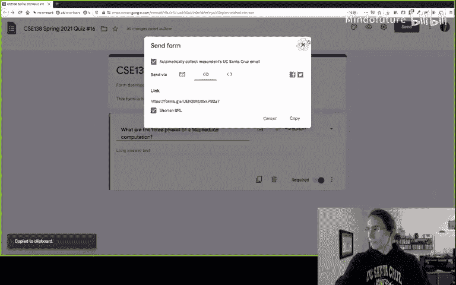

# 【加州大学】分布式系统-CSE138（Distributed-Systems）-p17-P17-L16---MapReduce--BV1eGdLYjETJ_p17-

All， it looks like we're live。End of week 9。Almost done。It's sad to think I only have。

A week left with you all。Right。So for today。I asked you to read the map Red paper and we're going to be devoting all of today and some of next time to be talking about map reduce。

 I actually allocated two dates for this in our schedule。Because there's a lot to say。

 but we might end up using some of next Tuesday to talk about something else we'll see。

In the meantime， though。Let's get started with today。So on the schedule today。

We're going to be talking about。唔。Online versus offline systems。And。Raw and derived data。

And then we're going to get into talking about mapR。And a lot of this will be an extended example。

Where we're going to talk about computing an inverted index。From what's called a forward index。Okay。

 so before we jump into talking about map Red， let's set the stage a little bit by talking about this about what map Red is exactly。

So up until now。We've been talking a whole lot about systems to which you make requests。

And you receive responses。The key value store that you've been implementing works that way。

Dynamo works that way， web servers work that way。Databases work that way。

Cashching layers sitting in front of databases work that way。

 So all those different kinds of systems， you can lump them together under the term。Online systems。

Also known as。Services。So examples include things， like we said， key value stores。嗯。Web servers。

Databases。Cashs。E cea。So the characteristic that these systems share。

Is that they wait for requests to arrive from clients？And then try to handle them quickly。

So low latency is really important in these kinds of systems。 Remember what low latency is。

 So low latency is time between。When you make a request and when you get a response。

 so that's really important。Availability。Every request receives a response， usually also important。

So low latency and availability are often prioritized。Maybe not always。

 like it depends on the design of the system， but that's typical for these kinds of systems。

 so Dynamo， which was the last paper we read is a classic example of something that falls into this category。

Reading the map Reduce paper after reading the Dynamo paper。Might have。

Been a bit of a radical shift for some of you because mapre does not fall into this category。

This is not the only way of building systems。There are also systems that take in a huge amount of data。

 do something to process it。And then produce output data， and this might take quite a while。

It might take a few minutes， it might take a few hours， it might take a few days even。

So this would be a different category of systems and we call these。O flying systems。

Or batch processing systems。In mapRuce。Is a classic example。Of one of these systems。

So the main concern with these kinds of systems is not having low latency。

The main concern with these kinds of systems is having high throughput。

So the goal here is to process lots of data。And high throughput is the priority。

So the more data that you can process at a time， the faster that you can crunch through a huge input data set。

 which is the goal with these systems。So MaRduce falls into this category。

 so MapRduce this is classic work from Google from 2004 and although Google obviously runs a lot of online systems too。

Under the hood。The data that those systems are serving up。

 which could be things like search results or videos or so on。

It was most likely the result of some very large scale。

Offline data processing job done by an offline system。

Which would at Google probably either be mappRuce or one of MapRduce's successors。So。

This might feel a little bit weird， right to be talking about this after we've spent almost the whole quarter talking about online systems and responding to requests quickly。

 but these are a very important class of systems。So MaRuce is now over 15 years old。

 it's not the shiny new technology that it once was。

 but it's still worth studying and understanding because it helps us see why and how。

This kind of large scale batch processing of data is important and useful。

 so we're going to spend some time talking about it。By the way， you might ask。Well。

 do all systems we care about fall into one of these two categories of online systems or offline systems？

As so often， there's。But such a thing is a hybrid between the two。And this is a fairly new area。

 and we don't necessarily have great terminology for it。

 but some people are converging on using the term streaming systems。

To talk about a class of system that kind of is somewhere in between online and offline systems。

In the sense that。It has to process a lot of data。But。

It also wants to be able to respond quickly to changes。So with something like mapRuce。

 you get a whole bunch of data all at once and then you process it with a streaming system。

You might be getting a whole lot of data， but you might be getting it over time。

 and you might want to incrementally process the data as you get it without having to redo all the work when you get one new piece of data。

So this space of streaming systems is fairly new and has been emerging over the last eight or 10 years。

We aren't going to be spending a whole lot of time talking about streaming systems。

 but if you're interested in this。There's a great blog post written by Jamie Brandon。

 which I would suggest you look up。Wwhich sort of tries to sketch out the space of streaming systems。

 which I think if you just Google for streaming systems， Jamie Brandon。

 then you might find it and I'll try to find a link and paste it later。

 and he kind of tries to sketch out an overview of the space of streaming systems。

But you can think of this as sort of a hybrid of online and offline。That said， today。

 we're going to be talking about MaRuce， a classic offline system。Okay， so。To set the stage for。

Why you want something like reproducepreduce？We can kind of turn back a little bit to what we were talking about last time when we were discussing sharding。

So。When we talked about sharding last time， we were only talking about the notion of splitting up a data set that consisted of something like key value pairs right like Dynamo does so last time。

We talked about， you know maybe you want to have some different shards and maybe this shard over here has these key value pairs and this one over here has these key value pairs。

But。We didn't talk about anything more sophisticated than just this data model that consists of a whole bunch of key value pairs。

So it was a very simple data model。That's what a database person would say the data model here was very simple。

But。What if you had some more sophisticated data model， let's say you had， for instance。

 something like a relational database that had a whole bunch of different tables。If you had that。

 then the question of how to shard the data becomes a lot more subtle， right。

 what data do you store next to what data？And that gets really complicated as soon as the data model gets more sophisticated with this。

The question of sharding is still you know interesting。

 but you don't have to worry about things like you know does this key value pair depend on this other key value pair。

 does this one depend on this one and if I update this one。

 does this one on the other shard also have to be updated。

 you don't have to worry about any of that stuff if it's just this very simple data model of key value pairs as soon as you have a more sophisticated data model you have to worry about stuff like how does shard data in a way that will make your queries efficient。

So let's take something like Facebook as an example。Users accessing the site。

Might have very different access patterns than let's say。

 somebody who's a data scientist at Facebook， who's trying to analyze how people use Facebook。

 So if you're a user accessing the site， you might want to see something like。For example。

The updates of everybody who you're friends with， right， you want to see all of your friends updates。

The data scientist might be making a totally different kind of query， right。

 like they might want to see， oh， I want to see all of the updates of everybody who's in a certain age range right and who's interested in such and such a topic。

 right？So。Those are different kinds of queries that have a different kind of shape， right？

And that shouldn。Kind of make you wonder， how should the data be sharded in such a way that it's going to be most efficient for those different kinds of queries to be supported？

For the typical user using the site， they're going to kind of want the data to be sliced and diiced one way。

 and for the data scientist who's doing this kind of entirely different kind of query。

 they're going to want the data to be sliced and diiced a different way， differently organized。

 the same data but organized in a different way， Why is it organized in a different way because the queries that they're making are shaped really differently so。

Ultimately， the way that this works is。They'll want to optimize for the regular user of the site。

 right they want those users to be able to access the site quickly。So。

 but instead of having the data scientists always be sad。

 right because their queries are always slow。What they might do is have a redundant but differently organized copy of the data for the data scientists to work with。

so。Same underlying data， different representation。In the mapRuce paper they have names for these different representations of data。

 does anybody remember what they are？So if you want， go back and look at the paper。

 this comes up fairly early in the paper。Like kind of write in the introduction。

Intermediate key value pairs， okay， so this is something that's part of carrying out a map reduced job。

 but my question is more like。What are the names for these different representations of data that we're talking about like for example？

In the Facebook example， there's the way that the data organized that might be organized for users to see like the actual flow of posts as they're happening and then the kind of queries that the data scientist might like to do。

 which are more like getting aggregate information so in the map produced paper right in the first paragraph of the paper they call these raw data。

And derived data。So raw data is like the authoritative version。In some sense。New data comes in。

And it goes into some form of raw data storage。Deerived data is the result of taking some existing data。

And processing it somehow。So either taking raw data and processing it or taking some other derived data and processing it。

 so you can have raw data。So there's input。Which becomes raw data。Which can become derived data。

And then derived data could also become derived data。

So the easiest way that I can think of to describe mapRuce is to say mapRuce is a tool for computing derived data。

Does anybody remember what the first example it is that they give in the map reduced paper of derived to data？

Yeah， that's right， inverted intodices， so yeah， like in sentence one of the paper they talk about an inverted index。

 so I think this term is a little confusing， so let's go over it。Okay， so obviously if you're Google。

 you care a lot about search。A search engine is trying to index everything on the web， right。

 or as much of it as it can get to。So you have a web crawler that goes out and gets a bunch of documents。

And so。You end up with a list of documents。And let's say a list of words that are in each document。

 so maybe it's something like this。Maybe document2 is。Et cetera。

So this is what is sometimes called a forward index。

So this might be the data structure that gets built。As。You crawl the web。This is good for。

Putting data into quickly right as you're going around and crawling the web。

And trying to collect data that you're going to use for your search engine， right？

But is this data format good for things like doing queries。

 like let's say I want you to give me all the documents that have the word dog in them？

Is this kind of a format good for that kind of a query？No， that would be really。

 really slow if this were how your data were organized。So you don't organize it this way。

 or at least you don't only organize it this way， instead， you build what's called an inverted index。

So in the inverted index。It's an inversion of the forward index。

 so instead of having a list of documents and then for every document。

 a list of words that are in that document， instead the inverted index is a list of words。

And then for every word， the list of documents that it's in。

So we might have the and it's in document one and document two。And so on。

So now we have a data structure that supports fast looking up by word。

There's no more information in this inverted index than there was in the forward index before。

It's just that so we could have done those kinds of lookups in this one。

 it's just that it would have been really slow。This organization of the data is better for a query that lets you look things up by what words are in the document。

And that's all in inverted indexes。Okay。So。How would you write a program to turn the forward index into the inverted index。

 and this is not a distributed systems question yet so。Forget replication， For partitioning。

 forgetge fault tolerance， all that stuff we spent8 weeks on。 Forget it。

 How would you write an algorithm to turn。The forward index into the inverted index。

What do you think？Okay， so the suggestion in chat is create a hash table whose keys are words and values and are an array of document IDs okay yeah that's what this is I mean I don't know if it has to be a hash table。

 it's a table for sure it's a dictionary of some kind and yeah the keys are words and the values are document IDs but how would you do it。

 what would be the algorithm for doing it if I handed you this forward index？Well， okay。

 so here's one thing we could do。We could take the forward index。

We could loop over all the documents so we could say something like for each。Document。D。

And then for every document， there's all these words， right， so then you have to loop over the words。

For each word。We're going to say emitm this pair。Of the word。And the document。

So this could be one phase of the computation right， So from this。

 you would get a bunch of pairs that might look like。🤢，Is part of Doc one。Quick。Is part of Dock one。

And so on， and then you might get the。Is part of Doc2， Do is part of Doc2。And so on。

So this is what you'd get as output from。This first step up here。And then what do you do with that？

Reduce it， yeah， so how do you reduce it？If this is what we have， but this is what we want。Well。

 we really want these。Pairers that have the same word to be combined， right， we really want。呃。

Only one pair for every unique word， right， So we really want something more like。

And then we want a list here of Dock1。And Doc2。And then that's。The first row of our inverted index。

So we want this， and then we want another step where we're going to combine the documents in a list。

For every unique word。So to summarize。If you're starting with the forward index。

 then we're going to loop over all the documents in the forward index， that's this first line here。

And then。For each document， you're going to loop every word in it。

And you're going to admit this pair。Of the word and the document ID。So we've now got a list。

Of key value pairs， essentially with some repeated keys， right？And so now all there is to do。

Is to make it so all the keys are unique and squash down their values to a list of values。

And then we have this inverted index。So I think this name inverted index is sometimes a little bit confusing because it's really just an index like you would see in the back of a book。

 It's a list of words。And for every word， there's a list of places where that word occurs。

 so in the back of a book it might be page numbers or something like that。

But it's very much like what we would be used to seeing for the index in the back of a book。

 and we normally don't call that an inverted index right， we normally just call it an index。

But people who make search engines call it an inverted index because for them。

 it's an inversion of the forwardword index， which is the data that gets collected from the web crawl。

Okay。So would you say that this process of creating the inverted index from the forward index。

 would you say that this is particularly complicated conceptually when you leave aside all that stuff that I said to leave out replication and fault tolerance and partitioning and even concerns of efficiency。

 if you leave all that stuff out，Would you say that the algorithm for creating this inverted index is particularly conceptually complicated？

Not really， right， yeah。I wouldn't。It's pretty straightforward。

 I'm sure any of you could write the code to do it with no sweat。So why am I even talking about this。

 why is this even a topic of discussion in a distributed systems class， what do you think？Right。

 if you have a really， really， really large data set， if you're trying to do this at large scale。

 this becomes a distributed systems problem， all of a sudden。

You have to think about things like fault tolerance。

 you have to think about things like partitioning， you have to think about the stuff that this course is about as soon as you try to do this stuff at large scale。

So the insight of map Reduce was that the authors as well as a whole lot of other people。

They observed that a lot of the computations that they wanted to do were very conceptually simple。

 like this。So。It's the kind of code that somebody could write very straightforwardly。

 but because they had to do it on huge amounts of data。In a distributed fashion。

 the simplicity of the computations that they wanted to do was obscured by all of the code that had to handle all of the distributed system stuff。

 so they thought。Wouldn't it be nice if there was a framework that would allow people to write these conceptually simple algorithms like this and then plug them into a system that hides all of that distributed system stuff and takes care of it all automatically for them。

 and that's exactly what map Red is。So MaRduce is a framework that lets you plug in the code for the conceptually simple computation that you want to do。

Which hopefully won't be very much code， right？And then we'll take care of distributing that computation over a whole bunch of machines for you。

So let's say that our forward index is really， really big， right， too big to fit on one machine。

 so maybe some of the rows of this forward index are on one machine。And some are on another machine。

 and some are on a third machine and so on。And let's also suppose that this finished inverted index is also too big to fit on one machine。

 and that's normal for a map reduced computation， that's par for the course for a map reduced computation。

So what do you do， let's say that you're a machine and you have only one part。Of the forward index。

 let's say that you just have this one row。On your machine。That would be kind of an extreme case。

 but let's say that this one document is really， really， really。

 really enormous just for the sake of discussion， so let's say that you just have this one row of the forward index and your machine and you're tasked with running your part of this algorithm。

What do you do， how do you proceed？Okay， the suggestion in chat is partition each word to an individual worker thread。

嗯。Okay， I think you're on the right track， although that might be a little bit overkill， right。

 If you're a machine and you're one machine， you have one document to process。

 I guess the question I'm asking is。What part of this code do you run that I wrote down here？

If we look at the inner part of this loop， right， this right here。That doesn't change for you， right？

You've got a document。And now for every word in that document， you can emit one of these pairs。

 right？So you can just go ahead and compute。Your。Word document pairs for the part of the input that you're responsible for。

 whether it's one document or maybe a handful of documents or whatever。

You can compute that for whichever documents that you have。Your neighbors。

 the other machines can compute theirs for whatever part of the input that they have。

So in other words。The outer loop here。Could be done in parallel。For all the documents。

Is there any dependency between the different iterations of this loop？Like。

 do we care about what order they run in， the different iterations of this for each document loop here？

Let's say I'm another machine who's responsible for this document。

There what the first machine is doing with let's say this is on machine  one and this one is on machine  two。

Does machineine two care at all about what machine  one is doing， does it affect my job at all？Yeah。

 it shouldn't right， Every document is independent， that's right， there's no dependency。

 they're completely independent。So。This。Inner loop here can be carried out。

By these different machines for the documents that they're responsible for。

 totally independently of the other machines。So。These are totally independent。

And this is really nice。We call computations like this embarrassingly parallel。

 that is it's so easy to split up the computation into independent parallel tasks that it would be embarrassing not to do it。

😊，There are a lot of things in the world that are truly hard to parallelize。

 but this is not one of them。So let's sketch that out， let's imagine。

That every row of this forward index， that is every document is on its own machine。

So we've got something like this。Here's M1。And here's them too。Here's M3。

And we'll just start with three for the sake of discussion。So M1 has。Document1。And it's got。诶。Quick。

Brown。Fox。Et cea。And machine two has something like。Another document。Something like that。

And then maybe machinech  three has another document。And so on okay。

So in this embarrassingly parallel computation。Every machine。Is going to do the same。

 it's going to run the same function。On its piece of the input， on its piece of the forward index。

And it's going to do that computation and then write the results。To its own local memory。Importantly。

 no communication between machines is necessary to do this。So。

Machine one will end up with something like。Paired with dock1。Quick， paired with doc1。Brown。Again。

 paired with do one and so on。Machine two will get。Something like this。Machine 3 will have。

Something like this。The results of this computation。On each one of these machines。

Are called intermediate key value pairs。That's what those are。So notice that。

When this machine computes this？It's just doing a local right to its own memory。

So this isn't a message being sent to some other machine or anything like that。

 it's distortoring the results of computing these intermediate key value pairs in its own memory。

And it's important to point out that M1 and M2 and M3 didn't have to communicate with each other at all to be able to do that。

Okay。So we're part of the way toward computing our inverted index。

To finish creating the inverted index， now what do we have to do with the intermediate key value pairs？

Right， okay， you have to reduce， but what does that mean specifically in the context of this computation？

Yeah， you have to combine the pairs in a particular way。You have to group it in a certain way。

 that's right。So you want to look at these keys， right？

And what you want to end up with is something where。

All of the documents that in which the word the occurs are grouped together。

 right and all of the documents in which Quick occurs are grouped together and so on。

 that's what you want your inverted index to look like。But how are we going to do that， right？

Our data is spread out among a bunch of different machines。

So let's say that we have two machines for this next phase of the computation。

And I'll call them R1 and R2。What is going to be a good way？

To put all this intermediate data onto these two machines。As a hint。

We talked about it a little bit last time when we were talking about sharding。嗯。Hashing， yeah so。

One way to get。All of these intermediate key value pairs onto these two machines。Is hashing the keys。

And then doing modD2 of the hash， right， because we have two machines we have to split the data up onto。

So in general， if you have some number of machines here， like R machines。

 then you can take the hash of the keys mod R。 Why do we do that， Well， the happy outcome of hashing。

By key， and then going mod R is that then you're going to end up with everything with the same key on the same machine。

So in this case， we would end up with something like。Doc 1。That's this one here。the。Doc 2。

 that's this one。Maybe this one is also responsible for the key dog。So dog was here。And Do was here。

These other ones just occurred once， let's say that these all ended up on this machine。Oh。

 I forgot by。By the way， if you were doing this for real， you might ignore words like the。

Because you wouldn't necessarily care about those depending on the application or something like search you probably wouldn't care about the。

 you wouldn't care about what are called stop wordss but。Leaving aside things like that。

You would end up with this outcome where everything that had the same key。

Ended up on the same machine if your approach of sorting these intermediate key value pairs onto these two machines for the second phase of the computation。

If you were taking the hash of the key。And then doing modd2， in this case。

 you'd end up with everything with the same key on the same machine。

And that is exactly what you want， right？Because for the next phase of the computation。

 all you have to do。Is put together the ones that have the same key。 So in this case。

You want to combine the pairs that have the same key， so this would turn into。呃。

Maybe I need a different color。This would turn into。Would get paired with doc1 and doc2。And dog。

Would be paired with Doc2。And doc 3。So R1 and R2 have a pretty easy job。

 they just have to combine the pairs that have the same key。Interestingly。

A lot of the work of the computation got done。Bye。The sorting of the data onto R1 and R2。

So how did that data get there， how did the data get onto R1 and R2？

They had to read it from the local disks of these M1M2 M3 machines， right？

And this is a little bit difficult because。Like， for example。

Which machines does R one have to read from， which of these machines is our one going to have to read from？

All of them， that's right right， it's going to have to read from all of them。And likewise。

 R2 is going to have to read from all of them。 In this case。

 it didn't happen to have any in this drawing， I didn't have any from machine2， but in general。

Every one of these machines is going to have to read from everyone。

Of the machines computing the key value pairs。 So you have a communication pattern that looks like this。

So fortunately， once the data is actually on R1 and R2。

 then they can do their computation independently of each other right so M1 and M2 and M3 all computed independently of each other to begin with。

And then once the data is on R1 and R2， then they can do their work independently of each other。

 but in the middle， you had this big transfer of data。So this phase right here。Is known as a shuffle。

So I'm going to call this a communication pattern。And I use the word communication pattern rather than computation pattern。

Because in some sense， no actual computation takes place here。

 it's just a matter of moving data around， right？But。

This ends up accounting for a huge chunk of the time that it takes to do these kinds of computations。

 so shuffling is expensive， it requires sending a whole lot of data over the network。

And it's done for the sole purpose of getting that data into the right place in order to do the next phase of computation on it。

So the good news here is that you can sometimes play tricks to try to avoid having to shuffle so much data。

Which we can talk about later。But。In the meantime， let's see if we're done computing our inverted index。

Okay， so are we done basically。R1 and R2 did their work。

I kind of left out the part that R two did here because these ones。

 we didn't have any words here where they they appeared in the same document。

 but you can imagine this sort of，Doing a rather boring sort of。

The massaging of the data to getting it in the right format。Okay。

Are we done computing our inverted index， well， basically。

All that's left to do is for R1 and R2 to write their output somewhere。And in MapRduce。

 what they do is they write it to a distributed file system。So the output。

Of this whole process gets rid to a distributed file system。

Which in the mapreuce paper is called GFS。So GFS is Google's distributed file system or it's the distributed file system that Google used to use。

It stands for Google file System。The name is very creative。And that's it， congratulations。

 you now know mapRuce， so we just walked through a typical map Red computation。

The part of the computation that takes place over here on the machines M1M2 and3。

This is called the map phase。Moving the data。From those machines to these machines。

Is the shuffle phase？And then the part of the computation that took place。

On the R machines here is known as the reduced phase。

So the particular example that we looked at here was creating an inverted index。

But it turns out that this particular pattern of map phase， shuffle phase reduced phase。

Is common to a lot of computations。So the only part of this。

Pattern that was specific to this particular task at hand。Was a couple of little pieces of code。

There was the piece of code that ran on the map workers。

That computed these intermediate key value pairs from the raw data。

And there was the little piece of code that ran on the reduced workers that computed the output from the intermediate Q value pairs that appeared on each reduced worker。

Everything else here。Is not specific to that particular task， so in the map Red framework。

 you have to write these two little pieces of code。Which are known as the map function？

Which runs on each of these machines。And the reduced function， which runs on each of these machines。

You have to write those two pieces of code。And then the rest will be handled for you by the framework。

 it will split up your input onto the map workers， which are what these machines are known as for the map phase。

It'll put your code on those machines so that the code can run on the data。

It will handle the shuffling for you so that the correct intermediate key value pairs get put onto these machines。

 which are known as the reduced workers。And it will make sure that the output of the reduced workers ends up。

On the distributed file system， such as GFS。And by the way， everything on GFS gets replicated。

 so you end up。Actually using twice as much output storage as the output that your computation produces。

 if you're replicating everything， if your replication factor is two。Okay， question and chat。

 does GFS allow for concurrent rights or do the workers take turns writing to the distributed file system。

 I can only imagine that GFS allows for massively concurrent rights。Especially because。

These reduced workers could be writing to distinct files in the file system。

So the output of the entire map reduced job doesn't have to be a single file。

So that's the essence of map reduce in one picture。MaapRduce has a popular open source clone。

 by the way， does anybody know what that's called？Haadoop， that's right。Yeah。😊，And of course。

MapRuce depends on the existence of GFS。So Hadoop has its own clone of that too， so it's called HDFS。

 which stands for Hadoop Distried file System。Okay。So the idea with MaPRuce is that you。

 the programmer， have to specify these two little pieces of code， the map function。

 and the reduce function。In our picture over here。The map function is represented by this that I have boxed in red here。

So this is the map function。And then this part here where I said。

 combineine the documents in a list for each unique word， that represents the reduce function。

So with mapre， you have to specify those two things。

And you have to say something about where the map Red framework will find the input data。

So typically， the input data is going to be stored somewhere on GFS to begin with， or HDFS。

 maybe if you're using Hadoop。And then the mapRuce framework does the rest。

And it turns out that a whole lot of common data processing tasks can fit into this particular programming model。

So the paper gives a bunch of examples。Of that。 so it talks about。

In addition to this example that we just looked at。嗯。So we talked about computing an inverted index。

The paper talks about GrP。In other words。Search for searching for documents that match a particular regular expression。

Distributed sorting。A distributed word count。And more。

So these are all computations that can be expressed in the Mareuce programming model you can think of the job of the Mareduce framework as factoring out all the code that's common to doing all these things in a massive distributed setting and making it so that you don't have to manually write that code so the only code that you have to provide is the map function and the reduced function that are particular for doing one of these tasks and maybe you know some tuning parameters。

 saying things like how many machines to use and perhaps a little bit of code saying where to find the input and where to store the output。

And then the framework will handle the rest for you。Questions about any of this so far。All right。

Well， I think it's about time to take our break。So I'll put up our quiz question。

All right。

So take a break， rest your eyes。And I'll see you at 431。哦。嗯。Yeah。嗯。嗯。

I'm going to resume in about two minutes。All right， welcome back。

So let's do another example。Let's look at word count because that's the one that。

Is discussed in the paper， so let's draw another diagram。

Let's see if we can see what the word count example would look like。

So let's say one more time that we have three map workers。And once again。

 let's say that we have a whole bunch of documents。That are split up among all of these map workers。

So remember again that the whole point of using something like MaRduce is when you have way more data。

Then we'll fit on a single machine。There's really no way to avoid having your data split among all these different machines。

 but as we'll see。They can each do their computation independently， so it's not a problem。

 so you've got a bunch of documents， we could even say they're exactly the same documents as before。

So。Maybe machine one has the quick brown fox。Maybe we'll make this more interesting。

 so maybe machine two says。My。Fox。Is cute。Machine three says。My dog is cute。

And we're trying to do a word count to figure out。How many occurrences there are of all the words and all the documents。

So。What do the map workers have to do？They're going to iterate over all the words。

That are in the document。And they're going to emitm。These intermediate key value pairs。

One for every word， so maybe this whole sentence here is you know the quick brown fox jumps over the lazy dog。

So if we're just going through here and emitting key value pairs as we go along。

 then it would look something like this， we'd have like the。1。Quick。1。Brown。One， et cetera。

 et cetera。诶。One， lazy。one。dog。But。So those are all the intermediate key value pairs generated and written locally on machinech one。

Is there any sort of optimization that this machine could do at this stage。

 assuming that what we want to do is a word count， we eventually want to know all we want a count of all the curtains of every word。

Is there anything that machinech one can do at this stage that would help？Carry out that computation。

That's right， yeah， it could do a little bit of reduction work locally， right。

 because these two pairs here。They're both the key the， so it could combine those together， right。

 could just say two here。So that's kind of nice， right。

 machinech one can help a little bit with the overall process of doing the word count。

 it can do a little bit of the computation that's possible to do locally now。

That's not the whole job right because notice that machine3 has an occurrence of dog right and machine one knows nothing about machine3's occurrence of dog。

 nor should it right at this phase of the computation Ma one has no idea what's going on over here on machine 3 and it shouldn't have to but it can do a little bit locally。

 and so it does， So does anybody recall what that's called in the mapre paper when you do a little bit of this reduced work locally。

That's right， yeah， it's called a combined function。So the map workers can run the map function。

And they can also do the combined。And you can think of the combine as being。

A little tiny version of reduce that you do locally to try to get that work out of the way。

And take a little bit of the work off of the reduced worker's plate。Just as much as you can。

Not anything that would require communication with another machine。All right。

 so let's once again pretend that we have two reduced workers。

In order to get the data onto the reduced workers， we have to do our shuffle phase。

 and this is the phase where all of the map workers have to talk to all of the reduced workers。

And so。I believe the way that these arrows get drawn in the diagram in the mapre paper is the opposite of the way that I drew them。

Oh no， looking back the paper， it is the same as I drew them， so you could either think of it as。

You know， machine one rights to。Rduccer one and reducecer2 and machine two writes to R1 and R2 and and3 writes to R1 and R2。

 or you can think of it as R1 reads from all of these and R2 reads from all of these so whether you think of it as a read or a write。

That's kind of。Not so important， the point is the data has to get from one or the other。

 they call it a read in the paper。So R one reads from all of these。So it is R2。

So we've got our map phase。We've got our shuffle。Data ends up over here。Partitioned by key。

So maybe R1 ended up with。The。And then it ended up with。Dog here。And then it also ended up with this。

Key value pair that had dog。Maybe this one got my。So there's two of those。Maybe Fox ended up here。

And so on， so I won't bother writing them all out， let's say cute ended up here as well。

And now all that's left is for the reduced workers to do their job。

 so what does the reduced workerser' job consist of in this example？It's pretty simple。

 just has to take any matching。Keys and then add those numbers together， right？

So dog one and dog one are going to get combined into dog two。Likewise here for my and cute。

And then all of that data is going to get written onto the distributed file system。

Which is GFS or what have you？This is the reduce phase。And that would be a distributed word count。

And in this one， we were able to take advantage of this notion of a combined function by doing a little bit of the reduced computation over here。

 Now， if we hadn't done that， would it be okay？Yeah。

 it would still be fine if we had just sent those pairs the one。The one over here to R1。

 then they would still be computed over here and it would be fine。

But M1 is trying to save sending a little bit of data over the network。Depending on the data。

 you can sometimes save a lot of bandwidth by doing some of the work over here on the mappers。

Using the combined function。It's nice when you're able to do that。嗯。Questions about any of this。

All right， here's a question for you。Last week we talked about sharding， right。

 we talked about ways to shard data and one of the things we talked about。Was that。

If you wanted to shard data on a sub numberumb of nodes， then one way to do that。

Right was to take the hash of the key。And then do mod n。

 right where n is the number of machines that you're trying to shard onto。

But then we said that there was a problem with doing it that way。

 what did we say the problem was with this hash of keymod and sharding approach last time？Right。

 when a node goes down， yeah， or in general， whenever the number of nodes changes。

 and why does that cause a problem。Well， it means that if this number changes， right？

This hash of came out in。teells you where a particular piece of data is supposed to end up right。

 but this means if the number changes here， then some of your data is going to end up in a new place。

 so all or almost all of your data wouldn end up having to move around。

Much more of the data than it should really be necessary to move around。And why wouldn't change。

 well， it could change if you decide to add a note if you might decide you need more nodes to store more data or handle more throughput。

And why would un get smaller， well nodes could die？So instead of doing this hash of key mod n thing。

 we suggested using consistent hashing。So organizing the nodes in a way where we can think of them as being in a ring。

And every node gets hash to a particular spot on the ring。

 and it's that the node is responsible for the keys that are in a particular range that kind of corresponds to a particular slice of that ring。

When nodes join or leave， it's only the immediate neighbor on the ring that ends up being affected。

 so that's all great we talked about that， but then here we are reading the map Reduce paper。

And what does it do to suggest splitting up these intermediate key value pairs onto the reduced workers。

 well， it suggests exactly this hash of key mod in。Where N is the number of reduced workers。

So my question for you is。Why is this okay？They're suggesting doing this very thing that we said last time was maybe not such a good idea because of this idea that the number of machines might change。

But they're saying to do this in the Mappers paper。

Why do you think this is okay to do in the setting of map Red？It's kind of food for thought。

What do you think？Yeah， okay， so one thing in chat is okay。

 maybe because this operation happens all at once you rehash every time you map reduce well。Yeah。

 so certainly when we're doing map Red， I think maybe what you mean by all at once is that when you do a map reduced。

You're expected to have all the data to begin with， right。

 you're expected to have all of this raw data。So you know how much raw data you have to work with。

 right？And you have to make some choices up front about how many map workers。

 how many reduced workers you want to work with， I think the map reduced framework will choose certain defaults for you。

 but you can put in certain choices yourself as well。That number is kind of set up front。

 right when you start the map reduced computation， that number changes。

And there's not any real facility in the map reduced computation for saying， oh。

 we're going to add a new node now， right？You shouldn't need to because you already know how much data you're working with。

 It's not an online system like Dynamo is with Dynamo。You're serving client requests。

 it's an online system， and all of a sudden you could start getting more requests than you were expecting and then you might think。

 oh， well， we'd better add a new node to the system。Whereas with mapRduce。

For a given map reduced job， you should know how much data you're working with to begin with。

 so you should have some sense of how many reduced workers you need。So I think that's why。

It isn't necessary to have that number。Of reduced workers be flexible during a given map reduced job。

So with consistent hashing and things like that， we do it because we always have to be responding to client requests。

And whether or not a node dies， right， or regardless of what happens。

 whether or not we're getting a whole bunch of requests， we have to stay flexible。

 so it's worth the trouble when you're building an online system like that。

To make adding or losing nodes as non disruptive as possible。

But with MaRduce you're not serving client requests。

 nobody's going to come along in the middle of the MaRuce computation and say。

 oh here's another piece of input data that you have to handle There's an assumption that at the time you begin the computation you already have all the input data that you're ever going to be operating on in that computation。

 so the framework can make a fairly informed decision upfront about how many map workers。

 how many reduced workers it needs。So you， the programmer， actually the framework decides for you。

 I think how many map workers it needs， and you are expected to make a decision about how many reduced workers you need。

Maybe you pick too small of a number。And then your job might take longer than you like。Well， too bad。

 better luck next time。But you're expected to make an informed choice about how many reduced workers you need。

So the assumption is that since you have all the input data to begin with。

 then you won't have to add more map workers or more reduced workers in the middle of that particular map reduced job。

So it's very different from something like Dynamo right where you might be adding more dynamically to improve your throughput or just to store more data。

 that's kind of not a thing in mapRuce。Okay， but what about if a node crashes？

What about when map Red workers crash， how does the framework handle that？

 somebody already mentioned in chat Yeah， so one piece of the picture。

 the really important piece of map reduce that we actually didn't include here。Is that there's。

Another machine involved that's called the master。So I'll draw it up in the corner here。

So the master is responsible for assigning out tasks to all of these workers。

 all the map workers and the reduced workers， and its job is to ping them periodically。

To see if they're still alive。And if it doesn't hear back within some given amount of time。

 then it's going to assume that the worker has failed。So the master knows what tasks are assigned。

 where it knows who's a map worker， who's a reduced worker。

And if it sees that a worker has failed by not getting a response。

 then it can take the task that it was working on。Reset its knowledge of that task， say， okay。

 that task is unfinished and it can assign some other worker to it。

So there's a little bit of discussion of this in the paper。If a map worker fails。

 let's look at map workers for a second。Let's say that one of the map worker fails。

 let's say that this one fails。What happens then？Do you have to start that work over from the beginning？

Let's say that it's。Not only does it fail， but let's say its disc gets trashed。Well。Remember。

 this is just a local right。When this map worker is。Producing its intermediate key value pairs。

 so it's not storing this data anywhere on GFS or anything like that。

It's just storing its data locally， so if it dies， that data is no longer accessible。

So that work really does have to be redone if one of these map worker dies。Is that a good choice。

 well， this is a choice the trade off that they make in the design of mapRuce。

 they could have stored all this intermediate data on GFS。And then it would be still available。

 even if that map worker died， but then。That would take more time than storing it locally， right。

 So they considered the pros and cons， and they decided that they would rather store data locally and occasionally pay the cost of having to redo a computation。

Then store it on GFS and not have to pay that recomputation cost。

 but have to pay this additional cost of storing on GFS， right？So distributed systems。

 this is the thing I say all the time， right， distributed systems are full of trade offs like this。

When one of the hallmarks of map reduces that they often make the choice where they would prefer to redo computation。

If there's a failure。Then pay the extra cost of storing the data somewhere else。

 that's how they approach fault tolerance。So there's a question in chat about what replaced mapRduce at Google well。

First of all。MapRuce is still used at Google， so it's not completely gone。

And the systems that replaced mapreuce are。呃。Still spiritually similar to what we're talking about here。

 So the essence of what I'm talking about here。Whether it's whether or not it's still faithful to。呃。

To what actually is the specifics of what's being used。The spirit is the same。

 So the general idea of of having this distributed data processing system， some things about。

The design might be different， some things about the framework might be different。

It's not necessarily。I mean， I think this is still worth studying， right because I think。

The key ideas are have changed remarkably little I do think that it's worth looking at streaming systems if you're interested in kind of like the future of this sort of thing because。

One thing that you might want to ask is。Well， what if you're doing this word count and then one more document comes along。

 right， I would rather add the results of doing the word count on that one new document and do it incrementally。

 rather than having to do the whole Mapreduce job over again， right？

So a streaming system can support that kind of thing。

 it can support data that arrives in a streaming incremental fashion and not having to recompute everything when you receive some new data。

Streaming systems are worth looking into。And hopefully you can kind of get a sense of why。

And by streaming systems， I just mean systems that are kind of like mapreuce in that they compute on large amounts of input data and process it to produce derived data。

 but are also able to receive new data in an incremental fashion and process in an incremental fashion without having to redo all the previous computation。

All right， we're out of time for today next time we're going to talk about a little bit more map reduced stuff。

So have a good weekend， enjoy your holiday weekend。And I will see you on Tuesday。

