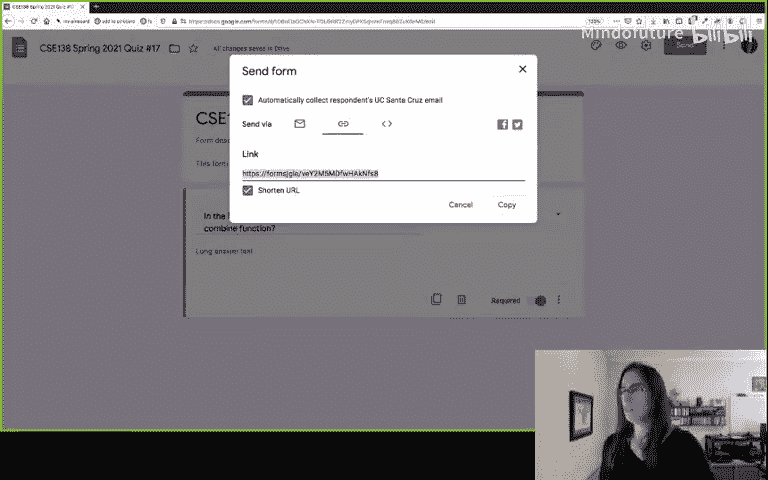

# 【加州大学】分布式系统-CSE138（Distributed-Systems）-p18-P18-L17---MapReduce-wrap-up-the-math-behind-replica-conflict-resolution--BV1eGdLYjETJ_p18-

So。Jumping in， administrative stuff。So as you know。We're almost to the end of the course。

So here's what we have left in this last week so there's today。This is lecture 17， like I said。

 we're going to talk about map Red。And then also we're going to start talking about the math behind replica conflict resolution。

And if we finish all that today， then we'll have all of Thursday left just for answering your questions leading up to the final。

 and then we'll do an AMA， so anything that you want to ask me。

 you can ask me whether it has to do with the course or not。

 I can't promise I'll answer every question but you can certainly ask them。Friday。

 your fourth programming assignment will be due。And then next week， Thursday is our final。

So the final exam， you'll have three hours to do it at a minimum。

 more if you have extended time on the exam， and it'll be not that much longer than the midterm。

In terms of the number of questions on it， so it'll be worth 120 points as opposed to a 100。

 which the midterm was worth， but you'll have relatively speaking a lot more time to do it。

I don't know if y'all can hear， but my daughter is saying hello to me， hi。

 she's standing outside the window。All right。Just one note about this last programming assignment。

 so a part of the fourth programming assignment is to do the peer assessment。

 so if you haven't taken a look at this form yet，This is the peer assessment form that I'm asking you all to fill out to assess your teammates contributions to your team。

 thanks to those of you who have done this already。😊，A few of you already have。If you haven't yet。

 this is linked from the assignment description and it's also linked from an announcement on Zullip。

It shouldn't take you too long to fill out， so we're asking a handful of questions which are all multiple choice questions and we're asking you to evaluate。

 let me be clear we're not asking you to evaluate your teammate as a person。

We're not asking for that， we're asking you to evaluate in the context of this particular project。

 what contributions did your teammate make？So your teammate could be a lovely person or an awful person。

 we're not asking about that， we're asking in this particular narrow project context。

 we're asking you to evaluate the contributions of your teammate and this includes questions like was their behavior cooperative and helpful。

 did they do their share of the work？Were they actively participating in the team did they listen to and support others on the team and did they do their work accurately and on time so please take a few minutes to fill this out for every member of your team and to motivate you to do it。

 we will not return your grade for assignment for until after you've submitted this peer assessment for every teammate。

So please give a little bit of attention to that， it should be easy， should only take a few minutes。

Great question， will you have any sort of study guide for the final。

 I am going to share a list of questions so like I did before I'll share the list of the in class electric quizzes。

The questions from those， but I'll also share a big list of questions that was put together over the last few years that I've been teaching this course and you'll be able to use that as a study guide for the final。

 it'll cover the whole term。Other logistical questions about this stuff？Oh yeah。

 while I'm talking about assessment， peer assessment。

 be sure to fill out your course evaluation also。All I have to say about that is。

Accctionable feedback is good， so I really want feedback on what worked and what didn't for you in this course。

If you have suggestions on what can be done better， know， we're eager to hear them。

 I'm hoping to get actionable feedback though， so instead of just。Something like。

 I didn't like the assignments， talk about what specifically you might not have liked and what specifically you would want done differently。

And then just stuff like you know there's some stuff that I obviously can't control right。

 like if you didn't like the time that the course meets I sorry I feel for you。

 but that's not the sort of thing that is that I have any power over so that's not something that it's necessarily useful to talk about on the course evaluation。

 talk about stuff that I actually do have control over and then that feedback will be taken into account and we will and you I'm planning to teach this course again in the fall so the better feedback that you can give the better this course will be for the next generation。

All right， let's jump in。Okay， so we're going to wrap up and recap our discussion of map Red from last time。

So。To recap from last time， somebody told me what are the three phases of a map reduced job？

That's right， yeah， the map phase， the shuffle phase and the reduced phase。

 so let's recap the map phase first。So the map phase is when a programmer supplied map function。

Runs on all the data。Here's something that we didn't really talk about last time。

 can somebody tell me what the type？Of the map function is。

 that is what is the type of its input and what is the type of its output？

So these might not necessarily be the literal types that you write in the code， but conceptually。

 what is the input to the map function and what is the output？Okay。

 takes raw data gives you derived data。 Yeah， okay， I mean， you're not wrong， right。

 but in particular。What what is the shape of the data that the map function operates on So conceptually。

 here's the type of map it's going to take one。Input， key value pair。

And then what is it going to give you as a result？So just for example。

 it might be something like if we were looking at the same example we had last time we might have something like document one and then。

The quick。Brown fox， etc。And then what would you get back？That's right。

 you would get a set of intermediate key value pairs。So in this case。

Those intermediate key value periods， if we were doing the example from last time where we where we talked about。

Creating an inverted index， it would be something like。Pairing up words from the original document。

With document identifiers like this。So， a set of those。

So that this up here at the top is a particular example。Of what the input and output might look like。

For a particular rap reduced job， and then this here is the general。Conceptual type of map。

What if we wanted to do word count instead， so what would we want the map function to spit out then？

Well， if it were a word count， then we'd want it to spit out each word。And then account， right？

So this would be another kind of。Set of intermediate key value pairs that you might get。

So in this example， let's say the whole sentence was。The quick brown fox jump over the fence， right。

 so there's two occurrences of the。But I just put one here， right？So I'm imagining that later on。

In this set， there would be another pair。So all of those occurrences of the we're imagining are going to be added together later。

 so it's okay to defer that until the reduced phase。

 but if we felt like doing it here in the map phase as an optimization， we could。ok。

What happens after the met phase is the shuffle phase。

And can somebody just summarizeize what goes on during the shuffle phase？Right。

 data is hash to and sent there。 Yeah， so that's when the data from every map worker。

Is going to go on to the reduced worker。That will process it。And by data。

 I mean those intermediate key value pairs。How has it decided which intermediate key value pairs go on which reduce worker？

Well， that's decided by some partitioning function。So this might do something like。Hash hash of key。

Mod R， where our is a number of reduced workers。So interestingly， in the paper。

They don't say that the default partitioning function is this， right。

 they don't say that it's necessarily hash of key mod。

 They do say that there is a default partitioning function。

They say that the default partitioning function uses hashing and then they say， for example。

 hash of keymod， but they don't come out and say that that's actually it。

 so maybe Google has some secret partitioning by hash approach that they're not telling us about that's really awesome。

 but it's probably something a lot like this。😊，嗯。And just to reiterate what we said at last time。

So last time we talked about why would they do this， like why is it okay to do this。

 because remember when we discussed consistent hashing？

We talked about how this would be a bad way to divide up the data if this number R ever changes。

But we talked about how last time this isn't necessarily a problem for mapR because in this setting。

This number of reduced workers isn't something that's going to be changing dynamically。

 hopefully during the map reduced job， so it's okay。Okay， so。That's the shuffle phase。

After the shuffle phase， the data has gotten on to the reduced workers and the reduced phase can occur。

We talked about the conceptual type of the map function。

What's the conceptual type of the reduce function？By the way， these types of map and reduce。

May not match up exactly with what you might be used to from functional programming and the concepts of map and reduce。

So。If I had a little bit more time， we could talk about that。And in the past I have。诶。

subjected my class to a discussion of that， but I won't do that today instead we'll just talk about what map and Red mean in the context of this paper。

Okay， so this is a little bit trickier yeah。The reduced workers are each going to have their own partition of the data。

 right？And we can think of this as this kind of partitioning approach， hash of key。

 partitioning by hash of key。Every one of these intermediate key value pairs with the same key。

Is going to end up on the same reduced worker right， so a reduced worker。

Running the reduced function is going to have a bunch of intermediate key value pairs。

 hopefully with the same key， right， or it might have。Several sets。

 but if there is a pair with the same key as another pair。

 then they will be on the same reduced worker。And it's the job of the reduced function to put them together somehow。

So。We could say that the reduced function takes。A set of key value pairs。

With the constraint that all the keys are the same。Right。

But the way that they express this in the paper。Is they say that the reduced function takes one key。

And then takes a set of values。Oh， that go with it。

So the input to the reduce function is a particular key。

 and then all of the values that go with that key， and this is drawn from this set of intermediate key value pairs。

And then it produces some set of output values。And I can't really be any more specific than that because。

We don't know。诶。What it's going to be， it's going to depend on the specifics of the supplied。

Reduce computation。So if somebody put in chat write to GFS from reduced replicas。

 and that is indeed what the reduced workers do， they write to GFS。

But what I was asking you here was kind of more like what is the type of the reduced function so let's see some examples so for this inverted index example。

An input to the reduced function might be。Something like this， it might be like。dog。

And then conceptually。It would be。Like the set of documents。Containing that particular word。

And then in this case， the Red function doesn't have to do much of anything。

 it just writes its output out to GFS， basically。So in this case。

The output is basically going to be the same。You might recall from the paper。

 often the reduced function doesn't have much to do。

 and that's kind of the magic of the shuffle phase。

So even though the shuffle phase is just moving data around。那没得。

It's kind of magical in the way that it works so nicely to get the data into the right places so that there's very little to do often by the time you get to the reduced phase depending on the particular map reduced computation you're doing。

So。You know， in practice， the way this would be implemented is like you'd pass some kind of an iterator here and it would have to iterate through all these values and do something with them。

But the thing that it does with them could be as simple as just writing them out to GFS unchanged。

What if it were something like this， what if we were doing the word count， Well。

 then you might have something like。Dog。And then you'd have these。

Counts from the set of intermediate key value pairs that would be all the individual word counts that you had。

 so maybe one document had one occurrence of dog， another document had three occurrences。

Another one had two and so on。And then the role of the Red function would be to add all those numbers together。

哇。So in this case， it might be like。Something like that。

And that would be account of every occurrence of dog in every document。

So the reason why you might end up with something like three here and two here and something like this instead of just the number one is if you were doing that optimization that we talked about before with using the combined function up here during the map phase to do a little bit of the computation early。

Otherwise you would just have a list of ones here。So let's talk about that just a tiny bit。

So let's say that I'm a map worker。And let's say that I have to count occurrences of the word dog。

So let's say。That。For particular。A document， I have something like。No。My dog。Is。The best dog。

And the fastest dog。So let's say that I have this。If I used the word count map function that appears in the mapRuce paper。

 then。Let's say that I were only counting the occurrences of dog。

 let's say that I was ignoring other words。So if I used what was in the paper。

 then I would end up with like three intermediate key value pairs here， I'd end up with this。

And this would be during the map phase， right？And then during the shuffle phase。

 those would all get sent to a particular reduced worker。So the shuffle phase would send them。

To some reduced worker。And then at that point。All those ones would get added together。

And you would end up with。This。So I can kind of draw an arrow in the middle here。

 so it's showing shuffle。So this is the map。Output。This is the reduced output。

What is wrong with doing it this way？Or are there any downsides to doing it this way？Yeah okay。

Good question Okay， so the question is in the shuffle phase isn't the map information supposed to go to all reduced replicas。

 so in general， all of the map workers are going to have to talk to all the reduced workers because in general。

😊，Some of the intermediate key value pairs produced by a given。

Produced by any given map worker are going to have to get hash to a particular reduced worker。

So yeah， maybe， I mean， maybe this sentence was split over multiple documents， right。

 maybe I had a sentence。That was just my dog is the best dog。

 another sentence that was just and the fastest dog， maybe these were on different map workers。

 right？And then both of those map workers would have to talk to the reduced worker that was responsible for the key dog。

Great， yeah， so somebody just said what I was looking for。

 which was sending all three of these tuples across the network costs bandwidth， right？So。

These could have just been added together on the map worker's side。

 and then the map worker could have just sent this。So a map worker is a。

Fully capable of doing some local computation。And then that on the reduced side would be added together with every other map worker's count for dog。

 so the reduced worker could still have work to do。

 but they'd be adding together the local counts from a bunch of the map workers instead of just adding up a whole bunch of ones。

And this is the notion of using a combined function。So this would be。

This would be a way to possibly save bandwidth if you could do some of this work on the reduced workers side。

Then you have less to send over。嗯。To the reduced workers when it's time to do the shuffle。

The reason this is okay to do。In the case of our word count， computation。Is because。

The operation that we're doing， in this case it's addition， right。

 we're just adding together these numbers。This is okay to do because。Addition is associative。

So what does that mean well， associivity means for addition。It means that if you add A plus B right。

 and then you add C to that， that's the same as if you add A to the result of adding B and C。

So if the reduce operation in general that you're trying to do， in this case。

 the reduced operation is addition， so if the reduced operation is associative。

Then it's okay to do as much as we can。Early。Locally on the map workers。

So the reduced workers will still have work to do。But not as much data will have to be sent during that shuffle phase。

So in general。If the reduced function is associative。

Then we can do this combined thing and do some of the work early on。It's pretty cool。

 we can save bandwidth by taking advantage of this associivity property。

So instead of sending Dog one a million times， then a map worker can just do as much addition locally as possible and then send that compressed data in a sense。

 over to the appropriate reduced worker。And then the reduced worker will do whatever addition is still necessary to be done at that point to get the final result。

Questions about any of that。Okay， so somebody asked a good question last time。

 which I didn't really answer well， so I want to try to answer it a little bit better。

So the question last time was。嗯。Why did Google stop using MaRduce？Oh， somebody just asked。

 let me recap this， so somebody just asked why does associivity matter？

It matters when you do the addition， right？If the operation were not associative， right？

Then it wouldn't be okay for us to do it early over here on the map workers if it weren't associative。

 then you might get a different result by doing some chunk of it early and then doing the rest of it later。

呃。But as it turns out， because it is associative， doing a chunk early and the rests later gives you the same result as if you were to do。

As if you were to just send all of the original intermediate key value pairs over to the reduced worker for it to do all of the computation。

So。Associivity lets you do some of the computation early on the map workers and get it over with。

Makes sense。Addition is just one example， but it's the one that happens to be useful in this particular word count example。

 but in general。Any associative reduced operation should be okay to do this combined thing with。Yeah。

 good question I don't have off the top of my head an example of a non associative operation where this would break。

I think the best practice with using mapRuces to do something associative。

 I only point this out because if you， for whatever reason， have a nonassociative operation。

 then you need to be careful about how you use the mapPRuce framework。Good question。

I'll try to think of a good one， yeah， somebody has an example in chat about finding an average。

 yeah。Good one， yeah， like averaging things over here。Yeah。

 anytime you're taking averages of averages， you could end up with something yucky。Yeah。

 you're exactly right， yeah， so a non associative operation。Okay， so you're asking。

 why would a non associative operation ever be okay because wouldn't that mess things up over here？

As long as let's say that you are doing a non associative operation。Well。As long as。

All of the intermediate key value pairs with the same key get sent to the same reduced worker and those reduced workers are deterministic computers right。

 then you should get the same result right because so the assumption is that a given reduced worker is going given the same input is going to do the same computation on the same input。

嗯。The issue would be。If you did some pre computationutation on some of the app workers beforehand。

 then that would be a different input so then you couldn't necessarily expect the same output from a different input if the operation were not associative。

Yeah， and this has interesting implications right for the ability to stream data。

 right like it would be kind of nice to be able to do computation in advance。

 so I'm sure this is something that comes up more when you talk about streaming systems。All right。

 so I want to talk a little bit about。The question that somebody asked at the end of last time。

 which I didn't really have a great answer to off the top of my head。

 which is why doesn't Google do mapRduce anymore so I stored a hand waved and said well they still do。

MapRuce at Google didn't so much go away as get generalized。🤢，You can look up if you want to a paper。

That came out in 2010。诶。Which is called Fme Java， I think it's flume Java， easy， efficient。

Data parallel pipelines。And this is about the fluin system， which kind of generalizes map reduce。

 and as far as I know it's still in use at Google， yeah me put a date on there。

 so this was something like 2010。So。Why didFme become necessary？Well。

We talked about how with MaPRuce。You can do anything you want with mapR as long as it fits into this particular structure of map phase shuffle phase reduce phase。

 and after the reduced phase， everything gets written out to storage to GFS in the case of map Red。

This works great if the computation that you have to do fits nicely into that particular structure。

But some computations are harder than others to shoehorn into that structure and what you end up having to do。

Is have。A sort of series of map reduced computations in order to compute what you actually want to compute。

So what you might end up doing is have like。诶。A map produced job。

That then produces input to another map reduced job。That then produces input to another。And so on。

 right？The raw data comes in this end。And then in order to。

Compute what you need to compute because the mapRuce framework is so structured and because there's only so much you can do。

 right， you're given only a couple of degrees of freedom with the MaRuce framework。

 you get to supply the map function and reduce function。

If you need to compute something that doesn't fit into that framework。

 then you need to chain together multiple phases of mapRduce。

What happens in between map reduced jobs？The data gets written out to GFS， right？

So in between here and here， you're writing out the data to GFS， and then it goes back in。

And then again here。And then back in here。So。If these different map reduced jobs are each just themselves intermediate stages in the overall pipeline that you're trying to carry out。

Then this gets really tiresome right because you're having to write out the data to the file system in between every one of these intermediate phases。

 so this gets really slow， instead of just being able to keep the data on the machines that are operating on it instead it's being written out to this intermediate storage location every time and then sucked right back into Mereduce and then out to storage again and then back in。

 so this gets really slow， so what you might hope for instead is some kind of system that offered you a little bit more flexibility that would let you not have to do this writing out to intermediate storage every time。

So that is what Fme does， so Fme generalizes mapPRuce if you still just want to do a regular old mapRuce job。

 you can， but Fme also makes it possible to schedule these long chains of mapRuce jobs in a way that's more efficient。

And so if you're interested， I would encourage you to check out that paper that I mentioned。

 and there may have been things published more recently too， I'm actually not sure but。嗯。

It's a nice paper， I remember reading it a few years after it came out。

So it's not so much that map reviews has gone away， it's just that it's been generalized and。呃。

This particular limitation of it has kind of been overcome。Okay。

 that's about all I have to say about map Red。Yeah。

 interesting conversation going on in the chat about possible non associative operations。All right。

 next thing I want to talk about。I'm trying to think if I should do the quiz question right now。

 Yeah， let's go ahead and do our quiz before I move on to the next topic。Alright。

Yeah， let's take our 10 minute break now slightly earlier than usual。And I will see you again at 410。

Great， two minute warning。Okay， welcome back。

All right， so I want to talk about。Something different。

I'm going to talk about the math behind replica conflict resolution， but before I do that。

I want to talk about。Consensus for just a moment to set the stage。In particular。

 I want to talk about the cost of consensus。This is something that we might have discussed a little a while ago。

 but I want to cover it in more depth。In this course。

 we've obviously spent a lot of time talking about。Repla consistency， right。

 we've talked about the problem of keeping replicas consistent。So quite often。

 the situation is that you have some number of replicas。

Let's just say two like this to keep it simple。And you have updates coming in。

Or you have some sort of messages arriving at these replicas that causes some kind of a change in state。

And let's say that both of these replicas can receive updates。

 just like with the key value store that you've implemented。

Any replica can receive and deliver updates。At least that's what you were supposed to implement。

So this is a scenario where there's no leader， we aren't doing primary backup or anything like that。

 neither replica is special。So updates could come in here， maybe this。

Relica could get a message saying A and this one could get a message saying B。

In this kind of a scenario。If we want strong consistency。What are our options？Well。

We could use a consensus protocol to decide where to slot in every event as it arrives。

 so let's say we have something like this where replica 1 receives this update A。

And replica 2 receives this update B。Well， then we could run consensus， right， maybe we have Paxos。

So maybe over here we have some acceptors， right？So。

Maybe R one is acting as a proposer and it can say I propose that we put of A in slot1。And mean。

 replica2 won't be saying， I propose that we put event B in slotAT1。Well， one of those will win。

 right？Either that or the Paxos algorithm won't terminate。

 and then in which case there might be some timeout and you'd have to start over。

 but we know that it won't end with these two replicas having different things in slot1。

 that's the agreement part of those properties of agreement validity and termination。Okay so。

Let's say。你。These two replicas are trying to decide what what goes into slots。 Maybe。

 maybe it would look something like this。 Maybe replica one is saying。Well。

 I want to propose that A goes in well first it has to send a prepare message right。

 it's going to send its prepare message over here to a majority of acceptors。

And then it has to hear back， and meanwhile B is also sending its prepare message。

Maybe it's sending them here， so maybe these got ignored， right because these got responded to。

So maybe these two got ignored。Maybe this was like a。诶。I don't know what propose number was used。

 but the point is somebody got in first and then the other ones got ignored。Promise messages go back。

 Then a gets to say what it wants to have accepted。 So a would say， oh， I want to have。

My message A going in slot one， so it'll send that out。Then it'll get a response there。

And then that information is also going to get broadcast to B because B is a learner in this case。So。

😊，Look at all these messages。How many messages got sent here， a whole lot， right， it looks like。1。

 two，3，4，5，6，7891011， something like 12 messages were sent just to get to the point where both R1 and R2 knew to put A and slot1。

And we still have to run the protocol again to get them to agree to put message B in slot2。

So the point here is consensus protocols are expensive， right the only time that you really。

 really want to use them is when it's very important that everyone agrees on having everything in exactly the same order。

So in this case。We would only want to go to the trouble of agreeing on an order for A and B if it actually matters that they do happen in the same order everywhere。

Now， I haven't told you anything about what this A and B are， right？

So it's possible that it is really important that they do happen in an order that's important， right。

 and it's necessary for everybody to agree on that。So quite often in this class。

 we've talked about events or messages without talking about the content of those events or messages。

So。Most of the time， like when we're talking about。呃。🤢。

Things like Paxos when we're talking about deciding on the order in which these events go。

We don't need to know anything about what those events do in order for PaXos to make that decision。

 right， the algorithm doesn't care。Likewise， when we talked about causal broadcast。

 it's deciding whether to delay or deliver a message based on the causal metadata attached to that message。

 the causal broadcast algorithm doesn't care about the actual content of the message。

 it only cares about that causal metadata。It doesn't care if those messages are checking your account balance or launching rockets or whatever。

And Texas doesn't care about what these events A and B are。The Chandy Laport algorithm doesn't care。

 none of these algorithms care about the actual content of the messages。So。In fact。

 because these algorithms are so general and they have to work regardless of the content of the messages or the content of the events。

It wouldn't make any sense for these algorithms to sort of look inside these messages and look at the message contents。

 What could they even do， right， they couldn't do anything necessarily useful with that information because these algorithms have to work generally。

诶。🤢，With any kind of messages。But for you， as a human being who's developing applications that might be interacting with this replicated system well。

You know what your messages say， you know what your messages mean。

And you know what application specific properties you need to enforce and which ones you don't care about。

 right？So to come back to our standard example， right？

What if R1 and R2 are copies of a shopping cart？And what if events A and B are adding things to the cart？

Let's say that event A is adding a book to the cart， and event B is adding the blender to the cart。

If that's what's going on here。Then you probably don't want to pay the cost of sending all of these messages just to get everybody to agree。

 okay， first we're going to add the pants and then we're going to add the blender， right。

 because that would be massive overkill for this situation。

Because the order doesn't really matter very much no。

The guarantee that you want could vary depending on the application that you're actually implementing。

But a lot of the time。The safety property that you want is not strong consistency。

I'm going to argue that a lot of the time， the safety property that you want。

Is just strong convergence。Not strong consistency。So recall that strong convergence means that。

If replicas have delivered the same set of updates， then their states agree。

The same set in any order。So strong consistency is going to be overkill for a lot of situations。

So if you need this， if you need this property。人。Your life gets a lot easier， right？

You don't have to make sure that people get the same updates in the same order。

You just need to make sure that。If a replica gets a certain set of updates in a certain order。

 then it's state。Is going to be the same as the state of another replica who might have gotten the same set of updates。

In different order。That might still be a challenge。

 but it's a heck of a lot easier than making sure that everybody gets all the updates in exactly the same order。

Okay， so if we have replicas representing shopping carts and if we have events that are adding items to carts。

Then。To have replicas agree。We just want to make sure that。

The same set of events shows up at every replica in some order， right。

 and then if we have strong convergence right that tells us that the replicas will agree at the moment that they've gotten the same set of updates。

So that's shopping carts。But what is a general principle here？The general principle。

 we know what to do for shopping carts， but how do we generalize that So for this。

 we need to add a little bit of math。But it's math that you've seen already。

 or at least most of it is。So。Let's talk a little bit about it。

 so reach back in your brain to when we talked about partially ordered sets。

Way back at the beginning of the course， can somebody remind me of what the definition of a partially ordered set is？

Or a post set for a short， and some people call it。That's right， yeah， so you have a set。Call it S。

Together with a binary relation。And I'll write it this way。Sort of looks like less than or equal to。

 but'll I'll use this。Funny looking square。Operator。

That relates some of the elements of S to each other。

 so the partially ordered part of partially ordered set。

Means that not every pair of elements in S is necessarily going to be related by the relation。

 In other words， not every pair of elements is going to be necessarily comparable。嗯。

But this is going to be a relation that relates。Elements of S to each other and in a partial order。

 there are some axioms that have to hold for this relation。And there are three of them。

Can anybody remind me what the three properties are that have to be true of that relation？No。

 that's right。So the partial order。Has to be reflexive。So this means。For all the elements of S。

They're all related to themselves by the partial order。Antiymmetry。So this says that if you have。

A couple of elements of S。A and B， if a is related to B by the partial order and B is related to A。呃。

Then they're the same。And then finally。Transitivity。Which says that。For all elements of S， A B。

 and C， if you have A related to B。And be related to C。Then。A is related to C。What's an example？

Of a partially ordered set。 Well， the usual go to example for explaining partial orders is。

To have S be the set of all subsets of some other set。

If we're talking about items in our online store。Like， you know， books。And blenders。And pants。Then。

We could talk about the set of all subsets of that set。So。I could say S is。

Maybe there would be the empty set and there would be the set containing the book。

And this set containing the blender。And the set containing the pants。Then you have pairs of two。

 so like we've got the book and the blender。And we've got the book and the pants。

I hope you like my art。What else do we need？Lops， not the book， we already got that。

 we need the blender in the pants。And then the finally the set of all three。So that's S。

 it's got eight elements， all of the subsets of this set。And the relation- so if that's S。

 now we need to talk about the binary relation。And the binary relation we care about in this case is Z inclusion。

So， for instance。This set。Would be a subset of this set。

So this would be two elements of S that are in fact related by the binary relation。

You could have other elements of S that are not related， for example。

The set containing just the pants。Is not a subset of the set containing just the blender。And。

Nor is the set containing just the blender， a subset of the set containing just the pants。

 so this is a partial order rather than a total order。

Because there are some pairs of elements of S that are not related。By this ordering relation， okay。

 this is all reviewed so far。But now we have the pieces in place to be able to talk about something new。

So we can talk about upper bounds。We can pick out。Any two elements of our set as and we can ask。

Which elements of S are at least as big as both of those， according to the ordering relation。

 So let's say that I pick。The set containing just the book。

And I pick the set containing just the pants。What are the elements of S that are at least as big as both of those？

So here again is the entire set is。So what elements of us are at least as big as this element of us and also this element of us？

嗯。Somebody says just the mug， okay， so maybe there's a misunderstanding because what we're looking for are elements of S that are bigger according to this。

Binary relation here。 So here we said that。嗯。The pants are less than this set containing the pants and the blender。

Which probably looks a little bit more like a mug。嗯。😊。

So what we want are elements of S that are at least as big as both of these。

 so they have to be elements of S that know at a minimum， they have to contain both of these。

And when we say as big as。We mean。According to this relation。

So I didn't write out the whole definition of our set inclusion relation。

 but I'm hoping that it's fairly intuitive。Okay， yeah so。HThe set with the mug and the pants。Well。

 that's not at least as big as both of these because， oh。

 maybe you couldn't tell it this is a picture of this is supposed to be a picture of the book。

So elements of S are at least as big as both of these include。First of all。

 this set that has both the book and the pants， that's at least as big as both of those。

And then also the set of all three， right？Right。So somebody just said it in chat。Yeah。😊。

So these are called upper bounds。Of these other two elements。Of us。So here's the definition。

Given a partially ordered set。An upper bound。Of a particular pair of elements。In S。

Is some element in us。Call it U。Such that。A is less than you according to the relation and B is less than a U。

 according to the relation。Or you can pronounce it less than or equal to。So。

A given pair of elements in S might have many upper bounds。But。In general。

 the upper bounds that are going to be interesting to us are going to be the smallest ones。

 So in this case， this is the upper bound。These are both upper bounds。

 but this is the upper bound that's really interesting。So。

We can formally define what it means for an upper bound to be the smallest。So we can say。嗯。

An upper bound。Of a particular pair of elements is。What we call the least upper bound。

Or love for short， or sometimes called the join。If。Well let's call it u here， an upper bound U。呃。If。

U is less than or equal to V。For。Each upper bound。V。Of A and B。So in this case。

 the least upper bound of the set containing the book and the set containing the pants is going to be this one。

 the set containing the book and the set containing the pants， this is also an upper bound。

Of those two elements， but it's not the least upper bound， this here is the least upper bound。

In this partially ordered set。That we've been talking about。Let me ask you this。

Do every two elements have a least upper or bound？Somebody else in chat。

 does this join have anything to do with the notion of join from relational databases？😊。

I'll let that one be an exercise for the reader。All right， so in our set S。

 which is the set of all subsets of this。诶。Of this set of book，Pants and Bnderer。

 do every two elements have a step or bound？It's kind of a tricky one， so I'll give away the answer。

 turns out that yes， they do。So now we can define。A partially ordered set。In which。

Every two elements have at least upper or bound。Has a fancy name。It's called。A join。Semi lettuce。

A lot of partially ordered sets turn out to be joined semi lattices。

So to bring this back to distributed systems。If we have our two replicas， right？

And we have a couple of clients。Let's say。That we have a partially ordered set that is not a joint semi。

 So let's say that we have one where。Not every two elements heavily up or bound。

It's actually a little bit tricky to think of one。But。I have an example in mind， so here's one。

So let's say that you have。呃。A register that can be either empty。

Or it could be filled in with either true or false。

So these are the different states that it can be in。

And I drew it like this to show that the different- so we have a set here of possible states。

 there's empty true and false。And。So。Is it a partially ordered set， Well， we can check that it is。

 right？ It turns out that it's reflexive， antisymmetric and transitive。

 So the relation here would be like。No， empty。Is less than true。And empty is less than false。嗯。

True is less than or equal to true， false is less than or equal to false。

 empty is less than or equal to empty， so it's reflexive。嗯。

So it ends up being a partially ordered set， but it's not。Ajo semila。

 because these two elements true and false don't have at least upper or bound。So。In our example。

If these are our clients。Let's say that this client here。Has sent a message。Seeing。

Set the Reg to Tru。And maybe this one has sent a message saying， set the register to false。

So now we're in trouble， right， because we don't have a way to combine true and false。

They don't have a least up or bound。So in this case。

 replica 1 got the true message first and then the false message， so replica 1 might end up。

In the false state， well replica 2 might end up in the true state。

So if this is the situation that you're in。Then you might end up needing to do something like consensus in order to resolve this problem。

But。If we had had two elements that did have a least upper bound。

Then we wouldn't have a problem here because。Then when you get this message。

You could merely combine this other message with it， right？And then here similarly。

 so I'm going to make an informal claim， so my claim is that。If the states that replica can take on。

Are the elements of a joint semila？Then you have a natural way of resolving conflicts between replicas。

Without having to do consensus。And we've talked about this before， but let's just look at it。

So if we had， for instance。Our situation where。Somebody writes。The book。And somebody else writes。

The pants。Like so。Then。When these updates arrive。They don't have to clobber each other。

 instead the replicas can build on the state that they have。So replica one here can merge together。

The result of this right and the result of this right to get。Something like this。And similarly here。

And the reason why this is possible。Is because。The states that these replicas can take on。

A elements of a joint semilaus and the particular joint semilaus that it is is that set S that we were talking about before。

And the set inclusion operation。And that gives us a way of resolving conflicts between replicas without having to do consensus。

And you can think about that yourself and think about whether it makes sense。

But if you're interested in these kinds of ideas。I'd recommend looking up。On your own。

 something called conflict free。Replicated data types。Or CRDTs。

So CRDTs are data structures that are designed for replication。

The particular flavor of CRDTs that I've been showing here are something called state based CRDTs。

So this is a state based。CRDT example。What might actually happen in practice with CRDTs is that。

Maybe this client is only talking to replica one。And maybe this client is only talking to replica too。

Then what might happen is that at some point periodically。

 these replicas send each other their state。And then they have to merge their state。

With the other replica。 So maybe at some point， at some point after this update has been received with this book。

 Relica one decides to。Let Relica2 know， hey。I got this update。So it'll send it state over。

 replica2 will merge。That state in with its own。And when it does that。How does it do it。

 it does it by computing the least upper bound of its current state and the received state and similarly。

Repla 2 could send it state over here。And replica1 could carry out this merge。

By taking the least upper bound of its current state and the received state。

And at the end of this process。We will have the property that we wanted。

 which was strong convergence， we won't have strong consistency because。

Like we talked about in the past， strong consistency means that clients can't tell that the data is replicated right。

 and that's not the case here because a client could come along。

And read R1 and R2 at some point you know during this phase before the merging has taken place right。

 and if the client reads during that phase， then they'll see that the data is not strongly consistent so strong consistency is not what we're promising here at all。

Instead， we're only promising strong convergence。So with CRDTs and in particular what these are state based CRDTs。

 you have this notion that。The states that replicas can take on are elements of a joint semila and when you receive。

An update from another replica， you can merge it in to your own by taking the least upper or bound。

Why can you almost do that because the definition of a joint semila is that every two elements have at least upper or bound？

And so that makes it possible to do that merge and have it always come out like it should。

So here's one last thing to think about。So far。I've been talking about。Issues that can arise。

When you're adding different items to a set and this in particular。

 this sort of issue might occur if there was a network partition， right？

Maybe client one could only talk to replicatelica one， right。

 and maybe client two could only talk to replicatelica2。So。

You want it to be the case that later on when that network partition heals that their states are able to come to an agreement。

But so far， I've only been talking about。Adding items to a set。

 but if clients want to be able to remove items， yeah exactly， thank you for asking question。

 then things get even more complicated。So think about how in the Dynamo paper。

 deleted items could reappear in shopping carts。Why did that happen？It could happen because。

If you're representing the contents of a cart as a set， right？

And the conflict resolution is going to take the set union of multiple versions of the cart。

 maybe an item has been deleted from somebody's copy。

 but it hasn't been deleted from somebody else's copy yet。

If that delete hasn't propagated everywhere yet， then the item could reappear when that older replica gets unioned together with the newer one。

 if somebody， if anybody out there still had the old copy， then it's going to end up in that union。

 right？Well， it turns out there are some tricks for handling this。

The CRDT people came up with some of them， so this is work that happened the original paper on this came out in 2011。

Whi you'll note is a few years after Dynamo， and then kind of a lot more work in this space has happened over the last 10 years。

So what are some of the tricks that you can do to deal with removing things in general the problem of deletion is tricky。

 so one of those tricks。Is to separately keep track of everything that's been deleted right so then you essentially need two sets right you need one to keep track of everything that's been added and then you need another set to keep track of everything that's been deleted。

And then when you have to sync up replicas。You have to take the union of the sets of items that have been added and take the union of the sets of items that have been deleted。

So the merge needs to be a little bit more sophisticated in that case。So this helps。

 but it doesn't actually solve all your problems， right， because like let's say。

 what if you add something and then you delete it and then you add it again。Well。

Then what do you do right now it's in both your addition set and it's in your removal set。

Which are those wins？Well， a common approach is to say， remove winds。And then。Basically。

 it means that if you add something and then you delete it， you can't ever add it again。

So that might or might not be the semantics that you actually want for your application。

So then you could try keeping count of times that something has been added or deleted。

OhAnother question in chat， who keeps the set of added and removed elements？Yeah， so the question is。

😊，Yeah， who keeps track Well yeah， every replica indeed has to track both additions and removals。

 so this obviously gets to be a lot of state， doesn't it？And that's one of the issues。

 right with CRDTs is that you're tracking a lot of state。

 especially if you're doing a lot of deletions， right？

The sets of deleted elements are called tombstone sets。Because they。

They're like markers for you know RIP， this element of the set， right。

 and some people jokingly call them doom stone stats because they're so unpleasant to have to keep around。

So。CRDTs do not solve all your problems。Third。Nice， right。

 and they can help you avoid certain kinds of bugs。Sometimes。

But there are some issues that are ultimately unavoidable and might require you to do something like eventually garbage collect all of the tombstones。

 right， and to do that。You might need to do consensus and get everybody to agree on a particular point where you're going to do that garbage collection。

In summary， distributed systems are hard。All right， so that's food for thought。

Thinking about how you manage this sort of replicated state in a setting where you also have to deal with network partitions and you don't want to have to do consensus all the time。

If you want to talk more about this stuff， I love talking about it。

 but we're unfortunately out of time for today。I will see you on Thursday and we're going to spend our time doing review for the final。

 so bring your questions and also bring anything at all that you might want to ask me。

And enjoy the rest of assignment four。And I look forward to seeing you in a couple days， take care。

