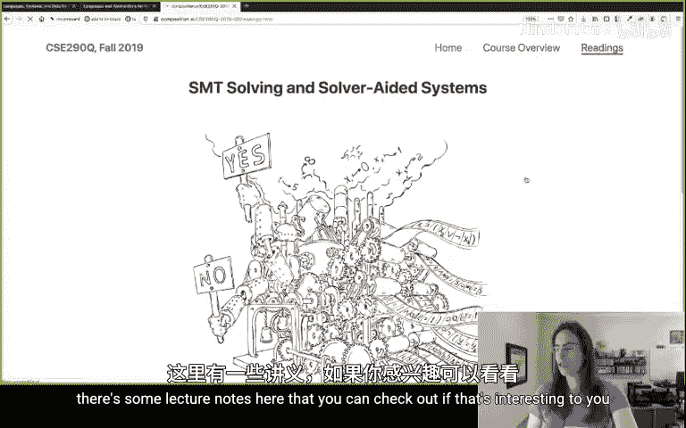
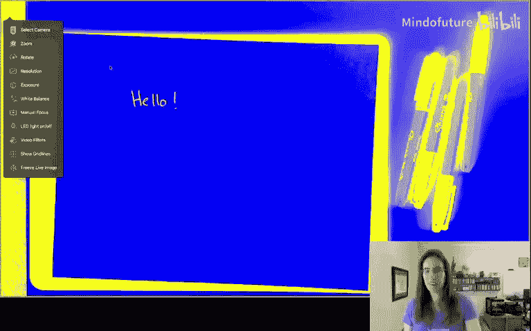
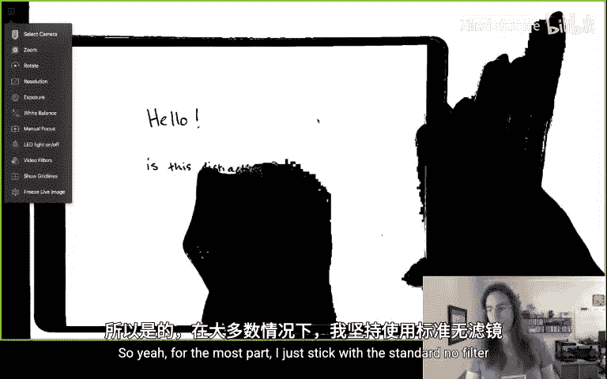
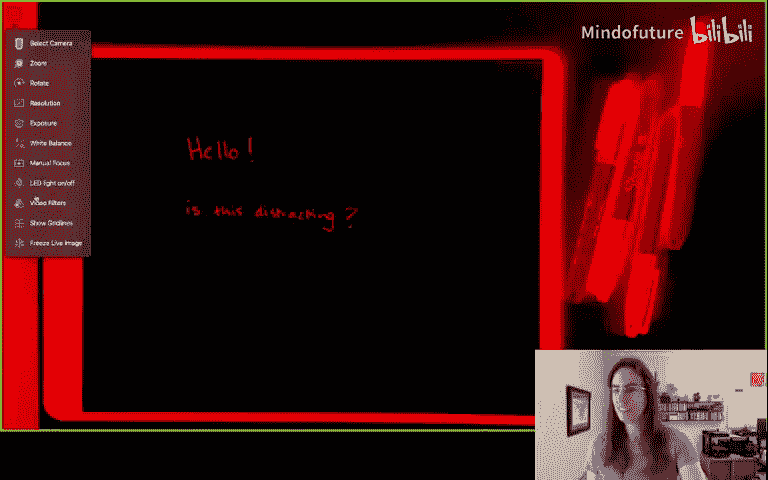
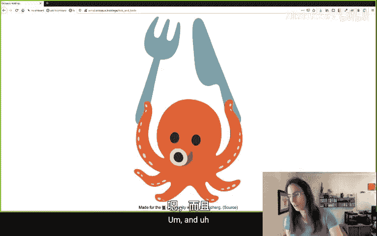

# 【加州大学】分布式系统-CSE138（Distributed-Systems）-p19-P19-L18---ask-me-anything--BV1eGdLYjETJ_p19-

All right， just waiting for Twitch to tell me that the stream is running。Looks like we're live。Great。

It's our last lecture， welcome to the end of week 10。Wow， you made it。Congratulations。You know。

 a few minutes ago， I was on Twitter。And I asked。What should I tell my undergrads。

 most of whom are graduating seniors？Using what such a platform as I have right in these last few minutes that I have with you。

And of course， they said wrong answers only。So， and I got lots of funny responses like don't wear sunscreen。

And all distributed systems problems can be solved by a suitable application of blockchain technologies。

So。Whatever you do， please take the opposite of that advice。All right folks。

 so today the I don't have any new material to share with you。

 I just have a couple of announcements to make and then we can use the rest of the time for answering questions that you might have so whatever those questions might be。

So if you do have questions， please share them in the lecture chat。And if nobody has questions。

 then we'll end early and give you a little bit more time to work on the last assignment。

So announcements that I have。呃。First of all， I want to make sure that everybody knows about our research group here at UCSC。

 so I along with a group of other students and faculty。

 am part of this loosely organized Feration that we call the Laages Systems and Data Lab or the LSD labb for short。

And the goal of this is to create a community where people who are interested in all of these different research topics。

 whether it's systems， distributed systems operating systems， database systems。

 data management systems and programming languages。

 all of these things can intermingle and benefit from one another。

 so as some of you know my background is in programming languages。

 that's what I studied when I was in grad school。And then I moved into this area of distributed systems only later。

I believe that there's a lot to be gained from people who are working on different topics。

 talking to one another， and I think that I missed out when I was in grad school by kind of singularly focusing on one topic to the exclusion of others。

So what I'm interested in these days is bringing together。

Ideas from programming languages research and ideas from distributed systems research I like to tell people that i'm interested in using programming languages solutions to solve distributed systems problems and that's what my students and I work on in particular i'm interested in using programming languages techniques to。

Formerally verify that distributed systems behave the way that they should。

And so if that's something that you're interested in。

 then maybe you should take a look at what we're doing in the LSD lab。

I also want to specifically advertise that we have a talk tomorrow。So every Friday。

 during the regular quarter， we have our talk series， the Languages System and Data seminarminar。

 and this week we are lucky to have a talk from Renesha Wee， who will be visiting us from CMU。

And her talk is going to be called Battle for bandwidth。

 evaluating congestion control deployability for the internet。

 so this will be a cool talk for people who are interested in things like networking and so please come join us tomorrow and if you want to know the details go to lsd。

ucsc。edu。And you can learn more about that。I also want to share with you a couple of other things and I'll post the links to these on Zooulip。

In my first couple of years here at UCSC I was lucky enough to get to teach some graduate courses that are relevant to the kind of research that I do。

 so in my first quarter here at UCSC in fall 2018 I taught a course called Languages and Abtractions for Distributed Programing。

And the web page here is still up， and there's a reading list of interesting papers that are kind of in this topic area。

 a lot of which have to do with things that we have been talking about all quarter in this course。

Also， my students and I wrote a blog， so there's a series of blog posts here that were all written and edited by my students and me。

And so。I've been finding as students come to office hours and they ask me questions about stuff that often I find myself referring to these blog posts that were written by my grad students and me。

Three years ago now， so there could be a lot of stuff in here that's of interest to a lot of you if you take a look。

So I encourage you to check it out and I'll share that link in the chat。

So that was what I did in fall 2018 then in。Fall 2019。

 I was lucky enough to get to teach another graduate Special topics course。

That one was on a totally different topic， which is SMT solving and solvevaated systems。

I'll talk about how this。 What does this have to do with distributed systems。 Well。

 as somebody who's interested in programming languages and verification。

 I'm interested in things like how do we build high powered。

Verification technologies that can help us reason about distributed systems。

As we've seen one of the challenges in reasoning about distributed systems is that there's this huge space of possibilities that can happen。

 right， there's a lot of orders in which messages could get delivered。

 there's a lot of combinations of machines that could fail or not fail right and the bigger the system gets。

 the bigger the state space of possibilities of things that could go wrong。Well。

 when you're trying to reason about a big state space。

 it helps to have some mechanized tools that are good at that sort of thing and so SMT solvers are tools that can if used well。

 help us reason about these sorts of systems and make sure that we've kind of covered all the bases in knowing whether there's a bug。

 right？So how can this be useful to us when we're building distributed systems well。

 if you could have something like， let's say， a type system in a programming language that's hooked up to the power of an SMT solver。

 then that type system can let you express really， really rich properties of programs。

 including things like，Our message is getting delivered in causal order。

 which is something that we've talked about this quarter。 so that is in fact。

 something that my students and I are working on right now in order to work on that。

 we had to study SMT solvers and understand how they worked。 so this course is all about。

About SMT solving and there's some lecture notes here that you can check out if that's interesting to you that I wrote and then there's a whole bunch of papers that have to do with applications of SMT solving not just to distributed systems but to all kinds of other problems as well。

 like test generation or。

Synthesizing programs， program synthesis， so all this stuff is really。

 really cool and I think in many ways it's the future of programming languages research。

And I'd love to talk to you more about it if you're interested。Okay， so that's it for that stuff。嗯。

Now I want to turn it over to you。What questions do you have for me if any。

 and if you don't have any， then no， we'll end early today but I want to try to answer your questions in advance of the final and know you can either ask me stuff about the course material or about anything at all。

 really。So let's open the floor to questions。I guess I can first answer a couple of logistical questions that somebody asked。

呃。🤢，In office hours， I was asked whether tutoring sessions would still be going on next week。

But I wouldn't count on it。I don't think the course staff is expected to still hold their tutoring sessions。

 some of them might still choose to。And they might still be listed on the calendar in Canvas。

I wouldn't necessarily trust that information， so if you still want to attend a tutoring session next week I would suggest that you confirm with that person that it's actually happening。

 but there's no expectation from me that the tutors are going to keep doing their tutoring sessions during finals week。

 they might， but it's not guaranteed。Oh， another question in chat。

 my favorite IDE and or text editor。So。I am an EMX user。I do not impose my views on anyone else。

 so actually right now one of my grad students is any E max user and one is a VM user and so they still manage to collaborate somehow。

😊，But I personally in a Yemen EMAC users mostly out of habit when I was in undergrad。

 XEax was the popular choice。And so that's what I learned how to use。And in fact。

 so when I first started undergrad， I didn't really know how to use any sophisticated text editor and then。

I was embarrassed one day because I had to do a presentation in front of the class and I was using G editit which was the crummy default text editor on the the Li Linux distribution that we were using at the time and so I was really embarrassed that I was using my bad text editor in front of everybody and so I thought I had better learn how to use a good text editor and that's what kind of shamed me into learning EmX and it stuck so here we are 15 years later and I'm still an EmX user。

Eex is not perfect， but it has a lot going for it and it's very extremely customizable so you can make it do just about anything that you want。

Okay， next question， favorite programming language， right， yeah， okay， well。

 and what I would recommend for this class well， those are kind of different questions so。😊。

When it comes to what programming language one should use to do a group project。

That largely depends on the group， right？And in general。

 I would say that the advantages and disadvantages of different languages。Are。I mean， okay。

 some yeah， sure， I have preferences about programming languages。The most important factor is。

What will help the group work well together right and that's going to depend a lot on what the group knows and what the group is comfortable with so。

You know， the advice that Peter Norvik gives to people who want to choose what language to learn as their first programming language。

 his advice is actually use whatever your friends are using。

And I think that's actually pretty good advice because the most important thing is to have a community where you can talk to other people and get help and you know。

Have joys and suffering together， right。😊，I hesitate to say， oh。

 any given programming language is the best。For me personally。

 though I'll say some programming languages that I like a lot， I'm a big fan of Ru。

I was lucky enough to get to work on rest in the early days。

 I am not a particularly good rest programmer because rest has changed a lot since then。

 so the rest that I knew was like RE 0。3 and rest has evolved a lot since then and it's become a whole ecosystem。

But。A lot of things about the design of rust are great。嗯。These days for research I'm using Haskell。

 but I'm not a particularly good Haskell programmer either and I'm using Haskell because it's the best platform to do the kind of work that I want to do on things like SMT powered type systems that sort of thing so it's not so much that I'm a diehar Haskell programmer it's just that that's where the tools are available to do the kind of work I want to do and it's what my students want to use so my interests are kind of guided by what they want。

And then I have to put in a good word for。Possibly my favorite programming language。

 which is rackcet， which is。An evolution of scheme if you've heard of the scheme programming language。

 so racket is like a high powered batteries included scheme and I strongly recommend checking it out。

 it's really cool and the community is very friendly。😊，All right， I hope that's a good answer。Yeah。

 and as far as this class。Python' is the most popular choice and I can understand why there are good frameworks for Python for doing the kind of programming that we need to do for this class。

That's also the case for go， go has some people call go the Python of systems programming and for good reason。

Building things like a web service is really straightforward in go。And。嗯。And often， you know。

 people people like to。Complete about Java， but I think Java has a lot going for it for doing things like this class project。

 it has some really good APIs。I wouldn't totally discount Java as an option too。

Some just asked they want to know about my degree in music， yes， so when I was an undergrad。

 I double majored in music and computer science。😊，So I went to a small liberal arts college where it was relatively easy to do such things。

 so when I came in， I didn't know what I wanted to study。

I ended up being a music major at first and then。Kind of stumbled into CS when my roommate took a CS course and I thought。

 well， I can do that too， so I took CS。 It was a different time these days。

You you can't stumble in see us as easily just because there are so many people trying to take it that it's much harder to even get into the classes。

So， but at the time that wasn't the case， so I lucked out。

 I was in the right place at the right time that I was able to kind of stumble it and say。

 oh this looks cool， no， I'll check it out。That first course was taught in PLT S。

 which was the predecessor to racket and I fell in love with it， one thing led to another。

 I majored in CS and here we all are。But I studied music also， so I'm a singer。

 I don't play any instrument particularly well， I've got the like you know basic piano skills that you might expect from a music major but nothing more than that I'm actually pretty bad。

 but I love to sing and in nonpandemic times I perform with the Symphony Silicon Valley Corral。And。

We haven't met for over a year， of course， because singing is one of the most unsafe things that you can do during a pandemic like this but。

Actually， that's seguing into the topic of the course。😊。

Software tools that make it easier for groups to play music together remotely。And。呃。

Some of the members of our choir have been taking advantage of that， for me。

 what it's really all about is performing。I don't get that much out of going to rehearsal if I know that there's not going to be a performance。

 and so I haven't been participating in these remote online rehearsals。嗯。But。I mean， I love to sing。

 I love to perform， you can probably tell， right like I'm a teacher， part of teaching is performing。

And。And actually， some of you， I guess have heard me sing because you saw the PLDI video that went around。

Yeah， I。嗯。I love to sing and I ended up。Being fortunate enough to pursue a music degree also when I went to grad school I went to Indiana University which has a world class music school so there I was lucky enough to get to sing in a couple of really really good choirs and so everybody else。

 almost everybody else there was a music student so I was like one of the three people in the choir who wasn't a music student and I learned so much from getting to work with those really world class musicians。

Now I wasn't nearly anywhere on their level， I should say， or maybe I was at first。

 but it would be like I was at the level of maybe like the freshman music students who were who were there and it was clear to see how their skills improved over the year and a half that I was in the choir with them whereas my skills kind of stayed where they were right because I wasn't putting in the hours and hours and hours and hours every week of practicing that they were so like I was like just barely good enough to be in the choir whereas they were like really taking off as musicians so you know everybody has to choose where to put in their time。

 their finite time on this earth and。I chose to pursue other things but I love to sing and and I'm fortunate enough to be okay at it Oh what part do I sing I sing Alto。

And how well can I ci read？It depends who you're comparing me to， right？呃。

Better than a lot of people in the choir that I'm in now。

 but worse than a lot of people in the choirs that I was in back in Indiana。诶。嗯。Yeah。

 I guess it depends on what group you're comparing me to。Well enough to get by a lot of the time。

I will say it also depends a lot on the piece。When I was in grad school I somehow ended up on this mailing list for people who wanted to be in these kind of experimental one-off choirs for people who were composition students who needed musicians to perform the pieces that they were writing so I ended up in a couple of these concerts where the composition students basically just needed to get people together who were able to perform these pieces on relatively short notice and also the pieces were changing right like they would hear us rehearse and then they would decide that they needed to make changes and they would go back and edit the piece and then give us something new the next week so that was really tough that was a big challenge for me and I had to work really hard and what I found was that。

No， I had to work really hard， I had to be very alert， I couldn't slack off。

And I found that when I brought that level of alertness and skill back to the other choir that I was in。

 where we were singing stuff that was written 200 years ago， then，II was much better， right。

 but still。I still wouldn't say that my skills were anywhere near the level of the more dedicated music students。

Yeah， I mean， I I。I。I think it just depends a lot on who you're comparing to。

Somebody has to anything that I've done that combined music and see us。You know。

I studied electronic music a little bit when I was in school and so that was kind of interesting like one of the things that we did was we studied some tools。

 some software tools for making electronic music， some of which end up being to incomple programming languages so some of these tools are really really cool I never really did anything with that I have been told that the way that I think about music is the way that a computer scientist would think about music。

 but I can't really you know I don't know how other people think about music I can't live inside their head so I don't know really what that means。

But yeah， no， I mean， I'm not there's so much cool work in the intersection of music and sees。

 but I'm not really the one doing that work。 I am going to say that。

So if you're interested in things like。Data representation and knowledge representation。Studying。

Music notation is really interesting especially because there are a lot of ways to represent music and those ways are they actually differ between cultures and between time periods so one of the things that I studied when I was in college was different systems for loot tabblature so the loot was of course you know a medieval instrument and different systems for writing music for the loot developed in different places at different times and had these different systems of writing had different properties right like some of were were more concise than others some of them were more verbose and so to me that kind of clearly has an analogy to things like programming languages right so。

Something that I think is interesting to study is how does the cultural context affect how people choose to represent the data right and I think that we see that kind of thing come up in programming languages as well as in things like music。

But I'm not a scholar of this sort of thing， it's only just kind of an idle observation that I'm making and there are people who actually do study this kind of thing for real。

 so don't listen to me， listen to the people who actually know what they're talking about。Okay。

 different topic。Okay， the question is what tools or frameworks exist for testing distributed systems。

 especially complex network conditions like partitions and high latency This is a fantastic question I'm really glad you asked。

😊，Like we've talked about in this class， testing distributed systems is really hard and one thing that I've noticed right。

 is that sometimes let's say on assignment three。Somebody will somebody in the group will run the provided test suite and they won't get any errors。

 somebody else will run the test suite and they will see a back。

And then the students will come to me and they'll be sad， right， because， you know。

 one person's test passed， you know， shouldn't everybody's tests be passing？So what I would say is。

 no， you shouldn't be said， you should be jumping for joy because the bug was present for everyone。

But there and because this is the same code that these different groups are running。

 it's just that the bug was only exposed for one person， so what would you rather do， you know。

 if there's a bug， would you rather know about it or not， I think you'd rather know about it。So。

 but why is it that the bug was only exposed for one person and not another。

 it's because these bugs are only exposed if messages get interleaved in just the right way in the timing of those messages happens in just the right way on a particular machine or set of machines that the bug is revealed。

Hey， sorry about that， I'm back。Zoom just crashed for me。Let me share my screen again。

Funny that that would happen today of all days。And funny that it would happen right when I'm talking about testing distributed systems。

huh？Okay， we're back。😀嘻呵。😊，You know， a funny thing about that， so I learned recently that。

But on Zoom。You can't have breakout rooms with more than 50 people in them or something like that。

 so a colleague found this out。Oh， the Tw stream is down too， okay， let me fix that。嗯。No， let me see。

OBS says I'm still streaming。Let me see here， sorry about the technical difficulties。

 I guess if we had to have technical difficulties on any day， I guess glad it was today。嗯，哼。😊，Okay。

 folks are saying it's working now。So okay， so the question had to do with testing distributed systems and what what tools do I recommend for it。

 Well， first of all， just generally。I hope that。呃。It's clear no especially after taking this course that testing distributed systems is hard and the measly little test scripts that we have been providing are not even close to sufficient for finding bugs so what do you do Well ideally you want something that will try to exercise all of the possibilities all of the innerleavings of messages。

 all the combinations of machines being up and down you want something that will systematically test a distributed system and ideally insert bugs right so we talked about this a little bit earlier in the course we talked about this notion of chaos engineering which is inserting bugs into a live system。

And so yes， this does mean testing and production。And that's not necessarily a bad thing。

 This is always everyone always claims that testing and production is bad， but。

The thing about testing and production is it means that you're looking at the real environment in which the code runs。

So there's a whole lot to say about that， right， that would be a whole course unto itself。

But the question was specifically about like what what tools and techniques do I recommend。

 so I would recommend looking into a couple of things there is an open source framework called Jeepen。

 which is for。Finding bugs in distributed systems， it's for throwing a bunch of bad things at a distributed system。

 simulating things like network partitions and so on。

 and seeing how a system behaves under those bad conditions。m now。

I don't know how easy it is to use one the one of the issues with it is that was it was kind of developed by an individual for his own use and and so that he could。

show the world what bugs he was finding in the systems that he was testing。

 but it's as far as I know。Its the he's not necessarily providing it as like a supported product。

 however it is open source and you can go and try to use it if you want to。

There's also stuff like what my colleague Peter is doing on lineage driven fault injection。

 so this is all like a recent area of research， but what this is about is。

So if you are injecting faults into a system to try to make them fail， one important question is。

does it make sense to try to test first because there's this huge space of possibilities and if you try to consider every possible combination of say message omissions。

 then you'll never get done because there's so many possibilities to look at so what the lineage drivenrive fault injection work tries to do is it tries to prune the search by making the space of options that you look at smaller。

 and it does that by trying to pick the kinds of faults that would be most likely to expose a bug。

And the way that this works is really cool and you can go read about it if you want to。嗯。

I would also suggest looking into there's kind of this whole world of what's called observability tools。

We've talked about this a little bit and I think this came up a little bit during Cyrus's guest lecture。

step one， to making sure that your system works is to actually know what's happening with your system。

So。You can't。You can't debug your system if you don't know how it's behaving。

Observability tools are kind of a suite of。Tools and also sort of an engineering culture that goes with it that's all about understanding what your systems are doing。

 how they're actually behaving in production。AndThere are a few tools that are and this is all kind of a very doing this well is still very much an emerging field。

I don't want to really chill for any particular tool。

 but I just will say that there's a lot of really cool stuff going on in industry in this space right now。

So if you're interested in learning about how to do this， how to do this right， you know。

 search for distributed systems observability and you'll probably find some cool stuff and you know maybe some of you actually have recommendations for tools that you like。

 I don't want to personally advertise anyone。Okay。What else？

Okay why did I choose to use pen and paper and document camera， okay， another good question。Well。

 I started doing this know out of necessity last year。

 I had to start teaching online on very short notice。

 I didn't own a tablet and I liked to write on paper so back when I was teaching in the classroom I wrote on the board I didn't use slides and I wanted to have something that was as close as possible to that experience。

When I was teaching remotely， so I got a document camera。

 it was actually recommended by my colleague Sesh who has the same document camera and he uses it in his classes too。

 some of you have probably taken classes from him as well and maybe you've seen him use his。

 he has much better handwriting than I do。Um， so。And then why do I do this instead of something more high tech well first it was just because I didn't own a tablet and then I started I kept doing it because I like it。

 it's fun and students react well to it。I was excited to learn that document cameras are a possibility for home use。

 I didn't even know that that was something that you could buy until March 2020。

And so now that I have one， I really like it a lot and I use it not just for teaching but when I'm meeting with my students and we're trying to draw things on paper to if we were in person。

 we would be standing at a whiteboard together， but this is kind of the next best thing。Yeah， so。

The document camera has some cool features that I usually don't use。

I could try to show them off right now。嗯。So， like， for example。I could。I could change the， let's see。

I could change the exposure。Yeah， I can do stuff like this。

Yeah that actually didn't seem to change anything Oh yeah there we go so that's a lot brighter maybe I should have been doing that the whole time there's also these cool video filters so if you want like yellow and blue。

I don't know why you would want that， but there you go。

There's also like sepia。In case you want like an old timey feel。诶。And there's some others here。

 like black and white。Yeah， know I don't know if this is good or if is this distracting or is this better？

So yeah， for the most part， I just stick with the standard。

No filter。Is there a dark mode？Hm， well， there's inverted color。Not sure what's going on there。嗯。

I don't think there's a dark mode as such there's red on black。It's kind of cool。

Yeah， so that's the document camera。Oh what are your opinions on types of databases like relational databases versus No SQL databases so okay so this is interesting right so this came up a little bit when we were talking about sharding。

😊，So when we read the Dynamo paper。And we learned about consistent hashing as a way to shard。

It was very straightforward in the sense that it was you only had one kind of data right there were key value pairs and those key value pairs are totally independent of one another。

 you don't have anything like dependencies between different key value pairs。

 there's not anything like what you have in a relational database where you would have different tables and you would have integrity constraints between the tables and so on。

 so in a lot of ways that very simple flat data model is great because it makes it a lot easier to deal with things like distributed consistency and fault tolerance because you can because those key value pairs are independent。

 you don't have to worry about things like making sure that the data in one table gets kept up to date with another table that might be changing and having to lock a table when another table changes。

 that sort of stuff so。Really with all of these tools it depends how you use them。

 I think with a relational database there's a lot more room for problems on the other hand。

 those kinds of problems that I'm talking about like having to maintain those integrity constraints and so on those problems only come up at large scale when when you have so much data that you need to distribute it anyway so know step one of know choosing what kind of system to use is you know do you really need a distributed system and this is something that kind of hasn't come up so much in this course right because。

This course is about distributed systems I assume if you're here then you care about distributed systems but。

You know， step one of distributed systems is do you really need a distributed system and Joe Heellerstein。

 who's one of the kind of leading lights of database and distributed systems research says well。

 you know the first thing that you try should always just be like put your data in something like Postgs and keep using that on a single machine until further notice basically so and you may never outgrow that right。

 and if you never outgrow that then that's cause for celebration because that's good enough for a lot of situations。

It's only to the point where you end up dealing with data on the scale of something like Amazon right that that's very much not good enough and so then you need to start thinking about these other concerns of availability and so forth and it's at that point when things like this flat data model。

Become really helpful。So then with the flat data model。

 what's really interesting is that then people sometimes try to retrofit the features of a relational database onto that。

And so that gets kind of interesting too， so you get databases where people are trying to impose that relational data model onto this underlying system that kind of wasn't designed for it so and that kind of brings a whole new set of design considerations that are interesting so if you notice I'm kind of not picking aside side here because the answer is always it depends on your assumptions and。

😊，And it depends on the constraints of the problem that you're dealing with， so my opinion。

 as with everything in this course is it depends。😊，I'm getting some private messages。

 so I wonder if people are asking questions privately， let me see here。Oh， just。

It doesn't look like anybody has any questions that they want to ask publicly right now。Okay。So。Yeah。

 what else？Anyone have homework questions？Oh here we go。

 do you have a favorite distributed systems research paper？Well， that's a great question。

 so so obviously in this class we picked the map reduced paper and the dynamo paper because those are kind of。

Standards of the literature， and they're very different from each other。

 so I kind of pick them for that reason because they let you see kind of different parts of the spectrum of distributed systems work。

And they're also they' I would say that they're both kind of showing their age a little bit， right。

 like they're they're both， you know， 15 years old at this point， but they're classics。

 but if you ask me like what papers I really， really like，I would go even further back in the past。

I like the papers from the '80s and '90s， no what can I say。

 when I teach distributed systems to grad students。

 a lot of it is dusty old papers from the '80s and 90s， and so if you want to。

 you can go look at my CSE 232 syllabus and see what we read。

And a lot of those are papers from back before there was any such thing as what we call today cloud computing。

 right？A lot of work on distributed systems in those days。

It anticipated the sort of concerns that we would have now with fault tolerance and network partitions and so forth。

 but at the time those were largely theoretical concerns。

 the authors were planning for a supposed feature in which those things might happen， right。

 but they were interested in those things kind of they weren't necessarily having to solve those problems in their real lives。

 they were just interested in those problems because they're independently theoretically interesting。

So now today it's so cool to see how those questions that people were asking and answering back in the '80s and '90s are relevant。

 deeply relevant to everyday modern software engineering practice。

 and so you know I like these dusty old papers because I think there's a lot of cool insight to be found in them。

😊，And not everybody would teach a course that way， right。

 so not everybody who's teaching GD distributed systems courses is reading these old papers or focusing on these old papers but that's what I like to do。

 so I have to do me and that's what I do。Okay， another question。

 what big companies and distributed systems are good to look out for and watch one of my friends is working for a cockroach DB this fall and hearing about them was what got me interested in the field。

Yeah， so that's a great question well I wouldn't necessarily put the cockroach DB in the category of a big company and a lot of the cool work is actually happening at not so big companies also。

嗯。So yeah， I think there's。A。🤢，So once again I'm loathed to endorse a new particular company a while back I asked for a collection of job postings from people that I could share with my class and I still didn't do that so I still have been meaning to share this collection of job postings with you all I just didn't manage to put it together yet so you know I'll try to do that in the next couple days I guess but。

One of the reasons why I was hesitating is that I don't really want to endorse any particular company because I can't say that they're necessarily good places to work right I haven't necessarily worked there so I can't personally speak from experience and。

Even if I had， right， my experience might not generalize。

So it's hard for me to endorse any particular company， I will say。So。

The big companies are going to have a different scale of problems than anyone else so。

The Googles and Microsofts and Netflixes and Amazons of the world are going to be working at a scale that nobody else has and those and so working there will expose you to a kind of problem that。

ThatThat nobody else has and so a lot of the work that gets done right。

 like the invention of the mapRuce framework， you wouldn't need something like mapR if you didn't have a ridiculously huge quantity of data and in fact。

 you should not use something like mapRduce unless you have a ridiculously huge quantity of data。

 it would be the wrong tradeoff to make if you have just like a moderately large amount of data。

Don't use map Reduce right so the reason why they invented things like map Reduce is because they had so much data that the problems that they had。

😊，Required them to develop new。New tools to do it My partner likes to say that Google is a machine for turning AI problems into systems problems so AI problems like search right becomes a systems problem when you're doing it at the scale of a company like Google because there's just so much data and solving systems problems rather than AI problems at that point becomes the bottleneck so that's really。

 really interesting to me right on the other hand。There's only a small number of companies where that's actually going to be the case。

Now for me， you know where would I go work if if I wasn't a professor。

 well like I said I'm interested in programming languages right so I was lucky enough to get to work at Mozilla on Rus as an intern in the early days of Ru these days I might go somewhere where I could I could work on the next emerging PL thing so Microsoft Research is one place to go for that。

But honestly。You know， can you can find。You don't know。

 it's hard to predict where the cool programming language's innovation is going to come from。Sadly。

 a lot of the people who were at Mozilla developing things like rest and Servo are now gone。So。

You kind of have to grab those opportunities when you get them。

 it was like a once in a lifetime experience for me to get to work on that and I don't know if it's going to come back again。

嗯。These days。So I'm excited by。By the work that's going on in kind of the broader rust ecosystem。

 so one company that's using R is fastly and doing so they're doing cool distributed system stuff with rust。

So certainly I would look into them if you're interested in kind of using modern programming languages to solve interesting distributed systems problems。

And I have some good friends who are working there too。嗯。Yeah， RIP， Mozilla research， right？Yeah。

 so and then in terms of like。Where to work where know。Who has a lot of data well also it depends on。

The kinds of problems that you want to solve。 So something that some people who' have worked on things like payments have told me is that that industry is interesting because。

They deal with less data in terms of the total volume of data。

 but every single transaction is extremely important。

So that's a little bit different than the aesthetic of some of the other work that we've looked at where it's like things can fail。

 right， and it's okay if they fail。If you're working in something like no。

 where actual money is changing hands。😊，It's the trade offs are different。

And so your infrastructure needs to be designed differently。Honestly。

 also if you're interested in cool distributed systems problems， the game industry。I。

I think that game doves have。Incredibly creative ways of solving hard problems and those incredibly creative ways of solving hard problems don't always make it into the mainstream software industry sadly enough so and they often have their own vocabulary and their own culture right but they're talking about the same hard problems that are in mainstream distributed system software development it's just that they have their own culture and their own vocabulary and so there isn't necessarily a lot of crossover but if you want to work on really cool hard problems that have know really like interesting human computer interaction aspects to them too。

 I think online gaming is。Is an interesting place to look。

I was lucky enough to have some guest speakers from Blizzard the first year that I taught this course。

 sadly the people that I knew at Blizzard are no longer there。

Otherwise I would have liked to invite them to talk about that stuff again， but that was really cool。

 it was really cool to learn about what they do。Other question。Oh okay。

 so somebody asked a question privately about。Yeah。

 so I mentioned at the beginning of the quarter that I took like an online evaluation for ADHD。

 so it wasn't an ADHD diagnosis， I want to be clear it was just just this informal kind of questionnaire but。

The questionnaire showed that I had moderate ADHD symptoms。

 so that's kind of interesting and I might want to look into whether I do indeed have ADHD。嗯。

The question was， how do you cope with that？I mean。

During a pandemic everything's harder right and you know there's some question right like do I really have ADHD or am I just trying to be a parent of a toddler and an assistant professor during a pandemic？

And so I don't know the answer to that question， right？呃。I will say this。I think that。

There are a lot of people in our field who have learning disabilities。

 and I think that it's more common among researchers in our field than you might think。So。

I think that having a learning disability and I can't again， I don't have a diagnosis。

 so I can't speak necessarily from experience， but I think that having a learning disability。

Make somebody really scrappy and resilient， and that's a really important skill in research because research is largely about failing and failing and failing and failing over and over again。

And being rejected over and over again。That resilientness and that tenacity。

 that resilience and tenacity is the sort of thing that will really serve you well in a career in research。

 and so having life experiences that make you resilient and tenacious。

 whether it's having to cope with a learning disability or anything else。

 are the kind of things that can actually make you good at a career in research。

Another private question is how much money have people offered you for your Twitter handle？

I don't think anybody has ever actually offered me money， so I have the handle Lindsay on Twitter。

 so for a long time I didn't really use my Twitter and so I would periodically get messages from people saying。

 well， you're not using it， so can I have it？"，And。I would always say no。

 and then these days I do use it。Nobody's asked me that recently。But yeah， it's not for sale。

Well somebody wants to meet my daughter， well I don't know。

 so she and my partner are probably in the other room playing video games right now。

 so if she decides to wander in then she can。'm not going to force the issue。

Somebody else also wanted to know how I met my partner。Have you ever heard of live journal？

So live Journal was a prefacebook social networking website you might have seen it if you ever saw the movie The Social Network where it featured as something that college age and Mark Zuckerberg used and the movie wasn't necessarily a realistic depiction of actual events but the part about live journal was。

 so I met my partner on Live Journal in 2003， 2004 or so when we were both college students。

We were online friends for many years， and then we did not we did not actually meet in person until。

2007。And then。We hit it off， we became close and one thing led to another and then in 2011 we got married and we're about to celebrate 10 years of marriage later this year。

Okay， a question about the course。Which topic in this course do you think is the most difficult lecture on？

Like difficult for me or difficult for you， I don't know how to answer this question。

HCertain some of the。Some of the lectures have been。

I had to put in a lot of work and study to be able to do it， right， so for example。

 teaching Paxos was something that I was very nervous about。Before before I taught this course。

So I had to put in a lot of effort for developing the examples that I would show and so on。

 of course， now that I've taught the course a few times I don't really feel that way anymore。

 I'm not so nervous about it。I think that a lot of the stuff in this classes is you know very deep and subtle。

 I remember so the first year that I taught the course。I remember feeling。Like。

I sort of went through phases over these three years where in the first year I thought， well。

 the assignments， the stuff that's in the assignments kind of follows directly from lecture。

And then in the second year teaching a course， I thought， oh no。

 the assignments are really much more applied and they're much harder rights and much harder to understand than the lecture material and now now I'm kind of coming to this different conclusion where now I'm thinking。

 oh， well， the assignments are，😊，Are not as hard because the assignments you can sometimes kind of figuring out by them just hacking until you get it。

 but the lecture material is harder。😊，嗯。😊，I really go back and forth on whether which part of the course is harder。

And I think it depends a lot on the individual， I will say that。I mean， I find that people who。嗯。

People who do well on the lecture materials seem to also usually do well。Enough on the assignments。

And that's a little surprising to me like I might expect I wouldn't necessarily expect that to be the case because I might expect some people to really you know even if they didn't understand the lecture material so well I might expect them to be able to kind of hack things together and make it work on the assignment anyway but lately I've just been thinking that to really do the assignments well。

 you really do have to understand the lecture material and so that's actually a little bit of a relief to me it's like okay good。

 like this theoretical material that I feel is important actually does matter and so knowing that it does matter is it's a little bit of a relief right like it's not something that we only have to study you know it's not something that we only study because it's beautiful and you know of theoretical interest of intellectual interest right it's actually also very practical and so that's the kind of thing that I've been saying on my soapbox for years but now I actually believe it too。

そ。This year， I felt like。So one thing that's kind of been interesting for me over the last year is that my students and I have been working on this verified implementation of causal broadcast。

When you work on software verification， it gives you a new angle on things。So。It really makes you。

Forces you to deeply understand how your code works， right and why your code works and confront that。

I feel like I have a but a much better understanding of causal broadcast than I did before。

 You might not think that causal broadcast is too complicated， right， Like it's an old idea。

 It's from the 90s。 You might think that it's pretty well understood。

But my understanding of it has certainly leveled up over the last year because of having to do this verification work。

 and my students are asking me really hard questions that force me to confront the things that I'm still uncertain about。

 which is great。The way in which I teach it is sort of starting to evolve too based on that better understanding and that makes me happy because I love to learn I want to keep getting better at teaching。

 that's why I'm in this field so。You know， I hope that the way I teach the course is going to continue to evolve as my understanding of the topics improved fruit。

Okay， another。Not on topic question， which is。What's your favorite game to play with family and your favorite game to play alone？

That's a good question。I never used to be much of a gamer。

 I didn't really grow up playing video games， we didn't have game consoles at home when I was growing up。

So I only kind of got into it as an adult。And I've had to do a lot of catching up right because there's a lot that I'm not so good at。

 I'm still probably never going to be good at games that require a lot of twitchitch skill right I'm never going to be good at fighting games and by Twitch I mean not twitched at TV I mean like fast reaction time。

I'm never going to be good at those kinds of games because I'm not willing to put in the kind of effort for。

 you know， it's like if I was going to be willing to devote a lot of time to， you know。

 hours and hours a day to，To something like something that requires really fine motor control， right。

 have then I would be a lot better at the piano than I am。So。

I clearly wasn't willing to put that time in to become a good pianist。

 so I'm also not willing to put in that time to become good at something like fighting games。

But I'm a casual gamer， I suppose， so I play a lot of games with my three year old。

 we have been playing Super Mario Galaxy， which is a fun 3D platformer from 2012。呃。

My partner and I just beat Untitled Goose game last night。Which was fun and really charming。嗯。

I don't know that I have a favorite game right like I kind of like puzzle games but。

I also like I like games that have a sense of humor。

so I really liked the portal games for that reason because they were puzzle games that were hilarious and had a great story。

 so I you know it can't just be a puzzle game right there needs to be a story for me to be into it。嗯。

And I've been playing I played a lot of there's another really cute easy platformer that I played a lot of with my daughter which is called Yoshi's crafted World for the switchitch。

 so if you want a really extremely cute easy platformer， I think it's an underd game。

How did I get into organizing Bing Bang con？Bing Bing K was the brainchild of a group of people that I met when I was a resident at the Recur Center。

 so if you're not familiar with the Recur Center， I'll share their website。The Recur center is a。

A programming community。Based in New York， well currently based online。

 but it's kind of like a writer's retreat for people who want to become better at programming。

They've been around since 2012， I think。And。So at some point。

 they invited me to come be part of what was called their residency program。

 where I got to go and spend a few days hanging out there and working with their。

I don't want to say students because it's not a school working with recursors。Bachelings， yeah。

 so the Recur Center groups of people who go there are called batches， so batchchelings。

 I suppose that's actually how I met Patrick and how I eventually convinced him to come to UCSC because he was at the Recur Center so in addition to the retreat that they have。

 which by the way is free， they also have this wonderful online community which is which anybody who's ever taken part in a Recur Center retreat is welcome to join and it's now this very vibrant community of thousands of programmers and people who are interested in computing from all around the world。

And so。嗯。It's the best computing related community that I know of。

 and it's how I met the people who founded Bing Bing Con with me back in 2014。

And if you look on YouTube， you can probably find the video of how Bing Bing Con came to be because we kind of give this presentation on it at the end of Bing B Con every year。

It kind of started as a joke。One person said that they wished that they could come so that the Recur center runs this thing called Never Graduate Week every year。

 which is kind of like their reunion。Somebody was kind of lamenting the fact that they couldn't come to never graduate week because they didn't have an excuse to come like they didn't have something that they could tell their employer that they needed the week off for so somebody joked and this was all happening on like the Reru Center online community which by the way uses Zullip。

So somebody said un Zlip， well， you should just make up a fake conference and then pretend to have a talk at the fake conference and then go。

😊，And then a group of us said， well， you could actually organize a real conference， know。

 in that much time， and then one thing led to another and this joke turned into a reality。

Here we are eight years later， still organizing conferences and it's turned into something that's very important and meaningful to us。

😊，I very much know， for me。You know， the Rehu Center is very much about this kind of spirit of joy and experimentation and eclecticism that I think also characterizes B B on。

 but it's not just about having fun， it's also about。

Me truly wanting to subvert computing culture to help encourage this aesthetic in which。

In which community matters。And in which it's not all about utilitarianism。So。

I don't really have a prepared speech on this topic。If that sounds appealing to you。

 I would encourage you to check out Bang B Con and also check out the Recur Center and I think that some of you would really。

 really enjoy it。嗯。Have I attended Dockercon，No， I have not。Sorry to say。

Also some game recommendations happening in chat， thank you for those。

Have I ever played escape rooms， no， I have not， I've done a couple puzzle hunt type things back in the before times。

But that's different。Somebody complimented me on my。Singing voice， thank you。Oh yes。

 I said I promised I was going to share the story of the octopus。So。Well。

 I'm not sure that I know the story accurately either。At the Recur Center where they used Zullip。

 so they were early adopters of Zolip at RC and they used it before it was even called Zoolip。

 and so they kind of developed their own culture of how they use it and I think there might even be a blog post here on their blog about the way in which they use it。

It might be old actually， so I don't know if I'll be able to find it right now。Actually。

 this is kind of cool， so this is about the。The tools that they've built。

 so they have something called RC together。Which is a。A tool that they've built for。

For remote collaboration。呃。But this was kind of this came out of having been developed during the pandemic。

 but of course they've been using Zooip since way before that。Somebody noticed that on Zullip。

 this octopus emoji could kind of be used in this very cute way where you know you could pretend to be holding something up in the arms of the octopus。

 so I hope this website is still online if I go to octopus。holddings。Oh， no。Apparently， octopus。

 oh no， it's because I misspelled octopus， here we go。Yeah， oh no。Still doesn't work darn。Okay。

 I'll try again。Okay I'll try again in a minute anyway this maybe it will work for some of you so octopus dot holdings is the website so it's this very cute thing where this octopus emoji appears to be holding up another emoji that's stacked on top of it and so for whatever reason this got to be you know kind of memetic in the recur center community where everybody is the octopus emoji for everything and then because RC was an early adopter of Zullip。

Zulip decided to kind of make the octopus emoji featured in their interface。

 so in Zoolip you know when you have the emoji picker。

It it's showing like popular emoji right in the first set of options。

 but that's not actually you might hope that that would be like you know somehow procedurally generated right and not just hardcoded。

 but it turns out that it actually is hard coded， so that's actually just what everyone sees regardless of what emojis are popular in a given zooul observer server。

But what happened is that because they put the octopus in that set。

 then other communities that were using Zllip started using the octopus a whole lot。

 and so now this octopus thing seems to have spread to other communities， let's try again。Oh。

 it still doesn't work， I don't know why， so Patrick's says it works for him。

 but I'm not sure anyway。Okay。Okay， all right， anyway when we started Bing Bg Con West which is the West Coast edition of Bing B Con hosted at UCSC。

 we decided we had to use the octopus both because it was this kind of inside joke for recurcent people and also because we wanted something that would be in the spirit of the West Coast and in the spirit of Santa Cruz and what better choice than an octopus。

 which is part of public art in Santa Cruz and also you know here at UCSC one of the things that we're known for is like the ceph distributed storage system which is also named after cealoppos so you know for me this octopus was just a very nice inside joke and it's also just very cute so we have the octopus holding up the exclamation points and that's our logo。

Yeah， that's the story of the octopus， it's not really too exciting。Oh okay。

 somebody points out that it's actually。Emoji。octopus。t holdings。Okay。Apparently， I had it。

OhThat didn't work， maybe if I can do something else here。So if I put something after the slash here。

Like here's an octopus holding an octopus。I don't actually know the names of all the emoji in the default set。

 so what else should I try？嗯。Ist a。Actually knife and fork， what's that？That's kind of a cute one。

Cake。Yeah， okay。You get the idea， so it may not surprise you to learn that this Otopus Holds website was made by a member of the Recur Center community。

And whatever you put in the URL here， it will be what the octopus is holding。

Any other questions or should we wrap up？All right。Before we end。

 I'm just going to look back at Twitter to see what other bad advice was recommended that I share with you all。

嗯，哈哈。😊，SoOne person said， tell the class that we just discovered a way to tell if a message will arrive。

 this is a joke about exactly one's delivery。Of course。

Or perhaps a joke about reliable delivery more generally。Yeah， so the fork and knife one。

 somebody suggests is a funny one。Work and。n。Yeah， it just lines up so perfectly， right？

How can you not love that？All right， well。On that note。

We're probably about ready to wrap up for today， the questions have stopped coming in。

 so thanks to all of you for asking so many good questions。嗯。

And thanks for the game recommendations as well。I want to thank all of you。

 I know this was I know most of you are graduating。

 this is probably not what you expected your senior year of college to be like。Is it。嗯。And。

You've had to deal with a lot this year。嗯。So I want to say thanks to all of you。

For being so accommodating。Of this difficult situation this year for over a year。In fact。

And it means a lot to me that。You've been willing to put in a lot of work in this class。

And that you've asked so many great questions， I also want to say something not just to the students。

 but to our amazing group of course staff。So。All of our core staff are incredible。

 I don't know if you've noticed。But there's a couple people that I want to call out in particular。

Patrick in particular has been taking live lecture notes and sharing them on Zlip every day during lecture。

😊，I didn't say he had to do， right， nobody said it was a requirement at the job。

 but he did it anyway because he's just that conscientious。

And then the other person I want to specifically mention is Aria。

 who created beautiful slides for all of the course staff to use during tutoring sessions and office hours about all of the assignments。

 and this again was something that I didn't say she had to do but she did it anyway because she wanted to。

So。You know， you can't like I。I try to find a good course staff every year but it's always。

 you know you never know what to expect and I think I really lucked out with this incredible group of staff。

 so thanks to all of them for doing such a great job and offering so much help by the way all the course staff。

 all the tutors are people who previously took the course and did well so。

They're really good sources of information， and I think they're just good people to know generally。

They're just really nice people as well and then our TAs our wonderful TAs， Patrick and Abha。

 they're both people who I knew and had worked with before and who are incredibly trustworthy and reliable and there's really nothing more that I could ask for so yeah so thanks to all the core staff for being awesome。

😊，And and thanks again for all of you for really for coping for this difficult situation over the last year and making the best of it。

 I'm sad that I didn't get to meet most of you in person。

 maybe one or two of you I met in person because you took CSE 30 from me so long ago。

 but didn't I haven't gotten to meet most of you so come back to visit later on when you can。😊。

I'd love it if some of you could come back and visit my class because I hope to keep teaching this class。

 By the way， somebody there was a question that kind of went by that I didn't really get a chance to answer。

 somebody asked，Is it true that UCC is going to stop teaching this class no that's not true at all so it's not being offered in the spring next year maybe that's what you're referring to so I am going to be teaching it in the fall。

 it's not going to be offered in the spring why am I not teaching it in the spring because I'm going to be teaching a different course so？

You know， I can't teach this course every time。And I'm going to be teaching but I expect to be teaching it you know for a while。

 at least once per year， so I know that it's not perfect， you know。

 like some students are unhappy that it's only going to be offered in the fall next year because that doesn't fit in well with the rest of their schedule。

 so you know， I'm sorry。I don't make those decisions。

 but those are the constraints that we're working with and the core of the problem here is that we do not have enough staff to teach all of the systems courses。

 all of the PL courses that we want to teach so really the answer here is that we need to hire more faculty and we're doing our best。

😊，Yeah。Quest is， can you stop by if you're vaccinated？Yeah。

 I don't know when I'm going to be on campus next， but hey， you know。

 I expect to be on campus in the fall at the latest because I'm supposed to be teaching in person in the fall。

 fingers crossed that that actually happens。嗯。But。But yeah。

 I'd love it if people stopped by and maybe I can get some people together。

 something that I've done in the past is have a panel of recent grads who can talk about you know their experiences working industry。

 we didn't manage to make that happen this time sadly but。

That's something that I would really like to do in the future so if any of you want to who are graduating want to come back and be on that recent grads panel。

 especially if you're working in a job where you're working with distributed systems。

 I'd love to have you back so yeah just email me。I'm also going to be teaching graduate distributed systems in the fall。

 so if anybody's interested in either taking that course like generally undergrads who do well in this course are fully capable of doing well in that course。

 so feel free to talk to me about that if you're interested in taking grad distributed systems or just sitting in on it。

 or you could sit in on the in-person version of this class in the fall too if you want to just if you feel like it。

I probably will not be teaching on Twitch in the fall just because I'll be back in the in person classroom and I think it might be a little too hard to manage。

Yeah， if you're graduating， I don't know， right， so you're welcome to come back and visit。

I will never turn alumni away。嗯。😊，So and I think most of you are graduating。

 so that probably applies to most of you。But I don't know that I can keep doing the Twitch thing and also know be present enough for students in the classroom。

 so that might be hard to do。But you're welcome to if you can visit in person at some point。

 it'd be great to have you there。Oh somebody wants to know if they can be on this。

Recent grads panel if they're not working in distributed systems， it's still okay with me。

I feel like our students are perhaps most eager to hear from people who are working in distributed systems。

 but if that's not the case， that's still okay。Yeah。All right。

 last thing I want to say is stay in touch。嗯。So。Something that。I've noticed is that。

Sometimes people decide。Years after graduating that they're interested in。

In studying more and they decide they want to come back to grad school。

 but then they start to have regrets about the fact that they haven't stayed in touch with their professors because one of the things that you have to do when you apply to grad school is get letters of recommendation from people who know you well and can speak to your potential for doing research。

If you haven't been in touch with with your old professors then you know they might not remember you right you know even if you did well in their classes and so on。

 if you didn't like form a relationship with them that you then maintained right then when it comes time to write that recommendation letter years later when you decide oh wait I actually want to go to grad school then you know your letters are going to be a lot worse right so what you can do is stay in touch right professors love to hear from students who are telling them you know how they're using what they learned out in the world especially for a course like this it makes me so happy to hear from people who who say that what I'm teaching is directly applicable to what they're doing so I really do want to hear from you I want to get emails from you I want to hear what you're up to and who knows like maybe years later later you'll decide that you want to study distributed systems in in grad school and then I'll be。

Well a equipped to write you a strong letter because you will have stayed in touch with me and even if that never happens and you decide that you never want to set foot on a university campus again for as long as you live。

 which is a position I could understand then know even then it's nice to stay in touch and hear what you're doing it makes me really happy so please do stay in touch。

All right， folks。嗯。I want to see your faces。Those of you who are。Not on camera right now。呃。

Are you willing to show your face for five minutes？Or even five seconds。A few of you are， yay。

Thank you。Ah， that's really touching to me。Alright。Everybody， good luck on the final。Ask questions。

 of course Step is here to help answer questions as you're looking at that document of study questions that I shared。

 so you know we're around， ask us questions we'll be on Zlip。And good luck on the final。

 good luck finishing up assignment four。And I wish you all the very best as you。

 especially those of you who are graduating， and it means a lot to me that you've been such great participants in this class and like I said。

 stay in touch。Bye。