# 001：课程简介 🚀

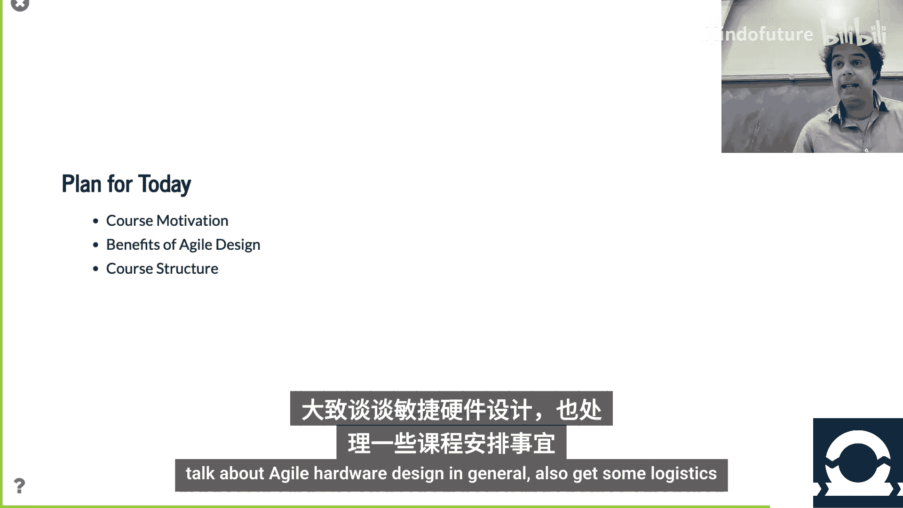

在本节课中，我们将要学习敏捷硬件设计的基本概念、课程目标以及整体结构。我们将探讨为何需要采用敏捷方法来设计硬件，并了解本课程将如何帮助你掌握这些技能。

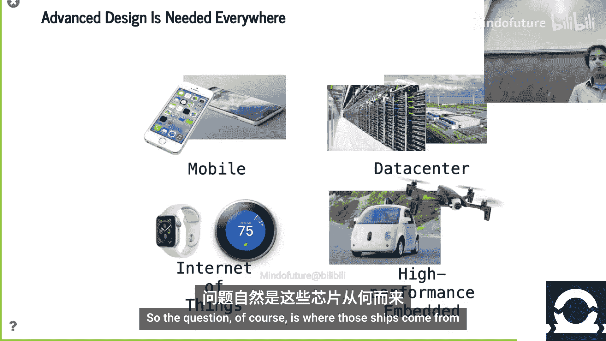

---

## 为什么需要敏捷硬件设计？

我们生活在一个极度数字化的时代，计算无处不在。从智能手机到物联网设备，再到数据中心，所有这些电子设备都由芯片驱动。那么，这些芯片从何而来？答案是我们需要设计它们。

随着应用场景的多样化，我们需要为各种不同的地方和应用设计芯片。这带来了几个关键挑战。

首先，你可能听说过摩尔定律。随着时间的推移，芯片制造技术的进步使我们能够以更低的成本获得更多的晶体管。几十年来，这确实是事实。然而，新闻头条也显示，这种进步开始放缓，遇到了一些阻碍。

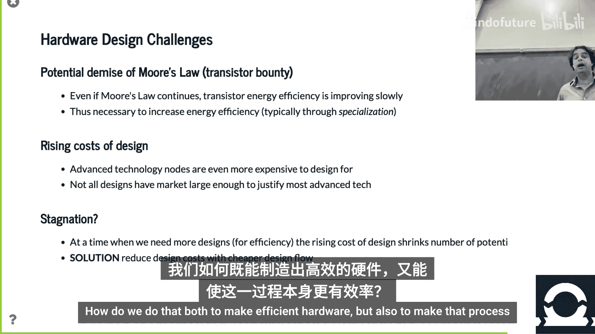

无论摩尔定律是继续还是放缓，近二十年来，我们一直面临着一个重大的能源挑战。我们想要进行的计算需要能量。除非我们提高效率，否则进行更多计算将需要更多能量。因此，我们的许多设计和架构都致力于如何提高效率，以便完成更多工作。

提高效率最经典的方法之一是**专业化**。与其使用可以处理任何事情的通用处理器，我们不如定制硬件，使其专门执行我们想要的任务。这种专业化使其更加节能。

然而，专业化也带来了一定的后果。转向设计层面，我们想要构建更多专用芯片，那么设计这些芯片需要什么？随着晶体管尺寸越来越小，设计它们实际上变得越来越困难。尽管我们使用了许多工具来辅助，但各种约束也随之出现。因此，芯片的设计成本不断上升。

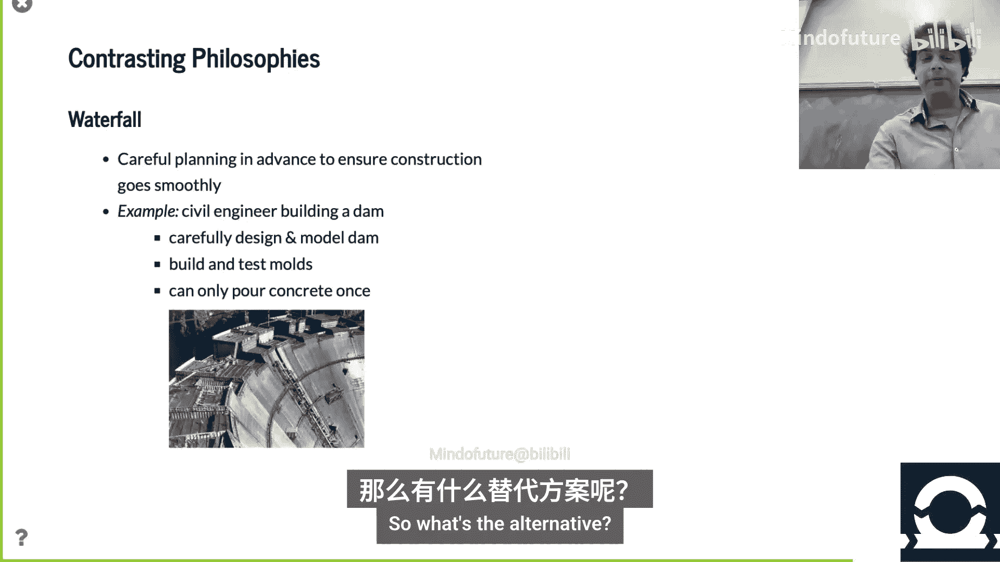

我们面临一个矛盾：一方面我们需要更多专用芯片，另一方面设计成本却在上升。如果无法解决这个问题，我们将面临一个可怕的后果：我们负担不起制造所需芯片的费用，一切可能停滞不前。

好消息是，这种情况并未发生。作为一个社区，我们已经找到了如何更高效、更富有成效地设计芯片的方法。因此，我们能够在提高生产力和效率的同时满足需求。以人工智能为例，对定制芯片的需求激增，这极大地激励了人们去解决这个问题，并且人们正在解决它。

本课程将探讨如何更高效地设计硬件，以及如何使设计过程本身更高效。

---

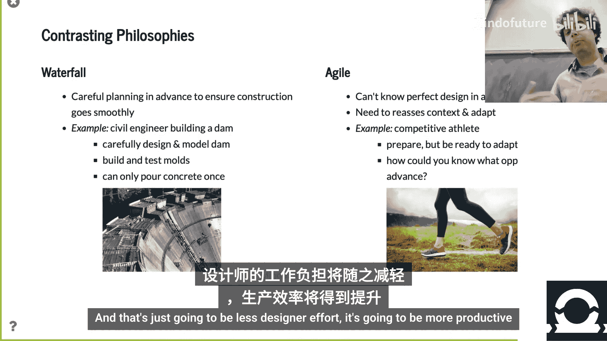

## 两种设计哲学：瀑布式与敏捷式

为了实现这一目标，我们可以从两种不同的设计风格来思考硬件设计，这不仅仅是硬件，更广泛地适用于工程领域。

经典的工程思维方式被称为**瀑布式技术**。其核心思想是进行非常周密的计划，确保每一步都正确无误，避免任何错误。这种方法在某些领域非常成功，例如土木工程。几百年前，桥梁会不时倒塌。随着土木工程变得更加严谨，能够防止这种情况发生，现在这类失败非常罕见。这是因为他们制定了非常详细的计划。

想象一下，你要建造一座大坝。你会进行所有建模、勘测和替代测试，每一步都非常谨慎。你会建造和测试模具，确保一切正确。如果一切都做对了，你就会得到一座坚固的大坝。但这里有一个关键约束：建造大坝时，你只能浇筑一次混凝土。一旦浇筑了数百万加仑的混凝土，大坝建成后，你就无法决定“我想把大坝向左移动一英尺”。这是不可能的。

那么，替代方案是什么？替代方案是**敏捷**。敏捷的理念是拥抱持续的变化和适应。敏捷哲学认为，你无法预先做出完美的设计。因此，你需要持续适应。这意味着你有一个迄今为止认为最好的计划，但这并不意味着没有计划，只是意味着你愿意并且能够在过程中改变计划。

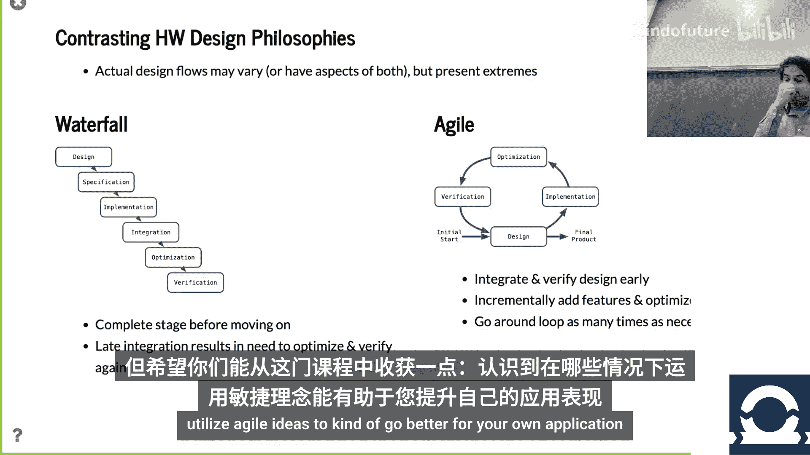

举个例子，想象一名竞技运动员。当然，你会训练，保持良好的状态。但因为你是在与对手竞争，你如何能提前知道他们会做什么？你会有一些预感，一些计划，但你无法完全确定。你能做的是，识别他们的行动，适应，然后超越他们。

这两种风格都有其适用的领域。选择哪种哲学取决于你所在领域的约束条件。在只能做一次的事情上，我强烈推荐瀑布式设计方法。例如，如果你只能浇筑一次混凝土，你肯定不希望浇筑后说“让我们把它移一英尺”。你做不到。

然而，涉及软件的事情并非如此。你可以持续地适应和修改。例如，我们现在使用的许多应用程序，无论是在云端还是移动端，几乎不再向我们用户公开版本号。我们有时甚至无法分辨它是什么版本，因为它一直在持续适应和修改。

许多年轻人可能不知道，在我年轻的时候，软件发布是巨大的瀑布式过程。微软会发布全新的操作系统，一切从头开始。瀑布式方法在软件中导致了如此多的灾难性失败，因为事实证明，当你能改变时，这种适应性的方法要高效得多。

本课程的全部前提是：如果我们能够认识到硬件设计的某些方面可以使其更容易改变，而不是一成不变，更容易调整，我们就可以拥抱敏捷哲学。敏捷哲学使我们能够更好地适应我们的需求。这不仅会减少设计工作量，还会提高生产力，所有好处都会结合在一起。

---

## 传统硬件设计与敏捷硬件设计实践

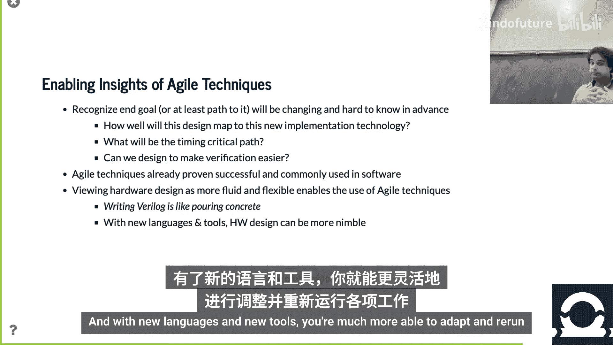

将上述抽象理念带入硬件设计的实践，我们来看看它们的具体表现。

传统的硬件设计是一个非常审慎的过程，一次一步，完成一步再进行下一步。你需要设计芯片，指定各个部分，分解所有模块，每个模块都有特定的组件和规则。然后，你分配任务给团队去实现这些部分，每个部分都会进行独立测试。接着，你开始集成它们，并再次进行测试。在将所有功能部分整合在一起后，你开始尝试优化它们，可能是单独优化，也可能是集成优化。最后，你验证整个设计。这种方法有效，我们确实用这种方法设计出了功能正常的芯片。

然而，这种方法本身并不易于改变。相比之下，想象一下更敏捷的硬件设计哲学：我们会先让设计运行起来，实现一些东西，优化它，验证它，然后我们会继续调整它。每次迭代，我们都会审视设计中不满意的地方，然后去改变设计、改变实现、优化它，当然，同时持续重新测试，并一遍又一遍地循环这个过程。直到我们找到满意的结果。

在瀑布式方法中，很难提前知道最终的性能、功耗或面积（这些是评估硬件的主要指标）会如何。你可以尽力建模，可以为某些方面设定预算，但直到整个东西集成完毕，你才能确定是否达到了这些目标。相比之下，在敏捷方法中，你经常经历整个过程，所以你总是知道自己的位置。可能你的第一个设计并不出色，也许你从一个非常简单的设计开始，只是为了通过工具流程，性能数据并不好。但你知道这些数据是什么，然后你可以去优化并设定目标。

你可能会看到我用手势画圈，这是因为我在谈论将设计过程作为一个循环，以及使用工具的过程。这是本课程的一个关键点。你可以看到课程标志也是一个循环。

---

## 敏捷为何对硬件设计有益？

那么，为什么敏捷如此有帮助？答案在于认识到，当你所处的环境不是一成不变，你可以重复某些事情时，敏捷就非常有用。例如软件，或者在本例中，硬件设计，你可以再次运行编译器，再次运行工具。

想象一下，当你开始绘制模块和组件时，你可能不知道你的关键路径是什么。直到你将这些设计通过工具，实际完成布局和布线，你才知道关键路径是什么。看看那条关键路径，也许其延迟时间在性能上是可接受的，那么你可以提前完成。如果不行，你可以去攻击它、改进它。

在硬件设计中，有很多事情直到你真正动手实践，开始让设计通过工具流程，你才能知道结果。这就是敏捷对硬件如此有益的原因：你可以知道进展如何，可以看到设计通过工具时获得了什么样的性能指标等等。

验证也是如此。在行业实践中，验证通常采用一种类似“对抗性团队”的方法：设计者完成他们想要的硬件，然后把它“扔过墙”给验证工程师。验证工程师负责验证所有这些RTL代码。你可能听说过，在软件中，开发工程师与验证工程师的比例通常是1:1，而在硬件中，通常是一个RTL编写者对应两个验证工程师。部分原因是编写RTL的人并不是编写验证代码的人，他们有时甚至不进行测试。这就像把东西扔过墙一样，效果并不好。

敏捷方法将验证更早地引入流程，将测试更早地引入流程，确保所有人都在同一页上。正如我反复强调的，敏捷已经在软件领域被证明是成功的。我应该澄清一下，当我提到敏捷时，我指的是这种迭代和修订的方法，而不是特别关注Scrum、速率等具体框架术语。更广泛地说，就是拥抱修订、根据需要调整计划这一理念。

这就是我开设这门课程的原因：如何使硬件设计变得更加流畅和灵活？有趣的是，如果我们看看当前常用的语言Verilog，我认为它就像浇筑混凝土。这种语言可以构建功能正确且可靠的硬件，但人类很难一次性写对它。尽管其规范超过1000页，但Verilog有很多未定义的行为。因此，为了使代码健壮，编写Verilog的人不断使用称为linting的工具来检查他们的代码，以确保没有违反语言规则，从而导向更安全的行为。这是一个非常谨慎的交付过程，一旦写正确了，你就不想再动它。

混凝土也是如此，如果形状和位置正确，它可以持续很长时间。罗马人的混凝土至今仍在使用。问题是，一旦它在那里，就很难修改。这不仅是因为它有多“脆”，还因为你还需要改变验证。有人已经验证了那段Verilog代码，一旦你改变了它，你就打破了验证的封印，现在你必须重新验证所有东西。

使硬件能够进行敏捷设计的是新的语言和工具。新的语言和工具使我们能够适应并重新运行设计。

---

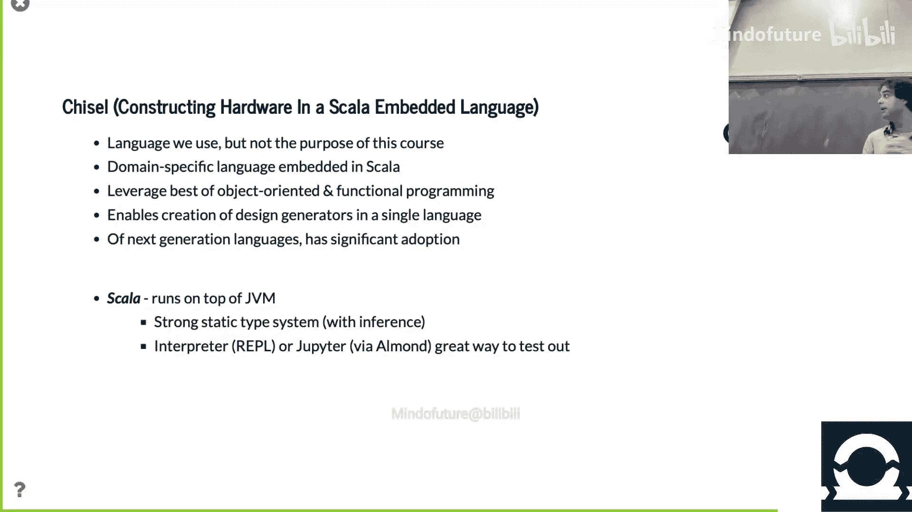

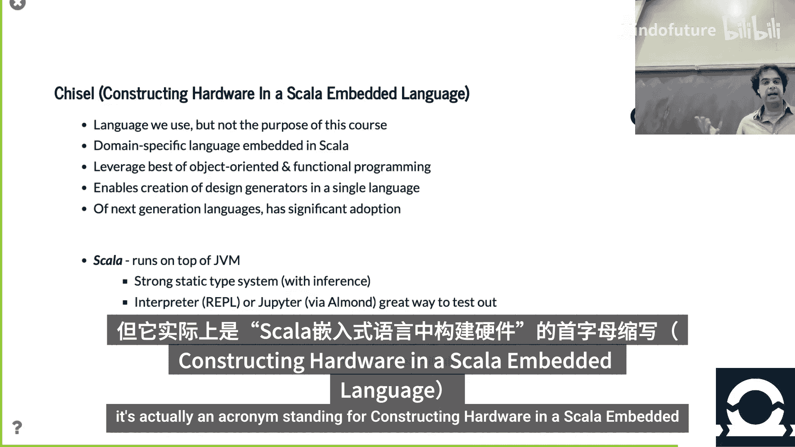

## 课程核心主题与目标

那么，我为什么如此热情地倡导敏捷硬件设计呢？原因如下：

1.  **降低设计成本**：目标是减少每单位人力工作所产生的设计记录，我们希望产出更多的硬件组件。通过敏捷方法，我们可以将精力集中在需要的地方。当你看到整个设计的成本时，你会知道哪些地方做得好，哪些地方不好，从而可以有针对性地改进，避免在不必要的地方过度优化。
2.  **获得更好结果**：在传统流程中，如果在设计后期集成时发现性能目标相差甚远，那将非常棘手。那时你能做的非常有限。你已经编写了所有RTL，验证了很多，现在却需要对架构进行大规模更改以达到性能目标，这简直是灾难。虽然你可以通过建模和计划来避免这种情况，但如果真的发生，你就会陷入困境。相比之下，采用更灵活的敏捷方法，你可以随时了解进展，并能在早期就认识到是否需要改变架构，从而避免陷入困境。它不仅能帮助你建模，还能让你使用真实的工具和设计来了解在这些方面的表现。
3.  **区分概念**：本课程正式讨论敏捷技术，即我们所说的快速迭代等。这是一个独立的概念。开源硬件设计是另一个我同样充满热情的概念。本课程广泛使用开源硬件设计工具，但这两个概念在技术上是正交的。你可以用闭源工具进行敏捷开发，也可以用开源工具进行瀑布式开发。当然，更常见的是在同一产品中混合使用专有工具/组件和开源工具/组件。对于本课程，我们专注于敏捷，并且我所教授的一切都是开源的，但课程内容同样适用于闭源工具。

作为一名学者，我对此感到兴奋，是因为它真正实现了硬件设计的民主化。长期以来，硬件设计一直局限于拥有昂贵商业工具的大公司。现在，突然间，工具是免费的、开源的，所以等等，你不再需要大公司，也不需要大的许可证密钥来访问这些工具。再加上敏捷方法，即使是小团队甚至个人也能完成很多工作。因此，进入门槛大大降低，你需要更小的团队、更低的成本。随着成本降低，可以有更多的人生产硬件，他们可以生产符合自己特定场景的硬件。也许世界上某个应用领域被当前的产品所忽视，你现在可以走出去，用免费工具低成本进入，当然，敏捷方法让你能用更小的团队高效工作。

这太棒了。作为一名学者，我对此感到非常兴奋。我们可以让更多人参与硬件设计，纳入更多声音，让更多人参与进来，从而获得更具创造性的设计。

---

## 实现重用：生成器的作用

实现敏捷的一个关键方法是重用。开发硬件模块最快的方法是什么？当然是重用你已经有的模块。与其重新编写一个模块，不如直接从库中取出已有的模块。这是硬件设计的标准实践，人们会授权使用IP（知识产权），即现有的硬件设计，并将其集成到自己的芯片中。这在很多地方都很棒，但也有一些注意事项。

如果你要重用某个组件，它最好能做你需要的事情。这是一个技巧。如果它实现了你90%的需求，听起来很接近，你可能会想“我就改那最后的10%”。但有时这非常痛苦，特别是当修改很困难时。为了重用，你需要确保你试图重用的东西能做你想做的事，并且做得“正确”。

另外，假设有人给了你IP，如果你要将其集成到设计中，你需要确保它是正确的，你需要有信心它是正确的。那么，我们如何实现这些呢？这就是重用的目标：我们希望拥有一个能做我们想做的事、并且正确、我们有信心它正确的东西。如果我们实现了所有这些，那就太好了，我们可以重用这些组件，这使硬件设计过程更加高效。作为硬件设计师，我将把更多时间花在设计新颖独特的部分，而不是重复造轮子。

你会惊讶地发现，当你查看不同公司的内部库和组件时，这些组件看起来极其相似，因为你可能有各种交叉开关，四端口、五端口、六端口等等。原因是他们想要确切的组合，而你会惊讶于他们经常重复造轮子，因为虽然你想要的东西存在，但你只想改变10%，而这10%的改变用现有技术可能出奇地痛苦。

那么，如何使重用更容易实现呢？答案是使用**生成器**，而不是单一的静态组件。生成器可以生成许多组件。生成器不是随意生成任何硬件，它是针对特定组件的，只是根据一些调整生成该组件的不同变体。你给它参数，它就会为你生成代码。这就是我们构建本课程的方向：构建硬件生成器。

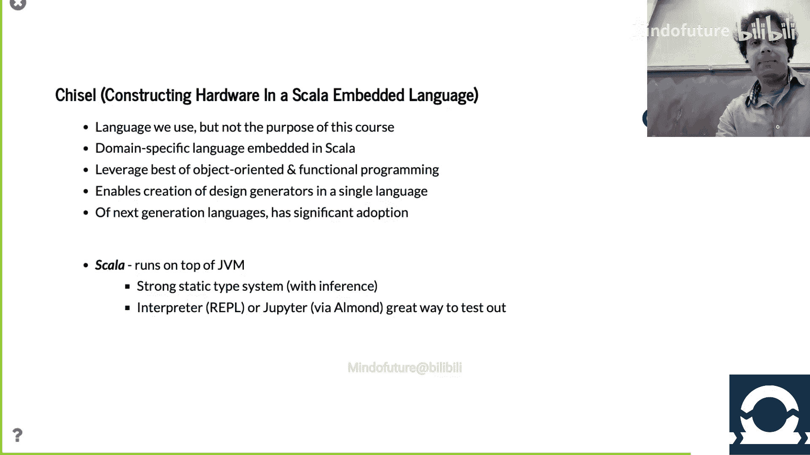

生成器的想法是，它比单一静态设计更灵活。更灵活意味着更具可重用性。通过能够根据我们的设计进行定制，我们可以在更多地方使用它。关于生成器的一个有趣之处在于，为了更具可用性，它们还有助于解决开源的第三个挑战。开源意味着你可以制作任何你想要的东西并放到网上，使其开源。但开源项目面临的一个挑战是获得足够的社区贡献。一个项目需要达到临界质量，即对足够多的人有用，才能吸引社区愿意回馈贡献。对于生成器来说，因为它更灵活，可以在更多地方使用，因此能够吸引更大的社区，有更多的人为其做出贡献。更大的社区将会有更大的组织来推动这项工作。

我预见到硬件设计的未来秘密在于生成器，这是让开源硬件真正普及的途径。设计生成是工具流程中的另一步。现在，工具流程是：将RTL交给综合工具等。而在RTL之前，将会有这个设计生成步骤。实际上，我们是在编写程序，而这些程序反过来为我们进行硬件设计。这不是任意的，它是在非常具体的计划控制下进行的，但这种灵活性仍然非常有帮助。

---

## 课程使用的工具：Chisel语言

在本课程中，我们将使用一种名为**Chisel**的语言。Chisel是一个缩写，代表“在Scala嵌入式语言中构建硬件”。我们在本课程中广泛使用这种语言。我想强调的是，本课程的目的不是学习Chisel本身，而是学习硬件设计，特别是敏捷硬件设计。Chisel是实现这一目标的绝佳工具。

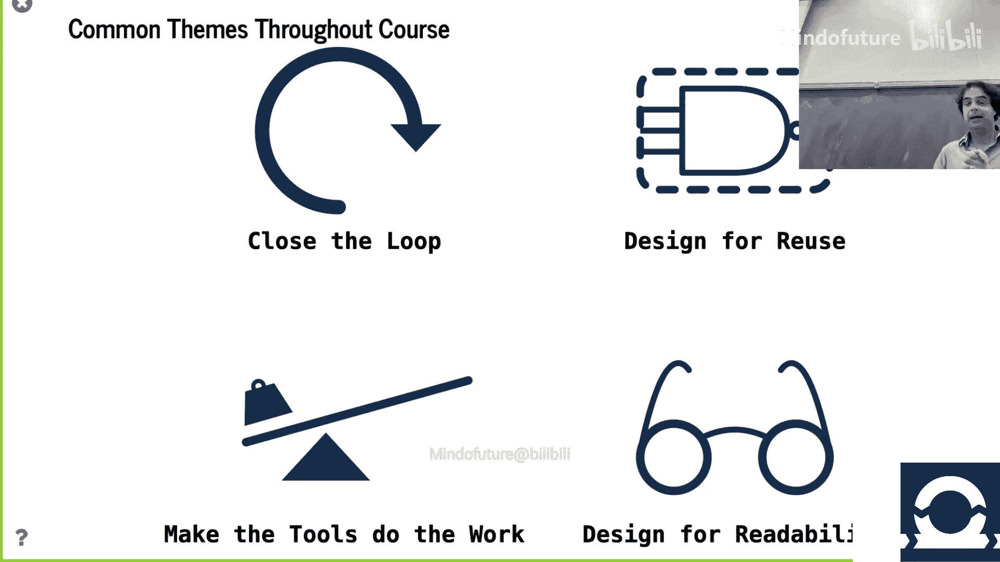

那么，Chisel是什么？它是一种硬件设计语言，更准确地说，是一种硬件构造语言，用于构建生成器。它嵌入在一种名为Scala的语言中。Scala是Java家族中非常流行的语言，运行在Java虚拟机（JVM）上，因此任何可以运行Java的地方都可以运行Scala。它有很多特性：强大的静态类型系统、类型推断，还有一个解释器。在本课程中，你会看到我在Jupyter笔记本中编写代码，今天的讲座以及所有实验都在Jupyter中进行。有一个叫做Almond的工具，可以在Jupyter中提供Scala支持。这就像是一个很棒的软件环境。

我选择Scala是因为它被设计成易于创建新语言。这种语言的许多特性都是为了让你轻松创建自己的语言而设计的。因此，当加州大学伯克利分校的研究人员构建Chisel时，他们发现Scala是实现这一目标的绝佳平台，所以他们选择将硬件描述语言嵌入到Scala中。自Chisel以来，已经出现了不少下一代硬件设计语言，其中大多数都嵌入在某种其他语言中，即采用嵌入式DSL的方法。所以，Chisel是本课程的选择，但现在有很多选择。

15年前，基本上只有Verilog或VHDL。而现在，人们正在尝试新事物，这很有趣，尝试新的语言，做新的事情。就像学习软件一样，学习更多编程语言会使学习额外的编程语言变得更容易。硬件设计也是如此，学习更多硬件设计语言会使学习额外的硬件设计语言变得更容易。

Chisel能够很好地融合软件导向编程的优点，如面向对象和函数式编程，并将其引入硬件领域。它使得创建生成器变得容易，而生成器是一个强大的概念，并且已经在工业界广泛部署。

在Verilog中，人们如何实现生成器？Verilog本身是描述性的。答案是，他们采用双语言方法，使用Python、Java、Perl甚至Tcl来拼接Verilog字符串，以生成他们想要的内容。这对于像交叉开关这样的东西是有效的，你可以想象如何编写脚本来生成你想要的正确Verilog文本字符串。人们这样做，在工业界广泛使用。然而，你可以想象，这非常脆弱。你用一种语言（比如Python）运行程序，然后它只是拼接字符串。没有关于字符串需要是什么的概念。相比之下，像Chisel这样的语言，我们能够使用像Scala这样的适当编程语言直接在该语言中进行硬件设计，而不是处理字符串。很多事情会变得更好：你有更强大的类型系统，这样做生成更安全，使用单一语言也更顺畅。

看看所有下一代硬件设计语言，正如我所说，它们大多数都是嵌入式的，而不是独立的语言，正是因为他们想要构建生成器的能力。

对于那些不熟悉Chisel的人，它最初由加州大学伯克利分校构建，现在被一家名为SiFive的公司广泛使用，SiFive是主要的RISC-V公司之一。它已被谷歌和IBM部署在产品中，英特尔也尝试过但尚未发布产品。所以，这是一种有趣的语言，有一些有趣的采用案例。

正如我所说，对于本课程，我们更侧重于学习这种新浪潮的硬件设计，这种非常以软件为中心的硬件设计风格，而不是仅仅学习Chisel语言。如果你去工业界，他们可能使用其他下一代语言，但Chisel会帮助你入门。

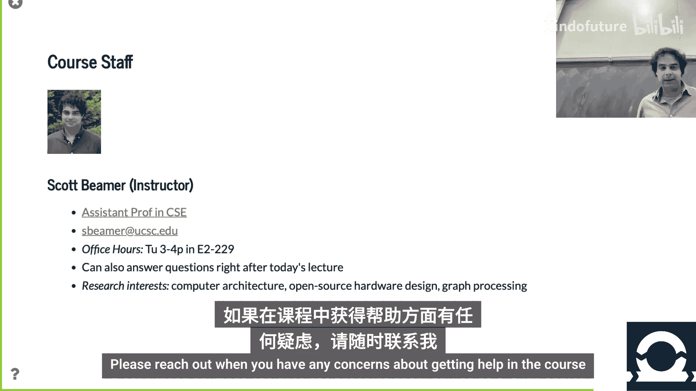

---

## 课程核心主题总结

本课程的核心主题可以总结为以下几点，我将经常用手势画圈来强调：

1.  **尽早闭合循环**：我所说的“闭合循环”指的是敏捷设计循环。换句话说，尽快让你的设计的某些方面在工具中运行起来，无论是在仿真中还是在物理设计流程中。一旦循环闭合，你有了结果，你就知道下一步应该把精力集中在哪里。我们将讨论如何将长期设计目标简化，以便尽早闭合循环，然后逐步增加功能和优化，以达到你想要的目标。
2.  **设计可重用性**：通过生成器实现。我们如何设计组件以最大限度地实现可重用性？这就是为重用而设计。
3.  **让工具完成工作**：自动化是关键。人工智能并不是自动化的第一次浪潮，硬件设计中已经有大量的自动化。看看硬件设计的历史，第一个晶体管大约由12个人设计，12个工程师对应1个晶体管。而现在，像苹果最新的芯片有数百亿个晶体管，由数百名甚至几千名工程师设计。从每个工程师对应的晶体管数量来看，这个数字飙升到了屋顶。这只有通过设计自动化才有可能实现。有各种各样的软件在进行这种自动化。本课程的目标是认识这些工具能做什么，它们提供了什么，以及我们如何最好地使用它们。在本课程中，使用Chisel语言使我们更容易创建硬件生成器，我们可以将以前只有人类必须做的事情交给工具来完成。当然，很多人对人工智能感到兴奋，人工智能肯定会在硬件设计中提供帮助，这又是另一种让工具完成工作的形式，即拥抱自动化。
4.  **注重代码可读性**：你们都知道，代码被阅读的次数远远多于被编写的次数。因此，我们将讨论如何构建我们的设计，不仅是为了更高的性能和更强的健壮性，也是为了如何使代码更具可读性。你们将大量接触到我认为什么使代码更易读或更难读的观点。希望你们中的一些人会同意，一些人会不同意，这很好，我们可以进行讨论。

这些是核心主题：尽早闭合循环、让工具完成工作、通过生成器使我们的设计可重用，以及使我们的实际代码易于阅读。

---

## 课程结构与要求

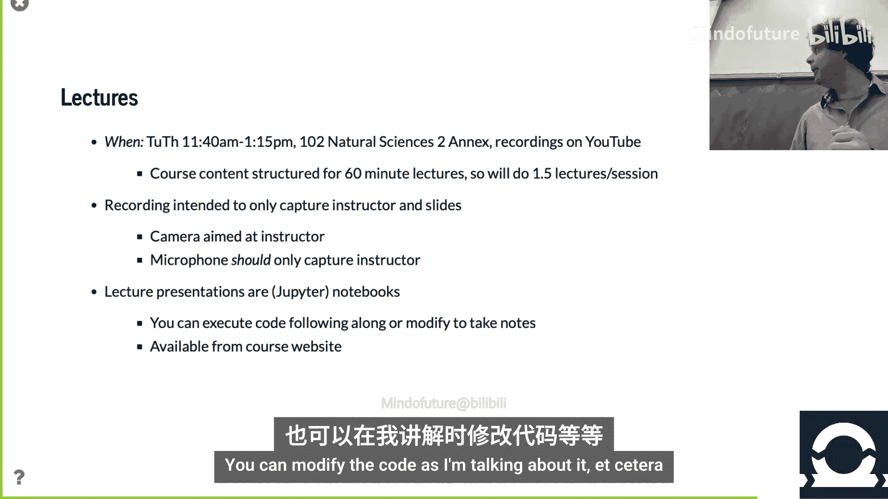

现在进入更具体的后勤部分。谁应该学习这门课程？首先是对材料感兴趣的人。我认为有三类先验经验是有帮助的：

1.  **硬件设计经验**：使用过Verilog或VHDL等语言。在加州大学圣克鲁兹分校，这对应于CSE 100或125等课程，当然还有CSE 225（125的研究生版本）。有这些经验不仅足够，甚至可以说是绰绰有余。如果你上过225，那很好，你为本课程做好了准备。
2.  **计算机体系结构知识**：理解我们试图在硬件中构建什么是有用的。例如，在圣克鲁兹分校，本科生有CSE 12，研究生有CSE 124。在本课程中，我喜欢构建处理器，喜欢构建RISC-V处理器，但这并不是我们课程要做的。我们构建超低功耗设计，但坦率地说，我们不构建ISA驱动的处理器，原因有几个：首先，很多新兴硬件不是处理器；其次，处理器有很多现成的东西，比如我们知道流水线，我们想构建特定级数或特定技术，所以最终，这实际上是一个更受限制的空间。你会看到，我对硬件的看法要广泛得多，实际上有更多尝试新事物的有趣机会。所以，我不想设置不必要的障碍。总的来说，理解硬件的基本概念，比如组合逻辑、寄存器、多路复用器是什么，如何将它们连接在一起等等。
3.  **高级编程经验**：本课程将利用面向对象编程和函数式编程。所以，我们希望你有这方面的经验。

如果你具备以上三项中的两项经验，那就太好了。如果你三项都有，那太棒了，你已经是一个罕见的人才了，因为通常根据你的背景，你可能更偏向电气工程、计算机工程或计算机科学培训。本课程的目标是将这些领域融合在一起。我很感激这门课程吸引了来自所有这些不同领域的学生。所以，如果你具备三项中的两项经验，你的状态很好。如果你只有一项经验，但感兴趣，我们很可能也能让你跟上。我教过这门课的学生中，有人完全没有硬件经验。他们是重返校园攻读研究生学位的行业人士，没有上过任何硬件设计课程或体系结构课程，但他们是专业的Scala开发人员。他们觉得课程有趣，阅读了Chisel的Scala源代码，他们花了时间，做得很好。我希望这门课程具有包容性，很高兴与你们讨论你们的背景。

即使这门课不完全关于硬件设计，希望你们也能拥抱这些敏捷方法，并看看它们如何应用到其他地方。

---

## 课程评估与项目

本课程的结构分为两部分。前三分之二的季度是结构化部分，你们将有像今天这样的讲座（尽管每周两次课，但内容相当于每周三讲）。然后，我们将转向项目部分。整个课程的重点实际上是项目，之前的部分只是训练你们为项目做好准备。

课程计划总是会根据需要改变和调整。例如，我的一位同事有一门课程时间完全冲突，如果有研究生想同时选修两门课，我们正在协调。

课程作业有三种类型。在结构化部分，你们每周会有一个实验和一个作业。实验设计得简单轻量，旨在直接尝试某个功能，快速且独立地完成。作业则涉及更多的编码。这是课程的初始部分。然后，你们将转向项目。项目可以单独完成，也可以与伙伴合作完成，我鼓励合作但不强制要求。在项目过程中，我们会提供一些支持，比如项目提案、反馈、代码审查等。最终，你们将构建一个项目，并在课程结束时进行展示。你们可能会注意到，这个列表中没有考试。作为一门研究生课程，我不要求考试。我认为用考试来评估这些材料是一种很奇怪的方式。

从评分权重可以看出，这门课程主要侧重于你们的项目。希望你们能做出很棒的项目。

---

## 课程资源与支持

我们拥有多种网络资源。首要去处是课程公共网站，一个静态HTML页面。所有内容都在那里，包括讲座录像、作业链接。我还编写了关于如何安装Chisel或各种工具的额外内容。这些完全对互联网开放，任何在YouTube上观看的人都可以访问。

对于在圣克鲁兹分校正式注册的学生，我们还有Canvas。Canvas的主要作用是显示你们的成绩，并通过Gradescope提交作业。在课程交流方面，我们有一个Slack。我想很多人已经加入了，邀请链接在Canvas网页上。这是一个寻求帮助的好方式，有不同作业类型的频道，你们可以向同学提问，我也会尽量快速回答。这是获得帮助的好方法。

---

## 总结

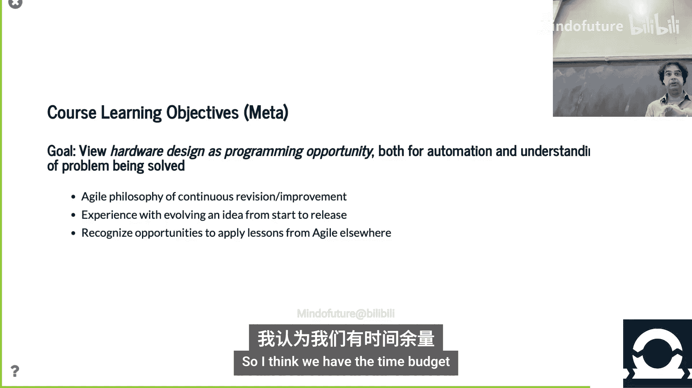

本节课中，我们一起学习了敏捷硬件设计的基本理念、其相对于传统瀑布式方法的优势，以及本课程的核心目标与结构。我们探讨了通过生成器实现设计重用、使用Chisel作为敏捷设计工具，并了解了课程的具体安排和评估方式。希望你们对即将开始的学习旅程充满期待，准备好拥抱硬件设计的敏捷未来！