# 005：时序电路

在本节课中，我们将要学习时序电路，即包含状态的电路，例如寄存器。我们将探讨如何在Chisel中实现寄存器，构建带有寄存器的组件，并设计状态机。最后，我们将学习如何在仿真中观察电路行为，包括使用打印语句和波形图。

---

## 寄存器基础

上一节我们介绍了组合逻辑，本节中我们来看看如何存储数据。寄存器是硬件中存储数据的基本单元。我们熟悉的寄存器模型是：在时钟的上升沿，输入端的值会被捕获并成为寄存器的输出值，直到下一个上升沿到来。

寄存器通常还包含其他功能，例如复位和写使能。复位信号可以将寄存器设置为一个已知的初始值。写使能信号可以控制寄存器是否在时钟沿更新其值。

在Chisel中，时钟和复位信号通常是隐式处理的，这意味着它们会自动连接到设计中的所有模块。这是最常见的情况，因为大多数设计都使用同一个时钟和复位信号。当然，Chisel也支持多时钟域和同步复位，但本课程不要求掌握这些高级特性。

---

## 在Chisel中声明寄存器

在Chisel中，有几种声明寄存器的方式，它们最终都会生成一个寄存器，区别在于集成的功能多少。最基本的方法是实例化一个`Reg`组件并进行连线。

以下是声明一个简单寄存器的代码：
```scala
val reg = Reg(UInt(4.W))
reg := io.in
io.out := reg
```

对应的Verilog代码会推断出一个正边沿触发的D触发器。在Verilog中，寄存器是通过特定的`always`块语法推断出来的，而不是直接实例化。

如果想为寄存器指定复位值，可以使用`RegInit`：
```scala
val reg = RegInit(0.U(4.W))
reg := io.in
io.out := reg
```

`RegNext`可以更简洁地同时指定复位值和下一个输入值：
```scala
val reg = RegNext(io.in, 0.U)
io.out := reg
```

如果需要写使能功能，可以使用`RegEnable`：
```scala
val reg = RegEnable(io.in, 0.U, io.enable)
io.out := reg
```

这些不同的构造方法都是为了简化代码，你可以根据需求选择最合适的一种。

---

## 构建计数器

现在，让我们应用寄存器来构建一个计数器。计数器的功能是：在使能信号有效时，每个时钟周期计数值加一，达到最大值后归零。

以下是计数器的一个初始实现，它使用了多个多路选择器来处理复位、使能和归零逻辑：
```scala
class Counter(maxVal: Int) extends Module {
  val io = IO(new Bundle {
    val enable = Input(Bool())
    val out = Output(UInt())
  })
  val width = log2Ceil(maxVal + 1)
  val count = Reg(UInt(width.W))
  val nextVal = Mux(count < maxVal.U, count + 1.U, 0.U)
  val nextValEn = Mux(io.enable, nextVal, count)
  val nextValReset = Mux(reset.asBool, 0.U, nextValEn)
  count := nextValReset
  io.out := count
}
```

我们可以通过使用`RegInit`来简化复位逻辑，从而减少一个多路选择器：
```scala
val count = RegInit(0.U(width.W))
val nextVal = Mux(count < maxVal.U, count + 1.U, 0.U)
val nextValEn = Mux(io.enable, nextVal, count)
count := nextValEn
```

更优雅的方式是使用Chisel的`when`语句，它能让代码意图更清晰：
```scala
val count = RegInit(0.U(width.W))
when(io.enable) {
  when(count < maxVal.U) {
    count := count + 1.U
  }.otherwise {
    count := 0.U
  }
}
io.out := count
```

我们也可以使用`RegEnable`在一行内完成，但代码可读性会降低：
```scala
val count = RegEnable(Mux(count < maxVal.U, count + 1.U, 0.U), 0.U, io.enable)
io.out := count
```

以下是测试该计数器的一个例子：
```scala
test(new Counter(3)) { c =>
  c.io.enable.poke(true.B)
  c.clock.step()
  c.io.out.expect(0.U)
  c.clock.step()
  c.io.out.expect(1.U)
  c.clock.step()
  c.io.out.expect(2.U)
  c.clock.step()
  c.io.out.expect(3.U)
  c.io.enable.poke(false.B)
  c.clock.step()
  c.io.out.expect(3.U)
}
```
`clock.step()`用于让仿真时间前进一个时钟周期。你可以传递一个整数参数来前进多个周期。

---

## 枚举与状态机

为了构建清晰的状态机，我们使用枚举来为状态值赋予有意义的名称，而不是使用难以理解的数字。

在Chisel中，使用`ChiselEnum`来定义枚举：
```scala
object RaccoonAction extends ChiselEnum {
  val Hiding, Wandering, Rummaging, Eating = Value
}
```
枚举值默认从0开始自动分配，你也可以显式指定值，例如`val Eating = Value(5)`。枚举的主要优势是提供了单一的真相来源，使代码更易于维护和理解。

现在，让我们实现一个浣熊行为状态机。该状态机有四个状态：躲藏、徘徊、翻找和进食。输入信号包括：噪音、发现垃圾桶、发现食物。输出是当前的行为状态。

以下是使用`when`语句实现的状态机：
```scala
class RaccoonFSM extends Module {
  val io = IO(new Bundle {
    val noise = Input(Bool())
    val trash = Input(Bool())
    val food = Input(Bool())
    val action = Output(RaccoonAction())
  })
  val state = RegInit(RaccoonAction.Hiding)
  when(state === RaccoonAction.Hiding) {
    when(!io.noise) { state := RaccoonAction.Wandering }
  }.elsewhen(state === RaccoonAction.Wandering) {
    when(io.noise) { state := RaccoonAction.Hiding }
      .elsewhen(io.trash) { state := RaccoonAction.Rummaging }
  }.elsewhen(state === RaccoonAction.Rummaging) {
    when(io.noise) { state := RaccoonAction.Hiding }
      .elsewhen(io.food) { state := RaccoonAction.Eating }
      .otherwise { state := RaccoonAction.Wandering }
  }.elsewhen(state === RaccoonAction.Eating) {
    when(io.noise) { state := RaccoonAction.Hiding }
  }
  io.action := state
}
```

使用`switch`语句可以使代码结构更整齐：
```scala
switch(state) {
  is(RaccoonAction.Hiding) {
    when(!io.noise) { state := RaccoonAction.Wandering }
  }
  is(RaccoonAction.Wandering) {
    when(io.noise) { state := RaccoonAction.Hiding }
      .elsewhen(io.trash) { state := RaccoonAction.Rummaging }
  }
  is(RaccoonAction.Rummaging) {
    when(io.noise) { state := RaccoonAction.Hiding }
      .elsewhen(io.food) { state := RaccoonAction.Eating }
      .otherwise { state := RaccoonAction.Wandering }
  }
  is(RaccoonAction.Eating) {
    when(io.noise) { state := RaccoonAction.Hiding }
  }
}
```

---

## 仿真调试：打印与波形

在硬件设计中，调试至关重要。Chisel提供了两种主要的仿真调试方法：打印语句和波形图。

打印语句适用于快速查看特定时刻的值。你可以在Scala代码生成阶段使用`println`，或者在仿真运行时使用Chisel的`printf`。

以下是仿真时使用`printf`的例子：
```scala
val count = RegInit(0.U(8.W))
when(io.enable) {
  count := count + 1.U
  printf(p"Incrementing from $count\n")
}
```
`printf`支持传统的C风格格式符（如`%d`），也支持更现代的字符串插值（使用`p`前缀）。

波形图能提供整个仿真过程中所有信号的变化历史，是更强大的调试工具。要生成波形，需要在测试中启用`WriteVcdAnnotation`：
```scala
test(new MyModule).withAnnotations(Seq(WriteVcdAnnotation)) { c =>
  // ... 测试逻辑
}
```
运行测试后，会生成一个`.vcd`文件。你可以使用波形查看器（如GTKWave、Surfer或厂商工具）打开这个文件，直观地观察时钟、复位、数据等所有信号随时间的变化。

需要注意的是，打印和波形主要用于**调试**。而最终的**测试**应该是自动化的，使用`poke`和`expect`来验证电路行为是否符合预期，无需人工检查输出。

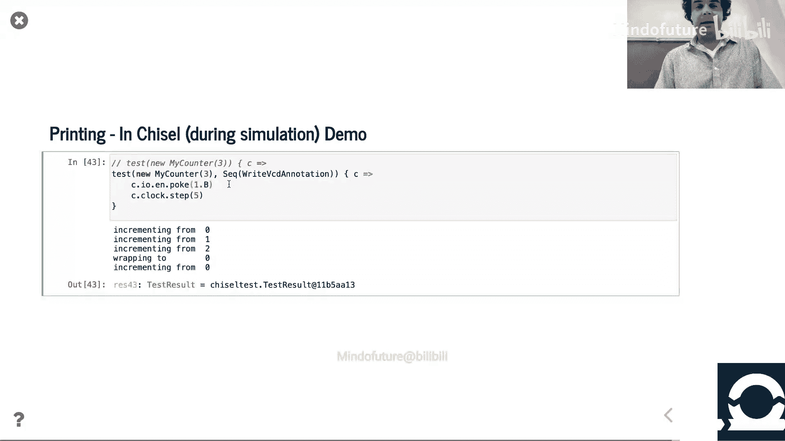

---

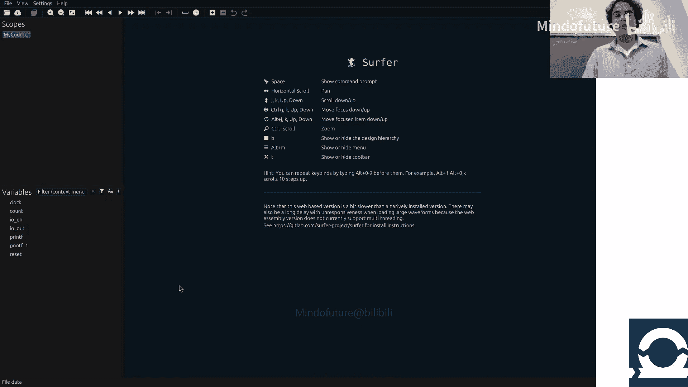

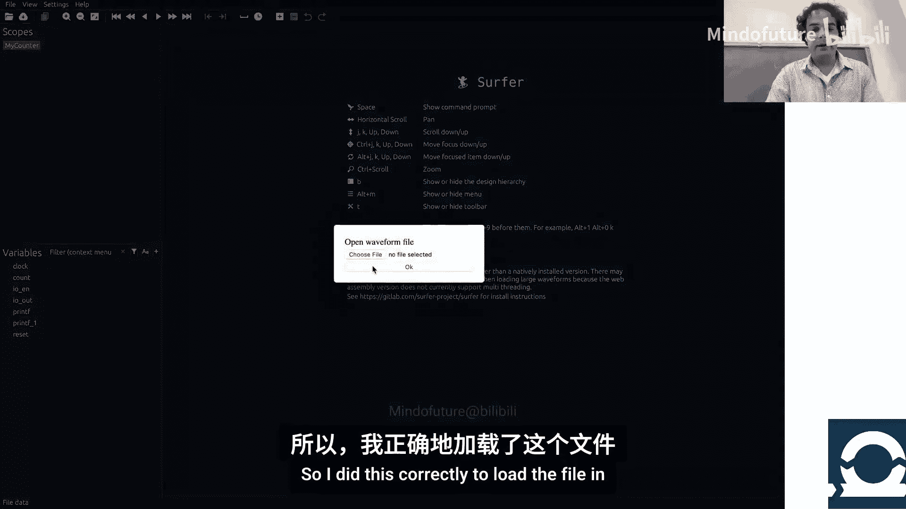

## 数值字面量表示

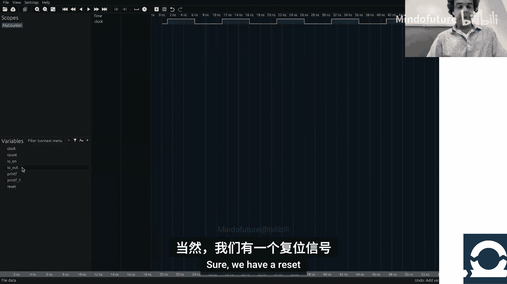

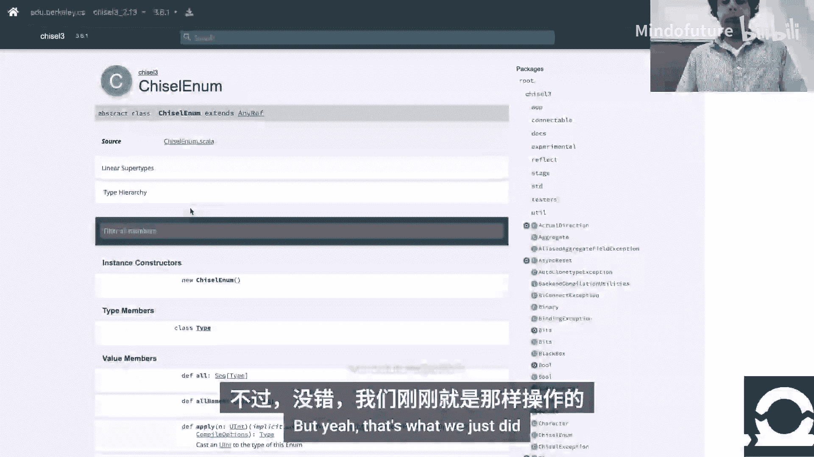

在编写测试或硬件代码时，我们经常需要使用各种格式的数值。Chisel提供了灵活的数值字面量表示方法：

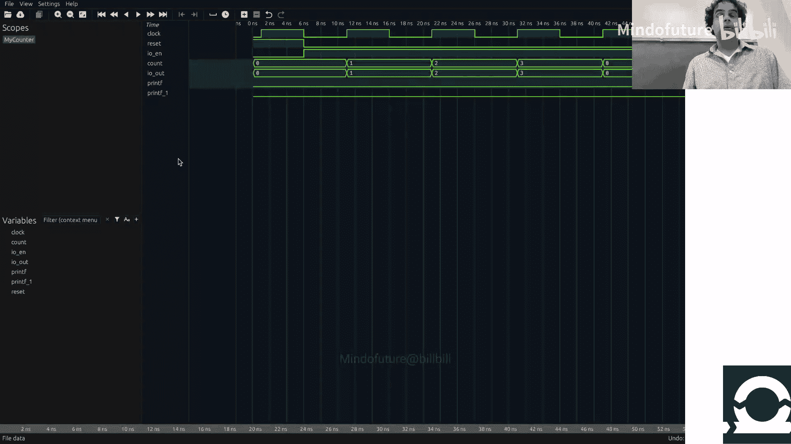

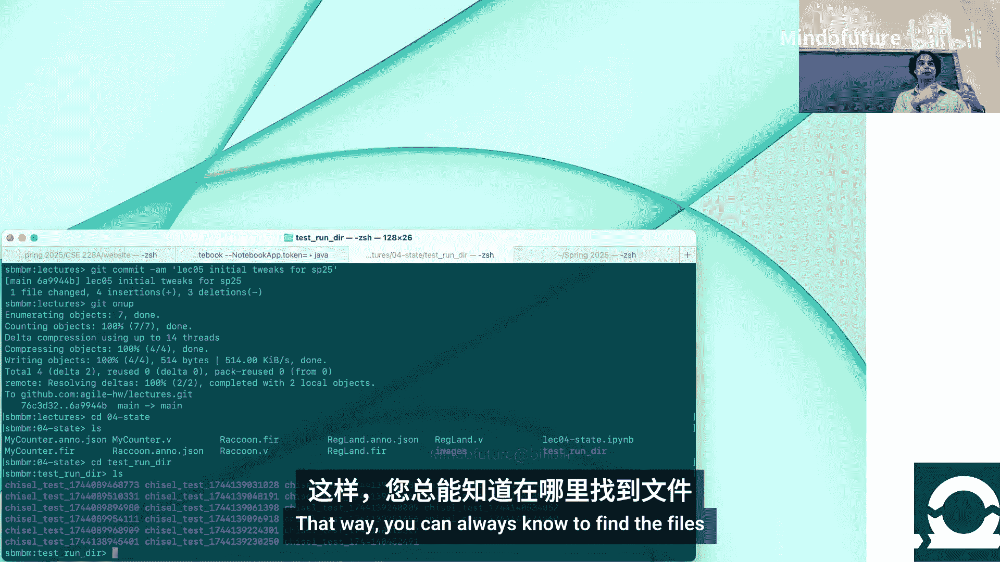

*   十进制：`5.U`， `-3.S`
*   十六进制：`"hdeadbeef".U`
*   二进制：`"b1010".U`
*   八进制：`"o777".U`
*   你可以在字符串中使用下划线提高可读性：`"hff_ee_dd_cc".U`
*   可以显式指定位宽：`"h1f".U(8.W)` 或 `5.U(8.W)`

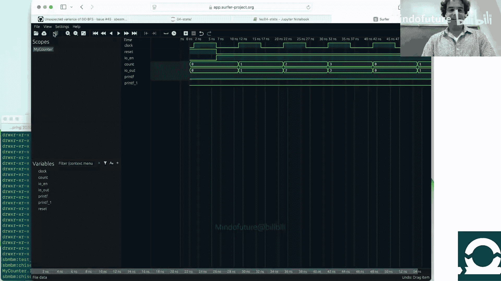

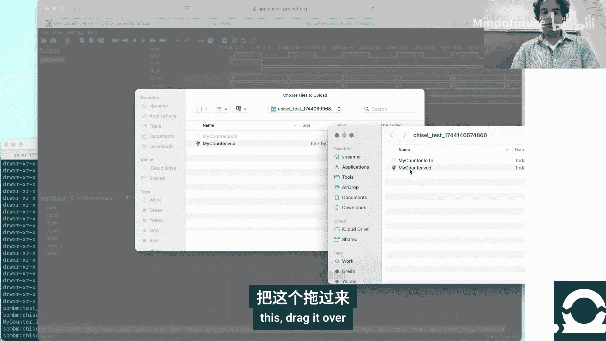

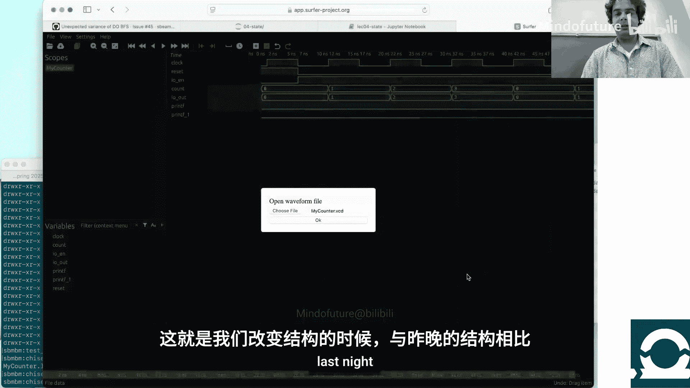

---

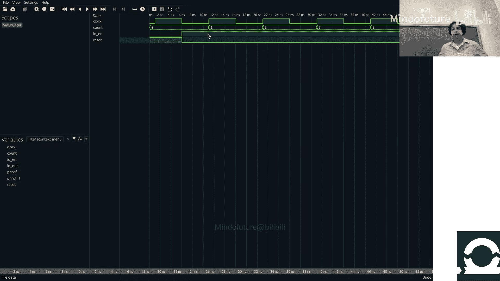

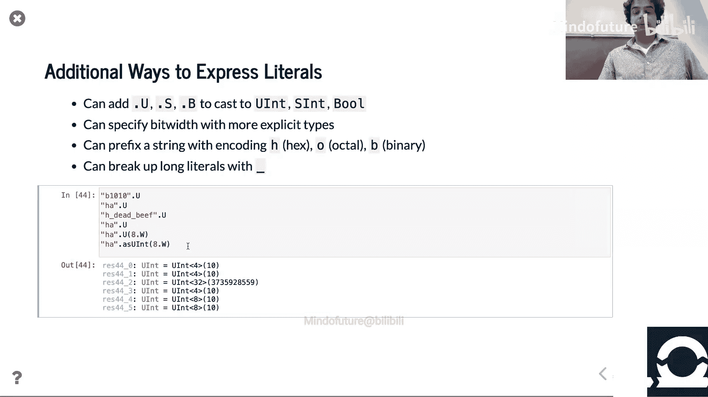

本节课中我们一起学习了时序电路的核心——寄存器，探讨了在Chisel中声明寄存器的多种方式，并利用寄存器构建了计数器和状态机。我们还介绍了如何使用枚举使状态机代码更清晰，以及如何进行仿真调试，包括打印关键信息和生成波形图进行可视化分析。掌握这些内容是设计复杂数字系统的基础。