# 008：硬件中间表示 (IR) 🧠

在本节课中，我们将要学习硬件设计中的一个核心概念：硬件中间表示。我们将探讨为什么需要它，它如何工作，以及它如何帮助我们构建更强大、更灵活的硬件设计工具。

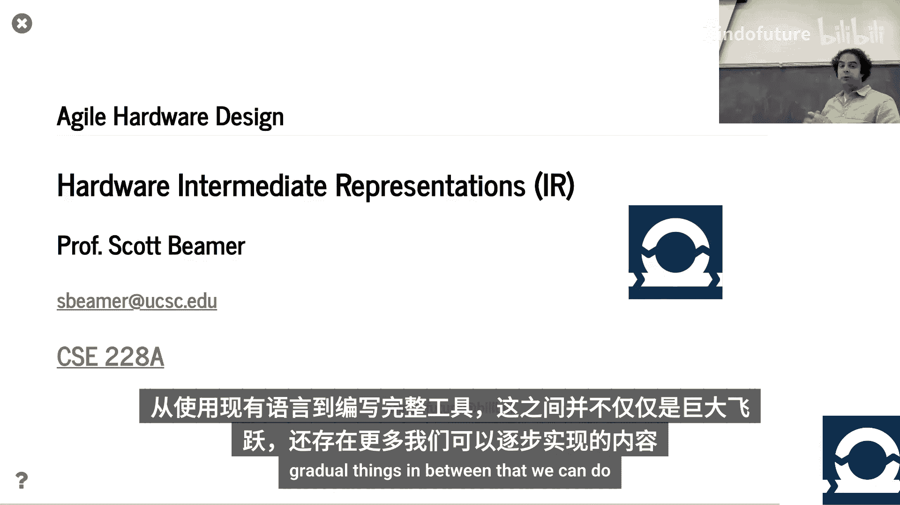

---

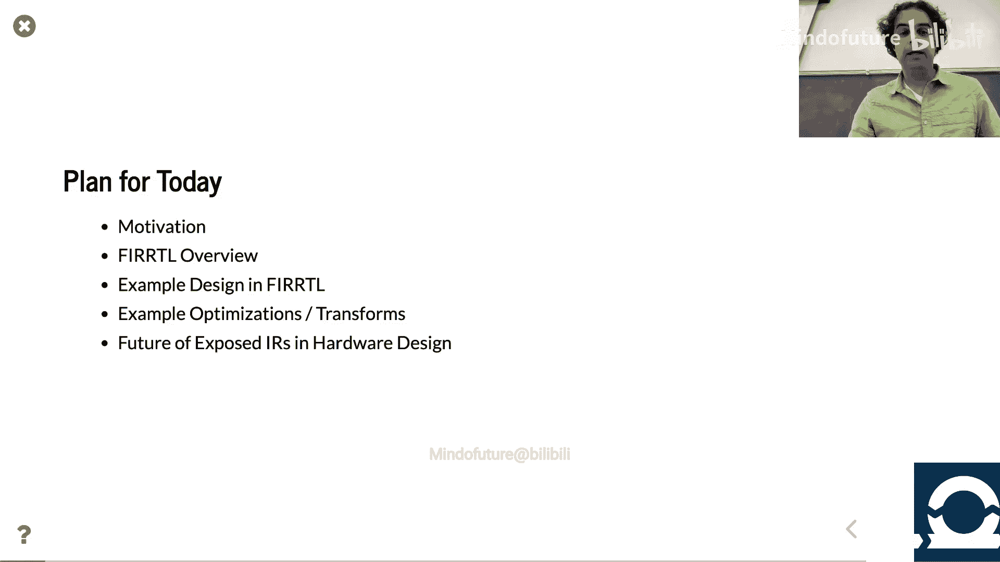

## 课程概述

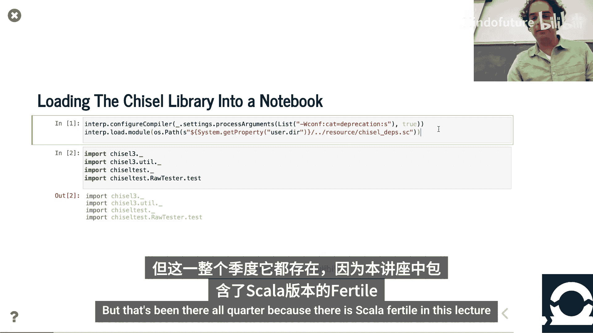

到目前为止，我们一直在宣扬采用更程序化的视角来构建硬件。使用 Chisel 这样的语言，你可以构建“生成器”，而不是构建单个硬件实例。我们构建的是一个可以根据某些规则生成任意硬件的程序。核心思想是，我们利用软件的最佳实践，使硬件设计更具生产力、更正确等等。

Chisel 是一个非常棒的工具。今天我们要讨论的是超越 Chisel 本身。这意味着什么？展望未来，构建你自己的硬件设计工具是可能的，并且我们可以在从使用一门语言到编写整个工具之间，找到一些更渐进的、可以做的事情。

上一节我们介绍了程序化生成硬件的理念，本节中我们来看看如何通过硬件中间表示来增强和扩展这种能力。

---

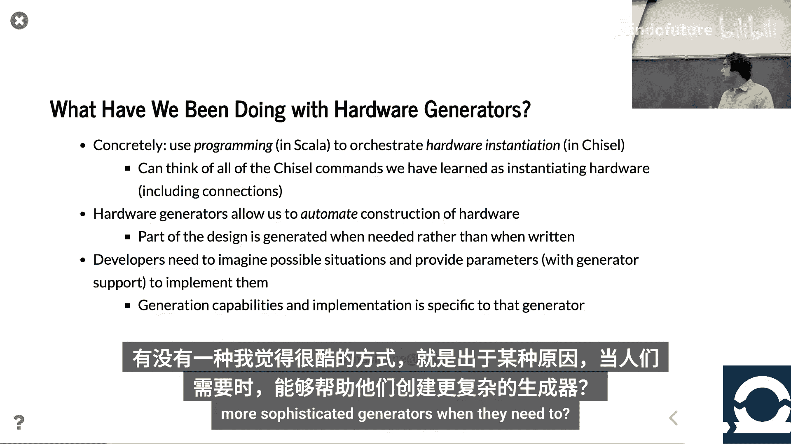

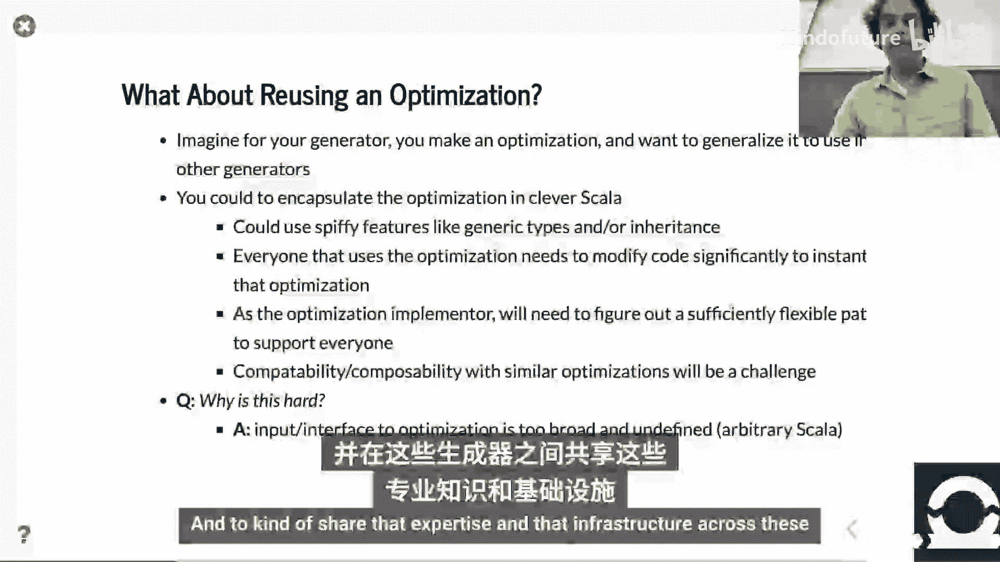

## 为什么需要超越生成器？🤔

我们一直在使用编程来实例化硬件。在 Chisel 中，我们编写 Scala 程序来编排硬件的生成。生成器非常棒，我们可以自动化连接和实例化。

生成器的好处在于，我们可以让设计是“生成的”，而不是反复重写。随着你构建这些生成器，你会不断改进它们。

然而，你可能会遇到一些情况：你想要实现的灵活性和功能超出了你目前所知的范围。为了处理更特殊、更复杂的场景，你可能需要编写大量代码，最终得到一个非常复杂、非常精巧的生成器。所有这些精力和洞察力都被锁定在那个特定的生成器里。

如果能有一种方法，让人们能够在需要时构建更复杂的生成器，并跨项目共享这些专业知识和基础设施，那将会非常酷。

---

## 从生成器到工具 🛠️

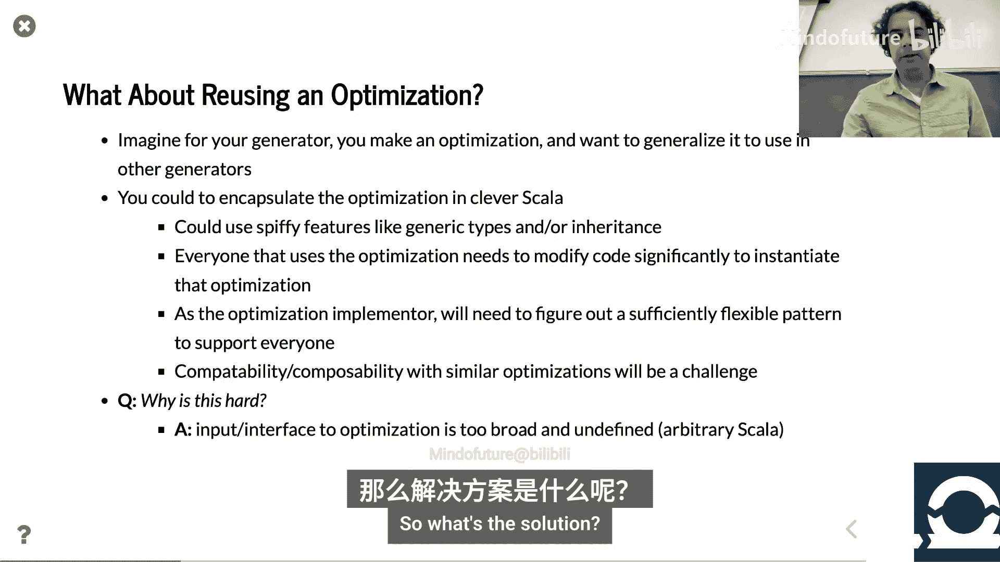

让我们更具体地思考一下。想象你正在构建一个生成器。它不仅仅是生成硬件，你还需要花时间运行设计通过一些 CAD 工具。你发现：“等等，这个效率不如我预期。这是一个关键组件，我需要花时间优化它。”

于是你进去做了一个优化。如果你的生成器不只是提交这个设计，而是提交一个经过优化的设计。然后你意识到：“你知道吗，其他生成器可能也想做同样的优化。”

突然之间，你面对的是一个完全不同类型的东西。到目前为止，在这门课程中，我们一直在讨论生成器，它们生成提供特定功能的组件。但现在，我想要的不是一个生成器，而是一种可以应用于其他代码以优化它的代码。我有了关于优化是什么样子的洞察，我想在其他生成器中重用这个优化。

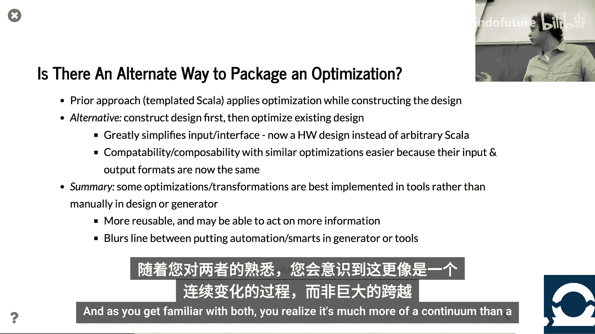

如果你非常聪明，是一个优秀的 Scala 程序员，你可能会尝试在 Scala 中完成这一切。你可以创建一个非常精巧的 Scala 类，它有一些泛型特性，也许通过继承，这样如果其他人想构建一个使用我的优化的生成器，他们只需要扩展我的类并实现某些抽象方法。

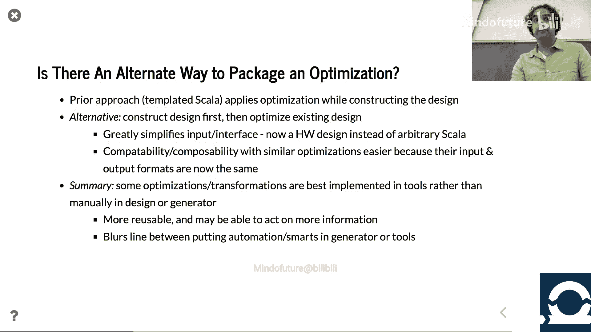

起初，这似乎可行。但很快你就会遇到一些真正的挑战，例如兼容性和可组合性。如果你的优化是一个类，而其他人想在他们的生成器中使用两个优化怎么办？Scala 不支持多重继承。虽然可以继承多个特质，但如果你需要你的优化能感知其他优化，事情就开始变得复杂。

另一个问题是作用域和复杂性。在生成器内部，阶段可能很复杂。Scala 本身是一个非常大的领域，要处理任意的 Scala 类是非常困难的。

那么解决方案是什么？

---

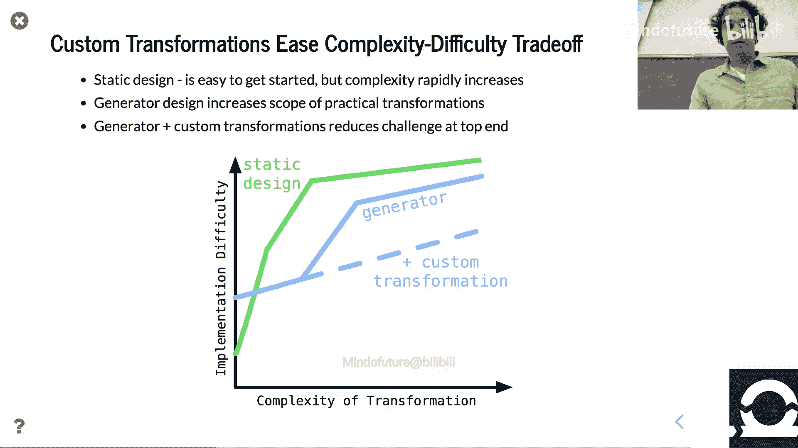

## 转变思路：先构建，后优化 🔄

答案是，重新思考你的自动化流程如何融入。我之前提出的方法是：在构造设计时，将优化作为 Scala 模板应用。另一种方法是：**如果我先构造一个设计，然后在它存在之后再进行优化呢？**

现在，我的优化过程的输入输出行为发生了变化。之前，输入输出是生成器的 Scala 接口，这非常复杂。现在，输入输出变成了：我接收一个硬件设计，然后输出一个硬件设计。这是一个更简单、更受限的领域。

你现在也可以看到它如何变得更兼容、更可组合。如果有人想使用多个优化，他们可以按顺序调用多个优化。优化一接收硬件设计，优化它，然后优化二接收优化后的设计并进行第二次优化，这没有问题，因为这些工具现在都操作设计本身，而不是任意的生成器。

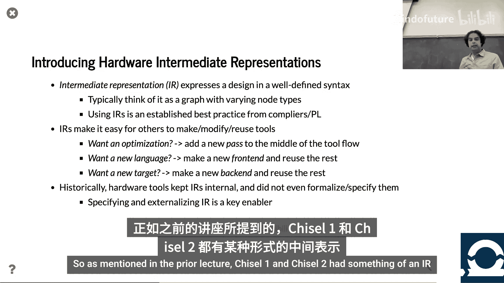

换句话说，有时你想构建的不是一个生成器，而实际上是一个**工具**。一个接收设计并修改该设计的工具。

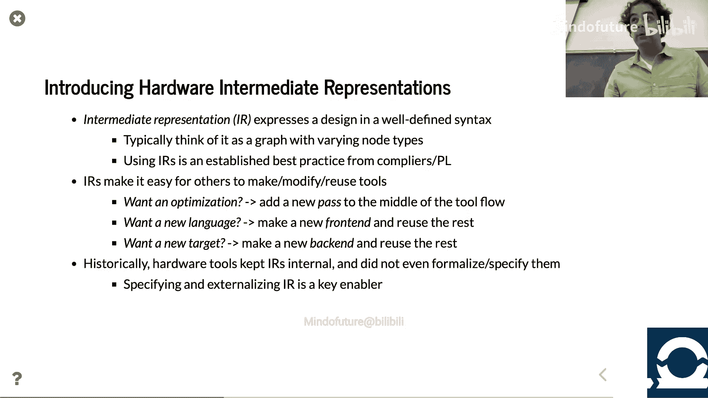

你可以想象这些工具会非常棒。它们可能更易用、更通用、更清晰。但随之而来的问题是：构建一个工具需要什么？你如何决定将自动化放在哪里——是放在生成器里，还是放在工具里？当你熟悉两者后，你会发现这更像一个连续体，而不是一个巨大的飞跃。

---

## 复杂度与难度权衡曲线 📈

为了说明这一点，我们来看一个复杂度与难度的权衡曲线。横轴代表你想要进行的硬件转换的复杂程度，纵轴代表构建它的难度。

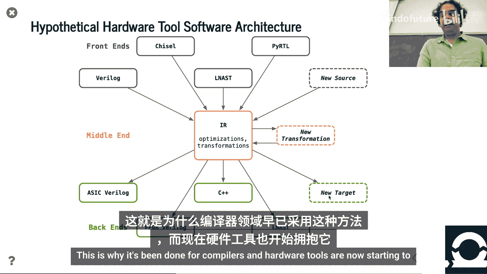

正如你在这门课程中已经体验到的，有时为一个非常简单的对象编写生成器，比直接编写该对象要难一点。对于一个非常简单的设计，直接编写组件可能更容易。

随着设计变得更复杂，在某个点上，单一的静态设计会变得非常复杂，相比之下，生成器可能更省力。然而，使用我们目前所学的生成器方法，在某些情况下会遇到挑战，难度会急剧上升。

我们的目标是，不让难度出现那种巨大的跃升，而是有一个更平缓的增长。这就是我们称之为**自定义转换**的东西。换句话说，我们不是从一开始就正确地生成设计，而是以某种方式修改已经存在的设计。

---

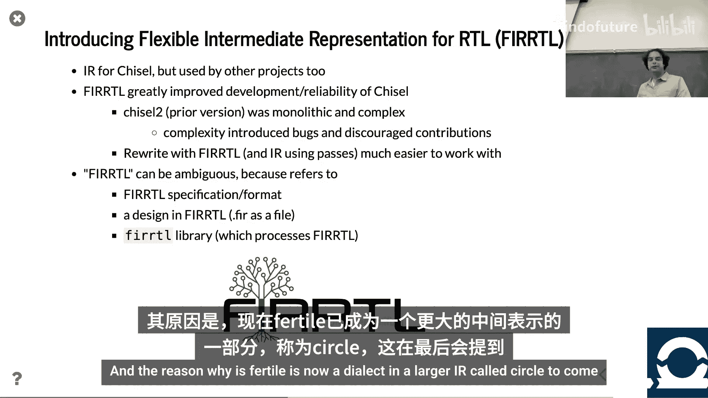

## 中间表示 (IR) 的作用 🧩

我们如何做到这一点呢？答案是，你需要一个**中间表示**。IR 是一种精心描述工具输入输出的方式。在编译器和编程语言中，IR 非常常见。你有一个定义良好的语法和语义来描述组件，这样工具就可以在这个表示上操作。

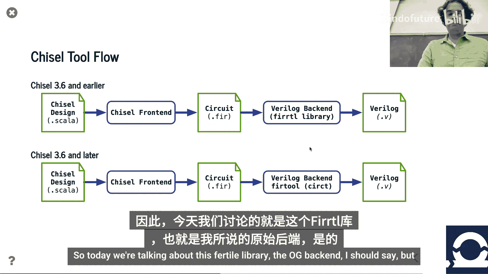

例如，你可能听说过 LLVM，它是一个用于软件的 IR 格式，它使得人们可以互换前端和后端，这正是它如此强大的原因。如果你想添加一门新语言，你只需要添加一个新的前端，将你的语言转换为 IR。如果你想支持一个新目标，你编写一个后端，接收 IR 并产生输出。如果你想进行优化，你编写一个“Pass”，它接收 IR，修改 IR，然后传递给工具流程的下一个部分。

长期以来，IR 在编译器中是内部专有的细节。LLVM 努力将其标准化并公开，这对社区来说是一个分水岭时刻。

对于硬件设计，硬件 IR 在历史上也是封闭、专有和任意的。它们也开始变得更加开放和共享。正如上一讲提到的，Chisel 1 和 Chisel 2 有某种 IR，但它没有非常形式化，也没有暴露出来。Chisel 3 是一个巨大的飞跃，它拥有了一个 IR，这使得很多事情成为可能。

使用 IR 是进行此类转换和工具构建的成熟实践，硬件领域早就该这么做了，并且过去几年已经开始这样做了。

---

## 理想的硬件工具生态系统 🌐

这展示了事情如何组合在一起。这里展示了一个假设的世界（虽然不完全存在），但你可以看到它可能的样子。

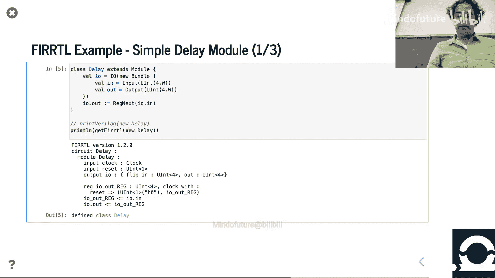

想象你在中间有一个非常棒的硬件 IR。你可以为不同的语言编写不同的前端，例如 Verilog、Chisel、PyRTL 等。它们都生成 IR。在 IR 层面，你可以编写转换 Pass，接收 IR 并输出 IR。然后，你当然有后端，可以输出 Verilog，或者针对 FPGA 或 ASIC 的代码，或者模拟器，甚至输出不同的 IR。


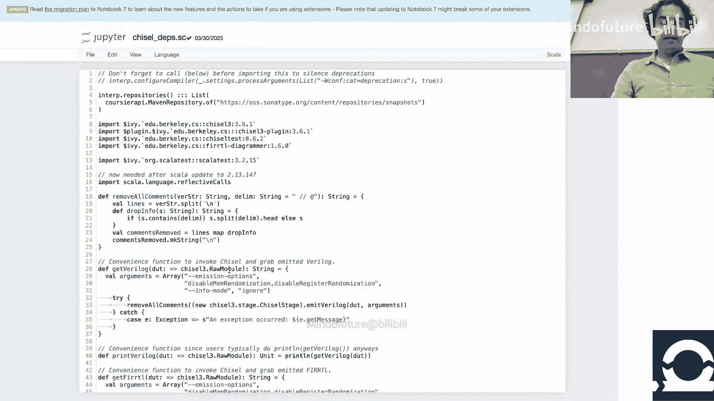

这就是你想要的灵活性。使用这个大型开源代码库，你可以做你想做的事情。你想创建一门新语言？当然，你只需要编写一个前端，将你的语言转换为 IR，然后你就可以重用所有现有代码。你想做一个新的转换？很好，你只需要编写一个在 IR 上操作的转换 Pass，你不需要编写整个工具链。你想支持一个新的输出范式？当然，编写一个新的后端。

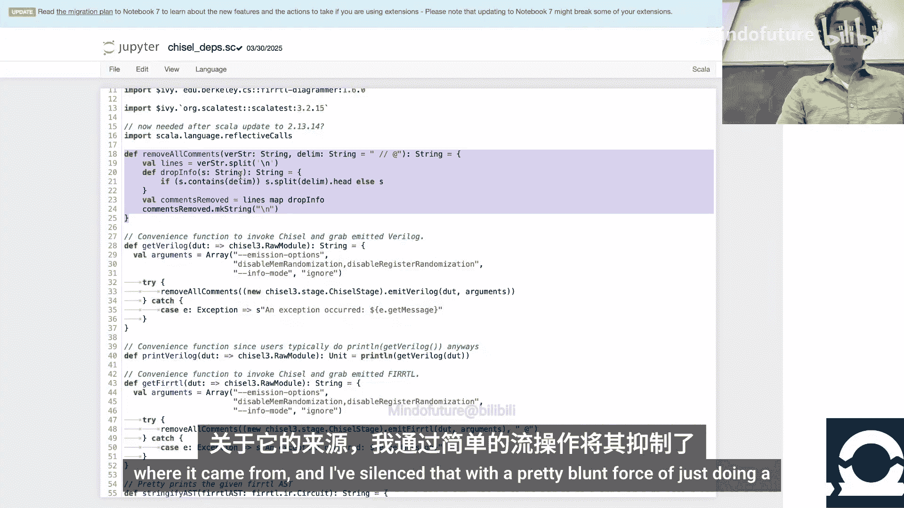

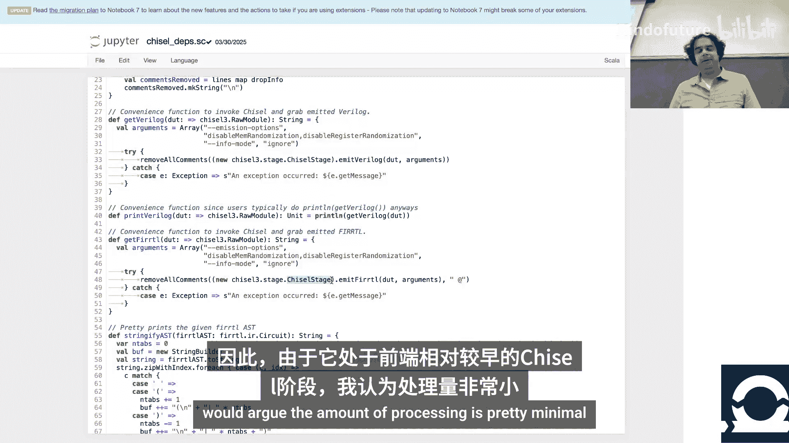

这个顶层图景清楚地展示了 IR 的用处，这也是为什么编译器领域早就这么做了。我们的工具现在也开始拥抱这一点。

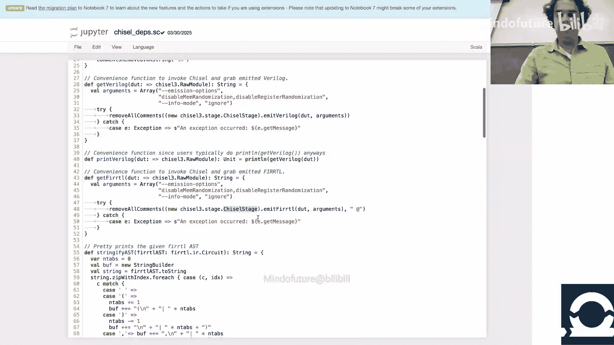

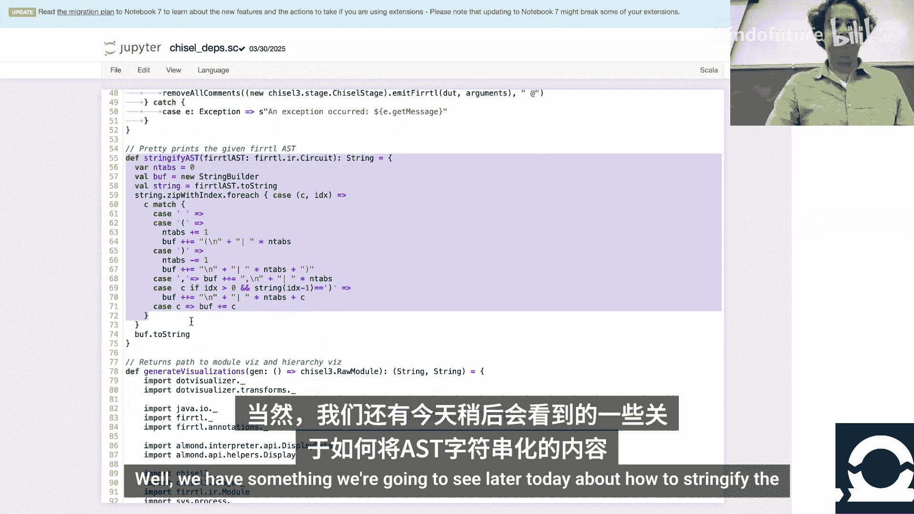

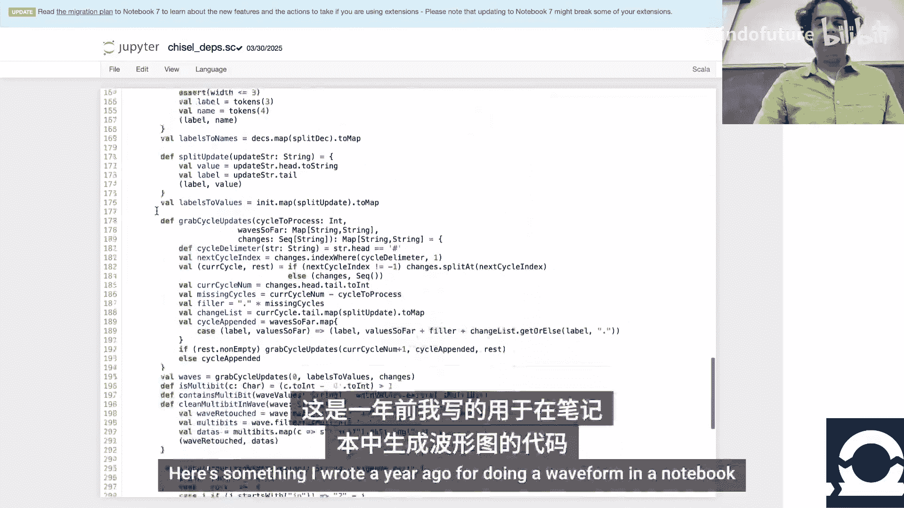

---

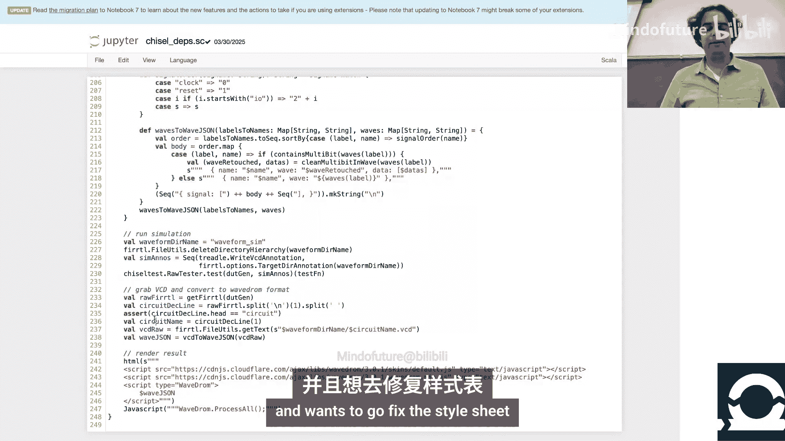

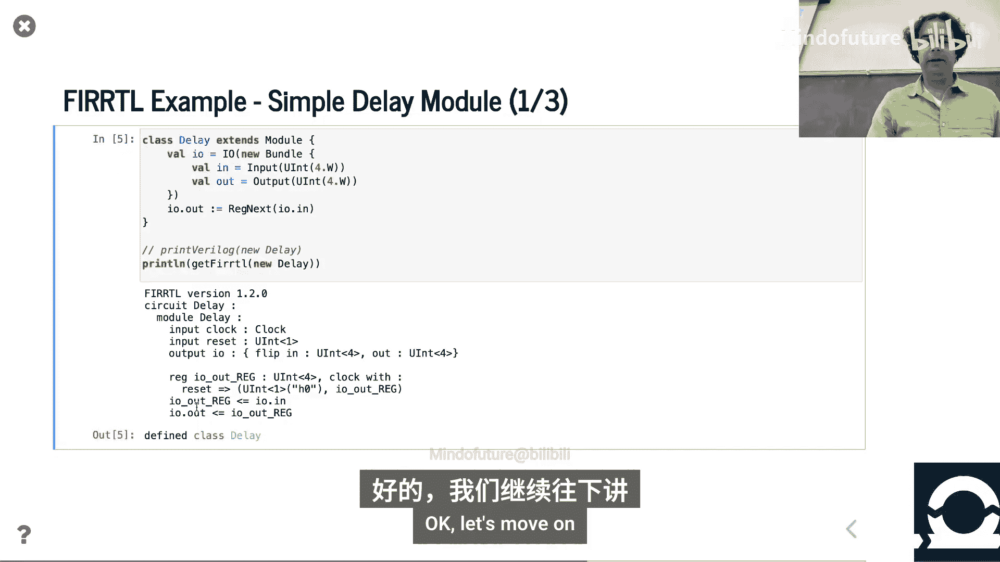

## 聚焦 FIRRTL ⚡

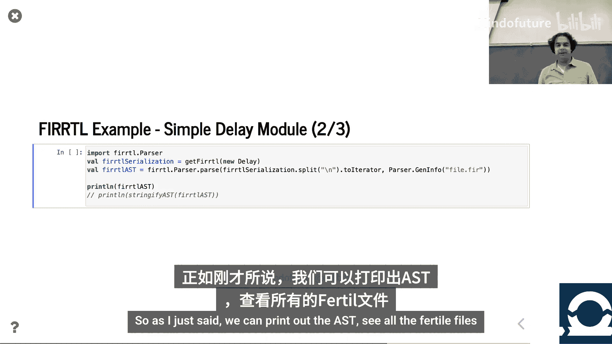

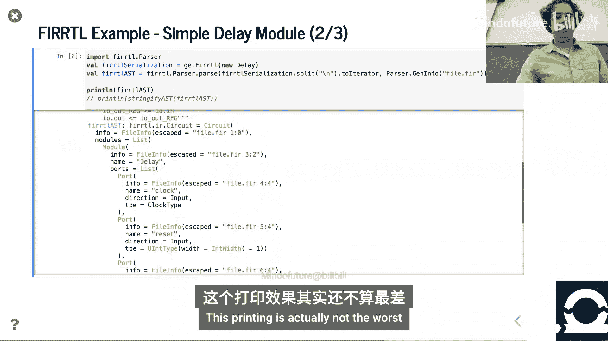

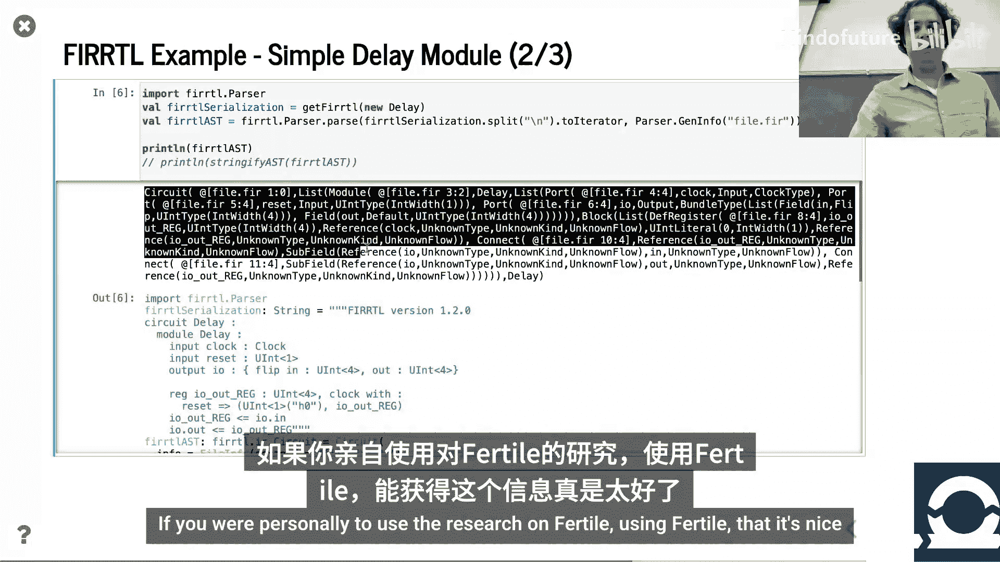

我之前提到过 FIRRTL。FIRRTL 是 Chisel 3 中引入的 IR，也被其他项目使用。

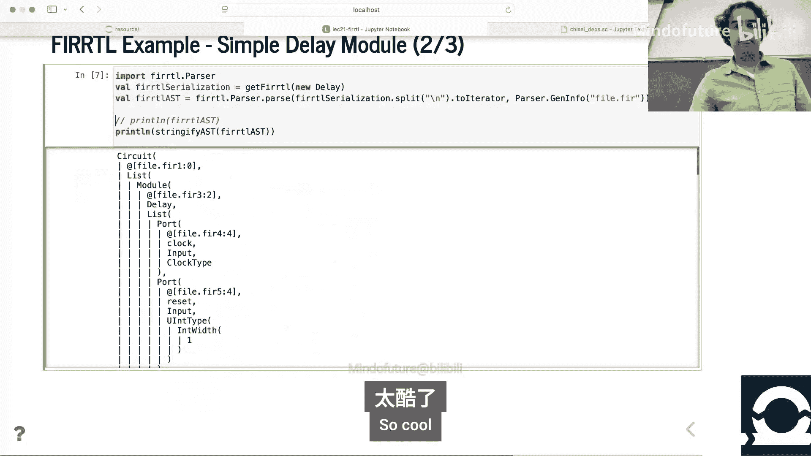

Chisel 2 及之前版本是一个庞大、单一、复杂的代码库，即使做一个很小的改动也需要触及大量代码，非常困难，也很难吸引贡献者，因为复杂性壁垒太高，而且有很多 Bug。因此，他们进行了一次大规模重写，让 Chisel 拥有一个前端并发出 FIRRTL，然后 FIRRTL 本身有转换 Pass 来操作和优化 FIRRTL，最后再转换为 Verilog。

当你听到我使用 FIRRTL 时，需要知道它指代多个东西：
1.  **FIRRTL IR**：一种规范格式，有在线文档描述其语义。
2.  **.fir 文件**：具体的 FIRRTL 文件，即硬件设计的实际表示。
3.  **FIRRTL 库**：处理 FIRRTL 的 Scala 库。这就是那个有弃用警告的库。它已进入生命周期末期，但我们今天的讲座仍会使用它，因为 FIRRTL 现在是 Circuit 中的一个方言。

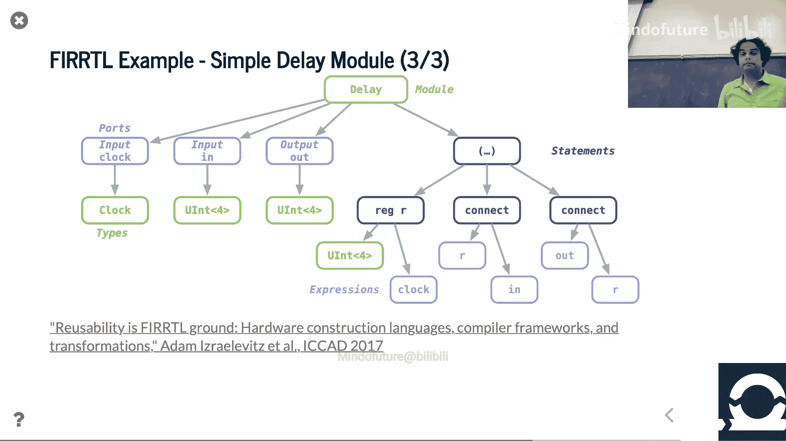

---

## Chisel 工具流程 🔄

Chisel 工具流程如下：你的硬件设计是用 Chisel 编写的 Scala 程序。当你的 Scala 程序运行时，Chisel 前端会发出 FIRRTL（你可以将其视为电路）。然后 FIRRTL 被传递给后端。

多年来，后端是那个 Scala FIRRTL 库，它生成 Verilog。现在，它是一个不同的程序，一个不同的代码库，叫做 `firtool`，它使用 Circuit 这个新的代码库。但从 Chisel 前端的角度来看，它仍然发出 FIRRTL。这很酷，因为引入这个新的后端不需要改变用户设计，也不需要改变 Chisel 前端。Chisel 前端仍然输出 FIRRTL，这没问题。只是后端变了。

今天我们讨论的是 FIRRTL 库（原始的后端），但原理是相通的。

---

## FIRRTL 内部结构 🔍

让我们深入了解一下 FIRRTL，因为它仍然是广泛使用的 IR。硬件在 FIRRTL 中是如何表达的呢？

它基本上是一个语句的集合。你的硬件设计，在最高层是一个电路。电路内部可以有多个模块。模块有端口（输入和输出）。模块内部有语句，比如连接操作。语句内部可以包含表达式。例如，`Connect(A, B)` 是一个语句，其中对 A 的引用是一个表达式。语句可以包含其他语句，表达式也可以包含其他表达式。所有这些都有类型，类型系统将它们联系在一起。

让我们回到我们整个学期都看到的经典延迟模块。这里我们不参数化，只是一个寄存器。

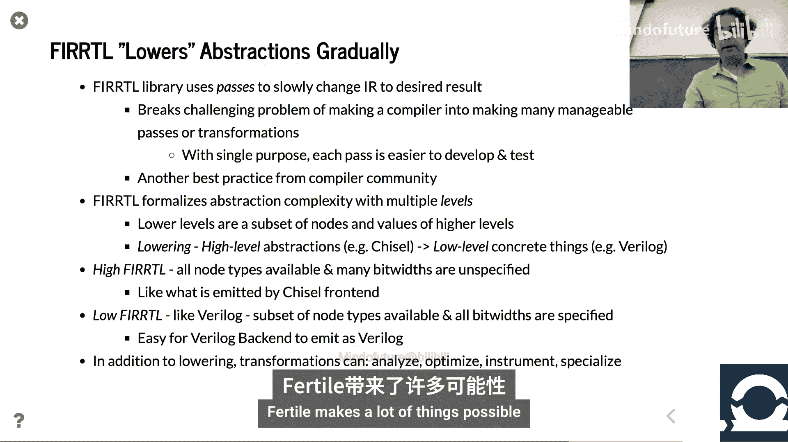

**Verilog 表示:**
```verilog
module Delay(
  input clock,
  input reset,
  input [7:0] in,
  output [7:0] out
);
  reg [7:0] reg_;
  always @(posedge clock) begin
    if (reset) reg_ <= 8‘h0;
    else reg_ <= in;
  end
  assign out = reg_;
endmodule
```

**对应的 FIRRTL 表示 (简化概念):**
```
circuit Delay:
  module Delay:
    input clock: Clock
    input reset: UInt<1>
    input in: UInt<8>
    output out: UInt<8>

    reg reg_: UInt<8>, clock with: (reset => (reset, UInt<8>(“h0”)))
    connect(reg_, in)
    connect(out, reg_)
```
在 FIRRTL 中，`reg` 明确表示寄存器，没有 Verilog 中那些模拟语义的混淆。它包含了所有细节：名称、类型、使用的时钟、复位方式等。连接语句也很清晰。

---

## FIRRTL 的工作原理：转换 Pass 🚶‍♂️

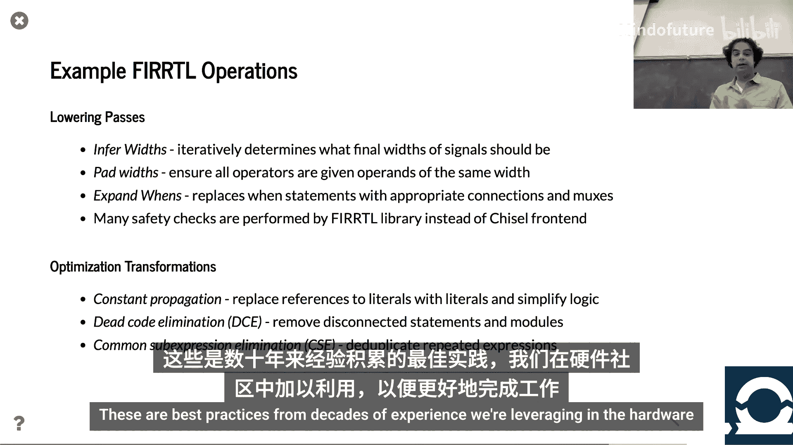

FIRRTL 库如何处理输入的 FIRRTL 呢？它通过一系列 **Pass** 来实现。

与其用一个庞大的函数直接从 FIRRTL 到 Verilog，不如将其分解成许多小步骤。每个 Pass 只做一件事，许多 Pass 按顺序执行。这使得指定每个 Pass 应该做什么、推理其行为以及（最重要的）测试它变得容易得多。这是编译器中的最佳实践，现在被硬件领域重用。

FIRRTL 实际上在多个层次上指定了这些抽象。有 **High FIRRTL**（基本上是从 Chisel 前端刚出来的 FIRRTL）和 **Low FIRRTL**（非常接近 Verilog 的 FIRRTL）。这个编译器的过程称为“ lowering ”：你从 High FIRRTL 开始，逐步降低到 Low FIRRTL，将高级抽象简化为低级抽象。

例如，High FIRRTL 中的 `when` 语句在 Verilog 中并不直接存在，需要被转换为多路选择器。此外，在 High FIRRTL 中，位宽有时可以被推断，位宽推断就是一个 Pass。从技术上讲，High FIRRTL 就是所有 FIRRTL，而 Low FIRRTL 是 FIRRTL 的一个子集，其特性非常接近 Verilog 的要求。从 Low FIRRTL 到 Verilog 是一小步。

---

## FIRRTL 转换的用途 🎯

这些 Pass 和转换可以做很多事情：
1.  **分析设计**：获取分析数据或细节。
2.  **优化设计**：这是我们今天讲座的原始动机。如果你想封装一个优化，你可以将其编写为 FIRRTL 转换。
3.  **插桩或特殊化**：例如，在实际工业项目中，你可能需要处理扫描链。你可以在 Chisel 中通过修改模块或使用特质来实现。但如果你有一个非常特定的扫描链想为你的项目构建，你可以将其构建为一个工具，一个 FIRRTL 转换，这样就不需要修改原始设计了。

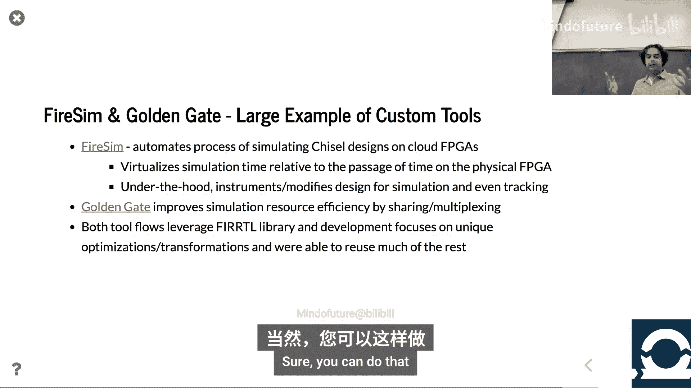

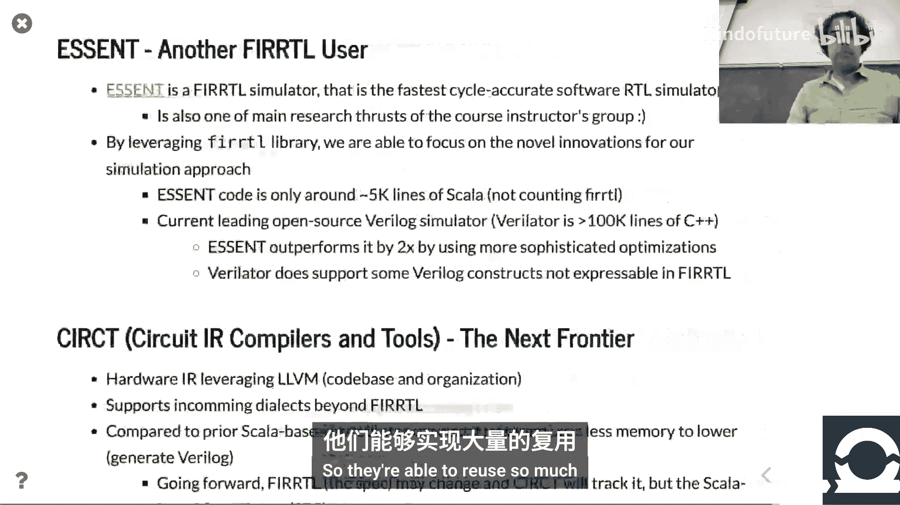

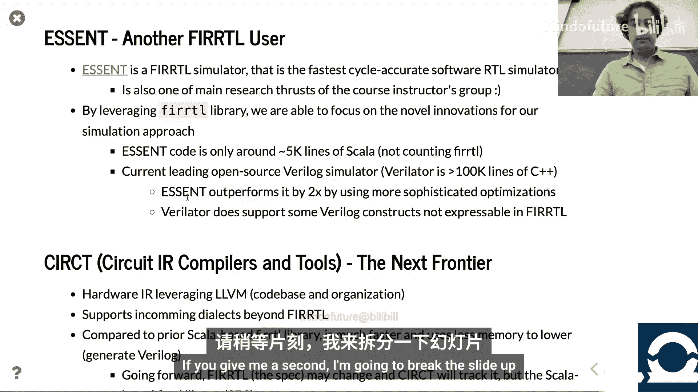

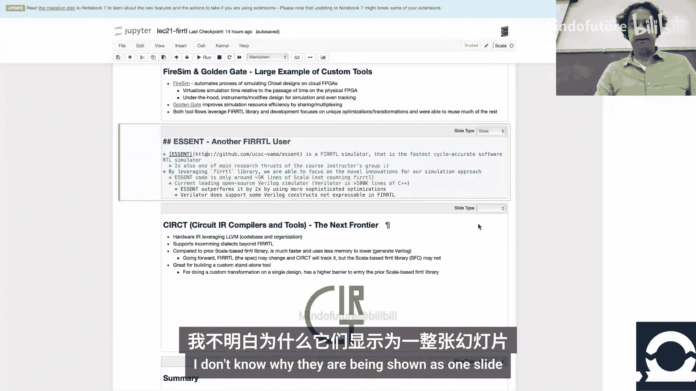

---

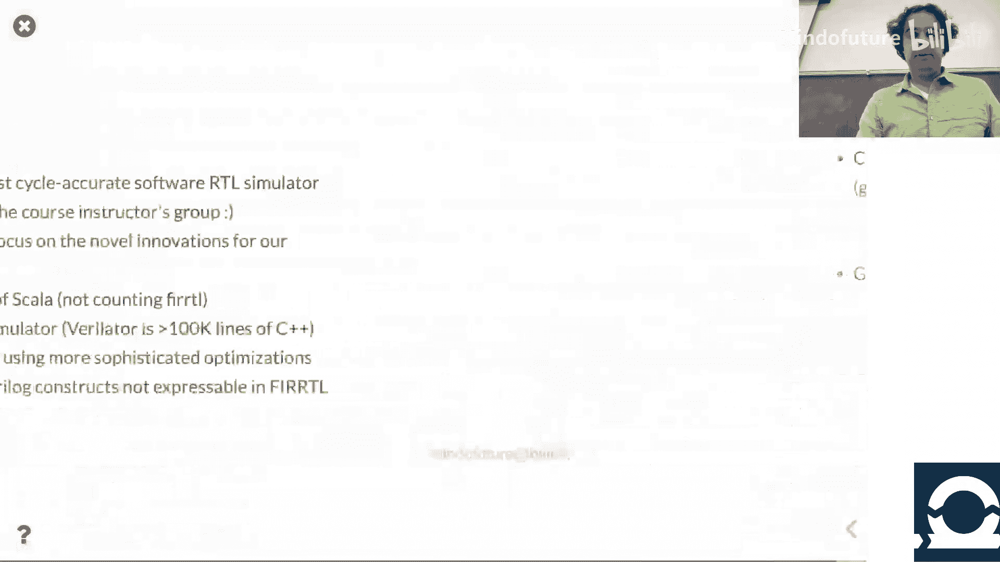

## 示例：FIRRTL 的强大应用案例 🚀

一个闪亮的例子是 **FireSim** 项目。如果你有一个大型的功耗设计并想模拟它，你可能会发现模拟器慢得离谱。FireSim 技术可以获取 Chisel 设计并在 FPGA 上运行。关键挑战在于：设计太大无法放入单个 FPGA 时如何分割？FPGA 运行速度与真实内存速度不匹配时如何处理时间虚拟化？

FireSim 本质上就是通过 FIRRTL 对设计进行插桩和修改。这是一组由研究生构建的令人印象深刻的项目，否则可能需要数十名工程师多年的工作。这一切之所以可能，就是因为有 FIRRTL 库。他们不需要担心解析输入设计和输出，只需要编写 FIRRTL 转换，并利用 Chisel 前端和 FIRRTL 库中已完成的所有工作。

另一个例子是我自己研究小组的工作：**ESSENT**，一个 RTL 模拟器。我们接收硬件设计并制作出非常快的模拟器。我们是如何做到的？我们不必构建整个工具链，只需要接收 FIRRTL，然后用 C++ 编写代码。我们的核心模拟器代码只有大约 5000 行 Scala。相比之下，Verilator 有超过 10 万行 C++ 代码。因为我们利用了 Scala 和 FIRRTL 库的生产力优势，许多处理硬件工具的基础工作已经完成，我们可以将所有时间花在思考新的解决方案和优化上，因此我们的模拟器更快。

---

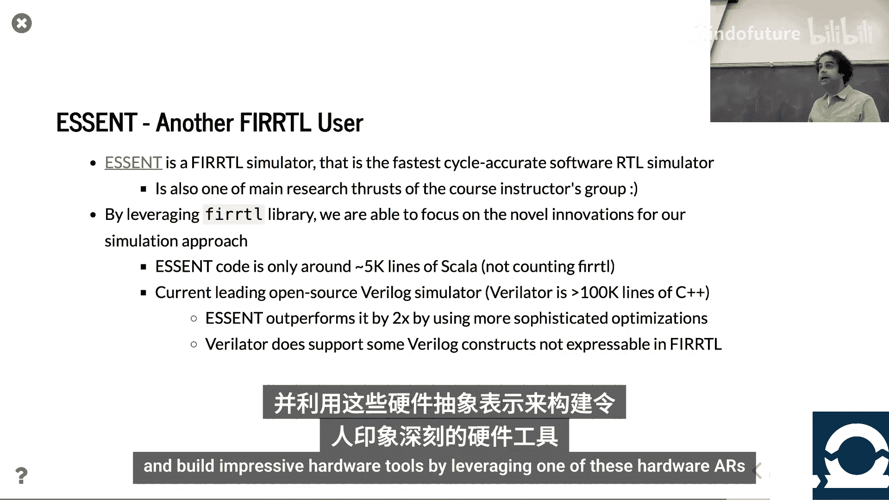

## 未来方向：CIRCT 与 MLIR 🌉

当前的前沿是 **CIRCT**，它正在吸纳一切。它利用了 **LLVM** 的基础设施。LLVM 对编译器的影响巨大，现在其组织和部分代码正被用于硬件领域。

CIRCT 项目就是做这个的。它的结构是：CIRCT 是一个非常通用、灵活、包容的 IR，它有很多不同的部分，它们称之为“方言”。FIRRTL 就是其中一个方言。还有其他描述硬件的方式也被支持。

CIRCT 也是一个工具，相比原始的 Scala FIRRTL 库，它更快，内存消耗更少。这是未来的方向。虽然 Chisel 前端仍然输出 FIRRTL 并输入到 CIRCT，但这已成为标准。

如果你想构建一个自定义的独立工具，你可以用 CIRCT 做一些非常酷的事情。它的入门门槛比基于 Scala 的工具高一些，但你仍然可以编写自己的自定义工具。

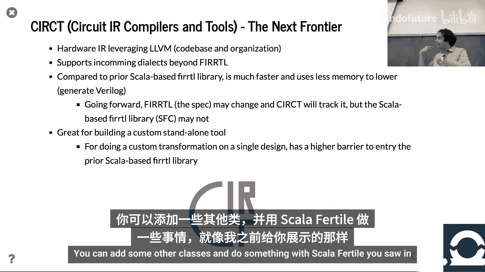

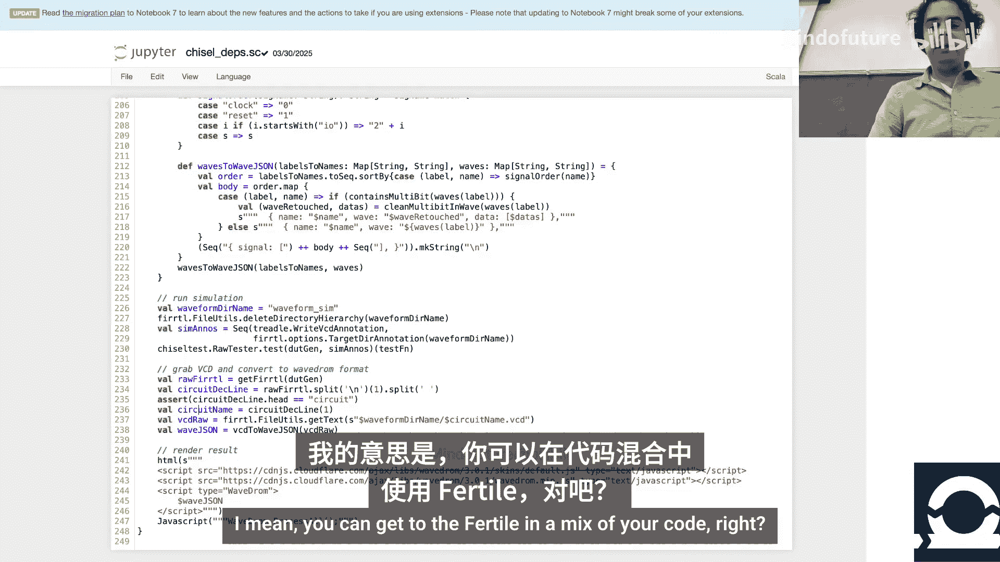

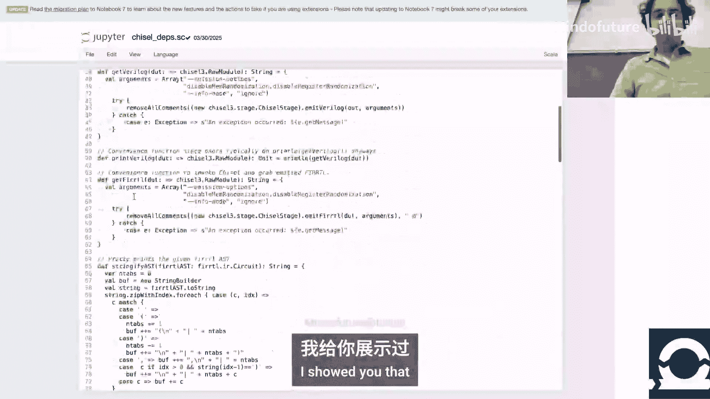

---

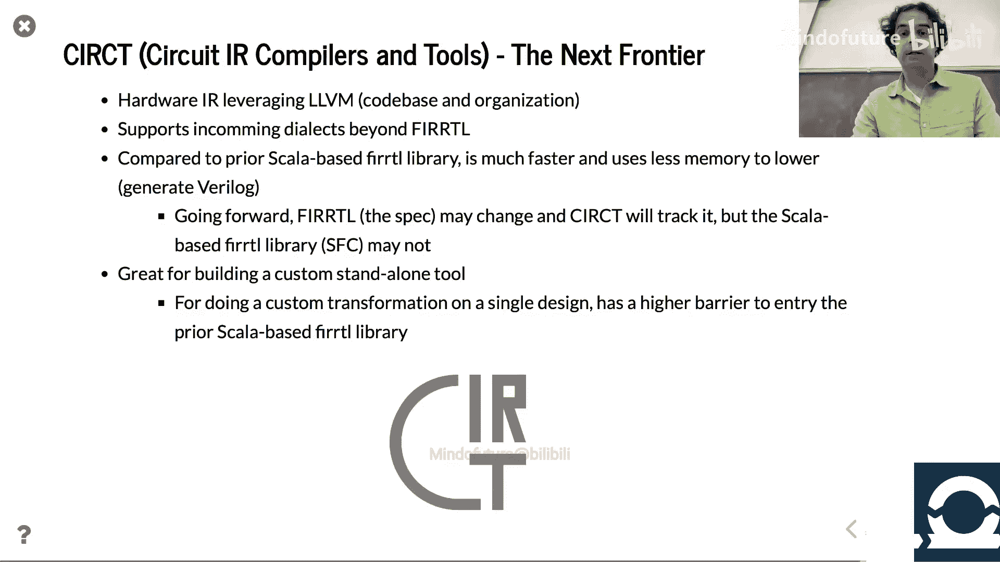

## 总结 📝

本节课中我们一起学习了硬件中间表示的核心概念。

1.  **动机**：我们讨论了为什么有时需要超越生成器，去构建可以操作已有硬件设计的工具。
2.  **IR 的作用**：IR 提供了一个定义良好、标准化的中间层，使得前端、后端和转换 Pass 可以独立开发和组合，极大地提高了工具构建的灵活性和可复用性。
3.  **聚焦 FIRRTL**：我们深入了解了 Chisel 使用的 FIRRTL IR，包括其结构、工作原理（通过一系列 lowering 和优化 Pass）以及强大的应用案例（如 FireSim、ESSENT）。
4.  **生态系统**：我们看到了一个理想的硬件工具生态系统蓝图，以及当前向更强大框架（如 CIRCT）发展的趋势。
5.  **核心思想**：关键在于转变思维，不仅将硬件视为生成的对象，更将其视为可以被分析和转换的数据结构（IR）。这为硬件设计自动化打开了新的大门。

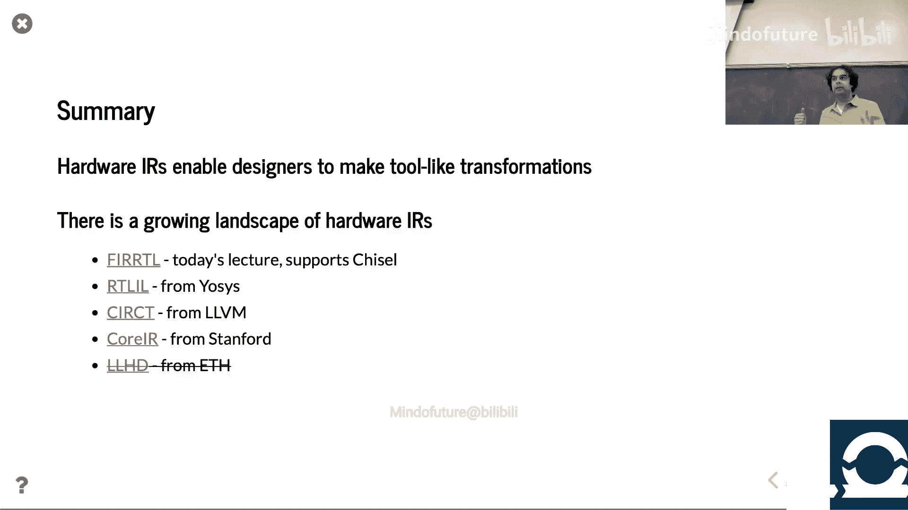

希望今天的课程鼓励你不仅思考如何生成设计，更思考如何构建操作设计的转换乃至完整的工具。掌握 IR 的概念是迈向高级硬件设计自动化的重要一步。