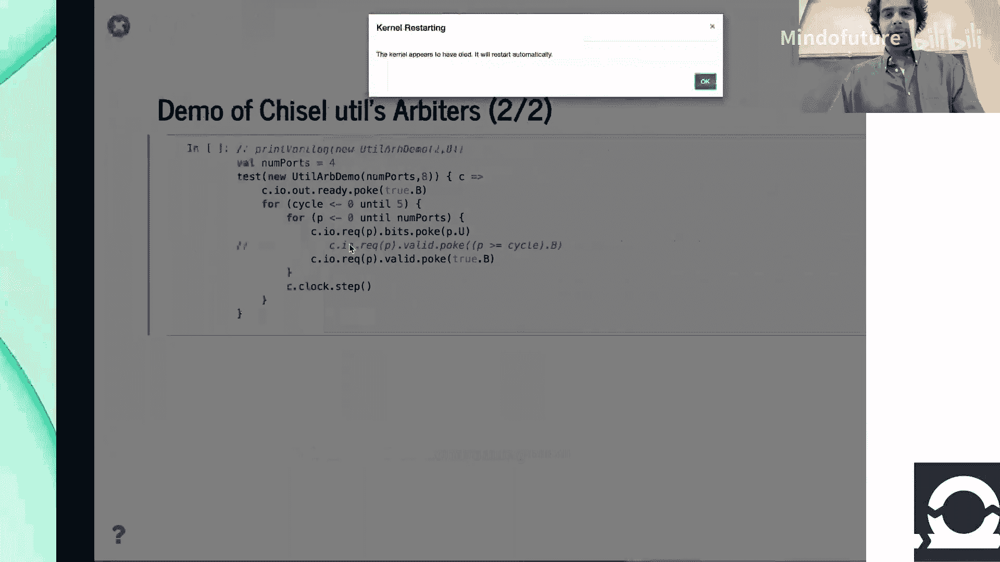
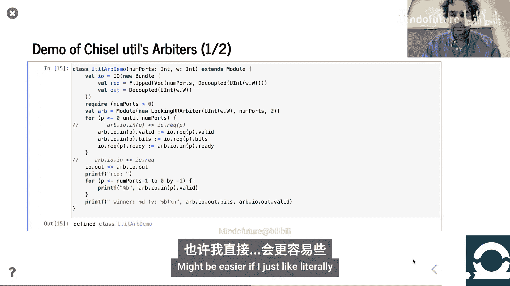
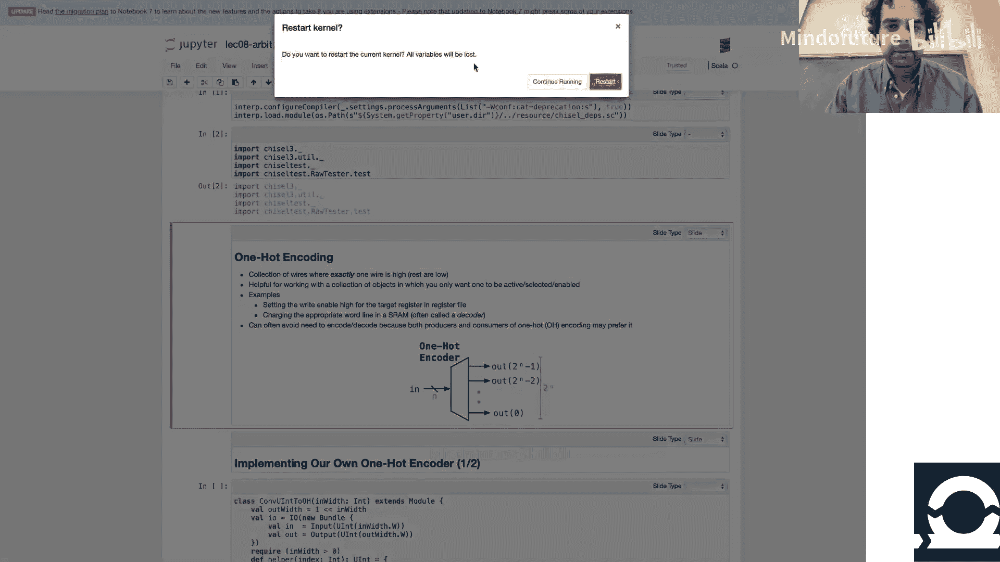
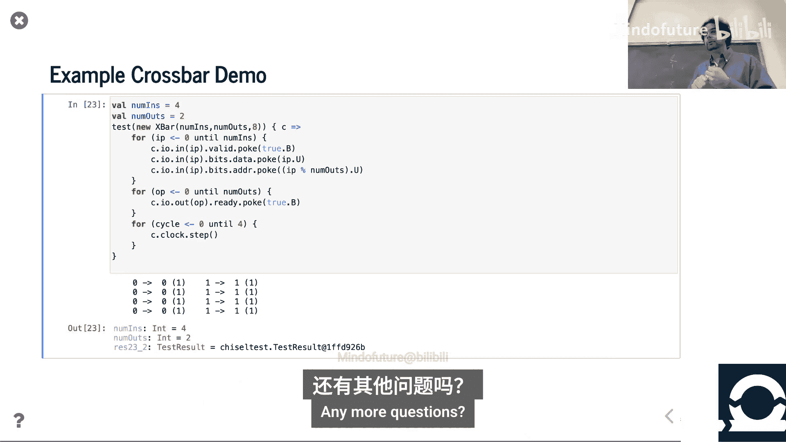

# 012：第8讲-仲裁（第2部分/共2节）🚀

## 概述
在本节课中，我们将继续学习仲裁器。我们将首先研究Chisel标准库提供的仲裁器，然后动手构建自己的仲裁器，最后利用我们构建的仲裁器来创建一个交叉开关。我们将通过不断构建抽象、组件和生成器，来搭建越来越复杂的硬件模块。

## 什么是仲裁？⚖️
上一节我们介绍了独热编码和优先级编码器，本节中我们来看看仲裁。

仲裁出现在需要决定谁有权访问稀缺资源的情况下。当消费者数量超过资源提供者数量时，就需要一种方法来决定谁可以访问该资源，这个过程就是仲裁。

例如，当只有一个请求者时，处理很简单。但当多个请求者同时请求，而我们无法满足所有请求时，就需要仲裁。仲裁器内部的算法决定了当出现多个请求时，谁将获胜。

以下是几种常见的仲裁算法：
*   **固定优先级**：某个实体始终拥有更高的优先级。
*   **轮询**：尝试以更公平的方式分配访问权。

具体使用哪种算法取决于应用场景。今天，我们将处理只有一个资源可供授予的情况。这是一个非常常见的硬件设计模式。

## Chisel标准库中的仲裁器🔧
与Chisel标准库中的许多组件一样，仲裁器也经过了精心设计，使其易于使用。

### 仲裁器接口
如下图所示，仲裁器有一个参数化的输入端口数量和一个输出端口。


每个输入端口都使用`Decoupled`接口，因此可以指示请求是否有效。仲裁器会通过`ready`信号（图中未明确画出）进行响应，告知请求者其请求是否成功被授予。

输出端口也是`Decoupled`接口，它也有`ready`信号。这个`ready`信号来自仲裁器所竞争的资源，表示该资源是否准备好接收请求。

基本上，如果资源就绪，信息会传递到仲裁器。仲裁器会看到多个有效的请求，并通过其内部逻辑决定谁获胜。获胜者将收到`ready`信号。

这是一个需要注意组合逻辑循环的情况：`ready`信号可能依赖于`valid`信号。但在这里，这是不可避免的，因为仲裁器不会向没有发出请求的端口发送`ready`信号。

### 仲裁器类型
Chisel提供了几种类型的仲裁器：
*   **`Arbiter`**：默认仲裁器，使用固定优先级。优先级高的请求者总是获胜，但这可能导致饥饿问题。
*   **`RRArbiter`**：轮询仲裁器。在所有请求者中轮转授予权限，试图更公平。
*   **`LockingRRArbiter`**：带传输锁定的轮询仲裁器。默认仲裁器可能每个周期都重新决定，而这个仲裁器允许获胜者保持访问权多个周期。

### 使用示例
我们将演示如何使用标准库中的仲裁器。这个模块主要是对Chisel仲裁器进行封装。

首先，我们定义模块的IO，包含`n`个`Decoupled`输入端口和一个`Decoupled`输出端口。

为了连接所有`n`个输入端口，我们使用一个`for`循环。这里我们使用了批量连接操作符`<>`，因为它可以一次性连接`Decoupled`接口中的所有信号（`ready`、`valid`和`bits`）。

```scala
// 示例：连接仲裁器输入（使用for循环和批量连接）
for (i <- 0 until n) {
  arb.io.in(i) <> io.in(i)
}
io.out <> arb.io.out
```

批量连接操作符非常有用。如果没有它，我们需要手动连接每个信号，代码会冗长很多。

```scala
// 如果没有批量连接操作符，需要这样写：
io.in(i).ready := arb.io.in(i).ready
arb.io.in(i).valid := io.in(i).valid
arb.io.in(i).bits := io.in(i).bits
```

我们还可以使用更简洁的批量连接方式，一次性连接整个向量：




```scala
// 更简洁的向量批量连接
arb.io.in <> io.in
```





在测试平台中，我们将输出设置为始终就绪。对于每个输入端口，我们根据周期数设置其`valid`信号，以模拟不同的请求模式。

运行测试后，我们可以通过打印信息观察仲裁行为。例如，使用固定优先级仲裁器时，端口0总是获胜。切换到轮询仲裁器后，获胜者会按顺序轮转。

## 构建我们自己的仲裁器🔨
看过了库中的仲裁器，现在让我们尝试自己构建一个。如果觉得复杂，我们可以一步步来分析。

### 设计思路
仲裁器的核心功能是：接收N个请求，选出一个获胜者。对于我们构建的这个基础仲裁器，其核心是一个优先级编码器。

基本设计如下：优先级编码器接收所有端口的`valid`信号作为请求输入。根据编码结果，我们可以通过一个多路选择器将获胜者的`bits`数据路由到输出。同时，我们还需要告诉获胜的端口它获得了授权。

输出端口的`valid`信号是所有输入`valid`信号的逻辑或。如果输出端口没有就绪，那么没有人应该获得授权。

### 代码实现
以下是实现代码。首先定义IO，包括输入端口向量和输出端口。

为了方便后续操作，我们创建一些线网来收集所有输入的`valid`信号和`bits`数据。同时，将所有输入端口的`ready`信号初始设置为`false`。

仲裁的关键是将所有`valid`信号输入到一个优先级编码器。我们使用`PriorityEncoderOH`来获得一个独热编码的获胜者向量。

然后，我们使用`Mux1H`（独热编码多路选择器）根据获胜者向量来选择要输出的数据。

输出`valid`信号是所有输入`valid`信号的逻辑或归约（`valids.reduce(_ || _)`）。

最后，我们需要在事务完成时（即输出`valid`且输出`ready`为真时），将获胜端口的`ready`信号设置为`true`。我们可以将独热编码的获胜者解码为索引，然后设置对应端口的`ready`信号。

```scala
// 自定义仲裁器核心逻辑示例
val valids = io.in.map(_.valid)
val bits = io.in.map(_.bits)
io.in.foreach(_.ready := false.B) // 初始化为false

val winner = PriorityEncoderOH(valids)
io.out.bits := Mux1H(winner, bits)
io.out.valid := valids.reduce(_ || _)

val fire = io.out.valid && io.out.ready
when (fire) {
    val winnerIndex = OHToUInt(winner)
    io.in(winnerIndex).ready := true.B
}
```

### 代码优化
我们可以进一步优化代码，使其更接近最初的框图设计。例如，可以直接根据优先级编码器的输出和与门逻辑来设置`ready`信号，这样就无需将独热编码解码为索引。

```scala
// 优化后的ready信号设置
io.in.zip(winner).foreach { case (port, win) =>
    port.ready := win && io.out.ready && io.out.valid
}
```

运行这个自定义仲裁器，其行为与之前的基础仲裁器一致。

## 使用仲裁器构建交叉开关🔀
现在我们有了仲裁器，可以继续向上构建更复杂的抽象：交叉开关。

交叉开关是一种网络组件，它有若干输入和输出端口。在一个交叉开关中，任何输入都可以连接到任何输出。

这带来一个问题：多个输入端口可能同时请求同一个输出端口，这就产生了仲裁的需求。在我们的设计中，我们将在**每个输出端口前放置一个仲裁器**。

从每个输入端口到每个输出端口的仲裁器之间都有连线，因此内部有很多连线。但逻辑主要集中于每个输出端口的仲裁器上。我们继续使用`Decoupled`接口来进行流控通信。

### 交叉开关实现
首先，我们需要定义通过网络的消息类型。消息包含目标地址（用于标识要访问哪个输出端口）和实际的数据负载。

然后定义交叉开关的IO：一个`Decoupled`消息类型的输入向量，和一个`Decoupled`消息类型的输出向量。

在交叉开关内部，我们为每个输出端口声明一个仲裁器。这里我们选择使用轮询仲裁器以实现公平性。

关键的连接部分通过嵌套的`for`循环完成：
1.  对于每个输入端口，我们需要收集来自所有仲裁器的`ready`信号。
2.  对于每个输出端口（及其仲裁器），我们需要将每个输入端口连接上去。这里有一个细节：输入端口发送的消息中包含地址字段。只有当这个地址与当前输出端口索引匹配时，该输入端口对这个仲裁器的请求才是有效的。我们通过一个比较器来实现这一点。

最后，将每个仲裁器的输出连接到对应的交叉开关输出端口。

```scala
// 交叉开关连接核心逻辑示例
for (i <- 0 until nIn) {
    // 收集该输入端口的ready信号（来自所有仲裁器）
    val arbsReady = io.out.map(o => o.ready) // 简化示意
    // ...
}
for (o <- 0 until nOut) {
    for (i <- 0 until nIn) {
        // 将输入i连接到仲裁器o
        val arb = arbiters(o)
        // 请求有效条件是：输入有效，且其地址指向当前输出o
        arb.io.in(i).valid := io.in(i).valid && (io.in(i).bits.addr === o.U)
        arb.io.in(i).bits := io.in(i).bits.data
        // ready信号连接已在另一个循环处理
    }
    io.out(o) <> arb.io.out
}
```

这个大约20行Chisel代码实现的交叉开关，可以参数化输入/输出端口数量以及消息负载大小。如果用Verilog编写，代码量会大得多。这展示了生成器的强大之处。

运行测试，我们可以看到输入端口根据其消息中的地址，将数据发送到不同的输出端口。由于使用了轮询仲裁器，当多个输入竞争同一输出时，访问权会公平轮转。

## 总结🎯
本节课中，我们一起深入探讨了仲裁器。

我们首先回顾了仲裁的概念，即解决多个请求者竞争单一资源的问题。接着，我们研究了Chisel标准库中提供的几种仲裁器，包括固定优先级、轮询和带锁定的轮询仲裁器，并学习了如何使用它们。

然后，我们亲自动手，从零开始构建了一个自己的仲裁器，其核心是利用了之前学过的优先级编码器。通过这个练习，我们加深了对仲裁器内部工作原理的理解。

最后，我们将仲裁器作为基础构建块，创建了一个功能更强大的组件——交叉开关。在交叉开关中，我们为每个输出端口配备了一个仲裁器，从而解决了多输入对单输出的竞争问题。



通过从优先级编码器到仲裁器，再到交叉开关的构建过程，我们实践了利用抽象和生成器来逐步搭建复杂硬件系统的设计方法。在后续课程中，我们还将看到如何让这些代码变得更加简洁和优雅。