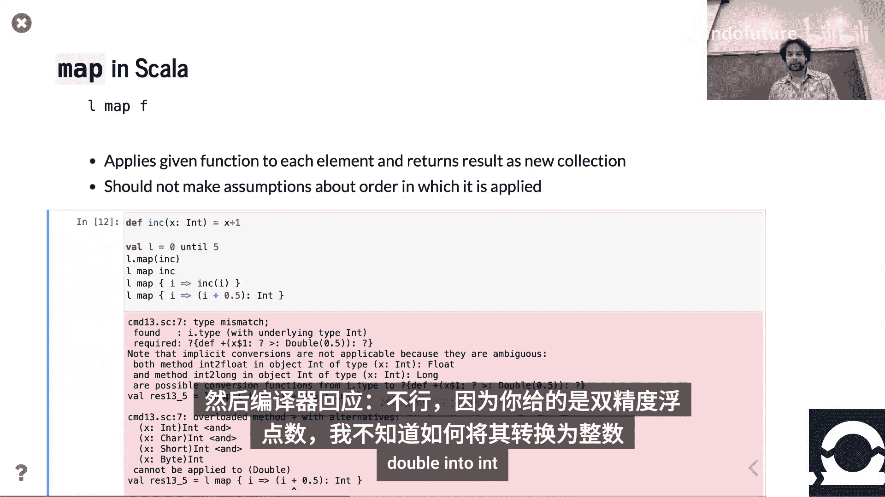
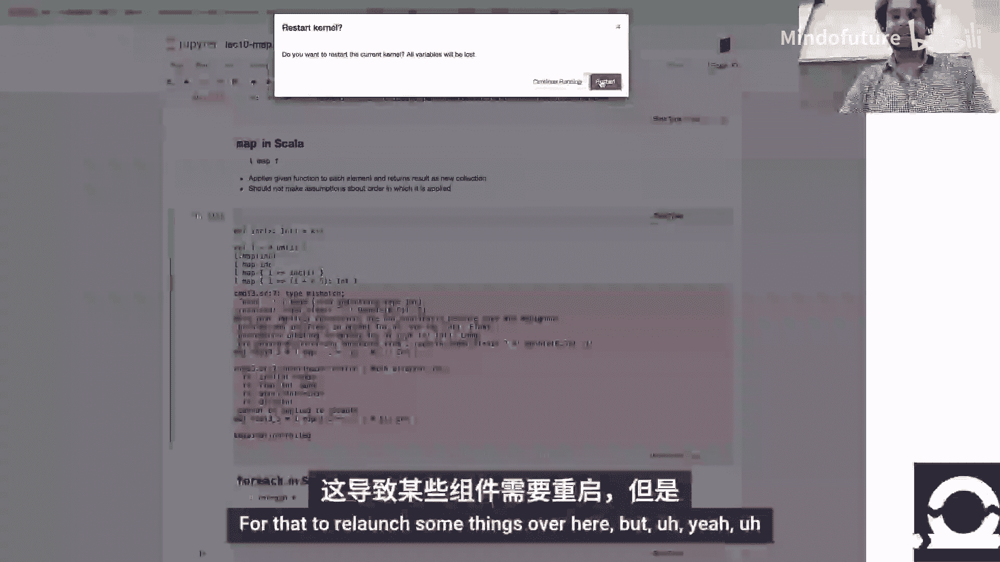
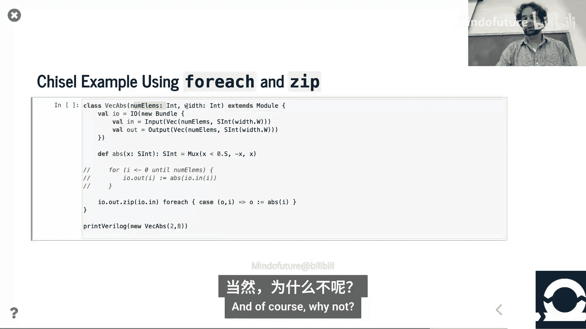
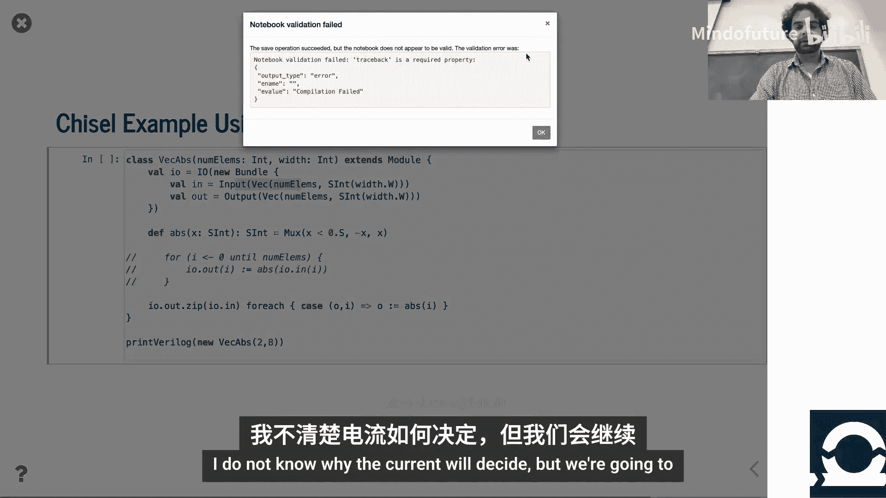
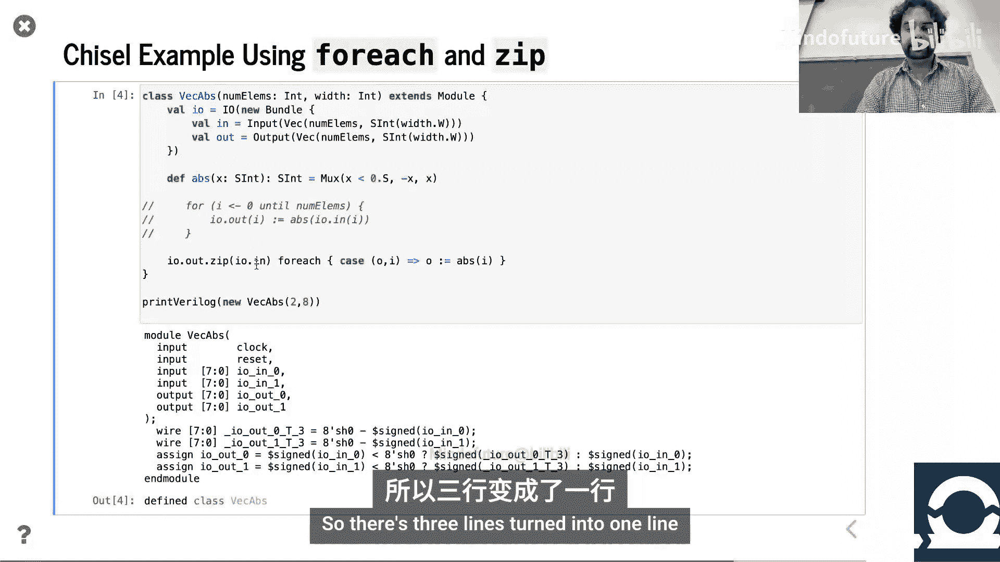
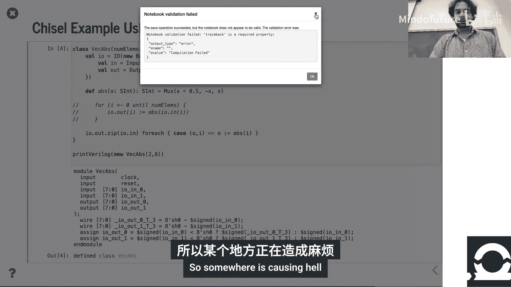
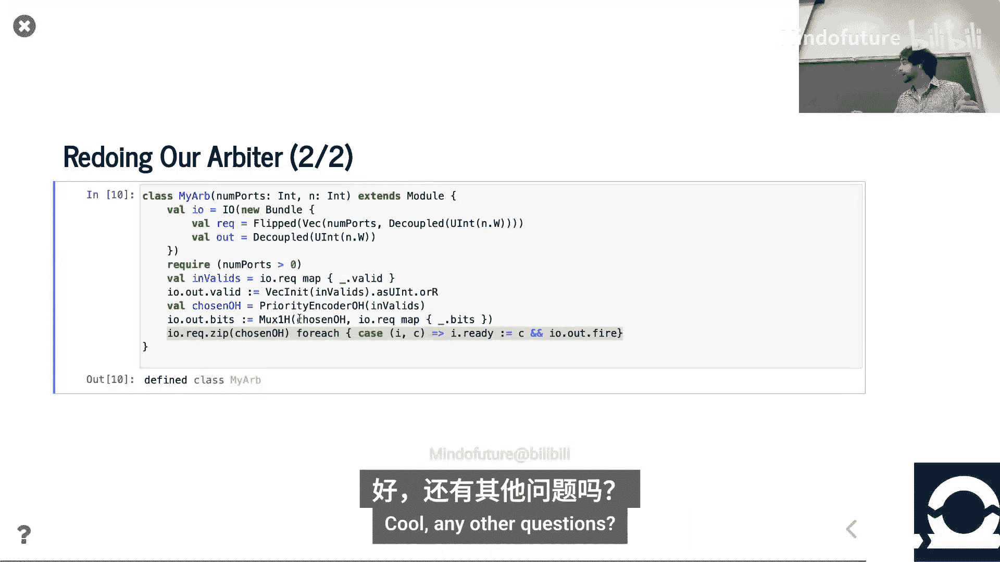

# 014：函数式编程介绍 🚀

在本节课中，我们将要学习函数式编程（FP）的核心概念，并了解如何将其应用于Scala和Chisel，以编写更简洁、可重用且易于阅读的硬件生成器代码。函数式编程强调使用函数来转换集合中的元素，而不是通过传统的循环步骤来操作数据。

---

## 什么是函数式编程？ 🤔

从标题幻灯片可以看到，我们将讨论函数式编程。许多人可能想知道函数式编程具体指什么。它指的是编写正确的、功能性的程序，并在程序中使用函数。函数式编程包含一系列特定的理念、哲学和原语。

在本课程中，我们不会深入探讨语言理论，而是以一种非常非正式、直观的方式来讨论它。我们之所以讨论它，是因为它与我们敏捷硬件设计的四大目标紧密相关：
1.  **尽早闭环**（如课程徽标所示）。
2.  **设计可重用性**。
3.  **让工具完成工作**。
4.  **设计可读性**。

事实证明，如果正确运用函数式编程，我们可以在所有这四个目标上获得收益。正确使用函数式编程可以让我们更快地编写代码，从而更早地闭环。它还能增加代码的重用性，减少我们需要手动完成的工作，并且在明智地使用时，可以使代码更易于阅读。当然，这中间需要平衡，我们将在课程中讨论这一点。

接下来的三讲（本周的两节面授课）将全部围绕函数式编程展开，探讨如何将其应用于Scala和Chisel。我们很幸运，这三讲恰好安排在同一周内。

函数式编程的核心理念是，思考如何将函数应用于一个元素集合，而不是像我们传统编程教学那样，思考操作数据的步骤。这意味着，我们考虑的是“我有一堆东西，以及我希望如何转换这些东西”，并使用一种结构化的、有规则的方式来描述这个过程。这就是本课程中函数式编程（FP）的含义。

为了做到这一点，我们需要像往常一样，先学习一些Scala知识，因为Chisel构建于Scala之上。

---

## 为什么需要集合和函数？ 📦

Chisel的目标是创建可读的硬件生成器。如果你只是编写顺序执行的代码，虽然也有好处，但真正的威力在于参数化的生成器，它能带来高度的重用性。

正如我们在过去一两周看到的，这些生成器不仅仅是简单的模板（比如改变位宽），它们实际上可以改变内部拓扑结构，自由地构建组件，例如最近看到的交叉开关例子。所有这些操作都是在集合上进行的。

因此，使用函数来处理集合是实现这一目标的绝佳方式。任何通用编程语言都能实现这些功能，但如果我们能善用语言内置的特性，识别并重用某些模式，而不是每次都重新发明轮子，那么不仅能减少编写代码的工作量，也能让后来者更容易阅读代码。

本周的目标就是学习如何使用函数式编程来识别那些高度抽象的通用模式，并反复重用它们。作为开发者，你可能需要稍微调整问题以适应这些抽象，但这是值得的。如果做得正确，你还能获得性能上的好处。

这里有一点建议：整个学期我们都在提倡使用 `val` 而非 `var`，尽量编写不可变的代码。然而，Chisel本身包含一些固有的可变性，例如当你使用连接操作符 `:=` 时，你实际上是在改变那些对象的状态。函数式编程本意是无副作用和不可变的，但Chisel允许一些副作用。因此，需要注意这种区别。今天我会展示一些例子，说明如何表明你的代码将产生副作用，而不仅仅是纯函数。

---

## 核心操作：`map` 与 `foreach` 🔄

我们首先介绍的两个操作符是 `map` 和 `foreach`。它们都用于对集合中的每个元素应用一个函数，但有一个关键区别。

`map`，顾名思义，是将一个函数映射到集合的每个元素上。给定一个包含 N 个元素的集合，`map` 会将该函数 `F` 逐个应用于每个元素，并**产生一个新的输出集合**。

`foreach` 同样对每个元素应用一个函数，但**它不产生输出集合**。那么它有什么用呢？`foreach` 用于当被应用的函数具有**副作用**时。例如，在今天的讲座中，副作用可能是向控制台打印信息（`println`）。在Chisel中，副作用可能是执行连接操作。

从简单性的角度来看，你可能会想：既然两者都对每个元素应用函数，有时我想要输出，有时我不想要，那么 `map` 不是更通用吗？如果我不关心输出，我直接忽略它不就行了，而且函数仍然可以有副作用。答案是：技术上可行，但不鼓励这样做。

原因是，当别人阅读你的代码时，看到 `map`，他们会认为这个操作的重点在于**输出**，函数内部不应该有副作用。而看到 `foreach`，他们会立刻意识到这里**有副作用发生**。这种关键字本身就传达了意图，甚至在阅读函数内容之前就让人明白了代码的目的。

---

## 匿名函数（Lambda表达式） λ

在使用这些操作之前，我们需要更正式地了解一下我们将使用的函数，特别是**匿名函数**的概念。在许多语言中，这被称为 lambda 表达式。在 Scala 中，它们被称为**函数字面量**。

它的基本写法是描述一个函数，例如，接受一个 `Int` 类型的参数 `x`（在 Scala 中，类型写在变量名的右边），然后是一个箭头 `=>`，接着是函数体。这种写法非常适合简短的单行函数。你也可以使用花括号 `{}` 来编写多行的匿名函数，但如果你发现需要写多行，更推荐直接编写一个传统的命名函数。

让我们通过代码来理解。首先，我们有一个匿名函数，它接受一个 `Int` `x` 并返回 `x + 1`。我们可以将这个匿名函数赋值给一个 `val`，比如 `inc`。现在，`inc` 就是一个指向这个函数字面量的引用。我们当然可以调用它。

这里有一个细微的区别：我们之前也用 `def` 关键字定义过函数。在这个简单的例子中，对于程序员来说，`val inc = (x: Int) => x + 1` 和 `def inc(x: Int) = x + 1` 看起来是等价的。在某些语言语义上它们确实不同，但在本课程中，这种区别通常不重要。我建议：如果你在编写一个函数，使用 `def`；如果你需要将一个匿名函数赋值给一个变量，使用 `val`。匿名函数通常是无名的，并且直接嵌入到操作中。

匿名函数之所以强大，是因为函数在 Scala 中是**一等公民**，意味着它们可以像任何其他值一样被传递和使用。

关于类型标注：由于 Scala 有强大的类型推断，你通常不需要显式写出参数和返回值的类型。编译器会根据上下文推断出来。例如，对 `Int` 进行数学运算，结果会被推断为 `Int`。但在复杂的表达式中，或者为了确保代码清晰，显式添加类型标注也是一个好习惯。

---

## 动手实践 `map` 操作 🗺️

现在让我们实际操作一下 `map` 操作符。记住，`map` 对集合中的每个元素应用一个函数，并产生一个新的输出集合。

`map` 的用法是：集合在左边，调用 `.map` 方法，然后将函数作为参数放在右边。需要澄清的是，`map` 并不是 Scala 语言本身的关键字特性，而是 Scala 标准库中为几乎所有集合类型实现的一个方法。由于其写法高度一致，所以感觉像是语言的一部分。

以下是一些示例。我们有一个范围 `0 until 5`（即 0, 1, 2, 3, 4）。我们可以用多种方式应用 `map`：
1.  使用之前定义的 `inc` 函数。
2.  直接在 `map` 内联地写出匿名函数 `i => i + 1`。
3.  使用更简洁的占位符语法 `_ + 1`（稍后会详细解释）。

执行后，原始集合 `[0, 1, 2, 3, 4]` 被转换为 `[1, 2, 3, 4, 5]`。

关于语法风格：Scala 允许省略点号 `.` 和括号的写法，但我个人推荐使用更明确的 `collection.map(function)` 风格。这是为了照顾那些不熟悉 Scala 但可能阅读代码的程序员（例如来自 Java 或 Python），以提高代码的可读性。不过，在你自己的项目中，可以选择你觉得更清晰的风格。

---

## 动手实践 `foreach` 操作 🖨️

接下来是 `foreach`。它同样对每个元素应用一个函数，但没有输出集合，主要用于产生副作用。

典型的副作用例子是打印到控制台。我们有一个范围，然后调用 `.foreach(println)`，每个元素都会被打印出来。

那么，能用 `map` 实现打印吗？可以，`collection.map(println)` 也会打印每个元素。但是，`map` 会返回一个新的集合，其每个元素都是 `println` 的返回值，即 `Unit` 类型（类似于 `void`）。在 Scala 中，`Unit` 用空括号 `()` 表示。所以最终你会得到一个充满 `()` 的集合，这毫无用处。使用 `foreach` 不仅能避免这个无用的输出，还能立即向代码阅读者传达“此处操作旨在产生副作用”的意图。

---

## 在 Chisel 中应用 🛠️

现在，让我们在 Chisel 中尝试这些概念。好消息是，无论是 Scala 标准库的 `Seq`（我们常用），还是 Chisel 的 `Vec`，都实现了这些函数式编程操作符。`Vec` 特意添加了 `map` 等方法，以与 Scala 的集合操作无缝衔接。

这里有一个简单的模块示例，它接收一个常量参数 `nElements`，并输出一个包含 `nElements` 个常量的向量。

首先，我们使用 Scala 的 `Seq`：`(0 until nElements).map(_.U)`。这行代码将整数范围映射为 Chisel 的 `UInt` 类型。
然后，我们有一个 Chisel 的 `Vec` 输出 `io.outs`。我们调用 `io.outs.zipWithIndex.foreach { case (o, i) => o := constants(i) }` 来建立连接。这里我们用了 `zipWithIndex`（它相当于 `zip(collection.indices)`），将输出端口和索引配对，然后使用 `foreach` 进行连接操作（连接操作具有副作用）。

这个例子虽然简单，但展示了如何将 Scala 集合和 Chisel 硬件类型通过 `map` 和 `foreach` 结合起来。

---

## 元组（Tuple）和 `zip` 操作 🤝

在深入更复杂的例子前，我们先介绍**元组**和 **`zip`** 操作。

**元组**是一种将多个值组合成一个对象的方式。其中的元素可以是不同类型，通常用于组合少量（如2-3个）值。如果元素很多，使用样例类（`case class`）或 Chisel 的 `Bundle` 更合适。元组的元素没有名称，通过 `._1`、`._2` 这样的索引访问（注意索引从1开始）。你可以将元组“解构”为独立的变量。

**`zip`** 操作接收两个集合，并将它们**逐元素地配对**，形成一个新的集合，其中每个元素都是一个元组（通常是二元组）。如果两个集合长度不同，结果集合的长度将以较短的那个为准。

`zip` 的强大之处在于，它常与 `map` 结合使用。当你需要同时处理两个集合中对应的元素时，可以先 `zip` 将它们配对，然后对配对后的元组集合进行 `map` 操作。

例如，有两个列表 `a` 和 `b`，你想计算它们的元素之和。你可以写：`a.zip(b).map { case (x, y) => x + y }`。这里的 `case` 关键字用于**模式匹配**，将元组解构为 `x` 和 `y` 两个独立的变量。

---

## 更复杂的 Chisel 示例：仲裁器重构 ⚖️

让我们回顾一下上周的仲裁器（Arbiter）代码，看看如何使用函数式编程使其更简洁。

原始的仲裁器代码中，我们做了以下几件事：
1.  收集所有输入端口的 `valid` 信号，然后进行“或”归约得到 `out.valid`。
2.  收集所有输入端口的 `bits` 信号，用于后续的多路选择。
3.  根据选择结果，设置各个输入端口的 `ready` 信号。

我们可以用函数式编程重构：
1.  **收集 `valid` 信号**：原来需要用 `Wire` 声明并循环赋值。现在可以：`val valids = io.in.map(_.valid)`。一行代码直接得到了所有 `valid` 信号的集合，清晰明了。
2.  **收集 `bits` 信号**：同样，`io.in.map(_.bits)`。我们甚至不需要中间变量，可以直接传入后续的 `Mux1H`。
3.  **设置 `ready` 信号**：原来需要循环遍历。现在可以：`io.in.zip(chosenOH).foreach { case (in, sel) => in.ready := sel && io.out.fire }`。这行代码将输入端口和对应的选择信号位配对，然后为每个端口设置 `ready` 信号。

通过这样的重构，代码行数减少了，意图也更清晰。例如，`map(_.valid)` 明确表达了“提取所有 valid 字段”。`zip` 结合 `foreach` 清晰地表达了“将这两个序列对应起来，并对每一对执行某个带副作用的操作”。

当然，也需要权衡可读性。过长的函数式链（例如连续多个 `map`、`filter`、`zip`）可能难以调试。建议将链条限制在一到两个操作内，或者使用中间变量增加可读性。最终目标是写出既正确又易于理解的代码。

---

## 占位符语法 `_` 的更多细节 🔧

我们之前提到了简洁的占位符语法 `_`。它允许我们以更简短的方式编写匿名函数。

规则是：每个 `_` 按顺序代表一个参数，并且每个 `_` 在函数体中只能出现一次。
*   `_.valid` 等价于 `x => x.valid`。
*   `_ + _` 等价于 `(a, b) => a + b`。
*   但 `_ + _` 不能写成 `_ * 2`（因为这里 `_` 出现了两次，代表两个不同的参数？这里需要更正：`_ * 2` 是合法的，它等价于 `x => x * 2`，`_` 只出现一次。而 `_ + _` 中的两个 `_` 代表两个不同的参数）。关键是，每个 `_` 代表一个**新的**参数。

这种语法非常简洁，但只适用于简单的、参数使用不复杂的场景。如果逻辑变得复杂，还是推荐使用完整的 `case` 模式匹配或显式的参数列表。

---

## 总结 📚

本节课中，我们一起学习了函数式编程在敏捷硬件设计中的基础应用。

我们首先了解了函数式编程的核心理念：通过对集合应用函数来转换数据，而不是描述详细的操作步骤。这有助于实现代码的简洁性、可重用性和可读性。

我们重点掌握了两个核心操作：
*   **`map`**：对集合中每个元素应用函数，**产生新的集合**，用于无副作用的转换。
*   **`foreach`**：对集合中每个元素应用函数，**不产生新集合**，用于执行带有副作用的操作。

我们还学习了支撑这些操作的**匿名函数（函数字面量）** 的写法，以及如何使用 `_` 占位符语法让代码更简洁。

接着，我们探讨了 **`zip`** 操作，它可以将两个集合配对，常与 `map` 或 `foreach` 结合，以同时处理两个相关集合中的对应元素。

最后，我们通过重构 Chisel 仲裁器的实例，看到了函数式编程如何将传统的循环结构转化为更声明式、更易读的代码片段。

记住，使用函数式编程的目的是为了写出更好的代码，而不是为了使用而使用。始终要在简洁性、表达力和可读性之间找到平衡点。在接下来的课程中，我们将继续探索更多函数式编程模式及其在硬件设计中的强大应用。