# 020：继承（第2部分）🎓

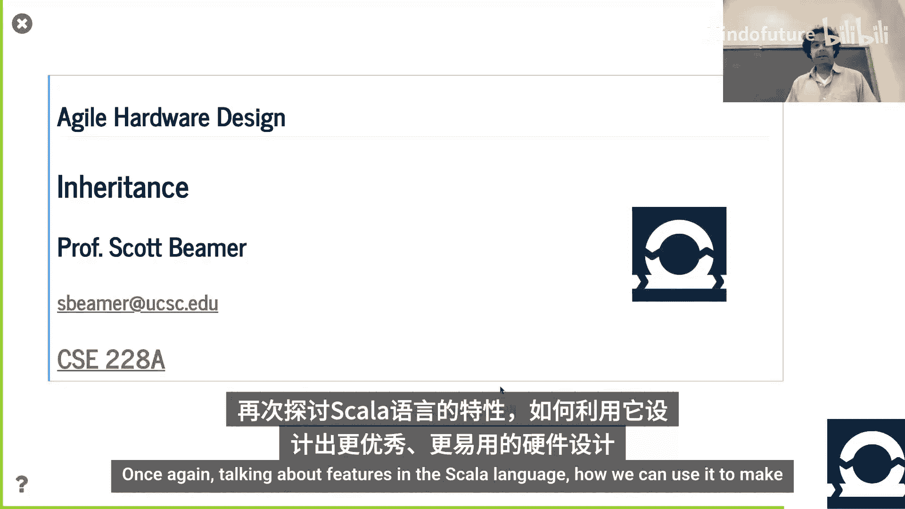

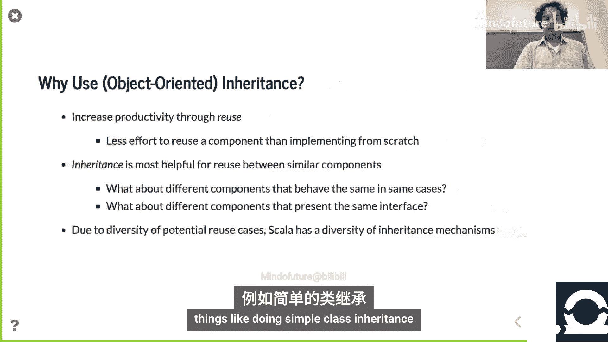

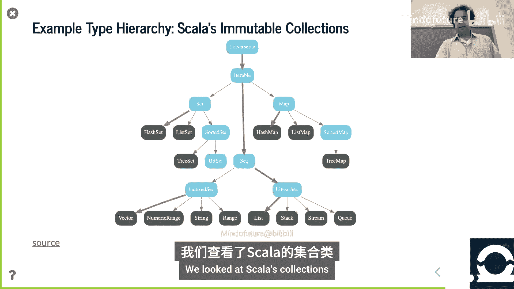

在本节课中，我们将继续学习Scala语言中的继承特性，并探讨如何利用这些特性来构建更模块化、更易维护的硬件设计。我们将通过一个更复杂的例子来加深理解，并介绍特质（Trait）和类型参数化（Generics）的概念。

## 回顾与引入

上一节我们介绍了简单的类继承、抽象类以及Scala集合。本节中，我们将构建一个更复杂的例子，并探讨如何通过继承和特质来复用代码。

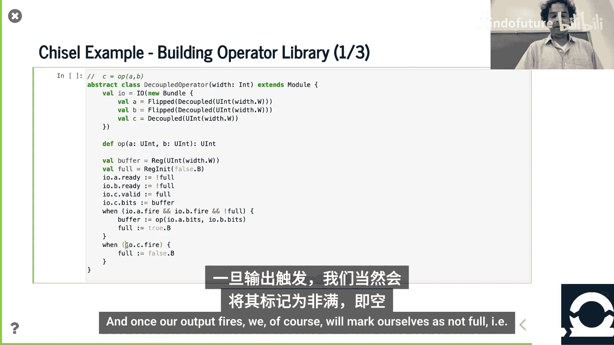

## 构建解耦运算符库 🔌

假设我们想构建一个包含解耦运算符的库。这些运算符在其输入和输出端具有解耦接口，内部会缓冲输出，以确保关键路径上只有一个运算符，从而实现平滑的数据流操作。

我们的目标是将“运算符”的通用概念封装在一个父基类中，然后让子类去实现具体的功能。

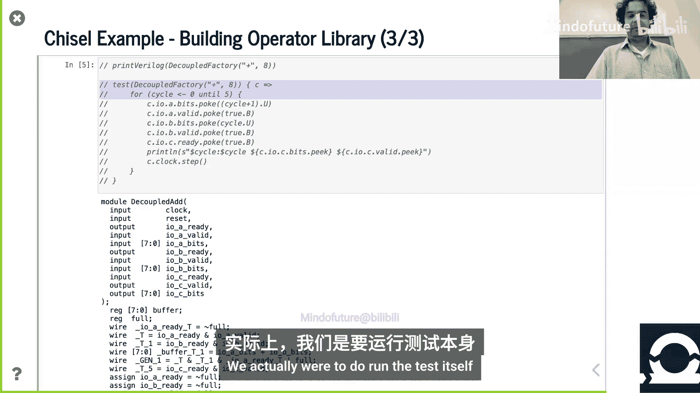

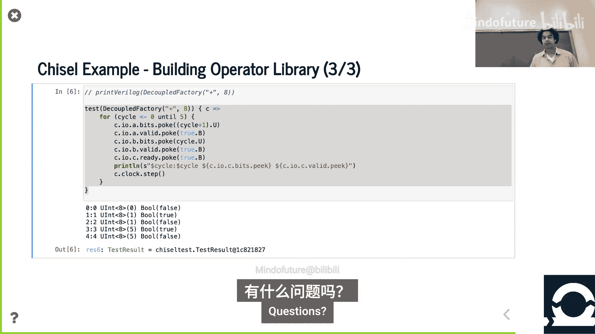

### 定义抽象父类

首先，我们定义一个抽象父类 `DecoupledOperator`。抽象类意味着不能直接实例化它，必须通过扩展它的子类来实例化。

```scala
abstract class DecoupledOperator extends Module {
  val io = IO(new Bundle {
    val a = Flipped(Decoupled(UInt(8.W)))
    val b = Flipped(Decoupled(UInt(8.W)))
    val c = Decoupled(UInt(8.W))
  })

  // 抽象方法，由子类定义具体操作
  def op(a: UInt, b: UInt): UInt

  val buffer = Reg(UInt(8.W))
  val full = RegInit(false.B)

  // 输入就绪条件：当缓冲区不满时
  io.a.ready := !full
  io.b.ready := !full

  // 输出有效条件：当缓冲区有数据时
  io.c.valid := full
  io.c.bits := buffer

  // 当输入有效且缓冲区不满时，执行操作并填充缓冲区
  when(io.a.valid && io.b.valid && !full) {
    buffer := op(io.a.bits, io.b.bits)
    full := true.B
  }

  // 当输出被取走时，清空缓冲区
  when(io.c.fire) {
    full := false.B
  }
}
```

这个抽象类定义了输入 `a`、`b` 和输出 `c` 的解耦接口。它包含一个缓冲区 `buffer` 和一个状态位 `full`。核心操作 `op` 被声明为抽象方法，等待子类实现。

### 实现具体子类

现在，我们可以通过扩展父类来轻松创建具体的运算符，例如加法器和减法器。

以下是加法器子类的实现：
```scala
class AddOperator extends DecoupledOperator {
  override def op(a: UInt, b: UInt): UInt = a + b
}
```

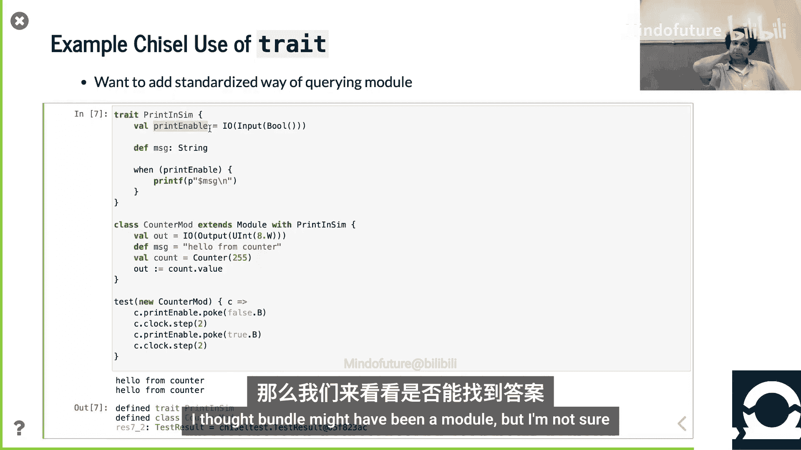


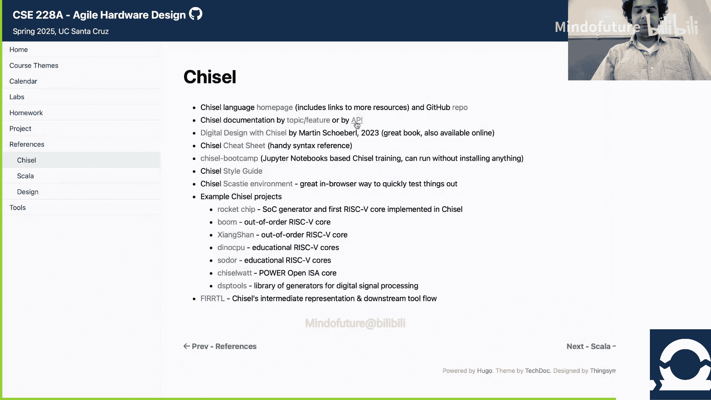

以下是减法器子类的实现：
```scala
class SubOperator extends DecoupledOperator {
  override def op(a: UInt, b: UInt): UInt = a - b
}
```

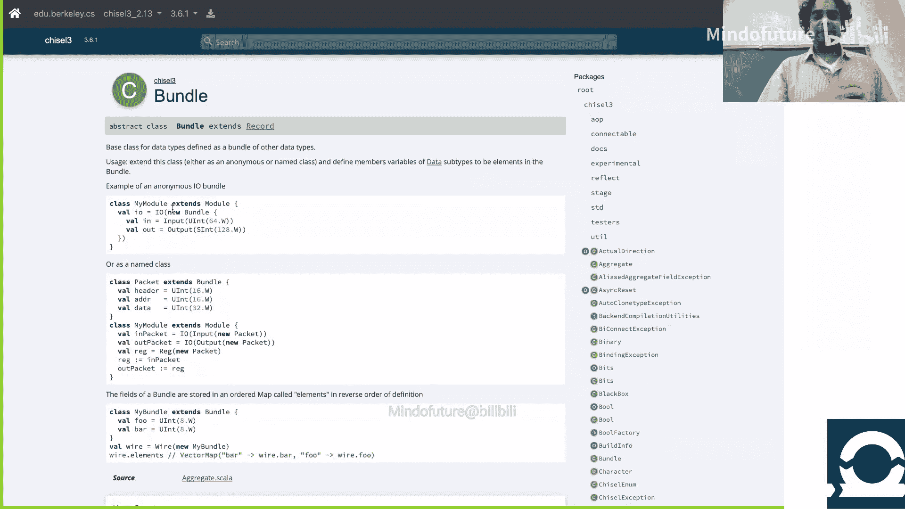

### 使用工厂模式

为了更方便地创建运算符，我们可以使用工厂模式。工厂根据传入的字符串返回对应的运算符对象。

```scala
object OperatorFactory {
  def apply(opType: String): DecoupledOperator = opType match {
    case "add" => new AddOperator
    case "sub" => new SubOperator
    // 可以轻松添加更多运算符
    case _ => throw new IllegalArgumentException(s"Unknown operator: $opType")
  }
}
```

通过这种方式，添加新运算符变得非常容易，只需在工厂中添加一行代码即可。所有子类都可以复用父类的测试框架和接口，大大提高了代码的复用性。

## 特质（Traits）与混入（Mixins）🎭

Scala只允许单类继承，但允许混入多个特质。特质类似于抽象类，但更灵活，用于向类中“混入”额外的功能。

### 特质的用途

特质不能有构造参数，它主要用于向类中注入功能。在Chisel设计中，特质和抽象类各有用途，因此Scala两者都提供。

### 示例：为模块添加打印功能

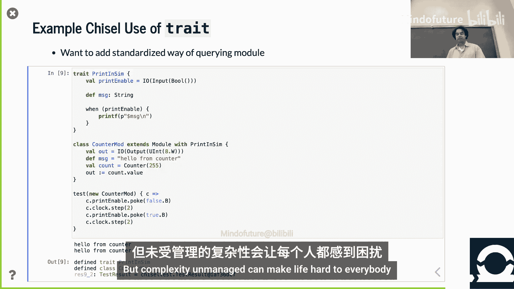

假设我们有一个计数器模块，并希望为其添加一个标准的打印功能，以便在仿真中进行日志记录。

首先，我们定义一个特质 `PrintInSim`：
```scala
trait PrintInSim extends Module {
  val io = IO(new Bundle {
    val printEnable = Input(Bool())
  })
  def printMsg(msg: String): Unit = {
    when(io.printEnable) {
      printf(cf"$msg\n")
    }
  }
}
```

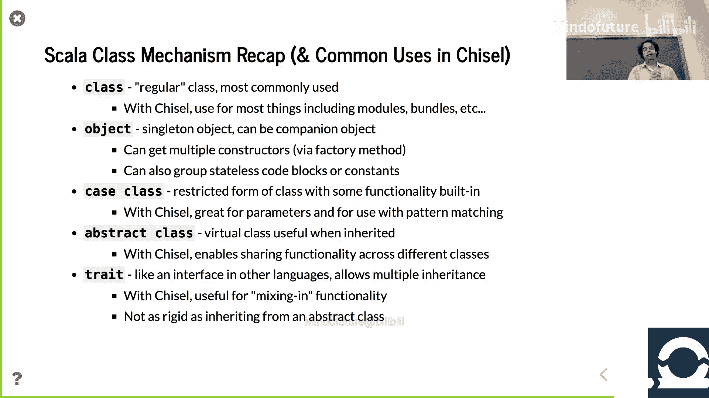

然后，在计数器模块中混入这个特质：
```scala
class CounterMod extends Module with PrintInSim {
  val io = IO(new Bundle {
    val count = Output(UInt(8.W))
  })

  val counter = RegInit(0.U(8.W))
  counter := counter + 1.U
  io.count := counter

  // 使用混入特质带来的方法
  val message = "Counter value: %d"
  printMsg(message)
}
```

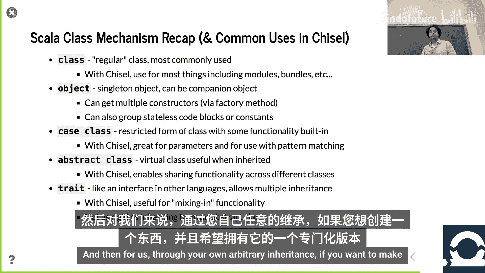

通过混入 `PrintInSim` 特质，`CounterMod` 模块获得了 `printMsg` 方法和 `printEnable` 输入端口。这是一种强大的代码复用机制。

### 特质的注意事项

然而，过度使用特质或深层继承可能导致代码可读性下降，因为功能可能分散在多个文件中。使用IDE的“转到定义”功能可以缓解这个问题。另外，需要注意名称冲突，如果特质和类定义了同名字段，可能需要使用 `override` 关键字。

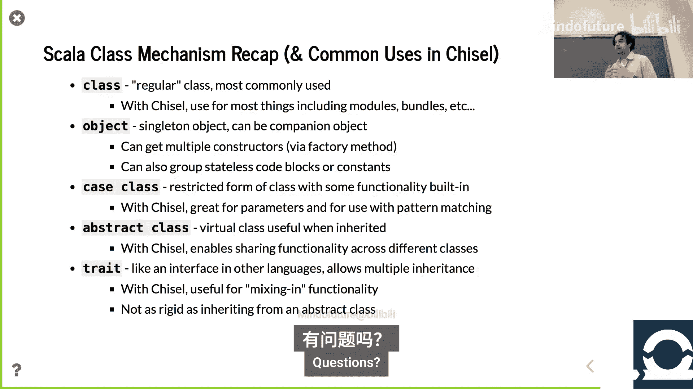

## Scala面向对象机制总结 📚

到目前为止，我们在课程中涵盖了以下Scala面向对象概念：
*   **类（Class）**：用于创建可多次实例化的蓝图。Chisel中的 `Module` 和 `Bundle` 通常通过继承类来实现。
*   **对象（Object）**：单例对象，常用于伴生对象、存放常量或实现工厂模式。
*   **样例类（Case Class）**：一种特殊的类，自动提供 `copy` 方法、友好的 `toString` 实现，并支持模式匹配，常用于参数传递。
*   **抽象类（Abstract Class）**：用于定义通用模板，不能被直接实例化，需要子类实现其抽象成员。
*   **特质（Trait）**：用于多重继承和混入功能，可以灵活地为类添加能力。

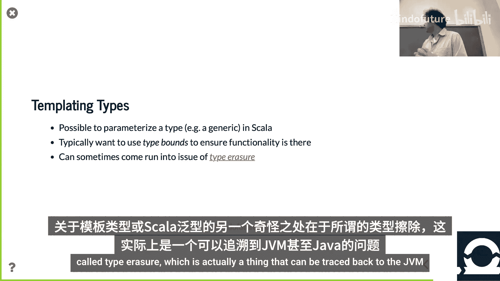

一个高级的特质使用例子是Chisel项目“Rocket Chip”中的“Diplomacy”系统，它允许SoC中的不同组件在生成时通过混入的特质来协商参数。

## 类型参数化（Generics）🔧

类型参数化（或泛型）允许我们编写可处理多种数据类型的通用代码，提高代码的复用性。

### Scala泛型的特点

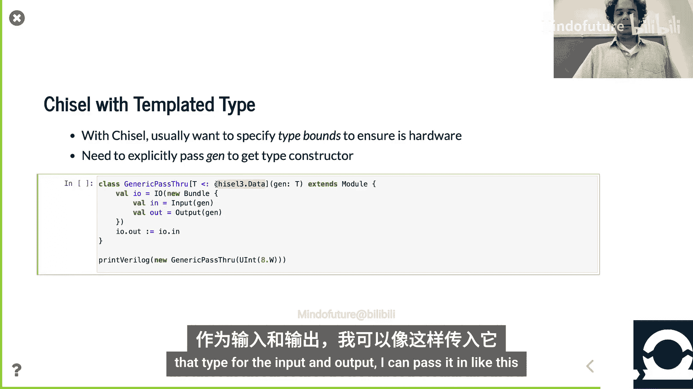

Scala的泛型支持类型边界（Type Bounds），可以限制类型参数必须是某个类的子类。但Scala/Java泛型存在“类型擦除”问题，在运行时类型信息可能丢失，进行模式匹配时需要额外处理（如使用 `TypeTag`）。

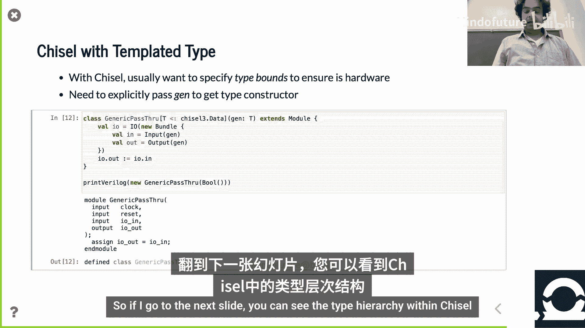

### 在Chisel中使用类型参数化

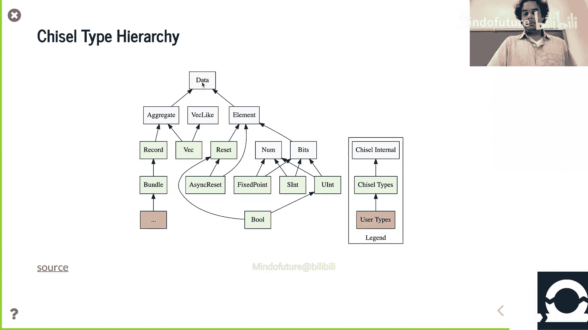

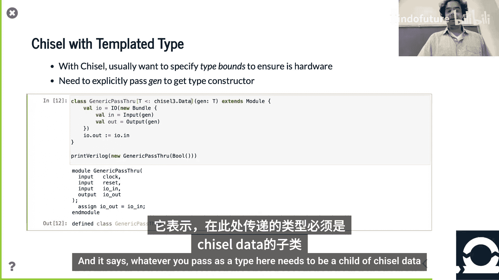

在Chisel中，类型参数化非常常见。我们通常将数据类型作为参数传递给模块。


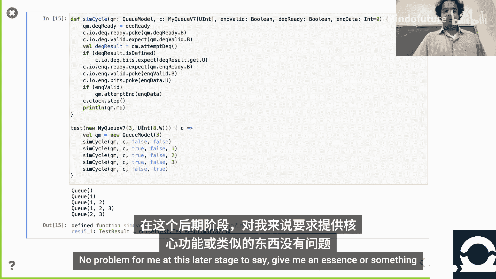

以下是一个通用模块的例子，它接受一个 `Data` 子类型作为参数：
```scala
class MyModule[T <: Data](gen: => T) extends Module {
  val io = IO(new Bundle {
    val in = Input(gen)
    val out = Output(gen)
  })
  io.out := io.in
}
```

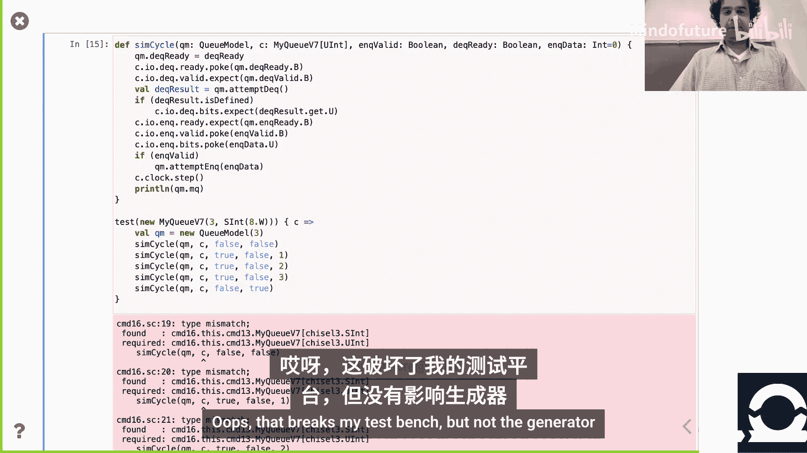

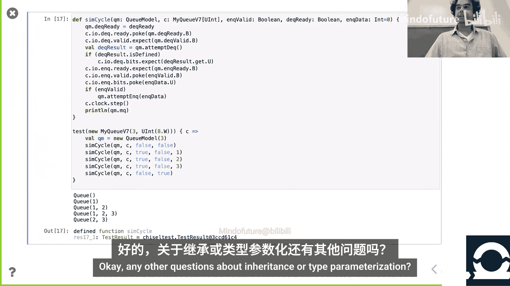

这里，`[T <: Data]` 是类型参数，`<: Data` 是类型上界，表示 `T` 必须是 `Data` 的子类型（如 `UInt`、`SInt`、`Bundle`）。`gen` 是一个“生成器”，用于创建该类型的实例。

### 应用：参数化队列

我们可以将之前学到的队列模块进行类型参数化，使其能够处理任意 `Data` 类型的数据。

```scala
class ParamQueue[T <: Data](gen: T, depth: Int) extends Module {
  // ... 队列实现，使用类型参数 gen ...
}
```

这样，我们就可以轻松创建存储 `UInt`、`SInt` 或自定义 `Bundle` 的队列了。

## 项目建议 💡

关于课程项目，请记住以下几点：
1.  **选题**：从你熟悉的领域或感兴趣的新领域入手。
2.  **核心**：项目应是一个“生成器”，而不仅仅是固定功能的模块。它应该有一些可配置的参数或“旋钮”。
3.  **规模**：选择大小适中的项目，最好能支持增量开发。即使最终只完成核心功能，也应有可展示的成果。
4.  **调研**：查看往年的项目，确保你的想法有创新之处。
5.  **规划**：在提案中明确最简单的起点、开发路线图和潜在扩展功能。

过去的项目涵盖哈希函数、AI加速器组件、Bloom过滤器、分形生成器、生物信息学算法等多种领域。

## 总结

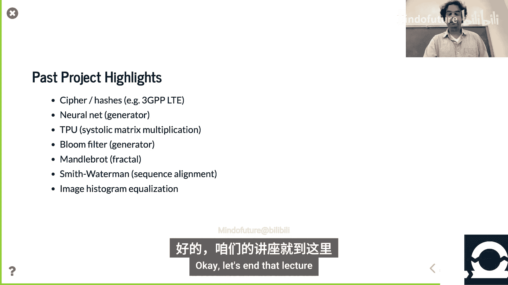

本节课中，我们一起深入学习了Scala继承的第二部分。我们通过构建一个解耦运算符库，实践了抽象类和工厂模式的应用。接着，我们介绍了特质的概念，展示了如何通过混入特质来为模块灵活添加功能。然后，我们总结了Scala中主要的面向对象机制。最后，我们探讨了类型参数化，学习了如何在Chisel中编写通用的、可处理多种数据类型的模块。掌握这些概念将帮助你构建更灵活、更可复用的硬件生成器代码。