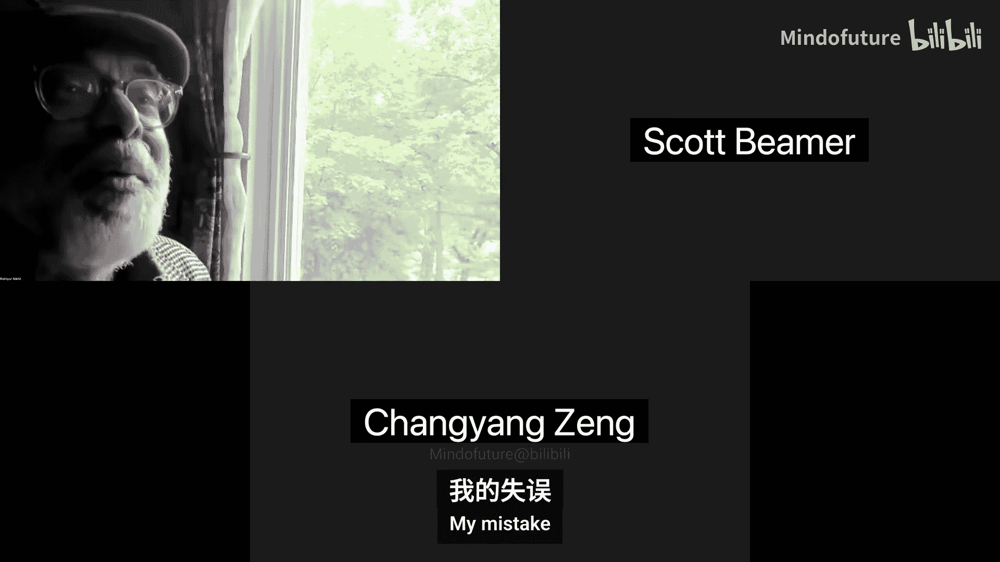
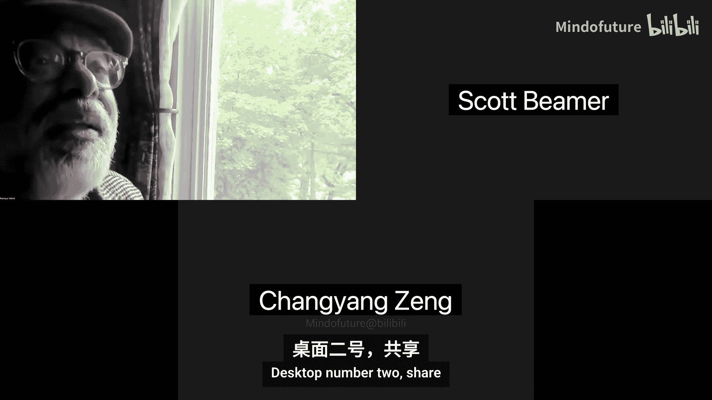
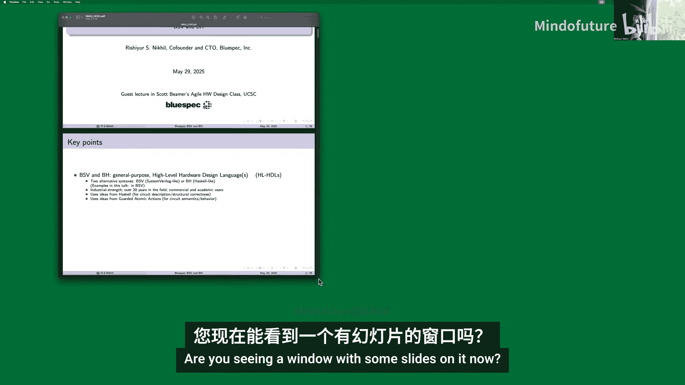
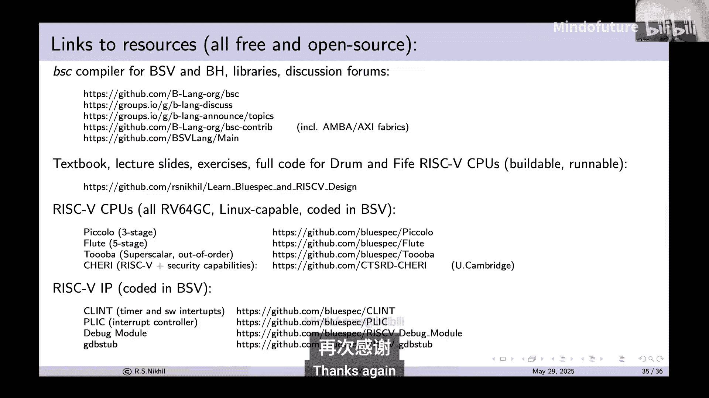

# 025：嘉宾讲座 - Bluespec 概述









在本节课中，我们将学习由 Bluespec 公司 CTO Rishiyur Nikhil 带来的关于 Bluespec 硬件设计语言的特别讲座。我们将了解 Bluespec 的核心概念、设计哲学，以及它与其他硬件描述语言（如 Chisel、Verilog）的区别。

---

## 概述

Bluespec 是一对通用的高级硬件设计语言，包含 BSV 和 BH 两种语法变体。它借鉴了 Haskell 的函数式编程思想来描述电路结构，并采用“受保护的原子动作”来描述电路行为。自 2020 年起，Bluespec 已成为免费开源工具。

---

## 核心概念：电路描述与行为

在硬件描述语言中，设计活动可分为两部分：**电路描述**和**电路行为**。

上一节我们介绍了课程的整体框架，本节中我们来看看 Bluespec 在这两个方面的独特之处。

### 电路描述：借鉴 Haskell

Bluespec 在电路描述方面借鉴了 Haskell 的纯函数式编程范式，拥有强大的类型系统，包括代数类型、多态类型和类型类。

*   **BSV 语法**：类似于 SystemVerilog，用于定义包、参数化类型和模块。
*   **BH 语法**：语法与 Haskell 完全相同。
*   **增强类型系统**：支持精确的位宽规范和匹配，防止静默的位丢失或溢出。
*   **多时钟域支持**：支持多个时钟和复位域，并进行静态域检查，确保信号在跨越时钟域时必须通过同步器。

### 电路行为：受保护的原子动作

电路行为通过“受保护的原子动作”来描述。这不是一个新概念，在 TLA+、Unity 等软件并发规范语言中早有应用。Bluespec 的创新在于将其应用于硬件设计，并能以模块化方式构建这些原子动作。

一个原子动作（规则）包含两部分：
*   **条件/守卫**：一个布尔表达式。
*   **动作**：更新状态的操作。

其执行语义非常简单：
1.  选择任意一个条件为真的规则。
2.  执行该规则的动作。
3.  重复此过程。

原子性保证了规则执行时不会发生交错，极大地简化了并发状态更新的正确性推理。

---

## 与 Chisel 和 HLS 的对比

理解了 Bluespec 的双重特性后，我们可以将其与其他流行工具进行比较。

*   **计算模型**：
    *   **Bluespec**：受保护的原子动作。
    *   **Chisel/Verilog**：时钟驱动的数字逻辑。
    *   **HLS**：C/C++ 程序执行。
*   **微架构**：
    *   **Bluespec/Chisel/Verilog**：是硬件描述语言，代码精确描述目标电路。
    *   **HLS**：微架构由编译器生成，用户可能不清楚其细节。

---

## 原子动作示例：缓存一致性协议

让我们通过一个具体的例子来理解原子动作如何简化复杂系统的描述。

考虑一个简化的缓存一致性系统，有两个 L1 缓存（A 和 B）和一个共享的 L2 缓存。初始状态是 L1A 以独占模式持有数据 X，L2 持有旧值 Y，L1B 无效。

当 L1B 收到一个读请求时，期望的状态转换是：
1.  将 L1A 降级为共享状态。
2.  将 L2 更新为值 X 并标记为共享。
3.  将 L1B 更新为共享状态并持有值 X。
4.  向 CPU 返回响应 X。

在 Bluespec 中，这可以用一个原子规则直接表达：

```bluespec
rule read_request_on_B (req_fifo.first().type == READ && l1b.tag == INVALID && l2.tag == EXCLUSIVE);
    let x = l1a.value;
    l1a.update(SHARED, x);
    l1b.update(SHARED, x);
    l2.update(SHARED, x);
    resp_fifo.enq(x);
endrule
```

这个规则是一个高级**规范**。为了实现它，我们需要将其细化为多个更细粒度、只涉及本地操作和消息传递的规则（**实现**）。Bluespec 允许使用相同的语言词汇在不同抽象级别进行设计和推理，便于验证规范与实现之间的等价性。

---

## 模块接口与方法

Bluespec 中模块间的交互通过接口和方法进行，类似于面向对象编程。但有两个关键增强：**隐式条件**和**调度约束**。

### 隐式条件

每个方法都有一个隐式的布尔条件，决定该方法能否被合法调用。例如，一个 FIFO 的入队方法 `enq` 在 FIFO 满时不应被调用。规则的整体启用条件是**显式规则条件**与所有被调用方法的**隐式条件**的**逻辑与**。编译器会自动处理这些条件，无需程序员显式编写流控代码。

### 调度约束

调度约束规定了同一时钟周期内方法如何被并发调用。例如：
*   **流水线 FIFO**：逻辑上 `deq` 发生在 `enq` 之前，允许同一周期内出队和入队。
*   **旁路 FIFO**：逻辑上 `enq` 发生在 `deq` 之前，允许数据在同一周期“穿过”FIFO。
*   **互斥约束**：两个规则不能在同一周期并发执行（需要仲裁）。

这些约束作为类型信息的一部分由编译器检查并强制执行，确保生成的 RTL 代码符合预期语义。

---

## 高级特性示例：蝶形交换机

Bluespec 的强大之处在于能简洁地描述复杂、参数化的硬件。以下是一个递归蝶形网络交换机的核心代码片段，展示了 Haskell 式的强大抽象能力：

```bluespec
module mkButterflySwitch#(Integer n, function OutPort destinationOf(T x), module mkMerge2to1) (Switch#(n, T));
    if (n == 1) begin
        // 基础情况：实例化一个 FIFO
        FIFO#(T) f <- mkFIFO;
        return tuple2(cons(f.enq, nil), cons(f.deq, nil));
    end else begin
        // 递归情况：实例化两个半尺寸的子交换机
        Switch#(n/2, T) leftSwitch <- mkButterflySwitch(...);
        Switch#(n/2, T) rightSwitch <- mkButterflySwitch(...);
        // 实例化一列合并模块
        Vector#(n, Merge2to1) merges <- replicateM(mkMerge2to1);
        // 连接逻辑（此处省略）...
        // 行为规则：路由单元
        for (Integer i = 0; i < n; i = i + 1) begin
            rule doRouting;
                let pkt = inputPorts[i].first();
                inputPorts[i].deq();
                let out = destinationOf(pkt);
                if (out % 2 == 0) merges[i/2].in0.enq(pkt);
                else merges[i/2].in1.enq(pkt);
            endrule
        end
    end
endmodule
```

这段代码展示了：
1.  **高阶模块参数化**：将合并模块作为参数传入。
2.  **递归模块实例化**：轻松构建递归硬件结构。
3.  **强大的静态生成**：使用 `replicateM` 等函数生成硬件实例。
4.  **清晰的规则描述**：`doRouting` 规则简洁地描述了每个路由单元的行为。

---

## 编译流程与工具链

Bluespec 源代码（.bsv 或 .bh）通过 BSC 编译器处理：
*   **仿真路径**：可编译生成 C++ 代码，链接成原生仿真可执行文件（Bluesim）。支持导入 C/C++ 代码进行协同仿真或测试。
*   **综合路径**：可编译生成标准的、可综合的 Verilog 代码。此 Verilog 可交由其他工具进行仿真、FPGA 实现或 ASIC 综合。

BSC 编译器的核心任务包括：
1.  保留源代码中的微架构状态（寄存器、FIFO 等）。
2.  保留计算逻辑，并进行局部优化。
3.  **将规则转换为 RTL**：这是最复杂的部分。编译器会分析所有规则，插入仲裁逻辑，在最大化规则并发性的同时，严格保证规则的原子性。它内部使用 SMT 求解器来分析规则条件之间的关系，以生成更优化的仲裁电路。

---

## 总结与资源

本节课我们一起学习了 Bluespec 硬件设计语言的核心思想。Bluespec 通过结合 Haskell 的函数式抽象和受保护的原子动作模型，提供了一种高表达力、高可靠性的硬件设计方法。它强调正确的构造和安全的并发，支持从高级规范到低级实现的平滑细化，并具备强大的静态检查能力，有助于实现敏捷的硬件开发。

**主要特点总结**：
*   通用高级硬件设计语言。
*   两种语法：类 SystemVerilog 的 BSV 和类 Haskell 的 BH。
*   电路描述借鉴 Haskell，电路行为基于受保护的原子动作。
*   强大的类型系统（含位宽检查）和多时钟域静态检查。
*   隐式条件和调度约束简化接口设计。
*   编译器保证原子性，并自动生成仲裁逻辑。
*   自 2020 年起免费开源。



**相关资源**：
*   编译器、教程、教科书、IP 库等资源链接可在讲座幻灯片中找到。
*   一个重要的生态系统工具是 **BlueCheck**，一个受 QuickCheck 启发的、可综合的属性随机测试框架，支持在 FPGA 上运行测试并进行用例收缩。