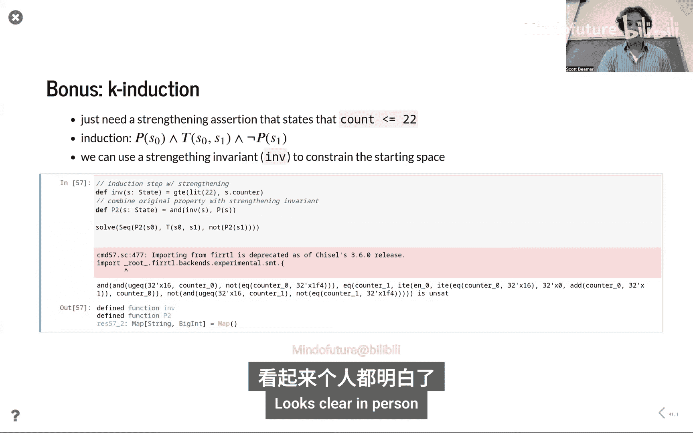

# 026：使用Chisel进行形式验证


## 概述

在本节课中，我们将学习形式验证的基本概念，特别是如何将其应用于使用Chisel设计的硬件电路。我们将从布尔可满足性问题（SAT）和可满足性模理论（SMT）的基础知识开始，然后探讨如何利用这些理论来验证组合电路和时序电路。课程将结合理论讲解与在Jupyter Notebook中运行的代码示例，帮助你理解形式验证的核心思想与实践方法。

---

## 布尔可满足性问题（SAT）🔍

首先，我们来理解形式验证的一个核心基础：布尔可满足性问题。

布尔可满足性问题是指：给定一个由布尔变量（`x1, x2, ..., xn`）组成的布尔公式 `F`，是否存在一种对这些变量的赋值（真或假），使得整个公式 `F` 的最终结果为真（`true`）。如果存在这样的赋值，我们称公式 `F` 是**可满足的**；如果不存在，则称其为**不可满足的**。

我们可以通过一个简单的函数来询问SMT求解器某个公式是否可满足。

```scala
// 示例：检查公式 `b0 && !b0` 是否可满足
// 变量 b0 只有两种赋值可能：true 或 false。
// 无论 b0 是 true 还是 false，公式 `b0 && !b0` 的结果总是 false。
// 因此，该公式是不可满足的。
solve(b0 && !b0) // 预期结果：UNSAT（不可满足）
```

对于公式 `b0 && b1`，情况则不同。

```scala
// 示例：检查公式 `b0 && b1` 是否可满足
// 当 b0 = true 且 b1 = true 时，公式结果为 true。
// 因此，该公式是可满足的，求解器会提供一个满足条件的例子。
solve(b0 && b1) // 预期结果：SAT（可满足），并给出一个例子，如 b0=true, b1=true
```

### 求解方法的挑战

一种直观的求解方法是列出真值表，检查是否存在结果为真的行。然而，这种方法存在一个严重问题：其复杂度随着变量数量的增加呈指数级增长。对于一个有 `n` 个变量的公式，真值表将有 `2^n` 行。对于具有数十个甚至数百个输入的硬件电路来说，这是完全不现实的。

尽管SAT问题在最坏情况下是指数级复杂的（NP完全问题），但研究人员发现，对于许多实际中遇到的问题，存在高效的启发式算法可以在合理时间内求解。这使得基于SAT的验证方法变得可行。

---

## 可满足性模理论（SMT）🧩

上一节我们介绍了基础的布尔可满足性问题。然而，硬件设计通常涉及更高级的概念，如整数运算和内存访问，而不仅仅是单个比特的操作。本节中，我们来看看可满足性模理论如何扩展SAT，以支持这些更丰富的数据类型。

SMT在布尔逻辑的基础上，增加了对特定“理论”的支持，使我们能够直接表达像位向量（固定宽度的整数）和数组（用于模拟内存）这样的高级概念。

例如，我们可以询问是否存在一个整数 `a`，满足 `a + a == 8`。

```scala
// 定义位向量变量 a
val a = BitVec("a", 32)
// 构造公式：a + a == 8
val formula = (a + a) === 8
// 求解
solve(formula) // 预期结果：SAT, a = 4
```

我们也可以尝试求解 `a + a == 9`。

```scala
val formula2 = (a + a) === 9
solve(formula2) // 预期结果：UNSAT，因为不存在整数解满足 2*a = 9
```

SMT求解器还能帮助我们验证编译器优化。例如，我们可以检查“强度折减”优化（将乘以4的运算替换为左移2位）是否总是等价。

```scala
val c = BitVec("c", 32)
val a = BitVec("a", 32)
// 检查是否存在常数 a，使得对于所有 c，有 c * 4 == c << a
// 实际上，我们固定一个具体的 c 值（如145）来寻找 a
val formula3 = (c * 4) === (c << a)
solve(formula3) // 预期结果：SAT, a = 2 （因为 4 是 2 的 2 次方）
```

如果尝试将4改为非2的幂，比如5，则求解器会返回不可满足。

```scala
val formula4 = (c * 5) === (c << a)
solve(formula4) // 预期结果：UNSAT
```

---

## 组合电路的形式验证⚙️

理解了SAT和SMT的基础后，我们现在可以将其与硬件电路联系起来。本节我们将探讨如何对**组合电路**（即没有状态元素，如寄存器和内存的电路）进行形式验证。

在Chisel中，我们使用 `assert` 语句来声明电路必须始终满足的属性。在仿真中，如果断言被违反，仿真会停止并报错。在形式验证中，我们的目标是**证明**对于所有可能的输入，该断言都永远不会被违反。

验证的思路是：我们请SMT求解器寻找一个能**使断言为假**的输入赋值。如果找到了这样的赋值（公式可满足），那就发现了一个错误（Bug）。如果找不到这样的赋值（公式不可满足），则证明该断言对于所有输入都成立。

考虑一个简单的电路，其断言是 `b > a`，其中 `b = a + 1`。

```scala
// 这是一个概念性描述，并非完整Chisel代码
Input: a
Wire: b = a + 1
Assert: b > a
```

为了验证，我们构造以下SMT公式，询问是否存在使断言失败的情况：

```scala
// 构造公式：存在 a，使得 b = a + 1，但 b <= a
val a = BitVec("a", 32)
val b = a + 1
val bad_condition = !(b > a) // 即 b <= a
solve(bad_condition) // 寻找反例
```

运行后，求解器会找到一个反例：当 `a` 是32位全1（即最大值）时，`a+1` 会发生溢出，结果为0。此时 `b（0）` 并不大于 `a（最大值）`，断言被违反。这揭示了一个潜在的溢出错误。

在Chisel Test中，我们可以更直接地进行验证：

```scala
import chisel3._
import chiseltest._
import chiseltest.formal._

class MyModule extends Module {
  val a = IO(Input(UInt(32.W)))
  val b = IO(Output(UInt(32.W)))
  b := a + 1.U
  assert(b > a, "b should be greater than a")
}

// 使用 verify 进行有界模型检查（对于组合电路，界限为1即可）
test(new MyModule).verify(_.a, 1) // 这将发现并报告溢出错误
```

### 实际案例：格雷码电路验证

以下是一个更实际的例子，验证格雷码编码器的两个关键属性：
1.  **无损性**：二进制数转换为格雷码再转换回来，应得到原数。
2.  **单比特翻转**：递增一个二进制数时，其对应的格雷码每次只改变一个比特。

```scala
class GrayCodeProperty(width: Int) extends Module {
  val in = IO(Input(UInt(width.W)))
  val gray = BinaryToGray(in)
  val out = GrayToBinary(gray)
  // 属性1：无损
  assert(in === out, "Gray code conversion should be lossless")

  // 属性2：单比特翻转（使用汉明距离）
  val inPlusOne = in + 1.U
  val grayPlusOne = BinaryToGray(inPlusOne)
  val hammingDist = PopCount(gray ^ grayPlusOne)
  assert(hammingDist === 1.U, "Only one bit should flip in Gray code on increment")
}
// 对64位宽进行验证，穷举测试是不可能的（2^64种输入），但形式验证可以完成。
test(new GrayCodeProperty(64)).verify(_.in, 1)
```

**总结**：对于组合电路，形式验证可以为我们提供**完全证明**，确保在**所有可能输入**下，所声明的属性都成立。在Chisel Test中，只需使用 `verify(..., 1)` 即可。

---

## 时序电路的形式验证⏱️

上一节我们处理了没有状态的组合电路。本节中，我们来看看更复杂的、带有状态（寄存器或内存）的**时序电路**。验证这类电路的关键在于，我们需要考虑状态在多个时钟周期内的演变。

考虑一个简单的计数器，当使能信号有效且计数值不为22时递增，达到22时归零。我们断言计数值永远不会达到10。

```scala
class MyCounter extends Module {
  val enable = IO(Input(Bool()))
  val count = RegInit(0.U(32.W))
  when(enable) {
    when(count === 22.U) {
      count := 0.U
    }.otherwise {
      count := count + 1.U
    }
  }
  assert(count =/= 10.U, "Count should never reach 10")
}
```

如果我们只验证一个周期（`bound = 1`），验证会通过，因为从初始状态0开始，一个周期内确实无法到达10。要发现这个错误，我们需要验证足够多的周期，让计数器有时间计数到10。

```scala
// 界限为1，验证通过（但结论是错的）
test(new MyCounter).verify(_.enable, 1)
// 界限为10，会发现错误，并给出导致count=10的输入序列（trace）
test(new MyCounter).verify(_.enable, 10)
```

### 理论基础：有界模型检查

时序电路的验证通常通过**有界模型检查** 来实现。其核心思想是将电路抽象为一个**迁移系统**：
*   **状态**：由所有寄存器的值构成。
*   **初始状态谓词 I(s)**：描述系统复位后的状态（如 `count == 0`）。
*   **迁移关系 T(s, s’)**：描述在给定输入下，如何从当前状态 `s` 转移到下一个状态 `s’`。
*   **属性谓词 P(s)**：描述在状态 `s` 下，我们期望的属性是否成立（如 `count != 10`）。

BMC会“展开”这个迁移系统K步，构造一个大的组合逻辑公式，询问是否存在一条长度不超过K的状态迁移路径，最终到达一个违反属性P的状态（坏状态）。如果SMT求解器返回`SAT`，则找到了一个反例（Bug）。如果返回`UNSAT`，则证明在K步之内不存在错误。

**重要提示**：BMC只能证明在**指定的步数K内**没有错误。它不能证明电路在**无限步数**下永远正确。不过，实践中许多错误都能在相对较小的K值内被发现。

---

## 实践案例：队列验证🔎

理论学习之后，让我们看一个复杂的实践案例：验证一个FIFO队列的正确性。这展示了形式验证在发现隐蔽角落案例错误方面的威力。

我们希望验证队列的一个核心属性：**数据完整性**。即，进入队列的数据，必须以其进入的相同顺序被取出，且最终一定会被取出。

在Chisel中，我们需要将这个属性也编写为硬件电路（包含`assert`）。我们创建一个包装模块，内部例化待测队列，并添加用于追踪和断言属性的逻辑。

首次尝试的属性可能只追踪第一个进入队列的数据包，检查它是否正确取出。但这可能漏掉错误，因为当队列中有多个数据包时，逻辑会混乱。

改进后的属性会记录数据包进入时的队列深度，只有当该数据包到达队头（即队列深度减到1）时才检查其输出值。这个更精确的属性成功发现了一个队列实现中的错误：在特定时序下，`maybeFull`信号的生成逻辑有误，导致队列在应为空时却输出了数据。

```scala
// 修复前的错误逻辑
val maybeFull = risingEdge && io.enq.fire === io.deq.fire
// 修复后的正确逻辑
val maybeFull = risingEdge && io.enq.fire =/= io.deq.fire
```

形式验证工具给出了导致断言失败的具体波形（trace），清晰地展示了错误发生的过程，极大地辅助了调试。尽管它没有直接指出代码中的哪一行错了，但提供的反例极大地缩小了排查范围。

**经验总结**：编写有效的属性是形式验证中最具挑战性的部分之一。好的属性应该能捕捉设计的关键行为，并且本身足够精确以避免误报。通常需要结合领域知识和调试经验。

---

## 高级主题：时序断言与K归纳法🚀

### 时序断言

之前的断言大多是关于单个周期的。**时序断言**允许我们表达跨多个周期的属性。Chisel Test提供了`past`和`stable`等构造来简化这类属性的编写。

例如，对于AXI4流协议中的“Valid稳定”要求：一旦`valid`信号拉高，在`ready`信号拉高完成传输之前，`valid`不能拉低，且传输的数据必须保持稳定。

```scala
class AxiStreamProperty extends Module {
  val valid = IO(Input(Bool()))
  val ready = IO(Input(Bool()))
  val data = IO(Input(UInt(32.W)))

  // 使用 past 引用上一周期的值
  when(past(valid && !ready)) {
    assert(valid, “Valid cannot be deasserted without ready”)
    assert(stable(data), “Data must be stable while valid and !ready”)
  }
}
```

这些时序断言不仅可用于形式验证，也可用于动态仿真测试，实现验证组件的重用。

### K归纳法

有界模型检查（BMC）只能证明K步内无错。**K归纳法**是一种试图证明属性对于**所有步数**都成立的技术。
1.  **基础步**：证明属性在初始状态（以及可能的开头K-1个状态）成立。
2.  **归纳步**：假设属性在连续的K个状态中成立，证明在第K+1个状态属性也成立。

如果两者都成立，根据归纳法，属性对所有状态都成立。

然而，K归纳法可能因为归纳假设不够强而失败（即“不归纳”）。这时需要用户提供额外的**强化引理**来帮助证明。例如，要证明计数器`count`永远不会达到500，除了主断言`count != 500`，我们可能还需要一个强化断言`count <= 22`（因为计数器逻辑决定了它只能在0-22之间循环）。结合这个强化断言，K归纳法才能成功。

**使用建议**：首先用BMC进行“漏洞狩猎”，因为它总能给出明确的反例。只有当BMC在合理步数内都找不到错误，且你对属性的正确性有高度信心时，才考虑使用K归纳法进行完全证明。

---

## 总结

本节课我们一起学习了硬件形式验证的核心概念与实践方法。



我们从**布尔可满足性**和**SMT求解器**的基础讲起，理解了形式验证的底层引擎。接着，我们探讨了如何对**组合电路**进行验证，获得关于所有可能输入的完全证明。然后，我们深入到**时序电路**的验证，介绍了**有界模型检查**的原理与局限性。通过**队列验证**的案例，我们看到了形式验证在发现复杂角落案例错误中的强大能力。最后，我们简要了解了**时序断言**和**K归纳法**这两个高级主题。

形式验证的核心优势在于其**穷举性**，能够发现仿真测试难以触发的错误。在Chisel生态中，通过Chisel Test库，我们可以相对便捷地将形式验证集成到敏捷硬件开发流程中。虽然编写有效的属性需要经验，但它能极大地提升我们对硬件设计正确性的信心。