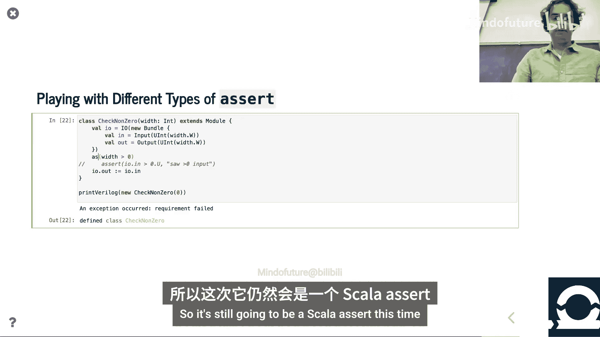
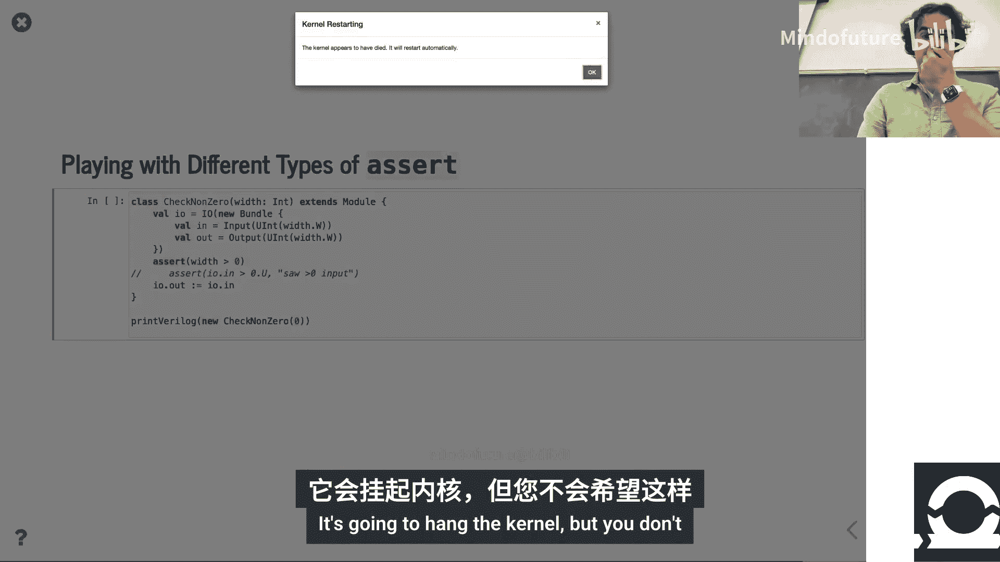
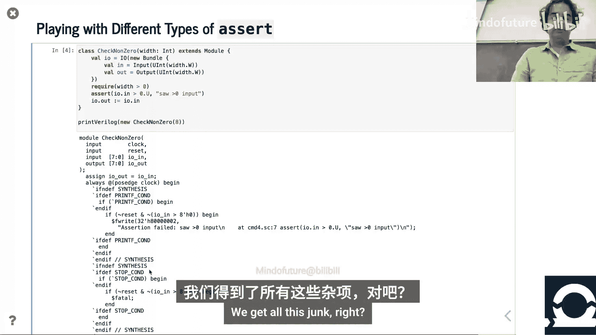
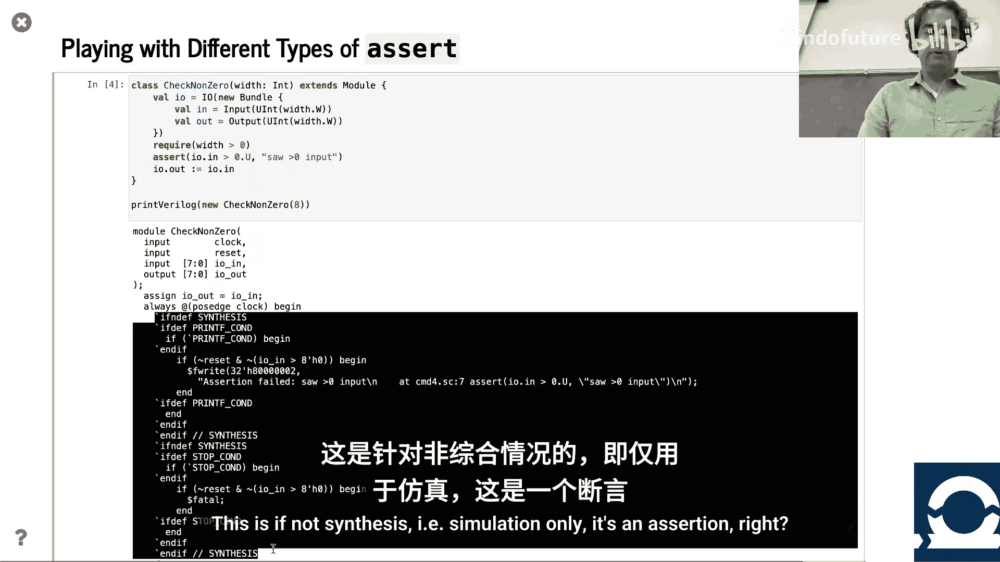
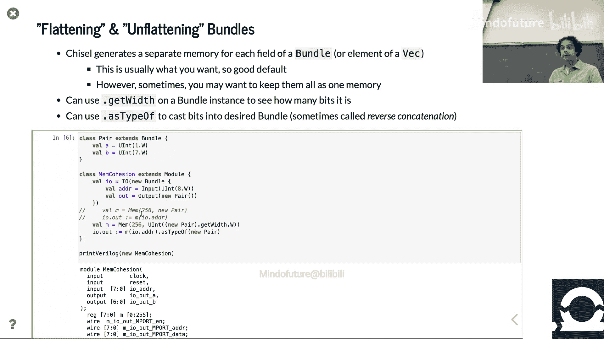

# 030：第20讲 - Chisel 工具包概览 🧰

在本节课中，我们将回顾并深入探讨一系列关于 Chisel 语言及其使用技巧的要点。这些内容涵盖了常见用法、常见误解以及一些能帮助你写出更清晰、更健壮代码的最佳实践。

## Chisel 工作原理回顾 🔄

上一节我们介绍了本讲的主题，本节中我们来看看 Chisel 的基本工作原理。经过近一个季度的使用，这应该不再神秘。

Chisel 是一个嵌入在 Scala 中的领域特定语言（Embedded DSL）。你编写的 Chisel 代码本质上是一个合法的 Scala 程序。如果你在 Scala 层面有错误，编译器会报错。

Chisel 库在你的 Scala 程序运行时被调用。当你的程序运行时，你实际上是在实例化 Chisel 对象，这些对象代表硬件组件。即使是像字面量 `4.U` 或对某个引用的取反操作 `~io.in`，也都是代表硬件的 Chisel 对象。

每个对象内部都有输入和输出，代表硬件本身的输入和输出。这一切都在幕后进行。例如，当我们编写一个模块并声明 `extends Module` 时，我们使用的是来自 Chisel 库的类继承。

我们的代码最终归结为两件事：实例化对象和连接对象。连接操作符（`:=`）或批量连接操作符（`<>`）会在这些 Chisel 对象中引入副作用，即在输入、输出或其他部分之间建立连接。

因此，你的 Chisel 设计就是一个实例化和连接 Chisel 对象的 Scala 程序。所有的参数化和灵活性实际上都来自 Scala 程序本身。Chisel 的核心非常简单：实例化和连接。围绕它的所有功能都是 Scala 提供的。

## 硬件是静态的 ⚙️

接下来，我们需要明确一个核心概念：硬件设计在结构上是静态的。

这意味着物理硬件、连线、连接都是固定不变的，不会改变。然而，硬件连线上的值在仿真或实际运行中是可以改变的。

例如，一个多路选择器（Mux）总是在两个输入之间进行选择，但它与两个输入的连接是静态的，不会改变。只是它读取哪个输入的值会变化。

同时，寄存器或内存等状态元件具有内部状态，它们只在时钟上升沿改变。在 Chisel 中，时钟通常是隐式的，但请记住，设计中大部分会变化的部分都发生在时钟节拍上。

## 最后连接语义 ⚡

现在我们来回顾 Chisel 中的“最后连接语义”概念。

这意味着如果对同一个输入有多个连接，Chisel 必须选择一个胜出。这看起来像是运行时行为，但实际上是静态的。胜出的连接是在 Scala 程序（生成器）中最后执行的那个连接，并且会被编码到设计中，该设计是静态的，不会改变。

以 `when` 语句为例。在底层，`when` 语句是通过 Mux 实现的。即使 Mux 有能力在不同输入间选择，但连接本身是静态的，只是它读取哪个输入会变化。

以下是一个阈值（限幅）效果的例子：
```scala
io.out := io.in
when (io.in > 3.U) {
    io.out := 3.U
}
```
默认情况是直通，当条件满足时，则输出 3。Chisel 编译器会将其转换为一个 Mux。

## 优先使用 `val` 而非 `var` 🚫

这是一个在课程中多次出现的重要风格点，我们需要非常清楚地区分。

不要混淆 Scala 中的可变性（即使用 `var`）与硬件设计中连线值的变化。`val` 和 `var` 指的是对 Scala 中 Chisel 对象的引用，完全不是描述 Chisel 对象本身的可变性。Chisel 对象代表硬件，其值可以在仿真中每个周期都变化。

使用 `var` 不仅可能导致错误行为，有时还难以调试。例如，尝试用 `var` 写计数器：
```scala
var counter = 0.U
counter = counter + 1.U // 错误！这只是一个 Scala 赋值，不是硬件连接。
io.out := counter
```
这会导致输出始终为 1（0+1），因为这里使用了错误的赋值操作符。更好的方式是使用 `val` 和正确的连接操作符 `:=`，或者直接使用寄存器 `RegInit`。

另一个常见错误是 `when` 语句作用域逃逸，这通常也是由使用 `var` 引起的。请尽可能使用 `val`。

## 使用函数式集合操作 🧮

在课程的一些地方，我鼓励大家少用可变集合。就像 `var` 一样，我没有完全禁止，但建议谨慎使用。

现在你学习了函数式编程，可以使用 `map`、`foldLeft` 等操作来生成新的集合，而不是改变原有集合。这减少了迭代和突变带来的复杂性，使代码更清晰，更不易出错。

例如，递增一个序列：
```scala
// 使用可变方式和迭代
val buffer = ArrayBuffer.tabulate(6)(i => i.U)
for (i <- 0 until 6) {
    buffer(i) = buffer(i) + 1.U
}
// 使用函数式方式
val seq = Seq.tabulate(6)(i => i.U)
val newSeq = seq.map(_ + 1.U)
```
函数式方式没有突变和显式迭代，更简洁，更不容易出错。

## 减少特殊情况的处理 🎯

我鼓励大家减少代码中特殊情况的处理。有时，让代码更通用、参数化，反而会使它更简单。

例如，`foldLeft` 这样的结构可以优雅地处理零元素的情况，同时也能处理非零元素的情况。如果你有很多 `if-else if` 分支来处理不同的参数值，这可能是一个“代码异味”，试着看能否重构。

## `for` 与 `foreach` 的选择 🔁

学生有时会问，在 Chisel 的上下文中，`for` 和 `foreach` 有什么区别？

两者在 Scala 中都非常灵活，都可以在很多场景下使用。`for` 是 Scala 语言的一个关键字，而 `foreach` 是许多 Scala 对象实现的方法。

通常，当你的目标是产生某种迭代或副作用时，使用 `for` 或 `foreach`。如果你希望直接产生一个结果，那么 `map` 可能更合适。

个人建议：
*   当集合或范围已经存在时，使用 `foreach` 进行迭代。
*   当你需要创建一个范围进行迭代时，使用 `for` 更自然。
当然，你可以互换使用，这在一定程度上是个人风格问题。

## 硬件效率考量 ⚡

虽然本课程主要关注正确性而非性能，但作为计算机工程师，我们仍需考虑逻辑元件的使用。

CAD 工具很智能，会优化掉一些低效设计，但有些操作它们难以优化。例如，在硬件中，除法、取模和乘法操作非常昂贵，应尽量避免。

在“生命游戏”作业中，有人使用取模和除法从单个索引计算行和列。更好的方法是使用两个独立的计数器。

此外，在 Chisel 中进行位操作时，应使用位选择（如 `bits(6, 4)` 或 `head`/`tail`）和连接（`Cat`），而不是像在 C 语言中那样使用位移和位掩码。这样更清晰，CAD 工具也更容易理解。

## 大型硬件实例化的位置 🏗️

这是一个风格问题。硬件是静态的，放在 `when` 块内的硬件实例并不会因为条件不满足而消失，它始终存在。`when` 控制的是连接何时生效。

有时，将大型硬件实例声明在 `when` 块之外，可以使模块的结构对阅读者更清晰。将主要的模块实例化放在模块顶部，可以让人一目了然地看到模块的主体结构，然后再填充细节。

两种方式在功能上都是正确的，但后者通常更利于代码阅读和维护。

## Scala 范围：`to` 与 `until` ↔️

Scala 提供了丰富的范围操作。`until` 是排他的，`to` 是包含的。

例如，`0 until 4` 得到 `0, 1, 2, 3`。如果你需要包含上界，应该使用 `to`，而不是手动 `n+1` 或 `n-1`。充分利用语言特性可以使代码更简洁。

## `assert` 与 `require` 的区别 🛡️

我们有时用 `require`，有时用 `assert`，实际上有两种断言。

Chisel 断言（`assert`）用于硬件设计，其参数类型是 Chisel 的 `Bool`。它只在仿真中存在，如果条件为假，会导致仿真失败。在工业中，大量使用 Chisel 断言来编写测试模块。





Scala 断言（`assert`）用于 Scala 程序本身，在构造/生成期间运行，不会存在于硬件中。它的参数类型是 Scala 的 `Boolean`。





`require` 也是一个 Scala 特性，用于检查输入合理性（例如参数范围）。`assert` 和 `require` 都是运行时检查。区别在于，可以通过编译器标志禁用 `assert`，但 `require` 不会。因此，风格上通常用 `require` 进行输入合法性检查，用 `assert` 保护内部不变量。

## 抽象：模块、函数与类 🧩

我们应该如何考虑抽象？什么应该放在模块里，什么应该放在函数或类里？

目标是让代码对人类清晰易懂，并易于复用你构建的组件。其他方面（如效率）是次要的，可以交给 CAD 工具。

对于大多数情况，为每个组件使用一个模块就很好。其他机制（如非模块的类）出现在一些特定场景。

考虑抽象时，请思考：
1.  **复用性**：人们会如何使用这个功能？他们是否只想要其中一半？也许应该拆分成更小的模块。
2.  **可测试性**：如果一个模块太大，难以编写测试用例或覆盖所有组合，这可能是一个信号，提示你应该将其分解。
3.  **向下隐藏复杂性**：尽可能将复杂性封装在模块内部，使用者只需关心接口和参数，无需理解内部实现。

有时，一个返回组件的函数可能比一个类或模块更简单，尤其是在使用函数式构造时。有时，为了在波形图等下游工具中保持清晰的层次结构，可能会将一些小实体合并到模块中。但作为初始版本，为每个逻辑单元使用一个模块是很好的起点。

## 内存打包技巧 💾

这是一个非常具体的优化点。当你用 Chisel 创建一个内存（`Mem`），其类型是一个 Bundle 时，Chisel 会为 Bundle 的每个字段创建独立的内存。

例如，一个包含 1 位 `a` 字段和 7 位 `b` 字段的 Bundle，创建 256 个这样的元素，会得到 256 个 1 位宽的内存和 256 个 7 位宽的内存。

物理设计团队可能希望将这些字段打包成一个 8 位宽的内存。这时可以使用一个技巧：创建一个 `UInt` 类型的内存，宽度等于 Bundle 的总宽度。在访问时，再将读取的 `UInt` 转换回 Bundle 类型。这样可以实现内存打包。

## 总结 📚



本节课中我们一起学习了 Chisel 工具包中的多个重要概念和最佳实践。我们回顾了 Chisel 的静态本质和最后连接语义，强调了使用 `val` 和函数式编程的重要性。我们还探讨了代码风格、效率考量、断言的使用、抽象的选择以及一些实用技巧。掌握这些内容将帮助你写出更清晰、更健壮、更高效的 Chisel 硬件设计代码。