# 【加州大学】敏捷硬件设计-CSE228A-｜-Agile-Hardware-Design-Spring-2025-p01-P12_第1讲-课程简介--BV1M6ivBzESw_p1-

Hello and welcome， this is CSC 228。Here we are both virtually and in person， so this is。

Agile hardware Design grad courseur。 I'm instructor Scott Beaer。This is a fun course。

 I why say I teach it is selective course， despite being labeled a graduate course。

 we're happy to welcome undergrads to it。嗯。So let's get to it。So u today， you know。

 in the first lecture， we tried to hopefully motivate the course， why are we doing all this？Um。

 talk about agile hard design in general， also against the logistics。

 and actually before the end of day， we'll see a little bit of code。

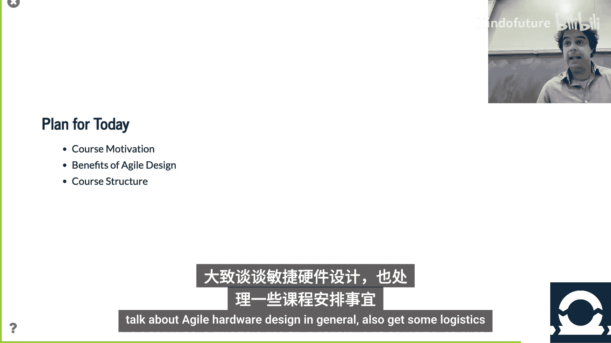

So。Why even do this in the first place。 Well， as we know， we are in an extremely digital era， right。

 you know， the buzzword from years ago was ubiquitous computing and computing is so ubiquitous that seems to even mentioned that。

 right， we have it all around us， whether it be our smartphone to carry of us everywhere or even other small Internet things devices attached to us at all times is even inside of things like toothbhes。

 for example， iss in our carss and data centers everywhere。

 So there's all these electronic devices of course， all powered by chips。 So the question， of course。

 is where those chips come from。😊。

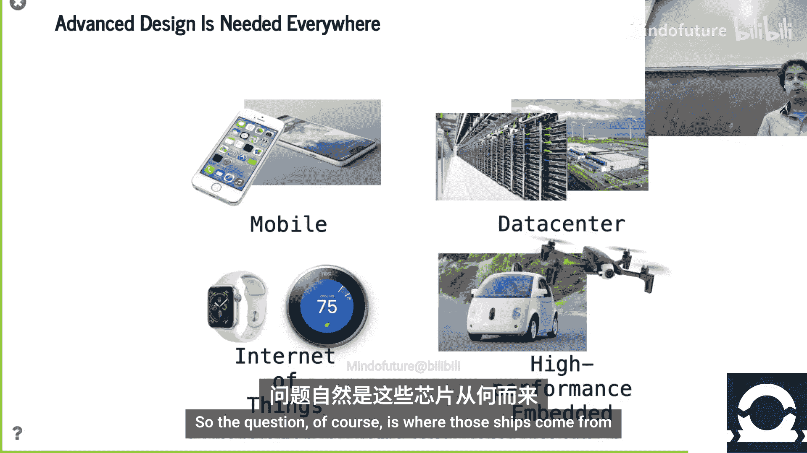

And the answer is for us to design them。And with all these different applications。

 we need to design chips for all different places， all different applications so。

Local forces kind of a work here。Number one， of course。

 you may have heard in various courses about Moore'swell， the property of， you know， as time goes on。

Advances in chip manufacturing allow us to provide more transistors for less money。 In other words。

 for a reasonable amount of money， mattress we have access to keeps increasing。

 This has been true for decades。 And as you've always seen in news headlines。

It's starting to have some slowdown。 There's been some hiups。

But whether or not Moore's law continues or slows down？For almost 20 years now。

 we've had a real big energy challenge， right， and that is that very thing we want to do requires computation。

 competition requires energy。 if you try to do more computation。

That will require more energy unless we improve efficiency， right。

 And so thus in order to get more done， we have to keep improving energy efficiency。

 And so much of our design and architecture is really predicated on how do we improve efficiencies so we can get more done。

And。One of the most classic ways to improve efficiency it something called specialization。

 That is rather having a general purpose process can do anything。

 we tailored the hardware work to do just we want to do。 So thats streamlining that specialization。

Makes it more energy efficient。But。It of course， also has certain consequences。

Chhifting over to the design site。 Okay， so we want to build more specialized chips。

 what does it take to make these designs。 Well， as these ts get smaller and smaller and smaller。

 it actually gets harder and harder and harder to design them。

 even though we're using lots of tools to help us， all sorts of constraints emerge。

 And so the cost design of chip just keeps going up and up and up。 And so wait a second。

 we're in a world where we need more specialized chips， However at the same time。

Design costs are rising， so how do these two worlds become reconciled？啊。If we don't figure this out。

 we have this horrible outcome of weight。 We can't afford to make the chips we need and everything kind of closed down。

 right， We can't build enough chips。 All these things happen。 And so the good news is。

 that's now what's happening。 What's happening is that as a community。

 we figured out how to design chips more productively， more efficiently。😊，And so as a result。

 we're able to get that productivity and efficiency there at the same time。The thing like AI。

 I there been more demand for custom chips and so。There's this massive incentive to figure this out。

 And people are furing it out， And so。I created a course originally four years ago in that time point。

 someone like Google is maybe the only cloud company doing their own silicon for their own data centers。

 Here we are four years later， they all have their own custom silicon， right， Google， Me， Microsoft。

 Amazon， They're all deploying their own chips and these chips got a lot of money to build。

 but they deploy so widely， it pays off for them because they're specializedizing in。And so。

We're talking this course about how do we design hardware more efficiently， How do we do that。

 both to make efficient hardware， but also。To make that process more efficient。

 How do we go about designing these chips And so。

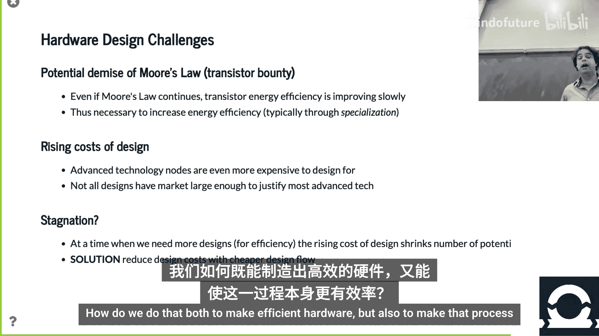

To go about that and to kind of get at the panel for this course。

 you think of designing hardware in two different styles， and this is not just hardware。

 but more generally engineering。The classic way to think of engineering is what we call the waterfall technique and the way I think of it is you know it's very careful planning and you want to make sure you make no false steps right you want to make sure everything is correct。

 you don't want to get anything wrong。😡，This has been very successful to some domains take civil engineering。

 for example， right you know hundreds and hundreds of years ago。

 periodically you know bridges would collapse， civil engineeringing got much more better。

 much more rigorous and was able to prevent that and now these failures are very rare and how they document it because we're so rare right so whether you do you have very careful plans so imagine you're trying to build a dam。

😡，And so you're going to do all of modeling and serving and alterative tests every step the way you can be very careful。

 you're going to build and test your mold， you think all the right， But if you get it all right。

 you have a crack damn and everyone's happy。But it's this key constraint， right。

 then you're building a dam， you can only pour it a concrete you once when you pour it。

 you know millions and millions of gallons of concrete。After dam is built， you can't decide。

You knowOh you know， I want to stand to move a foot to the left。That's not going to be possible。

 right， So what's the alternative， The alternative is something called Agile， right。

 which is this notion of embracing kind of continuous changing and adaptation， right。

 So the agile philosophy is you can do the perfect design in advance。

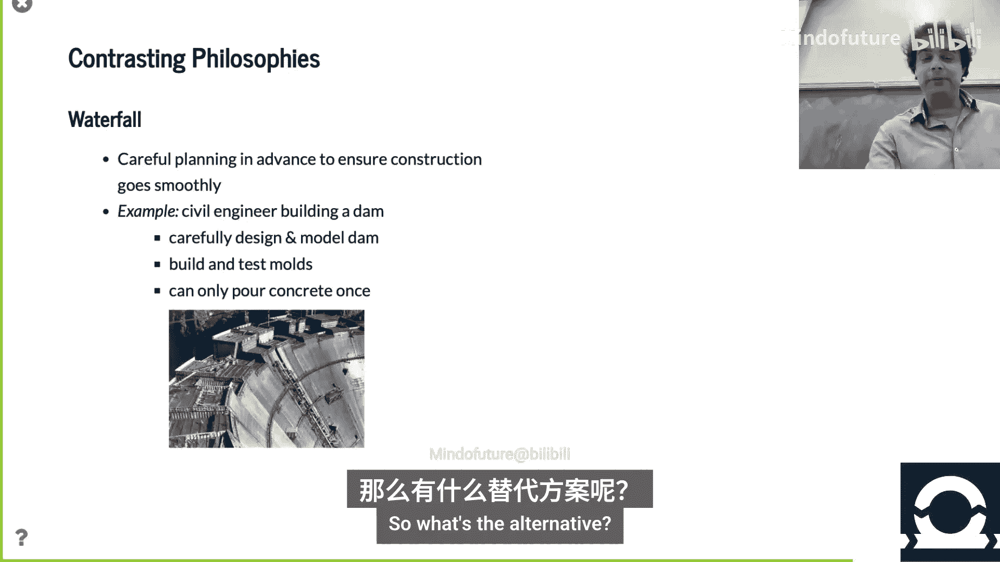

And so you need to kind of continuously adapt， right and say， know what。 Well。

 here's what we believe to be best planned so far。As doesn't mean there's node plan。

 It just means you're very willing and able to change a plan along the way right so think of that you know as an example as a competitive athlete right Of course you're going to train you're going to be in good shape。

😡，嗯。But because it's trying to compete with， I guess the opponent。

 How could you possibly know what they're can to do in advance。 You get some hunches。

 You get some plans， But you're gonna know for sure， right。

 And what you can do is you recognize what they do， adapt and then out compete， right， And so。

That's kind of these two styles。 And you can see that both of these philosophies actually have their domain。

In which domain which one the probe for your domain depends on the constraints of your domain， right。

 The situations where you only can do something once。

I highly recommend the waterfall style design approach。 right， If you're looking poor concrete ones。

 you don't want to， you know， poor concrete and have tell， you know what。 Let's move it over a foot。

 You can't do that。However， it turns out things involving software。Aren't like that， right。

 You can continuously adapt and revise it。 right， for example。

 we're seeing it for granted now to so many applications we use sort it be in the cloud or even mobile。

 They almost aren't even publicly versioned to us as users anymore。 We can。

 We can't quite even tell sometimes what version it is because it's continuously adapting and revising。

 right。And many of you were too young， But， you know， when I was very young， you know。

 had these massive waterfall。 You know， Microsoft release brand new O in scratch。

 You know I got always things from scratch。 There's so many catastroic failures in the software in the waterfall because it turns out this adaptive thing is much more efficient when you be able to change。

 And so。😊，whole premise of this course is you know what？

If we're able to recognize aspects of power design， it can make it。Easier to change。

 not set in stone and easier to move。 We can embrace an agile philosophy。

 But the agile philosophy were able to。😊，Much more able to adapt what we you to do and's not just going to be less designer effort。

 it's going to be more productive and they all kind of come together。😡。

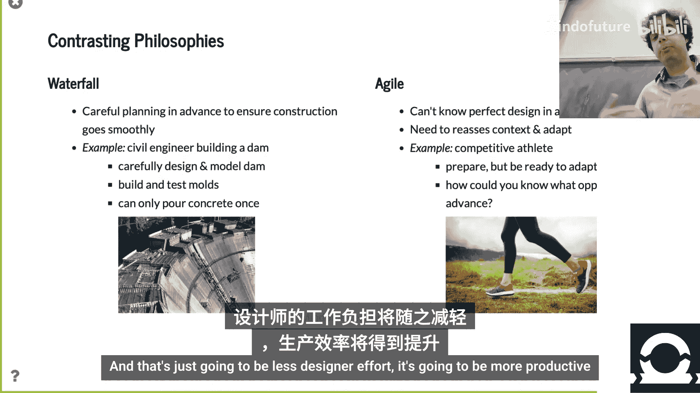

Okay， so taking those ideas philosophys in the abstract and now bringing them to what's looked like in practice for hardware design。

Traditional hard design you have is very deliberate process， right， One step at a time。

 you complete one step before we're moving on to the next step， right， So you're gonna。

Design your chip， you're going to specify pieces， break down all these blocks。

 each these blocks have certain components of rules。

 you to go off and task teams implementing those pieces。

 each of those pieces is going to be tested in isolation。

 then you start integrating them and start testing them again。😡。

After you've kind of started do all functional pieces kind of coming together。

 they start trying to optimize them， perhaps individually and in integrated。And then finally。

 you verified the whole thing， right？This works， this is how we have functional chipped。However。

 it doesn't allow itself very easy to change this right？ Imagine more agile hard design philosophies。

 you know what， we' get design running， we'll implement something， we'll optimize it。

 we'll verify it， but then we' go ahead and just keep tweaking it。

 And so you know what each time it away， we'll look at what we didn't like about it and go ahead and change design。

 change implementation optimize it and of course keep retesting it and keep going through this loop over and over again And so we find something we like right And if once we're satisfied with it。

😡，We can stop with a waterfall。 it's a little bit hard to know。

How things are end up in terms of performance， power or area。

 right those the main metrics use evaluated hardware， you can do your best to model things。

 You can kind of set budgets for certain things， But until you have the entire thing integrated。

You don't know for sure if you achieve those targets， right， versuss a natural approach。

You go through the entire process often， so you always know where you stand， it may not be great。

 maybe your first design because you you know， the really simple design is an awesome much that get through the tools。

😡，It's not not to my， and numbers aren't good。But you know those numbers are， right。

 And you can go ahead and optimizeize and target it。

 And so you may see me this core is kind of constantating into circular motion。

And that's because I'm talking about going through as a loop the design process as well as using the tools。

😡，That's kind of key point is course， you can see has a course logo。

I also put out there for folks who have any kind of questions or comments。

 I very much encourage discussion for those of you in Zoomland today you to speak up because I can't see that Zoom screen right now。

嗯。That's where we are。 Okay， so this is kind of just laying on philosophy of， you know。

 waterfall versus agile。 The goal， of course， is to be more agile。

 I'm kind of almost sometimes being caricature or over exaggeration。

But one takeaway from this course for you is hopefully recognizing when can you utilize agjuncile ideas to kind of go better through your own application。

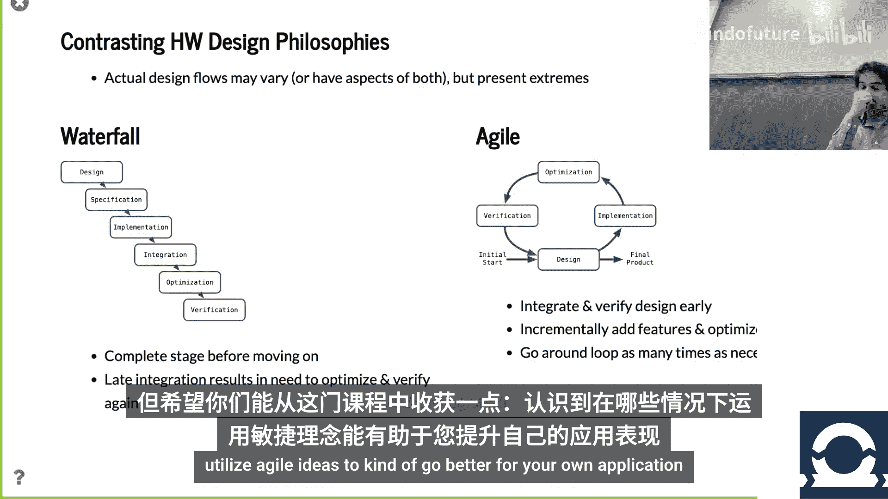

ho。Okay， so why is agile like said so helpful， right。

 And the answer is recognizing when you have a situation where you aren't said stone。

 you can actually repeat things， things like software or in this case， hardware design。

 you can just run the compiler again if you can run the tools again， right？ And so as a result， you。

 you able to kind of keep fordo things and。I imagine trying to build a horrorship。

When you first start drawing out blocks and components， you may not know。

What your critical path will be， right， It's not until you push this through the tools and actually done a placement and routing。

You know what the clinical path is。Guess what， you look at that chemical path。

 maybe the time it takes to delay is fine， through performance， that's satisfactory。

You can be done early and be done right but if not。

 you can go ahead and attack it and go after it right And so there's so many things when it comes to hardware design it's really hard to know until we start actually getting your hands dirty in the process and that's what makes agile so good for hardware is you can know how you're going right you can see how it's going through the tools What kind of performance metrics am I getting。

😡，E cetera， also things like verification， which typically in the practice industry is this kind of。

Adversarial teams approach where designers get the right over hardware they want and took it over a wall purification engineers。

 Dification engineers and burdened with all this R T L to go ahead and verify and。

You may have heard the software is very common have a  one，1 ratio engineer verification engineer。

 and hardware is very often only one R T L writer to two verification engineers。

 And part of the reason why it's people writing the R TL aren't the ones writing the verification collateral。

 They even tested sometimes。 It's just kind of， you know， chugging over the wall。That's not great。

The agile approach， kind of bringing verification into the process earlier。

 bring testing to the process earlier， making sure you're kind of all on the same page。

 And so as I keep saying over and over again， Agiles already been proven for software。

 And I should clarify， I say Agile， of course I' talk about this kind of innovativeative revising approach。

I'm not really worried about， you know， things like scrums or velocity and that kind of stuff。

 If you've seen those terms looking at the agile trademark， you know， stuff。

 But more generally just the notion of just embracing revision。Adapting your plan doesn you need to。

 right and so。That's I doing this course， right， how do you hardware designs become a more fluid and flexible approach？

And what's interesting is if you look at。We'll enable this well。The you know。

 language is commonly used ver log， I actually argue is like pouring concrete。嗯。

That language builds very functional and correct hardware。

But it's actually hard for humans to get it right。 That language。

 despite the specifications being over 1000 pages， has plenty of behaviors that are undefined。

 And so as a result， in order to make this code robust。

 people who write bear are constantly using things called limiting tools that check their code for things that aren't against the rules of the language。

 but。Lead to， you know， more safe behavior。 So this's this very careful delivery process。

 writing a very。Once it's correct， you don't want to mess with it。And guess what， concrete。

 if it's the right shape in the right place。 It'll last a long time， right。

 It's concrete from the Romans。 like Coning last of times。 there was very long as， you know。

30 years old They're still being used today and kept are using today， right。

 The problem is that once it's all there。😊，It's really hard to modify， right。

 because it's not just a matter of how brittle is it。

 It's a matter of you're also gonna to change verification， right。

 Someone who love to verify that very。 Once you change that very。

 you kind of break the seal on that verification。And now you have to re verify all this。

What's enabling that you do Azile design for hardware is actually new languages and new tools。😡。

And new language and new tools。

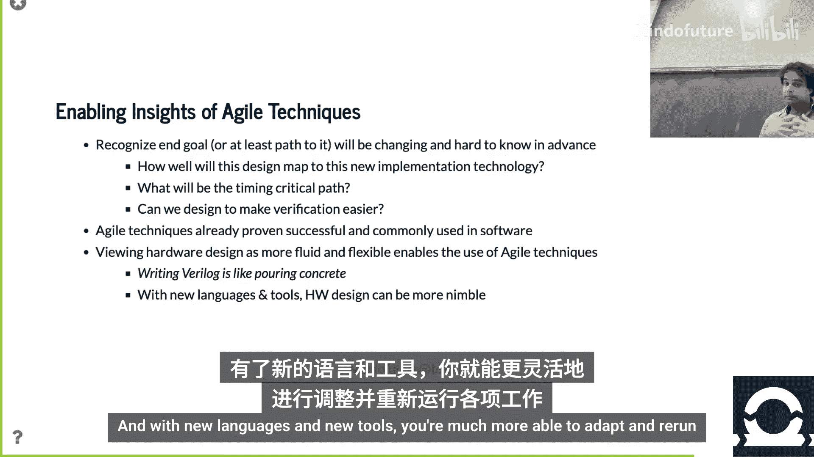

M we're able to kind of adapt and rerun things。こ。So。Why am I making all this， you know。

 passionateate plea for fragile hardware design intake tape， right， numberumb one。

 So the goal of reduce design record， right per hour of human working we want to get more hardware components out there。

 And so all that as possible is we can focus the efforts to where it needed right when you see the entire cost of your design。

You will know where you are doing where you hope to do well and where you're not doing well how to go attack so you can go right to places needed。

 you I can kind of over optimizeize certain places at the wrong times。😡。

You actually can lead to better results， right， One of the things that's really painful is you。

 let's say you。Have this late integration of your design and your way off your targets for performance。

That's really rough， right， There's only so much you can do at that point。

 You've already ridden all this Rtl。 You've already verified a lot of it。

 and now you need a massive change to your architecture on a reach the performance target you want。

 That is a disaster。 right You're can do if you can model and plan to find that from happening。

 but if that does happen。You're in a bad place versus with a more nimble， agile approach。

You can see how you're doing， right， And you can recognize how you need to change architecture early on before you even get to that place。

 And so it's really good at helping you kind of guide optimization efforts and you kind of have this。

😡，Not just modeling， but actually using the real tools and the real design to see how you're doing in terms of these things。

 And so。As a result in the software， Ad took over because it was very predictable right and have these massive cost of runs massively delayed projects。

So if you can shoot hardware， right， you have a design， It's constantly able to go through tools。

 Keep simple to go through， know going through a design loop。 You have a design。

 It's a question of just， is it as high performance as you want to be。 And you know， if you need to。

 you can kind of keep adding things onto to it。过。Okay， so。Youre hearing in this course。

Through a lot of above words， I want to spend a moment to kind of differentiate us。

So this course is officially about agile technologies right and so agile techniques right that's know rapid naeration where we're talking about et cetera。

 that is an orthogonal concept。Copo source hardware design。

 I'm also very passionate about a source hardware design。

 This course makes extensive use of open source hardware design tools。😡。

But you technically orthogonal concepts right， you can do agile with closed source tools。

 you can do waterfall with open source tools， right？And of course， you also， which is very common。

 you can mix both proprietary tools and components and open source tools and components in the same product。

 which is typically done。So these are two orthogonal concepts。 But for this course， yes。

 we're excited about Agile。 and everything I teach in this course is open source。

 but your course can apply to close source tools as well。嗯。

And so why am I so excited about this as an academic。

 I feel like this really enables to kind of democratize hardware design。

 where for a long time hardware design was kind of constrained to large companies with expensive commercial tools。

Now all of a sudden， the tools are free， the available source tools， so wait a second。

You only big company。 you don't need the big licensing key to access these tools。

 And then with agile， even small teams or even individual can actually get a lot done。

 And so all of a sudden， wait a second， you know， the buried entry is just so much lower。

 You need a much smaller team， so much less cost to do it。 So now with reduced costs。

 you can have a lot more people producing hardware。

 and they can produce hardware and may match their scenario。 You may be。

An application domain been part of the world is neglected by the current offerings。

You are now able to go out there and go do that right free tools makes it low cost enter and of course absences makes you productive doing a smaller team。

😡，And this is great。 I'm really excited about this as academic， right。

 We can get a lot people involved in hardware design， get a lot more voices， include lot more people。

 get more creative designs from this kind of stuff。😊，Cool， okay。So。啊。Theellican way to fly。

 But as you know。What is the fastest harder to block to develop。 And， of course， the answer is。

 is the block that you get to reuse， right， Rather having to write the block out， no， no。

 I just go to my library and grab this block and' what I want。

 This is a standard practice of hardware design， right， You know， people will license I P。 I。

 of course， being short for intellectual property。 does know existing hardware design。

 They will license someone else to put into their chip。That was great in a lot of places。

 but there's some caveats， right？If you're going to reuse some component。

It better do what you needed to do， right？😡，And this is this is a trick， right？

If it's 90% of what you want， that sounds looking close。

 oh I'll go ahead and just change that last 10%。Sometimes that's really painful。

 especially if it's in very。It's hard to kind of make those tweaks and those changes。You get reused。

 you want to make sure the thing you're trying to reuse does what you want to do， but it does quote。

quote， the right thing。But also， let's say someone does give you the IP。

If you're going to check into your design， you want to make sure it's correct。

 you want to make sure this is going to work。嗯。And so how do you get that。

 There' one thing for it to be correct。 It's another thing for you to have the confidence is correct。

 right， And so how do we achieve those these things and so。That's the goal for reuse。

 We want to have something that is the right thing we want to do。 and it is correct。

 and we have confidence correct。 And if we achieve all that， great， we can reuse these components。

It makes the hardware design process a lot more efficient。 And then as a hardware designer。

 Ire going to spend more time on what is novelly unique from my design and less time wing the wheelever rebuilds。

 And you'd be surprised so often when you go look at various companies。

Yall your own internal libraries and components， these components look extremely similar because you know you have neurons of various things。

 you just cross borrow four ports， crossb， five ports， crossb six course， etc。

And the reason why is they want to get the exact right combination and you be surprised to often to kind of keep breathing in the wheel because what you want exists。

 but you want to just change it 10% and that 10% change surprisingly painful t techniques。过。

Questions so far。Okay， we can keep going。So I pitched this goal of really want to get reuse。

 And so how can make。Reuse easier to achieve。 And the answer is rather than having a single static component。

 which， you know， may or may not be what you need。 We can have a generator， right。

 that generator can make many components， right， And so generator is not going to be some sort of arbitraryrbit。

 you know。Dreaming anything up and era kind hardware。 No， the generator is targeted。

 That's a certain component it's making。 It just makes different variance component with some tweaks。

 right， And so you give it parameters。 It turns and spits out code for you。

 And that's where we're building this course。 where we're building hardware generators。

 And that's the kind of idea that with a generator， it's more flexible in a single static design。

Not being more flexible， it's more reusable。And by able to kind of tailor to our design。

 we're to kind of use in more places。What's kind of interesting thing about generators is the condition to be more ususable。

They also help a third open source challenge。 And that is open source， you can。

Make whatever you want and put it online， make it up source sure。

 but the risks of open source things have large community contributions， right and。

One of the challenge of the course is reaching critical mass。

 of having something that is sufficiently useful to enough people。

 do you get a community willing to contribute back to it？And with a generator。

 because it's more flexible， it's dust usable in more places and because it's usable in more places。

It's thus able to。You grow， attract a large community and does have more people contributing to it。

 So there's a large community going to have a large organization of this effort。

I we up into this secret future of hardware design generators being this way to kind of get open source hardware really out there。

嗯。It's the kind of key point pioneage generator lifted of。

Design generation is another step into toolflow， right where right now the toolflow okay， yeah。

 I give the RTL to the synthesis tool， etc ce。Now， before RTL was going to be this design generation step。

 right And so really we're writing programs that in turn are doing a hard design for us right and it's not doing arbitrary。

 you know， whatever stuff it's controlled。 It's under very specific plans。😡。

But that flex still be really helpful。Cool。So。I would do end this course。

 using a language called chisel。 So Chisel here is written is a normal word。

 but it's actually an acronym standing for constructing hardware in a scholara embedded language。

 So we use this course with this language extensively in this course。

 I want emphasize the purpose of this course is not so much learning chisel。

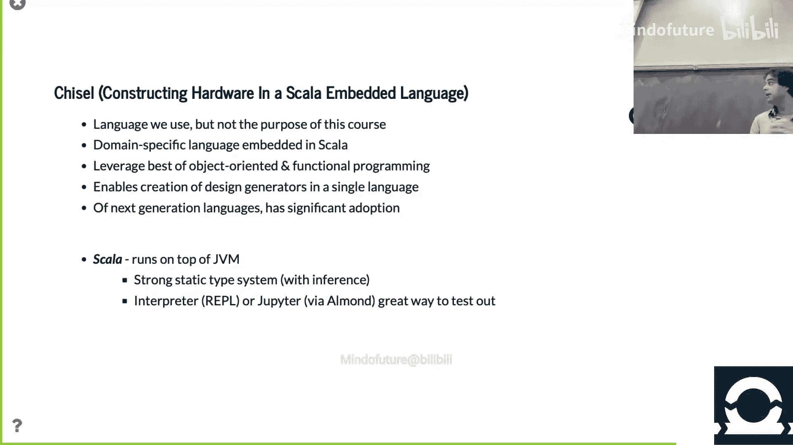

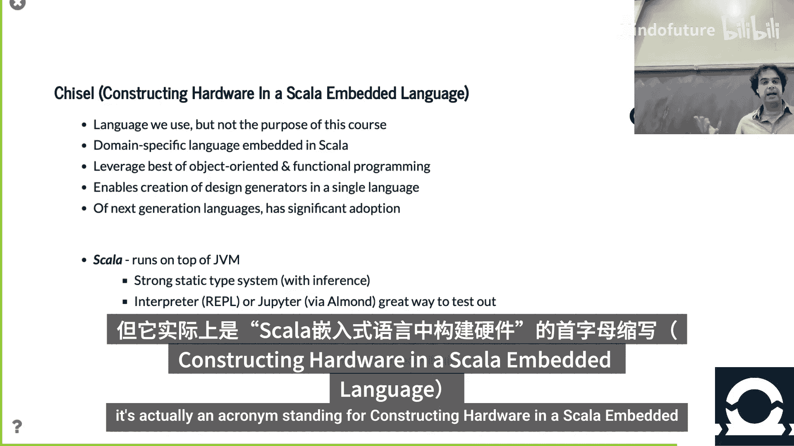

As much as it is learning hardware design， right？It's particular agile hardware design。

 She loves to be a great vehicle for that。 So what is it， Well， it's a hardware design language。

 tend to PC hardware construction language is a way to build generators。

It's embedded in a language called Scala， so the Sca is a extremely popular language in the Java family。

 so it runs on the Java virtual machine to JBM， so anywhere you can run Java you can run Scala。

Has in my features right， it's got a strong static type system， has type inference， it also has。

 you know things like an interpret， you want to go in and try things out in this class you'll see me writing it inside Jupiter Pas as part lecture today's lectures in Jupiter。

 all lectures are in Jupiter as well as labs，' something called alman which provides scholara inside Jupiter So there as always as kind of nice software out there right and it'll talk more about scholara layer today but。

This kind of is fun language。 And the reason why I got into the mix is this scholar was made。

To make it easy to make new languages。 Sos one a lot of trace put in this language。

 A lot of the features this language were designed to make it easy to make your own language。

 And so in this case， when researchers at UC Berkeley built chisel。

They found scholar was a really great place to do this。

 And so they chose you Schlet embed their hardest description language in since Chisel。

 there's been quite a few additional next generation hard design languages。

 and most of them are embedded in some other language right like I have this embedded DSL approach And so chisels won this course。

 but now is a bunch。😊，15 years ago， it was really kind of very log or very log。 And that was it。

 And now left people doing new things， which is fun， right， trying to do languages， doing new things。

 And so as you learn some software， as to learn more programming languages。

 It makes it easier to learn additional programming languages。 the same is cheaper hardware。

 as to learn more hard design languages， and makes it easier to learn additional hard design languages。

😊，And what is she able to do well it able to take the best of know software oriented programming。

 such as Aled and functional and bring knows of hardware。😡。

It also makes it easy to make generators where。That gender idea with pitching is a really strong idea。

 and it's actually already widely deployed industry。

Withve log and the question is wait how to do a v log v log is source shootive And the answer is they use a two language approach right they have whether it be Python。

 Java， pearl， even tickle stitching together very log strings to generate content they want and so that works for things like a crossbar where you can imagine how to kind of write those folks to generate the strings of text you want to be the right ver log people do this it's widely done industry however。

You can imagine this is really brittle right， you know。

 you have one language or it be Python or something。😡，Running a program。

 And then it's just putting together a string。 There's no notion of whats they need strengths， right。

 versus a language like chisel。 We're able to take a proper programming language like Sca and do the hard design directly in that language rather than with strings。

A lot of things work out a lot better right you have all this much but stronger type system it's much more safe。

 doing this kind of generation quo a single language is a lot smoother。

 And so look at all kind of the next generation hardware design languages， I said。

 Part and wide they're all embedded， as opposed to standalone languages。

Is because they want the ability to build generators。And socha Chisel。

 for those of you aren't familiar， it was originally built to UC Berkeley。

 now widely used by company called Scifi， which is one of the main risk five companies。

It had deployment from both Google and Intel and IB Intel， sorry Google。IBM have ship things with it。

 Intel has played with it and not ship ni thing with it。 So it's， it's an interesting language。

 It' has some fun adoption。😊，Like I said， for this course。

 we' rather than focusing on learning chisle focus on youre learning kind this new wave of hardware design。

 this some very softwarecentric style of hardware design。Just a language treat course。

You go to play cells the industry， They may have some other next generation language you're using。

 but she help you kind of get going。Co， questions on that。Yes。Good question。

 So where is Sca use an industry beyond hardware design。 So Scala， like I said。

 came out in the early 200s of the way to kind of improve upon Java and had a lot of interesting ideas。

 It initial adoption was kind of very esoteric。 It was originally in high frequency trading and finance。

 And then Twitter Twitter was a huge early contributor to Scala。 They got really excited about it。😊。

And actually， if you look at scholar's language growthve。I would argue three things happened to it。

 It was kind of victim of its own success。 So scholar did a lot of things really， really well。

What happened， Well， Twitter did really well with Scala。 And so Twitter is like， well， gee。

 we want to do Scalavolt here。 So we're going to go ahead and hire way to Sca corere developers to our company。

So Twitter took a lot of the core scholar developers from the language team to Twitter itself that hurt the language。

 but also victim's success。 So you may know it's that Java is not stayed put you know right now we have Java 24 coming out right And so Java keeps adding features and looks to the scholar has you know what。

 that is a good feature。 We'll do that a lot of times but by times some many features find the way back to Java。

 there's sometimes a little bit water down， not quite as robust。

 not quite as you know general or pretty perent languages theory sense， but。Ding adoption。

 The third thing is also putting pressure on Sca， of course， is Ka。

 right where Collins lit Java language and looked at what Sca got right， he go， that's great。

 we're gonna to do that， but simpler。 So I would kind of think of Sca as like the highb and the I wouldn't calllin low browrow column more efficient' kind of very utilitarian language。

 But you'll see Sc is a very rich language。😊，And yeah， it is used in industry。 It runs on a GVM。

 is using software。 Twitter was the biggest user of it。

 Someone can correct me I the chat or something tell me somewhere else receive concurrently。

 But yeah， things like Cotlin and honestly just modern Java have also decreased kids a little sorry。

 scholars room for growth。It wasn't a very strong growth curve。

 and it kind of like went to medium level growth。Good question。But I should also maybe mention as。

 you know， right now， you know， I'm being recorded。 the the is on the word I'm being recorded。

 The A V setup is such that the students are not recorded。 And so to put this on YouTube。 So。

 I'm the only one there。 That's why we've seen this to read the microphone because that way to picking up the student voices。

 So yeah， you can be asking me questions。 And they'll be usually trying to repeat them for the recording。

 but your voice will not be in Internet。 don't worry。 Great。😊。

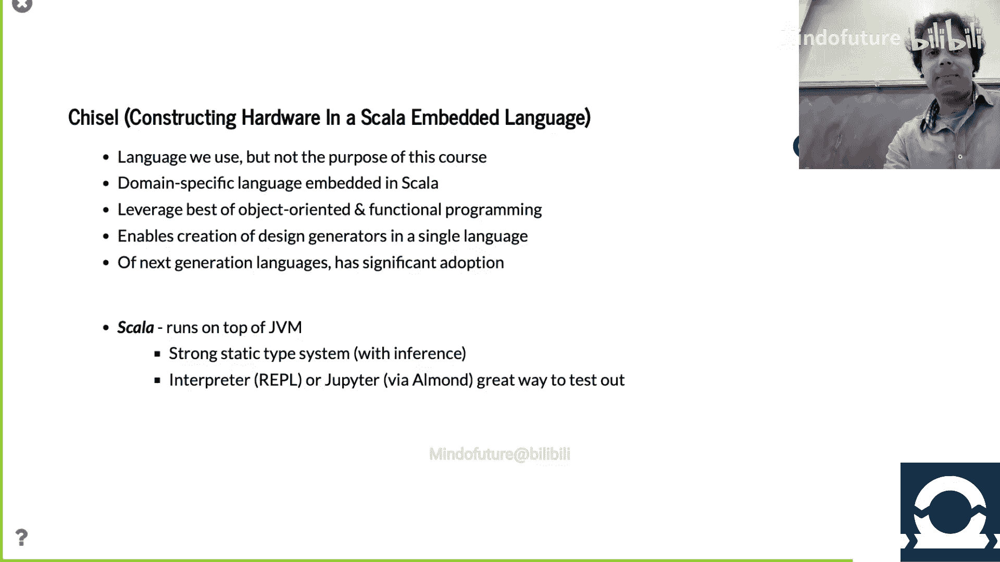

Cool， okay，a。So。Whether kind of the main themes for this course right here's my pictureation symptoms so you may seem need to get this motion all the time as's the course logo this notion to close the loop and I say close the loop I'm talking about that agile design loop in other words。

😡，Have some aspect of your design running in some sense with the tools， right。

 Would it be running in simulation or even a physical design flow。

Get that to happen as soon as possible， right once the loop is closed。And you have results。

 and you know where to spend your next bit of effort。

 So I keep talking close withki making this motion。

We're going to talk a lot about its course about how do you take your long term design goal and simplify it such that you can behave something really small。

 to close the loop early and then progressively add on functionality optimization to get to where you want to be。

嗯。As you've already seen， of course， from the prior。Talk， I'm very excited about reuse。

 rightpoint these generators。 And so how can we design our components to be maximally reusable。

 right， that's designed for reuse。The spirit of one hopefully is self motivated， right。

 make tools do the work。😡，So。AI is not the first forward automation， right。

 There's plenty of automation and power design。 If you look at the history of power design， you know。

 look at the first transistor designed by approximately a dozen people。 okay。

12 engineers to one transistor。 And now you have like latest you trips from Apple。

 which have tens of billions of transistors designed by a team of hundreds and maybe a few thousand engineers。

 right you can see。The in terms of transistors per engineer， the number is through to roof right。

 that's only possible because of design automation， right。

 There's all sorts of software or doing this automation。

So the goal for this course is to recognize what these tools can do。

 what they provide and how do we best use them。In this course， using this privilege chi the language。

 which makes it easier for us to go to hardware generators。

 and we can take things that only humans have to do and now pass it on to the tool。

Of course maybe people are very excited about AI， AI is going to definitely help in hardware design。

 once again another form of making tools due to work， right， embracing automation。😡。

And then the fourth one is， you know， part of what you're getting by a human taught course designed for readability。

 as you're all aware， code is typically read far more times than it's written。😡。

And so we'll be talking about how can we structure our designs， not just be you know。

 higher performance for more robust， but also just how to make the code more readable。

 And so you're to getting a heavy dose in my opinions about what I think makes code more or less readable。

Hopefully some doubt you will agree with and some that you disagree with from this good and have discussion。

 I'd love to have debate。

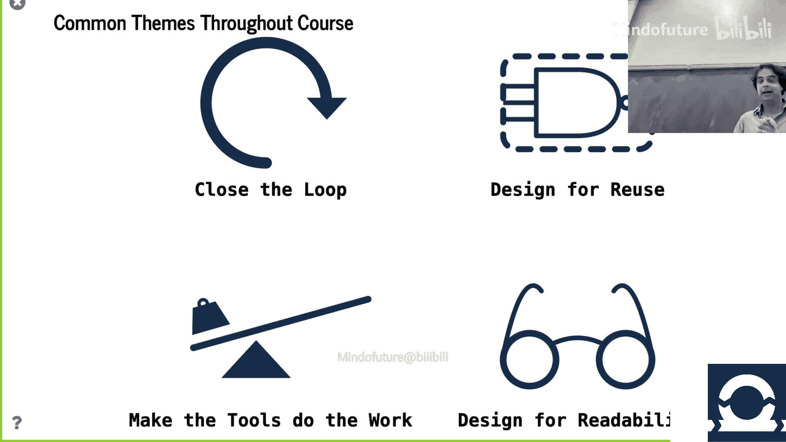

Cool。And so yeah， this is the material just on the prior slide written out in textual form。But yeah。

 these are the kind of core themes， right， Close loops are most common when keep talking about。

 make tools that the work， how can they figure out things that we as humans do to offload to the tools。

 And then of course， how do we make our designs both re usable with generators。

 as well as make our designs easy to read the actual code itself。嗯。Great。

So now getting to the more logistical patch， the ethic of this course， who should take this course？😡。

Number one people who are excited about material。 I kind of pitch it as there's three domains of prior experience that are helpful。

 So one of course is hardware designs of using language like Verlog or VHDL here at UC Santa Cruz。

 These are top courses like CSc 100 or 125 right now is of course 225。

 which is a graduate version of 125。 that's not just， you know， sufficient。 It's overkill。

 So if you' think 225， that's fine。 youre tod for this course。😊。

Arture is helpful right understanding what we're trying to build in hardware is useful So for example。

 here at Santa Cruz， are know 12 for undergrads or 24 grad students。Under in this course。

 I love building processors， I love building risk five processors。

 that's not we're going do it of course。We build ultra power designs。

 but liberally don't build I S A driven processors for a few reasons， in this course， number one。

a lot of nursing hardware is not processors but there were two processor have all these things where it's like okay we know the process。

 no we want to build to stages or certain techniques so at the end of the day theres actually kind a much more constrained space and you'll see that I' taking much more broadly view of hardware beyond processors actually have a lot more fun opportunity to try new things yeah so being overly dependent and I say something literally did not do for this course。

 I don't want to be an unnecessary barrier。So yeah， so domestic charts mean of hardware in general。

 understanding them。What the differences between a lay logic age which the register， what a mugs is。

 how can I fix it together， that sort of stuff。then advanced programming。

 so this course we're going to take advantage of both ourjoed programming as well as functional programming。

😡，And so those are kind of what we're trying to do and so to say here you know hopefully experienced with two of the following if you have all three。

 that's fantastic， you're already kind of a rare person because usually you can see depending where youre on in this list' either more of electrical engineering。

 computer engineering or computer science training and the goal of this course is to kind of bring these worlds together and so I've been very grateful for this course that will attract students from all these different domains and so yeah keep it coming if you've experience with two out of three you're in grave shape。

 I've experience with one all three and you're interested we can probably make this work I've had students in this course that were。

Completely inexperience of hardware。They were graduate students。

 two of them that had come from industry to come back to get the graduate degree。

 they had not taken any hard design courses or any architecture courses。

 but they were professional scholar developers and so yeah。

 they thought courses interesting they read a scholar sourceco for Chisel and they were you know often running how they really took good time and so yeah。

 I want it this course inclusive， happy talking more with what they filled their backgrounds are。

That should be good the goal is to make this， you know。

 the inclusive course that's why we had undergrads in the grad course， et ceter so。😡。

Even this course is not about， know， hardware design。

 hopefully you can kind of embrace these agile takess and see what they apply elsewhere。做。Okay。

 so who am I， I'm a professor in computer science engineering here at Santa Cruz。嗯。

I'll be available to ask the lectures answered questions throughout today's lecture。

 but every week I'll have office hours three to four in my office What do I do for research for research。

 I'm in computer architecture， I do work open source hardware design。

 I do stuff in high performance graph processing more in a high performance computing domain。Yeah。

 this is definitely kind of stuff I work on it's really fun。As your awareness quarter， unfortunately。

 we do not have a TA on the plus side after years of random course， we have enough。Automation。

 I think will be okay。嗯。Please reach out when you have any concerns about getting help in the course I'll do best to help you but also you talk to each other right there's the class as well how is of course structured well。

 this is a passion project for me this is a elective grad course so I'm trying best to make this fun interesting we make this available to undergrads。

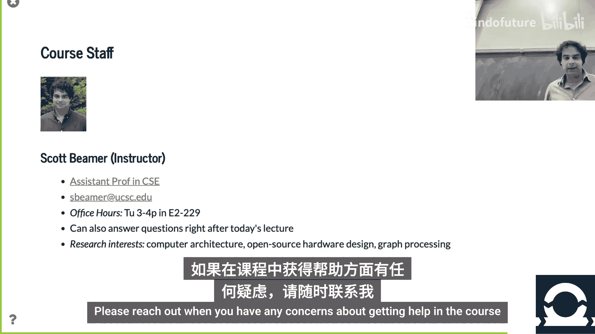

And that's kind of cool we get to I didn know， I changed the content I believe to be the best and most useful stuff here。

And so how to go about this well。There's kind of two portions for this course。

 There's a structured portion where you're gonna to have lectures like today。Uh， you know， uh。

 even though those two class meetings， it's kind of like three lectures in a week in the way。嗯。

And then。That we go on to first two3s of the quarter。

And then we will shift gears to the project portion。 So the whole point， of course。

 is really the project。And the stuff before us kind of just training you to get ready for the project。

😡，This is the plan， of course， we'll always be changing and adapting as needed。😡，For example。

 one thing that came up is， you know， one of my colleagues is a course that has the exact same time slot if 11grads want to take both courses so working with。

嗯。Great， yeah， so can see， how does this actually boil out for our course structure。Like I said。

 lecture， we meet in person。I'm multi supposed recordings online， so。Watch how it works。

 I really appreciate an in person audience， I really appreciate in person questions。

 but you know people have constraints understood。Actual course work。

 there's three types of coursework。😡，In the structured portion。

 you're going to be doing lab and homework， so one lab per week， one homework per week。

 the labs are designed to be easy lightweight， kind of directly try out some feature and kind of quickly in isolation。

The homework's a bit more involved coding。And set that's the initial portion of the course。

 then you shift gears to the project， right， the product that be， you know。

 this big project you build either。In isolation of a partner， I'm going to encourage partners。

 but not strictly required。Along the way from the project。

 we're going have some scaffolding right we' going to having you proposals， some feedback。

 code reviews， et cetera， ultimately you are building a project whichs going to culmininate presentation these are the kind of the main things we'll be doing。

You may notice， for example， on this list what's missing exams， right Left of grad of course。

 I'm not required to have exams。 I think that's really a weird way to evaluate this material。

As you can see based on the point weight， that's the percentage in the lower left。

 this course was primarily weighted on your project， right， So hopefully he build great projects。嗯。

Cool， so lectures here we are。 I said earlier， I've recorded these it put it on YouTube。

 I have the audio set up correctly such that students have not recorded I'll check if I need to mute for the zoom。

But that's where we are。 Now， this course has historically been taught with a three lecture per week format。

 So the content is kind of dice in these very nicece， tidy， 60 minute lectures。And so as a result。

 what I'm going to do this offering is I'm going to。Try to keep those lectures contiguous。

 And this had the middle one split half。 So you're gonna see me talk for an hour time permitting take a few minute break and talk another half hour for half a lecture。

 And then you'll see another half lecture next time。 and then another hour lecture following that。

 so。That'll kind of be that for those of you watching on YouTube。

We'll see how well I can figure out the YouTube editor。

 You may see two videos for those split lectures， and you may see me modify a video afters posted to go from Alson  for0 minutes 60 minutes。

Um as I set of kind of， you know， set up for recordings， for those here at Santa Cruz。

 I also have the room lecture capture enabled as to have a backup system。So yes。

 those of you who were in Santa Cruz enrolled， you can access those recordings as well。

But for the YouTube contest， I had a special setup on my computer of OBF。Keep the students out。

As you noticed he lectured， this is all Jupiter， and so we'll be。Doing that into lectures。

 I'll be running code in a minute， but also for things like labs as well。 And these lectures。

 there are things open source on Github。You can go ahead and you know clone it。

 modify your own hard content， you can you know take notes in line。

 you can modify the code if I'm talking about it， etc cetera， what do you find most interesting。

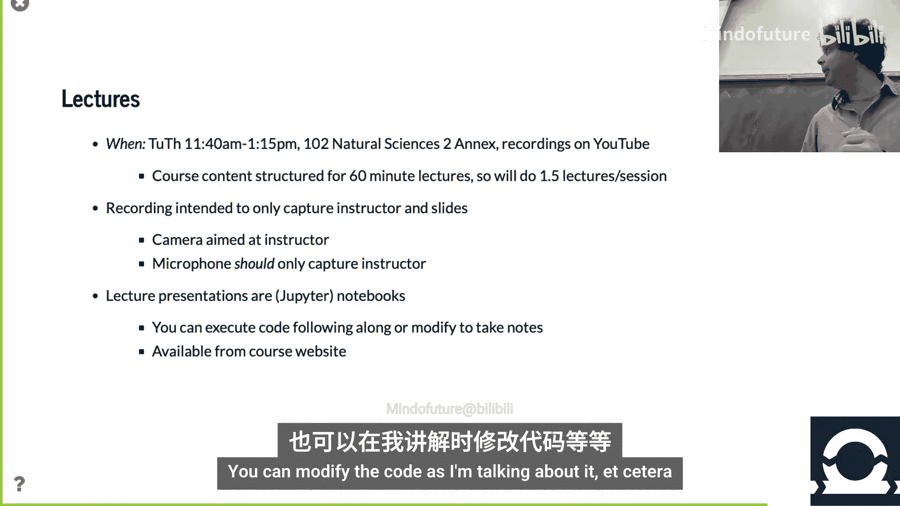

嗯。How about collabs， like I said， the kind let you try out some focused features and kind of a concentrated sending the rather having to write out lots and lots of code。

 small limits at a time。 Okay， here， traps one line， two line solution to fixes one thing。嗯。

So three decent groups， right， have a partner， talk it over。You know， hopefully you know。

 add most an hour or two per week aren't supposed to be super draining。

 just a chance to kind of try to features in isolation and get going。

How are these actually done in practice， except it's a Jupipyter notebook that's actually to be running in chisel code？

😡，You somebody online through grade scope。They'll be autograded。 So in some number of minutes。

 you'll have your score。 And so you can you can see， oh， wait， I got something wrong。

 I can go ahead and fix that and try it again， right。

 And so I recommend people do the lab as soon as you feel able to do the labs。😊。

Because you they're kind of the first step for any given bit of content。mCool。

 the homeworks are more substantial， right， it's going to be， you know。Writing out code。

 you probably should use， you know。Like an actual environment I recommend for dis course using some form of IDdeE。

 for example， intelligence swimming for Scala。嗯。Pop like V S code， that's great。

 but anything that has something that gives you， you know， not just syntax highlight。

 but also code completion and， you know， inline errors and warnings for syntax errors。

 that makes you so much more productive right， except for this course， make tools due to work， right。

 Why wait until compile time and find out you have a syntax error。😊，Have to underlined right away。

 I homework out is also in grade scope。 They're also gonna be outd。

 We'll provide you some test cases。Test cases we provide you initially won't be all test cases needed that you have a correct full point flu。

 So along the way， of course， you need to write your own test cases。嗯。😊。

And such now when it comes to allowances for people to have understandable circumstances for homeworks we have we call slip days where you get three slip days for the quarter。

 there， you know， discrete integer quantities and so whatever the deadline is， you know。

 if you turn it in late。嗯。You can use that many updates。

 And so this is there to kind of that slack for whatever you need in your situation。

 The reason why it's only3 days about it And let's say 20 days is because yeah。

 we do want to keep people on pace。 And so that we're able to have submission time we do the project and kind structure portion starts this course off is all about getting people kind of there。

 And that way， when it gets to the project open ended。 You have， know， that background that pace。

 And so， yeah， obviously， something more subal comes up， Talk to me We'll see what we can do。😊，够。😡。

That said， the project really is all point course， right。

 that's what we're trying to people able to do。Ting picture your all skills be done。

 I really recommend working for a partner。When a course is large I can it's systemtoic because that way it's only somebody time taught presentations this quarter we have a minimum number of students enrolled。

 I think if you're really determined to do it by yourself that's possible。

 but I think a partner makes it better。So what do you can do， well。

 you're going to propose a custom hardware generator。And you go off and build it， right。

 And so through covering this course， you're gonna have not just the technical skills to write the code and that sort of stuff。

 but also talk about the design approach。 How do you。

Figure out what the minimum viable thing to get started is and how you kind of extend that and elaborate that。

 And so。We'll talk about a project more as the quarter goes on。

 that there'll be support along the way， we'll have things like project proposals and meetings with the class staff to hear about how to tweak your project and stuff like that。

At the end the term， you'll be presenting your project to the class。

 submiting the code to the staff should be evaluated。

You're encouraged but not required to open source your project。

 and you can see in the webp page I've linked all the prior products students open source。

 and so it's kind of fun to see that is's now growing library to the products with students in this course and you can add on to that list。

😡，How do we get resources for this course？We have a variety of web presences。

 The number one place to go for most stuff is the horse website， a public website， static HTMLtl。

Everything's up there it's got links to all sorts of stuff。 would it be lectures， recordings。

 assignments。 I also have additional content I wrote up there about， you know。

 here' are some links for how install chisel or various tools and that kind of stuff。

And that's totally open on the Internet， right， anybody's watching it on YouTube。I've added it。

For know those of you here are Santa Cruz officially enrolled in students， we have a Can。

 the only thing Canvas really does is tell you your grades and give you way to submit assignments to via grade school。

嗯。So in terms of course content， that's all in the public open。In terms of course communications。

For people in the class， we have a Slack and so I think many people have already joined that linked。

 the Slack invite link is available on that Canva webpage and yeah it's a way to get help there's channels for different types of assignments you can ask if your classmates I can try I try to answer like right can。

It's a great way to get help。 And so yeah， you can see these kind of both web pages on continuous development。

 You'll see me updating them both primarily the public webage， the canvas site， as I said before。

 is mostly way for you to kind of see your grades and submit assignments。Cool。

 questions on that logistics。Yes。Oh yes， in a project you'll be picking a topic。

 if you find yourself unsure， great competition for office hours。

 we can help you iterate on your idea before you。😡，Pick for sure。

We also occasionally have some ideas of our own。 if you have you totally something。

 like I have no ideas。 And like， you should I have given students these initial ideas we have。

 They've taken and then changed it， which is great。

 We want people to have their own created their own ideas in these projects。

 And so you can see from the past projects， it's all over place。 We have people doing things like。😊。

The calculations for GPS or for like， you know， cell baseband， people build things that aren't even。

Reason hardware is kind of fun， like they built like a manlebro fractal generator， right。

 That's kind of fun。 Good place to use generation。 where people do the game snake， right。

 Why not have fun with it。 So yeah， it's definitely kind of encourage with to projects。😊，But yeah。

 I do want to encourage you to kind of approach these projects that to definitely engage that dolly with faculty and staff。

 I keep saying staff is a reflex， but unfortunately this quarter is just me。

Have a dialogue about what goes into your project when you're interested in and make sure it's know sufficient when it comes down to grades for this course。

 usually people because there's a lot of grading。Can't eventually figure out how to get their homeworks and labs Most correct。

 right， you get multiple submissions， you can。Speak that out。

 I think our students get in troubles when they have a very， very， very demanding course。

 so they don't have know enough time to do the homework。

 so even though they can see when homeworks aren't getting， they don't have time to fix it。

 that's a problem。The other problem we had a little bit of last spring， our last winter a year ago。

 for first time in four offerings， this course。 So students， the projects were the。

Initial goal was pretty unambitious that feedback was given and then。

They didn't even reach that initial goal。 And so the result they had a， you know。

 so project is so so great that was unfortunate。 So my goal is we get people doing products they're excited about they really are vibrant and that's kind of the whole point of discourse。

😊，嗯。So wrapping up the logistic courses this lecture and we'll see we're doing on time。

 we're doing fine on time。We can break the course objectives down into both what is concrete。

 whatever， you know， very measurable direct skills versus what is more meta， you know。

 it's kind of more abstract for the concrete。The goal is for you to have an idea for hardware and actually build a working hardware design。

 except separate for a project， right， I want to build hardware does X and actually go out and be able to build build hardware does X right And so what's required to do that。

 Well， you can say yes， I can go out go out and building a hardware generator。

 I can figure out to do things in chisel。There'A lot of sub skills in there。

 how to use these various languages， these various tools， etc cetera， but。

These are all learnable skills， and we're going to cover them in this course， right。

And perhaps you can think about how to not just make a single instance， how make it like， you know。

 a generator has the right amount of。Customsization to handle the situation。

Now that's see concrete direct skills from this course。

 the more abstract meta skills is really kind of viewing the hardwares opportunity to bring programming in。

嗯。So rather just， you know， this waterfall approach of。I'm given a spec。

 I'm going to write very to matches this speck。They a much more expansive view to our design process and understand how it can you know。

Really build a much more efficient system。 that this more agile adaptive approach， right， and so。

How do I go from an idea？And start working out actually have something that's actually released and complete。

How can I？knowB apart my big， complicated idea into small biteside pieces and then iteratively extend those until it's efficientlyly capableable。

 and how can I apply my apply ideas elsewhere and such？So that's kind of it so great。

 any lectures on the agile stuff or logistics。😊，So I think we have the time budget。

 so I'm going to go ahead and。

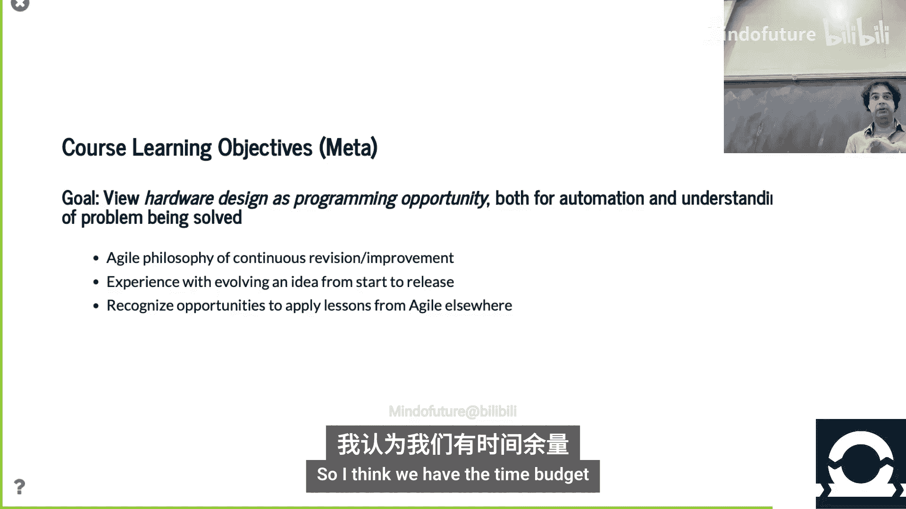

Stop the recording here。