# 【加州大学】敏捷硬件设计-CSE228A-｜-Agile-Hardware-Design-Spring-2025-p02-P13_第2讲-Hello_Chisel_第1部分共2节--BV1M6ivBzESw_p2-

Hello and welcome， here we are in lecture two， which is， you know。

 technically still part of the first class session。嗯。

So we will be talking about actually getting some chisel running as I said， close the loop early。

 right， that's that logo keep showing。

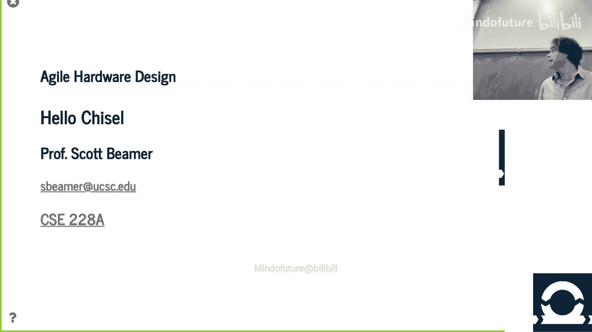

And so yeah， today we'll be getting a little bit chisel running because of the splitting the lecture in half。

 technically， you'll be only getting Sca and they'll do to chisel next time， but。

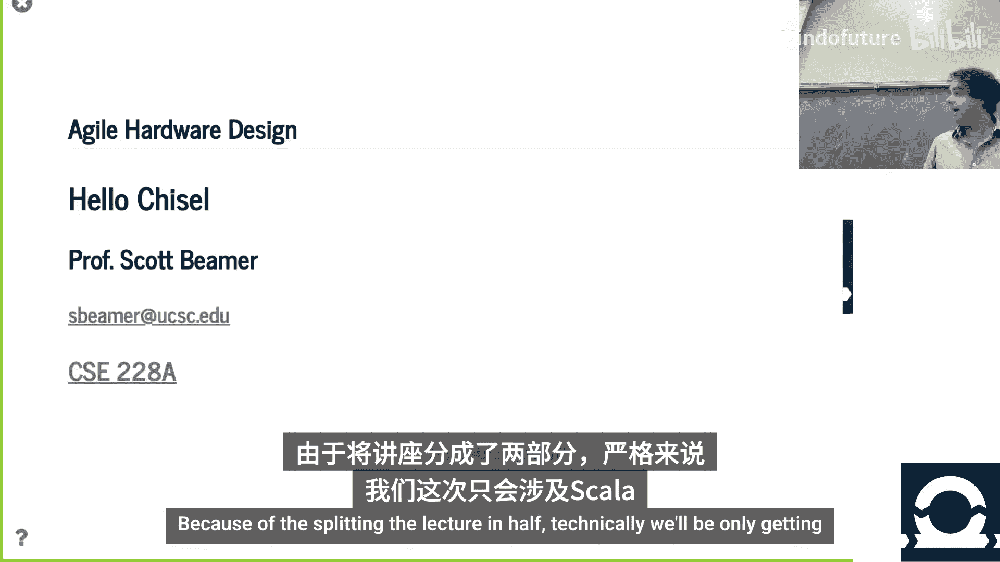

我 get some code good。

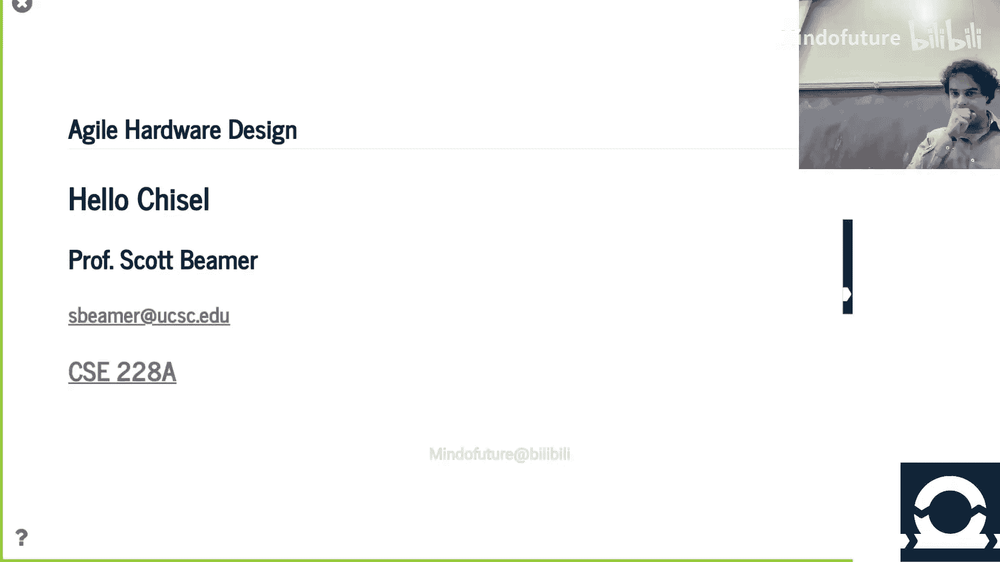

And so you may see me a second ago fuling around over here。Right now I'm running this off my laptop。

 but usually for this lecture I also try to run it from the cloud to show you it's possible。 So yes。

 our lecture slides are not just open source on Gitthub。If you don't want to install Jupyter。

 which trust me， it's a bit of a pan of times， if you run on the cloud。

 there this service called binary have set up such that you can just run that。

And it'll let you run it on the browser， the caveats to binder。The couple， one。

 if you leave it idol for too long， it'll just kill your instance。 So if you're doing a lab。

 for example， and to go off to get a meal and come back， it'll be that。

 So make sure if you're doing the labs to save it。The other catch to binder is sometimes the first launch is slow。

 And so I actually try to make sure the first launch before lecture。 I do that。

 So I have to wait 10 minutes for to build the image。But then for everyone else is faster。

 But if you see a five minute bill time， that's not unusual。 And then it should be fine。 But yeah。

 if you want to run Jupiter locally， we have。Information on how to do that yourself。

 We're also a doctorcker file contributed by a former student。 So great。

 Go ahead and play with this code。😊。

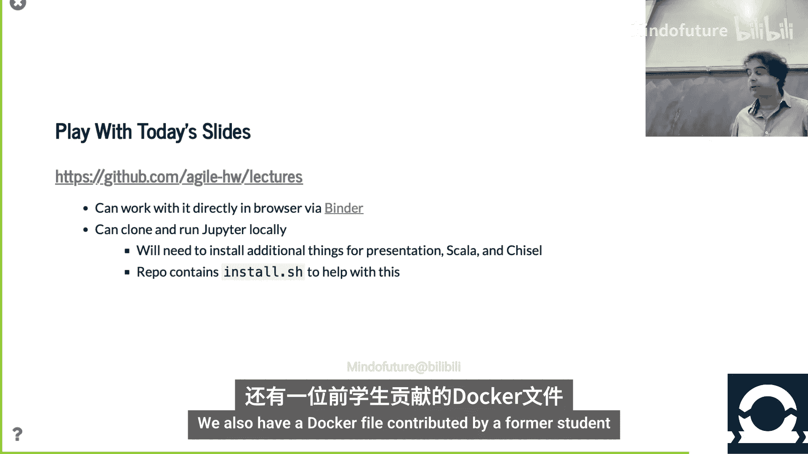

So what were you do， well， as said， with a split an half today's lecture。

 we're going do mostly brief taste of Sca， but in the exps of this full hour lecture， yes。

 you would see both brief taste of Sca。Brief taste of chisel and then close the loop。

 And that's kind of philosophy discourse where rather than learning， you know。

 everything has to learn about scala， everything's learn about chisel and everything has to learn about how design。

 We give you tastes of all three， right， We gave you a little bit of scala。

 a little bit chisel about horror design。Then we want to be more sophisticated， okay。

 do we need a little more sc， a little bit more to， a little more hard design。

 kind of keep building our way up through these various components。

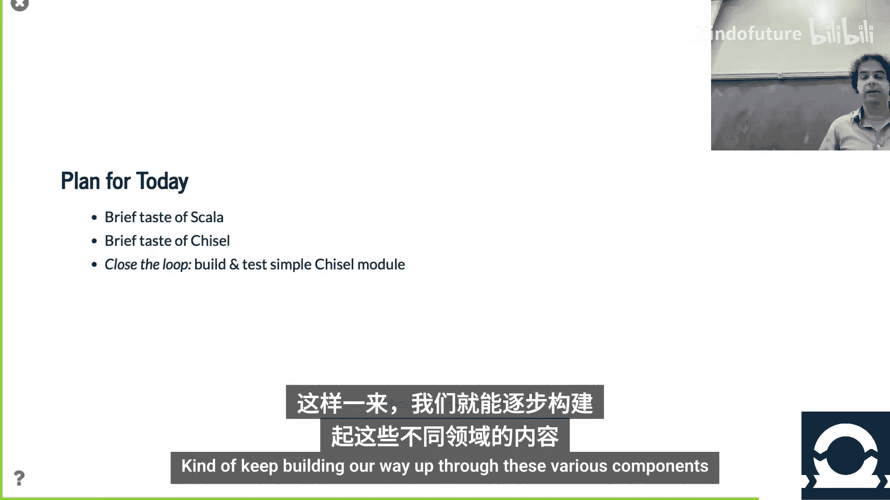

Cool， so we talked about scholars a few minutes ago， what are the main features of this language。

 As I said， it's in the Javava family。 It runs on the Javava version machine， which is great。

 That means you can。😊，Pull in any existing Java code and link against it and code it。

 And so that's really helpful。 You can imagine really really cool generator， for example。

 that maybe your generator gets the parameters and needs to run from a database。 Maybe can read。

 you know， a Json input or something。 whatever you want to do。

 right all that stuff that is out there in Java， you can do。 And as I mentioned before。

 I'm high performance computing individual。 So I'm all about speed。

 but I have so much respect to a Java ecosystem， because there's so much correctly operating code in the world running on Java right。

 So to this Java to this working code， which is wrong， right so。😊。

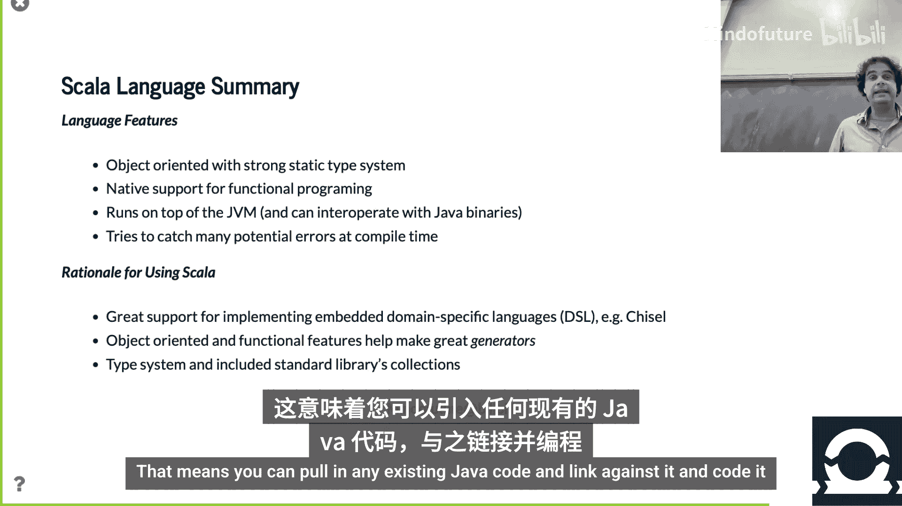

That's why it's out there because of what makes Scala specifically useful。It's orbit oriented。

 so Java course is orbit oriented， scholar embraces that。

 add some more out oriented features on top of it as a very strong static type system。😡。

It also has type inference。But unlike the original Java。

 but now modern Java has some flavors of this， that support for functional programming right that's can be really helpful And for those of you。

 that's not a familiar term， don't worry， you will see that covered in this course。

 I I try this course inclusive more from the hardware background。

 you aren't familiar with functional programming。Don't worry。

 we will cover that in a very empirical practical tone in this course。

One of many things a little again used to at Sc if you've ever seen it before， the language's goal。

 and if you hear this creator Martin Nadersky， who watch his videos。

 is to try and catch as many errors as possible at compile time。😡。

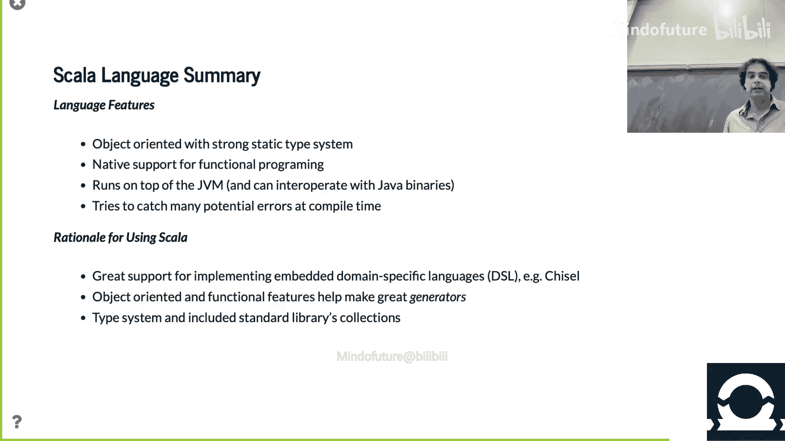

Right， they wantna rather having some sort of， you know， subtle logic error。

 you gotta debug and figure out。 They want to turn as many as they can to compile time， right。

 Remove that chanceor， remove those issues right away。

 And so this is why I was recommending earlier when writing scholar。

 recommend a tool like intelligent， full I D because it'll do things like underlined compilers。

 I'd be writing the code tell you right away。 You know what， this is not correct syntax。

This is build this right now for those of you who really love to use VS code。

 there's something called Sca Meals， which is a way to get a language server that can kind of give you some of those IDE like features inside things like VS code there's links for all this on the web page if you want to set this up。

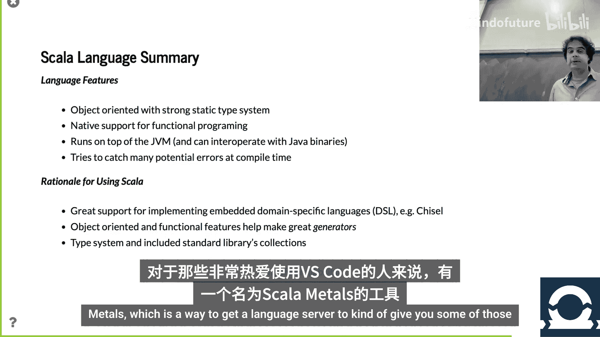

So why did Sca get selected to build Chisel？

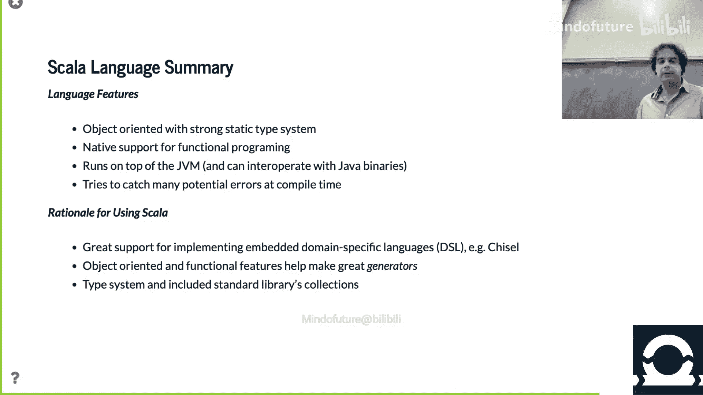

The reason why was Chisel was a domain specific language， right。

 they wanted to build a new language for hard design。

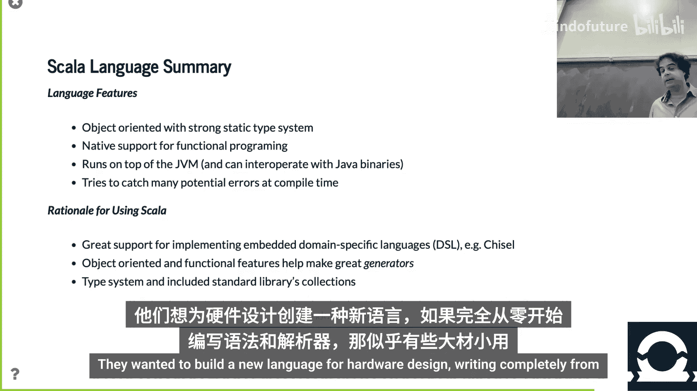

Rning completely from scratch， syntax parses seemed overkill。

And so they wanted embedded existing language and Sca was made to bake embedded languages， right。

 embedded DSLs。 And so some famous examples are， you know， of course。

 the life project at Stanford built a lot of things in it。At Berkeley at the same time there was。

 of course， a spark project which of course gave birth to Databricks and so yeah when chisel was created by researchers this was available and it was it was great there are other harvestscript languages out there that are these new modern ones that are embedded DSLs that use other languages right theres。

Python based ones like P metal or P RtL。There's a few other ones out there there is I'm just trying to name I top head with so many of them。

 there's things even in dash like I can't printnounce this O R OHD。

There are languages in Hake or languages of clash， right。

 there's also sort of hard school language out there in the modern era。其实我's看下 thisす。You know。

 flag bear of new generation from about 15 years ago。And so why is this so useful， Well。

 with Sca is nice programming features， we can build really nice generators。

 They're really robust code， really flexible code。😊，嗯。That whole point。

 we're trying to build these generators to get productivity。

And it turns out when you start writing scholar， you'll find it actually， it's。

You know core set of types and a basic standard library is actually amazing。

The collection it provides， and actually all functionality provides in these collections is really。

 really helpful。 A lot of things you want to do。 it's just there。

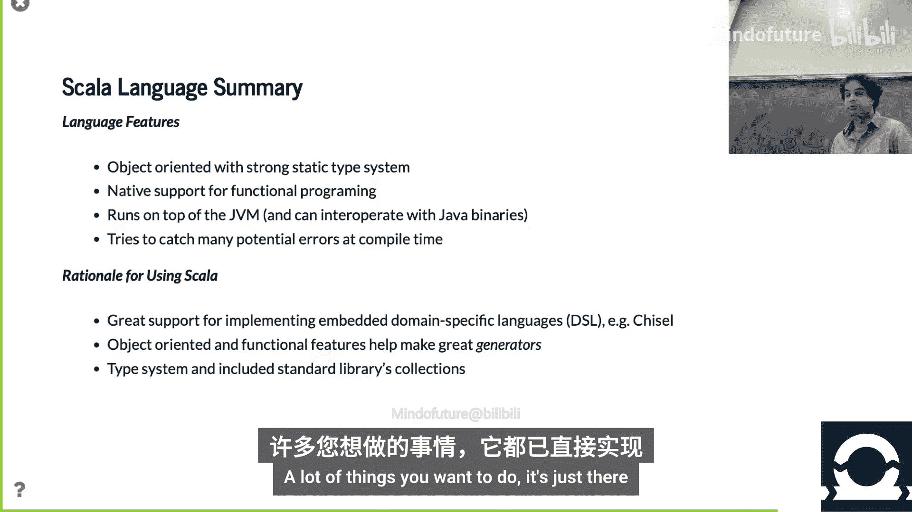

So yeah， it's kind of fun So when you're actually running Scha， there's two ways to run it。

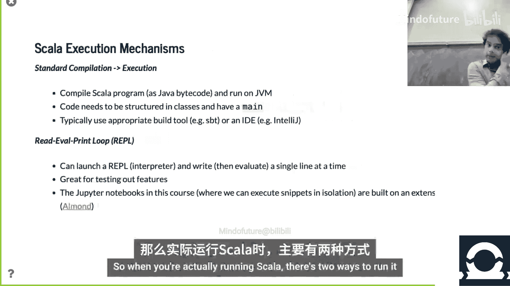

The normal way。You write code， hand out the compiler and let the compiler do some things。

 So Santa completionation， execute that。Technically。

 what's that doing is it's turning your Sch program into Java Btecode。

 which then runs a course from the Java virtual machine to JVM。So when you write code in this manner。

 you know， not on a like job or anything else， you need to have a main function。😡。

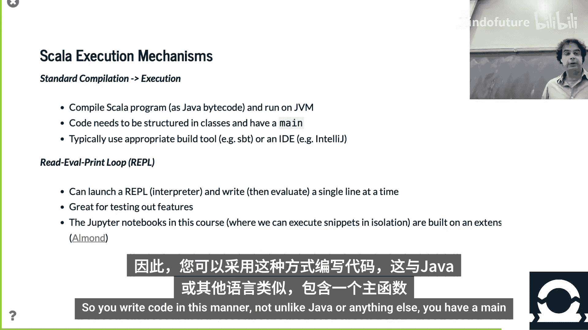

And you actually don't usually use a S compile directly， usually use this tool called SBT。😡。

Which is kind of like a combination package manager and build tool。

To actually execute and compile it。So ST is kind of classic Scha build tool。

 there is a new one called Mill which is getting a lot of traction。

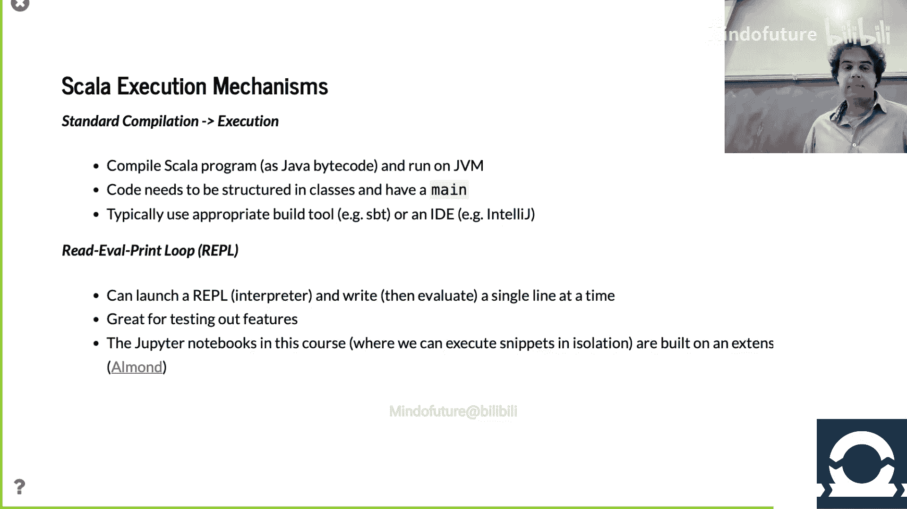

These distinctions are often hidden by an IDE， so for example， using someone like intelligentJ。

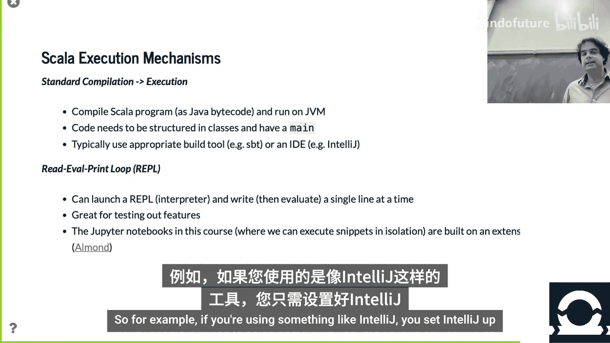

You set a teleJ up， you don't have to worry about this This is normal right。

 and this is what you can do for your bigger designs。😡，But for things like lecture or labs。

 we actually take advantage of skull has in their exc mechanism。

 which is the interpreter or sometimes referred to as the read Eval print looper Reple for short。

So that means you can write one line at a time and just see what happens， right。

 So you've seen this in Python。 If you're familiar with Python。

 you've seen how you can write entire Python programs across multiple files， or you can just。

Start messing around on the Python prompt， right， Scala has a repple has a prompt。 And that's really。

 really helpful。 If you're just trying to figure out one feature or one little bit of code and want to play around in isolation。

 it's really， really helpful。 And so。Scholar provides that。

 and we're able to use that functionality to do that inside of these Jupiter notebooks， right。

 these notebooks when we're want to run the course。

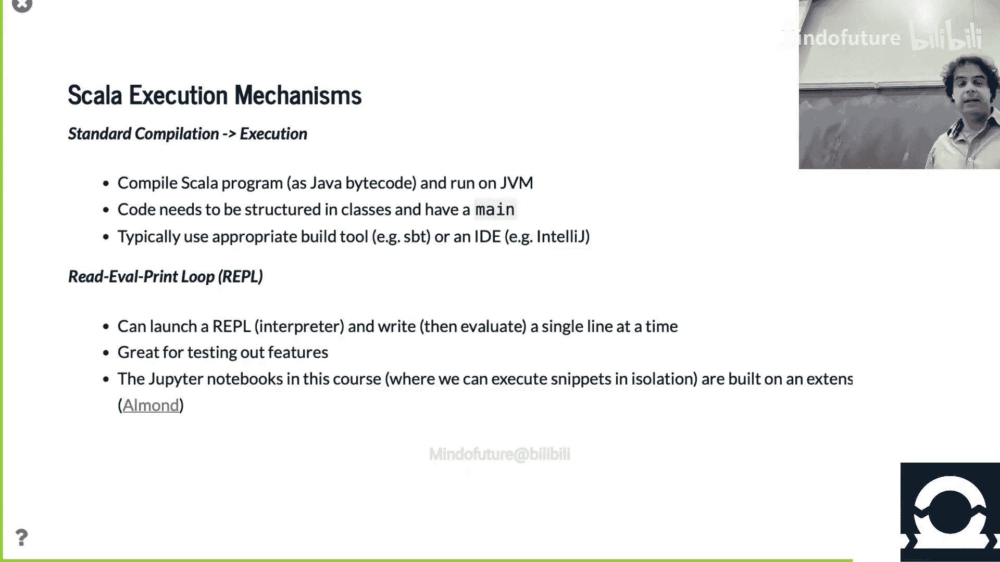

These've been breathing this repple style execution with the repple style execution。

 you don't need a main function， you can just write lines of code and they run。

 there's a tiny fraction of legitimate scholar you can't write in the Reple。Um。

 it's not because the rebel of brokens because of almonds， which is the Jupiter environment we use。

 but it's a very small subset。Cool。

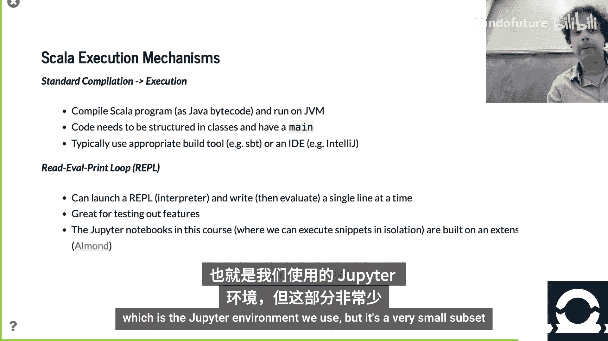

So let's actually try writing some sca code。 if you've seen language like Java， it'll of course。

 be extremely as similar because it's a language email of Java。 So， of course， we can have， you know。

 things like integers and do math， We can have things like a floating point number。

 or can have a string， right So if I go ahead and evaluate this。😊。

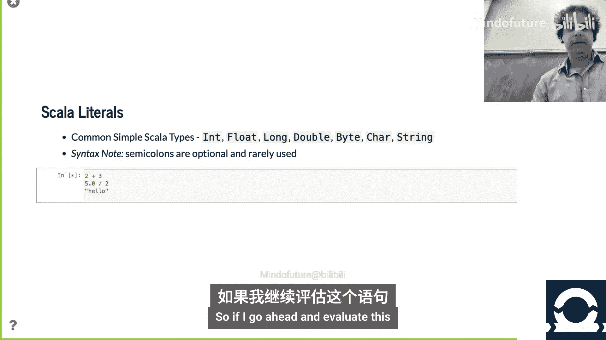

嗯。Sure we can see， yes， you know， we add two numbers together。We get not just through old 5。

Is telling us the type is int， right， This is the case where。It did type inference。

 It inferred that these two operams were integers。 and so the result of integers is going to be another integer。

In this case， it the type inference I saw， oh， its defim point。 that's going to be double。

Even though opera manager， in this case， the scholartype inference for society。

 you know double interacting with an inger is double。And of course， here at the quotes。

 that tells it's a string， right？These are all inferred types。 Now see things to note， number one。

 there's no semicoles， right these three separate lines。

Scholars clever to kind of figure out where lines end。 So we basically never use semicoons as nice。

 However， unlike a language like Python。Identations up to you， right。

 You're not forced to do a certain white space in a functional sense， right。

 It's just white space or human readability。 And so， yeah， language is such that。

The par is able to figure out each state， each line on its sew pretty well。 And so it's nice。

 This is this very clean， pretty syntax。Another interesting wrinkle is that some language just have a notion of like a prone of base types versus object types。

Scarfful five set。Everything's an object。 It' even like the， you know integer 2， that is a capital I。

In right does that is an object。And so it's kind of simple， right。

 don you think is this an object for prototypeotype？Everything's an object all the time。

 And so as objects， they have things you can call on them， right， So for example， if I was to。Yeah。

 we'll see some examples in a second。嗯。Questions so far。

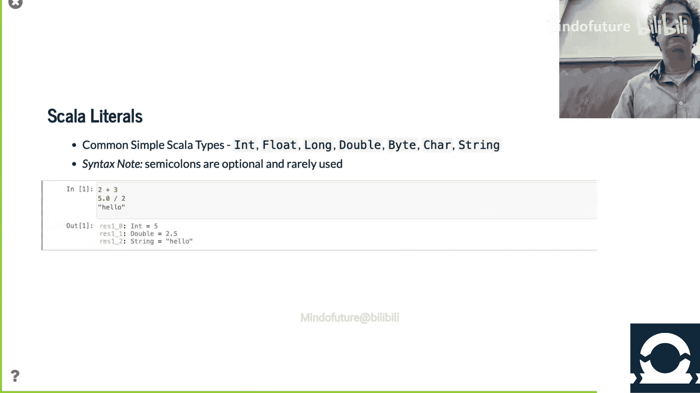

Cool， okay， so。in the last side I kind of told you about the type in for a little bit。

 let's kind of flesh out a little bit more so I said everybody's an object。Um。

 because it the static type language， that means at compile time， everything must have a， you know。

 definite type and these types must be compatible in the way that they're interacting。😡。

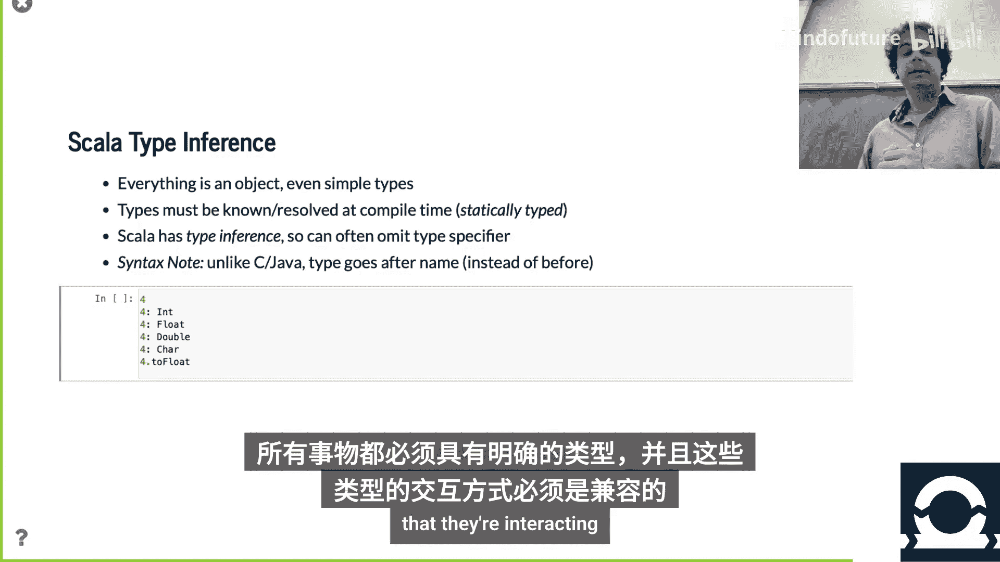

Now， to make the language more。Easy to read and write， it has type inference。

 so not everything all the time you need to specify a type a lot of times you can admit it。

 it'll infer the correct thing。😡，And so that's nice。 Now， for example， like you saw before。 Okay。

 yeah， number four by itself， we saw on the prior slide that's going to be inferred to be an int。

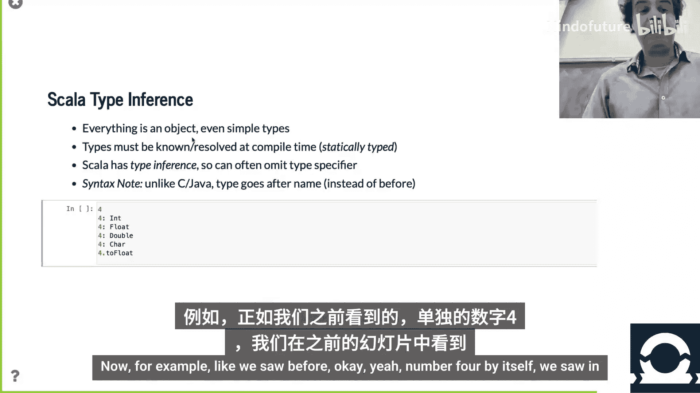

Now， when you want to specify types。You put it after the things。 in this case。

 these are all literals if I declared a variable name。The type also goes second is a little bit。

One of a few places where syntax is a little bit different。

 maybe youve seen languages like C or Java。But yeah， the type goes afterwards and we annotate it。嗯。

What's interesting is even though number four， of course， you have fours and you by itself。

We can remind it for and， even though it was already infer to be in， no worries。

By an these other types， it's also possible， right， So we can go ahead and evaluate this， sure。

 right。It was third to be for an int。 I'm sorry。 And wouldn this case if you said it wasn' an int directly。

In this case， we know we said it be a floatat， we said it'll be a double。

I was kid said it was a character。And because this is an object。We can call methods on it。

Right so we can call two float。Right， I can， you know。

See what else is available and there's a whole bunch。Of you know。

Method built into into object right it's kind of like wait a second I it's number four， but yeah。

 it's an object even literal and so you can see there's some variety of methods already available there。

Even know， here I'm running inside Jupiter inside all these thingss。 This completion is there。

 I will note the font is a little smaller。 And today I may intend I'm to figure out resolutions in time for the next lecture。

 But yeah。😊。

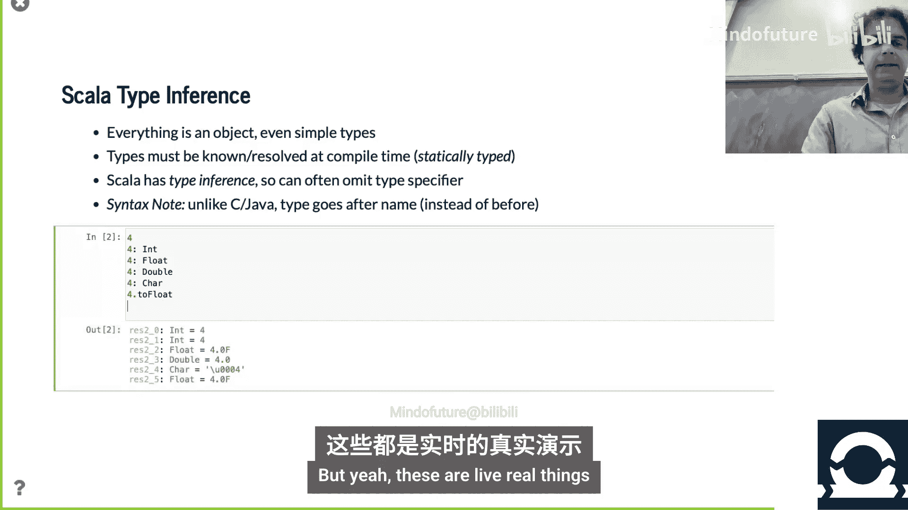

These are live real things。Co。Questions so far。It's the first taste of scholara。Like said。

 my paint a very pretty language。嗯。

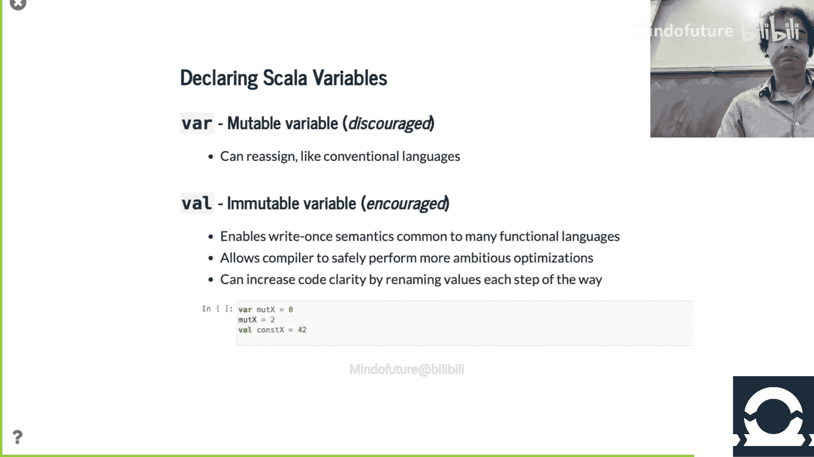

Cool， so let's actually declare some variables。😡，So what's interesting is Sca has two types of variable。

 two classes of variable' just say， right you have mutable variables and immutable variables。

The variables themselves。Are the same size of memory， you know， they're the same thing。

 It's just a matter of what permissions are you giving people。If you declare something as a var。

That's a mutable variable meaning， it can be changed。😡，Conversely。

 if you declare something of vowel that is immutable， right。

 so vowels like constant in many languages。What's going to surprise you。

Is the vast majority of the code you write will use Val， right。

 You will mostly write things where you assign a variable once。And that is it。

It was kind of in that functional philosophy。You know where you know。

 you may have seen functional law functional languages have only right one semantics。 guess what。

 I'm using vowel， it's right once。 If you try and change the contents of the vowel。

 it's going to yell at you。And so the question is， of course。

 why should we work so hard to embrace this right one semantics。

 why should work so hard to embrace immutable variables helps in a variety of ways， number one。

 as a performance person。😡，You tell the compiler things is' not going to change the compiler thing。

 you know。😡，高。Much more aggressively about optimizing right， understand， wait。

 it's not going to change this is this， I can do this this。

You're giving a lot more stuff there but also helping you avoid mistakes right there's a variety of places I'm going to show you in this course where I'm going to discourage you from using Vr and I'm going to show you know if you use a Vr there's a way you can have typos inplace else to actually have a very subtle hard to find bug if you use vows。

 you can just limit entire classes of bugs and entire all that time spent to buggy。😡。

Additional advantage of using vowel is that by having right one semantics。

You have these kind of single purpose variables。 Sometimes this is much more common in people。

 for certain program。 They make a variable， and they keep reusing the variable。 And so the variable。

 what it means， kind of changes over time。 right， Like， oh， in this case， it means this。

 in case it means this。 And it's like。

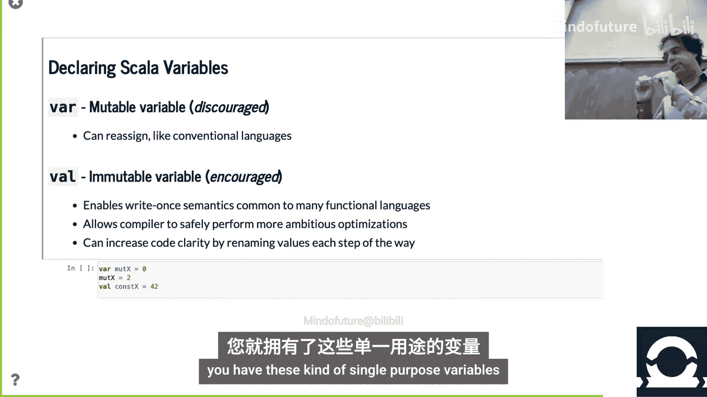

That's really hard to the book really hard for someone else to read right so by having this right one semantics。

😡，You're forced to kind of say， know what， this the purpose of this value？

And I'm not going to change it and you have more strip of names a single purpose。

 it leads to much more clear code and much more easy to maintain code。

This thing happens if you try and declare some of these。 right， So， for example， here we have。

 you know， when these Moable variables v labeled it in U X， great。

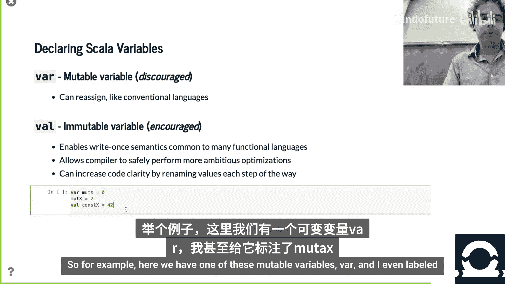

ItI has the value zero， but later on I assign it to。Meanwhile， this con is a valve of 42。So。

 for example。If I didn't declare this a vow instead instead declared it a var or sorry I didn't declare ava it declare a vow means。

 you know， make it immutable。

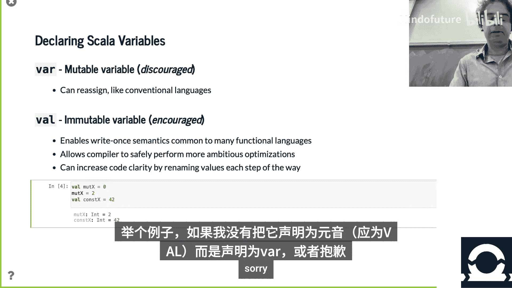

The probably was going to yell at me say， hey hey， you can't do that。

 that was supposed to be you know immutable and you reassigned it。嗯。And so yeah， in this course。

 you're going to see me basically almost never use Var。

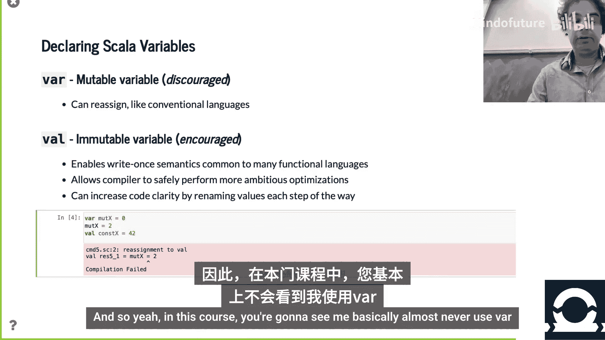

，A lot of students in a hear that， you know， you can do more things with the bar than you can't without like。

 oh great， I'll you' the only bar and I'm telling you， no， no， no， no， not only。

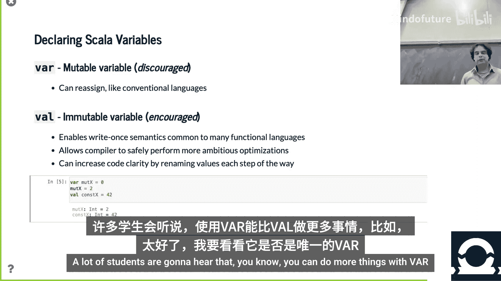

Should you use Val everywhere or just about everywhere when it comes to things like the project。

 we do look at your code。😡，And yeah， you know， frequent use ofar is a big point deduction， right。

 so use Val。And make life a lot better for you， trust me you'll save you time and it you time if you know what。

 maybe you find。

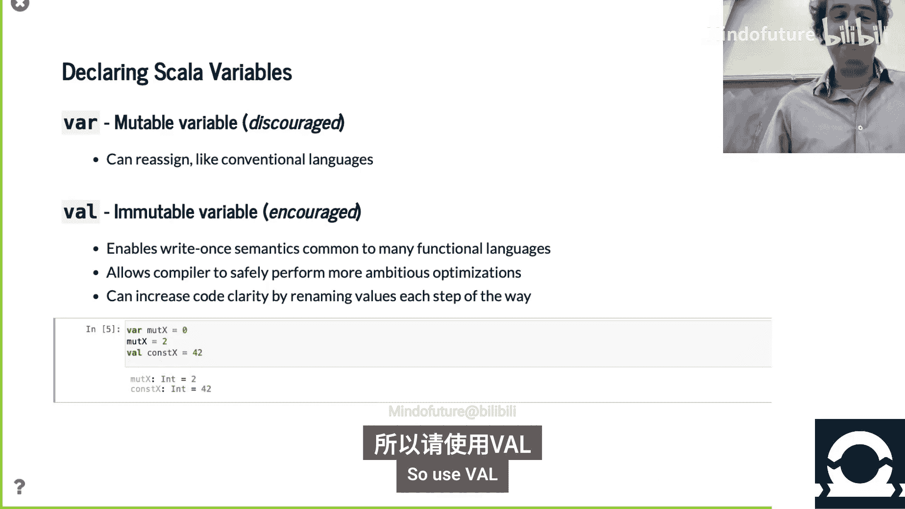

You want to use Val and there's a situation like you know what。

 I just have to change the value to this variable。

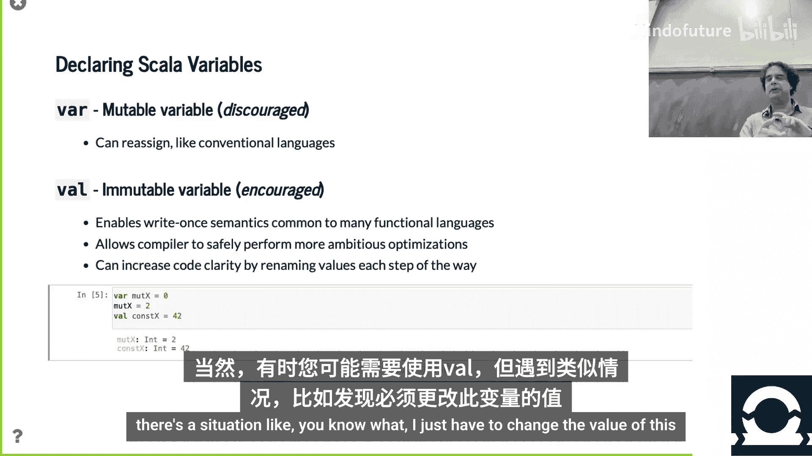

The common challenge of functional programming is how do you always do right on semantics？

Funal programming has couple ways of get around us things like recursion， other techniques。

We'll look at those in this course。

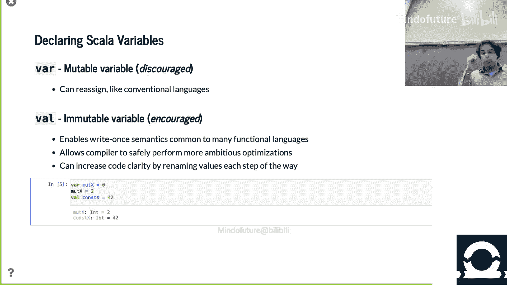

In handful of those cases。Caving using a var， it might be actually will be simpler code。

But it'll be a handful of cases rather than the common case， a common case， use vowel。

Try you you can。 And only if you really， really your。

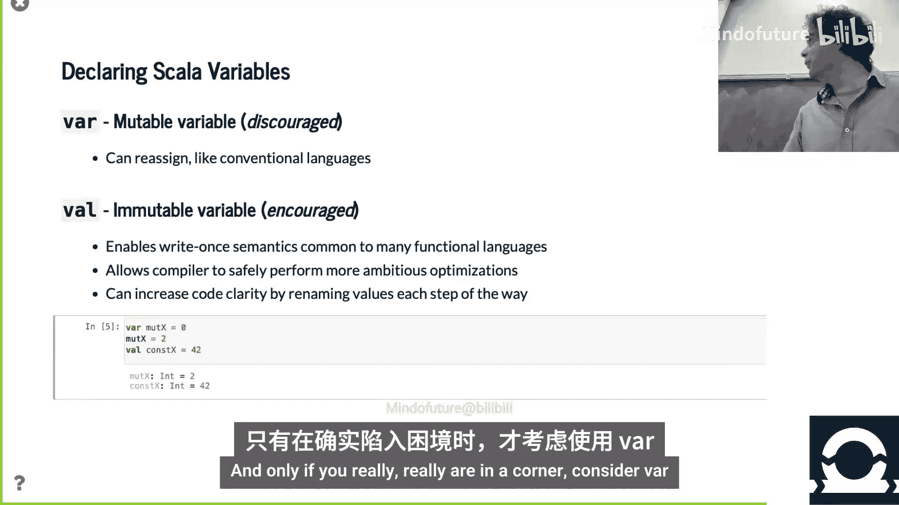

In the corner， consider vb even then。I I said， you can do the entire course。

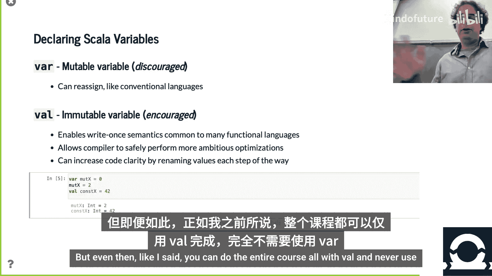

All would vow and never use Vr and you could write great code so。Please， please， please use out。

Questions。

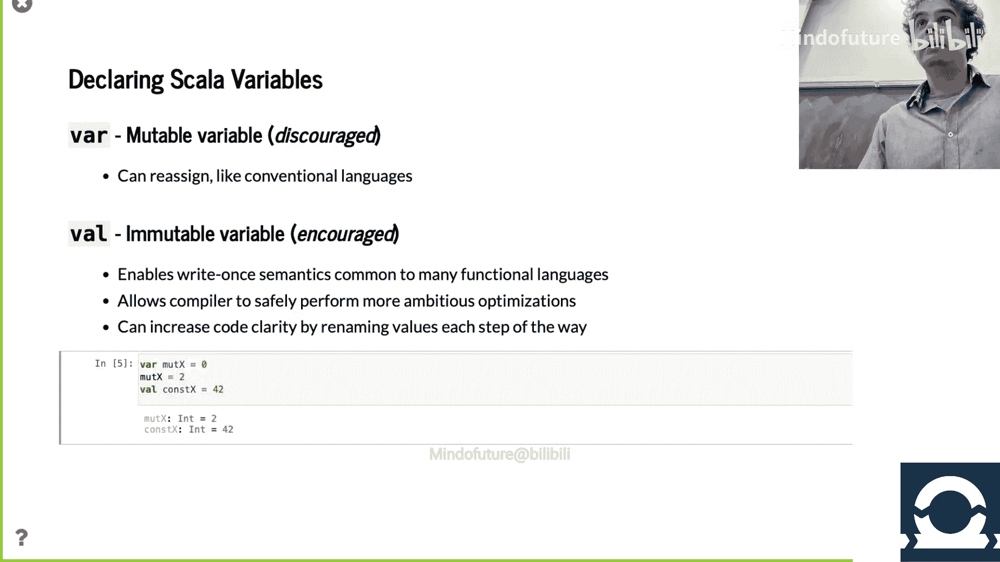

Oh， okay。So let's see what we're doing on time。I do want to。

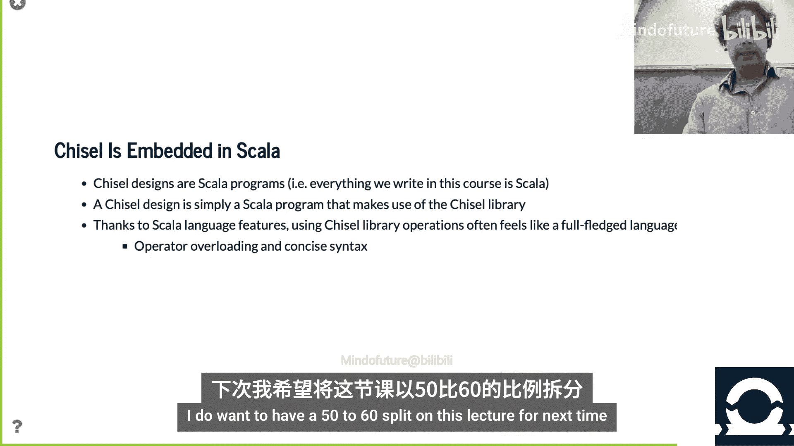

Have a 503 splendous lecture for next time。 So I think I'm gonna。Pause here's no other questions。

I will pick up this lecture midway on Thursday。Okay， I'm going to stop the recording。

I'm still available， both as Zming and person have any questions about the course。

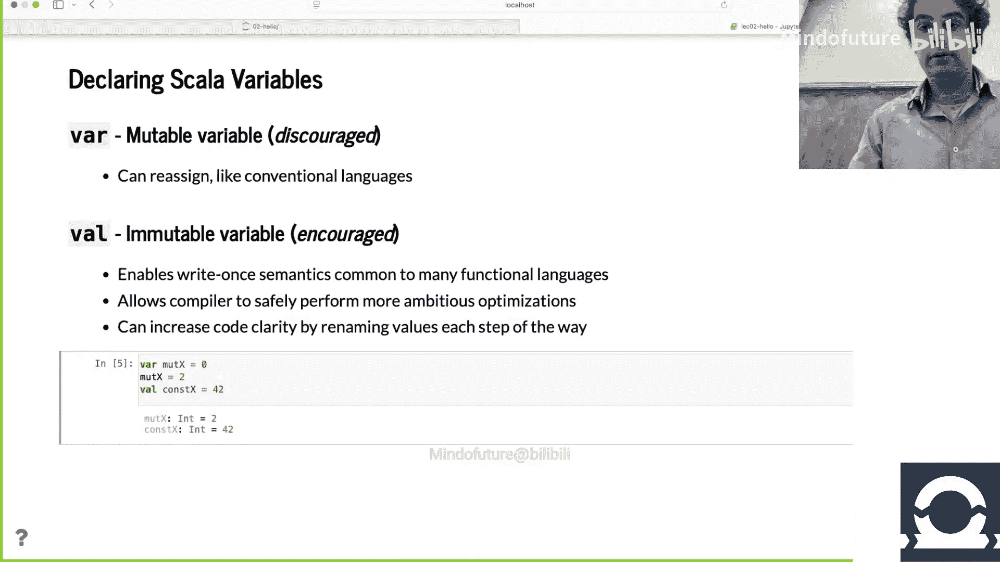