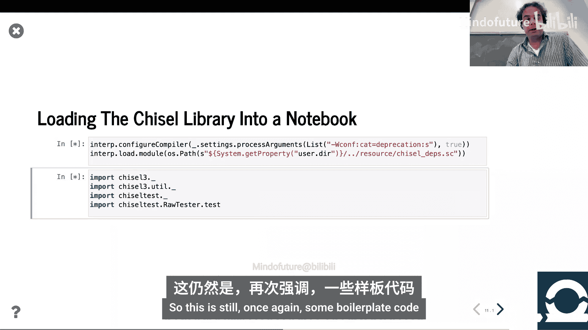
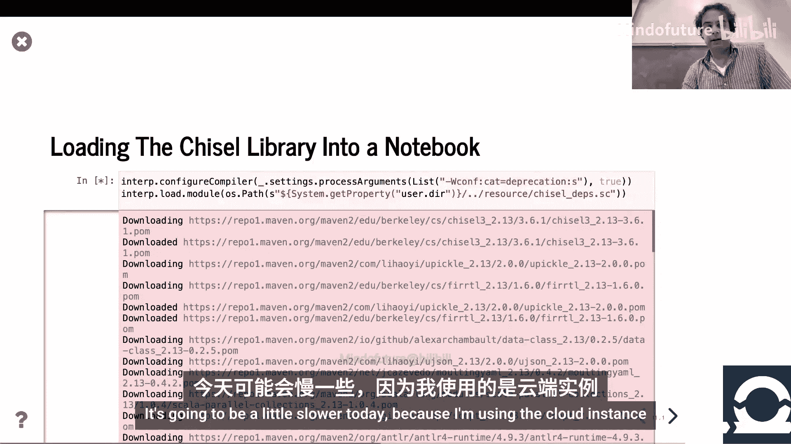
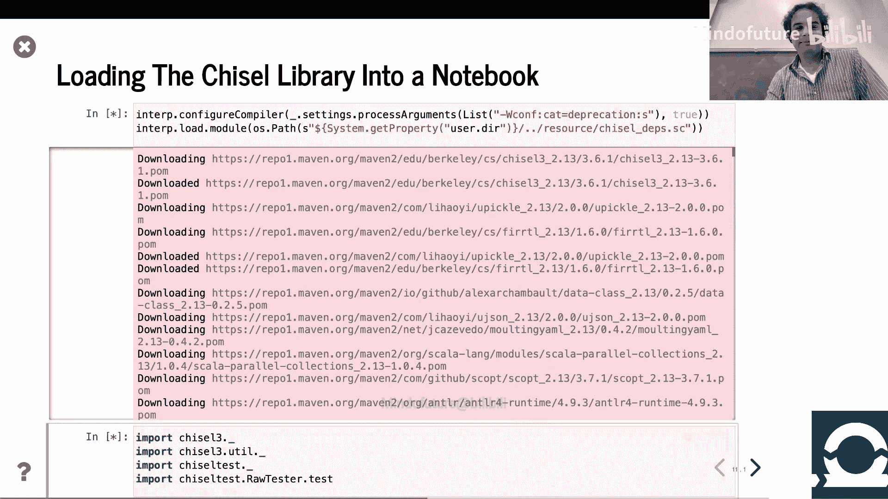
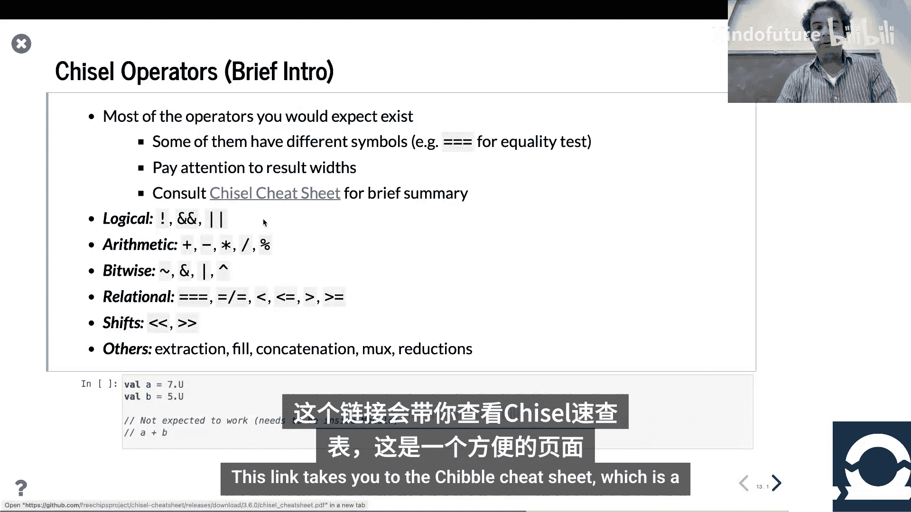
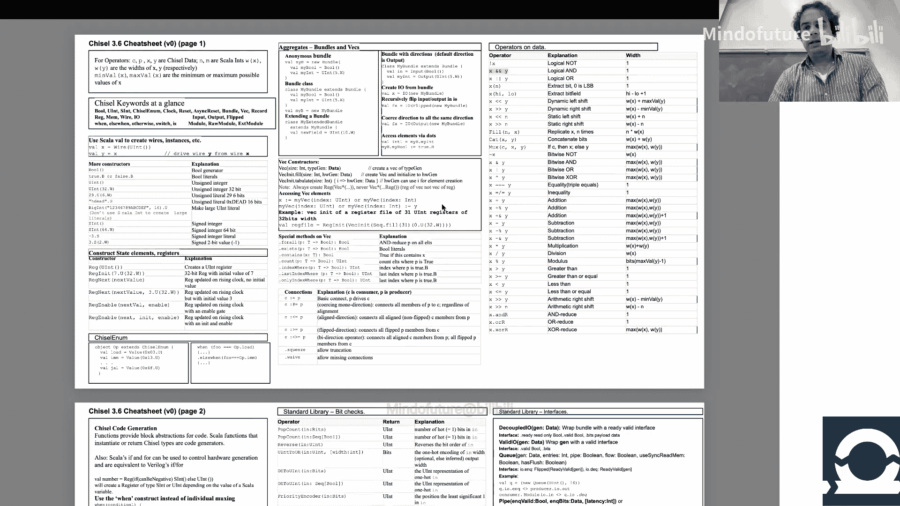
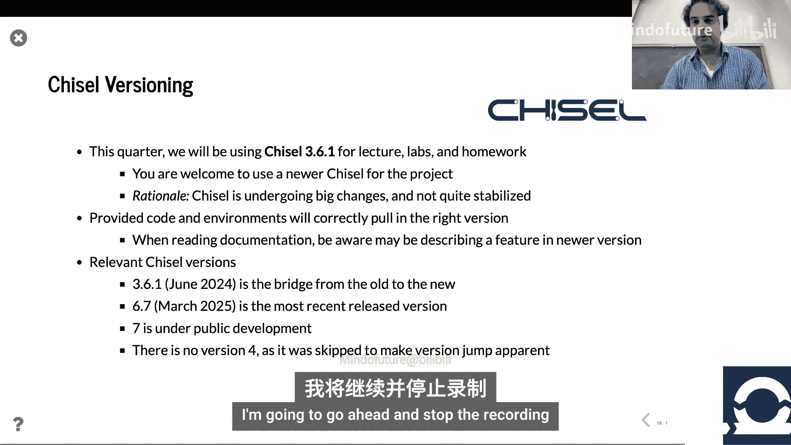

# 【加州大学】敏捷硬件设计-CSE228A-｜-Agile-Hardware-Design-Spring-2025-p03-P14_第2讲-Hello_Chisel_第2部分共2节--BV1M6ivBzESw_p3-

Hello and welcome Here we are in lecture two， as you remember from before， we're going to。

Do half of lecture two and then。Take a quick break and then do lecture3 because we have these 90 minute sessions。

嗯。Make sure the recording is going。 Yes， it is。 So we are good to go。

 So remember last time we were actually trying to close the loop， right。

 we wanted to show just a little bit of chisel and then see hardware design。

 And so we only did half that loop last time。 We did a little bit of scala。 And today。

 we're going do the rest， a little bit of chisel。 And then what should go into more detail on the following lecture about actually writing a combinational logic。

😊，So this is from last time。I do want to draw attention to fact these slides are not just Jupyter notebooks。

 but they're open source and you can and should run them right So if saying up the stuff's a little tricky。

 which it is， you can just run in the cloud with binder。

 And so actually right now I'm running myself from the cloud。

 So I'm using my laptop for running Jupiter right now。 that's cool。 things。

 So we covered this last time we introduced Scala， we got going， We show you know literals and Sca。

 we showed types， type inference。 We emphasize we prefer to do Val as immutable whenever possible。😊。

And then finally， I got to this point where he paused， right where， okay。

We've learned a little bit about Sca。 show you a chisel。 So how is chisel word。 Well。

 Chisel is this language you're using。 Its really just embedded in scholara。

 So technical when you're writing a hard design in chisel， you're just writing a va scholara program。

 It just so happens that chisel is， you know， a library inside a scholara that， you know。

 provides functionality we need。 And cut of some nice features in the scholara language。

Chs at times feels like its own language。 And thus we can go ahead and， you know。

 write things we need to。 And so。A lot of times she looked like his own proper language。

 a handful of times where you'll see even today， there's some stuff there。

 And the reason why that's there this spoilerplate。

 you kind of need to make it work as a valid scholar program。 But in general。

 there's some nice stuff there。 Sos， let's see we're talking about。嗯。

They give a big sense what I'm talking about， So when you write your zs in chisel right。

 you're going to make a file， it's a Val Sch program。 It's a dot Sch file。You know。

 with the toolflow we have set up， it's going to go through the Sca compiler。

And it creates a program right， the legitimate scholar program runs on the Jobri machine， the JVM。

And then， you know， chisel is a library' able to use to do what it needs to do。

 and then when the program runs， it produces the circuit。And says， circuit。Technically。

 it's in a format called Fertile or dotfiIR， but more importantly， just it goes from a program。😡。

To a circuit， right as a sensor of realization of hardware you want to have。😡。

What you do at that circuit will show another slide later today。

 what we call the back end to see what you can do with that。 But for now， it's just， okay。

 I have this program。 but program's a hardware generator and it produces a circuit。

 So I give arguments to my program and it spits out a circuit。

 That's kind of what we're trying to build。过。So let's go ahead and。I some code So this still。

 once again， some boil clay code is just loading up the chisel environment here in Jupiter。

 it's going a little slower today because I'm using the cloud instance。

But it's doing it， so here it goes。I I take about 20 seconds full speech。

Actually， know I'm going go to next slide we'll come back and make sure it's done in time。

 so let's say you're writing some chisel， right？What can you do。

 Well remember the study on last on Tuesday， I showed you some Schtype， The is some chile type。

 which。Technically are in Sc， but we'll say which will distinguish them。And。

reasonual why we're so obsessed with types it's actually one of the things Sca does where it uses lots and lots of types and it's constantly checking types with the goal of catching areas of compile time right we don't want to have our code compile and run。

 have this settle hard to detect。😡，Bg later on， we'd rather。Be told right away， right。

 sayss compiled time bug。 Remember， really just almost typing time bugs using an editor that has code completion and syntax checking。

 someone like you know In Jay， It'll tell you right away。 Hey， this does not make sense。

 And a lot of things gonna to tell you about these types don't line up。 And so for that reason。

 I said there's types in scholar。 There's types in chisel。And they look really similar。

 And sos some kind of ways it could cast back and forth between the two of them。 right。

 So for example， zero by itself， we saw that last time that is just a zero inger scholar。

But if we want to turn into a bull。Which is a chisel type。We can actually use this dot B synt。

 It's actually， like I said， everything's an object in Scs。

 So even the number0 as literal as an object and calling dot B。It's able to convert that to a bull。

 which is a single bit， you know， Boing signal in。Chizzsel now notice how bo， which， you know。

 pretty clear bindr signal， great。That's different than Sca， which has a boyan type， right？

 So you can see that right here where we have， you know， a 0。 We're casting to a bull。 We have true。

 which is a bullyan。 And then we cast this one also to a bull， right。

So ahead and run this coat of it and kind of see this come together。

 hopefully the prior flight is done， which it is。Great， so what do we see， Well， like I said。

 the first line， yeah， we had zero， we cast that to a bo， great。Second thing， you know。

 true and false in scholar or bulloleyan as's a scholar type。We used that be to cast it， shirt。

And then。You know， we declared a chisel bull with a value。 Sure， let's say， for example。

 I forgot to put that dot be on there。 Let's see what happens。

As can tell us right away these types don't line up， right， I said the thing I'm making is a bo。And。

It's bullion on the right side， right， It's going to be a mismatch。嗯。Sorry。

 I got to get a microphone in place great。 So these are things keep an eye out for Now I should point out that this decoration is not required。

 right we could of course。😊，Do that and that should also be fine。

 right it'll infer to type correctly because it knows it's on the right side equations。嗯。

Going on to multi bit signals， there's something called a UNint or of course， unsigned integer。😡，Um。

What's interesting about this is kind of a bus and bear。

You can invite you to cat create the width itself。Can either be explicitly set or actually left unset。

 And the tools will learnfer it。And so you can see all these kinds of situations here。

 So in this case， you know were。Declaring a， you know， six that' this。Scholar integer。

 we cast it to a Uent with the highlighted text above， then we get a Uent。

 It's going to infer a width of three bits。And it does that based on。You know， okay。

 how many bits do I need to hold that number it has minimum number of bits I need？

The chisel width infring with inference engine is actually pretty clever。

 it'll go through things and try and figure things out。If you specify too few whips。

 it will tell you， you know what， I can't quite figure this out。

 You need to give me some more whips along the way。Then general is pretty handy。

 And sometimes you as a hard designer， you know exactly what you want。 Sure， you can do that。

 So you can see， for example。Giving the width at the time we are doing this， you know。

 we can make it  eight bits， no problem。Of course， you make vows， sure， same thing still applies。

And then if， for some reason you want to have a signed number， that's also totally fair game。

That's a essence， which。a little bit confused why it's not visible， there it is。

 somehow we got zoomed in great， theres the essence。Cool， questions so far。Yes。Great questions。

Repeat this from recording when you use colons versus dots for types。

 So when you're labeling like a variable like this， that's a colon。

 So when you have like a variable declaration or when you have that list argument list for like a function or something。

 that's the colon。The dot here is actually not so much a， you know。

 labeling the type is's actually calling a function。And this function is a conversion function。

 And so you could imagine much more for both function， like you know， dot2 Bo。

 So a lot of times within Sca。We saw that earlier in this lecture。 Actually。

 go back a few slides from Tuesday。 You know， they have like these two casting functions， right。

The person that did this for Chisel decided to make this， you know very concise。

 and they chose to have a less for both name。So yeah。

 so dot B is actually calling a function that's doing the conversion for you。😡，Great question。Yes。Oh。

 so it the question is， you know， for recording， what's it casting it from。

 whatever type the scholara system has。 So， you know， literals and Scala have types， right。

 So a true is a bullolean。 So that's gonna be from a sca bullolean to a chisel bull in this case。

 right， You can kind of see that these two lines here。嗯。Yes。

 whatever type it is is gonna be converted from there。 This comes up when you design only sometimes。

 when you imagine within the hardware design， most time you're creating signals， connecting signals。

 et cetera。 But periodically， you're gonna need to have a literal， right， some sort of constant。

 And so that's that's where the casting comes in。Good questions。 saw one more over here， maybe。Sure。

 great。 Okay。 Yes， this， this is fun part of this course。 right。

 We can just kind of s some code And because it's running。

 you can just ask what ifs and do it right here in lecture and if you to be running on your laptop。

 You also can just play around with the same code。😊，Cool， so， okay， we have some chisel types。

 What can I do with them。 Well， most things expect to exist exist， right， you know。

 you can do logic operations， roof operations， Biops operations。

 comparisons that are relational shifts， etc cetera。 All those things exist。

 I want to kind of point out a few caveats along the way，😊。

The one that's a little bit surprising to some folks is actually the equality test。

Is three equal points。So why is that the case because two equal signs？Actually。

 is an important part of the scholar language itself and by overriding that functionality。

You would get some surprising behaviors in certain places so as a result。

They chose to use three equal signs for equal and for not equal， is this interesting。😡。

Thing which victorly does kind of look like， you know a flash to equal sign it is not equal。

 But so those the only operators which have characters that are different than you expect。

 the rest of the ones are the ones you expect right you know。

 you have ads subtract multiplied divide remainder of mod you know a bit with operations。

 not or and a Nor。Those are kind of along the way you expect some other things we'll see later at the end of the lecture the next lecture。

 things like， you know， if you want to extract certain bit ranges， fill a bit range， concatenate。

Mx is reductions， yeah， does all exist but。That's there。 Now， you may be saying， wait。

 how can I remember all this？ This link takes you to the Chibal cheat sheet， which is a。

Nice page， which you can print out double sided paper and just has this kind of handy reference。

 right， So you can say， oh， yeah， I want to do a logical， you know and， oh， yeah。

 that's the way to do it， right， And one of the things interesting about that is not just tell you the syntax if you forget。

A variety of chisel features。 It also has some helpful hints。 You'll see， for example。

 with things like with inference。

You know， you perform an operation， you're curious well how big is the result going to be。

 this table will kind of remind you how to compute depth， you're curious。Now， when when in doubt。

 of course， you are set withs explicitly， but sometimes it's nice to kind of let the tools do things。

So yeah， here we have， you know？A and B， just fine。Now。

 you might expect me to do this line right here。 but you can see if my comment。

 is's not going to work。 The reason why is， although， like I said， Chile tries us best to。

Give the illusion of being a language in this very exposed state of being inside al men inside Jupiter and outside of a class context。

 there's just not quite enough to chills look it going。

 And so you'll see this is not really limitation of practice。

 you do think declares what's called inside of a module。

 But if you're playing a round right now for the first time you may get that error and that's what's going on。

啊 coolol。Questions。Okay， let's actually make a module So how about a really simple module we'll just build nextor gate。

 right so we're going to call this my Xor。And what do we do， Well。

 you can treat a lot of this boilerplate， but kind of the key thing is sure， you name it。

You have IOs， so we have some inputs。A and B， which are each bo。

 so it's going to be no one bit signal。We have an output C， which is， you know， also a bull。

 and you can kind of see how we're setting this up， you know。

 inputs and outputs and giving them types。And then for the actual functionality。What do we do， Well。

 this is the XO operation。 You may recognize this carrot symbol for doing XO。 So yeah。

 our' xoring A with X or B， sure。And then we're connecting it to the output C。And see yes。

 that's the chiic code in the left。On the right， you can see a diagram I drew showing the functionality right。

 there's a single Xor gate inside this my Xor module and we have these IO。These ports， right。

 and you have the two inputs coming in， connected to the gate。

 and then of course they come out as output C。So we'll be doing modules all quarters is kind of the very first。

 you know， hello world of modules。Questions so far。Cool， okay， so then。

Now that weve declared this module so what right like have I made hardware well no I've made a hardware design right and technically what I've done is I made this class that when it runs it makes this Xor module and then what am I going to do with that Well we can do a few things for today what we can do is。

Tellah hey， you know what？Turn that circuit into verrlog。

So we can do that and take a little bit of time because the clouds a little slower to my laptop。

 but it should come out。 There it is。 So you see， yes， it produced。Very long for this design。

 and you'll see throughout these lectures。I often will use Ver log as a way to kind of show what the hardware returns into。

Does this silly mean that， you know？We only care about verylog。

 doesn't necessarily mean that you need to know very to do well in this course。

 It's just showing how this concretely turns into a circuit。 So in this case。

 it's virtually one to one， right， You can see， you know， if I go back a slide。嗯。

And here we have ABC is inputs， AB is inputs， Cs an output and then the one line connection。

 look at the actual very log， it's pretty similar right， okay， here's inputs A， input B， output C。

 and then yeah it science this。嗯。😊，Technically， it also has these additional ports for a clock and reset。

 you can imagine that since there you use a site this module， they're superfluous。

And the answer is yes， they're superflist。There's not really any penalty to doing this。

 the CAD tools when they actually process this very log will recognize they're not using this p them out quietly and there's no hardware cost for that。

 yes。一とメか。系先gan。Oh不贝思。Yeah， great question。 So， yeah。

 So the question why where are going gonna reset there what happens if you're writing chisel。 So。

 yes， the questioner quickly inferred in chisel when you write a module。

 we don't actually usually specify the clock or reset as Ios is because they're already included。

 So clock and reset are spread throughout the design。 They are， you know， global they are implicit。

 We can see in the very log， of course， they're actually materialize。

 That's just one way that chisels try to make things simpler， right， realizing you know what。嗯。

Everybody runs in the same clock。 So let's just spread out for you automatically。 Now。

 advanced designers will know there are certain times when you want to have multiple clocks。

 or you may want to you' swing funny with the clock。 You can do that in chisel。

 There are ways to set the clock to goes to a module。 There are ways have multiple clocks。

 We don't do that in this course， but you functionality for it that because that's you know absolutely essential for industrial designs。

 The other wrinkle is this reset where。Re components。The vanilla reset works great。 And thus。

 you know， spreading around globally and thely， it's a really nice thing to do。

 But you can once again， imagine certain components， maybe。😊。

Wt be a little bit more nuanced with recess， especially when you have， you know， power on， right。

 your first power on your chip。Coming out of power on again， the reset writes a really known。

 tricky problem。 Once again， for this course， you need to worry about that。 We're just saying， hey。

 Re is fine。 But if you're curious for， you know， advanced real designs， Yes。

 Chitle has support what's called asynchronous research which is very common in real hardware designs to handle that power on issue。

 yes。Yes， exactly。 So' to answer the question。 Yes， does reset assume， you know， on pause edge clock。

 Yes， exactly。 Yes， these resets are all synchronous， all pause edge。So how could you do not po。

 This is a question if there's a key opinion for recording。coupleuple of ways you can do that。 One。

 if you let say you want to do negative edge， you could。

Expose the clock to chi will make the clock more implicit and then negate it to dense the negage。

That' would be the most common way if you want to do something that's like neggage。Alternatively。

 say you want to have something more exating involving your resets。

 you may also want to then in that case， you use as synchronous reset。In the spirit of types。

 Chisel does have a few types that we don't cover in this course。

 but it' relevant for that more advanced usage scenario。So it was actually a literal clock type。

 So that way， you know， the signal of the clock is known as passed around with a clock type。

 there's certain constraints what you can do， which makes sense。 There's also an analog type， which。

It's all useful for times because there's sometimes you want to make sure the tools don't mess with certain signals。

😡，And if all that is insufficient， there's another escape patch in chisel。

 which is something called a black box So youre can just say you know what I really know I want to write。

 I want to write it in verylog， let me write it and you can write that and then you can connect to with chisel so it's very much like how in language you see this plus you can write what's called in line assembly you can write load assembly you know have C around it you can do the same thing in chis you can say you know what I really really wanted something that chisel seems to have a very good way of expressing it but I know how to do it in very log you can definitely do that for this course you won't need to do that but that functionality exists。

Great questions， I love you， this is good。Cool， so you know。

 we start off with just one Xor gate and here we go how what else can we do it this hardware design We can also visualize it。

 So there's this little tool someone put together a couple years ago that you know exports the design to graphs and yeah。

 you can see it visually So here you can see for example， oh yeah， you know this X component。

It's selected to A and B and now puts the C， this kind of a cute little thing to do。嗯。

If you're watching this course， you're going to see us typically eitherre looking at the very or diagrams I drew as the human。

😡，But this look gives you a sense of what's going on。Cool， okay， so we have this， you know。

 one gate module。Not a question， of course is what can we do with it。

 we said the front end takes chisel， you know， which is actually a scholar program and then the scholar program generates this circuit。

Now given this circuit。What can we do， Well， what the back end depends what you're trying to do most of the time。

 especially you're like in this course， you're gonna to assimilate that back end。

 You're gonna that design。 You're gonna go ahead and touch it ass similulator and run something。

 And so of course， when you。Have a circuit and you want tosimilate。 You can't just say， oh。

 go asimilate。 and you give a stimulus。 right， It some sort test bench。 right， You know。

 what are you doing to your circuit to make it do things， right， You're giving certain inputs。

 You' waiting for certain outputs， so。That's something we called Chidle test。

 we'll see an example down just the slide。And as solve simulation。

 you of course can get text outputs from printing things or a waveform， adopt ECD。😡，嗯。

In terms of what else can do if fit well， of course。

 you can generate Ver log and then pass that ver log off dimensional CAD tools。

 whether it be an FPJ flow， a ASI flow， etc cetera。嗯。

So there's the step in between these two things by a tool called Fertile。

That takes in these circuit files， which are actually in fertile format。fiR。

 and it does the conversion of the very log。So that's kind of thing for this course is kind of。

 you know， below the details you need to worry about， but just be aware that's there。

For the most part， we'll be， you know doing only kind of front end is design and just taking circuits and simulating them and if they get the。

 you know， correct logical behavior， consider that。😡，Good enough for this course。

 you can imagine in the real application， you can be very concerned about the physical costs。

 in which case you may want to optimize and actually pass it through a CAD flow。Cool。Okay， sodan。

What about chirsle tests this way we're going to do these test benchess actually pretty fun you can write a scholar program through the full power of you know。

 jump purpose language。😡，And you can set inputs and look at outputs， right？

You kind of see how this sets up， right， basically， okay， somehow I want to both exercise the design。

 make it do things by saying inputs。 When we set the value of an input， we call that poking。

And then we look at what comes back out of the design。

That's peaking to read the value of a wire and very often you don't just want to read the value。

 you actually also want to see the value that came out and matches what it should be。

 and that's called an expect or basically it's like a peak with an assertion combined。😡，嗯。

So it's a really simple example， you know， with a。Two input， one output， Booleing gate。

We only have four input cases， we can kind brute forest， all of them。So， sure。

 we can go ahead and write this test bench for diagram kind of considered us to be a lot of boilerp。

 But basically， yeah， hey， if I want to test。Z x or0， right， I poke the inputs for A and B to B 0。I。

Then check the output， right， and we know that。0 x for 0 should be 0。 In fact， the running this。

We just get this， you know？Object result， the reason why is it。Past， everything's good。

 so if we want to see it break。I can go ahead and change this。And then we see。It's going to fail。

 right because it didn't match， right， expected one， but they gotten zero。

And' that's an example of it feeling。 And so， yeah， so we'll see with chisel tests。

 you can kind of know my see right lot these test benches and such。

Often running and it's all in the skull environment， right？For example。

 if you're writing this in very log these days， you can write。A test bench plane bar。

 which we all know how to do。 There are things you can do in very log test benches that aren't synthesable hardware。

 but it's still not quite as friendly as a regular program。 Then， of course。

 through a system dialogue， which has even nicer functionality right test benches。

 but it's still not quite a full program language and you have scholar。

 which is a full programming language， right， So you can imagine very sophisticated testers right。

 You can have a tester that let's say，Calls into a large software library to know what the answer for a certain problem is you can compare and make sure your hardware matches that。

 Let's say blink photography function。 You call into the actual cry brand software。

 make sure oh yeah， my Sha hash matches the software Sha has。

 you can also do things like Taku database。 read Json， whatever you want to do。

 You have the full power of the entire job at somebody you spoil is really， really helpful。嗯。扣。

So I'm wrapping up about this initial chisel foray sobri course， we're using chisels 361。

 if you don't need to memorize the number， all the code to give you is automatically pull in the right version。

But the reason why it's being meant to talk about versions is when you look at documentation online。

 you may， if you just search on the Web， you may see， you know。A reference to a function。

 a feature just not in children' 3，6，1。 So 3，6，1 is not the newest feature out。

 not nothing newsest version out there。 that why I'm kind of warning you。

 So why we not use the newest version out there Every year。

 I kind of check out ticket tires and kind of see where we're at and see what， you know。

 what can we port。 What can not port。The biggest issues with the next version is most of the benefits it provides。

Are going to be。I appreciate in this course for the scale designs we're building a lot of them are designed to make chisel scale to much larger designs and that's something we don have a problem with in this course。

But if's a lot of consequences had， the most consequences of those costs the negatives it has we're going to lose things like chitle test。

 So we really love chitle test and makes it really easy for us to write our own test cases。

 but the newer version is not support chitle test。They are in the process of bringing it back。

 but it's still not quite there。 So when tiltes has returned。

 this course has moved into his version of chisel， but until then。

The normal benefits of the new versions don't really help us as much and losing tilt test is too big of a loss。

What versionins are are out there right， so Ti 361 was last made in June a year ago。😡。

But the much more modern series is much higher I see in version numbers。 I'm going to this。

Model of big number increments every year。There was no version for， did Lib skip the number？

The most recent version on the like head of head of head is 6。

77 is available of a release candidate under public development， but for this course， like I said。

 we use 361， it's all the labs， lecturers， homeworks from the course homepage。

 we link to documentation， we link to the documentation for that's version of Chisel。😡。

And much of the user facing Chislow code is the same from Chisle 361 to Chisle 6 and7。

6 and7 do us some user facing new features， but the biggest reason why they made these changes a lot of things in the back end。

 like I said those back end changes are going to make our life a lot harder for this course but not give us the same benefits we're doing billion transist design。

😡，Okay。Other questions？Good， I'm going to go ahead and stop the。

