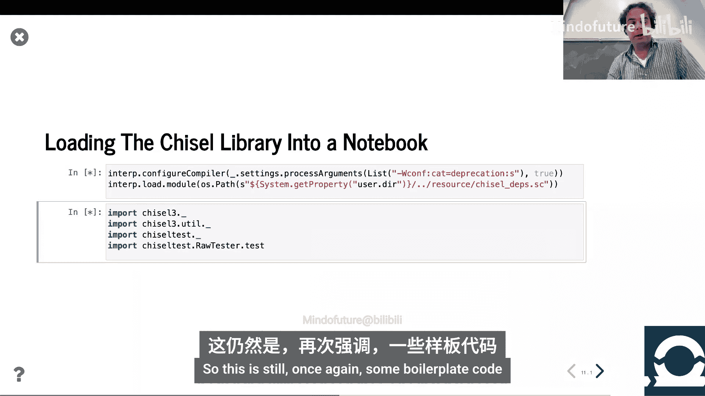
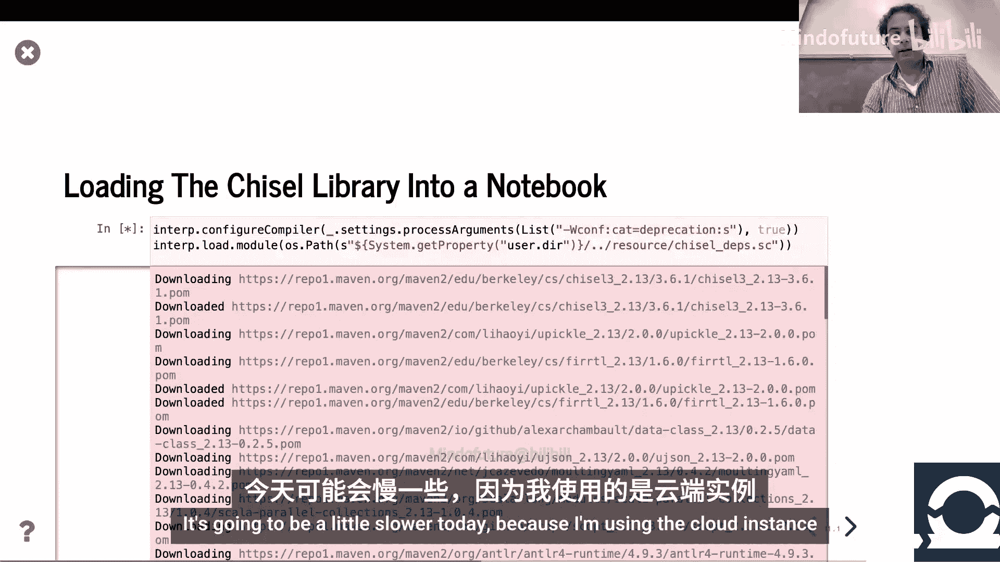
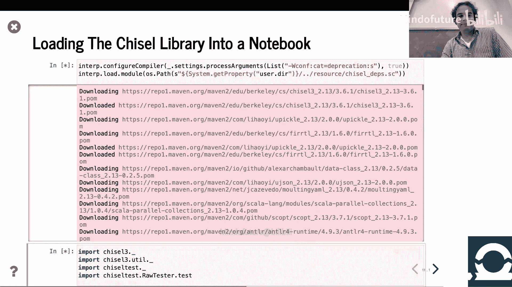
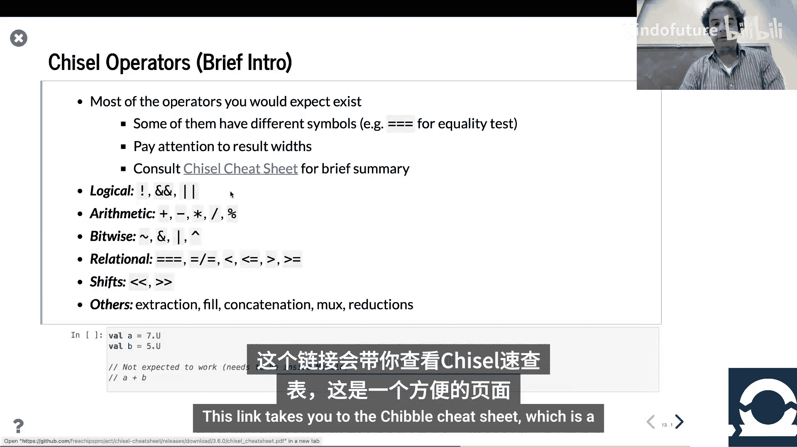
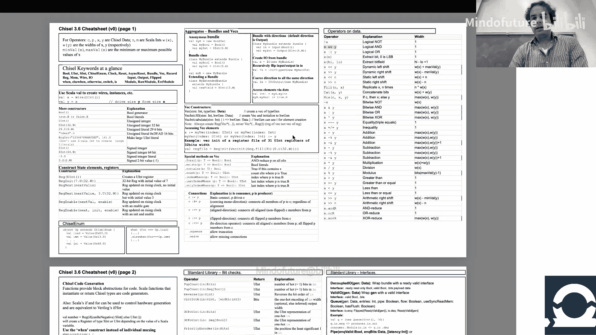
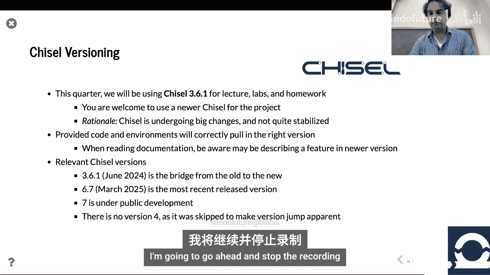

# 敏捷硬件设计：CSE228A：第2讲：Hello Chisel (第2部分) 🚀

在本节课中，我们将继续学习Chisel硬件描述语言。上一节我们介绍了Scala的基础知识，本节中我们来看看如何将Scala与Chisel结合，创建并测试一个简单的硬件模块。

## 概述

Chisel并非一门独立的语言，而是嵌入在Scala中的一个库。这意味着当你编写Chisel硬件设计时，实际上是在编写一个Scala程序。这个Scala程序在运行时，会生成对应的硬件电路。

## Chisel类型与操作





在Chisel中，我们使用特定的类型来表示硬件信号。理解这些类型及其转换是编写正确代码的关键。



### 基本类型与转换

Chisel有自己的一套类型系统，与Scala的类型不同。我们经常需要在两者之间进行转换。

以下是常见的Chisel类型及其创建方式：

*   **`Bool`**: 表示单比特布尔信号。
    *   代码示例：`val myBool: Bool = true.B`
*   **`UInt`**: 表示无符号整数，可以指定或由工具推断位宽。
    *   代码示例：`val myUint = 6.U` // 推断为3比特
    *   代码示例：`val myUint8 = 255.U(8.W)` // 明确指定为8比特
*   **`SInt`**: 表示有符号整数。
    *   代码示例：`val mySint = (-3).S`

**注意**：使用 `.B`、`.U`、`.S` 等方法是将Scala字面量转换为对应Chisel类型的常见方式。这里的点号（`.`）表示调用一个转换函数。

### 运算符

Chisel支持大多数你期望的硬件操作符。但有一个重要的例外：相等性比较。

以下是Chisel中的关键运算符：

*   **逻辑与算术运算**：`+`, `-`, `*`, `/`, `%`, `&`, `|`, `^`, `~`
*   **比较运算**：`===` (等于), `=/=` (不等于), `>`, `<`, `>=`, `<=`
*   **移位运算**：`<<`, `>>`

**注意**：Chisel使用三个等号 `===` 进行相等性判断，而不是两个。这是因为双等号在Scala语言中有特殊含义，重载它会导致意想不到的行为。

如果你忘记了某个操作符，可以随时查阅 [Chisel速查表](https://www.chisel-lang.org/doc/cheatsheet)。

## 创建你的第一个模块



现在，让我们将理论知识付诸实践，创建一个简单的硬件模块。



上一节我们介绍了Scala语法，本节中我们来看看如何定义一个Chisel模块。我们将构建一个异或门（XOR Gate）。

```scala
import chisel3._

class MyXor extends Module {
  val io = IO(new Bundle {
    val a = Input(Bool())
    val b = Input(Bool())
    val c = Output(Bool())
  })
  io.c := io.a ^ io.b // XOR 操作
}
```

这个模块定义了两个输入 `a` 和 `b`，以及一个输出 `c`。核心逻辑只有一行：将输入 `a` 和 `b` 进行异或运算，结果赋值给输出 `c`。

### 生成Verilog

创建模块后，我们可以让Chisel将其转换为标准的Verilog代码，以便在其他工具链中使用或查看其具体实现。

```scala
println(getVerilogString(new MyXor))
```

生成的Verilog代码结构清晰，与我们的Chisel描述基本对应。你可能会注意到生成的代码中包含了时钟（`clock`）和复位（`reset`）信号，这些在Chisel模块中是隐式存在的，为设计提供了全局的同步时序基准。

## 测试你的设计

设计完成硬件后，我们需要验证其功能是否正确。这就是测试平台（Testbench）的作用。

在Chisel中，我们可以使用 `ChiselTest` 来编写强大的测试程序。我们可以设置（poke）输入信号，检查（expect）输出信号是否符合预期。

以下是一个测试我们 `MyXor` 模块的例子：

```scala
import chisel3._
import chiseltest._
import org.scalatest.flatspec.AnyFlatSpec

class MyXorTester extends AnyFlatSpec with ChiselScalatestTester {
  "MyXor" should "work" in {
    test(new MyXor) { dut =>
      // 测试所有四种输入组合
      dut.io.a.poke(false.B); dut.io.b.poke(false.B); dut.io.c.expect(false.B)
      dut.io.a.poke(false.B); dut.io.b.poke(true.B);  dut.io.c.expect(true.B)
      dut.io.a.poke(true.B);  dut.io.b.poke(false.B); dut.io.c.expect(true.B)
      dut.io.a.poke(true.B);  dut.io.b.poke(true.B);  dut.io.c.expect(false.B)
    }
  }
}
```

这个测试遍历了异或门所有可能的输入组合（00, 01, 10, 11），并验证输出是否与真值表一致。如果任何一个 `expect` 断言失败，测试就会报错，帮助我们快速定位问题。

**优势**：由于测试代码本身就是Scala程序，你可以利用完整的编程语言特性来构建复杂的测试场景，例如从文件读取测试向量、调用软件参考模型进行比较等。

## 工具链与版本说明

了解Chisel的工具链和版本差异有助于避免困惑。

### 从设计到仿真的流程

1.  **前端**：你用Chisel（Scala）编写硬件生成器。
2.  **电路生成**：运行Scala程序，生成中间表示（FIRRTL格式的电路）。
3.  **后端处理**：
    *   **仿真**：通过ChiselTest直接进行软件仿真，验证逻辑功能。
    *   **生成Verilog**：通过FIRRTL工具将电路转换为Verilog代码。
    *   **物理实现**：将Verilog代码交给FPGA或ASIC工具链进行综合、布局布线。

在本课程中，我们主要关注前端设计和逻辑仿真验证。

### 课程使用的Chisel版本

本课程使用 **Chisel 3.6.1**。虽然这不是最新版本，但它稳定且包含了我们课程核心所需的 `ChiselTest` 功能。较新的主版本（如5.x, 6.x）在底层架构上有重大更新，主要服务于超大规模设计，但暂时移除了 `ChiselTest`，因此不适合当前的教学需求。

请确保参考课程资料中针对 **Chisel 3.6.1** 的文档和示例。

## 总结



本节课中我们一起学习了Chisel硬件描述语言的核心入门知识。我们了解了Chisel的基本类型和操作符，动手创建并测试了一个简单的异或门模块，还梳理了从Chisel代码到可仿真、可综合电路的完整工具链。记住，Chisel的本质是嵌入在Scala中的硬件构造库，结合两者的力量，你可以高效地生成和验证复杂的硬件设计。