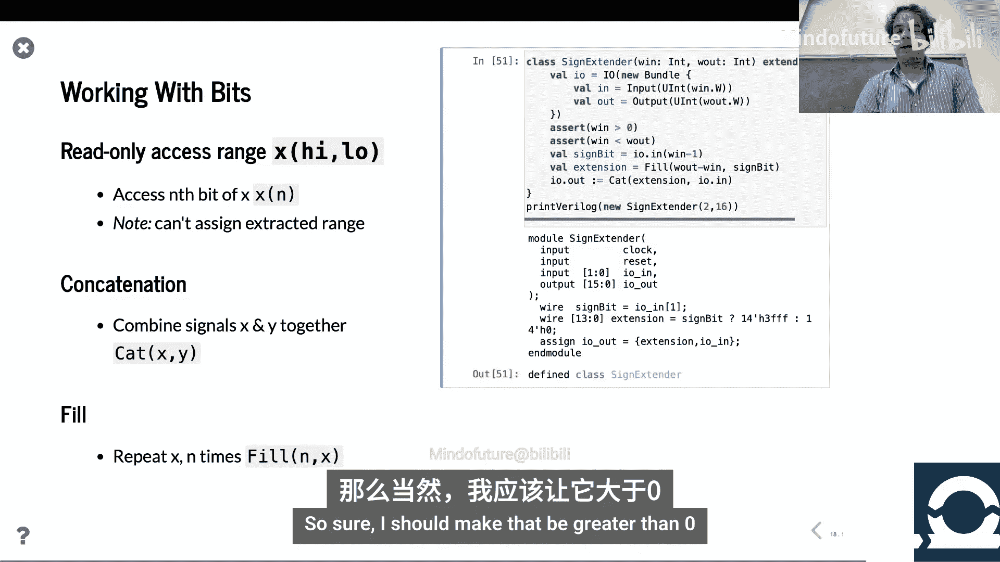
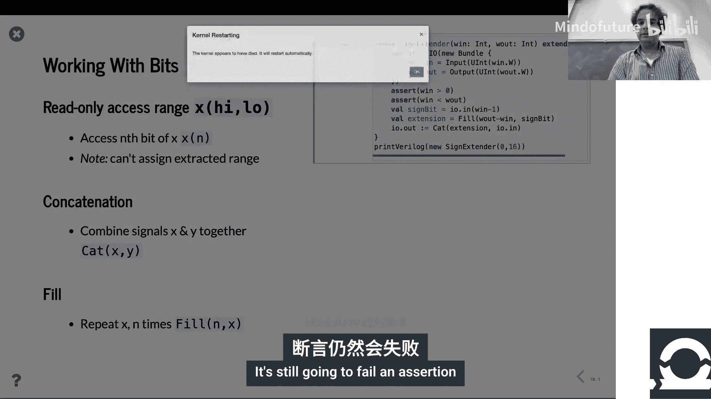
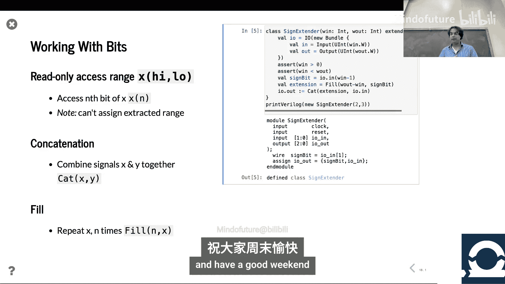

# 【加州大学】敏捷硬件设计-CSE228A-｜-Agile-Hardware-Design-Spring-2025-p04-P15_第3讲-组合逻辑--BV1M6ivBzESw_p4-

Hello and welcome to lecture three on day two so we just saw。

An example of fellowello World and Chisel and we got you know a simple design， close the loop， right。

 that was a whole goal， that' of a lo for dis course。R some chisel。

Gody both simulation and God see Verlo see the Apple we're doing And so today we're actually dive in much farther depth and we're going to go ahead and see commal logic And in just the course of this next lecture。

 we're going to cover like 80 or 90% accommodational logic that we need to worry about for chisel for this course and then the lecture next week we'll cover all sequential logic has a lot logic involving registers So actually by end of Dino those first four lectures。

You'll be able to do most things you can do in Verlog in chisel。 And then from then onwards。

 we'll start moving on the things we can do in chisel that are much harder to do in Ver log and kind of take advantage of full flexibility and power。

 So we're kind of still getting warmed up。 But it's good。

 And so we kind of see the same model we saw before。

 We're kind of this intermixing of little bit of sca， little bit of chisel。

 a little bit of design use to that。 And then。😊，Close the loop as you use it。

 and then we'll move on to a little more sophisticated and that might involve a little more scala。

 a little more chisel， a little more design use。嗯。We just had a conversation about very during a break and try to remember what I was supposed to talk about。

It's the。Yes， so one detail maybe is worth repeating in case people aren't aware the tool very long is what most commonly used for that is to describe hardware to be passed on to a CAdD flow to actually turn into hardware。

😡，And other was synthesis， you， placement， routing， et cetera。

 that that you know what very long was designed for。

Sorella was originally designed to be language to describe hardware for sake of simulation。😡。

And the conversion from that simulation language， or in this case， RTL。

 to a hardware with synthesis that was developed after V was made。😡，And so as a result。

 Verloc has constructs in it as a language that。Can't be synthesized， right？

Chissel having the benefit of hindsight as a language。

Everything in chisel is synthesizable right it is a hardware instruction language now our generators will intermix chisel with scala。

So of course， the Sc， which is， you know， a program that's not going to go into hardware。

 but the chisel is actually being done。 that's also sizable。

 So it's a little bit of a different thing whereas very long it was designed long time ago。

 So it result design for simulation。There are certain constructs and bear that aren't really synthesizable。

 And kids lawyer everything synthesizable。 A alsoed delivery program wrapped around it。

 Let's go ahead and see how plays out。As I said before today， we kind of cover commercial logic。

Along the way， we'll also talk bit about parameters and conditionals。Okay， so once again。

 fire up the old notebook。Good to go。So in the last lecture， we talked about things like， you know。

 logic gate， Uch， et cetera。What about you want to do a mu？markx array multiplexer。

 right is a way to you know given an input selection signal。

 choose between two inputs for the output right So you know if select is 0。

 we get input0 connected the output， if select is one， we get input one connected to the output。😡。

And so in Chisel， we can simply just declare it up by sayingMs。

Get a selection signal and the two inputs， one little。Rrinkle to be aware of。Input one is first。

So why would they do that？At first， it seems a little counterttu to why would you go 1。

0 rather than 0，1。 The reason why I did that is that actually it's very similar to law that languages。

 So， for example， if you have a ternary statement in either very long or see a question mark。

You know， it's condition。Question true case， Col and false case。 You know， if true。

 true case or false case， that's kind of why're adopting that syntax。嗯。

Its a little bit surprising to some people I don't blame them。 How's that code。

 We have some on the right。 We can go ahead and， you know， once again， our boiler play， you know。

 save a module。 We call them My mugs。 We have our I O or inputs and outputs。

We have three Boolean inputs right， you know select signal in 0 in one。Our output， which is。

 you know， a single bullolean signal。 And then what is the actual mus like we just talked about right。

 We have our flex signal， our two inputs。So in this code block。

 we're both going to declare this module and print very log to kind of see what code actually gets generated。

 And you can see once again that the very log is pretty similar to the chisel， right， You know。

 there's an a science statement in here。Ticking the output to a mug。 and in the case。

 the way you chose to do it in this case， it actually uses the turnernary statement in very log like we're talking about。

 that's why having the in one first kind of makes sense。嗯。Cool。Now。

 you can imagine hows a lot more situations you might want mues that are just as simple two input mugs。

😡，And if you're curious， there is a variety of additional mark available in the Chile standard Library。

 so if we go to that link in a documentation。Hope it's the right browser tab， yes it is。

 we can see for example， here is a Mux 1 H1 h is short for one hot。

We will come to that in a few lectures， but I'm just kind of trying to alert you to this exists right it's a variety of mugs and there's a mugs based on cases。

 so there's something called a case statement in scholar。

 you can use that functionality actually in the mu generation so there's a few different mugs available in the library。

 you kind of can scroll through and see things in the API。Cool questions so far。Okay， then。

Let's have a carry this little game of。Go back for languages， so what about Sca？

What we've seen so far we keep declaring things called class and these are actually actually objects they're actually a class right these aren't even functions。

 these are a class and so why we keep doing classes。Well， the way she is implemented， it uses。

 you know， inheritance to do some a lot of things that doesn under a hood。 so yeah。

 we need to talk more about classes。 So when you declare a class of scholar。You say class。

 give it a name。What's interesting is you also immediately follow it up with a argument list。

And so in some ways， this classic looks almost like a function， right as kind of you know。You know。

 the name and then the argument list， and there's a body and a body for your class。

Can have arbitrary code。 Doesn't this need to be declaring。Memb and methods。

 can actually also this have arbitrary codes in this case， we have， you know， name is created。

 we have a print statement。And then it comes time to actually create one of these instances。

We just go ahead and say new。namee it a class。 And then we got to fill in those arguments。

 Let's go ahead and run this code real quick。And yeah， we can see。 sure， we。You know。

Delared this class。So you can see in the output area kind two categories of output。

 we have what is the interpreter kind of doing and what is actually being printed to standard out。

 So the interpreter， you know， for this first lines， Yeah， you know， you created。

 you defined my class， great。Um， but in terms of what the stared out seeing is the evaluation of creating this。

You know， it creates name， it also calls this print command。Which of course， you know。

 created and then the argument which came from up here。Yeah， created MC boom。

 and then later on we have this other print statement which prints this field。

 you member within the class。As you can see the fact you can kind of reach in and grab that field。

That's because， you know， my default things are all public scope。嗯。Cool。Questions so far。

Let's go ahead and start tweaking this， right？You know， common things that might happen， Well。

 what if？I don't， you know。Derate the class。 Nope， I need to add the arguments。 Okay， sure。

 what if I say I want to change the value。Inside of the class。

Also going to yell at me because we define this as a about right， It's a signs once。

Oops that's hopefully not bad， we'll see what happens。And then yeah， so if I make an a var I sure。

 I can change the name but。Once again， you'll see throughout this lecture that actually having vowhou make life。

A lot better Okay so we shouldn't reassign a vow what if I want to so we can definitely print out the fields these are all public what about the arguments from one that was created for some reason they made this by default private So if I tried to print one of those。

😡，It's going to yell at me。And's gonna rather than saying it's private。

 it's gonna say it's not a member。However if I was to go in there and to save t。

That will make it public。And so much of the time， we don't really need to receive the arguments again。

 So I don't even bother calling them Val， but every now and then。

 you may want to read that argument later on。 so sure， go ahead and tos on that be。W。好。All right。

 let's go ahead and make this code work again and move on。So now that we have the ability to。

Add arguments to our classes。Let's go ahead and use that in Chisel。So we had this s mux。

And rather than being a one bit。Bool is the type here。We can get just a little bit more flexibility。

And take in a width parameter， Right， Our now class has this parameter W， which is the bit width。

Of these buses， right， you know， these are wB wide for each input and wBs wide for the output。

So sure， we can go ahead and declare that。You recognize in the prior lecture this。

Whiiffs and chisel are their own type， and we make them of dot capital W。So sure， we declare。

 you know， is Uin or all of that width。We have the mus like before and let's go ahead and print out the very log。

 Sure， we gave it the width8 and we can see yes，7 to0 down here。 It's a8 bit mus。 Of course。

 this casino can do whatever we need to4 bit。Teck even one bit。UmYou can see in this case。

 Chi Smartt recognized so it's only one bit wide I don't even have the bus not。

Because they go to two bits wise go go ahead and put in。The bus location for us， sure。嗯。Cool， yes。

 question。でいる。Oh great question， so how big are these bos in memory during the program？Um。

That's a good question， I suspect， as you suggested， much bigger than one bit。

Because they're an object that might actually even be even 64 bit like that product because it probably actually has some sort of additional metadata。

It's a good question。 I think it's probably around like that。 I would suspect， remember， of course。

 that a bull in chisel。Is a， you know， type we're gonna kind be passing around。

 We'll see this a little bit later in today his lectures what that means in terms of luxury memory。

 But let's say， instead of bo， if the question was， how big is a boy in in Scala。

 I think G is probably 64 bits， I'm not sure。是不是？阿さ哎。Yeah。Yes。

 the way to think of it is if you want to do multiple。If you want to do a multi bit signal。

 you went the way to go。😡，Um， there are times where you have a collection of bulls like a have。

 you know end bullols。That is totally a valid thing because loting reasons why it comes up。

 we'll see that in a few weeks。But typically。When you use a bull， you want that N1 B and you kind of。

Treating as 1 bit， viewing as 1 B， technically in the scholar program while it's running。 Yes。

 it's probably bigger than 1 B。 But from a designers point of view， Yeah， when you use a bull。

 if there's something you tend to be 1 B， do you want to be more bits。

 Usually you it' the best way to go。Good questions。So I'll show yet another example on this slide。

Of an example of why it would be good。 Actually， know， I'm away in a slide， sorry。

 I'm going to save that commentary in another slide。 I always want to show you why to keep using Val。

We'll see that in another minute。 Okay， let's say we're doing in Scala。

We've done artists in Mount Chisel。 We're gonna talk about if else statements。 And guess what。

 Scha has F or else statements。It's the way you expect， you know， if condition。Does the true case？

Else， there's a false case。You can use braces to mark the cases。If it's only one line。

 you can not bother with the braces。嗯。And so you can see， for example， on the right。

 we have this little tiny test case。 very trivial。 Sure， we have the condition。 We set the true。

 and so， of course。This if block。I can come at a F temporarily。I's going just say， yeah。

 it did the true case， right？ Make this false。 Yeah， we'll go down the false case。 No problem。Now。

 one thing that's a little bit different in some other languages is it has。看爱的嗯。

Style from a functional programming language， in which case， for a really simple thing。

Not only can we eliminate the braces。The if statement itself actually returns something。

 so rather than just being do disk code or versus do Act code。😡，There's actually a value。

 This is associated's deter statement。 So this， if。In this case， it's going to be true。

 It's going to go the true case。 The last statement in the true path。Is what is going to return。

 So this is going to return 3。 So as a result of this。Execution。X has the value3。

 or you have the value four。 this style of coding is very common in functional languages。

Where if being kind of had the return value， so to speak， even if statement And other languages like。

 C， you couldn't really do this， right， And see， you know， if controls the control flow。

 becauses not really a notion of how it impacts the data flow。 But here in S， you can do that。

 And so you can do some nice。Things we can have out this conditional in line， very tidy。

 And this also matches the question。 people will say， oh， what if I want to create a variable。

And after you use a values， you can only use vows， the valve are only right once。

 but I want to have it be either A or B。 Well， you want to be either A or B。

 the way you do that with a vow with a single assignment is to have this if statement kind all on one line。

And so yeah， so it's a really simple condition like this， keeping it all on one lines and just tidy。

 it's actually recommended by style guides because it makes life easier。Yes。😊，Baing that。

Good question。 Yes。 So in scholara， indentation and spacing do not matter。

So it's pretty clever how it' able to deduce the statements。 There's no semicollones。

 There's no spacing constraints。Also no whitespace constraintstrain Python。

 So it's pretty clever how that works。 And that's why you get spoiled。

 you learn a new language and you find out it has semicolons。

 you'll have whitespace requirements you like。What are we doing right like we don't need to worry about that that being said。

 mean， as you can imagine， as a best practice， you're coaching up certain。Indenting styling to it。

 there are tools for scholarly scholar format， which can go ahead and auto format your code and that kind of stuff。

Cool， okay， so now we have F else。 And I showed you mugs a minute ago。What are these two things？

Let's kind of appreciate。 you're gonna to use both and it's kind of distinguish the difference， so。

A mux is actual hardware work， right， This is doing conditional。Selection in hardware， right？

 So when we actually， you know， generate a circuit， there is gonna be a muux。

 There is gonna be the wires。 So it kind of has both pathways there。 And that's all there。

 So the choice of what is selected that is done based on the inputs as the hardware is executing。

 right， So generating hardware for all of that and then。

The hardware behaviors may determine as it's being used based on the inputs， right， In this case。

 we're doing absolute value。So of course， the input is less than zero。

We can kind of use all within the mug statement directly。Well， with less than zero。

 then of course we should negate it to get the positive value。And if it's not less than zero。

 then we can leave it alone， right I think Haci how this is both done and chisel as well as the circuit here。

Now。If I。Use the if statement in Scala that's also useful but as a very different thing。 So remember。

Part of we're doing with these chisel designs。We're not just writing hardware designs。

 We're writing hardware design generators。 So that generation step is an important part of the realization of the hardware。

 So our chisel program runs。 And as the valueing itself， it is generating the the hardware。 right。

 And so in this case， if I have an if statement that's going to impact execution of the program。

And consequently the hardware， but the hardware itself is not going to be at all conditional。

 right if I have inverts at the true。Inveex， you know。

 we set to negative X then it will always be negated if invert is false， it'll just pass x through。

 so indexex will just be。The x value， right。This is the way to in your generator。

 be more sophisticated。 right， You can imagine your generator based on the parameters given to you by your user。

 we discovered parameters a minute ago。 You may want to generate some things in one away versus another way with an if statement in Sca。

 you can select part you're doing。😡，And that's different than putting into commission execution。

Into the actual hardware itself of a mux。So depending what you're doing。

 you kind of want one or the other。Yes。Yeah， so exact great question。

 What happened to put an F S inside of a module。 We'll have some examples later today。

 But the short answer is that。Whatever the if else evaluates to that goes into the hardware。

 So the time that code is evaluated the program。That ifL so they could choose a certain thing in this case。

 you know， the FL is going to either select negative x or x。

 so that's going to be evaluated by the program。And that's gonna， whatever that result is。

 that's going to be the thing that gets put into the hardware。

 The hardware is always the same from Den。 The hardware is not going to be conditioned。

 The hardware is static， unchanged。 you know， it's wires or whatever。

But the program that generates it can be flexible。先生と。真是。So normally the goal is to。

 I'm not sure I answer a question， I understand a question。

 I'm asking you to clarify in a second but。😡，And only when running hardware。

 the goal is to have a certain understanding what you're getting， right and so。嗯。Chissel。

 despite all that you know me hypping up how flexible and powerful it is。At the end of the day。

 every piece of hardware we're describing。We're describingibing directly right we were saying， hey。

 I want this logic8， I want this mugs， I want this register or registers today。

 but obviously we'll use them And you're saying exactly like what you want。

 Now the other languages that are high level synthesis Hls， there you kind of say。

 I want somebody to does this computation。 and you give the tools a lot more freedom to say how they want to do that。

 tools can choose how much the pipeline， they can choose how much parallelism and that kind of stuff。

 And so scholar at the end of the day is still a vet literal language right。

 when you say I want this hardware component， you will get that hardware component。

 the productivity benefit comes from the fact of when you want to change the structure of this hardware component。

 you can do that in a programmatic way with parameters。

I don't know if I quite got your question or okay， great， thank you。Cool， okay。

 so let's go ahead and put these together。 So remember from the last lecture we talked about this notion that。

 you know， our generators we talked about， it's a program， right？ And so， yeah。

 it's a program that runs。 And that's a side effect。😊，We are getting to circuit， right。

 this is you know， F it comes out so。One things I kind of spend time in today's lecture as well as in future lectures is of trying people to kind of thinking about this additional step in the harder generation process。

 where it's not just write RTL， give the CAD tools， it's write a chisel generator。

 the generator runs that circuits turn into the RTL and RTL then goes off to the CAD tools right So that additional step of having this program running is a key sting。

😡，Right， so they kind of keep saying over over again， right your chi design of Valel scholar program。

 all these things we're using， all these things to keep talking about like a module or a wire or a amongst。

 All those things are actually components in a。Tos a library。

 right and to the library is a scholar library and so what's happening is every program's running。

Under the hood。It's building things up It instantating being， connecting them。 And then at the end。

Your program that's what's called elaboration， that is it goes through this in mirror petition have of your design。

😡，It turns it into a circuit。And that's you know sort of fertile file we're talking about right And so you may have noticed earlier I was talking about things like oh well you can't just have hardware by itself It needs to be inside of a module now I understand why it needs to be being in a module and needs to be in a module because of this under hoodod business of the Chiel library kind of understanding what you're doing and can things up the way we want to connect it up。

😡，Have that context， you need to have that module wrapper。😡，So really was well down to。 Well。

 the chisle components are actually all hardware fanly because that's a hardware expression language。

 the things like logic gates， wires， registers， modules， you name it。

 these are all Ph point to on a schematic。 These are all real hardware， right。😡，嗯。

Everything else in your generator， that's sca that is。You know。

 how do we actually put this things together。 So really。

 it's a matter of thinking about what chip components they want to instantiate and how do I want to connect them。

And then using a scala wrapped around those instantations to do the connections we want。

And so that's kind of the key point is we're using Slet to help us。Prorogrammatically。

 Sanchit and cookies can put us together。 And you can think this is almost like meta programming in a way。

And what's looked like， well actually when you're writing Chisel。

 you in a way you kind of are thinking about things spatially right。

 so with chisel or even very log right， you were thinking about describing the structure of a hardware circuit。

 that's what you're doing。😡，Tly scholara， which chi you're actually making programming generates that circuit。

 but still somebody， you' thinking about what is a spatial component I want to build。

Versus when we normally write software。 you're thinking about。You know， steps， right。

 things with steps。In this case， let's about taking us some steps more about what is the physical thing I'm trying to build and how they go about describing that。

 And weve seen so far some very， very simple chisel modules， which are， you know， a single logic。

 a single mus as this quarter goes on， we'll get more sophisticated。And the more sophisticated ones。

 the first of thing the power which is we go ahead and use things like loops and function calls and objects that start making much more sophisticated。

 much more arbitrary connections to match kind of things we want。😡，Cool。

 we're going to see some examples in a second about what is Chsle versus Sca。

 but questions at this point。Okay， let's see some chis of Slet。So。

This is almost the same mods we saw in the last lecture。

 we added in one additional line for rather andjectly connecting。😡，The Xr gate to the output。

We instead chose to put it in the bow。So in this diagram here， just when I drew manually。

We can see the hardware module， right， so we going to like X orgate， the inputs， you know。

 and the output。As well as in blue， we can see the scholar references， right， so Sca， of course。

 all these vowels， these are references。And so you can see， for example。You know， when we create IO。

This bundle， which can treat his boilerplate， is kind of like declaring astruct， right okay， this is。

Is call a reference I O。 And then， of course， if we populate that with， you know， references a。

 So reference a is gonna be。A reference in Sca。 And it was a point to connect equal something。

 It points to。A chisel object。 in this case， A I O input of type bo， right。

 You see the same thing for Val D。 We have you another skull reference point to a chisel object for an input。

Iio input， okay， great。Vel C is going to be an output so you have that arrow going in a direction。

Okay， great。Then what happens， then？We go ahead on the right side。We have an XO， right， we have A。

 X or B。So that creates this extra operation。The chiel library automatically。

 based on the way it's set up is， oh， yeah， I'm exploringing A And B。 So I'll go ahead and， you know。

 pull in A as an input。 pull in Bs an input。And then do the extra operation。

But now I'm assign this to a scholara reference， right， That's what this Mygate is。 So mygate。

Is not going to appear in the hardware might get something inside Scala。

 right This is a Scala reference to H look component。😡，And that's why later on。

I can use that reference for this last line。When I have the output I connect it to my gate。

 so my gate is this reference and that goes through。

 So now this is one you know operator for children to be aware of is just colon equals that's a connection operator。

😡，The connection operator takes levers on the right， takes the output of what's on the right。

In texture to the input of us on the left。And notice that the colon equals for connection for chisel。

Is different and equal for Sca， right， It's a different operator a different purpose。

 And that distinction is important。 So we haven't seen the very log for a second。And we can see， yes。

 the very log is what we expected from before。Our output， I O is， you know， the Xor of A and B。

 So thismic is even invisible， right， but。We can kind still see doesn and kind of still play around with us。

 right， for example， let's say I。For got who called an equal。What's going to happen？ Well。

 it's going to tell you you。Reassigned to a vow right， once again， vow saving us right in Chisel。

You know， you don't want to resign variables to change them。 You want to connect them right。

 so connect them is what you want Now let's say I was Li Dubborn and forgot that and then said。

 you no， no， no， I want us to be a v。😡，Bad things。Right。What happened here？ What happened here is。啊。

Io at sea。Isn't properly set up we can kind of see what happened， right， so originally。

IoC pointed to a chisel output object。By making this ava。And then reassigning it， I now have C。

Torning directly to the X gate。And so now this。Output out this kind of floating the weird state。

 So the the tools are self checking themselves say， hey， Wait I。

 you have this I O port does not set up right。 and it， it flags out。 the tool saving you。

 But once again， like I said， if you number one， not just use connect operator， but also just。

Never use Varr。Don't have that problem。 It'll tell you before。 yeah， so whenever possible。

 we're risk it all the time。 Use vow。And it'll help save you。

This is the most mind being part of course right here in lecturection Street。

 so taking many questions people need。😡，The big picture here is you know。

 this is a scholar program and we're you know instantating to the objects， right， staing inputs。

 staating outputs， instanting an exor gate， and then connecting them together。

So just being aware of thinking about， okay， what does the hardware want to build？

And then what programmatic steps they want to take to actually iniate and connect those things together。

 And yeah， I mean， you can of course， imagine。If I want to do as directly we had before。

 that's totally fine。Same hardware。Yes， it's our question。是。わけね。谢谢。

The question for recording is why would I ever use a var for someone like o。c？Some like a NIO。

 I can't imagine a scenariori where you want a v that handful of times in this course or I would say of v as Nile to question are involving loops。

So depending on how you set your loops up， there's a way in functional programming to do loops where it's all immutable。

 but sometimes using of our IE mutation in a loop makes things a little bit better。

 but outside of loop，😡，I don't really see much need for Var and like I said。

 you can write really great designs kind of a fun flex for students in the class to never use Vardi entire quarterder。

 you can complete every lab， every homework， your project， never using Var。

So if that appeals to you more power to you， I would do that？

I spent two years of the postdoc writing a lot of scholara code。To work on chisel and yeah。

 that code for fun for two years， I didn't use Var and you can do that。And it made it。Interesting。

 iss a handful of times were thear is cleaner， but it doesn't make it cleaner。

 I would not use the bar。Good question。Okay， so。With that in mind。We were just saying okay that。

 you know， from the headline， scholar values with references to chisel objects。

What if I want to actually have more parameterability， Right， More flexibility， Well。

 what if I want to have。A assignment thing I can do arbitrarily in chisel， right。

 something called a wire。 So a chisel wire is quite similar to a very long wire， right。

 basically says。Hey， here's a piece of hardware and that can assign both its input and its output。

 right？😡，Connected up so here's the same Xor from before。But rather than doing everything directly。

 we're now declaring。My wire is using this wire type from chisel。 So we get this wire object。

And then we connect。The output of the X gate to the input of the wire。

 that's what disconnect statement here does。And then we connect the output of this wire to the input of iOSC。

So we're throwing at the same hardware。In this case， it is optimizer。

Recognizing this wire number changes what it does。Can just kind of align it and line it together so that very log is literally the same。

 But bigger picture we have this ability to kind of flexibly assign things。 And so。You may saying。

 well， what's the plans。 We'll show you an example in just a minute where we use wire to chain what's connected to。

 But for now， you're gonna to see an example of wire being used。Cool， questions so far。Okay。

 so then let's go ahead and see when the situation we might want to assign a wire。嗯。

And we'll do that in the slide after this slide。So what we're doing in this slide。

 there's something called a chisel when。So this is like a mux。

 It's a different programming construct， but the types of places you use it are very similar。

 So what a when does。Is it a you know when condition？And then a code block。

So when this condition is true and this is a chisel condition。 This is not a scholar condition。

 This is， you know， in hardware。Make whatever is in this block true， whatever do of this blocks。

 usually just connections， so make those connections。嗯。And of course， also an elself case。

And so you can do that as well。And so sometimes people find using， you know， when and otherwise。

 there's also else when for a。Other scenario where you can kind of。 So this is like an if else。

 if you want a。If else， and then if on that else clause， that's when the else went is for。嗯。

And so depending what you're doing for a simple one liner。

 you may find the mugs syntax from earlier today's lectures more convenient。

 But as you'll see you have more sophisticated designs。

 you actually prefer to have maybe these one blocks， and you'll see。

More examples were to make more sense。 But in this case， we're just doing a mus。

 So Chisel on a cell is going to turn us into that ternary statement， just fine。You know。

 like before it's with paratris I can change it a bit with no problem。Now。

Sson scenarios play around with this when statement， right， Let's say， for example。

 I only wrote a when。And didn't。Given an else case， right， otherwise。

It's going to yell at me because。啊。Is checking the tools are automatically checking says， hey。

 you know what。I don't know。What value IO that out has at all times， right？

 I know when Iio S is true， it's going to be connected to Iio dot n 1。But otherwise， you know。

 when this is not the case。What heck should it be， So with the otherwise case， in this example。Yeah。

 you can see for all possible values of It F， IL how has a connection。And we'll see in just a minute。

 let's say， I。Didn't do it this way。But instead。Did this。This would also work。Because in this case。

I owe that out always has a value。In this case of n0。

And then I'm conditionally changing it in the case of。I out at S。 And you can see that。 yeah。

 the tools are making that condition will happen。With a mus。

So when they way to kind of have this functionality in hardware in a lot of times where you'll see using when。

 especially when you're connecting multiple faith societies blocks。

 that's less cumbersome than using the Mu statement。This example of trivials is only one liner。

 In this case， I would use the mu statement， but you see。

 real hardware we often have multipleface pan changing together in tandem。

 That's when this becomes helpful。Cool， okay， let's go ahead and。Restore things real quick。

One other interesting aside from a language point of view。

 people often comment that this dot here is confusing like， why is that there？

That's one of those wrinkles from。Chhile noting a proper language。

 but instead being embedded in a scholara。It actually turns out that。

What's happening is there's actually， this is actually a function call， right。

 This is the function call。 There's some arguments here。 This is another kind of argument。

 This is a following function call。 So actually， in scholar。

 you can remove periods and function calls。And it'll do the right thing。

 So why I put the dot otherwise in there， It turns out you write chisler code for reasons I'm not enough of peel person to tell you 98% of the time you can leave that dot off if it work just fine。

But at 2% of time， it's gonna to give you a really weird error。 You're not gonna know what it is。

 And that's why you can just put the dot there always。 And say yeah。

 same for elsewhere when it's kind of funny。 this language， right。 for a lot of things。

 you can just leave that dot off。 and it does the right thing。😊，That calls the function。

 So you have like， you know， object space method name is there a way to look at function， which。

Didally an odd way to write a function， but realize。

Let's look at very native looking embedded DSL which's why they have that functionality。Go。Okay。

 let's go ahead and now bring that wire back in， right。

 So this is referred to as last connect semantics， right， So your program's running。

 We saw the diagram a second ago。And you have connections， and so when you make those connections。

You'll go back that slide first。嗯。Understand it， even though I have all these things as vowels。

 that's these skull references。 So so my wire， for the entire of my wire。

 it always points to this chisel object。However， when I make this connection。

This is actually modifying。The object， right， So my wire is still a valves， not change。

 It's still point to the same thing。However， the Chisholopick itself。

Now has been modified as its input connected to something。😡，嗯。And likewise， this final line here。

IC is now modifying I input to point something else， right so。This is means a vow。

 doesn't mean the thing is 02 can't be changed。 This means in fact， what is 0。2 can't be changed。

 right， So if I have a vowel x。Actually always point to the same thing。

 But the thing Im point to that self can be internally immutable。

 These chisel objects are internally im mututable， right。Connecting things together， you know。

 that's changing the internal state for these chisel things。Okay。

 so now going into the last next semantics。Put all together， and make sure're running out of time。

 Ill have plenty of time。What do we have， So it turns out we make these connections。

You may have the case where the same object is selected multiple times。So the question is， okay。

 well， is W going to be connected to this constant 1 or is constant 7？And the answer is it depends。

 and this is his last connect semantics， whatever is the last connection that'll be evaluated。

That's the one that quote unquote  went， that's the guy is going to have。In this title of example。

Right。W is set to have the value one always。😡，Os。And then I use a one statement to sometimes based on I x set to7。

 of course。The tools are be smartha I。 go ahead and。Use a mugs for that。

Once to again and connected it up right， Okay， so based Iio X， you know， if it's true， we get 7。

 like the one statement account implies and as false。 we have the original value of Ws。

 So which is connect name as wins。 Well， it depends on the value of Iod X。

So you saw an example a minute ago， I did the mugs that way。

 This is a very helpful thing where you kind of can set a value or something and then kind of conditionally change it when you need to。

嗯。Cool， and yeah， you can imagine all sort of things， right， so courseify。

Don't have the when statement。 It's just always going to be one。Oops， if I。

Don't have the default value。 It's going to yell that， you know， unspecified。

 I need to have all cases specified。 And see， yeah， so rather doing。

Else when sometimes it's easier or otherwise and it's easier just to kind of a default value then。

Conditionally override。And notice how once again。W is a vowel。The entire time。

 all these things are happening。The vow W is not changing。

 It's always pointing to the same chisel object wire。

These connect statements are changing the internals of that wire。

 it's either pointing to the constant one or later on， it's pointing to this mu construction here。Co。

Questions。Yes。できね。Why。The questionest is， is there a situation where you should use wire versus an int or a bull？

A wire is a physical thing， right， I'm saying this is a wire in my hardware design versus an int or bo is a type。

 And so a type is， I don't know why we're going to be intangible。

 The way to kind of think of it right's like you know and so a wire can be a type type U in so wire because it's hardware needs to be of a chisel type。

 So it can be a type you in can be a type bo， if I have a sca int integer or a sca， you know boolean。

 those are gonna be。Notably put to wire a castle。是。

The wire is a physical thing and then the type is a， you know。Property。

 I definitely want to think of it that way。Yes。Correct， yes。Absolutely right。

 Great point from the audience。 Yes， so wire can change over time，100%。

 So even though what I'm doing in the program with I'm changing what wire is connected to。

The value in out wire is going to depend on the hardware。Operating， right。

 that's what I said earlier you know， we have like stimulation。 for example。

 the harder topology is gonna to be static。 That's going to be fixed。

 You know a wire is going in certain ways， however。

No as values slow in con simulation from the inputs。

 they will change the values as they go through the systems。

 So the actual numerical values on these wires may change。But the connectivity will not change。

 right， that's kind of what we're doing。Just it's good catch talking this over。 understanding saying。

 okay， what is mutable versus mutable， what changes when this good thing to to have these conversations。

Co。Okay， so then。Let's use last Connect to do something like making， oh another question， sorry。

 go ahead。Great question。 So for the wire， when you connect it。

 how do you can choose which site is which。The connect operator has a assigned list to it。

 so this takes the output from here， gives its input up here。

 So the takes the right side output and guess it's the left side input。 that's the rule。😡，Yes。

 it's always changing thing on the left， so when I call this connect W to1 U。😡。

W is the one thing changed and now is input connected to this you know literal one。Great question。

 yeah， if I flip this what's going to happen， it's something to the yelling me and we'll talk about why。

So。This connection。Is not a， you know， bidirectional connection。 You know wire its only bidirectal。

 from a important language point of view it's not， right， a sense it。To give me output of W。

And it's connected to a constant。 And so a few things need to go wrong， right。

 I'll run the code first， but a few things going to go wrong。So， first。

This is a constant literal right， so constant literal has no input。

 it's now put only' what that's what the warnings telling us the other thing that's going on。

Is it now？And the output of w to this， W's input is on right。

 because W's input is un and because this when only sets W some of the time。😡。

If we didn't have this error， the other error we'd be having is from before。

 which is W's not fully initialized。 right， We need to know for all cases what W is going to be。

 So we have a when。 You need to be asking yourself， okay。

 I have said a conditional set of connections。What is the alternative。

 so you do't get to have like a otherwise and else when or just a default connection。Good questions。

As again。U whichch one would be the bar？You can use a var anywhere you can use a v。So the。

 the var vow distinction is not here。 So like like I said。

 it's this kind of subtle point with scholar， right， where you have a vow。

 which is a reference to something。Because the vow， you can't change what the reference points to。

 it always points the same object。The object itself can be internally changeable。

 can be internally mutable。 So in a few weeks， we'll start talking about collections。

There are collections that are immutable。 Like once selection is made， you can't change what's in it。

 And there are other collections that aremutable。 You can have。

A vowel point to a mule collection and change the contents。 which surprised me people， right。

 And the point is the vowel itself is immable， but the contents are mutable， right。

 And so these chisel objects， it's the under the hood。 You know。

 we can see things in that diagramite drew about。We're ranking inputs risk detecting outputs that's changing the contest these chile objects。

 So even though we have a valid point to the thing。

 the chiob themselves internally have some mutation to them。Great。😊，Good questions。 Okay， Sudan。

Let's put this to work and do something useful like once again doing absolute value we saw earlier。

In the lecture， it had to sit mus。Now， let's go ahead and do it with a one statement。

 if we can kind of see how this works， right， we have our， our output， the absolute value of x。

 in input。 absolute value of X is the output。So normally it passes straight through。

In the special case， where x is negative， less than zero。We ne it。

 so it's going to get turned into a mux， losing why the very log is a little more of a boast than we might expect is because that is a syntax in very log for resed operations and we did declare these to be signed。

嗯。These are essence， right is a type， but if you kind of squint and ignore a decidededness。

You can see that yeah， it's you it's a mus， right， there's a question mark and the colon。

If that's the one cement kind pulling through。 And。 So you see this one statement allow for。

 you know， very convenient， very clean code。Ohll keep building on restlic quarter。是。不。All right。

 so then。Um， you may have noticed， you know， before we've had this notion of， oh， I have， you know。

 these w bit buses going around and I have a w bit U wentt。What about whiffs and chisels？

Chissel has this entire engine that runs to do bit with inference。

 So if you don't specify how big something is。It will figure it out on its own。m。

And that's why I was showing you that cheat sheet earlier， I don't know if it's still here。

If you're curious what the rules are， you can see what the rules are right but let's just run this code on the right。

 so for example you'll see in this case。As this， the inputs are both of W bits。😡。

I didn't give a whip to the output。However， the rules for addition。

Is did it truncates right so if I go to that thing？I's go ahead and find the ad operator。

 Here It is addition。嗯。It is the maximum width of eitherer input。For now。

 I'll assume I have two inbit numbers， I have two in bit numbers and I add them together。Because of。

 you know， number getting bigger， technically， the output could be n plus 1 bits。

 which is why I keep saying it's truncating because by。

Having an end bit input and adding it to another end number and then getting a。

And but output potentially there a truncation possible right。

 so maybe you don't want truncation right maybe you。Want to make sure you every bit。 In that case。

 there is another ad operator， right， So the ad by is truncation。If you want to。

Make it very clear as truncation。 we use the division sign， right，' talking to mod sign。 Yeah。

 it's still truncating。If you want to。Actually， make sure it grows and doesn't lose anything。

Then we have a different ad operator。 so now in this case automatically actually grow the output size to make sure it handles that。

嗯。And that way， it does the thing you expect， right？ And so， yeah。

 it'll infer these whips based on the rules kind we're talking about， these。

 these solving these whips can be across modules and such。Now。

 if I go a little bit too aggressive on。Not specifying whiffs eventually will yell at me。

 for example if I。Say one of these is undefined。It's going say， whoa， whoa whoa， whoa whoa。

 like I know A is W B， but I don't know how big B is said because I don't know how big B is。

 I can't figure out how big C is， right。嗯。But you'll see in a lot of designs that as long as you have enough places the width are set。

 the solve work can figure out the inferred widths。 Sometimes you know。

 for sure we want certain width you can specify that exactly。But the general programming practice。

If you keep manifestifying with everywhere all the time。

You have the theoretical risk of sometimes misspecifying that， right。

 So the bug could be not the code， but in fact， you specified the widths wrong， Right。

 And so why I take that risk， right， Why don't the tools do it for you。

And so when possible I like to not specify Ws assuming there's enough information there for the tools that haven infer to WIS for us right and of course if the Ws need to be changed has do you know extension right so for un there's zero that means to put zeros in front。

 it was an essence it's sign extended because it wants to maintain theness， etc。😡，过。

Questions on that， yes。The plus percent is the trunk hittingating edition。

 so technically plus and plus percent are the same and they have included both for symmetry so if I go to our cheat sheet and maybe we can zoom in somehow。

Yes， I can。Yeah， you can see that both plus and plus percent have the same。

Operation of addition and the same with behavior。The addition with the An sign also is addition。

 but you can see to have this notion where it grows。It varies in operation， right。

 it on multiplication。😡，And these are kind of abitators that were done by debate by committee because for example。

 multiplication does not lose any data， right， like it by default， does grow。

 But this case of addition with the possibility of overflow is so common。

That they chose to make the default truncation。But if you really don't want the truet。

 you can do plus n。 So ver log。Is a little interesting on this。

 So in log you do plus it does grow the output right。

 you get that extra bit However if you connect it to something that's the same size。

 it not drop it on you right So depending on what you want， it's similar right， but in this case。

You know， will not this will be truncated from the beginning， this explicitly truncates。

 and this explicitly grows it。😡，Co。So you can tell ready you're getting。

Pretty far into the weeds And that's the point is that you guys have already learned after just a couple lectures to do combinational logic and chisel。

 you know， comparable to you know do in very log， right。

 You basically learn most the combinational logic。 only a few more details left。Let's put us to work。

 Let's go ahead and build a conversion module as we take sine and magnitude remember we're sinine magnitude doesn' have a number I say here is the value。

 which is the magnitude and an additional bit I float around with it， which is a bit。

 you know if it's one if it's negative and zero if it's positive， right， that's the sine bit。

And so I can go ahead and convert that from s magnitude encoding to two column coding。

 Where's a single， you know， number altogether。 And so how this module work， well。

If the sine bit is 0， So let's actually say if the sign bit is 1。

We got to some work if the s bit is zero。That's the else casey otherwise。

The number is just the original magnitude， right now。If it is negative， the sign bit is one。

 if you ever tooth comment math from your undergrad。You may have to negate the number， right。

 So take the Boolean inverse， bitwise inverse。 Lets just say's our bitwise inverse。

And then you add one to it。Um，Cool， so have looking hardware well。We're going to compute the。

Schoth complement， know negation and then based on the sign bit。You know。

 either use that negation or just take the original number and prepend a zero on them。

 reason why prepens a zero as we set our output。It's gonna be W plus1 bit。

 So that the tool kind of automatically filling it in。 It's a U in。 So Uin is0 extended。Oh。

Let's go ahead and。Keep playing around with bits So some other operations may want to docom logic。

 maybe you want to grab a range of bits。 you have like an end bit。

 you only want to subset those bits。 You can do high low， you can even do a single bit at of time。

That's really convenient， one oddity， which is a very long story to explain。

You can't put this on the left side of a connect statement。So when you connect a Ut。

 you connecting all the bits at once， you can't connect only two bits of a Uin。

 It's a very peculiar limitation。 very large does not have that super modern chile allows that。

 but chillle 3，6，1 that we use does not allow that It a long story for why， but。

As annoying as that sounds， you'll find out that you's not as neat as you might think。 But yes。

 you can definitely say， you know， x of4 equals something in very log and you can't do that in chisel。

 but we we can work around that。 So yeah， you can definitely grab numeric ranges。 you can combine。

Two different numbers together， this depend to the wires if I want all the wires in one to all the wires in another one。

 Sure that's the cat or concatenation。Or if I want' to take a wire and repeat it， you know。

 end times， I can do that as well。 So to kind of see examples of all of this。

We're going to do sign extension， right so for sign extension。What are we going to do。

 We are going to find a sign bit， which is the。Most significant bits， if I don't input is W in bits。

 Wn minus1 is the maximum index， great it's a sign bit。The extension is。How many bits I need？

Beyond what is， whatever my output bit size is versus my input bit with I need down me more bits of the sign bit。

 I wantanna repeat that sign bit that many times。 that's the bill。

And somebody's two together for cat statement， Right， So， for example。

 if I have a 4 bit number and I want to assign send it to a 8 bit number。

Here you can see and you can see it's kind of materialized in very log as well。

We have the sign bit is the most significant bit。We have the extension。 And so this is the filling。

 In this case， the choosing to do the filling with。h， you know， actual constants。

 sometimes the Slet chill told the smart thing due to backt that you have in bear log。

And then he was concatenation， which in very log， you know the braces。

So can count these two together。 And yeah， this is， you know， parameter block， very convenient。 suck。

 you know。Change these numbers arbitrarily and you know。It does the right thing。

Which is pretty handy。Cool， you might also point notice that we for the first time have some assertions here。

So if we have many parameters， it's important to make sure our parameters aren't bos。

 If I say have a -1。You know。With input， that's， that's doesn't make sense， right。

 What's -1 bit width， right， So sure， I should make that be。You know。Greater than 0， even 0。

It's not clear what that should do， right，'s still going to fail an assertion。

I。Do dec I kill the colon。 So don't kill the colon。 That's a。Jupiter thing， now， a。Skular thing。

 oops。Yeah， I have to go reset my entire workspace we can do that。嗯。

Just going back to the loading page。Okay。And now yeah。

 so that was a really painful assertion violation， right？😊，Likewise， if I have a two bit input。

 I say want a1 bit output。 that's not very clear what I means for sign extension。

 So I'm once going to break my kernel by breaking assertion once again， but。We can。😊。

We start our kernels and be fine。Cool， so yeah， especially's really helpful。 Turn things into。

 you know， automatically checked rather mistakes。 It does make sense that we should， you know。

 have an input to at least one bit that we have at least assigned bit to grab onto。

 and the output should be bigger than the input。Although this one。

I think itll work fine if I make it the same size。 Let's see。Yeah。Oh no。

 It's complain about the 0 bit wire。 Sometimes the wires are financial a lot times。

 this case is not happy。 So this case it does need to be wider。Cool， okay。Other questions。

So this content to give folks the roadmap later today I'll be posting lab one that'll be due on Tuesday night usually have a full week this time if I'm having for electromeide andt needed po to get too early。

Like I said， lab one will be done in Jupiter。Those here enroll in Santa Cruz can you can upload that and download that Jupyter file when you've finished it and upload it to GradeScope。

 and I'll get autograded and you can see them score right away。But right away。

 I even in a few minutes， of course。But from writing， I really recommend using that binder instance。

 it's a little bit finicky with the binder remember。

 it takes a little bit time to start up and then additionally if you walk away from the computer it might。

😡，Time out so make sure you peer out hidden download what to save your work。There'll be the lab。

There'll also be a homework one that'll be due a week from tomorrow， so next Friday。

So you'll have that posted tomorrow as well。 You have a whole week to do it。

 That'll be more more involved， longer assignments and that sort of stuff。 And of course， yeah。

 welcome to the course。 We're happy to have you all here。😊。

Next week I might need office hours from Tuesday to Wednesday， but normally it'll be on Tuesdays。

 But otherwise， yeah， keep an eye on the slack for those kind of announcements and。

Welcome and having a good weekend。

