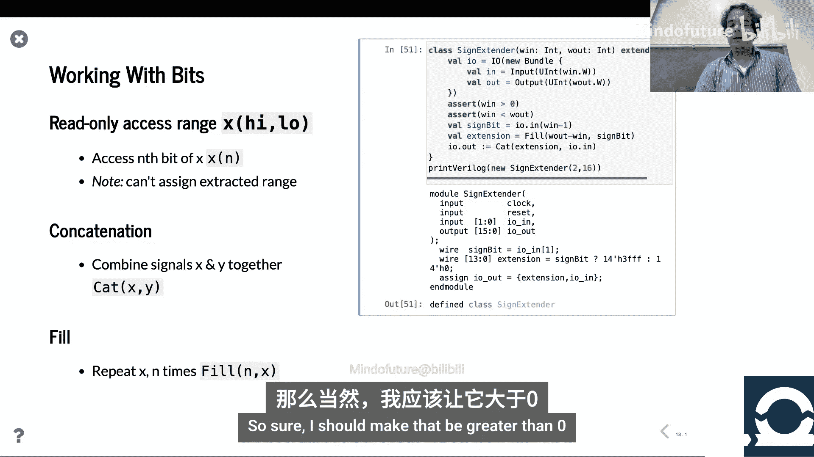
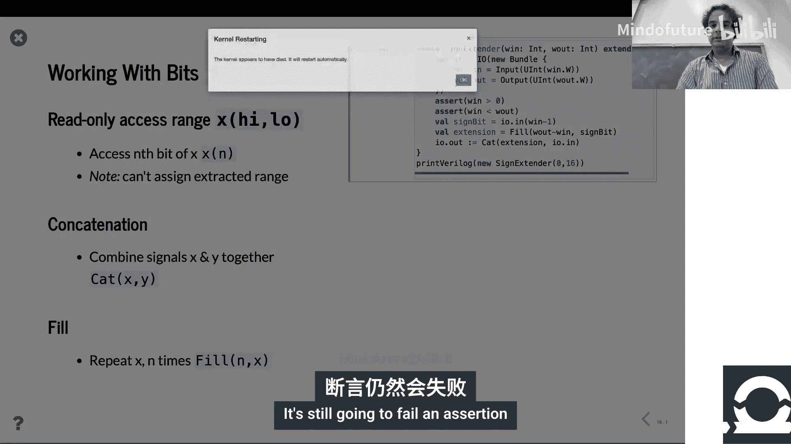
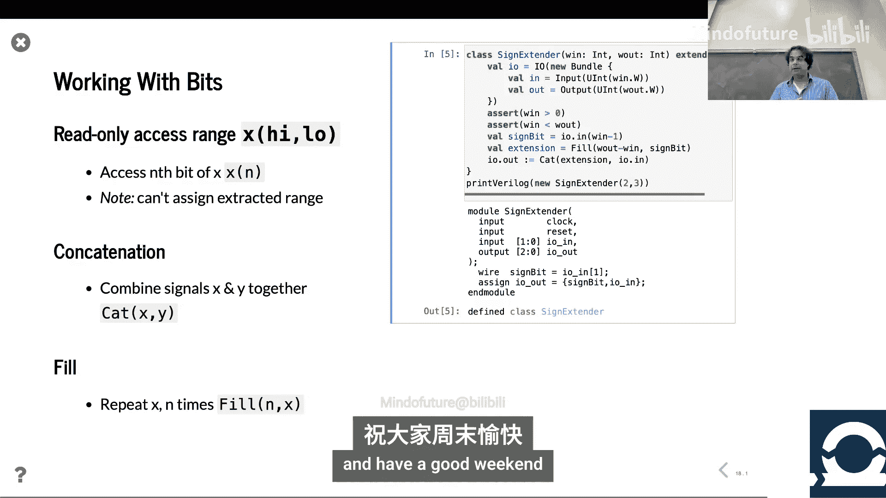

# 敏捷硬件设计：第3讲：组合逻辑

在本节课中，我们将深入学习组合逻辑在Chisel中的实现。我们将探讨如何构建基本的逻辑门、多路选择器，并理解Scala编程与Chisel硬件描述之间的关系。通过本讲，你将掌握使用Chisel描述组合逻辑电路所需的大部分知识。

---

## 组合逻辑基础

上一节我们介绍了Chisel的“Hello World”示例。本节中，我们来看看如何构建更复杂的组合逻辑电路。

### 多路选择器

多路选择器是一种根据选择信号在两个输入之间进行选择的电路。在Chisel中，可以使用 `Mux` 原语轻松实现。

**公式**：
```
output = (select == 0) ? input0 : input1
```

**代码示例**：
```scala
val myMux = Mux(select, in1, in0)
```
注意：`Mux` 的参数顺序是 `(条件, 条件为真时的值, 条件为假时的值)`，这与许多编程语言中的三元运算符语法一致。

以下是创建一个参数化位宽的多路选择器模块的步骤：
1.  定义一个继承自 `Module` 的类。
2.  在IO中声明选择信号和两个输入信号。
3.  使用 `Mux` 将输出连接到相应的输入。

### Scala类与参数

为了创建可重用的硬件模块，我们需要使用Scala的类。类可以接受参数，这使得模块（如多路选择器的位宽）可以灵活配置。

**代码示例**：
```scala
class MyMux(W: Int) extends Module {
  val io = IO(new Bundle {
    val select = Input(Bool())
    val in0 = Input(UInt(W.W))
    val in1 = Input(UInt(W.W))
    val out = Output(UInt(W.W))
  })
  io.out := Mux(io.select, io.in1, io.in0)
}
```
在这个例子中，`W` 是一个整数参数，它决定了输入和输出信号的位宽。

---

## Scala控制流与Chisel硬件生成

理解Scala代码（生成器）和Chisel代码（硬件描述）之间的区别至关重要。

### If-Else 语句

Scala的 `if-else` 语句用于控制**生成器程序**的执行流。它决定在硬件生成时创建什么样的电路结构。

**代码示例**：
```scala
// Scala if-else：决定生成哪种硬件
val invert = true
val signal = if (invert) ~x else x // 程序运行时决定，硬件是固定的
```
在这个例子中，`invert` 的值在程序运行时确定，并决定 `signal` 是连接到 `x` 还是 `~x`。生成的硬件是静态的。

### Mux 与 When

Chisel的 `Mux` 和 `when` 语句用于描述**硬件本身**的条件行为。它们会在生成的电路中实例化实际的多路选择器逻辑。

**代码示例**：
```scala
// Chisel Mux：硬件中的条件选择
io.abs := Mux(io.x < 0.S, -io.x, io.x)

// Chisel when：用于条件性连接，通常用于多个信号的赋值块
val w = Wire(UInt(8.W))
w := 1.U
when(io.cond) {
  w := 7.U
}
io.out := w
```
`when` 块通常用于需要根据条件改变多个信号连接的情况，它比多个 `Mux` 语句更简洁。`wire` 用于在模块内部声明一个可被多次赋值的信号节点。

**重要概念**：**最后连接语义**。在Chisel中，对同一个信号（如 `w`）的多次连接，只有最后一次有效的连接会生效。这允许我们设置一个默认值，然后在特定条件下覆盖它。

---

## 位宽推断与操作

Chisel具有强大的位宽推断功能，可以减少手动指定位宽的错误。

### 算术操作与位宽

对于加法等操作，Chisel提供了不同的运算符来处理溢出和位宽增长。

**代码示例**：
```scala
val a = 3.U(4.W)
val b = 5.U(4.W)
val c1 = a + b // “+” 可能截断，结果位宽为 max(4,4)=4
val c2 = a +& b // “+&” 保留进位，结果位宽为 5
```
*   `+` 操作符的结果位宽是操作数位宽的最大值，可能发生截断。
*   `+&` 操作符会增长结果位宽以避免溢出。

### 位选择与拼接

以下是常用的位操作：

1.  **位选择**：使用 `(n)` 选择单个位，或使用 `(high, low)` 选择范围。
    ```scala
    val bit = myUInt(3) // 选择第3位
    val range = myUInt(7, 4) // 选择第7到第4位
    ```
    *注意*：在Chisel 3.6.1中，不能将位选择（如 `myUInt(3)`）放在连接操作符 `:=` 的左侧进行部分赋值。

2.  **位拼接**：使用 `Cat` 将多个信号拼接起来。
    ```scala
    val combined = Cat(highByte, lowByte) // 拼接两个字节
    ```

3.  **符号扩展**：一个常见的应用是将有符号数扩展到更宽的位宽。
    ```scala
    class SignExtend(InW: Int, OutW: Int) extends Module {
      require(InW > 0, "输入位宽必须为正")
      require(OutW > InW, "输出位宽必须大于输入位宽")
      val io = IO(new Bundle {
        val in = Input(SInt(InW.W))
        val out = Output(SInt(OutW.W))
      })
      val signBit = io.in(InW-1) // 获取符号位
      val extension = Fill(OutW - InW, signBit) // 重复符号位进行扩展
      io.out := Cat(extension, io.in).asSInt // 拼接并转换为有符号数
    }
    ```
    此模块通过获取输入的最高位（符号位），将其重复填充至所需的额外位数，然后与原始输入拼接，实现符号扩展。`require` 语句用于在参数无效时给出清晰的错误提示。

---





## 总结



本节课中我们一起学习了Chisel中组合逻辑的核心概念。我们掌握了如何使用 `Mux` 和 `when` 实现条件逻辑，理解了通过Scala类参数化硬件模块的方法，并区分了Scala程序流控制与Chisel硬件描述。我们还探讨了位宽推断、算术运算符以及位操作（如选择、拼接和符号扩展）。这些知识构成了使用Chisel进行数字电路设计的基础，接下来我们将学习时序逻辑部分。