# 【加州大学】敏捷硬件设计-CSE228A-｜-Agile-Hardware-Design-Spring-2025-p05-P16_第4讲-时序电路--BV1M6ivBzESw_p5-

Hello and welcome to lecture four， so if you remember where we are in this course。

 we have so far in the first three lectures motivated the course。

 we have talked about eal logic in Chisel and so at this point you can basically do anything you can do in structural errorlog。

Today we're going to talk about。How do sequential circuits that is circuits with state， you know。

 things like registers。And then since this is 1。5 lectures a day in person。

 and the other half lecture are following this are going be talking about actually start going from what you can do in Fairlock to what you can' do in Fairlock or moving higher level and really taking advantage of the projections。

What you're going to do for circuits，1 number one tower registers， How do we do them in chisel。

 Show us some example ways of building a components with them。Build some state machines。

 and then in the very time we response seem the chater on slacklack about the lab。

 how can we see what's going on in simulation。 we'll talk about both printing and waveforms。Cool。

 so let's go fire up a notebook， load in the。Headers were set， okay。So registers， right。

 These are the way in hardware course， we data。 There's also memories as well。

 We'll come to those later on。 Registers or， you know， the more handy things。 So as we're familiar。

 right， we have a value going to register。If it's a normal positive edge sugar flip flop， that means。

Whenever this clock goes from low to high or rising clock edge。

 we take the value on the input and that becomes the value of the register and then from then onwards。

 register emits that output value。I can change this and put it other times。

The input and it won't change the output only changes if I know when lower values here around the clock system goes from low to high。

The rest of the circuitry here。It's something I've drawn to kind of give you an idea of conceptually。

What's going on， this is not a slight way it's actually built hardware。But we talk about registers。

 we talk about not just register holding state， but some other， you know， bells and whistles， right。

 you know， for example， what do we do on reset， do we have a reset value or what do we do if we want to have a right enabled So we can kind remind everyone what those things are。

 right， for example。And notice your input comes in here。 But using these mues， we can， you know。

 select what input' is going to be so。Let's say， for example。

 we want to register to little changes and we want to change I。e when it's naval， EN is one。

How do we do to set it up， well， if the n is zero？This box is going to select this。

 which is good to repeat the old values。 So kind of keep the old value register。

And so put the right label to one。 Okay。 then great。 then we'll pull in that next value。

And it's being passed on。 And is that all， Well， that we could have wired it directly to register。

But instead， we have this additional portion in between。We're had to possibly reset。

 so if reset is true。Instead of particular value， we want to put understood from the next signal。

 even the prior signal doesn't matter。 It initial value put in there。 no matter what it's the reset。

 So this is reminder of， you know， in the register。

 we have the notion of the right label which controls whether or not we change values and this reset which controls。

 you know， the ability the kind of set to a known value， no matter what。

And so not a register has all these pieces always， but I'm just kind of reminding what they are。

And so we talked about before in this class right that really as a designers and chip。

 we kind of see the value register both as input and this output。

 things like reset and clock are hidden from us right they exist， we see them in the very log。

But they're implicit， meaning they're kind automatically sented， automatically connected。

 automatically pass through our design。 And that's done because it's the common case。

 The common case is all blocks you would have in your。

Module are all on the same clock and always in the same reset Now， of course。

 there are times when you may want to have multiple clocks。Or multiple reset signals。

 And there's ways in chisel and I've linked to it here in the documentation。

To do multiple clocks or a different kind of reset called the synchronous reset。 But for this course。

 you don't need iderities。 I'm just putting out the for those who were veterans who want to see us as possible。

Cool， questions so far。Great， let's see how like she looks yes， Greg。し。That's a great question。

 so question is how do I choose which is belt the whistles and how do I accentiate that。

 that should be the next slide。So here we go。 So when you are the register in chisel。

 you have multiple ways of declaring it and at the end of the day， they all produce a register。

 just how much these bells and whistles are there。 And if you want to use the most verbose most bes and whistle laden register all the time。

 you can， but a lot of times you know not only just saving hardware。

 it's also actually just that you know code complexity。

 you actually don't need as other features and so。How is it work， Well。

 and chisel is stachiate register， you just say register， right， like I said before。

 when it boils down the chisel， you are instanting components and you are connecting components。

 That's kind of the entire ball of game。 Everything else is scholara code to kind of dip between no statements。

 But the other day， chisel is instanting components and connecting them up。

 So we instantiate this register called art。And then we connect you know。

 its input and its output right。 So in this case， remember when's connect operator lose colon equals。

 it takes the output of the right and connects it to the input of the left。

 This is not a bidirectional connection。So okay， yeah， So this output goes into this input。 Okay。

 In other words， the input to this module goes into the register。 And then， of course。

 same thing here， right， output register is not connected the input for this I that out。

 which is the。Output for this module。So great， how this look in Ver luck？Comes out the other end。

Here we go， so。This is very log for positive to your flipop， right， There is the register。

 Here is this always at block。 and here is the assignment。 So if you're not familiar with V log。

 do not fret that of course， is not in very log。 we use very log as kind of minus cells that's happening here。

 but can kind of talk about what's going here。First of all。

 if your learning very may be surprised to learn that Regdge does not mean register。

You can use register for things that are combinational or registers。

 and registers happens in very log when you。Use a read in a very particular way of an always block in the CAD tools infer to register。

 right， the synthesis。 And I mentioned the reason why this happens that way is because very log predates synthesis for hardware generation。

 right So made a simulation language。And then people are already been using it。

 people later learn on how to kind of backwards， you know， to out how to infer which there should be。

 and so if you taught very log， you're taught there kind of very idiomatic ways to right registers in particular red jar always at and then using the right type of assignment inside here。

😡，嗯。Alternatively， you know， we've seen the chisel approach， we dis instantstantiate Reg， you know。

 here's the hardware we wired it up， none this weird inference stuff。

 It is true in some very long design environments， you can also choose directiated register。

 So here it' UC Santa Cruz and our logic design course CSc 100。

 We have students directly instanttiate the flipfl register rather using this always app block。

 You don't need to always app block until CSc 125。 but idea is still there cool， we have register。

 We're off and running。😊，What if we want to kind of sp it up， right？ Well， we talked about this。

 Well， if I want to reset value in that case， I can instead instead of using redch。

 I can use redch in it。 And of course， the thing here。Is the reset value。See the very log。

 And then we' do a little tweak。 And now of a sudden。Reset hasn an consequence。 Okay， with reset。

 reset to 0。Otherwise there input is， we can easily change whatever value this is， right？

Make it to be set to one。Now， in this case， the chisel compiler is extremely clever。

And those that wait a second。If on reset， it's going to be one。I can now order it in there。

 So remove the F statement there。 So you can see there actually just some cleverness in the chi compiler all on do that for a second。

 kind I can appreciate that， but。😊，It's still all legitimate very。 Okay， well。

 what about these other options， right， Well， what if I instead。I wanted to use Regdge next。

So notice how read next。Not only gives us the reset behavior。 it also has， you know。So Reggne。

 I'm sorry。 Take all back。 Reggnx gives you to reset behavior， right， So you have a reset behavior。

It's there。It's also kind of handy because guess what instead instead of declaring input output。

The input goes in here。The output look goes here you know， instead of having three lines。

 it's one line， right， says you know， small little way to make a little tidier。And then。Finally。

 of course with Reginable， where we actually have the enable signal now using I enable。

And we see that kind of creeps in。Down here。嗯。Throughout these slides。

 Ive you know linked documentation so you can go ahead， you know， for example and say， hey。

 you know what is this particular flavor of regimentnet， oops you were still from the prior slide。

 But there we go。 Here we are。 Regt is you know the documentation created by Sald。

 who very similar to Java Dooc。yeah， you can see some information about it， some help as well。Cool。

Yes， question。結ること可い。The question is， if I create a register in chisel。

 and then I carry out the veryo log output。 will that always produce and always block I that the question。

 Yeah， yes， yes， that is the way an idiomatic very log to create register is you have these always blocks and you have the very log tool infer basically via synthesis that there are registers there。

 Now， perhaps you're in a company that doesn't want to do registers that。

 perhaps your company has your own special optimize， you know。

 awesome registers you want them to use thatll be a great time use a black box。

 So you basically make this chisel black box where basically you can have very log inside there。😊。

Inside that very log black box you put whatever code you use in very log disantiate。

 your magic registries， you know， probably going to some library and instant staating it directly with structural very log and then the chisel level。

 you can then just you know use that chisel module。But like I said。

 when it came to just being used in practice industry a lot of times。啊。

Sigchronous registers work for the vast majority of cases and the times is where they weren't the right choice was when you wanted a synchronous reset and like I said。

 I't going into all the details， asynchronous reset means the reset takes precede independent of a clock signal。

😡，And the reason why you want that is returning your chip on the clockman not be ready yet。

 So you have that ability to do that。 So it's a very niche real world constraint。

 not required for discourse。 but turns out between synchronous registers on positive clock edge。

 plus to ability to do aynchronous reset， which we link to documentation。That covers like 99。

999% of registers in industrial practice， but yes， in certain cases people have that really fast fl they need and then that case they can use a black box。

Cool， great questions。 Okay， let's keep going so。What might an easy way to use a register。 Well。

 what if we want to build a counter， Right， Count something， you know。

 we holds value and incr this way up。 And， okay， so how is this look， Well。

 there's some you know count value， some number。 And then with an signal， which when it's true。

 we add one each cycle it's true。 So how might we go about doing that， what we just taught you。 Well。

 we have a register。Count now all of this complexity。Is me trying to be clever？

About sizing this correctly based on the maximum value。

 So already this is our know v0 design for counter from and beginning。

 we actually setting a maximum value。And the reason why is we reach that maximum value。

 you want to count a wraparound。So that maximum value may not necessarily be a power of 2 It could be。

 you know，4 or something， or it could be 5 or something， right It could be totally arbitrary。

 And so we're figureiguring how many bits we need to hold that value。 So it， you know， log 2。

Even whatever the number is stealing， ground up in case he knows not power too。And great。

 so we have that ability to hold that The plus one's interesting。 So if I have。

AhEnough bits to hold seven。Really 8， if the maximum value is 7。

 that actually means they can hold count 8 things。 is 0 through 7。 So have to add one there。

 So this is a little wrinkle。 But okay， some logic you can calculate with。 We did it manually。

Whatever logic we have here。 Well， like we talked about a couple slides ago。

 to do all these various spells and whistles for our register， we have these various mus。 right。

 So next to value， well， if for below to maximum value。We can add one。You know。

 these mus is the first true case of the first one。

If count is greater than are more likely equal to max file。Then of course。

 we reset the zero wrap around。If someone apply the enable signal， great， then when ion is true。

 we increment the count or wrap around as needed， as the next file。If the enable signal is false。

 then wed just kind of keep the current value， we don't change count。And then。What about the。

Input to this register as itself， well， we added in one more buck。

Handle reset to set the zero on reset。 And so this is gonna to be a functional counter。

 You can see that the chisel compiler successfully， you know。

 took all these mus logics and rather than leaving these as muxes on the outside。

 pulled them into the always come block in the very log， but。😊，For now。

 you can my word the casinoino， very long is correct and it works。Cool。

 so I'm going to show you in the coming slides， ways to use more of these chisholm and sc contracts to kind of clean up this counter implementation。

any questions before I do that？Okay， let's see what we can do in terms of cleaning up that counter。

This is functional。 This works。 But， you know， it's kind of pain to keep doing mus， mus， Mos and。

Anding all these different cases， right， so。But what if we took care of that？

Reset issue with redge in it。 Right。 So in the first design， we have three muxes， right。

 We have one box to handle。 Re  one box to handle。The count En and other mugs to handle wrap around。

In the next slide， we're going to handle reset with re so we're to get rid of this mux。Okay。

 let's go ahead and do that， so we did that。Now we have re in it。It does the right thing。

It all kind of comes together there。こol。One person may ask。But in this case。

 we have one marks who had details reset for us， So very basically the same。Now， one person may ask。

 well， gee， what happens if I don't specify。The wood fear， right？Say the default value is zero。

 which is the reasonable thing to say。It's gonna to kind of work and where it breaks is it。

This tool is under constrained。F out counter， right， It doesn't know how big it is。

Because it doesn't see to maximum value， right， it sees。The other portions， right。

 and so we need to width in order to have it actually handle。How big it is because otherwise。

 without the annotation doest not know how big make that counter now in a larger design。

You may have other things in surrounding context。To give the inference tool。

For with inference information to figure out that with correctly， but。This counter in isolation。

 the tool is not no。 So this can kind of default to too small。 unless that's a problem。Cool。

Questions。Okay， so now we're down two mues。What else can we do？ And remember。

 if the third mugs kind of lurking inside her it's just， we didn't declare it explicitly。嗯。

What would if we did a completely different approach and use when？

This is a much more kind of programmer friendly way to write it right we can say okay over count。

Still using red in it for the reset value， sure。D for a ride Na， it's a one， right？

 And so what's nice about this。 Notice how。啊。When this case is not true。There's no otherwise case。

 and that's the whole point， right， really changing values。

When I owe that n enable is true and then yeah， I guess what， if we're below the maximum value。

 we just add one。If we reach the maximum value otherwise， then we just wrap around the zero。

And we can attach the output to discounts。 So this is， this is。

Quite civilized right this is quite nice。And I'll point out for those of you， you know。

Keeping track of choosing components versus scholar references。You may notice here it。Count。

Is a scholar reference， right？ It's a vow on the left side， a scholar reference。

 So it points to this register。 So， you know， if you'd imagine a diagramgg like drew before。You have。

 you know， count pointing to a register in chisel。And then you know these other statements here。

 for example， by putting count on the left and right。It's using that reference。

 but disconnect operations。Are adding， you no more connections between your chisel objects， right。

 this one， for example。hIs you know， taking on a chisel object for literal one？

Another of object for an adder and then adding the one to the current value account using a reference。

And then the output of that is being attached to the input of what count points to。

 which happens to be registered， right， now， it doesn't attach it directly there because it is nested when such chip compile pile is going to figure out the right combination of marks as we can see。

What do you have nesting down here？If you compare this slide to a slide  two slides ago。

 I would argue as a human programmer。 This is far easier to write and to read than the muses we had two slides ago。

 right， they go back to these muxes。This is functional， this works。

You kind of trace through it yourself， you kind of think， okay， wait， you know。

 the output of this mug is passed into this mug， the output， you know。

 this mug is passed in here and you're kind of traing through it， it's a lot of work。With the ones。

 you have some nice structure， it's easier to read， easier to write。

 and we're getting basically the same hard that end。

 And instead this is a fully parameterized counter， I can change， you know。

 this countervalue no problem。Still works， it changes。The wraparounds right here。Cool question， yes。

That is chisel， great question。 So log2 seal is a helper function that comes as part of your inputs with chisels。

 so you may remember。You know， I gloss over it in the labs in the lectures where we have this kind of this birdp we do and so yeah。

 this is pulling in a lot of stuff for chisel。This stuff is setting up。Scacala inside of Jupiter。

 which is not normal。That's that portion。Scall inside Jupiter。 this portion。

 you'll see in a lot of chisel designs， depending on chisel design。

 you may not need to have every one these in。 I kind of include all them out of safety。

 This one you definitely need to have。 I think log。The seal is probably inside dot U。

 That's probably why that one is there。Chsel tests are the seen we use testers。

 you can write chisel about testers。One particular test we like to use is the raw tester。

And rather than writing， you chileest raw test through do test。

 you may have seen some of the slides I just write test because I import it directly。

Charless also defffiliation， you'll see that later today， but yeah。The peak poke， Yeah， exactly。

 J'll tested the peak poke stuff。 So I think maybe in about a slide， if not， two slides。

You're going to see me use a test and that test block， email though just says the word test。

's actually from chisel test。😡，And that's what that long import is kind of pulling in for us。

Great questions。Okay， so here's the when。 I think this is a nice way to write the counter。

How else could you do it。 Well， I told you about this ret Na and guess what。

 It can kind of be like two mu of them one。 Like I showed you。

 I can handle both the reset and the write a enable。 So of the three months of had originally。

 that handles two of them。The third mus， of course， is the wraparound mus。I put it all in one line。

 I was showing you yes， you can write this all in one line。 it's a pretty dense line。

I'm not endorsing this， I'm just showing you it's possible。And yeah。

 you can see the okay kind comes together。 In this case。

 we pulled the width inference into the output port。

And even though the register itself and specified that chisel on So kind of figured it out。

 You know what this register is attached to something set with。 I'll make the register match。

So that's why that works out。嗯。But yeah， I would argue this is not ideal deal。

 I prefer the ones part of this course is kind of looking at what it is to code choices。

 These are both functional， correct code。Which one's better。

 And I think this one kind of makes the intent more apparent。This one， yeah。

 technically it's fewer lines， but I don't think that's easy to understand though。Cool， yes。反回。

Well the Reg enable， despite the name， is both an able signal and a reset value。

 So it's those two things。 that's why if we go back a few slides。

I kind of showed you this mental model register。 This isn't quite necessarily necessarily the way it isn't hardware。

 but conceptually， this is very accurate。 You can kind of think of the right enable。

And the Re says kind of two mues in sequence before you get to the register。

But in the actual hardware， the synthesis tools and hardware tools may choose to do it differently。

 Some hardware families have different registers in sta shade depending on how you're using it。

 Other ones don't。 that's kind of you know， below level deal for this course。 But yes。

 that's all possible。过。So here's that test we're talking about， yes。

 this test has this nice concise name because they have that imported earlier。

So this is a test of the counter and this is an exhaustive test， but what do we do， well。

 we say want a counter with maximum value 3。Turn on the enable。And say initially coming out of reset。

 yeah， it better be zero。Now， one thing you've not seen yet is this next thing。

Where we advanced thesimilation by one cycle before we had all these test cases。

 that were pretty combinational。 We changed the values， and then we checked the values right away。

 and。Unbeknownst to us， the simulation environments actually。Exe that。

 So makes commercial signals appear to take， you know， zero time， right， They have。

 They have their input immediately changes the output combination。 There's no delay there。 However。

 clocks， that is something's intentional， right， You know。

 register only changes value in the clock cycle。 And so as a result， you know。

In order to actually change it， the one the next cycle， we need to actually have a clock cycle pass。

Okay， that's the one click goes by， when enable on， that were one， that were two。

 then we each of three， the maximum value we said we should。And then we turn off the enable。

 so it save at three。Then me turn it back on， Let me see the wrap around。 cool。 And as I said before。

 these test cases， right？When it executes normally and there's no issues。

 it's silent and right the reason why is you're supposed to have many you know unit tests。

 they all run， hopefully they're all green and anything goes through and if they one of them fails then we want to know let's say。

 for example， we change our maximum value into two well then our counter better not reach that value three right that's what we're going to see right we're going see you know。

😡，I owe out 0 to not at mat 3。 that's because when I got to two， that logic wrapping around。

 kicked in and grabbed it around back to 0， rathering and let reach 3。 Likewise。

 I'll say a change in maximum value to 4。And that was different problem， right。

 where we had wrap around。With this test case。However。It's wrapped around too soon， right。

You may be thinking this test case looks extremely brittle and that would be a correct assessment。

but then it's okay for today， right is this kind of course， right， get something working？

Move on and then come back when we need to fix it right。

 and come back when we need to fix it is yeah， wouldn't it be great if our test case was also parametermettriized。

 think could you know match whatever， you know， maximum value counter has。

We'll do stuff like that coming to lectures。 But for now， you can very， you know。

 it's a lot tedious work， but you can do it。 You can write out all the signals spectrum re recycle。

 and technically。You're not required to run motorcyclecycl。 I， I can only include， you know。

The pokes， when they change。And that should be sufficient， yeah。

So only need technically change these po when they diverge， but you can see what copy paste。

It's probably easier to just include them always for for bothness。Cool。Question， yes。Yes。

Great question， so clockstep seems to go by one cycle， can I do any other units？Yes。

 those units need to be positive integers of number cycles so you can't do half a cycle。

 the environment we're using the assimilation for， there are no semantics for anything of final grand la cycle。

 commercial logic is instantaneous registers take a cycle。😡，There is no other。

Differentiable units of time available。 Now， if you're writing pure fair by yourself。

 this is exactly the same right。 If you're writing pure conventional bear log is effectively instantaneous if you are。

They register us to take a cycle。 Now we're in a very log。

Starts to kind of show some differences or things like a negative clock edge。

These are problemss you as registers。 so not can see that。

 Another place where like might show this is what if you have a latch rather a register。 Yes。

 you can do latches in very log Mo design house with they're a very restrict one， you can use them。

In chisel or not built in， if you want to put them inside of a black box you can。

 And then some a little wonky。 The third time in very log is in very log， you can put this。

 you know percent specifier or there pound specifiedifier to have an explicit delay。

That's as simulation only construct。 That's not a。Sypathizable construct that's that delay parameter it that delay parameter。

Is because it's not sim sizable。 it's not a chisel。 so yeah， so chisel simulations。

 everything is going to be。啊啊。In the intergens now。In this case， let's see if we can't。

Be a little ambitious。And。What if we step by a couple cycles， right？ So if I step by2。

This should be two， by then。And the answer is yes， right， because yeah， I let alone。Yeah。

 so whatever're going to we put in here is number cycles。 I can do zero， I guess。

 and say it shouldn't change。But by default is one， I'm I need to write it。Great question。

I can unbreak my test case， there we go。Cool， other questions。Great。😊，Working again， cool， okay， so。

We've built a counter。AndCory capital are， we've built a counter。Different ways。

 we've seen this kind of register construct and practice in the day。We say we want to register。

 We declare it。 We wire it up and these different nuances of red， wt in it， reg next， redge and Na。

 Those are just ways to kind of get some of that stuff in terms of reset that right Nas included for free。

 but。You know， artt is strictly necessary just a way it could go a little bit more concise。

What else can we do？ Well， working our way towards the state machine。 So for a state machine。

In addition to having registers Der code well structured， we're also going want to have enums。

 or in other words， enumerations。 It's a way for us to。Assign human chosen names to numbers。

 So that way， in the code， rather than saying， you know， this register is value 2 versus value 3。

 I can say this register has value whatever state I care about versus state A versus state B， right。

 And so in chisel， the way I do do is something called a chisel enum。and。

If you're looking around documentation， some of these names are all very similar。

 I try my best on the slide to differentiate them， so just leave them as the construct to use。

If you see very old chisel code， you may see enum， that's the prior way in Chis will doing enumererations instead such language is constantly evolving。

Likewise， in Scallet is stealth。Not in j or something called enumeration。

So Chiivli nu is the magic one， if you forget， you know you can use this link here and go read documentation。

Here we go。And so what do we get？It's a little bit of boillate code here where yes。

 instead of classes object and extends。Technically， this is using object oriented inheritance。

 We haven't covered inheritance yet。 So for now， you can think this is kind of simple to play code。

 but basically what do you do。They all the en values you want。

You put them on the left hand side of equal sign with comma separating them。And say value。

 What is this value， This value comes from Chile nu。

 If you want to set the value to particular number。You can't， you can't assign。

 you can have multiple ones per line。That's all possible。 And so what do these turn into， Well。

 these information values turn into Us of the right size to kind of hold the maximum value that E so。

I kind of see how this plays out here me a demo email with you know， name， name， name， B， name C。

And name D， right， And name D' saying to5。 we can see。Sa with two string methods。

 we can see how plays out。Name A is 0。 Na B is1。 Na C is 2， and could have told it to name D。Is five。

 right？And so yeah， this is kind of an email down system just a second。 But for now。

 you introduce this boilerplate on like I said AB U。Pfer。To write this loopops， let me write it out。

You know， and then thou。你逼。This should also work。Yeah， no problem， right？

That's one of the things whenever you have enums right as a hardware designer。

 a lot of times you don't care the number value is and the reason why use Eum is rather having this risk of your code of you know having this magic number floating into code。

 okay， you have some comparison it two comparison it' three and you change you change in all places。

😡，Enum， right， single source of truth。You define E number one place。

 Everyone who uses that Eum can then be in sync and that way， and you change Eum。

 all the users would change at the same time， right， And so a lot of times。

 you really don't care what the value is， and you can just let it use value。

 Sometimes you have a certain number you want。 So sometimes you may use an Eum， for example， to。

Part something's already known。That's a helpful thing to do。不。Okay。

So let's now build a estate machine， right， we have。Register is we have enums and label our states。

 less field a finite state machine。 So here is Santa Cruz， of course。

 our unofficial mascot is the raccoon。 It is just my opinion。 because， of course， being a slug。

 And so what do we have at the raccoon。 Well， this is the behavior I made up first a state machine。

 So by default， you know final state machine， we have this notion of states right。

 So four possible states。 And these states are also kind of outputs in a way。

 So know what is the action the raccoon is doing is either hiding wandering。

 rummaging or actually eating food。😊，You to find the same machine when you see a blank arrow and just one of them。

 that means invested default initial state， right， So it tells us， okay， and the same machine starts。

 we' can start in the hiding state。Because thatoon here is no noise， so not noise。

 it's going to sneak out and start wandering around。The man is to find trash。

 that's what the know of these arcs anday machines are。 If that condition is true， you change states。

 You're going go rum through the trash。 We find food。 great。 We can eat that food。

If I don't find food shocks， I'll go back to wandering again。at any point we hear noise。

We're gonna go back to hiding， right， We're gonna go hide away。 So this is， you know。

 a fourth state state machine for raccoon。I think it's be helpful to kind of draw this out by hand first before you go ahead and code it up。

Okay， let's， let's code it up。Well， we can do that， so we have our enum。

So we can now assign names to these chisel states，ccoon states right our Iraq action。

 what's it doing well， Chiselum， so it' either hiding， wandering， rummaging or eating。

The actual state machine itself。We have the inputs for， you know， noise， trash and food。

 and then the output is whatever action we're doing， right， which is one of these， you know from Eum。

Now our state is a register， right， essentially we're kind of keeping persistent over site time。

And we use the init field right to kind of that default coming out of reset to be the hiding with state。

 Okay， so we're the Hy state。So you can see we can refer to these enomes if you know。

 the object name and then dot hide， there is a way to include。The internals removed this prefix。

 but I think it's more clear to kind of have that more of her both name。Okay， what do you have。

 who when， okay， if the state is hiding？What do we do well？As we go back to the slide。

 remind ourselves， okay， in hiding。We're worried about the transition it cause us to leave this state well。

If there's no noise， I go to state wander， so yeah， hey， if I'm in state hide。

When no noise state changes to wander。 So notice how inside this case here， there's no otherwise。

 right， So the otherwise is implicit in to sense it。If I don't change my state。

 the state stay is the same， right， That's what the wind does for us。 So without the bother saying。

 you know。Current next equals old state default。 No， it's already handled。 right。

 If I didn't change state， saving we maintains this prior connection。

 That one nice thing about registers， yes。你还。啊。Great question。

We're going to try it out because I don't know exactly's going to happen。 We know it's not good。

 So the question is， if I didn't use rech in it。How of the break， Let's find out。嗯。So first。

 it needs a type， right， Okay， so type should be。Rack action。It spooked about the。

So what if I know that rack action should be a UN？And see if I can trick it。It is too smart。

 So you can see what the compiler is telling me is， hey， hey， hey， hey， you have a U int。

And you're trying to assign that to a rack action。 That is not a rack action。How dare you。

 So now I'm going to try and use the rack action dot type and see if that'll work。

There is a way to do this， but I'm actually not sure if I'm kind of having fun with this。

We're going to try get class， it's probably also going to break but。Yeah， okay， I have homework。

 I will post this on Slack。What the answer to this question is so what could happen。

 we even wrote an notebook're read it， Okay， so notebook is self broke， but admission to that。嗯。

What should happened， Well， independent of Chisel versusvelo。If you don't set the be register。

 its's values unknown， right， That's always kind of the case， right， The value it has。

To be totally arbitrary。 So if we don't know its initial value。

Which of these clauses applies to it is a little bit dicey because there's no initial value， right？

You can imagine。With some really clever theory， maybe you have some sort of very complicated set logic such that Inal values。

 unknown， somehow to conver of some known state。 that could happen。 But in general。

 it's good practice， too。Have registers again to known states most of the time it's accomplished by reset signal nor reset value。

Sometimes。It's just because the register has an input。 input has a known value。

 The input has an known value。 Then that gets the register into a known state。Yes。

 Ill like figure out how to。Declare the redge by itself without using it in sense of the。

Dot high and I'll post that on the Slack， Good question。Other questions。

I can keep talking about the rest of this schematic here quickly。 Right， So we kind of see， okay。

 state is high。 I do that。 You know， if the state is wander going back a slide， right。

 we had two exit arrows，1 for noise， one for food。So notice how I say one noise， yeah。

 we changed to hide。Else when。If there's trash， we go to run edge and so。

The weight this logic is written。 There's actually kind of in a precedence here， right， I'm saying。

Noises the higher precedes and trash。 Technically， if your pur is going back to the prior slide。

The way the steam machine is written。It is ambiguous if both food and noise is true what your next state should be。

Right。Because they're both valid solutions， you're looking be in one state at a time。

 if both food knows are true where should you go？This day machine underspecified for today。

 I'm going to kind of wave some magic hands and say， we can assume only one input is true at a time。

 So either only noise， only food or only trash and dust。That's scenario that can't happen。

 But if you're purist， yeah， I'll readily admit that that's under specified。 But yeah。

 being past fits together， right， Whens， nested， else wins。This is totally reasonable code。

 I did a little bit of extra spacing to try and make something things easier to read for the formatting。

Of course， the output is about as register。Yes， we've very logged down here。

 but you can see it's you know， a lot。The railway hole is kind of internal muxes。

 that's how kind of gets mapped out and there's of course is the default settings and registers。

 but that's not important Ive focused on this。Other questions on the state machine implementation。

Cool， okay， so let's see how else we might choose to write this。嗯。Well。

 what if we use the switch construct， So switch is a sca construct that is similar。嗯。rightSo back。

 switch is actually a chile construct that is similar。To which you may see in their languages。

 Scala uses match normally apologies。 So switch actually from Chi not from Sca。

 but it does what affect too right， I can say switch on the state。

And then what is the state currently， if the state is high， then this block occurs。

 if the state is wandered， then this other block occurs。 So yeah， using the switch statement。

This is a lot more tidy， you can also notice in general， right， by using this enum。Things in general。

 a lot more tame， right， we have the state names being clear。

 The next statement name is being a lot more clear。

 since it's much nicer code and having like raw numbers。 remember， okay， number two is this。

 Number3 is that。U， right， kind of keeps things all tiier。Cool， yeah， I can print very log。

 The B is gonna be not exactly the sameca the way chile maps sings， but。

Performance wise is indistinguishable。Cool， other questions。

I took a time to re handwrite a test case， and so it doesn't quite jer every arrow。

 but j of a lot of them can kind of traced through it。Yeah， hey， so if I originally have noise。

And I'm inde。 I' gonna expect。To a clock step goes by。It better be hiding， right。

 reckon you should be hiding。 Okay， then I remove the noise。 Adv time now moves on to wander。 right。

 That's right， then。I， you know， set trash to true。Avanced time goes into rummage。Then I， you know。

 turn trash off， turn food on Adv time it goes to eating。I， you know。Leave food on， it keeps eating。

If you go back to the diagram。You'll notice when you're in an each state。You basically。

 there's no food arrow keeping you in here。 It's more just you're only gonna leave on noise， right。

 Okay， so only gonna leave on noise。And eventually there is noise。

Time goes by and we'll go back to hiding。 So yeah， this， this checks out。 This is a manual test case。

 We'll talk about all quarter how to kind of write test cases in the way that's more programmatic and less。

 you know， manual， less error prone。 But it's going to kind of have this。 right eventually。

 to a point where you have a module in a test case and two of them working together。😊。

This is kind of a modality're going to have most of the quarter right where we're going to make hardware generators and then interact with them in simulation with test cases。

 Now， of course， in other scenarios， you'd probably make hardware generators and pass it on to a CAD tool to get turning into the physical hardware。

That's a great thing to do。 The on the scope of discourse。 Of course。

 mostly what's called front end design， writing a generator， test insurance。

 right and that kind of stuff。 The physical design optimization is obviously extremely important。😊。

Couldn't squeeze into the quarter。Other questions？I should I should put a asterisk on that。

 I will talk about should acceleration for performance as the quarter goes on。

But we won't be using AsIca tools， that's a very better way to say it。Okay。Cool so we just had。

 you know， these test cases and， yeah， I mean， ideally， your test case passes。

 there's nothing to look at。 But what if you wanted the bucket。

 We had this question on Slack just last night。 What else can we do。 Well， what peakpot tester。

 It's not obvious， but believe it or not under the hood was happening is the environment is taking truth of the design。

Insttaniating it in simulation， running your design and simulation and then using whatever stuff inside your chisel test to。

 you know， prod your design， right， So， you know， when we poke signals are sending inputs。

 when we piecess looking at outputs and of course， expect is how we。Look at things。

 there's also the ability to advance time。So how else can we interact with our design？

You have two ways of going about kind of seeing more from redesign while stimulating。😡，One。

 most to print statements， you know a lot of people are print after buggers。That is possible。

 One thing that's really nice to my hardware I encourage those who have more of a softer background to try embracing this quarter。

Is waveform。 So， you know， you do print statements。 you a human are saying， you know what。

 I want to print this particularicular value。 maybe put constraints on it。

 I want to put this particularicular value under these constraints。 So I put a statement around it。

 with a waveform， you get all values for the entire simulation。

 So it's cool about that as you're debugging。 you run simulation once。

And you can trace your way through the waveform， so you're can of navigate in that waveform。

You only need to installation at once with print F debugging， typically you put a print f in there。

See the value and like， oh， that's surprising。Well about a another value。

 you add another print statement， another simulation run and kind of repeating， so。

Wavforms are typically a better practice to use for hardware design。

 but guess what there are some times the prints are really handy， so we teach you both。嗯。

And whether you use print statements， waveforms or both。

 remember use for debugging when it comes time to running the test。That test needs to be automated。

 right， what I mean by that I we don't want to have someone who says， okay， yeah。Run a thing。

And if that print statement on the fourth line says 15 is correct。 Like。

 you don't want to hear someone say that， right， because that's maybe okay。

 when you're developing initially debugging initially。

 But you want to put that logic of knowing what to check and what the right value is。

Into a test case， test case is both an input and expected output。 And you won't put that。

 that intelligence， that insight into a unit test， right， So in this case， a chitel test。 And so。

Your chill test can check what's correct， Right， So it's gonna be， you know。

 those inputs and then the expected outputs and they sure they match up。

The stuff of Prince and waveforms that's only for debugging。

 it's only making sure we just kind of check out。So let's kind of see these two things in practice。

So for printing。Technically， you can print in two different times。 You can print in Scala。

While the design is being generated， It's not simulation。

 It's why your hardware generator is running， you may seen this command array race。

 It print line command。So yeah， you know， as you expect， takes the string。

Print it out to the console。Scala has a little bit of extra flourish。 It has string interpolations。

 So if you see these in python of an F， it's very similar where you have to delete to kind of。

 you know， marked this string has starting of S。 And then inside there with the dollar sign。

 you actually can include variables。 So in this case， for example。You know。

 I have my Val4 into the string。When the Prince I was actually gonna to say， you know。

What my vow is and actually even call a method on my valve。Now， if I just omitted that S。

The string is now just a raw string。So now I get。You know， the rock contest of the string。But yeah。

 if youve seen it in Python F strings， this is very similar。

 this was called string interlalationency， more broad concept。Cool， okay。

 but now how about the print after bugging， I was promising a second ago， right。

 So if you want to print。During simulation。You use print F。 This is a chisel thing。

 This is not in Sca。 So how does the work。 Well， much like the original C print F。

There's a former specifier string。And then if you have any， you know。

 variables you want to substitute in there， you got to use this weird， you know， percent syntax。

 you've seen this before。 In this case， percent D means print an integer。 and then you give it that。

 you know。Argument as a， you know， comma separated list of arguments。

 This is very much like classic printf。嗯。If you know Steve is very familiar， however。

 you know you might take a more modern style and once again， adopt interpolation。And yeah。

 we can do that too with chisel。 So actually， we can interpolate the value just fine if you use a P。

 so。That was something someone in Chisel's side chose， you know， for printf， you know。

Interlation string。Yeah， so this is not normal scholar is for chisel。 but yeah。

 if you want to use this printf with the interpolation style， you can。You know， include raw strings。

 as well as the variable to be substituted。 And so we substituted。Ad simulation is running， right？嗯。

Here we have a counter from before。But I wrote it using the。When syntax， sure。

 And I checked in a couple print statements in there。 So now if we set this up。

Next slide go ahead and run it。What happens？Okay， well what do we see。

 well Ive told the run for five cycles， we talked about the a second ago。And we see， you know。

 in to 0， and to 1 and to  two， rapping zero， in to 2。And grain is 0。 Okay， so what do we get well？嗯。

That's the fault of my test case。 So for those of you who are paying attention。

 you like said incrveing to0 seems a weird thing。 right， If I go back a slide， like wait a second。

 it says 0 twice。 Why say 0 twice。That's actually， I would argue， a confusing use of English here。

Incrementing from might be more clear， right， in which case。What do we get。

 yeah incrementing from zero， incrementing from two， incrementing， et cetera。

And then now my zero is misforatted once again， print after bugging。

Tends to lead to multiple executions as always。 So your I constantly running and tweaking my my setup up。

 But there we go， okay， that's perhaps more clear in commanding from versus rapping。But yeah。

 that worked， we did the printf， this is kind of the old school style。You know。

 maybe the interlation style is。You know， more friendly。

So I got E seem being kind of rerunning to reevaluate this model that change this code。 and then。

 you know， you run assimilation。こ。Questions。Cool， so yes， that's how you print stuff。

 So then what about wavefors。Let's do a wave for him， so。

We got a slight tweak to the arguments to as simulationimilation。

And for nagging to to this boiler plate。 But this is turning on waveform。

 So for those unfamiliar with this term DD， that is short for value change dump。

 That is the most common。Format use for waveforms。There are other much better formats。

 but BC is kind of classic economical one so。We have it in a lot of places， so if I run it。

Looks the same。 What happened Well， deep inside。A folder， it has a dot BCD file。

I have already in advance of this lecture on the prior fuion。Drop that folder。

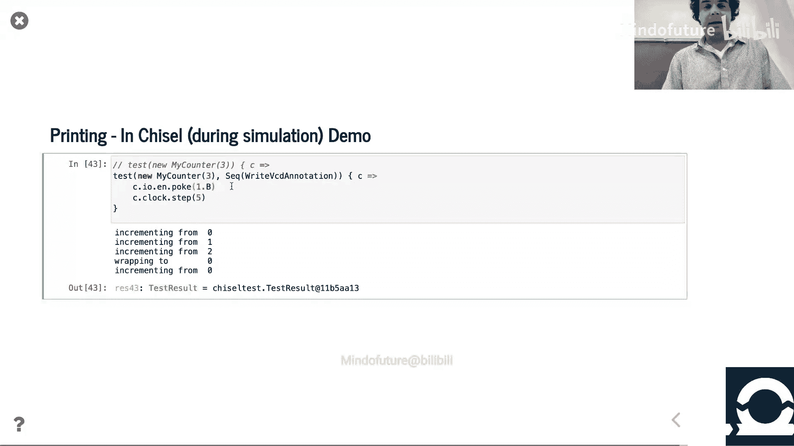

Into a waveform viewer。 So waveform viewer course you see a lot of these， for example。

 hearing courses。since youC 100， you've seen the thevado environment。In CSC 125。

 people can correct me in the room， I imagine you're using this ones just surfer。Yeah， yeah。

 so doesn't love surfer I twin surffer。 Sur is quite new and it's quite good。

 The surfer is a open source viewer。 This is actually literally running in a browser window。

 There's a way to download a native app。 There's a lot of away from viewers。

 There's classic ones called T T K waves。😊，On Mac， there's one that's。Outdated。

 but still somehow works even on arm， called Scanian。There is a few other waveform viewers out there。

 there are waveform viewers that are built into VS code。

 there's even a waveform viewer that can run inside JavaScript which you used to use inside Jupyter notebooks。

 the reason why I'm not writing that here in this lecture is because the is kind of whack。

It's not quite the right CSS， but otherwise it's fine a lot of choices Okay。

 so how do use the awayform a viewer， I already load in the file so you know did this correctly。

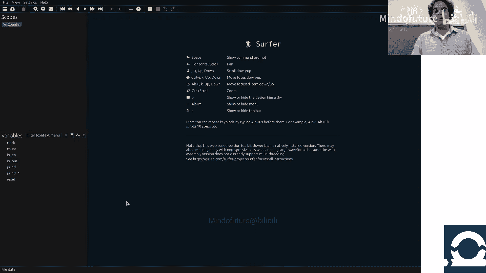

To load the file in。

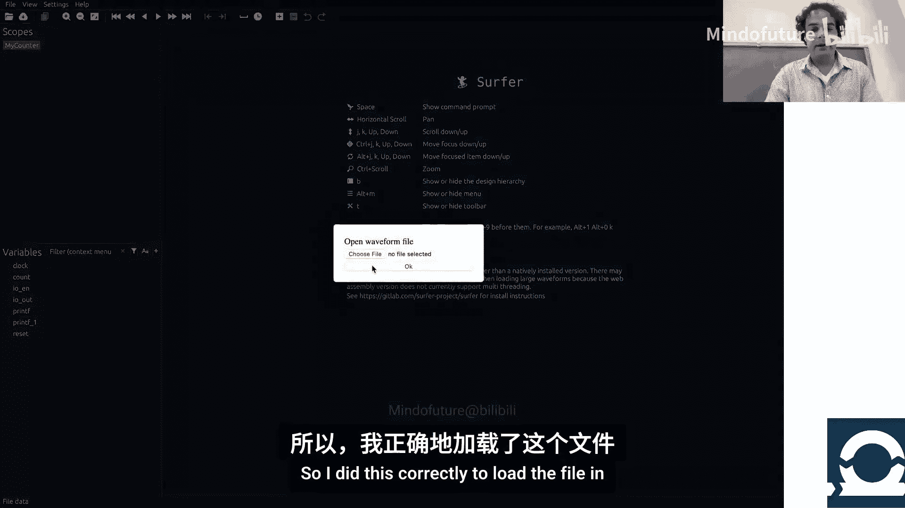

And you see， well there's nothing here， well， there's actually this object。

And it has these internal fields， right from like the clock。

Now you can see the clock valid varying over time。So interestingly。

The waveform viewer has decided to。You know， associate time with this， I mean， yes。

 desimulation has a clock signal that changes。But the fact it has a certain number in nanoisesecond is complete arbitrary chosen by a simulator because we didn't actually specify by time anywhere。

Sure， we have a reset。

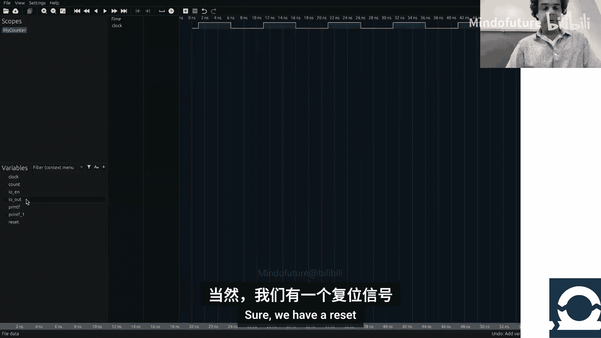

Put that in there we see that we never in our test bench， should I go back a slide？

In no place did I set the reset value。But by default， this test bench will。

Start simulation and reset on and then turn off after a cycle， and that handles a lot of cases。

 Sometimes data it is not what you want。 Sometimes you want control manually， you can poke reset。

 No problem。Um， but yeah， that's what we just did cool， so we have our， you know。

 clock and our reset。

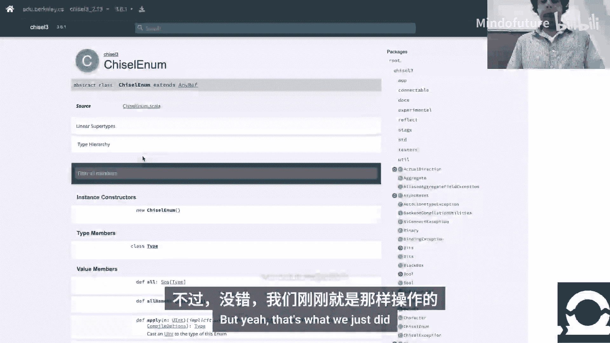

What about the count value？There you can see it， right， you know， initially it's zero。

Maybe she'll turn on the enable。Maybe we'll move that up a little bit。Yeah， so you can see， okay。

 turn your na on。And guess what？When the next rising edge ands one。We add one， right。

 Next rising edge enables one。 We add one to get two。 Next rising edge。Enables one。 We get 3。

 and then。Guess what the wraparound occurs。 And that happens。 So those are the main values here。

 Tenically， you know， I O out is the same as count， right， We saw that。

 And I actually don't know what we're gonna to see in the waveform for these print statements。

 It might be kind of gross。Or nothing， so I wouldn't worry about that。Go。😡，Questions on that。Yes。😊。

The the。

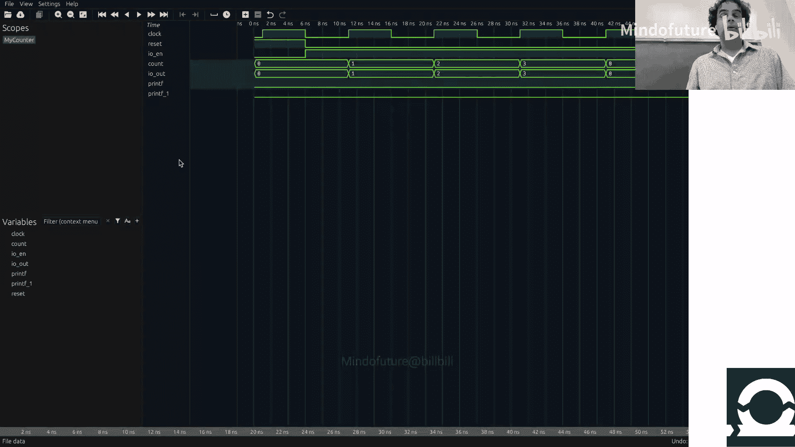

Good question。 I hi back to this gross， but I should actually show it to you。

 So teach the controversy。 Allright， if I go into my terminal。😊，Where this is running。

I am currently in lectured 4。I folks see inside my terminal。Of all the things going on in here。

And yeah， almost we're already posted， by the way， so they don' need to have those tabs there。

What do we have？We have the Jupyter notebook for this。

When I'm running things like generating error log or running other stuff。

Those very log emissions create， you know these various files， you can delete those， but okay。

 in test runer。Every simulation I run creates a new directory。Which is a little bit， you know。

 annoying because they're all you know， and they're basically tagged and its like shoot。

How to find the right one， depending on your environment as a way to go in and set a flag to have it keep reading the same test records that way you can always know to find a files。

 Let's say I didn't set a flag， so。

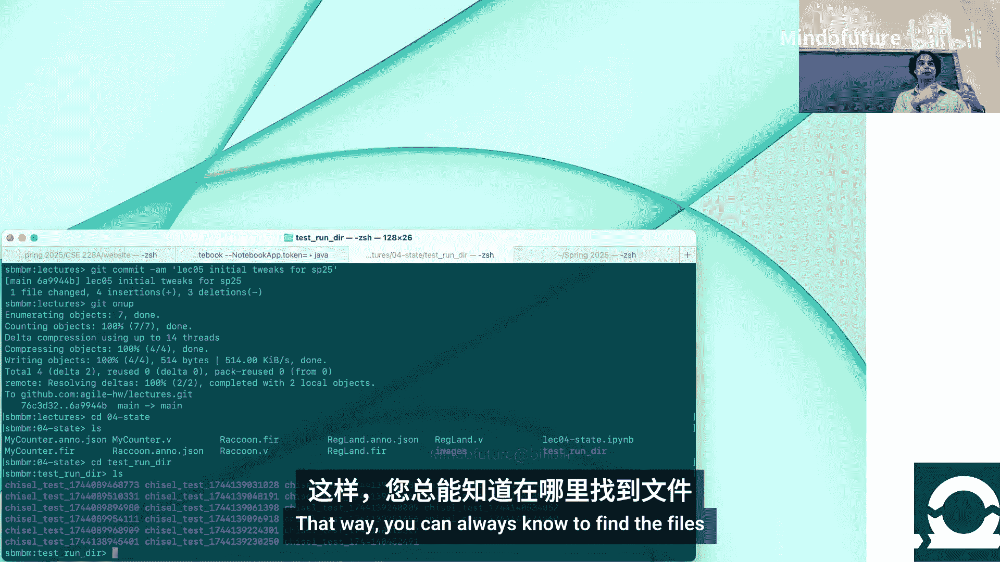

I don' know when to run。 Well， I can look at the timestamps and see， yes。

This is the one that's the one most recent。So then I'll go to that one。And you' great。

 there's a BCD file。Now。How might I get this complicated path into。

The window we just were looking at。I'm going to sheet for that。 I'm going exit full screen。

I'm going to say choose file here。

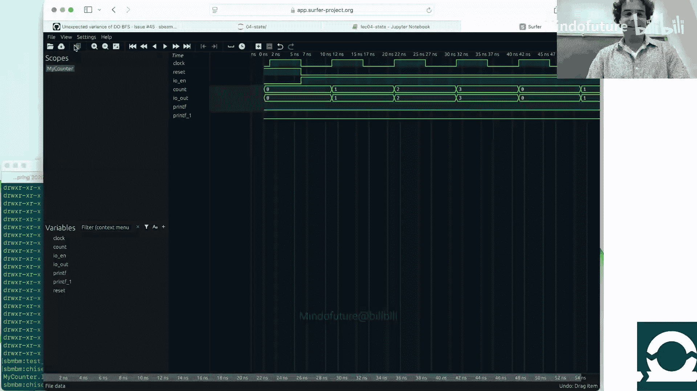

As yeah， I already had tro previously。 But let's say I didn't know that on Mac。

 One trick you can do is open up the folder。And then。This drag it over。

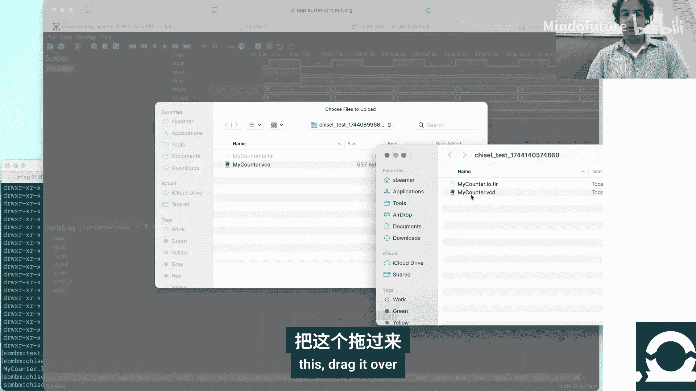

So that time， we change the structure I in from one from right now as opposed to last night。

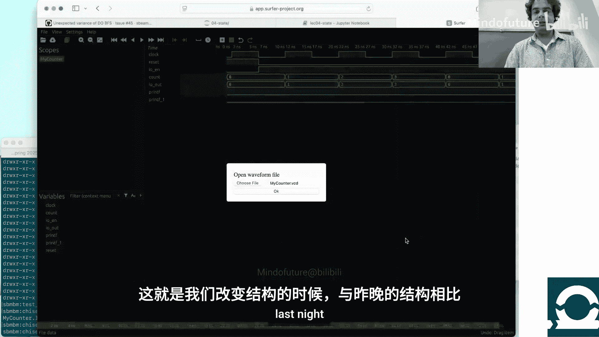

Loaded in and yeah， now we're cooking again。And can load in our clock again。

Actually I want to show one other thing I think was a good thing to just point out a second ago。

 So I was talking earlier about the timing specificity。啊。One nuanced detail。

 So chile test in particular case is not anyhow specified。

 You can see different things were mainly changing， things like I and Na。

Its happening on a half cycle phase， right？So that way it makes it more clear people reading these waveforms say。

 oh， yes， this changed before this clock edge， right， but that's not a strict requirement。

 It just the way happened to run the simulations took their time。Co。Other questions？

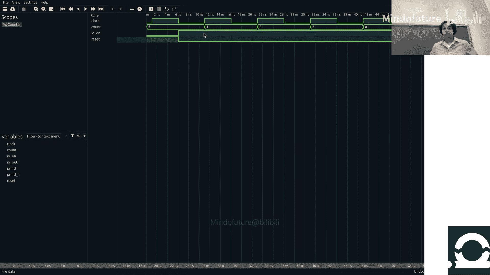

I think that's almost it。 Yes， so one of thing comes up a lot when you're trying to write more sophisticated tests is you often want to have bigger and bigger numerical literals。

So you've seen already in lectures how we have， you know， dot u， dot S， dot B， the cast， you know。

 U went Scent and Bo。But。You also can do things with the spacing as well。

 So rather than having everything be a decimal。We can use strings， and actually have。

For more specifiers， we can have， you know， binary things。B。We can have hex things with H。

We can put underscores anywhere we want to separate things out and make it easier to read。

And of course， whatever it comes out， we can， you know he's make us un wins。

We can make a viewnt and set the width。R than dotu， we can say dot as Uent。

 that's the same functionality just more for both。And yeah， these are all going to be， you know。

 various， you went to various sizes。不。Any other questions？

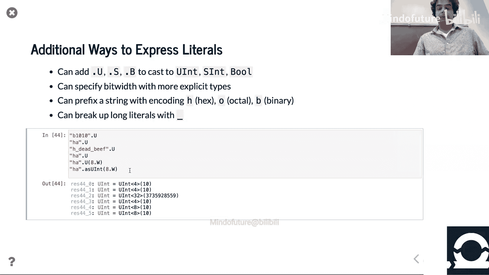

Great， okay， well that concludes lecture four， we'll be doing a half lecture in just a minute。😊。

