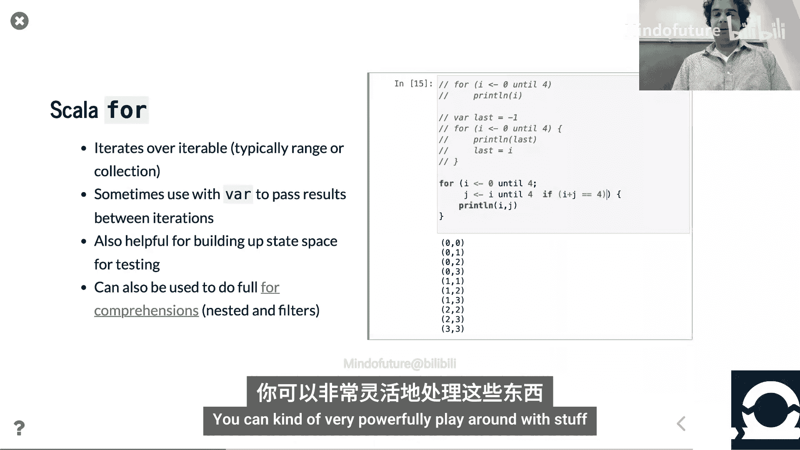
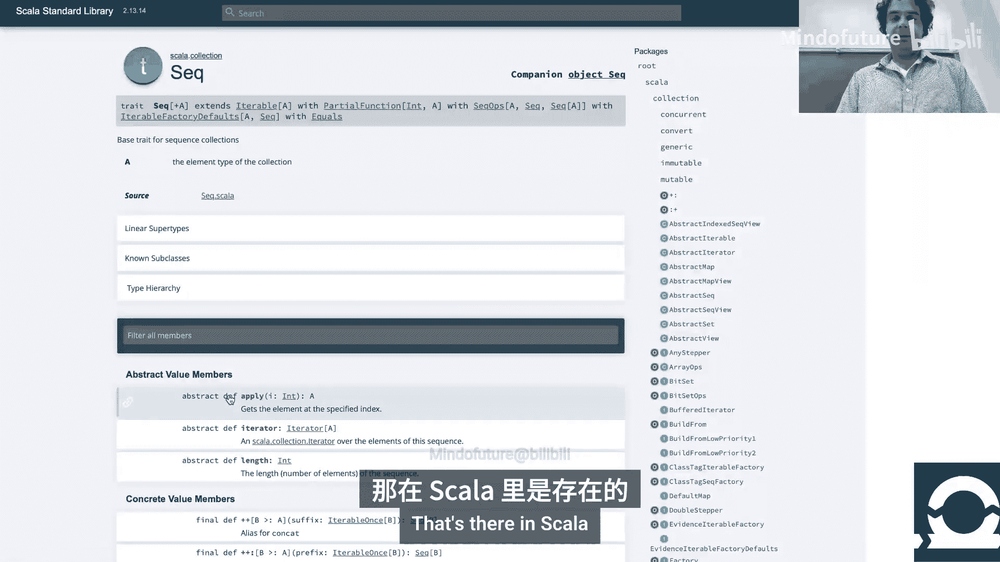
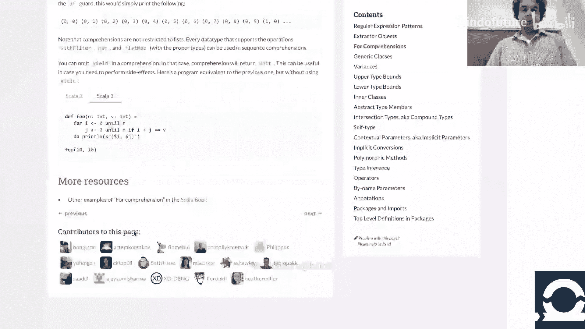
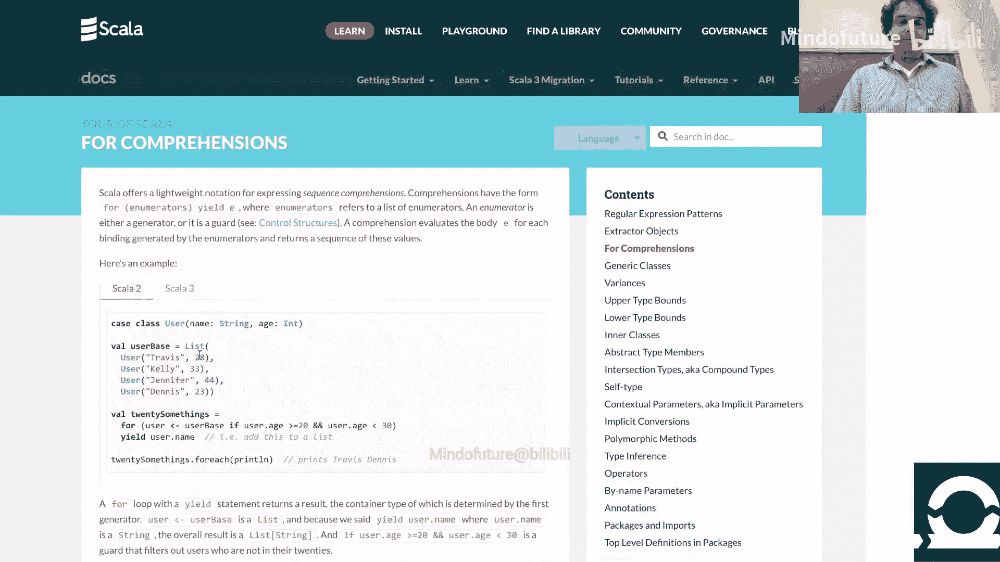
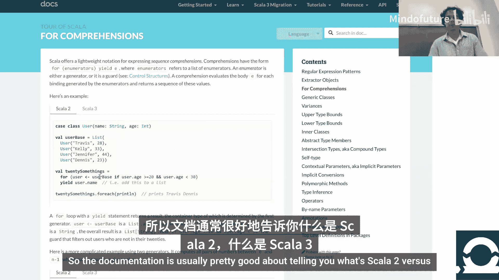
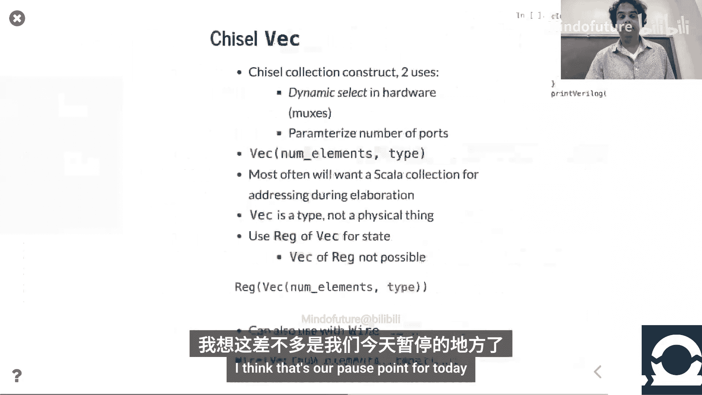

# 【加州大学】敏捷硬件设计-CSE228A-｜-Agile-Hardware-Design-Spring-2025-p06-P17_第5讲-集合_第1部分共2节--BV1M6ivBzESw_p6-

Hello and welcome to Le5。Today we're talking about collections。

What do I mean by collections That is how do we have multiple components and handle that in a nice programmatic way This is a fun lecture because up this point at first four lectures。

 we've covered chisel to the point of be able to do what you can do in very lot we covered。

 you know hello world， we covered combinationn logic we just covered sequential logic。

 doing things with state and registers So now you can build anything you can do instructional fairlock you can build commercial logic and these registers。

 put them all together Co。But what's the advantage， The advantage just from here forward， Right。

 What can we do is kind of finding more higher level。 And so one way to get at da collections， right。

 other words， I have a hardware component where。The amount of things inside there。

Depends on the parameter from generation， right， It's not just always the same thing。

 I give a generator parameter。 That's going to change number of things internally。

 So in order to structure to that code， we're gonna to use collections。

 So collection of the course comes from Sca。 And we're gonna be using those。

To build up these more intelligent hardware。So。Fire up some headers， sure。

Cool good to go So what is the most common collection used in Sca， something called a Sik。

 which is short for sequence。mAnd so what is it， you can think of it kind of like a vector， right。

 is you know， say。Collection of things。 There's a notion， sequence。 There's notion of order， right。

 There's in index 0。 mean index1。 So mean index 2。By default， the Sih is immutable。Right。

 so in other words。The size of sequence is set， the contents are set。

It's just a collection of things。Great， and so you can see link down below， I declared one called L。

I give initial values 1，2 and 3 the time。 I created it。 I can index into。 I'm sure。

 So in0 based indexing。 So one index  one， of course， is the two。

I can call methods on it like is empty or non empty。

This is yet another example of what kids likes to do in their design of things where。

Not only to have a lot of methods， they want things really clear。

 So you can imagine having a dot is empty。 And then up to the programme where you put a not sininofo and say not dot is empty。

 Some much your little thought or someone of the scholars sign it。 you know what。

Let's have more natural things。 And so， yeah， it's a lot of nice idioms and things in the language that kind of get code more clear and more readable。

We can call things like course select。 length， sure。Now， other a little bit more verbose， right。

 So for example， what about dot fill， So Phil is going to take。

 Give me three elements of this next thing。So then it gets38s。 Now。

 the syntax may be new to some of you where you notice how there's two sets of parentheses here。

There are reasons why for functional programming， which will cover later in this quarter。

 having your arguments arranged in this way is beneficial in some cases。For now。

 you can treat as boilerplate。 But the key point is， yes， this thought bill actually takes。

Two sets of arguments and two sets of parentheses。 Now， if I had let this off。

I'm going to get interesting partial results。It was actually not leaving even get to par with and I need to fill it out。

And I just killed it。No to sell。 Oh， no， I didn't。 Okay， great， but I killed something， okay。Well。

 here we go。As always， I'm due for about one or two not fis per per session。 Great well。

 not that broken。 Yes question。So， so Phil is the the first number there is how many elements it is。

 So it's not so much what index is's more just it like。You know， I had three before。

 and now I have five。AndSo reason why I showed you dot Phil。s a very specific， you know。

 scholara thing is you can see hardware is very common， right， I want to have， you know， N register。

 Well， I should use dot fill and register to get N register or something。嗯。Once again。

 you may be wondering about all these different methods。 How do you go about navigating all these。

 right， There is Goladooc， right， There's API documentation。

 So you can scroll through and see all the zilience methods available on the stick。 There's a lot。嗯。

More generally a seek or a sequence is a collection provided by Scala and talk to people write a lot of Sca。

 they actually argued that the collection of all these different types of collections in the library is actually strengthed language。

 So a lot of things we think might be language features are actually library features and selection library really spity。

 a lot of the data of various things you would need and they're all there and are really helpful more generally。

😊，You won to see the entire collections library。You can see that， you know。

There's the whole class hierarchy。 We'll come back this later in the quarter。

 we'll talk about obviously oriented inheritance。 There's also mutable variance。 but for now。

We're living in the vowel world or things mutable。 So everything' themmable， Excus me。

And that's that。 Now， one thing I want you to be aware of。 when you come across this for this course。

 and in general， you can just always use the word seek。And that'll be fine。Tendically。

 that's when needs you know higher level classes knowledge to orient inheritance。

 And it actually gets turned in the code。 It's can get turned into one of these base classes of either no list or vector。

 So you may see list or vector elsewhere in your code。 Under whetherre casable to seek。

 And so if even if you seek always， you're fine。The way I've done in this course I find for immutable collections。

 we just always use F。And as you look everybody in the course， you also ever mean。

 there are really subtle performance differences between， you know， lists versus vector。 course。

 you can imagine one's a linked less ones a continuousuous vector。

Those performance differences will not matter for discourse right you're not going to have 10 million elements in your seat so it's not going to matter so this you seek everywhere is clear。

Cool， other questions。Yes。我。That's a great question， so if I have a seek of chisel items。

 what is that？So that's going to be。Those N chisel items。

And the Sikh is the scholar references pointing to them。Now。

 your question you may be also be asking is， is there a chisel native collection？The answer is yes。

 it's called a V， and we'll get to that later in this lecture but not on state。Okay。

So then that's more scholar before we can kind of go fully into this。In Scala。

 there's this shorthand for ranges。 you may see similar things in Python。Where， you know。

 if you say just a number and then until， you actually get the range。 So its 0 true until4。

 until is exclusive。 So it's means 0，1，2，3。If you use the word two。It's inclusive。

So those also be 01，23 if I made this the same， of course。You know， it would be one longer。嗯。

Likewise， you can course change amount in by by default by one， you can go by two。

 you can even go down with minus one。So the reason why I have a small slide covering range is because in the second you're going to see me using them。

 this is why I now I understand that syntax。Okay， so。Let's do some for loops。

So virtually every Pra language has a four， the four in Scala is doing a lot of really heavy lifting。

It's inherited from Java it has kind of very iterative C style if you want to do it that way。

 we never ever do it that way in this course， and don't worry about that the way we do use it is kind of more of this iterator style maybe youve seen in Python where you have you know some sort of collection range and then you have an element of that right in this case we're saying hey for this iteration arrangements the rental4 give me I and then go ahead and print the value of I。

😡，Cool， right。 You can do some pipe on， I'm sure that works great。 Now。

 one thing to may come up is you say， wait a second， I。😊。

have some sort of code and actually I do want to know。What the last valid iteration was or something。

 right， so maybe。But that scenario， you would use a var。Attract the last value， for example。

 hypothetically， right？Also worked fine。You can use a bar。I try to avoid bars。

 but sometimes the for loops， the pains set things up， there's a reason why it's useful。嗯。Now。

How sophisticated are four loops？Really sophisticated。

 You can use all sorts of arbitrary generation synaxes and do four comprehensions。 So in this case。

What do I have going on？Even though I wrote the word for once。

This actually is two nested for loops with a filter applied with if statement。

 So what we get out of here is we're praying these pairs。 in words having I go from 0 until 4。 0，1，2。

3。Jy going。Whatever value I is until4。 And then I'm only printing it when the submission is satisfied。

 right， is this filter applied。 I， can course， remove that filter。And then these nest loop。

 that makes kind of sense。 is triangular， right， if I was to。Remove that eye。

 of course it's all 16 of them。So you can kind of see how。晕开了。

Very powerfully play out of stuff if a person loves this kind of for operation stuff。

Guess what that's there in Scs and go ahead to that page， all sorts of examples。

What thing I'll point out now， we're on the same page in this coursere using Schol 2。

 so it's made slightly different。

The Sca developers know that Sc3 is not widespread use。

 so the reputation is usually pretty good about telling you what Scala tube or Sca3。

Cool。Other questions。Okay， so we have four loops， we have ranges， what do we do？

It's put to where she built from hardware。So let's build an actual generator and this generator is something sustainablealable more interesting。

😡，So this generator is something we call a delay line， or we may think of as a shift register。

 right other words， it's end registers in sequence。

 so that way you know Iio in comes in and then n single later comes out， Iiota out。Right。

 so of course we have delay in cycles。 So n is this know delay amount。

So how could we go about writing that？First， I need those end registers。

So let's go ahead and use that seek operation。 So here we use the dot fill。To get end of them， right。

 And we're gonna have these， you know， registers。 So from the question from earlier， Yes。

 I can have a collection。 This is a scholara collection， a seek。 It internally is a bunch of these。

 you know， chisel objects。 And that was a way to access them， right。

 a way to kind of point and refer to them。 So you can see kind of the chisel the scholara often kind of intertwine very often inside your code。

 This is what's happening。😊，T accepting them up。 What do we do， Well。

 we're going to connect the input to red0 that's right here。

And that's going to be the first thing over here。From Regdge1 until end， so exclusive。

Or' this subtract one， right， So， you know， from one， connect0 to， connect to one， etc ceter。

Dick to all these other things up and then at the very end。

We're going to connect the last one to I it out so this works if we go ahead and you know join us some very。

If we say we want to delay my two cycles， we can see those Q registers。

 we can kind of see them cascading。In the way they feed through this design。

 technically register one， you know。Is up here as Le V？But it's the generator。

 This is pretty cool where I can go ahead and say I want four。You know， no problem。

 this is a pretty spiffy little bit of chisel， and now we're going to get generation。

mA system B log Pro willll point out there's something called a Gen。

 and you can probably do this case of a Gen probably could。This is we're going we're warm up。

 We're warm up。 We're going to get better。 but this is a starting point。 right。

 You can see all of a sudden， this is a generator。 It's no longer just a single static module。

This is a generator， given what parameter it does。It's going to change then nature to hardware。

 It's actually change the structure。 right， You can see based on this n parameter。

 it's going to change how each collection is and how many times this for loop runs， right。

 It's actually like， you know， it makes it kind of more conscious fact that we're not just have a hardware design with a program is kind of programmatically building up that hardware design。

 This is a generator concept in practice。 But you may notice I'm using this require statement。

Second assert。Ester to keep yourself from hurting myself。 So I say， you know。Hey， give me end cycles。

0 cycles。 And it's like， yeah， I can't do zero cycles， right。

 And the reason why is you can imagine just code the way it's written， you know。

 of0 comes in here and maybe have -1。 What is that， It's gonna break stuff。But yeah。

 one cycle is just fine。 with this way it's rid。 You，1，1 register， Sure， you know，10。Sure， right。

 it's a pretty cool little generator。Questions。So this is our you know， v0， we have a four loop。Ste。

 no use of bar， so there's a lot to like， this is very functional code。

But let's say you to kind Per know what， I want this to handle zero cycles。How can I change this？

What are you bringing them Mark？Which you know my time to be careful about。

 this is one of the cases where you know it makes life a little easier。So what happens？ Well。

 sometimes with a careful use of bar， you can make it a little bit easier。So I say， you know what。

 let's keep this last connection。And then， initially。So whatever I do in is， okay。

Then I'm going to iterate through all the elements。And I don't even bother making a sink。

 This is a for loop， or what does it do， it keeps taking the last connection。

And attach the register to it。 So whatever that register was。Wrap down the register， pass it on。

Raptor register pass it on。 So' is doing this is taking this is the reference to a Chi component。

 right。This gets passed into as the input to a register。😡，And then the output of Redki is now。

Associated with this reference。 And so we kind of keep taking the last value。 Rapper inster。

 Rapperinster。 I it gonna work。 So I can go ahead and print this out。

 It's gonna look very similar at the prior one。 The name' is a little different。

 but it's the same structure。But notice how now I can actually。

Have zero cycle delay and there's no registered result。And does the right thing。

 so I don't have to have the requirements statement anymore。It's still， it's still worse。

That's pretty cool， right， so now。You can imagine depending anything about things。

 which one you find more clear， Maybe you find the prior slide would just seek more clear。

 It kind of makes it very upfront that， hey， I'm declaring， you know。

 end register is now we ahead to wire them up。 This one is kind of essentiallying one through at a time and wiring it one at a time。

 This one also uses the varr， which， as I said， you know have some caution with， but。

In terms of functionality from the outside， this one to touch nicer because it has a wider parameter range you can handle a zero。

Cool。Questions。Do I have another variant， maybe not？Oh yes， one more thing。

Let's say I have some combinational logic， right？In this case。

 I have a three input logic function takes A， B and C。Has some output。

 there's some sort of cleverness to that logic。And guess what， running a tester？

I showed you earlier this today， I promise hey， you know what。

 writing one test case at a time is really tedious。Who't we be more clever， Yes， yes， we can。

 So this code on the right。It's going to exhaustively test。Every possible input combination。

So how are we doing that， Well， it's three instead of four loops， right， you know。

 for all possible dies of A， we're going to try all possible valuess of C and all possible dies of B and C。

 sure。They're iterating because these are bos。 They're iterating between true and false， okay。H。

 these are scholara bulls at this point， and they get cast of bulls inside the Po statement dot here。

You can see this right。 Okay， it this doesn't have， you know。

3re acid loops each with two possible values。 So it's to run two to three times。嗯。t the values。Now。

 one thing that comes up with these kind of test cases， not only you said the inputs。But you also。

So we' need to know what the right output is， right。 So in this particularer test case。

I'm doing a suspected line where I note the logic should be， I'm kind of serially rewriting it。

In Scala， and then I'm casting that to the right type for the chisel interaction now。

That works for D。If you were critical， you'd say， hey， wait a second。

 like that looks like almost the same go between here。In here， right。

 what kind of robustness am I getting with this test case？The answer is not loud。

 but if the two codes are so similar， what are you getting。

 but you'll see as we go through this quarter， we'll have more sophisticated ones。

 there's more diverse ways infing expected value and that way you to actually get some differences。

 but for today the point of this example is to kind of show hey， we just covered four loops。

 let's use for loops to make test cases more general， right？Oops。

 I got to first instantiate that on the left。Run on the right。And it works。

 And so in case you were unsure about， you know， how it goes through your design space。 Yes。

 it's itating between all these combinations。 That's a scala print line here。Now。

 let's say you wanted。Instead of scholar print line， you want the chisel print F。

Of what it's working with。And he ran this And you' was like， wait， I didn't get very much。 What。

 what， what happened Well， remember。The print statement in chisel。

 the print F only runs once per cycle， right。I actually need to now start advancing each test case by one cycle。

 and you that， then I'll start seeing， you know， the full gamut， right， I'll see。 Okay， yeah。

 you know， for A， B and C， the way have just kind of print up over here。What are the inputs。

 what is the output and overall little total test case passes？Yeah。

 now you know better now you know how to do four loops rather than just writing tons and tons of copy paste。

Cool。Other questions。I think that's our pause point for today。 Yes， it is perfect。

