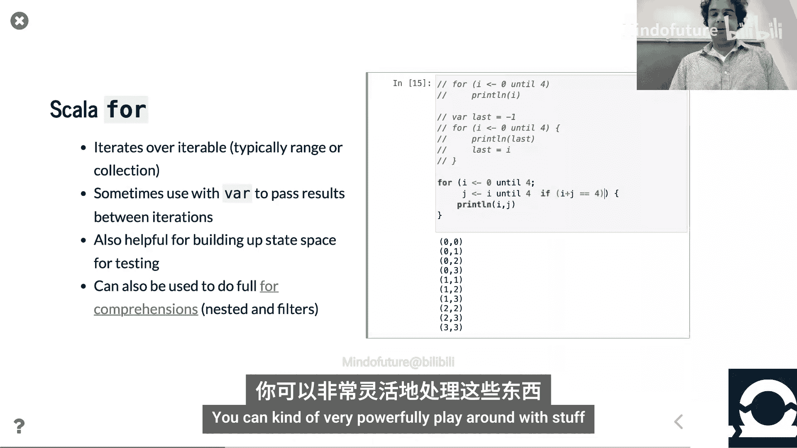
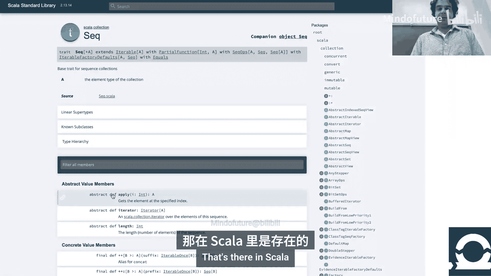
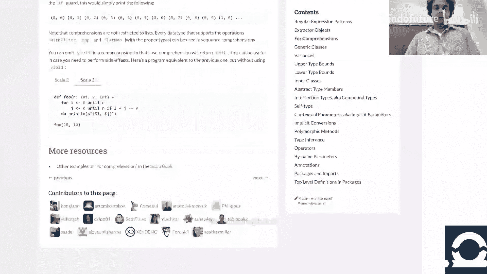
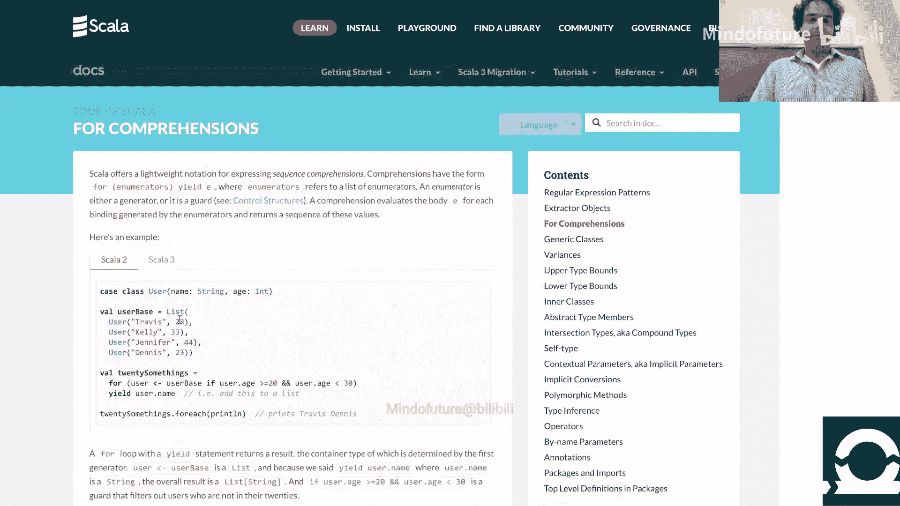
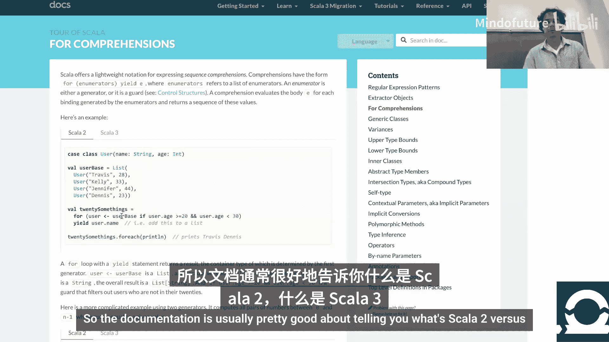
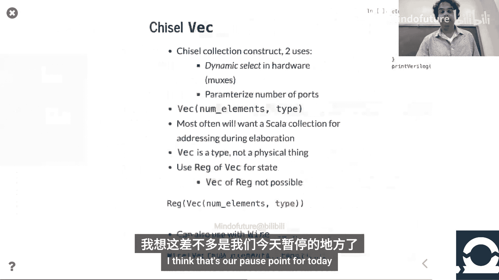

# 敏捷硬件设计：CSE228A：第5讲-集合（第1部分）

在本节课中，我们将要学习如何在Chisel中使用Scala的集合（Collections）来构建参数化的硬件生成器。通过集合，我们可以根据参数动态地创建和连接多个硬件组件，从而编写出更灵活、更强大的硬件设计代码。

---

## 集合简介

上一节我们介绍了顺序逻辑和寄存器。本节中我们来看看如何利用Scala的集合来管理多个硬件组件。

Scala中最常用的集合是`Seq`，它是“序列”（Sequence）的缩写。你可以把它想象成一个向量（Vector），它是有序的，可以通过索引（如0, 1, 2）访问元素。默认情况下，`Seq`是不可变的，这意味着创建后其大小和内容就固定了。

以下是一个简单的`Seq`示例：
```scala
val mySeq = Seq(1, 2, 3) // 创建一个包含元素1, 2, 3的序列
val firstElement = mySeq(0) // 访问索引0的元素，值为1
val isEmpty = mySeq.isEmpty // 检查序列是否为空
val length = mySeq.length // 获取序列长度
```

`Seq`提供了许多便捷的方法。例如，`fill`方法可以创建包含多个相同元素的序列：
```scala
val filledSeq = Seq.fill(5)(8) // 创建一个包含5个元素8的序列
```
请注意，`fill`方法接受两组参数，这是Scala函数式编程的一种风格，目前可以将其视为固定语法。

关于Scala集合库，有几点需要注意：
*   **丰富的库**：Scala的集合库非常强大，许多我们认为的语言特性实际上是库提供的功能。
*   **使用`Seq`**：在本课程中，我们主要使用不可变的`Seq`。虽然底层可能是`List`或`Vector`，但对于硬件设计来说，性能差异可以忽略，使用`Seq`能让代码更清晰。
*   **查阅文档**：如果你想知道`Seq`有哪些可用方法，可以查阅Scaladoc（Scala API文档）。

---

## 范围（Range）与循环（For Loops）

在深入硬件设计之前，我们需要了解两个关键的Scala概念：范围（Range）和循环（For Loops）。

范围提供了一种简洁的语法来生成数字序列：
```scala
val rangeExclusive = 0 until 4 // 生成序列 0, 1, 2, 3 (不包含4)
val rangeInclusive = 0 to 3    // 生成序列 0, 1, 2, 3 (包含3)
val stepByTwo = 0 until 10 by 2 // 生成序列 0, 2, 4, 6, 8
val descending = 3 to 0 by -1   // 生成序列 3, 2, 1, 0
```

Scala的`for`循环非常强大，我们通常使用迭代器风格，类似于Python：
```scala
// 基本for循环
for (i <- 0 until 4) {
  println(i) // 依次打印 0, 1, 2, 3
}

// 带条件的嵌套循环（也称为for推导式）
for {
  i <- 0 until 4
  j <- i until 4
  if i + j > 3
} {
  println(s"($i, $j)") // 打印满足条件的(i, j)对
}
```
这个嵌套循环相当于两层循环，并附加了一个过滤条件。`for`循环功能非常丰富，你可以查阅Scala文档了解更多高级用法。

---



## 实践：构建一个可参数化的延迟线（移位寄存器）









掌握了集合和循环后，我们现在将它们应用于硬件设计。让我们构建一个称为“延迟线”或“移位寄存器”的生成器。它的功能是将输入信号延迟N个时钟周期后输出。

### 版本1：使用Seq和fill

以下是第一种实现方式：
```scala
import chisel3._

class DelayLine(val n: Int) extends Module {
  val io = IO(new Bundle {
    val in  = Input(UInt(8.W))
    val out = Output(UInt(8.W))
  })

  // 使用fill创建包含n个寄存器的Seq
  val regs = Seq.fill(n)(RegInit(0.U(8.W)))

  // 连接逻辑
  regs(0) := io.in
  for (i <- 1 until n) {
    regs(i) := regs(i-1)
  }
  io.out := regs(n-1)

  // 防止n为0导致错误
  require(n >= 1, "Delay must be at least 1 cycle")
}
```
**代码解析**：
1.  `Seq.fill(n)(RegInit(0.U(8.W)))` 创建了一个包含`n`个8位寄存器的序列。
2.  通过`for`循环将这些寄存器串联起来。
3.  `require`语句确保参数`n`至少为1。

这个生成器很棒，给定不同的`n`，它会生成结构不同的硬件。这体现了“生成器”的概念：我们用程序化的方式构建硬件设计。

### 版本2：使用变量（var）优化连接

第一个版本无法处理`n=0`（零周期延迟）的情况。我们可以使用一个`var`变量来优化连接逻辑，使其支持`n >= 0`：
```scala
class DelayLineBetter(val n: Int) extends Module {
  val io = IO(new Bundle {
    val in  = Input(UInt(8.W))
    val out = Output(UInt(8.W))
  })

  var last = io.in // 初始连接指向输入
  for (i <- 0 until n) {
    val reg = RegInit(0.U(8.W))
    reg := last     // 当前寄存器连接上一个输出
    last = reg      // 更新“上一个输出”为当前寄存器
  }
  io.out := last    // 最终输出
}
```
**代码解析**：
1.  我们使用一个变量`last`来追踪需要连接的下一个节点。
2.  在循环中，每个新寄存器都连接到`last`，然后`last`更新为该寄存器的引用。
3.  这种方法更简洁，且自然地支持`n=0`（此时`io.out`直接连接`io.in`）。

两种方法都是有效的，你可以根据清晰度或功能需求进行选择。

---

## 在测试中使用循环

循环不仅能用于构建硬件，还能让测试变得更加高效。之前我们逐个编写测试用例非常繁琐，现在可以使用循环进行穷举测试。

假设我们有一个三输入的组合逻辑模块：
```scala
class MyLogic extends Module {
  val io = IO(new Bundle {
    val a = Input(Bool())
    val b = Input(Bool())
    val c = Input(Bool())
    val out = Output(Bool())
  })
  io.out := (io.a & io.b) | io.c
}
```

我们可以用嵌套循环测试所有可能的输入组合（共2³=8种）：
```scala
test(new MyLogic) { c =>
  // 三层循环遍历所有布尔值组合
  for (a <- Seq(true, false)) {
    for (b <- Seq(true, false)) {
      for (cVal <- Seq(true, false)) {
        c.io.a.poke(a.B)
        c.io.b.poke(b.B)
        c.io.c.poke(cVal.B)
        c.clock.step(1) // 需要步进时钟才能让printf在每个新输入下生效
        val expected = (a & b) | cVal
        c.io.out.expect(expected.B)
        // 可以使用printf调试，但需要clock.step配合
        // printf(p"a=$a, b=$b, c=$cVal, out=${c.io.out.peek()}\n")
      }
    }
  }
}
```
**要点**：
*   循环极大地减少了编写重复测试代码的工作量。
*   注意，如果测试中使用Chisel的`printf`，需要调用`clock.step(1)`来推进仿真时间，才能在每个新输入下看到打印输出。
*   在这个简单例子中，预期值计算与硬件逻辑几乎相同，测试的健壮性有限。但在更复杂的设计中，我们可以用更独立的方式计算预期值，从而进行更有意义的验证。

---

## 总结

本节课中我们一起学习了Chisel硬件设计中的关键抽象工具：Scala集合。
*   我们介绍了`Seq`集合的基本用法，它是管理多个硬件组件的基石。
*   我们学习了`Range`和强大的`for`循环语法，它们能用于生成序列和迭代。
*   我们实践了如何使用`Seq.fill`和循环来构建一个**可参数化的延迟线（移位寄存器）生成器**，这体现了用代码生成硬件结构的思想。
*   最后，我们看到了如何在测试器中利用循环进行**穷举测试**，从而更高效地验证设计。



通过结合Scala的集合和流程控制，我们现在能够编写出适应不同参数、结构可变的硬件生成器，这是迈向高级硬件设计的重要一步。在下一部分，我们将继续探索更专门的硬件集合类型。