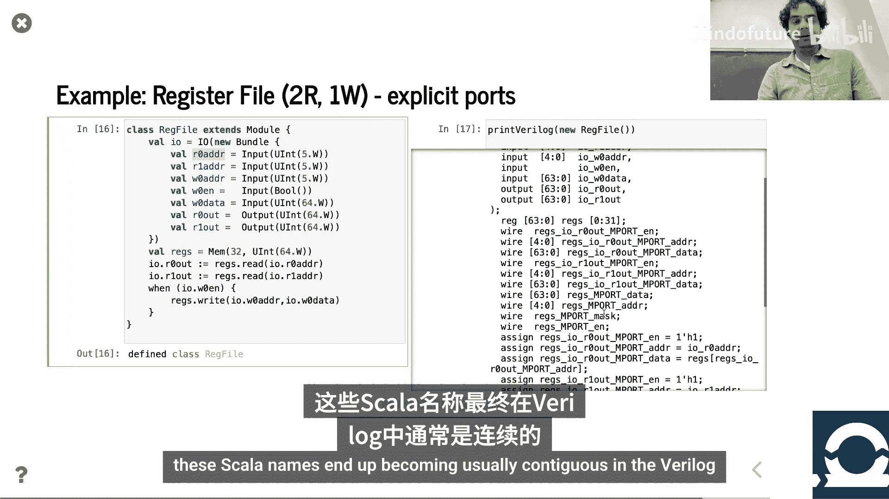
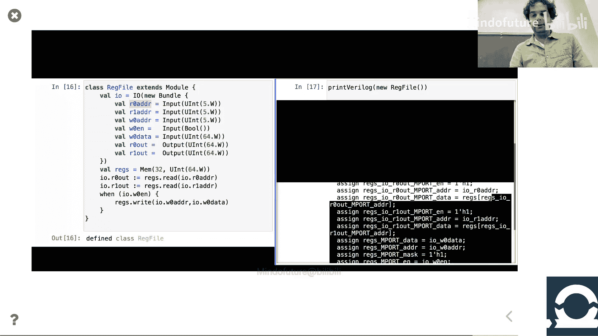
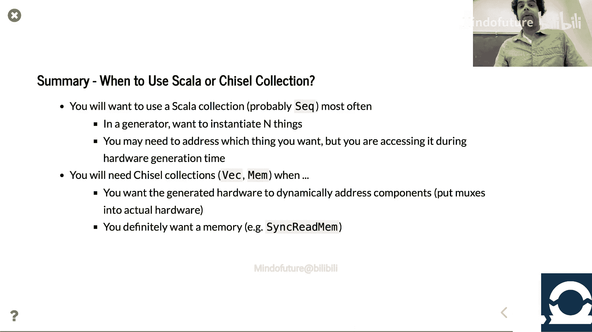

# 【加州大学】敏捷硬件设计-CSE228A-｜-Agile-Hardware-Design-Spring-2025-p07-P18_第5讲-集合_第2部分共2节--BV1M6ivBzESw_p7-

H and welcome to lecture5， part two， so we've been talking about collections that is groups of things and last time we talked about in part one。

Talked about groups of collection things in Sc， collections of scholara。

 talked about things like Sik and how we can use that in the horror generation process and how we can use also things like for loops as well to kind of navigate that space。

 So we in a ship here and talk about collections and chisel。 How do we have those。

 And so let's go ahead and fire us up。We'll get the notebook going。And then yeah， let's。嗯。

Jump into it， right， so。One of the things that's always kind of seem to keep an eye on this course is when we have these various constructs。

What is something that's in the Sch program or running the generator as opposed to what something is gonna appear in the generated hardware。

 Because oftentimes this code interm。 It's kind of hard to keep track of which is which you have to have a clear picture of both。

 And so。A chisel V， which， of course， is short for vector。

Something that's going to appear in the hardware。 That's in contrast to the scholar seek we talked about earlier。

 which is something that's in the generator program that not going to appear in the hardware， right。

So what is the vector is， as name implies， it's a vector。 you can have n elements into it。

 They're all going to have the same type。The key feature of it is in of just having n elements。

You can dynamically select an index an element， right， an index， right， other words。

 in this generated hardware， you have the ability to address something within it， right。

And so this concept I thing is very clear to about people。

 I think where students get tripped up and past offerings is they think， oh。

 I want and things that you a V。 and the answer is you'll need a Vck。

If you need that addressing ability in the hardware， if you just need n things for generating。

Use the Sch seek。 the V is when you want to addressing ability， right。So to see an example of it。

Why don't we actually just use a V as a way to implement a mugs？Right， so we can。Build a nway mu。

And theres number of ways thats coming in。Each of those different inputs will actually be an input to the Vex。

 so that way we have， you know。Our N input here I'm going to select from it， right， in the course。

 the selection operation。Sor of facts using the。Indexed notation。Even independent of Chisel in Scala。

 you index into arrays using the round。Phesees rather than the square back。

 I think of all other languages。So yeah， we can go ahead and make you known N mugs easy。

 right in this case a four to one。Degenerated chi is going to have a bunch of two to ones that might seem。

Less efficient。 Don't worry， the hardware catchules they see this through ahead and optimize that Eet up。

 They'll do the right thing。 But this is a parametertrit。 right， we can go ahead and make this。

 you know，8 inputs。 no problem。 I can also change a bit with right now， it's 1 bit wide。

 I can make these all 4 Bs wide。So was already an example of you know。

 some previtation is really helpful。Some other things to point out about V， so V is a type。

Not a physical thing。 Even I mentioned this ability dynamically index。

So the reason why nuance comes up is， let's say you want to have end registers and index them in hardware。

 you know， while the hardware is existing。You might think， oh， I want a vector of registers。

 And conceptually， I think that is a reasonable assumption。 However， in terms of the way。

The types interact。 It's actuallyally a redge。And the type of the register is a V， right？

So it's the low bit is the inverse of what you expect。

 So if you try to do V of Regdge tool until you can't do that， you need to dore ave。

 This is an extremely common point of confusion。嗯。Tme was also true。 if you want to do a wire。

 If you want to have a bunch of things in the deck and the wire， you put the wire on outside。

 And so for now， you can just。T to remember making a note of that if you forget the tool will tell you and you invert it。

For those of you who are really excited about， you know， programmingent languages and stuff。

 We want to dig into this。 There's reasons why was the type elaboration stuff that this is the order needs to be done in。

Cool questions on deck so far。Great。Let's just kind of see some more examples。 Let's say。

 for example， I want to。Build a harder to do reductions， right， So reduction is the ability to take。

 you know， end things and reduce it down to one thing。 Most commonly。

 the reduction operation is an addition， but that's typically not a requirement for reduction。

So let's say I want to have it N way reduction sum reduction， right， Okay， great。

 so I'm going gonna have。嗯。And inputs， and then I' also have N1 adders to add them all up。

So how can we go about doing this， Well， with a V， we can have this parameterized number of inputs to kind of match that。

 Sure， great。And I said， you can think about this Wait a second。 It's a V with n elements。

 And each element is U and of with W。That's like it's going to be， you know， n times W bits， right。

 A lot of bits。And then the output， of course， is a single element， sure。

And so how do we do all this， Well， we need to make sure we have at least one port that's that requirement statement。

And then I chose to， in this case， to do a var with a for loop。 right， That's not the way to do this。

 But that's a nice way to do this， right， and so。We can。Take the first input。

 and then from the on words， just keep adding things on。 So we'm going to get this unbalanced。Tree。

 yeah。 So how' does this actually look in hardware。 Well， he G， if I only have two things， it looks。

Like， how we hope it would look right， Just a simple addition。 Now， if I was to。

You know add things on， okay， we start seeing additional additions。And yet。

 it grows as you would expect。 And， of course， yes， the bit is also praized。Right now。

'll you used to that it's trivial， cool。Questions so far。Cool， yes。Yes。Good question， so I use a V。

 you know。nameam as output variable seems to be a little bit you know undefined or defined by a Ch compiler Yes it's definitely defined emission compiler。

 The Ch compiler tries to follow certain programmatic ways in naming things。😡。

It also is un hookooked to make correct very log。 So sometimes what you think it the correct name should be may already be in use。

 for example， And as a collision， it the text a has a way to kind of get around that。

 And so in this case， yes， you can see that it chose to。

Take the I O dot in and put another a score for the dot as a pretypical transformation。

 And then because there was a， you know， V， it did another score and then the index， right。

So that's the way happened to make this name。 So other names are not quite so obvious。

 you can kind of see， for example， like total so far。

Which is a scholar reference that you keep changing what it points to。That， you know， appears as。

 you know， underscore T 1， underscore T 3。 So a leading underscore is something where this is a。

You know， name the Chi compiler generated is' not something from your code。

 is your code created that， I didn't actually have that name。

If you are really concerned about the names of things in the very log。

 there are ways to anteate your scala code that suggest names of certain key crucial things。

So it's too much more for everything， but a certain port to want have a certain name yet。

 you can do that。Okay， yeah so。Ner one， two questions。 Right， number one， the question。

 the choice of var and number two。 What about to register。 So lets attack the var thing first， Yes。

 so the var thing， I keep piping up using Valel here around using var。

 We'll see this hardware again in a few lectures when I teach more construct。

 And so we'll go far down the functional programming path。

 And I'll show you how to do things like a fold。 And that way you don't need to use a var。

We also can use recursion to avoid using a vr， so a vr can be avoided。

 but for what we've covered so far。And you this code is perfectly reasonable code。

 I think this was a perfectly fine use of it。In terms of a register。

 there's no reason why we could use a register， but that would change to semantics， Right。

 So right now， these are all adders。 Those are combinational components， Right， They produce output。

There's some physical delay， but it's not depending on the clock period， right。

 It's gonna be whatever time that takes。 So one hour delay， two delays， you know。

 N minus1 hour delays。I've got to register in there all of a sudden the data advancement stops at the register in the next clock set arrive that clock barrier。

Depending your implementation， that may or may not be a good thing， right， And so， yeah。

 depending on what you want。 Yeah， go ahead and do that。YouMaybe a situation， let's say you have 64。

 you know， inputs to reduce reduction unit。 and maybe they're all 64 Bs。

64 adders in sequence or 63 hours， I should say。That's going to be a very long critical path。

How many reasons in the hardware you may put in a。Register to pick up and pipeline it。

Once to it up to you。 But for right now， I said the chisel is gonna be whatever you tell it is。

 right， So if I describe business confidential logic as the reists。

It's not going any registers in there。 If I put registers in there， it's gonna keep them in there。

 And so。Yeah， it's up to you as a designer what you want。Cool。Okay， Dan。嗯。So that was a V。Now。

One scenario you may want a V is let's say you want to have a read only memory。A ro so speak。

There's a V in it helper functions。 See how we do that， right， So in other words。

 you can give it a sequence。And what it's going to do。Is it going to。Create a V of that sequence。

 So that way in hardware， you can address that data， so。Jkin is going to initialize wires。

 in other words， these are all pretty constants。If you want to have registers and initial list。

 all those registers in parallels actually also re it。But anyway。

 just to go vectoring examples first， right， So let's say I want to build a table in hardware。

That does。Division， right， In other words， rather than building a hardware divider and build a realm that does that divider for us。

 So that might be cheaper than actually building a real divider。

And so it's not going to be do the full division。 I this going to remember。

Is the thing divisible by something， right， So given some input in。It's gonna say。

 is that divisible by X the thing we did generator for。Okay， so you can see。

We're going to build up this sequence。This is the use of bar I do not like。

But I'm doing because they I haven't covered enough scala to avoid it yet。

 So here I' going using a var because I have to， but we will see in not too long even later today how to avoid using this var。

But okay， what am I doing？ I'm going to build up the sequence。That is going to contain。Bols。

Of whether。Something divides evenly。 So am I seeing who divides who I'm taking。You know。

 what is the remainder of， you know， I and X I is this？

Lupineration variable let's say we're the to make this table 50th elements big。

This probably should be parameter， but for now it doing a hard coded literal。 So 16。

 the first 16 numbers and we're seeing， you know， is the remainder 0 or was the divide evenly。

 And if so。You know， it's a true otherwise， it's false， and I'm returning that into a chiselbo。

This syntax is a small detail。 It's not super critical， but this is how they in Scala。

Chhoose to present a pending。An element to a collection。

 And that's the symbol made look kind of front at first。 Like， wait， colon plus， I haven't seen that。

 Someone one was very clever。 So basically。You put the colon。On the side that has a collection。

So if you have a collection and you're adding on an element， it's colon plus， right。

 Because the colon is on the side of the collection。And the plus is on the side of a single element。

You actually can also prepen the element。 And it， you know， plus colon， right， That's also the case。

 And then if you have two collections， like you're doing cons in a lot of languages。

 that's colon colon。This is a two collection of both sides。 So that's， you know。

 sca being very ornate。 but we won't use this pattern too often our code the build of sequences。

 we'll see later today how the build of a sequence。valu evaluatingu a var。

 you need to worry about this construct。It uses a recursion to， but we won't eat it too often。

 But for now， this try built this sequence， It has 16 elements。We turned that into this vacuum in it。

 And now we have a wrong， so。We had to run this and look at the table。Yeah， it creates this。

Rom for us， right， and so。You can see that under the hood chisel compiler turned to into into mues。

 right， You know， hey， is the input one。If so。You know， return something right。 it， too。

 And you can see this kind of this unbalanced tree。Of mugxes。

 So how giving a selection procedure here。 Like I said， Im sure people are kind of， oh my gosh。

 iss that gonna be in hardware。Trust me， the hardware cat tools will see a bunch of2 to1 lues and do to write agglomeration。

 This makes sense for technology you're using。 What's actually more surprising to me is for research in our group we're building we have in building a tool takes in the fertile from Chisville and generates the plus code and make a high performance simulator。

 And so yes， so we have these large Vexs and user designs。

 maybe 100 elements that turns into 1 thousand00 of these2 to1 lues in the fertile。

One that with plus， that turns into 1000 if statements not code。

And then compilers like clang are smart enough to see 1000 deep if statement and turn into an array at access。

 That's like if a C compiler。 So the hardware tools。 This is even more important for them。

 They can do it。 But to keep pointing out， it works。 You can see it along the way。It keeps， you。

 referencing prior results of the kind that works his way in。But yeah， we can change， you know。

 what these parameters are and it kind of comes together。 But as an example of this building a ro。

 Usually you aren't looking as very long as you can see it's machine generated not very helpful to humans。

 but the chis will kind of help make sense。Questions。Okay， let's。See what else we can do。

 So we just talked about a V， which gives you the ability to。

Have a one dimensional E thing you can index into。 Now a man short for memory。Those two things。

 not only is it have dynamic addressing that in， you can index things in hardware while it's existing。

But it's also actually stateful， right， it has memory。And so。Depending on which memory you want。

You actually can get different types of memories。 right。 Remember in hardware， and we build。

State elements， we have registers and S Rams， right， static， you know。

 read only read access random access memory。 Sorry。 And so with。Registers。

 remember the the combination， the result is that you can read register。Instantly， right。

 it's always output coming out of it。 So this is a zero cycle delay to read the data。 however， the。

Data is put into a zero over some amount time。 right， takes a cycle to get in there versus a S Ram。

Takes both a cycle to get in and also take cycle to read it as well。 And so。If in Chiselley say。

" hey， I wanted them。By default， it's going to give you a combinational read memory。

 a zero cycle delay， so it's actually going to be basically registers that have much attached to them。

 essentially， right？Alternatively。If you want to have that once it delay and have it be mapped to SRAM。

You can use a construct for a think read me。You can also use the me and you can change the delay with a parameter。

And you can make it an hour channel of recycle。 You can make it two or four cycle delay。

 which maybe a better matches。The best technology you have in your design。

And we'll see some examples， but mes are pretty nice。 So in chisel。

 you can have this very fluid way working with them where you can just kind of。

Access to however you need to both for reads or writes。

 and the Per declared implicitly as using them。😡，Some people don't like that design style。

 and they instead prefer to have very explicit memory ports。Also， okay， yeah。

 I can do things like red masks and all that other good stuff。Let's go ahead and see some examples。

So let's say I want to build a recipe file for a processor， right。

 So if you're canonical wrist style processor， you're gonna want to have two reads。

And one right at a time， right， unless let's say you have 32 registers， right？Well。

 how would you do it well for that register file， you have already quite a bit of port。

 So I need to have the。Register numbers for the two inputs， right， Reg  zero， register  one。

 These are five bits because it's going to be 32 registers。

You also need to have the five bit index for which register you're going to write to。

And you don't always want to write， so you want to have an input to say is the right enable on or not for the right port And also if you are going to do that right。

 you do need to give it the data 64 bits of you know the data' actually going to do。On the other end。

 of course， also after you' read， you're going to have your outputs right， so you have you know。

 the outputs for register zero register one。So here's a lineness with Regdge of Vck。

 a perfectly reasonable way to do this。嗯。And see it comes together。

 It's actually pretty concise syntax， right， We declare the registers。And then for the read port。

 it simply attach these outputs to the registers and whatever index coming in。In this case。

 there's not any kind of read andable because the way it's implemented is known。

Damage caused by doing a read。 If you don't intend to do a read。 If you don't want to read。

 Don't look at the output， doesn't matter。 And then， of course， for the rights。

 you really want to do write when we want to， in which case， then we can use the right enable。

 And then if the right enable is true。 then， yes， we modify the contents of that location with incoming data。

 So This is a pretty concise little bit of code to do register file。And yet， look at the very log。

You can imagine what it looks like， right， It declares。64 registers。

 there's all of these boxeses to select who's talking to who。Yesikes。Alternatively。

So' harder wise it to be plenty efficient， but the very as humans reading it， we hate it。

If I use this mem construct。It's going to be a little bit more tidy。

Notice how it's already using the very log construct of having an array。

So there's3 two of these elements of red 64 Bs。So the result， yeah， the code is a lot more concise。

 You can see that， you know， the read port， for example。Or like this？

There are still quite a few wires here。That's because the tools are you declaring all the various wires require support of port of memory。

In terms of the generated hardware， these two things should be nearly equivalent。

 they're both going to be registers。Because that's where Im typically have the stickerness read delay but。

Just kind of showing features right。 if I want to have。3 few safe allments。

 Rejavek is totally fair game。 A lot of times you think of Rejavek， if you forget， you know， Rejavek。

 Beckck of Regdge， just do a mill and youre， and you're done。Cool， questions。Okay。

 so u let's keep going。So that was with implicit ports， you can see how， for example。You know。

 we just activelyly wanted to access。What if。We want to make it more explicit。 So yeah。

 you'll like this more for both syntax， where I can say。I am definitely doing a read。

And I'm definitely doing it right。This makes it more through the operation is。 You know。

 draw attention to fact this isn't just some sort of， you know。Index is actually like， you know。

 a read or write to a memory。And yeah， the the code come at it runs is exactly the same。Cool。Yes。

Yes吧。Oh yeah， so good question， so I chose to have， you know like the。

Naming like such or having an R 0。 That's just the style choice I did in a stickler case。 where yeah。

 register 0， register 1。Addres， you could also imagine， you know， it being register address。

0 register address 1 to me， conceptually， I think R 0 is more closely binded than the R& address。

 but that's an opinion point。It's the same in the very， right。

 You can see that in the very over here。These scholar names end up becoming usually contiguous。

In the。In the very log。 So the maybe adders of about。 Let's at R 0 out， for example， Yeah。

 you see R 0 out kind of stays together。 So it's not gonna have any impact on naming。

嗯。In the following lecture we're going to talk about more ways that structures are design rather than having a flat list of wires like this。

 you might instead choose that additional structure， say okay， to a port and a port has。

 you know ports within it right and that kind of stuff。

 So we can talk about that in the next lecture。Yeah， that's a great question。

 So if I was to have the wrong bit with， how does this break， Let's find out。 So if I have。

 let's say only 3 B registerfi specifyifier， I can't specify the entire figure 2。

 I like can specify 8。 I think it's probably be okayk。

 And it's probably something we wish wasn't there。 Let's see what happens。Yeah。

 approximately which was in there。 You can see that because we only had three bits instead the five。

 it put in two zeros。In there。Yeah， and so that's probably not what you want。Yeah， as for example。

 maybe tools could be smarter and worn you're about to， you know。

 blow your foot off on the other end。Let's say we have 64 bit outputs， but the registers themselves。

Or let's say， 32 or something。I assume it's also gonna be zeros。 I guess。

 sorry got rerun that and then rerun this。 Yeah， it's also gonna zero pen。 So， yeah。

 there are times when it's bit with mismatches， is's going to。

Ada accordingly now in this particular example。I believe。Now I kind of want to。

Pressureurity with for， let'll see what happens。 So if I leave that with off。That's probably okay。

So it's going to。Infer that should be free2 bit based on that。 Now， I think where the fun one is。

 What if I put that width back and there remove the width here。That might be in there。

 let's find out。It's not there。 Es wild。 It did whip and for inph into a memory。I'm impressed。

 I don't know that people are picking how you build casuals， but that's actually kind of wild。

 you declare a memory。Without supposed to find the bit with。 And because it， you know。

 crawled around the design and say， oh yeah， this is feeding into 64 B thing。

 I should make the memory 64 bits wide。That's wild。Yeah， great points though。If， if。

 it the width inference as opposed to two things we specified。 So if you specify both sides。

I's gonna respect that。 And then fill in zero or whatever needs to make it match up。

 If you don't specify side， this lip inference engine crawls around design， tries to fill singing。

 The big the question you are trying to ask is， wait a second， if I。Don't specify how big this is。

 Will it know that should be5hi bits。 That's the question you're asking。 Let's find out。

I didn't know。 That's like， you know what， I can't figure it out。

 The the w present is like I'm crawling around。 I can't figure out one now。 I couldn't figure it out。

 So there are limits that is human or not human but limited。 and say， yeah， there's' a limit to it。

Yes。没的。If I'm worried about the Comp project。Has speed up by having fewer things in bird。嗯。

Technically yes probably， but I think in the grands of things is probably a very small percentage。嗯。

The with inference engine actually is pretty clever。

 sometimes in some cases we actually do like multiple passes like trying to find a fixed point it converge。

But there's so many things done in the compilation process。

I don't think it's a large fraction of time I on width inference， I'm not positive。

 but I think I'll be depri of this more than five or 10%。

There's a lot of stuff that goes on under the hood。And that's my familiar layer。

 those timing constraints are based on the sca compiler comp flow with the newer circuit based flow I think where a time is spent has been changed based on。

 you know， that ML IR based code base， but。啊，呀。Cool。啊。So in the spirit of class。

 make you know generators parameterized， why not have end read reports right so in that case。

We're going to make the port for the addresses， A vectors we'd have any of them， right。

 parameterized。Only if still a single right part。Our output， of course。

 also is going to be factor in order to handle these n different outputs。So yeah， we declare。

 you know， our memory for free two registers。 and then for each of these read reports。

 we simply attach the output to， you know， that thing being accessed。And so。

Let going point out one thing it's kind an interesting consequence to this。Compar this code。To。

Let's say too prior， right？In some ways。Up to opinion。

This other one might be more clear question mark， right。

 And this is an interesting software design pattern， right， That is that sometimes you'd think it。

 okay， well， if I have。if specified， that is going to be simpler code。

 and if I have things parameterized， the parameter they just to make it more complicated。

There are some scenarios actually， that things be more general and parameterized actually makes the code simpler。

 right， rather than having。This copy paste of all these different。You know。

 ports and all these different signals voice ports。

We have few reports explicitly labeled because we're using facts to kind of handle that。

 I could also make， you know， two reads。 and this is going to be a sampling thing we keep generated。

But his code is， you know， shorter。Something to consider， This is one of these things。

 I think if you go around the web page。 you can see this。

 I recommend highly the software engineering book by John Oner How。

 And this is one of his principles he brings up that sometimes making something more general。

 even more gentle do you think you need to actually make the code simpler。

 This is an example of that。酷。Alrighty， let's see what else we can do。

So wrapping up lecture 5 part 2， we've been talking about collections， right。

 We won't have groups of things。 And now of a， we're talking about， you know。

 building real generator， rather than just。Doing everything we can do instruction very long。

 We're actually trying to build things that they're doing some amount of smarts， right。

 You saw a second ago。 we were changing them or read reports and the rescue file on us。

Not just changing the input output ports on the modules。

 also changing the internal wiring they also happen。

 no problem in the prior half of the lecture you also saw building things like a delay line and changing the merge through all a generation time。

😡，So when it boils down to it。More often than not， you're going to use a scholar collection。

 probably a seek right in other words， and you done things in your hardware and you want to have them access them seek。

 right？😡，And doesn't mean you can't access them by index。

 It's just a question of when using the indexing， using indexing during generation times。

Scholar collections like a fe work。 if you're absolutely sure。You want to have the index thing in。

Hardware done you know， in the hardware， Yes， then use a V amount。嗯。

And it's actually putting in boxes within the hardware。

 just because you want things in your hardware doesn't mean you can't and shouldn't use the key。

 if the fact you need to ability to dynamic the index into them is why you need to use them back。😡。

And I didn't talk about a whole lot today。 but I said this mam is really just like， you know， a。

Redge of V， right， If so。If you know you want an actual set of S Rams or something like that or B Rams on FPG。

 you're going to use a sync Read Me construct， we'll come back to that later in this quarter and that's the way to actually get that behavior。

😡，Co。Any last questions？

Okay。