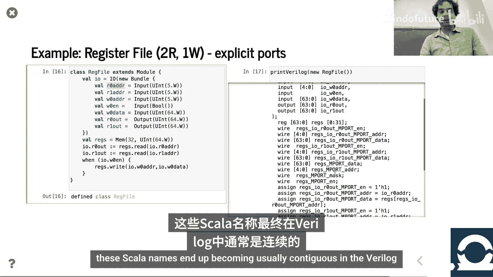
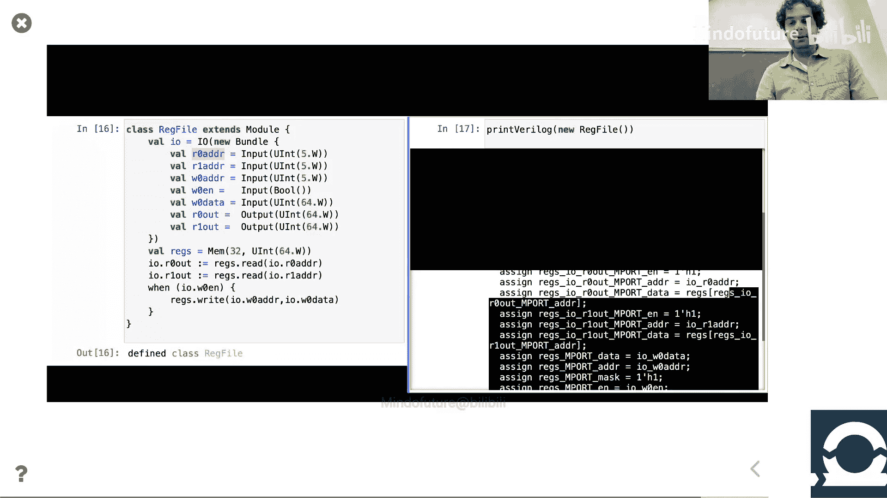
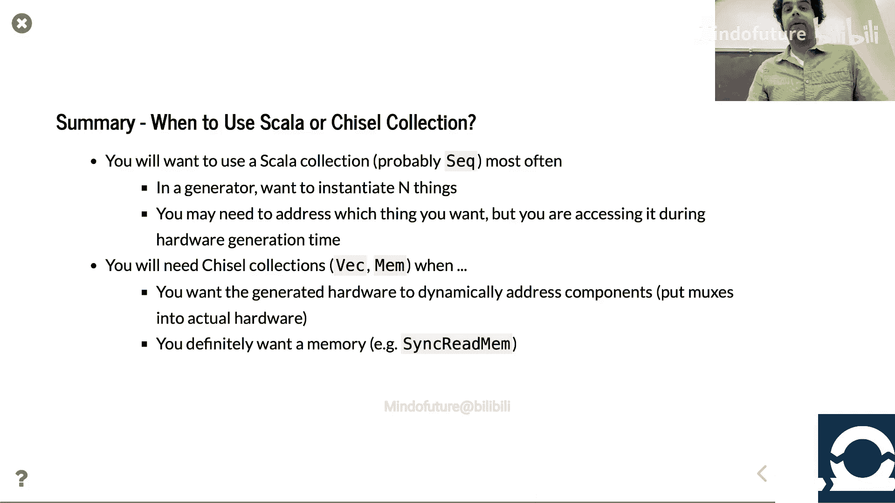

# 敏捷硬件设计：5.2：集合（第二部分）

在本节课中，我们将继续学习 Chisel 中的集合。上一节我们介绍了 Scala 集合（如 `Seq`）在硬件生成过程中的应用。本节中，我们来看看 Chisel 中用于描述硬件结构的集合类型，特别是 `Vec` 和 `Mem`，并理解它们与 Scala 集合的关键区别。

---

## 硬件中的向量：`Vec`

`Vec` 是 Chisel 中的一种硬件集合类型，它表示在生成的硬件中实际存在的一组元素。与 Scala 的 `Seq` 不同，`Vec` 允许在硬件运行时动态地通过索引访问其中的元素。

核心概念是：如果你需要在硬件运行时（例如，在一个时钟周期内）根据某个信号选择不同的数据，那么你需要使用 `Vec`。如果只是为了在生成器代码中组织数据，则使用 Scala 集合。

以下是一个使用 `Vec` 实现参数化多路选择器的例子：

```scala
class MuxNWay(n: Int, w: Int) extends Module {
  val io = IO(new Bundle {
    val in = Input(Vec(n, UInt(w.W)))
    val sel = Input(UInt(log2Ceil(n).W))
    val out = Output(UInt(w.W))
  })
  io.out := io.in(io.sel) // 动态索引选择
}
```

这个例子中，`io.in` 是一个 `Vec`，`io.sel` 信号在硬件运行时决定了输出哪个输入。

关于 `Vec` 的一个重要细节是它的类型顺序。如果你想要一组寄存器，并且需要在硬件中索引它们，正确的类型是 `Reg(Vec(...))`，而不是 `Vec(Reg(...))`。这是一个常见的混淆点。

---

## 使用 `Vec` 构建归约单元

让我们看一个更复杂的例子：构建一个参数化的 N 输入加法归约单元。这个单元将 N 个输入相加，最终输出一个和。

以下是实现方式：

```scala
class ReductionSum(n: Int, w: Int) extends Module {
  val io = IO(new Bundle {
    val in = Input(Vec(n, UInt(w.W)))
    val out = Output(UInt(w.W))
  })
  
  var totalSoFar = io.in(0) // 使用 var 暂存中间结果
  for (i <- 1 until n) {
    totalSoFar = totalSoFar + io.in(i)
  }
  io.out := totalSoFar
}
```

这段代码创建了一个不平衡的加法树。目前我们使用了 `var` 和 `for` 循环来实现，在后续课程学习了函数式编程概念（如 `fold`）后，我们可以用更优雅的方式重写它。

生成的硬件就是一连串的加法器。如果 N 很大，关键路径会很长。在实际设计中，你可能需要在中间插入寄存器来流水线化这个设计，但这取决于你的性能目标。

---

## 只读存储器：使用 `Vec` 初始化

`Vec` 可以用来方便地创建只读存储器。通过 `VecInit` 函数，我们可以将一个 Scala 序列转换为硬件中的常量向量。

假设我们想构建一个查找表，判断输入数是否能被某个值 X 整除：

```scala
val tableSize = 16
val divisor = 3
// 构建 Scala 序列
var seq = Seq[Bool]()
for (i <- 0 until tableSize) {
  seq = seq :+ (i % divisor == 0).B // :+ 操作符向序列追加元素
}
// 转换为硬件 ROM
val rom = VecInit(seq)
// 在硬件中，可以通过索引访问 rom
val output = rom(someIndex)
```

`VecInit` 会在硬件中生成一系列多路选择器来实现这个查找表。虽然生成的 Verilog 看起来有很多 2 选 1 MUX，但下游的综合工具会将其优化为更高效的存储结构。

---

## 存储器：`Mem`

`Mem` 代表硬件中的存储器，它不仅是可索引的，而且是有状态的（即具有存储能力）。硬件中常见的存储单元是寄存器和 SRAM。

*   **寄存器**：写入需要时钟周期，但读出是组合逻辑（零周期延迟）。
*   **SRAM**：通常读写都需要时钟周期。

在 Chisel 中，默认的 `Mem` 是组合逻辑读（类似寄存器堆）。如果你需要同步读（即读也有一个周期延迟，以映射到 SRAM），可以使用 `SyncReadMem`。

让我们看一个使用 `Mem` 实现寄存器文件的例子：

```scala
class RegFileImplicit extends Module {
  val io = IO(new Bundle {
    val raddr = Input(Vec(2, UInt(5.W))) // 两个读地址
    val rdata = Output(Vec(2, UInt(64.W))) // 两个读数据
    val wen   = Input(Bool())              // 写使能
    val waddr = Input(UInt(5.W))           // 写地址
    val wdata = Input(UInt(64.W))          // 写数据
  })
  
  // 使用 Mem 声明 32 个 64 位寄存器
  val regfile = Mem(32, UInt(64.W))
  
  // 读端口：组合逻辑读出
  io.rdata(0) := regfile(io.raddr(0))
  io.rdata(1) := regfile(io.raddr(1))
  
  // 写端口：在时钟上升沿，如果使能则写入
  when(io.wen) {
    regfile(io.waddr) := io.wdata
  }
}
```

这段代码非常简洁。使用 `Mem` 生成的 Verilog 比直接使用 `Reg(Vec(...))` 更清晰，因为它会使用 Verilog 的数组语法。





你也可以使用更显式的读写方法：

```scala
// 显式读
io.rdata(0) := regfile.read(io.raddr(0))
// 显式写
when(io.wen) {
  regfile.write(io.waddr, io.wdata)
}
```

---

## 参数化的多读端口寄存器文件

生成器的强大之处在于参数化。我们可以轻松地将寄存器文件扩展为具有 N 个读端口：

```scala
class ParametricRegFile(nReads: Int) extends Module {
  val io = IO(new Bundle {
    val raddr = Input(Vec(nReads, UInt(5.W)))
    val rdata = Output(Vec(nReads, UInt(64.W)))
    val wen   = Input(Bool())
    val waddr = Input(UInt(5.W))
    val wdata = Input(UInt(64.W))
  })
  
  val regfile = Mem(32, UInt(64.W))
  
  for (i <- 0 until nReads) {
    io.rdata(i) := regfile(io.raddr(i))
  }
  
  when(io.wen) {
    regfile(io.waddr) := io.wdata
  }
}
```

有趣的是，这个参数化版本的代码甚至比固定两个读端口的版本更简短、更清晰。这体现了软件工程中的一个原则：有时使设计更通用、更参数化，反而能让代码更简单。

---

## 总结

本节课中我们一起学习了 Chisel 中用于硬件描述的集合类型。

*   **`Vec`**：用于描述硬件中可动态索引的向量。当需要在硬件运行时根据信号选择数据时使用它。
*   **`Mem`**：用于描述硬件中的存储器，具有状态。默认提供组合逻辑读，使用 `SyncReadMem` 可获得同步读以映射到 SRAM。
*   **核心区别**：牢记 `Seq`（Scala 集合，用于生成时）和 `Vec`/`Mem`（Chisel 硬件集合，用于运行时）之间的区别。是否需要硬件动态寻址是选择的关键。



通过结合 Scala 的强大的集合操作和 Chisel 的硬件原语，我们可以构建出高度参数化且高效的硬件生成器。在接下来的课程中，我们将探索更多用于组织复杂硬件设计的结构。