# 【加州大学】敏捷硬件设计-CSE228A-｜-Agile-Hardware-Design-Spring-2025-p08-P03_第21讲-硬件中间表示--BV1M6ivBzESw_p8-

Hello and welcome to Lec 21， this is the last lectures I'll be giving from here on out。

 we have guest lectures as well as student presentations。So let's talk for today。

All court have been trying to extll the virtues of taking him more。

Programmatic perspective I'm building harder， right， you know， using the chile language。

 you can build generous rather than building a single instance。

We're building a program that can build。Arbitrage is kind of， you know， according to some rules。

It like kind of the key idea is we take the best of software to make hardware design more productive。

 more correct， etc cetera。 And so。Chivsel is a really helpful tool。

It was talk days about kind of going beyond chisel。 right， What does it mean to。Look forward to。

 know what's possible building your own hardware design tools and what's it like look like to kind of not just have this giant leap to go from working a language to oh my gosh。

 writing a whole tool are just kind of more gradual things in between them we can do。

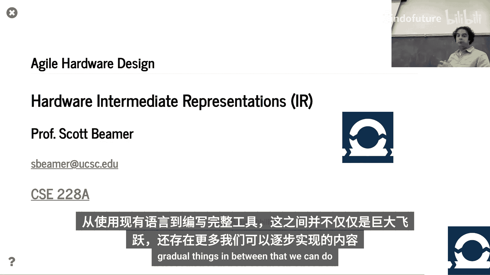

嗯。So I'm like trying to motivate why we're doing this。I'm talking about thtile。

 which as I mentioned before， at SD IR that is currently used by Chisel。

There are multiple IRs at the very last slide， I'll listen to the other ones that are currently being used throughout hardware design。

But I think Feril has a lot of great properties before we talking about it。嗯。

And past the all fits all if fits together。

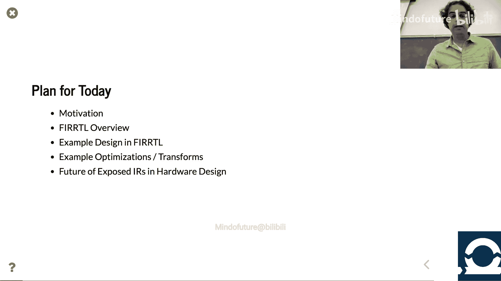

So as always， you can fire up a notebook。😊，Um， as the smallest side。

 you may have noticed that I have this line here， which maybe looks us like brotherly now I've seeing this all year。

I mean， turning off this deprecation warnings is for fertile。

 So it's not the fertile is being removed。 The escalala fertile is being removed。

 It's not being done by a difference set of code is not written in scala。

 but that's been there all quarter because。

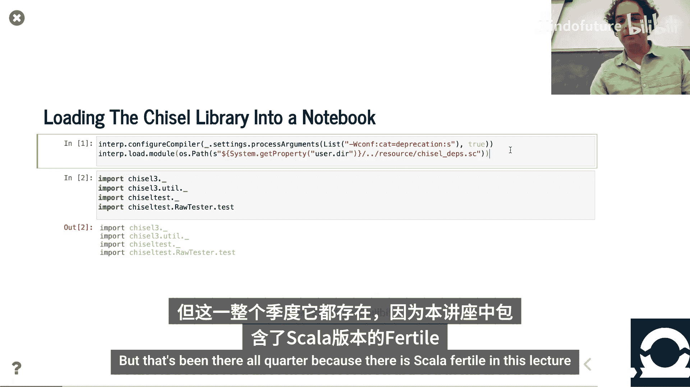

There is scallet fertile in this lecture， so we've been kind of building up to this so。

What do you mean with hardwaregene， right that we're using programming to instantiate harder。

 right in Kiler？😡，Making programs the scholara， it's the orchestrashed hardwareware sation， you know。

 arches little programs to keep saying it over and again again， and statuteiate hardware。

 kick it together。Our generators are great， we can automate connections and instructions。

And what's cool about is， you know， we can make。The design de generated rather than have to keep having we write and rew writeite things。

 right？And so as you're making these generators。You just kind of get better and better。

 You're going through youre doing your products right now。

Imagining scenarios your users can be in all apostle situations they want to use， and somehow。

Provide parameters let them reach show those possibilities and actually have you generators actually support them right。

 And so for some generators， this is really easy easy do or some reasonable tasks to do。

 But you may see scenarios where it's like shoot the the kind of。

Flexibility and pra I want to enable is kind of beyond。What I've seeing is what I know so far， right？

And so the result， it kind of handles more esoteric， more exotic scenarios。

You may need to write a lot of code right and you go through all this work in complexity。

 figuring all that kind of stuff out and you have this maybe just really sophisticated。

 really clever generator。嗯。And that kind of all insightal efforts kind of locked into that generator。

 would it be cool to kind of have some sort of resource to enable people to make these more sophisticated generators when they need to and to kind of share that expertise and that infrastructure across these。

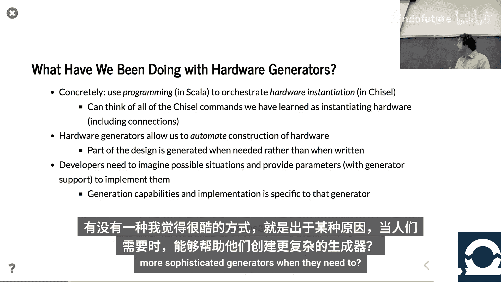

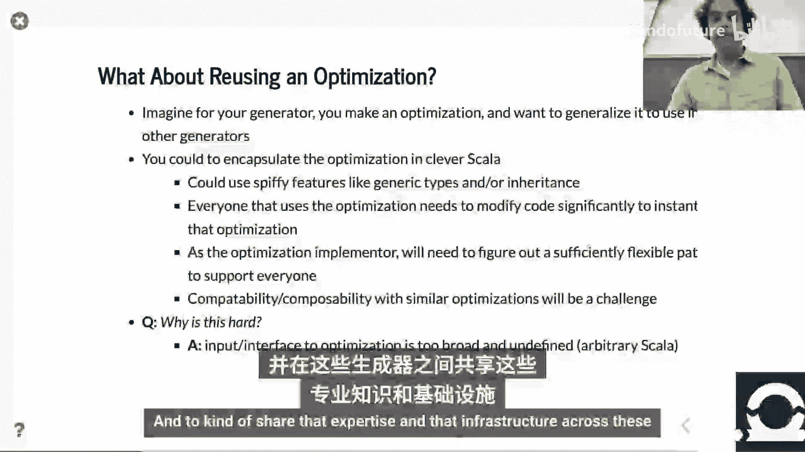

And so。Be of think it' more concrete for a moment。 Imagine， you know， you're making a generator。

 right and。It's not just generating hardware。 You spend the time。 You know。

 you run your design through some cad tools。 You see， oh， wait。

 this is not as efficient as I would like it to be。 And this is a really key component。

 I got to spend the time to optimize this。 Okay， so you go in， you make an optimization。

If your generator isn't just submit this design， admits the design。With an optimization。

And you realize。You know what， other generators might also want to do just the same optimization。

So now all of a sudden， you have a very different kind of thing。 So far in this course。

 we've been pitching generators which you know。As you can imagine。

 generates a component that provides some specific functionality。 Now。

 what I want isn't quite a generator。 I want the sort of code。

 I can apply to other code to optimize it， right， So I have this insight of what optimization looks like。

And I want to reuse that in other generators， right， So maybe if you're really， really。

 really clever if you're scholar and a good programmer。You could try to do this all in Sca， right。

 You can see know what。 I' like this really clever scholara class that， you know。

 has some sort of generic ties， maybe inheritance such that。

IfSome else wants to build a generated users of my optimization。

 they just need to know extend my class and do certain things。

 you know perhaps you know implementation of certain abstract methods。😡，Any he know。

They could do that， right？And so at first， it seems like。This might work and answer is yeah。

 it might work。Everybody wants optimization to kind of go through this challenges to do all this。

 right， That's true。 And you got to spend a lot of time iterating to make sure your abstraction kind of makes sense。

 And the things through quapo to do makes sense that you can handle。All of the scenarios。

But then all of a sudden， you run in some real challenges， right， for example。

 compatibility composibility， right， Like what happens if you have your with the optimization。

And someone else wants to have two optimizations in their generator， right？

We can't do multiple inheritance。 You can hear， You canherit multiple traits， right， but。

You can start to see how it starts kind of break down if you't having your optimization。

 so I'll be aware of other optimization。That's going to be hard。

Weather phase could be possibly inside these generators。 And about like what is the， you know。

Vulnerability factor， what is the tax service you have to kind of worry about？

Arbitrary sca is a very big。A tax ci。 rights a very big place to be responsible for。 right。

 How could you possibly。Handle arbitrary scholar classes， right。

 It's kind of hard to really kind of get that。 That's very broad undefined。 That's hard。

 So what's the solution。

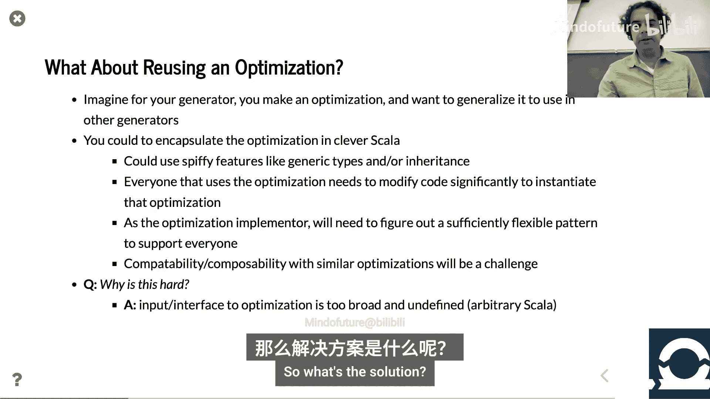

The answer is， think about how your automation fits in。 So the approach I has pitched。

You have think it like a template to scholar。You're applying utilization while you're constructing design。

Right， an alternative approach would be。What if I construct a design first？

And then optimize design after it exists。So now of a sudden。

 the input output of my optimization before was， you know。

 some I not interfacing a scholara of a generator in generous is congraly complicated。 Now。

 of a sudden， the input output behavior is I take in a hardware design and I spit out a hardware design。

 So it's a much simpler， much more restricted。Doomain。

And you can also now see how it can be much more compatible， composable， right。

 where someone wants to use multiple optimizations。

 they can just call multiple optimizations in a row， right Opposition one takes how it design in。😡。

Oimize it， then Op  two takes the optimized design and makes the second observation to it no problem right。

 because these tools now are all operating。😡，On design， rather and arbitrary generator。

 rest in other words。Sometimes what you want to make isn't a generator， but it actually a tool。

Right now it was something that takes power design in and then modify that design somehow。

 And so cool。 you can imagine these tools would be great， right， They could be more usable。

 much more general， much more。😊，Clear to do what you want to do。

But then the kind of question is what does it take to make a tool right and you kind of think about where you put this automation in programming smart for design。

 do you put in a generator， do you put it in a tool and if you kind of get familiar with both。

 you realize it's much more of a continuum than a huge leap。

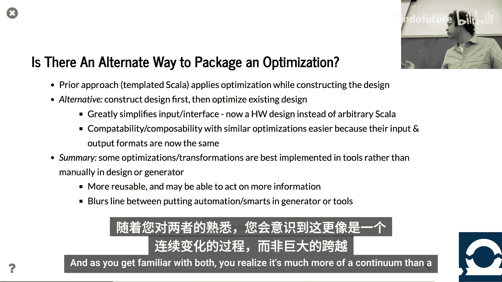

Cool questions so far。

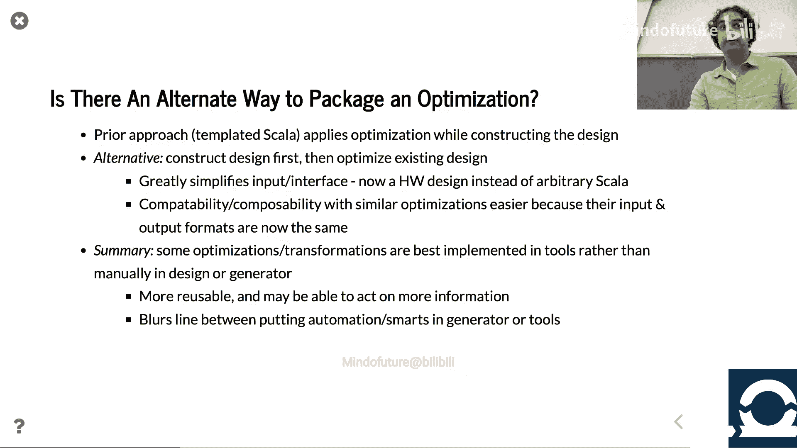

Okay， everybody's on board in motivation。To think about that。

 here's a complexity difficulty trade off curve。 So this one to use throughout computing。

 I'm using it here for hardware。 So think about this as how complicated hardware transformation is I want to do on the horizontal axis versus。

How hard it is to build on the vertical axis so。As you've already experienced in this course， right。

 sometimes writing a gene for really simple object is a little bit harder than just writing the object directly。

 Right， You know， here we are writing a generator for a static component。 You know what。

 if it's a really simple design。 It's just writing a component directly， right。 Now。

 maybe argue a chisel is not as hard as it could be， but。You can be really simple， right？

Now as that design gets more complicated。At some point， you know， a single static design。

If then get really complicated compared to a generator， right。

So Jenen has a time period where for' center complexity， Jen is going to be less effort。Now。

 one thing you may notice is that at some point， the gene phology has learned so far and this course。

 the certain language choose has learned。You're going to run into a challenge where you know what。

 all of a sudden gets hard to hurry。Like this situation I described a few minutes ago， right of。

 let's say you don't just want to make a design。 You want to。

Tackage up an optimization procedure and make that usable across multiple generators。

 That's all thing going to be way harder to do。 And so you kind of have this huge increase in difficulty。

Making life art。 And so the goal is rather than。Having that huge increase in lit。

So we have a more gradual increase。 So's let me take more effort。But a much more gradual slope。

 that's going be possible what we call a custom transformation， in other words。

Rather than generating design correctly from the beginning， we're going to somehow modify design。

 transform design once it exists。😡，Okay， so。

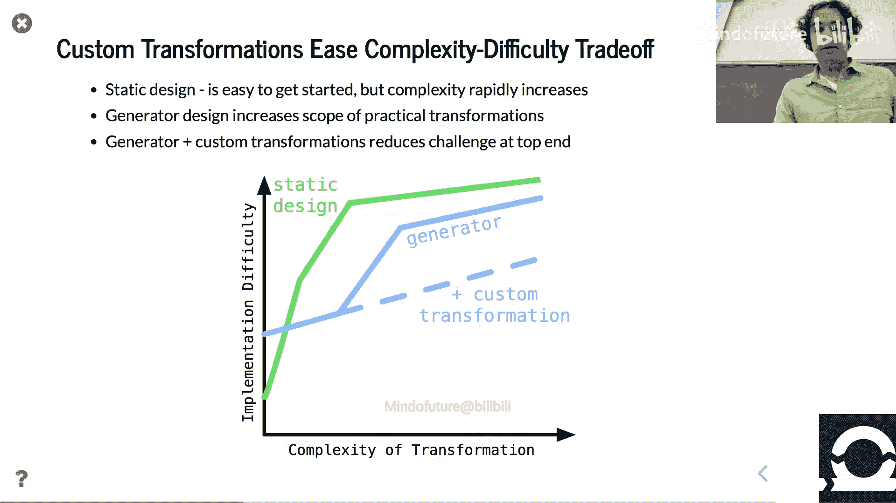

How could we go about doing that Well， the answer is you're going to want an intermediate representation as's a way to kind of carefully describe what the input and output is going to be of this tool And so an IR。

 which is short for intermediate representation that commonly what use tool and compilers and program languages right you have a well definedfined syntax and semantics freeze components and so these tools can operate in this how you know your compiler stack takes a high levelvel language and translates in various ways。

 optimize it to kind get correct machine code at our end。Along the way， it has an representation。

This has been really， really powerful right you may have heard LLVM。

 which is a IR format for software but also enables people to interchange what is the front end and the back end right and that's what makes Is so powerful。

 right。For example， if you want to add new language。

 then you add simply a new front end which takes in whatever language you want？😡，And produces the IR。

 If you want to have a new target， you says something it takes in the Ir and produces the output。

 which is sometimes referred to as a backend。 Or if you want to do an optimization。

 you is called a pass， needs to me takes in the IR， modifies AR。 And then， you know。

 you pass it on to the next part of the toolflow。 And so。For a long time。

 IRs are kind of very internal proprietary details and compilers， whatever and。

LLVM really worked hard to make this standardized in public and that was a huge。

Watershed moment for that community。So now for hardware design。

Harris have also been historically kind of closed source， very proprietary， very arbitrary。 They。

 too become more open and shared， right， So mentioned in the prior lecture。

Chissel  one and chisel  two。

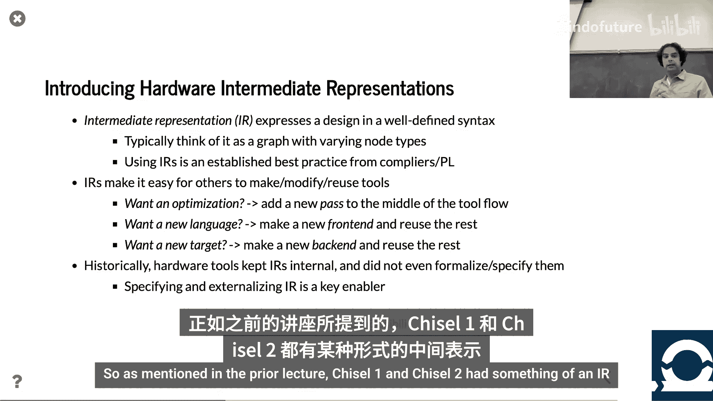

Had something of an IR。 It wasn't very formalized and it wasn't exposed in Chis 3 was this huge leap。

By having an IR， and it really made things a lot。More possible， right。

 You can definitely have new front ends， new backends。

 it also makes it much easier implement the thing originally， right the chisel 2。

 which is so freaking complicate the work in that code base。

 And then now Serki and I andm doing passes。 It's way， way easier。

 So it using an inter than IR is such a well established as practice for these kinds of transformations and these kinds of tools。

 And so hardware is overdue to do it。 and it's been doing it for the last few years。😊。

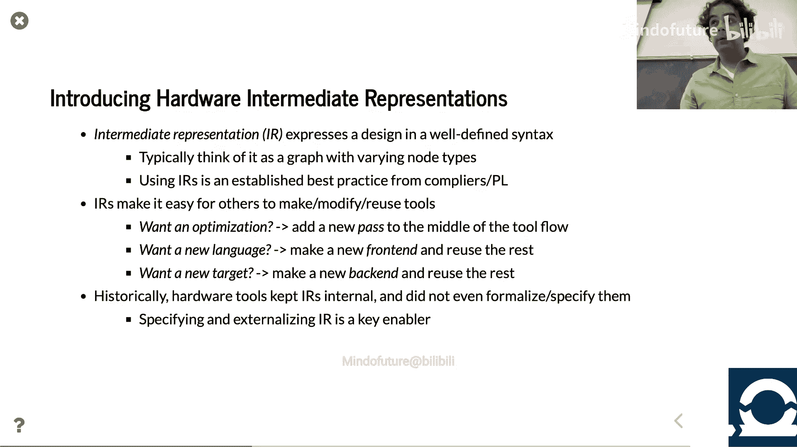

诶。So that kind of shows office together。Here's a hypothetical world which doesn't quite exist。

 but I'm showing you what it could look like。So imagine you had a really awesome hardware I are in the middle。

That is the kind of key point right and so you could have different front ends for different languages。

 for example， you know， Verlo chisel， Purtle， Elmas is a IR Pro now's group here at Santa Cruz。嗯。

It all gets into IR in the IR you can write transformation so they can take the IR in and put it back out。

 no problem， and then of course you have backend which can spit out。

 maybe it spits out you know verylo， you maybe tailored to v log either FJs or Asics both with plus code or maybe a simulator。

Spit out different IR。That's kind what you want。 You want to have this flexibility right And so you can see is someone using this large open source code base。

 you can come in do things you want to right， You wantna make a new language。 Sure。

 all you need to do is make a front end to get from your language the IR。

 and you can reuse all of this code right You want new transformation， Great。

 You need to take the IR in。s put the IR back out。 You have a transformation。

 You don't need to write a whole tool。 You don't need to write a parser。

 you don't need to write it in the middleter。You just need to write a transformation on the IR。

 right， You want to support a new output paradigm。 Sure， write a new backend so。

This top deck picture you can see is very clearly very useful。

 and this is why it's been done for compilers。😡，Our tools are now starting to embrace this。

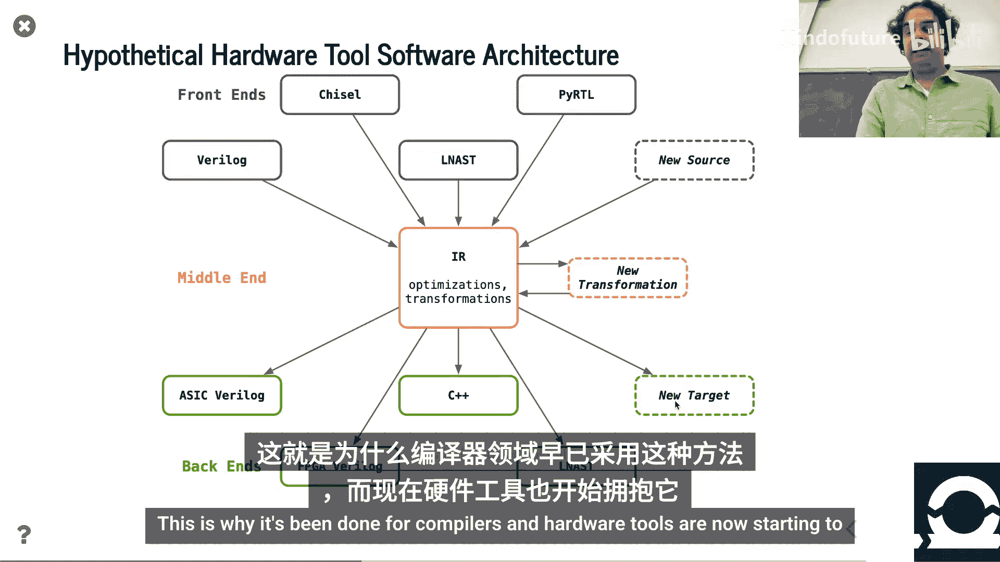

So I mentioned this before us。Bring us home， what is fertile。

 so fertile is the IR that was introduced in chisel 3。I'' been used other projects as well。

 And so like I said， Chisel2 and before was this huge。

 monolithic complex code base in order to do a surprisingly small change you to touch a lot of code。

 it was really hard。It was hard to get contributors because just the complexity barrier was so big。

 right， There's a lot of bugs。 And so yeah， it was a math that rewrite done where they had chisel。

 have a front end and emit it fertile。And then fertile itself。

Had transformation passes the operating fertile optimize the fertile。

 and then that can in turn be turned into ver log。And so when you hear me use fertile。

 both me and the community who often use fertile to refer to multiple things。

It's kind of worth being aware that this is multiple things， right。 So fertile is D IR。

 which is a specification format。 There is a， you know。

 dc read online about what what what semantics are， that sort of things。

 Fertile also can refer to a specific dot FIR file， the actual fertile file for hardware design。

 So see you have a show hard design and you run it through the chisel front end。

 you get the fertile out。You refer to as the fertile fertile also。Is a library， right？

Which processes the fertile。 And this is the one that has application warnings。

 So the scholar Fertile library is the one that's been end of life， but still using today's lecture。

 on the reason why is Fertile is now a dialect。In a larger。

I are called Sergo to come to the very end。

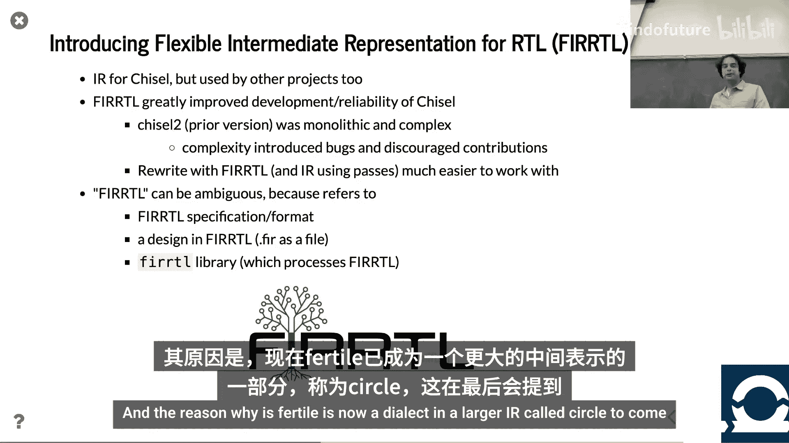

Okay， so like I said the Chisel tool flow， you have your hardware design in Chisel。

 it's the scholar program。When your scholar program is running。The chill of front end emits fertile。

 what you think of as a circuit into actual hardware。 And then gets passed on to a backend。

 So for many years， that was this fertile scholar libraryist telling about。That generates a log。

 Now it's a different program， a different codeb called F tools， R plus using circuit。

 this additional set of code。 But you can see that a lot of the things are the same。

 right that from the point of view， the chisel front end， you're still emitting fertile。

 And you can see this is kind of cool。 where you're able to kind of introduce this new backend。😊。

Which has certain properties they liked， know， it's more scalable， it's faster。

 less memory consumption。 people argue that barely produce is more human readable。In that change。

Not only didn't require changes to user designs， it also didn't require an necessarily change to the chisel frontend。

 right Chisel frontend still spits out fertile and that's fine。Da just changed to backend。

So today we're talking about Fertile library， OG back in， I should say， but yeah。

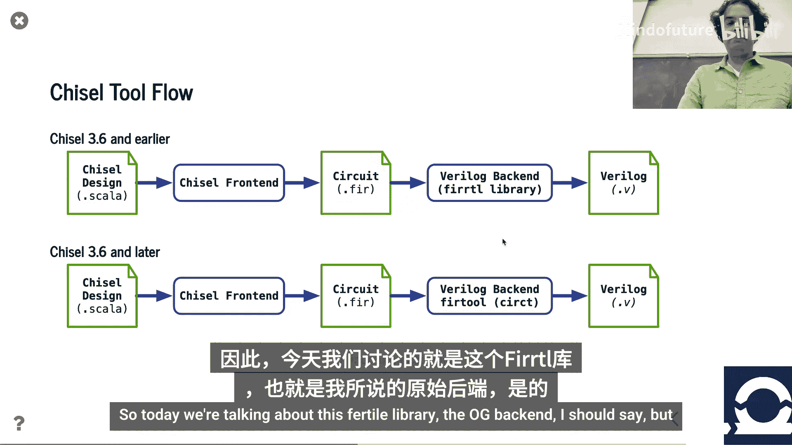

So。嗯。If you think about， well， let's dig into fertile because it says still the I being used。

 What sort of things are in there。 How do you express hardware？ Well。

 you kind of have this collection of statements， right， There's a variety of things in there。

 right so。Of course， here are' kind of drawn psychoonology showing how different types of things interact。

So your hardware design， of course， at the highest levels of circuit of you know the entire thing。

Within your circuit， you can have multiple modules。 Okay， that makes sense。 Now， of course。

 your modules as you've seen。They have ports， right， input and output ports， we've seen that。

Within your module， you also have statements says things like a connection operation or something。😡。

And statements， of course。あ。Internally can have expressions。 So for example， I'll say Connect。A to B。

 That's a statement。 The reference to a is an expression。 And so you can see how， of course。

Statements can include other statements。 For example。

 you know when statement can include things inside of it。

Expressions can include expressions aside themselves。 For example， I maybe have， you know。

 Io dot something。 So you know， accessing within a reference。These things all up types。

 leaving type self together， so。嗯。Here's kind of talking about the same things again。And you'。

 you've seen these things and kind of didn't quite realize what's going on。 But yeah， I mean。

 I said there's statements， which you know， basically。

 I think this is roughly one line of actual chisel would be a connection， declaration， sanation。

 etca。Especially if these references or literals or perhaps in operation。嗯。

So let's go back to our good old fashioned delay module， which we've seen all freaking quarter right。

 in this case， you're not worry about parameterizing。 it's just one register so。Yeah。

 here's the very level weve quarter， right， we declare。A reddge。

 remember in Ver log Regdge doesn't mean registered， it means。Sman simulationimulation semantics。

 the actualist story comes from the fact and it always blog and has。The non blocking assignment。Sure。

 that's the register， that's the very， so what if we looked at the fertile？So yeah。

 the notebooks after this course。 we extra， you know， get fertile features。

 It's always kind of been lurking there。So yeah， here we can see。 here's our design S fertle。 So yes。

 there's a circuit inside a circuit as a module。These are the IO。

 so you guys clock and reset is ports。Has， you know， output。Not the foul。The out is output。

 but also it has a flip， which makes this in kind of like an input in a way。There's there。

 we can see infertile。Redge actually means register once again， you know。

 very clear what happens on this weird simulation， only semantics。It has all these details， right。

 what's the name， what's to type， what clock am I using， what reset， etc。And here to connections。

 right， I connect the output to register， sorry input to register to Io coming in as well as the output like there。

 So you see， there's how F together。Yes，Good question。

 The question is how much optimization has already been done by time we're looking at this fertile。

I don't think a ton since we have time。

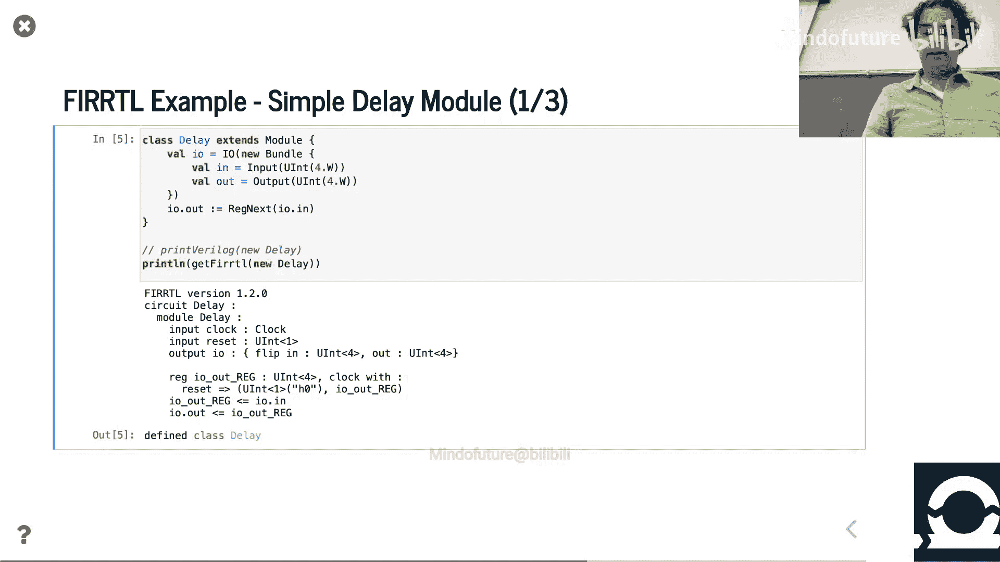

Why don't we go digging so if you go digging around the course code for this course。

This is the magic file which enables all of the things that we do in our notebooks。So yeah。

 those things like， you know， pull in the right versions of the chisel dependencies。

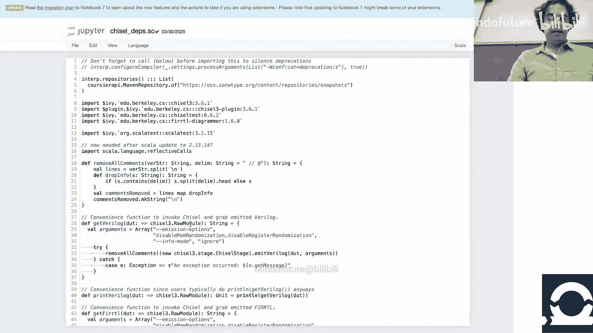

Um， when we print Vlo， the vlog actually normally has a lot of annotations describing where it came from。

 and I've silenced that with a pretty blunt force of stream manipulation。

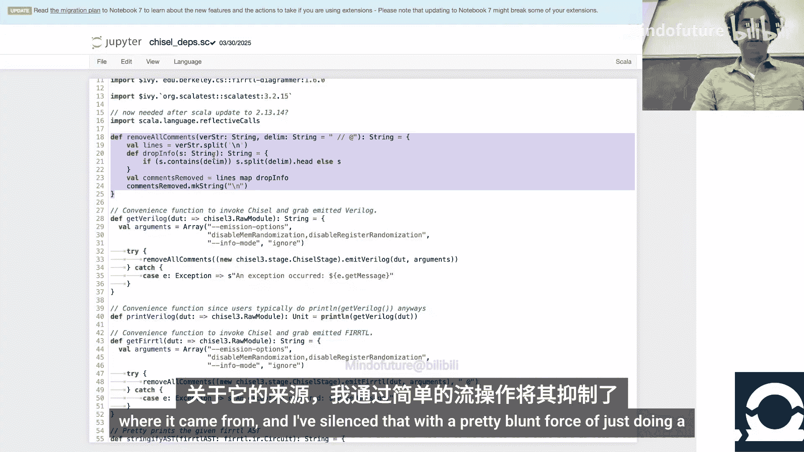

嗯。What we call getvelog。We actually are calling。you know。

 a variety of things within chisel and scletton midvelog for example。

 and so here it is emitting fertile， so because in the chisel state。

 which is comparatively in the front end， I would argue the amount of processing is pretty minimal。

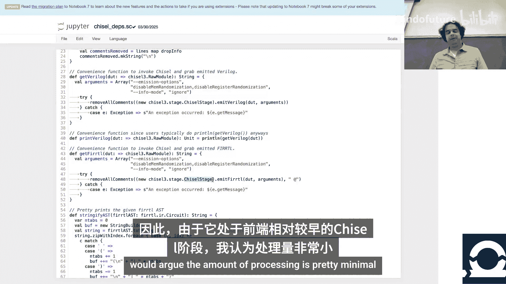

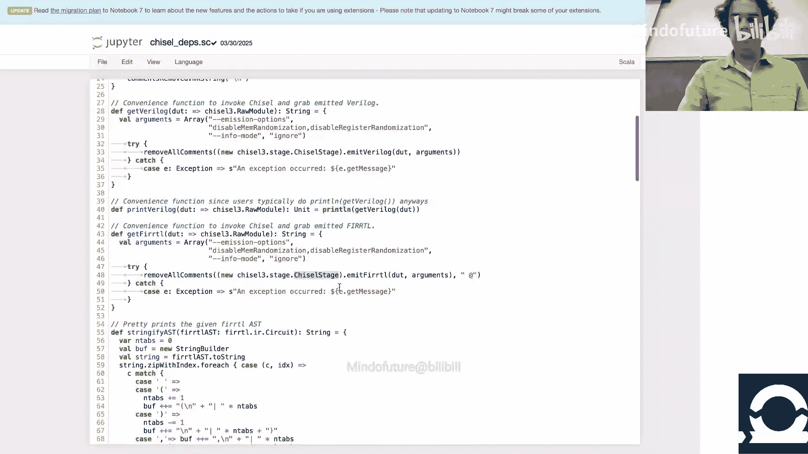

For curiosity， you might wonder else in here。Well， we have something we see later today about a stringified AST。

 sure。

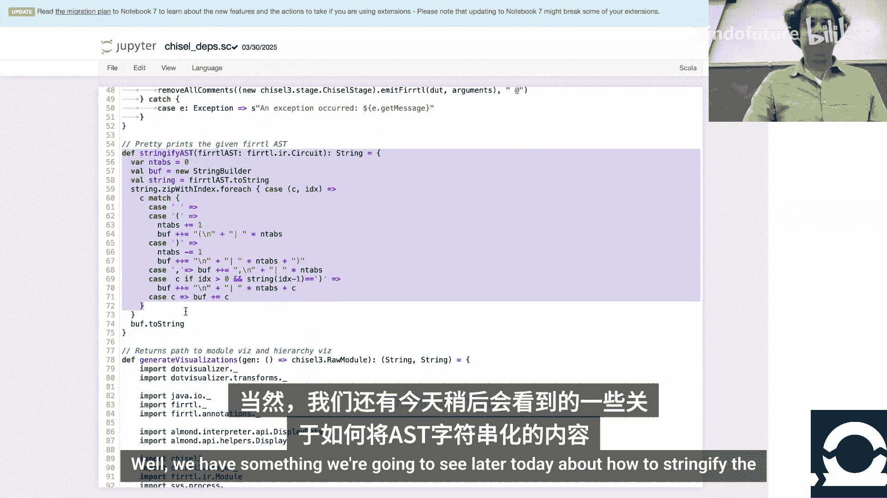

Generate visualizations using the graph this tool， that was something we saw in the second lecture。嗯。

Here's something I wrote a year ago for。

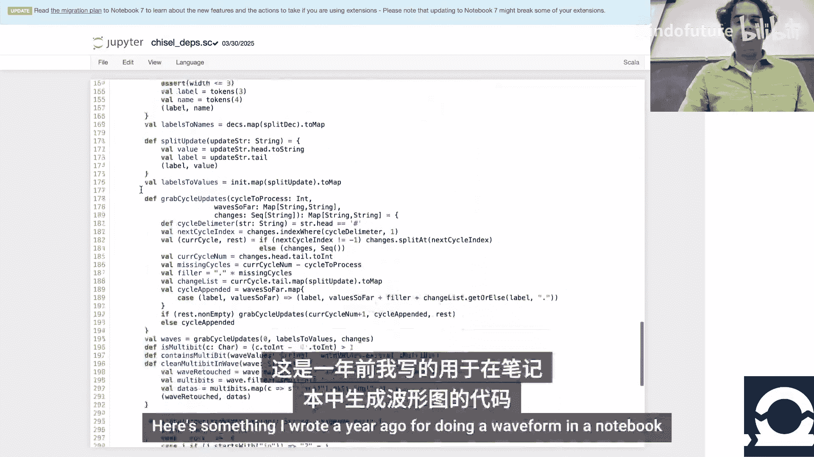

Doing a waveform in a notebook is still in here。Because why it's commonly。

 it's not super helpful because the young。The A ratio aren't great。

 but maybe someone watching this because they're excited about someone wants to go fix the style sheet。

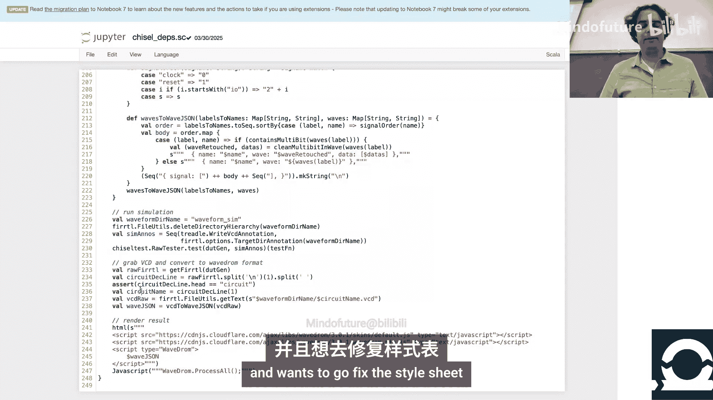

Much appreciated。Okay， let's move on。

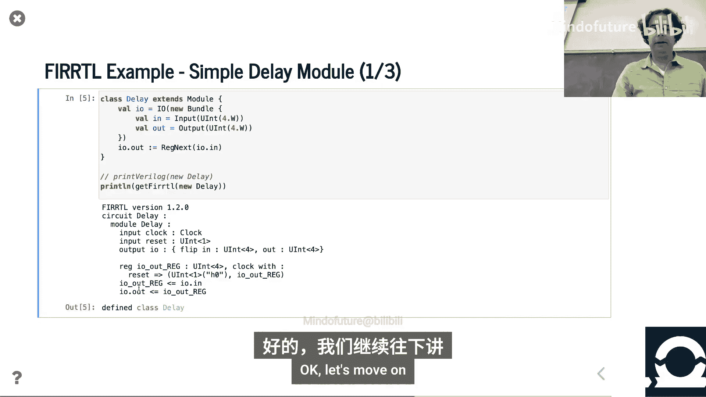

啊。As I just said， right， we can print out the AST， right， see all the fertile files。

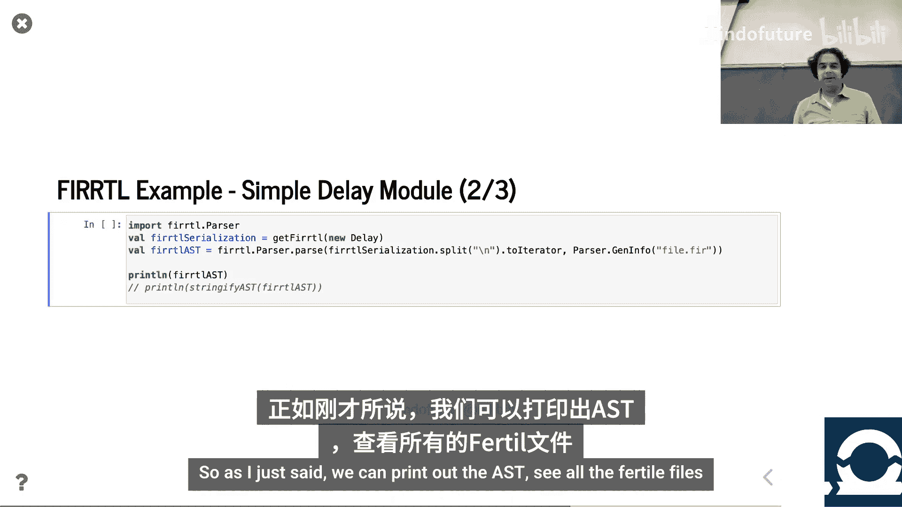

So here it is， you know。Kind of writtenden out。And so yeah。This printing is actually not the worse。

 It actually does kind of group things together better。

 If you're personally needs the research on fertile using fertile that as as you get this， this is。

 you know， impenetrable for humans。

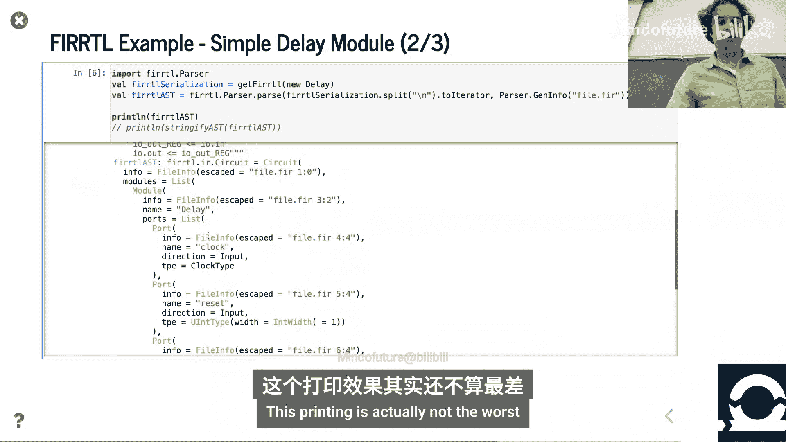

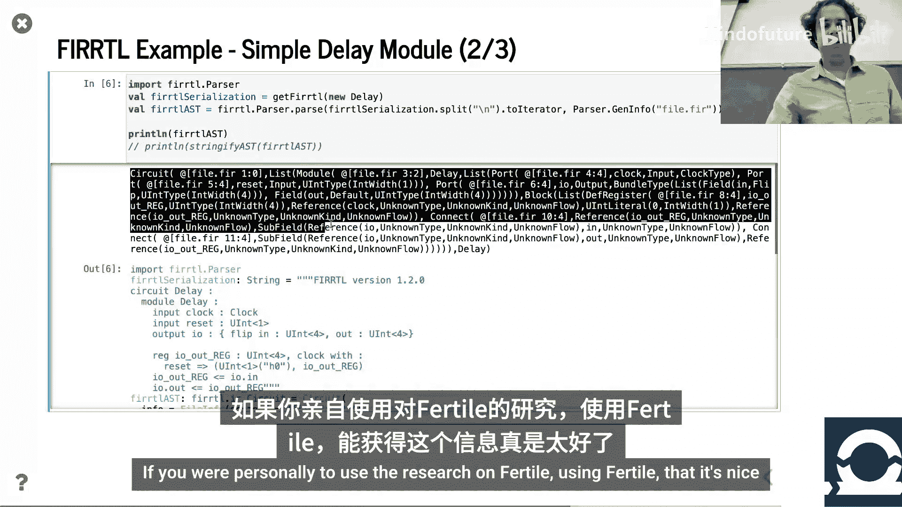

So this kind of formatting is a way nicer to string formatting。

If you didn't have that Ni92 string formatting， you could use the string of F feature to kind of also get a similar。

Clarity。So cool， So here we are looking at you know fertile forgiven module。

 if you actually were to try to draw this out， this is an example I drew in this course style using from the original fertile paper。

😊。

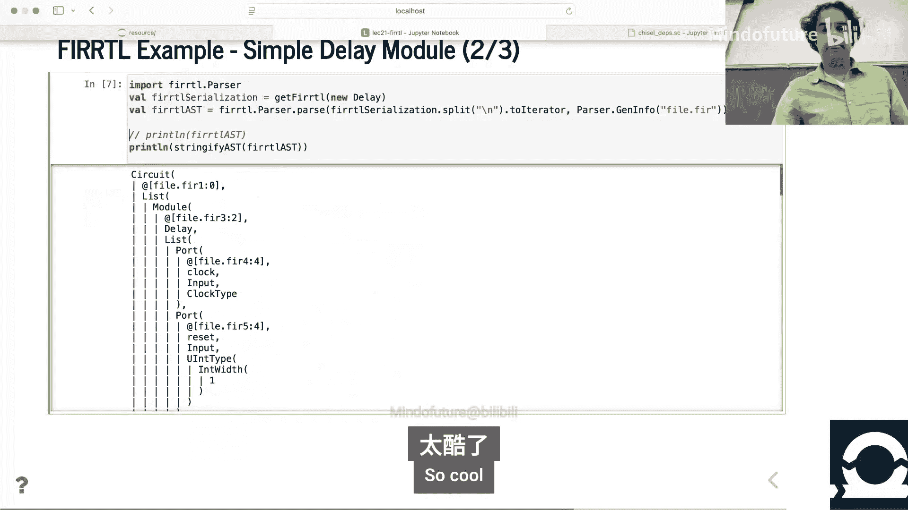

Here's all it fits together。 right， You have your module above that。 not shown。 Of course。

 it' the circuit。 You have your ports， right， Okay， yeah， clock in out。 Sure， you have statements。

 So this is the block。Of all statements， there was a register， and there was the connections。 right。

 We're saying， oh， yeah。 By the way， you know。Just register to as a type and a clock， right。

 I connect the register to the input， I connect the output to register， et cetera。

 So you see how what was a really simple looking module。Actually， is all these things。

 kind of a language level。 that's kind of how they all fit together。 And so。

K of point this today's lecture， I said， to kind of show you。What does looks like under the hood。

 but also kind of motivate？What you can do by viewing hardware in this way。是。

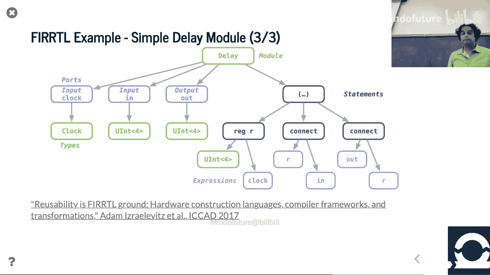

Cool。So how does Fertil actually work so that fertile library。

 which takes in this fertile we just saw？Intern on the bear， right？

The way it does that is what's called passes， right？

Rather than going all the way from fertiles very log and just one big function。

 that'll be really hard right， Well'll make this to bias sizeize pieces。

 And so this is the technique using compiler this kind of nanopa。

 micropa a procedure or basically do。One small thing at a time is to do many things in a row， right。

By having each of these passes do a single thing。It's much easier to specify by a pass supposed to do reason it's supposed to do and most importantly。

 much easier to test that pass to make sure it's doing the way you expected to right this is something that's done compilers。

 it's a great best practice。 it's being reused in hardware right and so。😡，Fertile， as it goes。

3D passes actually。Has specifications for what these abstractions should be at multiple levels right so there's a notion what's called high fertile。

Thats the fertile basically comes nearly out of the chisel front end。And then there's low fertile。

 which is。Fertile that is very close to ver log。 So basically。

 what this compiler is doing is use this term lowering where you start from high fertile comes out that chisel front end and gets progressively lowered。

Down to low fertiles， so you take these high level abstractions。And you simplify them， for example。

High fertil is something like a one statement， which doesn't really quite exist in ver log at some point that one to make it needs to get turned into a mux。

Additionally in hyperfertal you've seen when you're in Chiselaw quarter。

 you can sometimes not specify things like bitwiiffs and the bitwiiffs can be inferred。

Bit with inference is one of these passes。 right， It one of the steps that goes from there。

 So technically。In terms of how things was specified。High fertile is actually just all of fertile。

And low fertile is a subsetstive fertile that's， as name implies。

 very low little features that are very close to what's。Very log requires。

 And basically going from low fertile to very log is a very small step。 That's kind of goal。 right。

 you start off high fertile， go through many passage。 You keep lowering。

 keep removing these complicated things and turning them into simpler things。 You know。

 take those when statements， turn them into the boxeses， take those undefined bitwiiffs。

 Sa out those bit should be。And then you get down to low fertile and everything thing is all specified。

 all the operations are things you recognize， and going through low fertile very log is much。

 much simpler。😡，And so。That's transforming kind from one language another going from you know chisel to ver log。

 but these passes and these transformations can do a lot of things right they can analyze the design。

 you can get certain analytics or details years ago。

 Intel had a project where they used for it to kind of get early hardware cost estimates for a design unfortunately that's been Vitrod and not kind compatible to news version of Chisel3。

 but that was a kind of cool project they did。You can optimize the sign。

 That was the original motivation for today's lecture， right。

 Let's say you want to build a observation is kind of encapsulated。 Well， guess what， if you can。

Forign authorization too fertile， you can do that。Other things you can do are instrument or specialized stufft so for example。

If you've worked on a real industrial project。You've made had to deal with things like called scan chains。

 right where？You have your design。 Your design works the way hope it does， however。

When it comes to the bugging or testing that design， you want to what's called scancha。

 basically kind of insert wires to dig into all the internal recipeies your design to set them and probe them。

 etcter。😡，Now， having that in your chisel， you can do that you can have， you know。嗯。😊。

In additional fields all your modules。😊，You can also imagine。

Maybe have familiar cleanness of sc and chisel， maybe having like a trait you how that trait and does the scan chain versionion for you。

But you know that requires modifying those modules that requires modifying those generators what if instead you know you had a very specific kind of scaning you want to build for your project。

😡，You grow that as a tool as a fertile transformation。

 and now we don't need to modify original design， so choices， right？F like lotpp things possible。

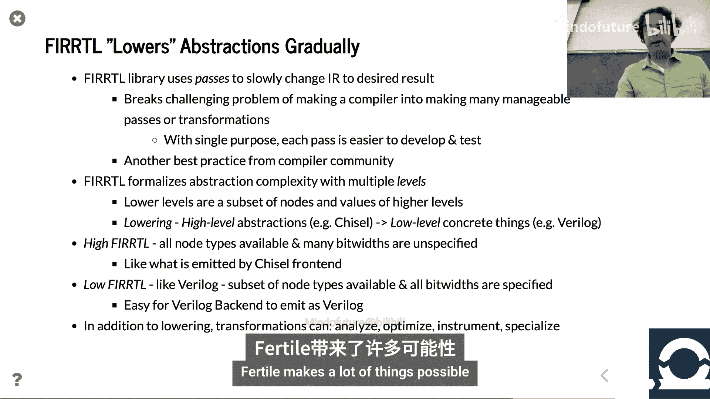

So I've kind of already mentioned some of， but maybe make it's more concrete。

 What are some example lowering passes， right， Like I said， inferring widths for bitwis。

Sometimes you have operations。Where both operators are different widths。

 and there's rules and chisel and fruittile that has to interact and that's maybe perhaps had those withs to make things match up。

 as I said， expanding ones， and attorneys wins into the boxes and other connections。😡。

And a lot of safety checks are done by fertile， right， So tilt the fronting can be kind of simple。

 And sometimes these those safety checks are done。U by fertile。

 it's been done in cooperation if some city checks done by the chile frontend end。

 some done by fertile。It's all combined， hopefully we can do a lot of checking at tool time rather than。

Debugging assimilation。As this said， it's not just lowering， it's optimizations。

So like a lot like compiler optimizations， right So something like constant propagation， you know。

 okay， I have a literal is assigned to a reference， these reference onplace else。

 I plugged that literal in to the place where it's used。Maybe some phy logic around that。

 or what if find'm using something called dead colimination， DC， you know I。e pruning？😡。

Look at inputs， look at the outputs， if there's hardware is attached to either。

 you can probably snip that away， right？Or column socialre elimination， DSE。

These are the okay things that are repeated as a common trick。

 So these are all things you can kind of do It says a lot of sounds breaking and parallel like and that's intentional right。

 These are best practices from decades of， you know experience or leveraging in the hardware community to kind of do stuff better。

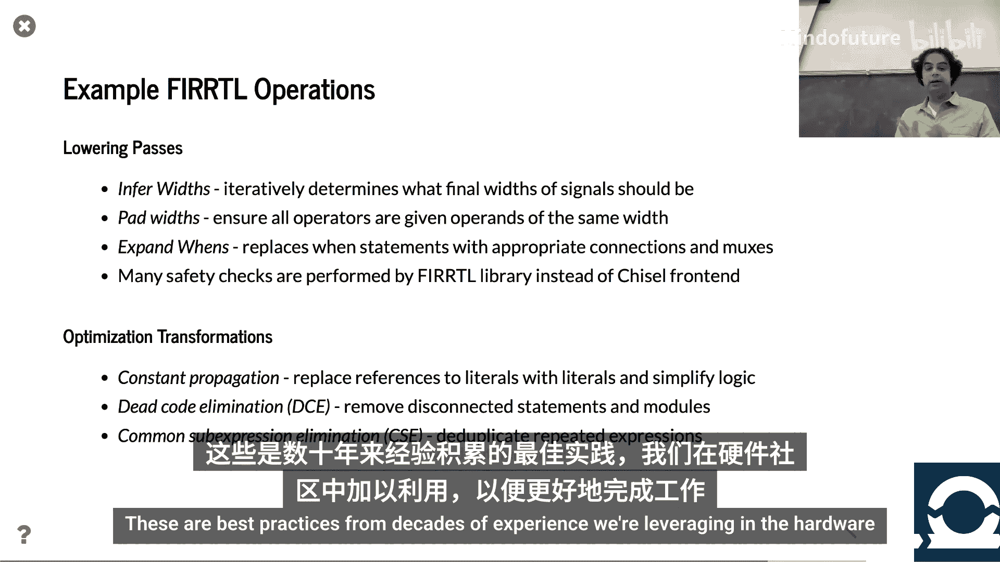

嗯。So， as a。Shiny beacon was possible something like fertile I'm to pitch what's called the fire Sim project right so what does actually pretty impressive。

So let's do you have a large power assigned。And you want toim it。

You may find that the simulators are crazy slow， right， So in this course， you know。

 we don't have very big design。 which is not too wrong。 But remember， like a real asic。

It's going to be in the gigertz， right， how fast it runs。

 You big enough design with a software as simulator。

Do so much a speed is going to be under a kilohertz。So you're talking， you know， due to math， right。

 10 to the nine versus 10 to the two， 10 to  seven， maybe a 10 million time slowdown。

You're not going to able to run very many cycles before you run out of time so fire semi technology to take a chisel design and run an FPJ Now。

 of course， you can always take hard designs put FJs。

 but what is the key challenges here There's a few。😡，Number one。

What happens with your hard design is too big for the FPJ。😡，How do you split across multiple ofPJs？

That's a challenge。Number two， what do you do if？Your refugeJ is running at 100 megahertz。

 which is pretty good for FPJ。And the memory he's talking to is running at real memory speeds。

 now of a sudden the memory in assimilation or running at incompatible speeds compared to the real world。

 you can virtualize time。 So what you want to do of course， is dive in to design。

It add all sorts of time tracking and virtual tokens to make sure you are doing the right thing to track。

The time。 and so。What's cool about this is that Firesome appears to be this kind of magic tool from the outside and of course。

 can run us on CloudPjs， but under alert it's going through the fertile instrumenting it。

 modifying it， etc cetera， this is all great。 So if fireyem was original paper from years ago。

 there's been a variety of follow on papers， you know， for example。

 Golden Gate looked for opportunities to improve resource efficiency by sharing and multiplexing objects。

I need to revise the slides tonight to add on Fire acts which is technology to help with a partitioning process when you have a design they to go across multiple chase。

 how do you pick which goes where？The reason why I bringing this up was this is a really impressive project set of projects built by grad students was。

You know， otherwise require dozens of teens ofal engineers years right。

 this is all possible because it's a for to library。So the fertile library listen do this。

All the stuff involving， you know parsing the input design and then the output。

 they don't need to worry about all they need to do is make fertile transformations they can leverage all the works already been done in the chile front end。

 all that are useful things they have to process fertile， for example。

 maybe you change your fertile and then you want to call authors to then modify that fertile。 Sure。

 you can do that。 Thiss the advantage of having a library。😡。

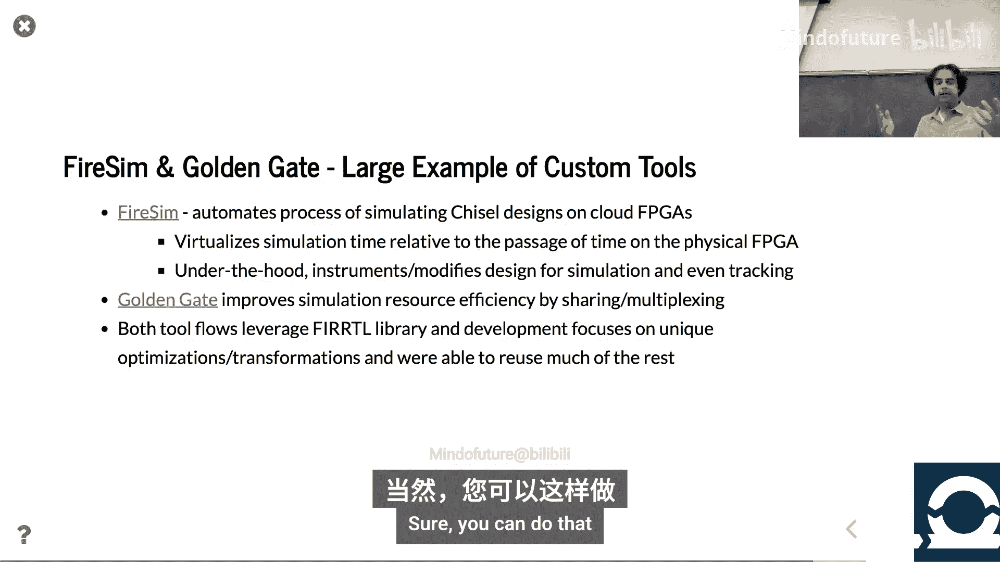

So， you use so much。

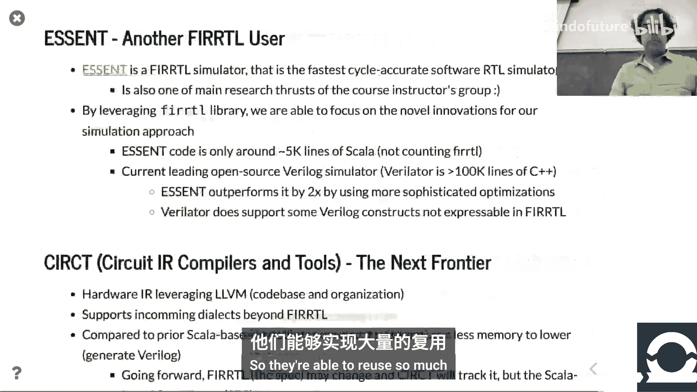

So。系。

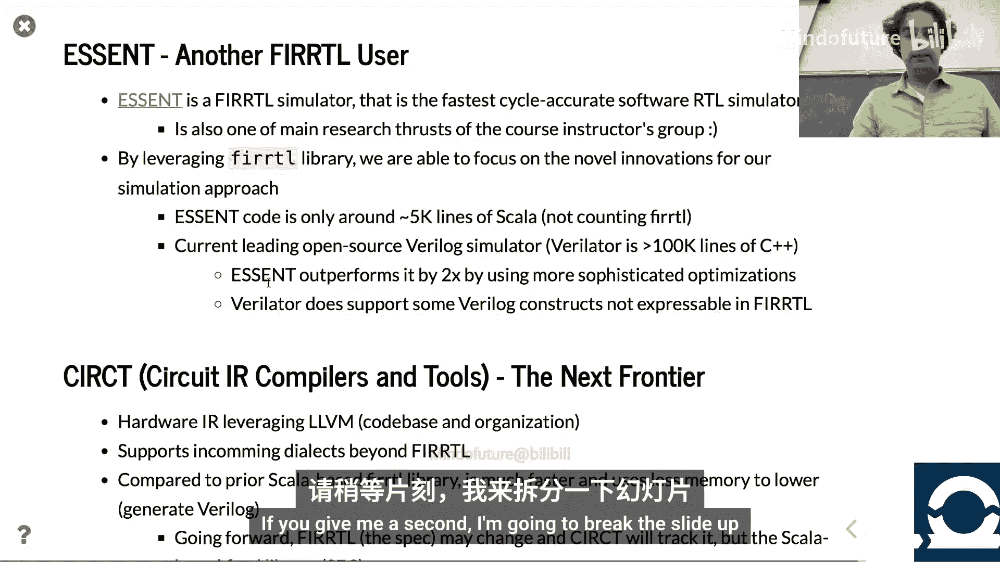

give me a second， I'm going to break the slide up。 I don't know why。

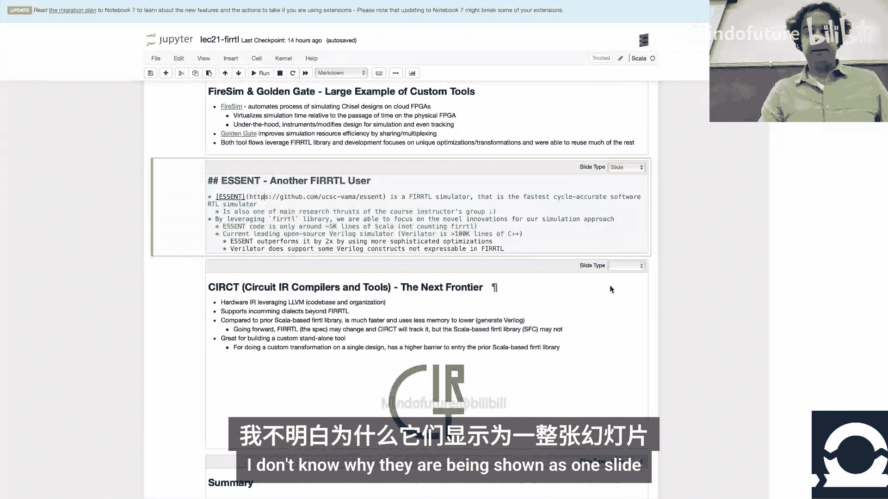

They are being shown as one slide。嗯。So now I'm going to shame pitch my own research in my own research group。

 but here's why so for example， a research that I didt mind group is something called Escent which is an RTL simulator right so we take in hardware designs and we make a really fast simulator usually the fastest both for single thread and multithreaded。

😡。

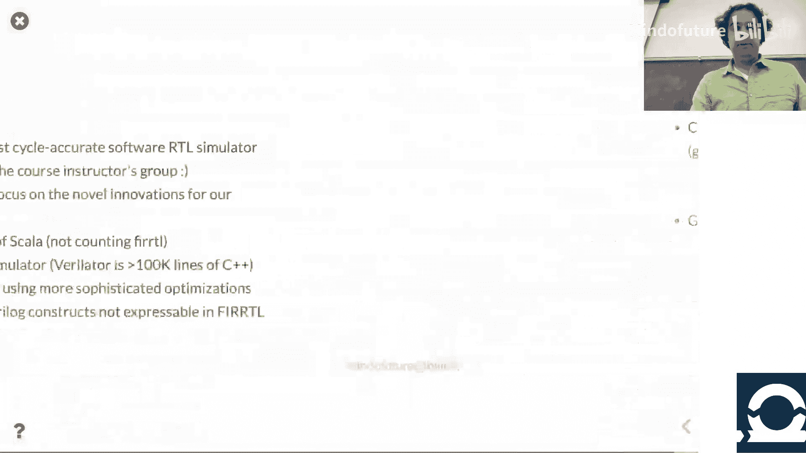

And how is that possible？Well， we didn't have to do an entire tool chainin。

We just had to take in fertile。And then fill with plus code。嗯。And so how is that done， Well。

 we even just go the library we were able to kind of see the hardware design。

 we can go around and crawl it， do we need to do。So when it does kind of settle on this project。

 D S encode code， which is in Sca， is only about 5000 lines， right， you know， basically。

We have a lot of secret sauce and now we do things fast route for simulation。

 that's we've spent all the effort doing that。And they compare to like verilator， which as you know。

 very commonly used open source verlu simulator。It's over 10000 lines plus plus code， right。

Not only is that， you， may have a smaller code base。

It's at least 2x faster or if not more one of this newung group has basement something called Rucut。

 which does multich parallelization， if you count't multicore parallelization。

 rep cut can really outperform fairly by quite a big margin much more than 2x。😡，嗯。

The kind of question is wast。 And what， what he is going on here， right。

 So what's going on here is that because the productivity advantages of Wolf scholara and his fertile library。

 there's so much stuff for processing and building a hardware tool that we didn't have to do。

 that was already in the fertile library。 So as a result。

 we as researchers spent all of our time thinking about new solution techniques and optimizations to go fast。

 that's why we' faster as we have to spent more time and optimizations。

 very later does only a handful optimizations because it's just so much code to。😊。

Pase fair log and then em things correctly。 So now， of course， in the spirit of fairness， yes。

There are a couple of very log constructs that availables simulateil that EN can knock as EsN onlys simulateimilates fertile and some of those very log constructions aren't available in Fer。

嗯。However。I include Santo， like I said， to people people aware， the fact， yes。

 you can go out and build。Impressive hardware tools by leveraging Wendy's hardwareRs。

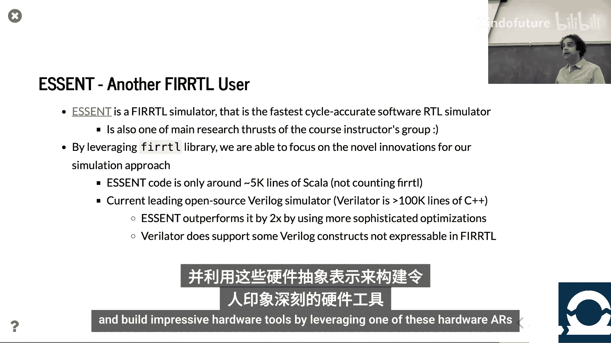

是。Cool， so then circuit， which is the next frontier， I should say it's the current frontier。

 so this is what's kind of subsuming everything right now， so it's a hard way。😊，Leveraging L of V M。

 So earlier， I pitched how impact L of VM was for compilers， you know， if you're writing C code。

 maybe youre perhaps using plan。As El of young base， perhaps you like rust。That's all of be un based。

 right。 So it's really kind of a lot of live languages， a lot of great things over there。

 And so that。😊，Both organization and code base and some of the pieces from there are being used for hardwares right and so circuits the project is doing that。

嗯。So the way it's being structured is circuit's actually a very general， very flexible。

 very inclusive IR， it has a lot of different things。They have a such they called dialects。

 And so does' multiple dialects。 One those dialects is fertile。

 There are other semantics you want describe certain things that are ways of describing hardware that are also supported。

So that's the IR， there's also a tool that influence this， which is， you know， for example。

 for tools I was talking about， this is you know largely developed by Scifi because yes。

 it's compared to the originalal Scha Fertile library， it's a lot faster， a lot less less memory。😡。

And so。That's the direction things have gone。And so。

Although fertile still uses the front end to kind of feed into this circuit。That's kind of standard。

 And so this this fertile jaws call library been using is the end of light。

 so as the future as you know they change fertile， which they haven't done too often。

If they were to change fertile。That will be reflected both in the chisel front end。

And in this tool called circuit， you circuit tool using F tool。

It manifest reflected inside that scholar base for the library， right？Gos。

 but that gap for now isn't too bad， but maybe in a couple of years it'll be a bigger bigger gap。

 But start gets really cool。 There's a lot of people using it for a lot of different projects。

 academic， industrial， etc cetera。So guess what， if you want to build a custom standal loan tool？

You can do some pretty cool stuff of it。 It has a higher barrier of entry than the scala based tools。

 So remember before with Scala fertile， I mean， you write your design and Scala as chisel right。

 You can add some other classes and do something that scala fertile saw in that thing here I was showing you。

 I mean， you can get to the fertile。

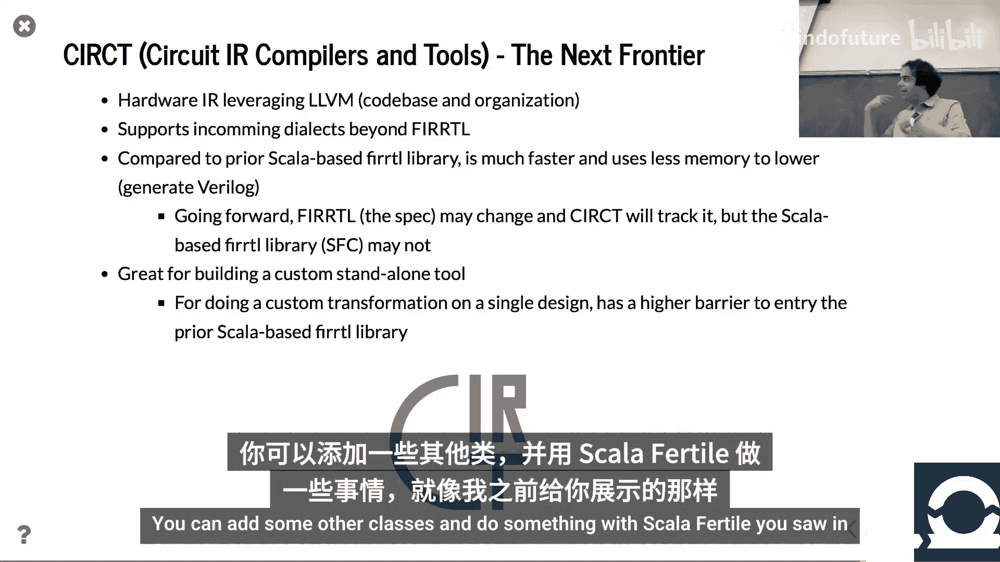

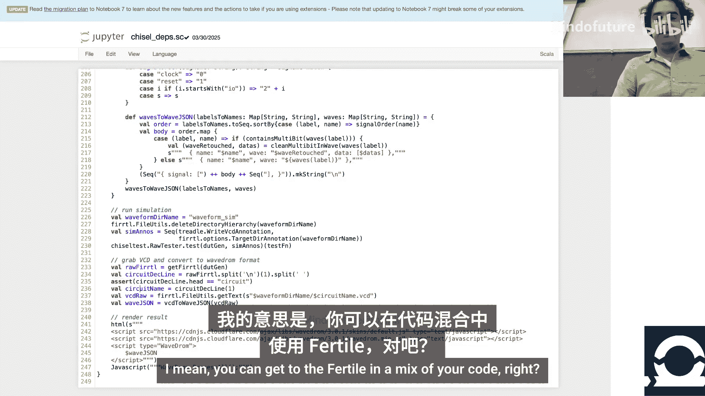

Intermix with your code， right I showed you that。

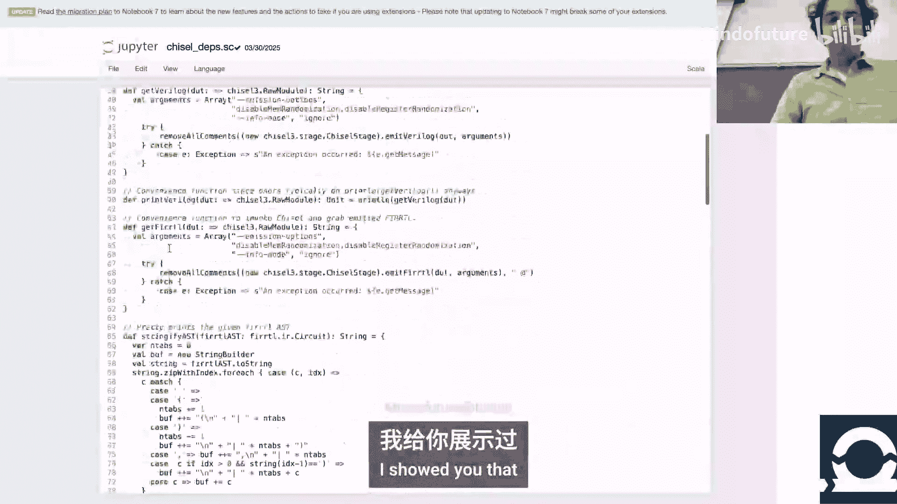

Right， is this intermix。 you can get there with circuit。

 now the syndigo start writing with plus code and writing apply a separate code base。

 It's a little bit harder to get started， but you still can write your own custom tools and stuff like that。

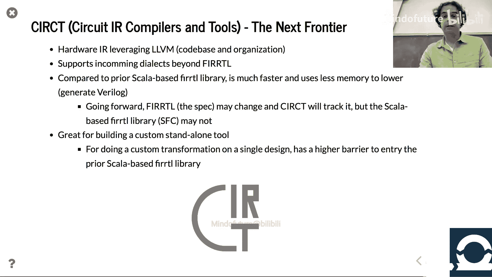

Cool， so hopefully today I're going to talk mostly about Fertile。

What I describedscribe applies to most hardwarey ours。 that's kind of the point。

 I you rather thinking it us about making。A design which you' maybe came into this course thinking about throughout this quarter of time encourage you think about making a generator and now thinking about。

 you know， not just generators about actually making full on tool like transforms。

 even tools themselves。And so there are multiple hardware areas out there。

The Brtle is one of the more popular recent ones， so the kind you know was being carried along by Chisel。

If you've heard of Esis， a very commonly used open source tool， they have their own RTL， IL。

I just talked about circuit， which as you know， kind of you know this big future going out there Fertile originally came out of Berkeleys so a lot of other top universities had their own competing Is。

 so for example， at Stanford had core IR， there was LLHD from ETH。

 which I still include on the slide however the original link。No your work。 I checked out last night。

 and it's now not reing correctly me。 So if staringron strikes through。

 the link is now to the paper itself rather than the code。

 I guess that's a sign that this code is not being maintained， perhaps， but。

You still see a lot of IRs out there and yeah，' the between。Especially RTL IL and Tit。

 there' are kind of being a lot of current traction。不。Any other questions？

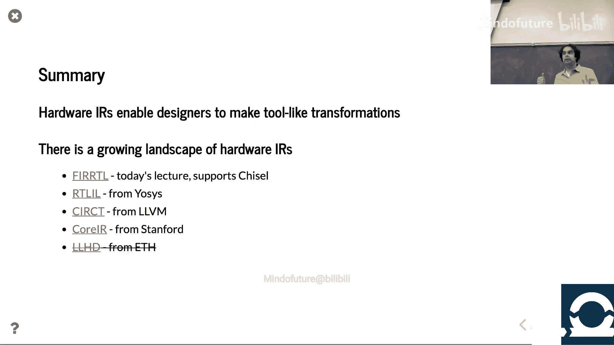

Cool， that's it， folkss。