# 【加州大学】敏捷硬件设计-CSE228A-｜-Agile-Hardware-Design-Spring-2025-p09-P19_第6讲-封装--BV1M6ivBzESw_p9-

Hello and welcome to Le 6。Let's talking about encapsulation。What do I mean by that， Well。

 as youve seen from the last lecture。We're off running， right。

 We originally over the first four lectures。 We were able to build。

Anything can do in structural very long， we can build designs great。

 But then we started actually using the power of programming with scholar to actually construct generators。

 right So in the last lecture， we've talked about using things like for loops， Vex， seeks。

 etc cetera to actually build parameterized generators have some nontrivial actual generation parameterrability。

And so sorry keep adding stuff in and so to keep adding stuff in。We're gonna want to， of course。

 have some structure， right， some way of like。Having hierarchy。

 some way of having things encapsulates。 somecapsulating in course， the goal is to。

Hide details intentionallys now if dont want to worry about certain things， right。

 so what' that mean in practice for today。We'll be talking about a little bit more scala。

 kind of same。 we have all quarter right， little to scala。

 little bit chisel and some design application， right， So we'll talk about some more scala things。

Use that to build up some chisle components that actually demonstrate some additional chisle use cases for them。

Cool， let's go ahead and see that。 So it's far of a notebook。 Sure， get the headers in there。

Al readyy。So we've made it all the way to lecture 6。

 and we never told you how to write a function in scholar， right， So yeah， let's fix that， right。

 So they call it a method， right， And there's a few different syntaxes and there's some。

 some nuances， right？ So for a function by itself。😊，Yes， you just say， hey， death。Function name。

Argument lists。 and you can directly say equals and then give it the body， right。

 So if I want to find a function plus one that， you know， takes an argument and adds one to it。 Yeah。

 great。And remember， also in scholar， we have this interesting syntax of。The type。

 if you want to give a type goes after the name， right， So name colon type， rather than， you know。

 int N， it's N colon int， right， but okay。So yeah， you can see how it gets evaluated。

 we define the function plus  one， sure here I call that function， like it see in other languages。

 you give an argument， gives you the answer six。Now。嗯。This is a， you know。

 full fledged language of a lot of things being first class。 So what can I do， I can make a function。

That。We'll do plus x， right， In other words， rather than always being plus 1， it'll be n plus x。

And notice how sure I can write that easily。呃。So of course，5 plus2 is 7。 What's interesting is。

I gave x a default value， right？ So if I don't specify x when I call it。

 it's going to be x is going to get a default value of1。 that's why we get。

 you know5 without x specified default value of1， then we get6。Cool， so these are some examples。

K warming up。These are trivial functions， right， they're one liners。😡，And you really are one line。

Writing like that is the most clean way to write it， of course， larger functions。😡。

can have you know braces around them。 Now when you have a multi line function。

 the return value is going to be the last line that's executed。啊。Cool。By default。

 I can't change the arguments。Looks like we saw with the classes if you want to make it change of course。

 you can label as a var。Inside the argument list， I don't recommend that。et cetera。

 And usually these functions are freestanding， usually inside of you know some sort of class or object。

嗯。错。This is like the very first set of sc methods， any questions？

A lot of like you see in that are languages。 right I think the most atypical things are， the fact。

 you use equal signs。Rather embraces the kind of to mark the star of the function。

 and you have the types go second， yes。包含什份。Good question。 So I want to return more to one thing。

 How do I do that， Yes， you need somehow or aggregate them together so you can use if they are all the same type。

 Yes， the sequence is the right way to do that。If they are of different types。

 there's a tuple in the language， the tuple can be arbitrary size， mixture of types。

Just like you may have seen in Python， yeah， that's totally fair game。Great。😊，Okay， so guess what。

 We have functions。 And so we're really going to say， what about recursive functions， right？

And so let's listen looks， right so。Notice how this function looks a little different than the one we's on a prior page。

 number one， yeah， it's multiline， so we have to have the curly braces。

You may also notice we explicitly specified the return type。So this time we say it's， you know。

 an in and we say colon return text。 So the same kind of sentence you saw before， right？Name， colon。

 type， you know， function。Colon tight， right， okay。This time， we had specified a type because。

If you have a recursive method， it needs to know to type。That's， that's a rule in the language。

 If I was to remove this in the yellow。 I'll leave it on for now。And if I drop it off。

 I'll saycur function should have a type。Yeah。Okay， so what's going on in the body here。 Well。

 it's the recursive function， right， So we have our base case。And then we have， you know。

 our inductive recursive step， right？And so here we are just adding up the numbers from N。Down to 0。

 right， You can see， okay， we take the current and then say。

 I'll run the same thing again with Rex sum and -1。Great so。You know。

 four plus three plus2 plus1 plus zero is 10。Great。嗯。If for some reason。

 your function doesn't want to return anything。😡，You can use the name explicitly unit and that's like void。

 right？From your prior program experiences， you know， when you writing a recursive function。

 what do you need to think about？Number one， what is your base case， How' is this going to end。

And then you can think about what the curs step is and et cetera， right。

So canonical re function you probably see in their languages is the Tibonacci sequence， right？So。

Our third function， of course， you know， when it gets sufficient small。

 always return n Otherwise in the fit not sequence， know each sequence elements last two elements。

 we can kind of break it down recursively。 And so， yeah。

 it's a very pretty recursive expression of this function。Alrimically。

 it's not the most efficient way to calculate the butach we know that。

 but look'll ignore that for now。And yes， here we see I sequence you like because the for that we're calling it multiple times。

 And so， yes， you know，0，1，1，2，3，5，8，13，21，54， butnaci， yes。S。Yes。Great question。

 So here I'm showing Sca。 How would this look in their log。 We're gonna to show down a few slides。

 The short answer for now is。😊，This is the scholara in the program that's running。

The very log is that you feel like the residue of the hardware was generated。

 so whatever your coursesive function builds up。When that code ends。

 that's when it turns into the very log。过时年。他。对。A question was， okay， so this using scholarcursion。

Is that applied to combinational or sequential logic in hardware， right？

 So it it's the kind of this game we're doing here where we're building up hardware。

 to hardware when it comes to building it， it a matter of declaring it。 I want a adder。 I want。

 We saw a M。 I want a wire and connecting together。

 So it's really instantiate component and connect components。

Everything else we're doing is actually all scala， rather and chisel。

 And if we're kind of choosing what to coniate， how to pick them together。 And so， yeah。

 for that sca code surrounds these chisel operations， that can be a straight line code。

 It can be loops。 It can be functions。 It can be recursive functions。 That's all fair game。😊。

And using all those firming constructs， we can kind of build more and more sophisticated and intelligent generators。

是。过。And so you may be thinking why recursion， well。

 why recursion is because it's sometimes a really helpful way to think about problems。

 it also a way to keep this style of having everything be immutable all vowels and yet you still have that iteration ability like like a immable thing。

😡，In terms of runtime overhead or anything， So's a knife occurs gonna be floor if you're not careful。

 but it doesn't matter because it's gonna be in the generator。 It runs once。

 and then the hardware is generated。 The hardware is gonna be no less efficient， right。Cool。

So we were just talking about a second ago， right， how are we using scholarly constructed children components。

 right？We are the substantiating things。ecting them all together， right， And so the goal is。

 this is the more with software engineering goal。We want to incap。 We want to hide the complexity。

 right， We wants the way to have a generator， and they can just give the parameter generator needs and then use it。

 They don't want to think about what's going on the inside， right。

 They don't want to worry about that。 If we do a good job of choosing what we hide and what we show。

They shouldn't need to care what's inside there， right？

And stillll see as you're designing your own components and your own abstractions from your own design。

You may want to reuse certain things， right， And so the goal is how do I declare something once and use it in many places and get。

Great utility and reuse out of it， right， And so one such tool for that is recursion， right。

 the way to perform iteration。With parameter translation， of course。And so we'll see that。

Another thing we're going to see today is until now， we've been telling you， yes。

 everybody Chelsea declare needs to be in the module。That's only like 90% true。Technically。

 we can construct things outside of a module。😡，for example， with functions， however。Eventually。

 that component needs to be wrapped into a module before I generate a veryo or before I run a tester。

😡，And so we'll see how that goes。So we also look construct components outside a module and then pull them into a module and a s them。

 et cetera。And at the very end， of course， we' come back to them called bundleundles。

 which is how we kind of get some structure to our design。

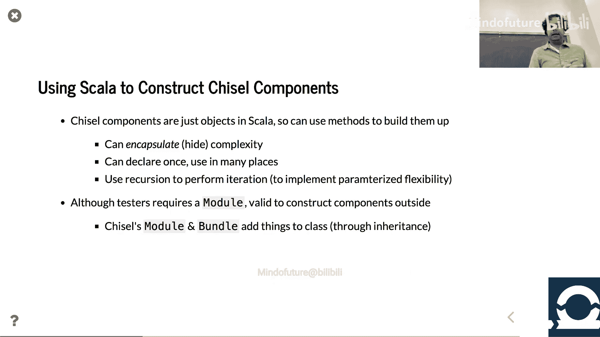

So you may remember from just。So lectures ago， but actually just three years ago here in person。

 we built that shift register， right， we said， hey， I want to have something delayed and cycles。

And we。Did that with。A var and a for loop was one way we wrote it。

 right the reason why like the the var for loop 1 is that one。Allowed us to have。

Even the possibility of zero delay and gracefully， changed over。But， you know。

 if you want too a good lay， sure， you got it。So that was what we did before。Now， let's。

Tried this recursively。So。We're going to have a helper function。

These's often the kind of ways that recursive situations where you kind of have your recursive function。

And you declare it as a method function in this case。 And then you're gonna。Wired up like this。

 right， So okay， so。Base case， no more delay。I has path out the last action should have been given。

If I have n， you know， not equal to 0， well， then I should。Call myself again。

 But then using recursion。Take the output to sing and wrap inside a wge， next。And go on there。

 And so。This is going to produce basically the same code。The naming is a little different。

 but structural the same。Right， and yet， this also has a nice property bill to handle。0ero。Or。

 you know， arbitrarybit depth， whatever。嗯。So comparing these two side by side。

I guess the one the right has the virtue of having no mutation。

Mations kind of handled by effectively creating these new。

Method context every time it does the recursion。So there's no var。

Both of them have the same external functionality。 Both of them have the ability to give a user an n delay and can be0 or greater。

嗯。So both， you know， check off a lot of boxes。I think if some people probably prefer the one on the left。

 they might find the idea of mutation in a for loop avar more clear。For this course。

 if you're trying things out， I would suggest trap thing on the right。

 It may not look simpler and it may not be simpler。

 but it's kind of good to like experiment and see what happens。 And I think。

For the sake of deliver of your own。Design style on your own coding style， is' good to kind of。

Push us in a little bit and see what kind of makes sense。

 and you may find for some more sophisticated problems。

Recursive one does like a lot cleaner than the mutation1 before loop in a bar。W。Questions。She。

Let's go ahead， and。Now' talk about scholar objects。The naming here isn't ideal。

 so you've heard me talk about class and object and keep talking about objects。😡。

Let's kind of be clear about what's what So in objectjo programming an object you know is some instance of something and you can have methods。

 you can have fields to it， etc。😡，嗯。Of objects， there's kind of two styles， right。

 There's objects we can have arbitrary number of instances。

And there's something called a singleton object， meaning that no matter what， there is exactly one。

Copy， right， There's never zero。 There's never five。 There's always one。

 that object exists as soon as the program exists。And we see the program dies。

 that thing end since that's called a Ston object。And so in the scholar。

De's distinguished with the object keyword。 So here we have a class called my pair。

 So were gonna have an instance of my pair。 Then there's object my pair， which is a singleton。

 So there's only one singleton my pair。And then I can have emphasis of the class， my parent。

 orer number of instance， right，  zero2， you know， n。having。A singleton。

Object and a class with the same name。Is a very common design pattern。

 And this predage scholar goes back to outdoor oriented languages。

Is this often referred to as the factory pattern or factory method。

 right And the fact that's queue of the same name is that it was called a companion object technically。

 right， but basically。The way it set up。Is that someone can use this object。To andect others。

 So let's kind how this plays out。 So find declare a class by itself。' say making a class for a pair。

 Sure， it takes in A And V is 2 in。It has those fields。

 and someone can call some on it to get sum of those two things together。

So if I was to run this code， Sure， I can declare， you know。

 the nuance of a class is new and in my pair。I can add them up。One interesting thing about Sca。

If you have parentheses on something as a functionification。

And there's no argument It's a blank premiseheses。嗯。You can actually omit them。

So no has NPC sum without premises。 That works just fine。 Stylistically， this is encouraged when。

The function returns something and does not modify the class instance。

If there's any kind of mutation involved， this is strongly discouraged。

 right because I'm reading this code。D syntax， then distinguish will from me calling a function。

Or just thumb being a field of the class instance， right？And。Guess what。

If it's in immutable function doesn't change anything。

 the fact it's a function call versus the field， maybe it shouldn't matter someone on the outside。

 And that's why it chose to have this possibility。 But instead if you're mutating things。

You should use the print so that way it's clear what you're doing if you're reading some Muslim code you you seem to somehow omit them。

 that's why。Cool。So'll see how they use this single syn objectic in a few ways。嗯。So we can。

Do a few things。 We can number one。 let's why we want to track how many pairs have ever been instantd。

This is a way to kind of do that rather than having somebody of time to call new my pair needing to in some sort of counter or something I can at the time this is done intercept that call so。

嗯。What is this code right here？Calling us on the object name。Chap is really the same as a class name。

 but being compileeller is not confused。And then given these arguments。It's what they going to do。

 Well， a apply method in sc is a special keyword。And so。

Apply is going to kind of all the apply and basically do this。 right。

 So you're calling this function。 And what does that do， Well。

 it adds one to total number repairs and it returns to class instance。

 So from the point of view of the user。They called my pair 2，3。And they got a my peer object。Right。

 this object were returning if I let's do this， this actually returns a second。My pair。

 I can call some on it， sure。Now， if I ask it how many of my pairs have been made。

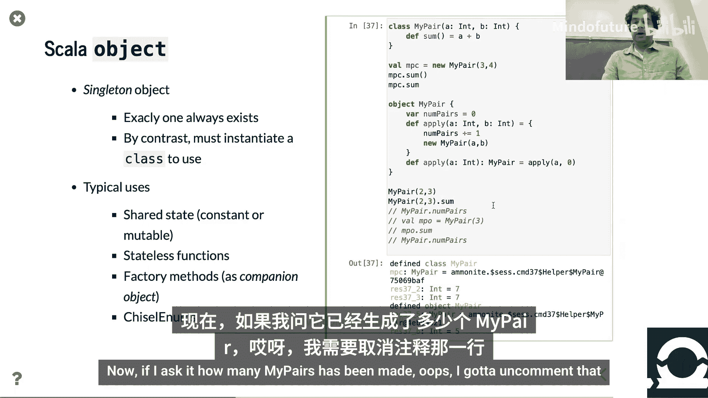

WOops， I got to un at。It only two， right？And the reason why it's counting these two calls。

 these two calls。Use supply methods that they are going to be incrementing this nu pairs。

These other iniations kind of bypass this object， right， they go directly to the class itself。

 and that's why they're not included there。But you see using this kind of factory method。

We're able to。Interface yourself into this。 So you may have thought looking at this class primer from last week。

 we have this argument list。 It was kind of very cumbersome because sometimes for a class。

 you might want to have different types of construction list。 If you want to have， you know。

 simple construction list or long structure list。And in this case， you only had one for the class。

 and this probably seemed very constricting。 The answer is。

 you can actually have that flexibility by using these factory methods。

As apply methods on the companion object， right， I can have the structure of two arguments。

I am a shocked with one argument， which under the hood just calls the。

T constructor apply and it gets zero over taking an argument。What's nice about that？Is that。

K how this is coded up right by calling the other apply method。

Numb pair is that also thought incremental correctly， right， It's all kind of track。

 But having a single source of truth， right， this all comes together。So。😊。

You've been using these singleton objects and not knowing it。For example， when I say something like。

 you know， seek。1，2，3， right， That's an apply method on the Sih object that returns a Sikh instance。

Right， you may be wondering why recover coveringing this。In this class。No pun intended。

We use it a few times， right， Much of time we're using these class construct。

 There will be times when we want to use these single ten objects， right。

 Sometimes we want to have these factory methods to handle different cases for us。

 Sometimes we want to track of our class synthesis。 Sometimes you may just want to have。

In not Nope land， but actual proper Scotlandland， you just want to have bunch of。Methods， right。

 Meths need a living or class or an object。 if there's no。Herer instant state that makes sense。

 And as putting them an object makes more sense， except why people have to kind of stand change object nor de it。

And instead， they can just go directly， so you'll see it in all these kind of cases。Yeah。

 class and object。Both for adultjoted features， class is a， you know。

 instantible type of class versus object as a singleton。哦OK。Questions， yes。接下。Which one up here？Oh。

 oh， so within here。Yes， this new command。Is a stand Ch an instance of this class。

So they happen to have the same name。That's actually not a requirement。 I could make this my pair。

 too。That it'd be okay。 And if that'll also be my pair2 down here。嗯。However。呃。

You can have these two have the same name as referred to as a companion object。

 and then you probably can figure out which one you mean when you do to certain things。But yeah。

 so basically we're using the same object to produce instances of this class， right。

 and so that's referred to as a factory pattern and all jointed programming。😡，嗯。

This is one way to cring objects， where rather than having objects that have their own internal constructs。

 you have another bit of code that understands how to build that object and handles that for you。

Other questions。Okay， let's。use that effect method were was talking about。

 right and actually put it to work in chisel。You may remember from a couple lectures ago we。

Rote up our code for our counter， right， So that's this class above， you know。

 So we have class my counter， theres a maximum value。I told you this boilerplate。

 but now you can't understand more about what's going on， this is。

Obbit oriented inheritance from module， which is a chichislo construct and that kind of makes it chisel appropriate。

 We have very， you know input， a single boolean wire。 If true。

 we're going to incr enable to increment a recycle the current touts and output。

Here's the code from a couple lectures ago where you know have registers set to zero。

 there's some additional work here to kind of figure out the right bit with。And then yeah。

 if it counts true and it counts below to max， just add one。If we are equal to the max。

 then we wrap around a zero and wire it all up。 So we did all that。So， I can go ahead and。

Deecclare that method and write the very and we've seen that。If I use the factory method style。

 so in other words， I have an object also called my counter and supply and that just returns to new my counter。

Yeah， that's gonna work just fine。And should produce。Literally the same bear luck， right。

 this is all the scholarland instinctable in Chi land。

But you'll see in certain cases having these factory methods。Allows you to better。

Encapsulate your chisel for these generators where， like said。

 it's very common with generators you want to have not just parameters。

 but different combinations of parameters and have that， you know diversity of constructors。

 you can do that by having multiple applied methods inside of your river。Campanion object。

 much easier than you can。With just the classified self。

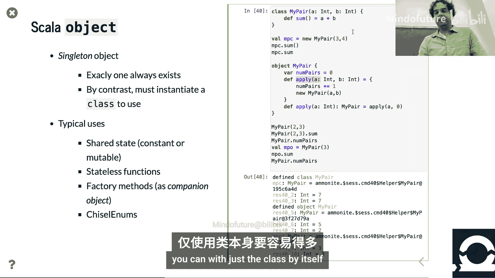

This is a trivial example and doesn't quite show the full power， but it shows at least functionally。

 and we'll get more examples in a second question。那。Oh。So the factory method allows us to kind of。

The question is， what what's， what's the advantage factory method。

 The advantage of factory method is you can now have the intelligence and logic involved with。

Creating an instance。Separative from that instance itself， Right。

 So in lot of language you may have written before， you would let say C plus。

 you might have multiple different constructors。 Okay， construct A， construct B， construct C。

 and you put that inside the instance， right。By pulling it out， it's the same code， right。

 notre magically eliminating code， but it can be more clean。

 right the instances focus on doing what this actually needs to do。

 And this companion object then has the smarts about how to construct it for us pragmatically。

 as harder people who don't care about software just care about making nice hardware。

But we care about the ability to have multiple instructors， right？With the class and taxing Sca。

 you're looking say， you know， knew my counter not it。

But if I want to have be able to have different types of parameters I want to have。 you。 know。

 instructor Astructure B versus construct C。Matting different applying methods in the companion object and the factory pattern。

 I can do that。是。Yeah， good question， so could we use the term overloading to describe my counter because it both refers to a class and an object。

not quite sure overloads the right term， but you're right。 It's the same name。

 The compiler based in the context knows what you mean。

 And the fact they have the same name binds them together in some way I want to call a companion object。

Not necessarily， I could。Make this， you know， like that， right， And then it would need to be。This。

 I think that should also work。ops I gotta run that code。Yeah， that's fine。

 So they're required to be the thing， but。They can be the same that's a lot more clear to people reading what's going on。

You'll see in a second I'll show you some examples from the Chisel standard Library in the Chisel standard library。

 sometimes it haven't be the same name it's very clear where it comes from in other times。

I's not the same name because the thing it's using is actually name for some other reasons。

 kindnd of hiding that name。

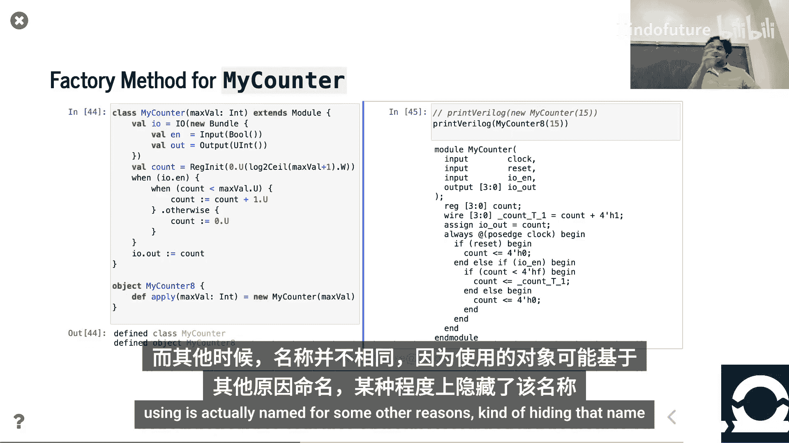

Um so。Let's see a few different variants of this。How about？If we want to do our module or sorry。

 do our counter。But we want to do it outside of a module。Right， so in other words。

 this is a scholara class。It， you know。Takes in a maximum value。That is a sclet int。

Takes in a chisel wire and na， which is a bo。And it has kind of that choal logic for our counter。

And then if somebody wants to instantiate this， they can use the companion object。To go ahead and。

 you know， say， hey， I have a maximum value in that enable。

 It's going to go ahead and call that function。 It's cause wired in there。 And we need that output。

 So then it's going to go ahead and。Return the output as the result of the supply function。

 So technically， you know what is this my counter applyly return？It returns。D count。

Which is a register that was generated by this function。 Now， the register is not alone。

 There's a lot of stuff surrounding it， but that counts the result of all of that。And said before。

 it's perfectly fine for us to declare a chisel like this。

But before I can turn it into a very log before I can as simulateilate it。

And he's the finest way inside of a module。 So the very end。I'm now asing your module later on。

And I'm answering this。 You can see the actually syntax is perhaps more simple than you might expect。

 right， Im saying， hey， my counter。This， my counters not new My counter。

 knew my counter would be up here。My counter directly is calling in the object。

The object that the pre is right away that's the apply method， so it's the supply method。

 this is returning MCc。 count and detecting into discount。So， the other day。

We get the same verrilla coming out did end。This example is。

 you know putting to get all these different features together。

 This is probably not a molecular right write counter。

 but we're showing these features kind of in the lowest consensus example I can show you。

 and we'll see as the quarter goes on more sophisticated usages actually justify。

Use of these features。 okay， yes。Are there other otherjoative design patterns besides factory in Singleton。

 Yes， they are and not until my tongue at this moment， but definitely right。

 they are definitely both possible in scholara in general because it's a very flexible language。

 but also there are some scholar even encourages I forgive me for not remembering right down the spot。

 but I'm sure there's other patterns for sure。Okay， so。We've written counters so many different ways。

And it's like a reful thing。 So is it in chisel。 Yes， it's already in chisel。

 It's already in the standard library。 So let's take a look at that。

 If we go to the scaocc page on it。😊。

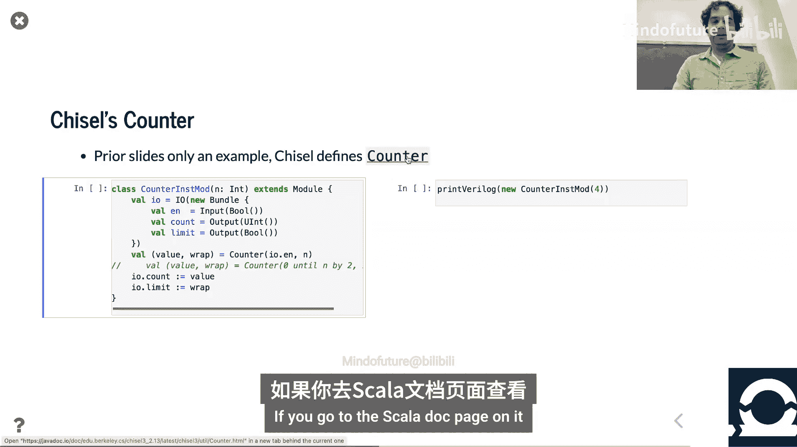

So yes， it's part of Chi utility， there's a counter。

And you may notice how counter is why uses this phrase examples。Even here in earth。

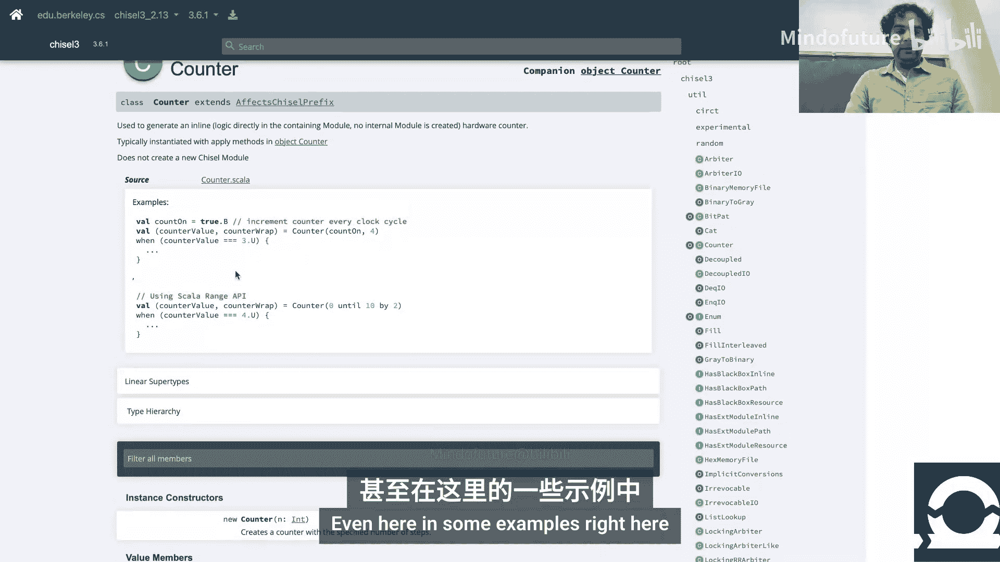

Some examples right here。It's actually multiple different。Vararianance， right， There is a counter。

 which has。A count enable and a maximum value。There is also a counter， which takes in a range。

And it does that。嗯。you can see R has kind of some cleverness about what we're doing。

 You may also see that。You know，He were taking the wire directly out of the counter。啊。

This is not returning a module。😡。

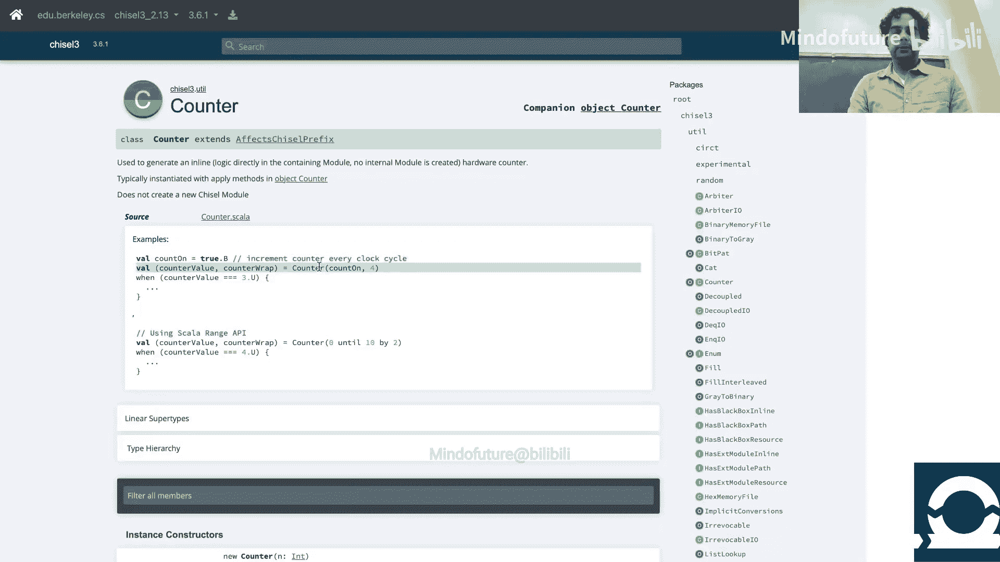

Right。So you may see this kind of notion of what something is or is not inside of a module as we're building more sophisticated constructs and hardware。

 you may find it easier to have some pieces not always be modules， right。

 And so what's the trade off between。Putting something in a module versus putting something in a function。

The advantage of ways made a function， especially with a small bit of hardware。

You don't need to worry about having Zop ports because you can just have the fields coming in as arguments。

 right？Meanwhile， the outputs， you can have a couple outputs just fine。

 So that's the advantage for having things as a function， not in the modules。 Yeah。

 you can very quickly do things。 You can avoid needing the IOos。

 The other reason why to avoid modules sometimes is if you have to and tons of pieces going together。

😊，The image is very log， every time you say module and chisel， you get a module in very log。😡。

And so you emitted very log as a bunch of very log nestings and stuff like that。

 And depending on the CAD tools you're using and how you have't them configured。

Module boundaries can be significant， right， Some CAD tools will orroll not under certain circumstances。

 optimize across module boundaries， right， the kind of modules contain unit。And， you know。

 won't go inside there。 And so sometimes your design。Really， the module is a kind of bigger thing。

 And the fact that all these internal pieces or stitch together from different。

Scalar functions in classes。Great， you system all。 When you have to think about that end。

 you would be happy of having that a single module rather having a module a lot of nested modules inside of it。

That's the design choice， but there are some reasons why if there was some CAD tools some the time。

 this comes up。Our own group had to deal with recently where。

notizations we want to do on PCD tools do not go across module boundaries despite the flags we give it。

 And so we've had to take some of model keywords out of our code。

To have more of to kind of chisel native scholar construction to avoid that issue。Okay。

 let's see the Chison Library counter in action。So wrapping in the module。

 we have an input to enable it， you know， the current count， and we also this notion of limit。

 in other words letting us know， is it reaching the limit？😡，So sure， not without counter。

Actually returns two things。 So earlier in the lecture， we were talking about tuples。

This is an example of a tu。 It's like anonymous， right， It's just， you know。

 two things joined together about premisehees in a comma。

These are two different facing we out of the counter and we can attach shows to the ports。

 And so this works just fine if I generate the very， Sir。It all comes together。 So see， for example。

You know， the count is what we respect the value。What is this wrap。

This wrap isn't just that the value is the maximum amount。

It's the fact that you're going to wrap around a sense that you have the maximum amount and the count label is high。

 So as a result， you're going to go from that current max value to 0。

 So it's telling you you're wrapping。 That's why you can see in the very long code， for example。

 I that a wrap。The limit is both， you know。Enable and wrapped， right？Cool， so。

Here we are as sentiating it， you know， the wires， you could also， of course，centiate。

A counter if I go to you a question。Oh know， you course extension it with a range。

And we everything about this one， for example。You notice how the range goes by two。

So our counter is going to add two every time。Sure this is kind of a pretty cool bit of stuff right。

 you can imagine where this is very， you know， scholar E to have this range come in。

 and then this is somehow being turned into hardware。Cool， so I'm going。

R pull back the code on counter in a second， until then any questions first。

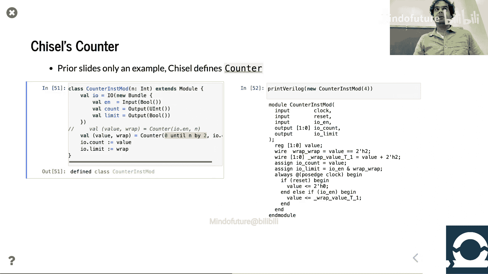

So let's go look at how it implemented us。 So here we are in sca dooc。

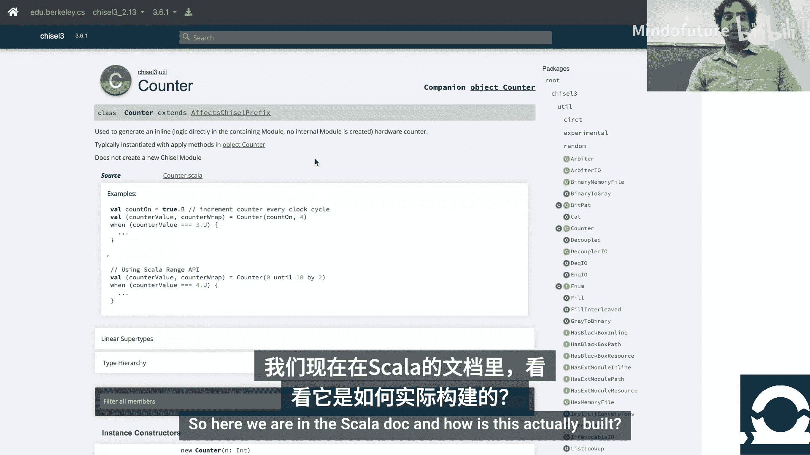

And how is this actually built？So we see。There is a class called counter。And it has things like。

The the range， in this case， the range syntax。As well as， you know。啊。Things like。The old end value。

 Okay， but in see inside， there is all this stuff， right， where。There's a lot of complexity to some。

 you know stuff here for。Havingling legacy versions of a counter。

 But the reality is that actually use a user are going to be calling the object counter。

 right and when apply methods right， if I want a simple counter that counts up to you know n。Yeah。

 you got a new counter end， right， if I。Have this， you know， condition。Guess what It's going to。

Use the condition to control whether a counter is incrementing or not， right。

 So we're still sanctioning a counter。And then there's an in method if I want to do a range。It is。

Doing that as well。 So how' it use this range？Oh。It is calling counter on the range。So。Going back to。

Counter。You can see counter both has ability to handle a range as well as an integer。

 so how does that work？Let's go back to counter。 And here we are kind of handappped by。

A browser rather than an IDE。But。Yeah， you can see that。For the old option， it can do the int。

 but there's also the range option for incrementing。There's some mad stuff here。

 We've not covered all the sca yet。 Most of the point insurance example is to showed it。

There is a object which have different constructors， we supply methods。

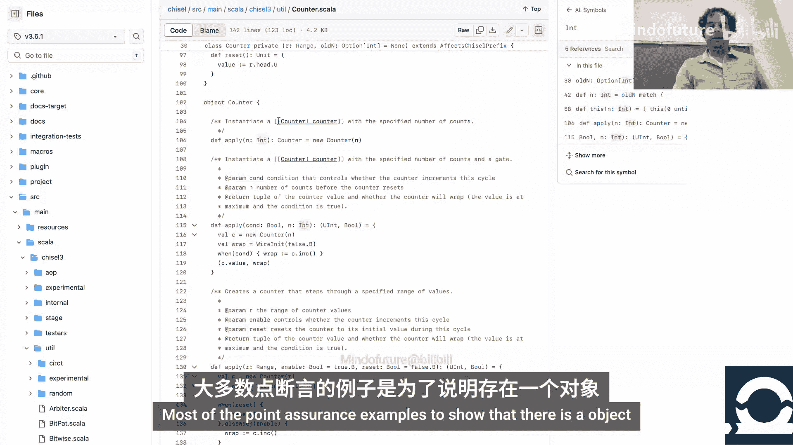

And that turns into crit in the class counter for us。

 And so like you've seen in many classes in undergrad already you dig your algorithm course。

 where we build your own data structures and they tell you， use a standard library。

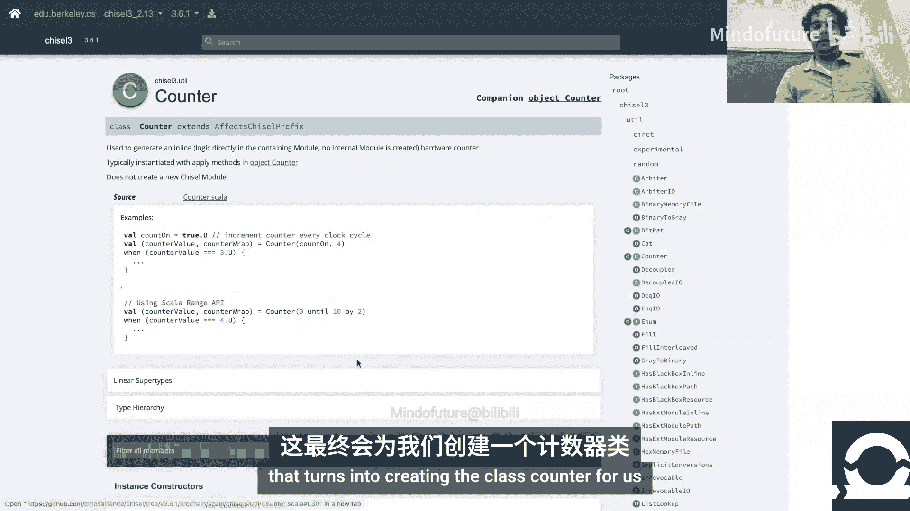

Same thing here， right， We've built our own counters。 You've done in assignments already。

 And I'm telling you， when you actually using your designs， use a standard library right。

 We you need a standard library component route and running your own。

 that's not just less code writing， less chance for error， right。

 This is a standard library component。 Hopefully it's been widely used and widely tested。

More could be write whatever you write yourself。And you might say， oh， well。

 maybe the mind is more efficient。 It could be， but maybe there's is more efficient because they've had more reason to optimize it。

 right， and so。In between as of philosophy， you might as well at least use their library objects when you can。

And there was a situation where you think yourt might need to be red in your cells to be faster。

Have you measure to know you actually need that， and youre actually make it faster first。不Yes。

Oh good question， why use these gsle library components？Can I get， you know。

 in trouble when they deprecate or remove things？Their deprecation rates being pretty slow。😡。

They have deprecated a few features over the years， but they were， you know。

 fortunately extremely rarely used。And so yeah， I would definitely encourage the use of standard library components。

They've also had various compat over the years to kind support prior versions。 So for example。

 you know， we're using Chisel 36，1 in this course， the Chisel 3 series lived perhaps maybe almost。

Eight or 10 years， that was kind of a long used version number。But even in that time span。

They actually supported chisel 2 for quite a some amount of time。

 and chisel 2 was actually literally a different code base and they had a pretty good chisoo compatibility layer that was available non chisels 3。

6， but before then， it was still available maybe even3，4 or something。 And so yeah。

 they've had a pretty good track record of having。Backwards code compatibility and yes， of course。

 if you have been among the loss of chisel testers and the new versions of chisel。

 that was one more you know stark departures， but in general， yeah。

 use standard library whenever possible and hopefully they won't pull the rug out from under you usually they don't。

Okay。And they're wrapping this up， let's add some more structure something called a bundle。

 so a bundle。I like to think these is like astruct in C。I can have named fields in something， right。

 In other words， I can have something。 I can put fields in it and each should just have names。

And so we've been seeing bundles so far and I've knowing what they were。Because， you know。

 if I go back， onll slide or two。Is keyword kind of looking in here。

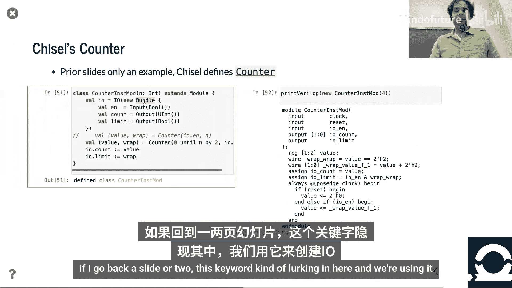

And we're using it to make I O。 You can see for a lot of things， right， You you can make a bundle。

In this case， you know， we do by extend bundle。 Yeah， let's go ahead and toss in。

A four bit field a called M inside mag。And then。If I want toate a module， instantate that bundle。

 I can just say no Mag class， of course。Sure， I can go ahead and instantiate that。 It's Nio。

 and then。嗯。I can reach into a field of it with a dot operator， no problem。And of course。

 it can like to something else。 In this case， I'm taking a sca int and turning into a chisel U in。

 right？ So after all that hoopla， this module just， you know， produces。嗯。Literal， too。

If this clock and reset really bothers you。There is a way to make that go away。嗯。

That has no advantage in the hardware。Having that clock and reset there that are not used。

 coing up in the CA tool will prune that of wave automatically， but like said。

 if you're really curious to not have that， yeah， raw module can do that。And yeah。

 as you can see yes， it's just a single output， but。I have figured the best practice。

 it's always use module and it'll always do the right thing。Cool， so we have a bundle。

 we're going to see how to go ahead and use that， right？

So whats cool about bundles is we can compose and build them up， we can nest them。

 we can extend them， so let's say for example， I want to do number representation。😡。

How about s magnitude style number， so I can take my magnitude。Which is the first bundleway made M。

I can。Make a finiteine magnitude。Which extends mags， even though I can't see it。

This has the field M from mag， as well as this new field S， which is a bo， which is a sign。I can。

 I can also substantiallyiate nest it， where I can say， hey。

 I want to have a pair assigned of magnitude numbers。And I could， I could have had nu 0， number1。

 And this case， I chose to make it back。So even not just fields。

 you can actually have some amount of smartphone in here。Right， and so let's say， for example。

 I want to make a module that has smoothth sign magnitude numbers in emit myth。

 always constant literals。 And how can schiate all that。 Sure I go ahead in instantiate as I owe。

This bundle type。And I can go ahead and wire stuff up。 And so notice how。What do I have， I have。

 even though I sent just parasite mag。Hracine Mag has numbs。 There's two elements miss the back。

 We see nus，0 nus1。Each shows elements of the sine mag， which。A signine mag has the field S。

As well as everything that inside of magic as it sense that and y or inheritance sense， right， so。

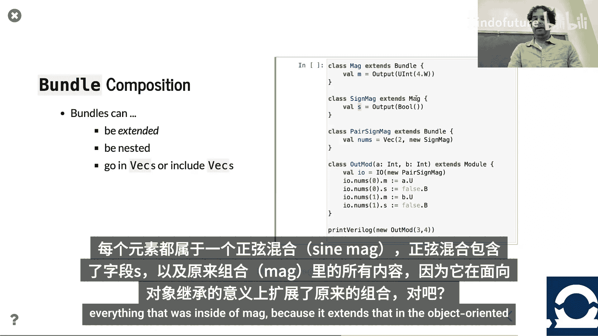

嗯。Cool， so it's kind of a long way to generate a bunch of literals。

 but we'll see at some applications this in just a second。Yeah。

 so you can put bundles inside the effects， you can put vests inside the bundles。

You can do a lot of cool stuff。 And so you see bundles have looking kind of a really great way to kind of start building some structure。

So if you're seeing bundles， you see old chisela code。

 you might see something called clone type where you can see。When you w to write your own bundle。

 you had to write this over eyeide defaf clone type blah， la， bh。 That was really ugly。 Guss what。

 The Chile compilepi folks got really， really clever。 and Chitel35， which was not a couple years ago。

Remove a need for that。 In't not necessary。 So you don't need to worry about this at all。

 Why do I include this slide in the lecture， Because I want you to be aware of the fact that this language is constantly evolving and improving。

 right， So this is something that was annoying。 They fixed it。 That was great。嗯。酷。Now。

Bundles are just kind of the start starting point， right， we can start building on them。

 So we can have our assign of magnitude bundle。 Sure， in this case， you chose to do it redefined。

All at once。 Now it's kind of cool。 let's say I have。

A module is going to have an input bundle and output bundle。I could。Write it like this。

 which is going to。Simply connect the input field for both fields separately。😡。

Or we can use this spiffy operator in chisel called a bolt connect operator。

And it's going to connect bundle on bundle。 So I can just have one line connected these bundles entirely and what may not be obvious right now。

 this is an extremely clever operation。 It isn't just a matter I think all the fields。

 You actually can have situations in which the bundles on both sides aren't exactly the same type。

And it's pretty smart about how it figures out how to handle that。There's a lot of。

Operators through those connections。 So if you have really complicated design。

 really complicated bundles。You。Ma。Want to consider all sorts of different ways of handling。

These interactions。We don't worry about in this course。 and our designs don't really get that big。

 But for those of you who are athes， this is extremely important and extremely productive， right。

Think about it when you're writing hardware designs， especially in Verlog or chisel。Very quickly。

 a large fraction of re line count is Iio， right， It's like inputs， outputs， inputs， outputs， inputs。

 outputs。 and you not only declare clarity the inputs and outputs。

 then you got to connect them all up together。 So having these abilities to use both connections。

Especially clever with the connections in terms of how you do in various ways。

That's a really helpful feature。Some of people sophisticated operators are only available in the more recent version of the chisel not available in version 3。

6。

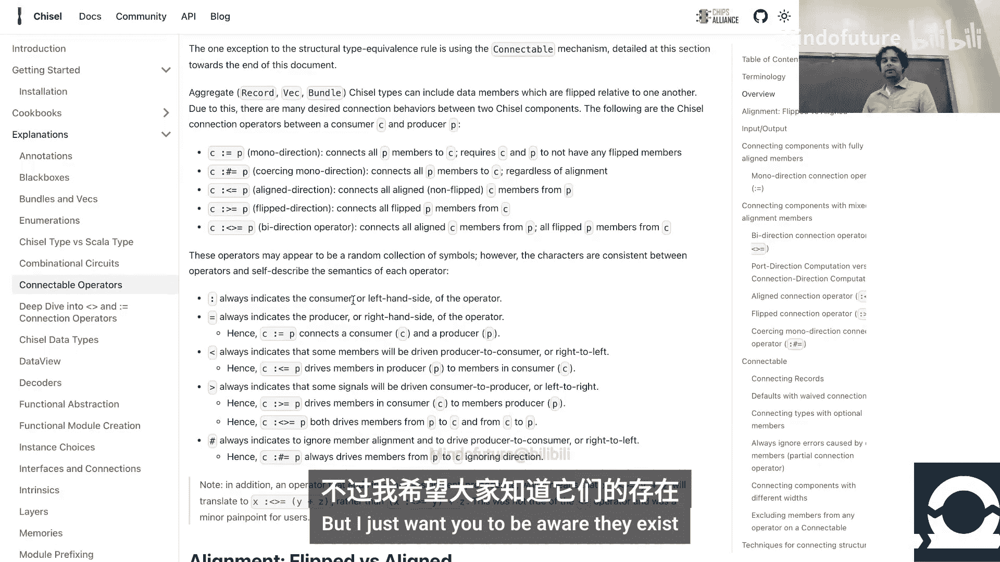

But I want you to be aware they exist。This book connection。The classic one we will use。

 right because it makes life a lot easier。 Also understand that when you have these two bundles。

 right the directions。 where in turns the inputs output plus may different or something。

 it'll do the right thing and figure things out in that sense。 And if it can't。

 it'll tell you at compile time， which is helpful。Cool， questions。Yeah， so said a second ago。

 you can have bundles that have wires and remote directions。 so your bundles can have。

And on this slide， the fields have no direction's just。You know a Uent or a pool。

 or I can put a direction on them。 I can say， hey， this is an input。 This is an output。

And so if I instant handshake， ready is an input and data is an output。

 if I call flipped on Handshake。As your name suggests， it is going to be the opposite of directions。

 right so now ready is going to be an output。And data is going to be an input。And so。

You can see if to in directions is's kind of few options available to you。On this slide。

 the bundle had no directions。And we kind of globally apply it to the bundle。

 and they all got sent the same direction。But oftentimes， the more sophisticated interfaces。

 you're gonna have bundles where that bundle will contain things in both directions And those directions are kind of baked into the bundle。

 and maybe different directions。 And then you can still do things like flip to kind of work with them。

好。And then this key word he saw 10 minutes ago to know what it is。

Now we're finally going to cover it before do that and asking any last questions on bundles。Okay。

 so what is this option type？This is something that's pretty cool about Sc。

 It's a way to wrap around。Something and so whatever type you give it。You can either have。

 this is that type。Or a nun。 right always doesn't exist。 And so。This is really helpful sometimes。

You want something and you want to know it's there versus not there so really。Risky C code。

 you may see the notion of， oh， if a pointer address 0， pointers can never be 0。 So if it's 0， Ie。

 nu， that means it's empty， right。This is light up way， safer and better， right。

There's a variety of ways interactive active options in Sca。Through today。

We're going to use is defined。😡，Meaning true or false， is defined It is the sum， meaning it exists。

You get told true。 if you call， is the on somebody of those nus until you false。

And you're going to call a dot get， which will give us the actual thing inside there。If it exists。

 if it doesn' like this and you call doc get， you're going to cause a problem。

So why are we doing all this？In the minute， we're gonna show you how to use option to have an optional field in your bundle。

 The first is put sc first。 So let's have an option。Oh， that is the you of type in。

 and I say some for。So good， I go ahead and this code here I call is defined。And if it。

 since it is a bias for some。It goes ahead and grabs the value， right， for printed。

If I alternatively had a nun here。It will be not defined and it's going to print empty。

What if I didn't check and I just try to grab it and it none？

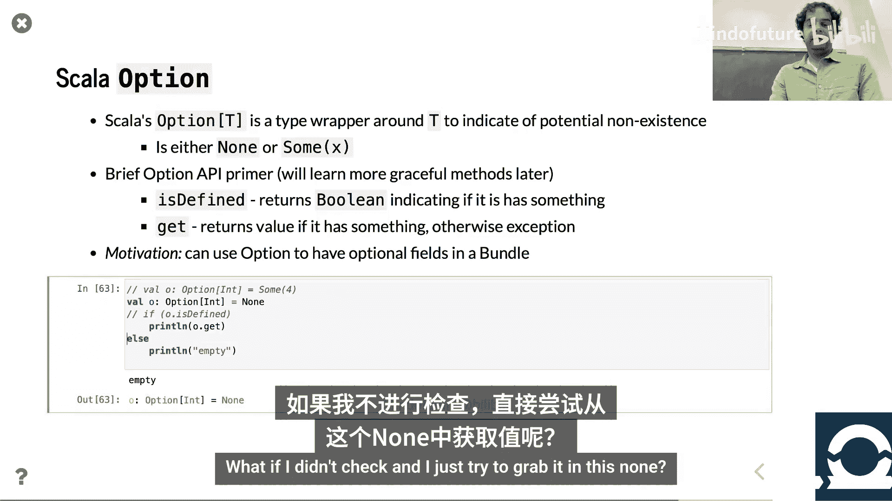

We get affection， right， I call it get on and done。Like I said， so you're going to avoid that， right。

 You're going to check first。Now， the checking seems like a lot of work， right。

 but we'll learn more elegant ways in Sca to more gracefully include that checking logic。 But yeah。

 is just a way to kind of note。Something either or desert does not fully exist。

So we'll see down in the bundle。 So now I can have an optional IO。 In other words， an optional port。

 So I have this maybe pair。It always has the field X in the output direction。Now。

 the scholara Booleion， I can say。If there is was not going to be another field。

 so just Y it's going to be an option type。Child's are going to understand what that means。 And so。

 yeah， if someone wants the Y field。This say has why。 Sure， I had this Y field。If this is false。

 this is going to be a nun。And so。Yeah， if I go ahead and look at this module。😡。

What do I do Well inside his module do I use this， you know bununlight declared sure。

Takes them the Bo and kind of control us to use why。So yeah， if there is a why。

 I go ahead and grab the Y and wire it up。AndConnect it， however。If I turn this whole thing off。

It goes away， right， no ports， no hardware associated with。

 This is a kind of very powerful way to not just。You've already seen in prior week last week。

 you know， we can use the scala if statement that haves hardware where deserts exist based in the parameter。

In this case， we're not using that to go not just inside the module。

 but actually the module boundary to have an optional port。 so a option is one way of doing that。

 the other way， of course is using anything like a V and having like like a0 element V。

 I think an option makes more sense if it's either01 if it' you know0 to end then a V makes more sense conceptually。

Cool， questions。

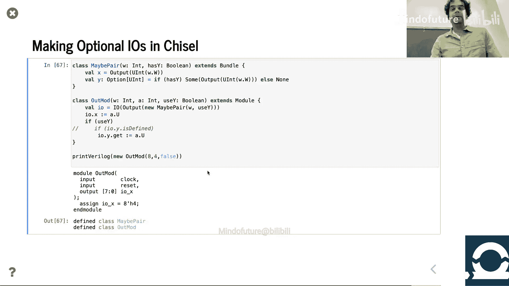

Okay， so then。As one last little wrinkle。嗯。You， always thought earlier in the lecture we had like pling a s with a var。

There's a helpful built in function in the scala called tabulate。

Which allows you to kind of do a fill。But rather than just doing everything constant。 in this case。

 you know， this feels。You know， I four elements seek with all zeros。That's they call a function。

Every time it's called， right， and so。We covered functions earlier。

 This is a different kind of function。 This is an anonymous function。 It's a really short。

 concise syntax。嗯。So in this case， it takes an input I and the function returns I。

Or you have a more aggressive syntax， what's called placeter syntax where。

It returns this and its underscore is the first argument。

And you're look at that once and so you can see， okay， sure。I call seek got fill。 I get four zeros。

 I call tabite， or I given in， but I just， you know。Return the same thing。 Yes。

 you can see tab basically only calls 0，1，2，3， which is less than 4。 and that's what you get。

If you use this placeholder syntax。It's really concise， kind of clear。

 you can do some more clever things。嗯。Sometimes you run back yourself into a corner。 if it happens。

 don't use the。Wild card instead。Use a more natural function definition。 coolol。

 So I said this is the way to kind of build things up。 And so we going go ahead and。

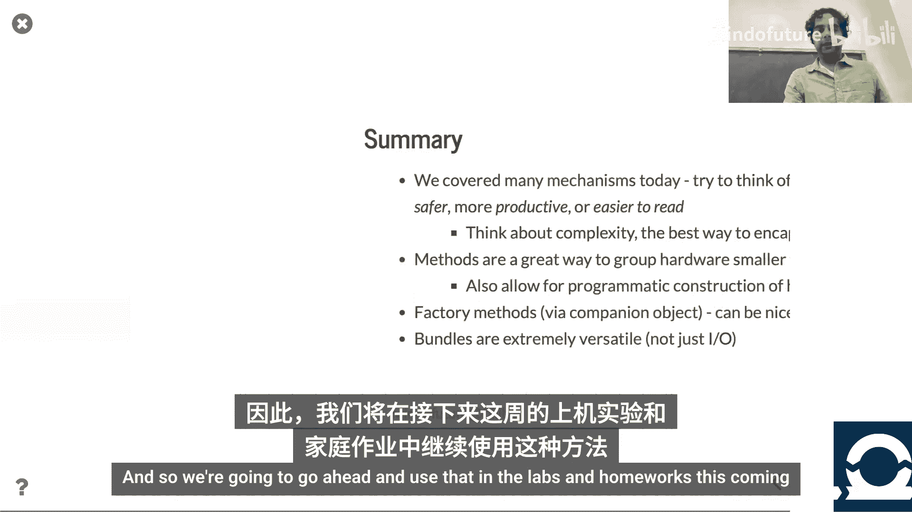

Use that in the labs and homeworks this coming week。Cool。Any questions on that？Okay。

 well then to kind of wrap up。 So we covered a ton of features。

 So I think this is good to kind of take your time with the labs。

 take your time at the homework to kind of make sure you're getting a chance to play around with them。

 There's this balance in this course where we try to make these simple。

 possible examples to show just the feature in isolation。

 but sometimes it's so simple that the motivation may not be obvious， right。

 But they get useful and kind of get larger designs from more of meat to them。😊。

And so it's good to think about， okay， how do I make these things to make my code。Better in some way。

 What is better， well。Scholar helps you a lot for safety， which is great。I also。

 when I say safety here， I'm referring to like， how correct is your design。 Like。

 can I make my code in a way where like， I don't I can make mistakes writing the generator or someone's make mistakes using the generator。

 How can make that safer， right。I going to generator more productive。

 right how can I write fewer lines of code to get more functionality now in kind of a more graceful。

 nicer way， or how about just easier to read， right between these complicated features is a way to kind of balance and make this actually even more clear。

And kind of keep thing when comes to complexity thinking about incapsulation does There's going to be complexity somewhere。

 How can I best put it only where it needs to be and not where it doesn't need to be。 In other words。

 you know， pull complexity down to where it has to be and。Id it otherwise， right？

I'm covering of things like methods， which are a great way to kind of group things up and how to build up harder components。

With methods and objects without even using modules necessarily。

 And you can see what kind is kind of more programmatic way to build hardware， we' not just。

Saing single line is a single piece of hardware， or're making programs that assemble hardware that's pretty cool。

We saw factor mathe companion objects， and we also saw bundles。

 You're gonna use so many bundles ass a really helpful feature。

 And it's good to have that flexibility in them。Cool， any last questions？

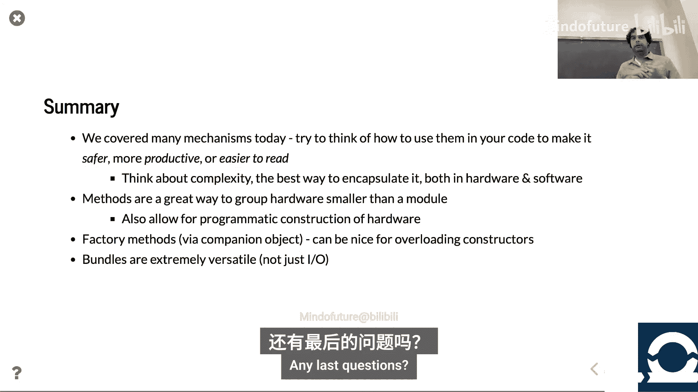

Okay。