# 敏捷硬件设计：第6讲：封装 🧩

在本节课中，我们将要学习如何通过封装来组织和管理复杂的硬件生成器代码。封装的核心思想是隐藏内部细节，提供清晰的接口，从而提高代码的可重用性、安全性和可读性。我们将学习 Scala 中的函数、递归、单例对象（工厂模式）以及 Chisel 中的 Bundle 等关键概念。

---

## Scala 中的函数与方法

上一节我们介绍了使用循环和集合来构建参数化生成器。本节中，我们来看看如何通过定义函数来封装和复用代码逻辑。

在 Scala 中，我们使用 `def` 关键字来定义方法（函数）。函数可以接受参数，并可以指定返回类型。

**定义简单函数：**
```scala
def plusOne(n: Int): Int = n + 1
```
这个函数 `plusOne` 接受一个 `Int` 参数 `n`，并返回 `n + 1`。

**带默认参数的函数：**
```scala
def plusX(n: Int, x: Int = 1): Int = n + x
```
调用 `plusX(5)` 会使用默认值 `x=1`，返回 `6`。调用 `plusX(5, 2)` 则返回 `7`。

**多行函数：**
对于多行函数，使用花括号 `{}` 包裹函数体，最后一行表达式的值即为函数的返回值。
```scala
def multiLineExample(a: Int, b: Int): Int = {
    val sum = a + b
    sum * 2 // 这是返回值
}
```

---

## 递归函数

函数不仅可以封装逻辑，还可以通过递归来实现迭代。这对于构建某些硬件结构（如移位寄存器）非常有用。

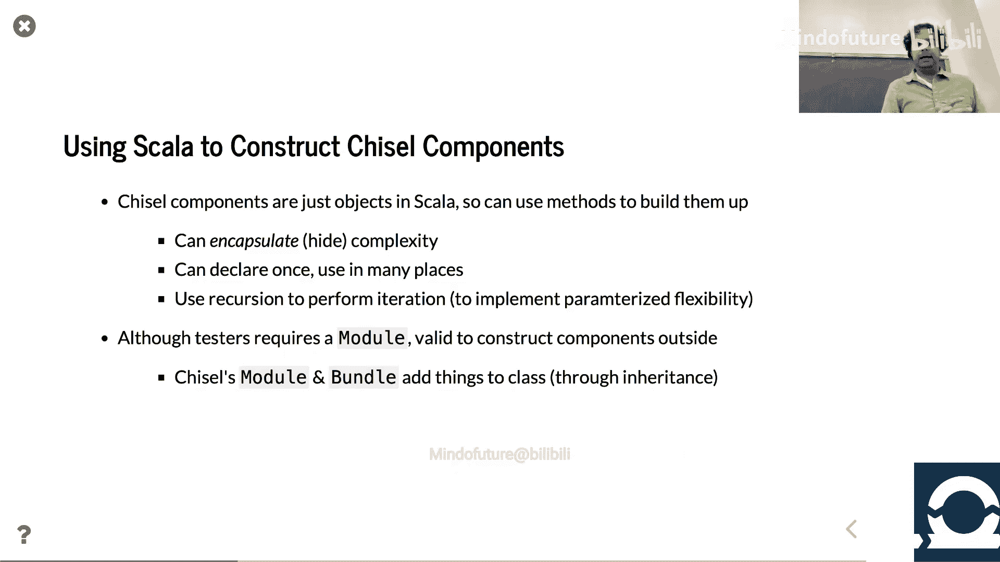

**递归求和函数：**
对于递归函数，必须显式指定返回类型。
```scala
def recursiveSum(n: Int): Int = {
    if (n <= 0) 0
    else n + recursiveSum(n - 1)
}
```
这个函数计算从 `n` 到 `0` 的整数和。例如，`recursiveSum(4)` 返回 `10`。

**斐波那契数列：**
```scala
def fibonacci(n: Int): Int = {
    if (n <= 1) n
    else fibonacci(n - 1) + fibonacci(n - 2)
}
```
虽然这种递归实现算法效率不高，但它清晰地展示了递归思想。在硬件生成器中，递归代码只在生成时运行一次，因此不会影响最终硬件的效率。

**关于递归与硬件：**
一个常见的问题是：Scala 递归如何应用于组合逻辑或时序逻辑？答案是：我们使用 Scala 代码（包括递归）来决定实例化哪些硬件组件以及如何连接它们。递归是构建复杂生成器的强大工具。

---

## 使用递归构建移位寄存器

让我们将递归应用于硬件设计。回顾之前用 `var` 和 `for` 循环构建的移位寄存器，我们可以用递归实现相同的功能。

**递归实现移位寄存器：**
```scala
def shiftRegisterRecursive(in: UInt, n: Int): UInt = {
    if (n <= 0) in
    else {
        val reg = RegNext(shiftRegisterRecursive(in, n - 1))
        reg
    }
}
```
这个辅助函数通过递归调用自身，并逐级插入寄存器（`RegNext`），实现了 `n` 个周期的延迟。它能优雅地处理 `n=0` 的情况。

与使用可变变量（`var`）的循环实现相比，递归实现没有可变状态，完全依靠函数调用栈来管理中间值。两种方式功能相同，但递归风格更符合函数式编程的不可变思想，有时能让复杂问题的代码更清晰。

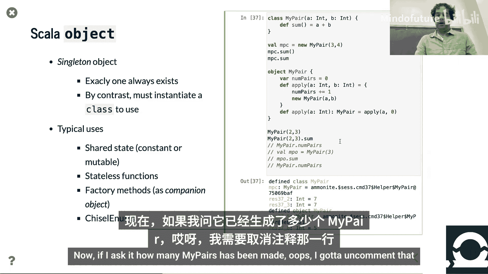

---

## 单例对象与工厂模式

随着生成器变得复杂，我们需要更好的方式来组织代码。Scala 的**单例对象**（`object`）和**伴生对象**是实现封装和灵活构造的利器。

**类与伴生对象：**
```scala
// 类：可以创建多个实例
class MyPair(a: Int, b: Int) {
    def sum: Int = a + b // 无参方法可以省略括号
}

// 单例对象：与类同名，称为伴生对象
object MyPair {
    private var numPairs = 0
    def apply(a: Int, b: Int): MyPair = {
        numPairs += 1
        new MyPair(a, b) // 工厂方法，负责创建实例
    }
    def totalPairs: Int = numPairs
}
```
*   `MyPair` 类代表一个数据对。
*   `object MyPair` 是单例的伴生对象。它的 `apply` 方法是一个**工厂方法**。当用户写 `MyPair(2, 3)` 时，实际上调用了 `MyPair.apply(2, 3)`。
*   工厂方法可以封装构造逻辑，例如这里用于统计创建了多少个 `MyPair` 实例。

**为什么使用工厂模式？**
它将对象的构造逻辑与对象本身的行为分离开。伴生对象可以定义多个 `apply` 方法，以支持不同的参数组合（构造方式），这比在类内部定义多个构造函数更灵活、清晰。

---

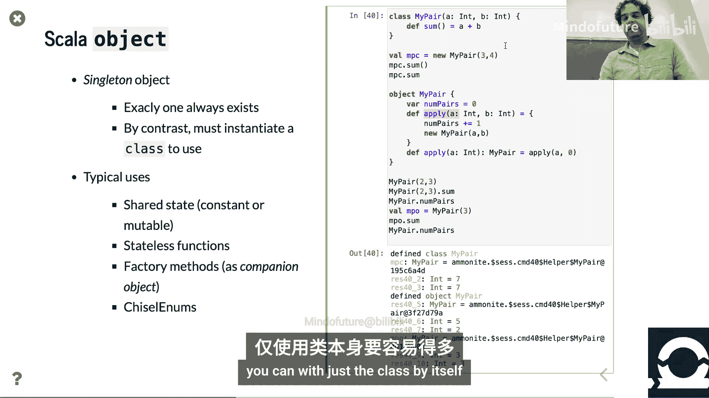

## 在 Chisel 中应用工厂模式

我们可以将工厂模式应用于 Chisel 模块，使生成器的接口更友好、更强大。

**传统的计数器模块：**
```scala
class MyCounter(val max: Int) extends Module {
    val io = IO(new Bundle {
        val enable = Input(Bool())
        val count = Output(UInt())
    })
    val reg = RegInit(0.U(log2Ceil(max+1).W))
    when(io.enable && reg < max.U) {
        reg := reg + 1.U
    }.otherwise {
        reg := 0.U
    }
    io.count := reg
}
```
实例化时需要 `new MyCounter(10)`。

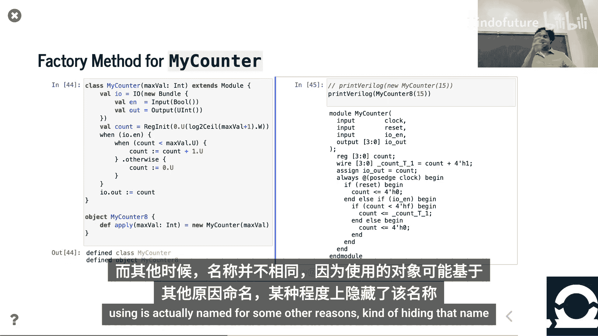

**使用伴生对象的计数器：**
```scala
// 类定义
class MyCounter(val max: Int) extends Module { ... } // 同上

// 伴生对象
object MyCounter {
    def apply(max: Int): MyCounter = new MyCounter(max)
}
```
现在，用户可以用更简洁的 `MyCounter(10)` 来实例化计数器。这为未来添加更多构造方法（例如，支持范围或步长）奠定了基础。

**Chisel 标准库中的计数器：**
Chisel 已经提供了强大的 `Counter` 对象，它包含多个工厂方法。
```scala
import chisel3.util.Counter

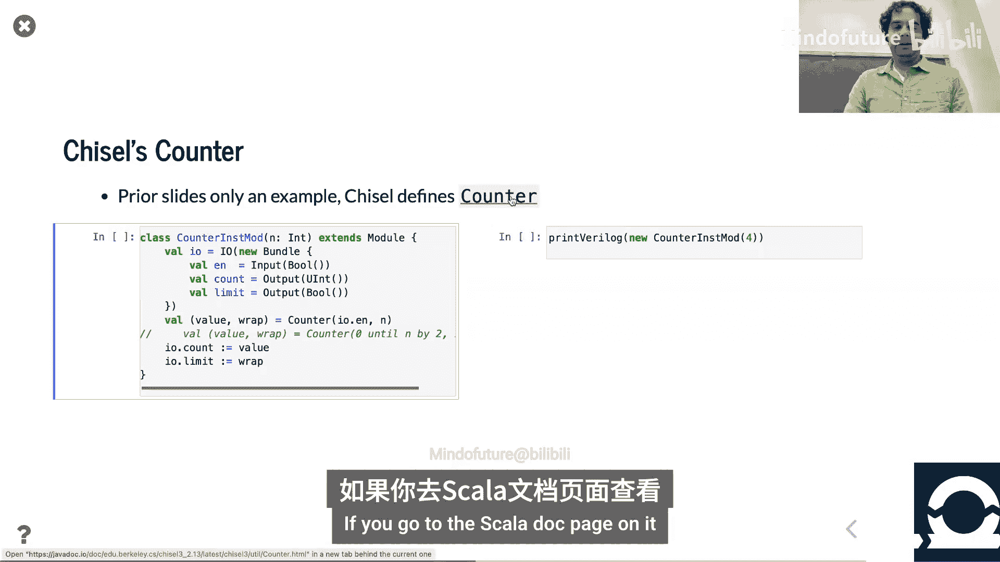

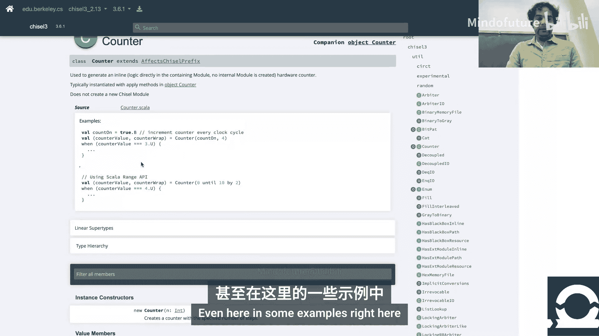

// 方法1：计数到 n
val (countValue, wrap) = Counter(io.enable, n)
// 方法2：按范围计数
val (countValue2, wrap2) = Counter(0 until 10 by 2)
```
`Counter` 返回一个元组 `(count, wrap)`，其中 `wrap` 在计数器达到上限时变为高电平。使用标准库组件可以减少错误，提高开发效率。

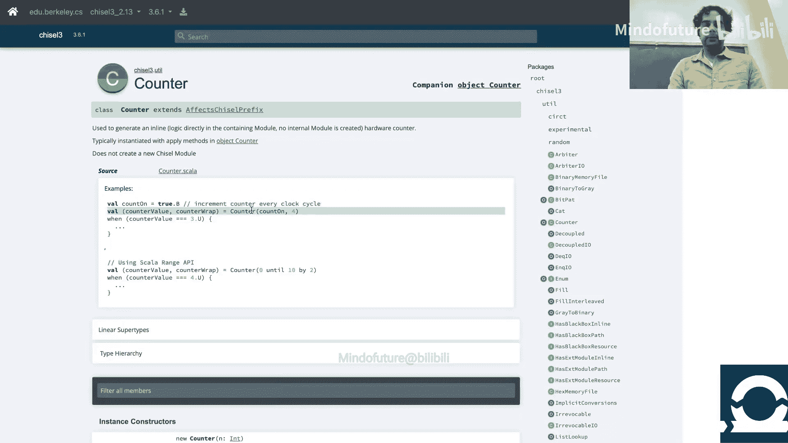

**模块 vs 函数：**
`Counter` 是一个返回硬件的函数，而不是一个 `Module`。有时，将功能实现为函数而非模块更有优势：
*   **函数**：更轻量，无需定义 `IO` 端口，输入输出直接作为参数和返回值。适用于小型、组合逻辑为主的部件。
*   **模块**：会生成 Verilog 中的模块边界。某些 EDA 工具可能不会跨模块边界进行优化。对于需要明确层次结构或大型功能单元，使用模块更合适。

---

## 使用 Bundle 组织接口

为了管理复杂的端口信号，Chisel 提供了 **Bundle**。可以将其理解为类似 C 语言中的 `struct`，用于将相关的信号分组。

**定义简单的 Bundle：**
```scala
class Mag extends Bundle {
    val m = UInt(4.W) // 一个4位无符号数
}
```

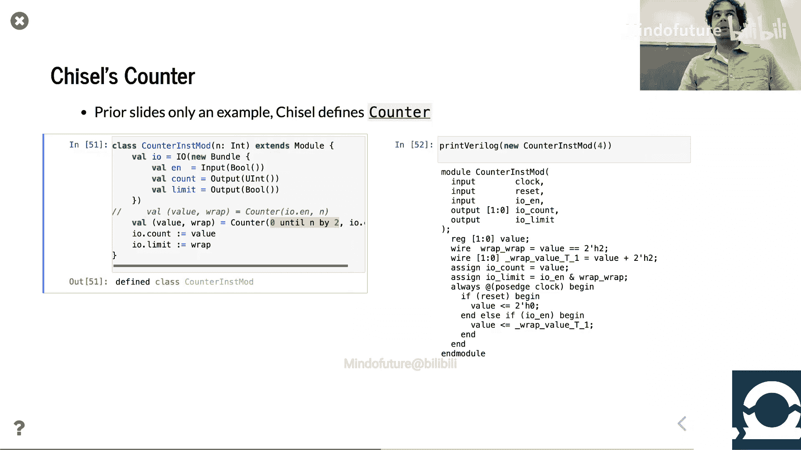

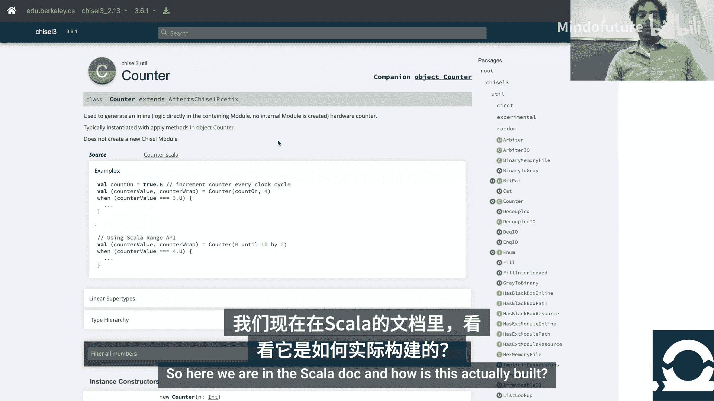

**在模块中使用 Bundle：**
```scala
class MyModule extends Module {
    val io = IO(new Bundle {
        val out = Output(new Mag()) // 输出一个Mag类型的Bundle
    })
    io.out.m := 2.U // 访问Bundle内的字段
}
```

**继承与嵌套 Bundle：**
Bundle 可以继承和嵌套，以构建更复杂的数据结构。
```scala
// 继承：添加符号位
class SignedMag extends Mag {
    val s = Bool() // 符号位
}

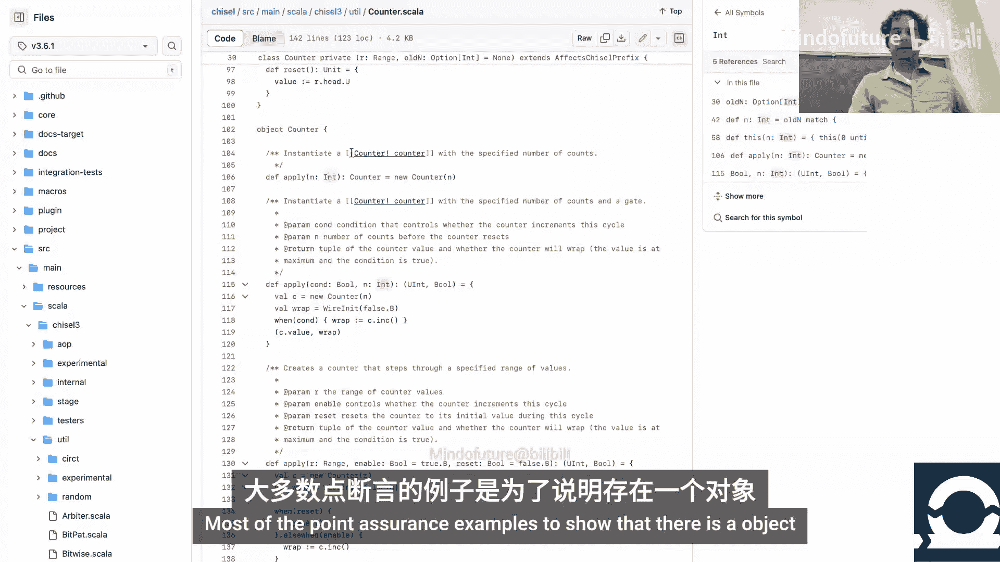

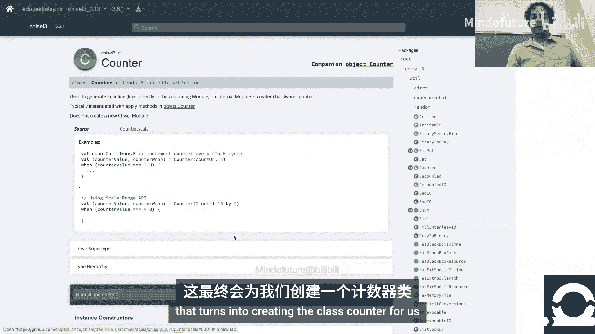

// 嵌套：包含一个SignedMag的向量
class PairBundle extends Bundle {
    val nums = Vec(2, new SignedMag())
}
```
在模块中，可以方便地访问嵌套的字段：`io.someBundle.nums(0).s`。

**批量连接操作符 `<>`：**
当两个 Bundle 类型兼容时，可以使用 `<>` 操作符进行批量连接，无需手动连接每个字段。
```scala
io.outputBundle <> io.inputBundle
```
这个操作符非常智能，可以处理方向（Input/Output）甚至不完全匹配的 Bundle 类型。

**带方向的 Bundle：**
可以在 Bundle 内部为字段指定方向。
```scala
class Handshake extends Bundle {
    val ready = Input(Bool())
    val data = Output(UInt(8.W))
}
```
使用 `.flipped` 方法可以反转 Bundle 内所有字段的方向，这在定义接口的双向端口时非常有用。

---

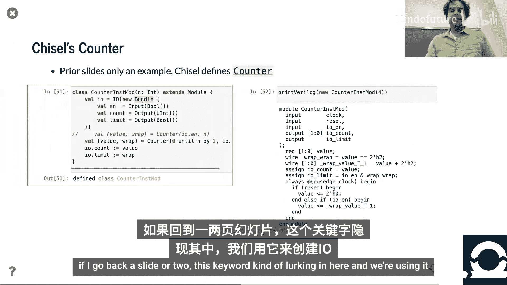

## 可选端口与 Option 类型

有时，我们希望模块的某些端口是可选的（例如，根据参数生成）。Scala 的 **Option** 类型与 Chisel 结合可以实现这一点。

**Scala 的 Option 类型：**
`Option[T]` 表示一个可能存在的 `T` 类型值。它有两个子类：`Some(value)` 表示存在值，`None` 表示不存在。
```scala
val maybeNum: Option[Int] = Some(4)
val emptyNum: Option[Int] = None

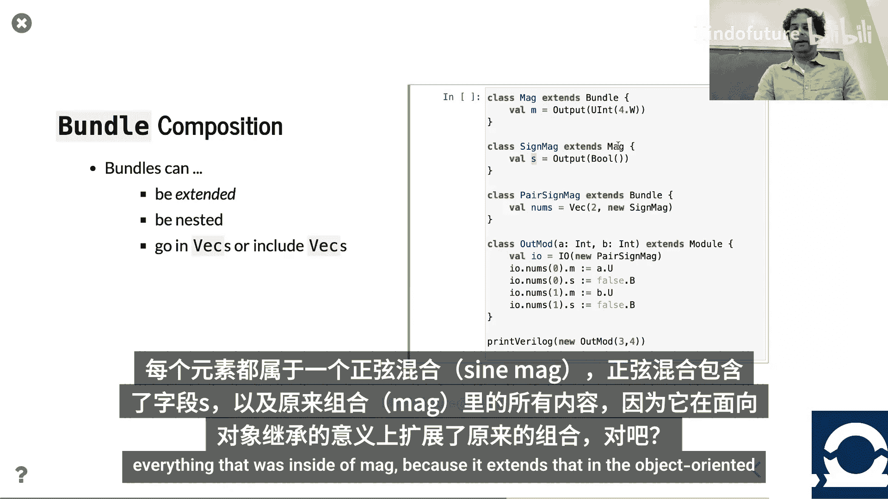

// 安全访问
if (maybeNum.isDefined) {
    println(maybeNum.get) // 输出 4
}
// 对 None 调用 .get 会抛出异常
```

**在 Bundle 中定义可选端口：**
```scala
class MaybePair(hasY: Boolean) extends Bundle {
    val x = Output(UInt(8.W))
    val y = if (hasY) Some(Output(UInt(8.W))) else None
}
```
在模块内部，可以根据 `y.isDefined` 来判断是否需要处理该端口。
```scala
class MyModule(hasY: Boolean) extends Module {
    val io = IO(new MaybePair(hasY))
    io.x := 1.U
    io.y.foreach { y => y := 2.U } // 如果y存在，则连接
}
```
如果 `hasY` 为 `false`，则 `io.y` 为 `None`，不会生成对应的硬件端口和逻辑。

---

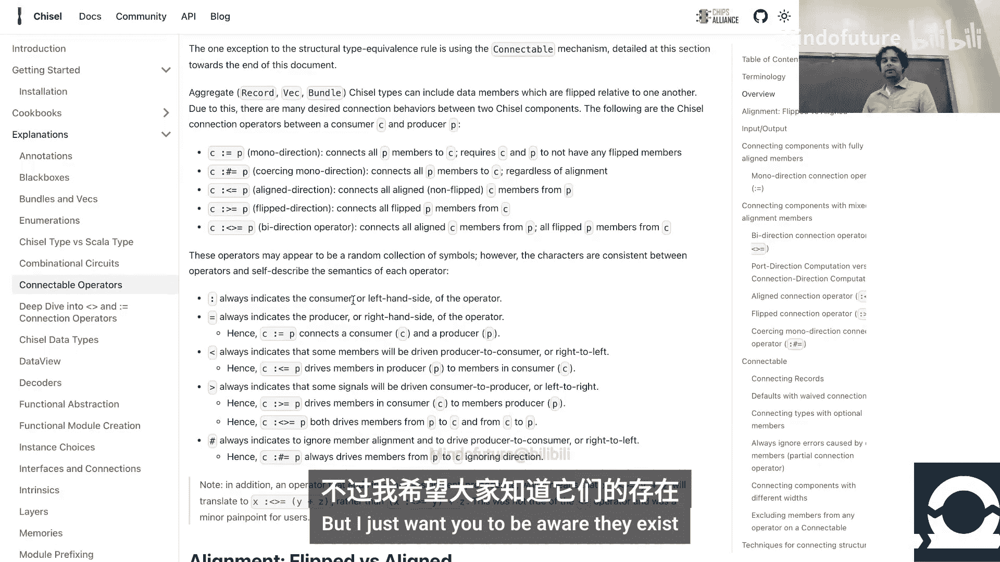

## 匿名函数与集合构造

最后，我们介绍一个有用的 Scala 特性：匿名函数。它常用于对集合进行变换操作。

**使用 `tabulate` 构造序列：**
`Seq.tabulate(n)(function)` 创建一个长度为 `n` 的序列，其中每个元素是调用 `function(i)` 的结果，`i` 从 `0` 到 `n-1`。
```scala
// 使用完整匿名函数
val seq1 = Seq.tabulate(4)(i => i * i) // Seq(0, 1, 4, 9)

// 使用占位符语法（更简洁）
val seq2 = Seq.tabulate(4)(_ * 2) // Seq(0, 2, 4, 6)
```
占位符 `_` 代表匿名函数的第一个参数。这种语法在函数体简单时非常方便。

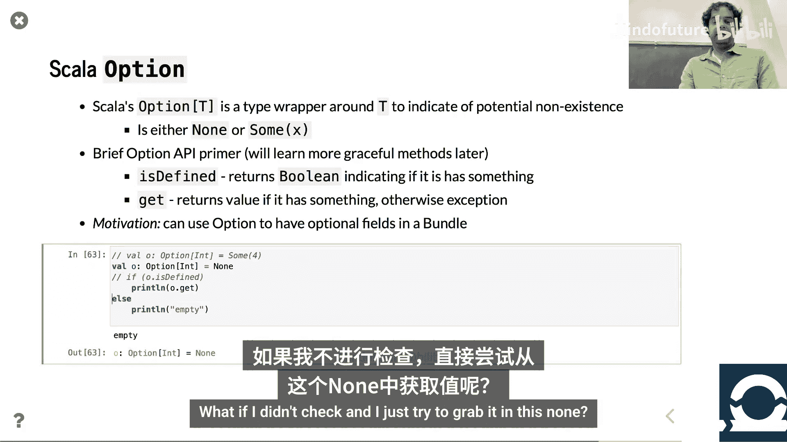

---

## 总结 🎯

本节课中我们一起学习了硬件设计中的封装技术。

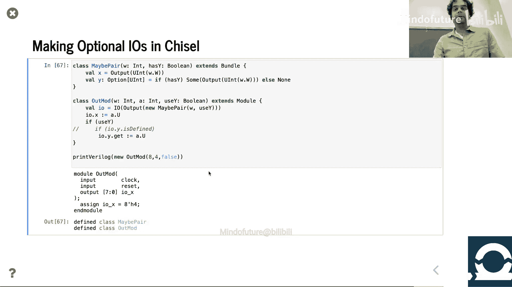

我们首先学习了 **Scala 函数**，包括如何定义、使用默认参数和编写递归函数。递归是构建参数化生成器的强大工具。

接着，我们探讨了 **单例对象和工厂模式**，通过伴生对象提供灵活的构造接口，并学习了如何在 Chisel 中应用此模式，包括使用标准库的 `Counter`。

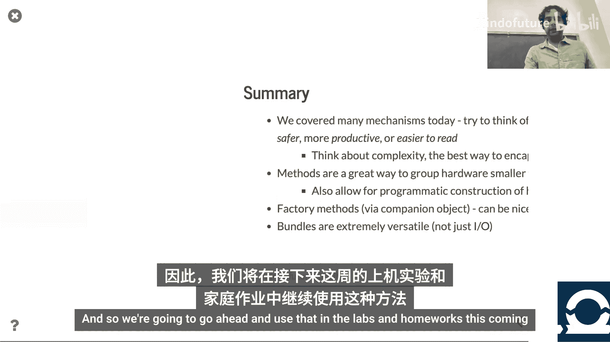

然后，我们深入研究了 **Chisel Bundle**，它是组织复杂接口的关键，支持继承、嵌套和方便的批量连接操作。

最后，我们了解了如何使用 **Option 类型** 创建可选端口，以及 **匿名函数** 如何简化集合操作。

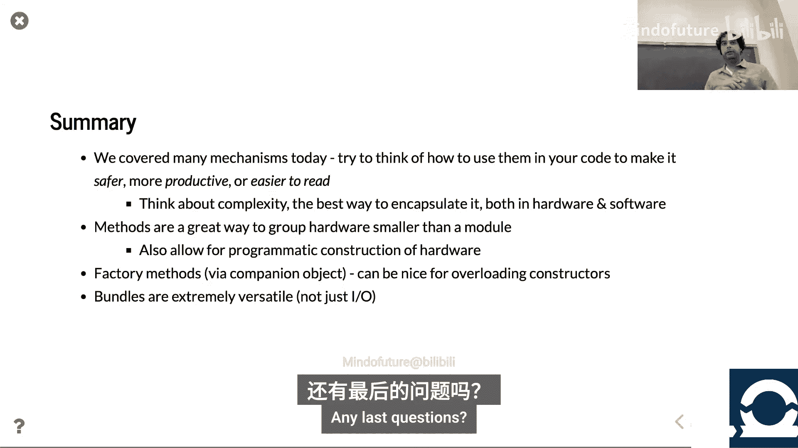

封装的目标是管理复杂度：通过函数、对象和 Bundle 将细节隐藏起来，提供清晰、安全的接口。这使我们的生成器代码更易于编写、阅读、重用和维护。请务必在实验和作业中尝试这些新概念，以巩固你的理解。