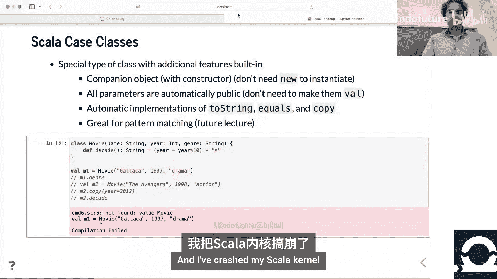
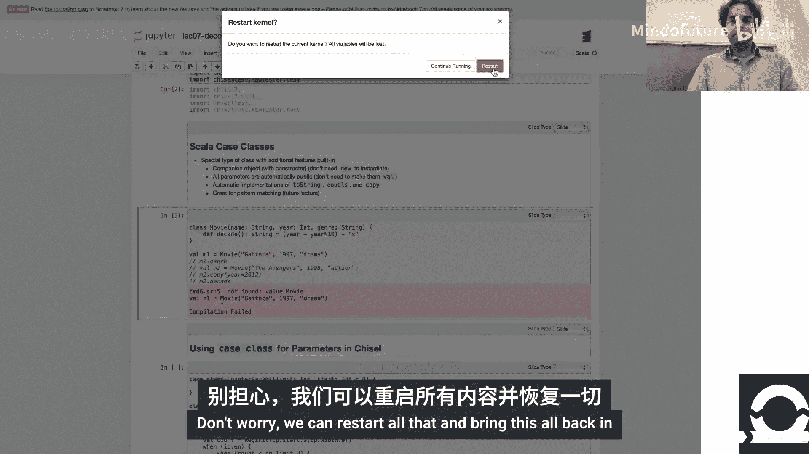
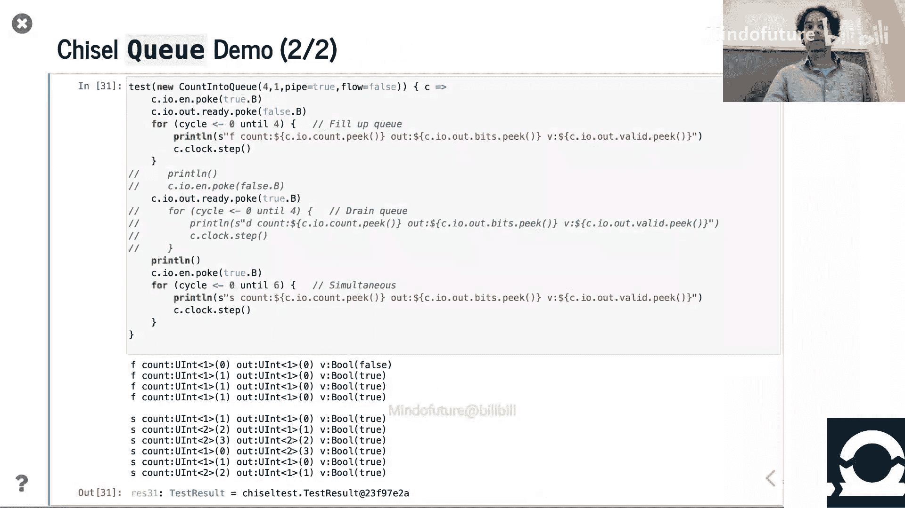

# 【加州大学】敏捷硬件设计-CSE228A-｜-Agile-Hardware-Design-Spring-2025-p10-P20_第7讲-解耦--BV1M6ivBzESw_p10-

All， welcomee to Lecture 7。Suppposed a different title it's about the coupling。More generally。

 the lecture this week you're kind of shifting gears。 So remember in week1， we introduced the course。

 we introduced chisel in a very superficial sense， Find whatcom logic。Then we， two ramped up。

 We talked about sequential logic in chisel and。At that point we knew enough chisel to do whatever he could do in structural v。

 and then we kind of added on。More scallet add， more structure and started building up things。

Look more like generous， right， things like those。Ship registeristies right。

 to lay lines where we had an large number reosisttories。

 we compared instantche that with a four loop of v as opposed to with recursion。Today。

 and more're generally this week， we're talking about building up more abstractions and hardware。

 These are abstractions that will allow us to make our designs more sophisticated。

 In this case of today， talking about the coupling。 that is we have。😊，Two interacting components。

How do you make them interact in a way where they aren't so tightly bound that they're always holding each other up？

Okay， so。And Laura I talk about it today， let's talk about a few things， talk about the coupling。

But before we do down talk about something called scholar case classes is a way to bettercapsated parameters。

 Then we'll talk about the chisel queue， which in this lecture。

 we'll see how to use it in the later lecture，'ll actually go about building your own queue and we'll kind of see this come back a lot this quarter。

Okay， so。What is the goal here？😡，The goal is when you have a substantially large design。

You're going to have more and more components。You wanted to decoup them。

 You want them to have some flexibility to operate independently as Facebook gets sufficiently big。

 efficientlyly complicated， they need to be decoupled right so what do we call me by decoupled thiscourse。

 We mean some sort of connection。With time sensitivity。 So not only does that mean。

 it's not combinational of some sort of， you know， registers in both ends。 So it has some amount of。

Ply there， we also mean that。You know， it doesn't happen every cycle could happen cycles only on both sides already。

 and so when the coupling is done correctly。😡，It can really simplify fly your design。

 you can build bunch components that are decoupled。Put them all together。

 They all understand decoupled， and they all together great。And they're retroreeaable， right。

 The alternative would be components that very specializedized to operate to each other。

 And then we try and intering up with something else。 They aren't quite as compatible。

So theup done well really improves reusability， and that's of course one of the key parts of this course is how do we make things very。

 very reusable？嗯。Cool， okay。Let's actually see some concrete stuff。 So as always， lit up a notebook。

Good to go。 Okay， so before I dive into a couple of I said before， I want called Scha K classes， so。

😊，You're starting to see a little bit that depth of Sca here where Sca in the advertise itself talks about it being。

Java Fla object oriented and functional programming features。 Java， of course， is object oriented。

 why would they repeat that with Scala。 Well， they had a lot of new additional object oriented features。

 That's why。 So we've already covered。Class and object， today recover something called case class。

So what is that， it's a special kind of class that makes a lot of common cases really simple and easy to do。

And for that simplicity， not utility。We actually lose some functionality。

 that's okay because I're going to need that， right？

A lot of times they kind of want something like a struck to kind of just toss together if you。Fields。

 and maybe maybe not method to it。 right， this say。

 we have a case class about movies we have a name for the， you know。

 the name movie in of course a year and maybe another string first genre， right。

 And let's say someone wants to， you know， say what decade movies from。 Well， we'll just。You know。

 stay a decade， sure。So。If we go ahead and。Tire up this code。

 maybe we'll leave this portion uned right now。Sure， we can go ahead and define this case class。

We're going to stand an instance of it。 I'll point out right away that notice how。

When we instantiate M1。That appears in the log， no problem。

But there's already a string print out of it， right？嗯。And that string print out。

It's something that the case class gives us automatically。

 if you have an arbitrary scholar class and you try to print it， you're going to get some sort of。

 you know。I thing we likeve seen before， where it's just going to be。Location。

 I think I I able to get that happen。If I are。Common data we can comment this out too。Yeah oh。

You know what is still remembering as a case class。Why know I call this movie to。There we go。嗯。

W I said， oh， and of course， when you do。Normal objects， we got to say new and yes。

 you can see normal objects， you know have to say new and et cetera， but as a case class。

Life was a lot easier， it handles new for us。Lighting paraobs exists。And I've crashed my sca colonel。

 Don't worry we can。

Restar all that。嗯。

And bring this all back in。But yeah， so key point about cage classes， right。

 is that we are now able to have this kind of convenient。Thing two pulls together。

 right so now this it all work。Fし。Oh， thank you。This is why we're a team。 Thank you so much。

 Fort the case。 It was a good comment from the audience。 Okay， good to go， so。😊。

A lot of things are already available， right， so now we can just declare a case class， use it。

 grab the fields on label in file， go ahead and declare another case class， no problem。

Now it's also kind of fun is that as case guys have a method called copy， right， I'm allowed to say。

 hey。Make me a new case class。We're keeping everything the same。

 I must telling the one field I want to change。 I want change the year。Yeah， you got that right。

 so guess what there's two movies called the Avengers， you look at MMDB。And in a course。

 you can call the functions on it。 great。 So these are all there。

 we'll use case that is quite a bit in this course。 right。

 what they're useful for is for just kind of capsulate what your parameters together。 right。

 You know， imagine if you're。😊，Generator， maybe if that' one or two parameters。

 you can just have those as individual fields we start having， you know。Dozens of parameters。

She put them in case classes right or even case classes and nest's inside of each other。嗯。Not today。

 but a future lecture shows film called patternern matching。It once again。

 shows another benefit a case classes where can kind of really easily get things into and aible。Okay。

 so as promised， let's see how we use them for a parameter。Remember from prior lectures。

 we've talked about building this countery kind of keep spping up。And rather than having。

A bunch of fields we're going to have a case class here， so we find this a counter programs。And。

You know， actually， have yet another field start， which we set by default to 0。

 because course can override that。 We're also going to。

In ca that logic we have for to figure out the width of the field inside the case class， right。

 So that makes the generator simpler。 The generator just knows， hey， I need to ask this case class。

You know what wh to use， the case constantly doesn't figure that out。

It's also grace to put this in the case class Without that way it's a single source of truth， right。

 that way， this is used twice， but rid once， right， So that way。

 there's no notion that hes being out of sync or anything。Of course， also can。

Use a start for resetting。This all kind of comes together。

 So you see this case class makes this not just cleaner code， but much more， you know。

 robust and flexible code。 And yeah， like always can print the very log out。

 You've all seen this very log。 We can show off today。😊，You know， oh yeah。

 let's say we want to have it started at four。Yeah， no problem as we scroll down in there。

Sometimes that's a double click onness oops。There we go， I can scroll better。

We can see there is rec signed the form。Cool。Question so far， yes。Yeah。

 so where does this start start？And counter so far， I've had this assumption that， you know。

 the count start at 0 and goes 0，1，2， E cetera。 And we're making this more flexible and saying。

 you know what， we can start at some arbitrary numbers。 So maybe not 0。

 maybe start at two or something。 Is it just， you know。

L hanging fruit in terms of adding flexibility to our generator another parameter， check it in there。

 tweak it。And do that。 And so most users probably don't care about that。 So guess what。

 We can leave that off。And the default of zero is going to be used and they're happy。

 and they're all good。嗯。They said it's kind of thing the capacity as you build these generators or。

 you know， adding flexibility make it more reusable's kind of key thing。

 But we don't want fully expose too much complexity， Right。

 Some doesn't care about when to start station she have to worry about that。Great。😊，Okay。

 let's keep going so。Now get to the main meat of decoupling。

So there's one called a handhaking protocol， which is you have two entities。

 let's say it's called producer and consumer。 So one person's creating things with things。

 consuming things。If theres a if there's a bidirectional relationship。We'll think of that as。

 let's say there's two things that both are producing and。

 We'll think that as two producers and two consumers， you know， going both ways。 But for now。

 let's focus on one direction。From the producer。se to consumer， right？And like I said。

 both sides of sequential components where both sides have internal state。

 This is a non combinational path between them。 But how do we decide when。It's okay to exchange data。

 right， and。You know， the pre could always produce data， The the consumer is not ready for it。

 that day is not going be accepted。 So how do we have some sort of way to dictate when both sides are ready。

 when previously tocend。And if's ready to accept that， how do we kind of declare that。

 that's what your hand shaking protocol is。So。We're gonna covered and I pick my protocol on the next slide。

 before that want to kind of。At the stage。More generally throughout computing and engineering。

You can see this trade off is a recurring trade off right notion of when you do things centralized versus when you do things distributed。

m，And they both have merits why we're talking about welfare them， right， know。

 you don't always do only one of them。There's a time for each one， right。

 so what's the advantage is for each centralized when it works well。

It's simple right everything is all centralized right you can see all the things so in other words you have and entities。

 you notice stay those entities entities and you have that all information in one location。

 you can make decisions very easily and kind of spread it around， right。What's the challenge。

 Well challenge that number of entitiess are controlling is five things。 Sure。

 you may bring information from five things in one location， make decisions。

 you got a million things， bringing information from a million things in one location is not going to work。

 right， So that's why we have distributed or peer to peer where you have the that kind of operate semi autotonnomously。

😡，And that's great， however， of course the trade often distributed is because you're peer to peer。

You have to make decisions， knowing up the making decisions and you have to make decisions with partial information。

😡，So。Nothing just trade off， right？So in a numbers art it computing， engineering more generally。

 kind of the outcome is， well you know what for a certain system scale and smaller。

 you're better off centralized and for a certain scale beyond you're better off distributed。

And what's interesting is you give to ensure system。

It can be distributed system of components that are internally centralized， right And so。

That's what the the conversation is。 Okay， what scale is switch from centralized distributed。

 So you kind of start off centralized。 You get sufficiently big。

 You become distributed inside those components。 that may still be internally centralized。

 And that's usually we build hardware。 You know， your module is always internal components and understands those are all centralized。

 but between modules and sufficiently big system。 it could be distributed and dust decoupled， right。

So now come back to our data transfer conversation。😡，Um， what do we need to handle。

 we need to handle the notion that the producer is not always sending data the anyway way to say。

 hey， you know what？I had nothing to share with you right now， you know， you can hang out。

 you can chill。And at the same time， series also will to say， you know what。

 I can't take anything right now， I'm， you know， too busy。

And unable able to push back because they call that back pressure I say no。

 I can't take it anymore So these's the kinds of things we want to have in their protocol the ability for a improve indicator there's no day to be sent and for the consumerr to be able to indicate that they can't receive anything they to apply back pressure。

Okay， so the protocol we're thinking I'm hopefully seeing in other hardware courses is called a ready valid protocol and there's a lot of things that are really similar so please attention to the details right and that is we're going to have these two one dis signals。

😡，The duty handhaking， right。 So valid is sent from a producer to the consumer。And it said， well。

 this is true。It is saying， hey， I'm ready to send data。Meanwhile， on the consumerr。

You have a ready signal， which is true when the consumer is ready to receive。The actual data。

Is sent on the bits， which could be 1 bit wide。 It could be no entire bus of 100 bits。Now。

 the key thing to point out。just because you're ready to send data doesn't mean data is actually sent right it only is sent when you are both ready to send data as a producer and the consumer is ready to receive data right so he's both valid and ready at the same time So here we have a little waveform you can see know clock cycles okay so these decisions are evaluated on the rising edge of the clock and sure。

There is a rising edge of the clock here where valid is true。 So， oh， maybe there's data to be sent。

 There is data to be sent， but it's not ready to be received。 Ready as false。 So no data sets。

 the actual bits are still。Or a valley they were originally。And then of course， the next to later。

 we really evaluate。 So wait， wait， both ready and valid are true。We call this firing， you know。

 a couple of handshake happenss， and now we can send the data。And then the producer is， oh， wait。

 I have now sent D0 to the consumer。I can now get ready， but next thing I want to。

 which happens to be D1， for example， right？嗯。And you can see it sends D1， next cycle later。

 you know， ready andval true at the same time， so we said D1。Then the producer says， you know what。

 I have number day to。 And so it de asserterts， you know， turns off valid to 0。At that point。

 the contents of bits does not matter because we'ret to any exchanges， right， So the data here。

Doesn' that matter。 So here's the high level protocol。

 I see you' probably seen this maybe in this digital design course。

 The reason why I was very careful to kind of go up through the semantics is there's subtle nuances about you know what is always true or always false in two different versions of this。

Questions。Okay， let's go ahead and try use some hardware。嗯。

So chisel in the spirit of making things easier。Bilt this into the standard library， right。

 so ready valid S is an extremely common design pattern。

And so let's just add some language construct to make this easier to use right And so rather than writing your own ready valid stuff。

 you should use the stuff for ready valid inside a standard library number one。

 the courts of less code for you to write， that's great。

 but also by reusing other people's code is hopefully correct。

 lets has a you to make mistake and also being more standardized and improves me to believe' someone else So someone else who's not read your project but has read chisel code。

Its the speed more quickly， right that's a good thing to have。嗯。And so what do we do well， basically？

Do you take a port that you want to send data on？And then you annotate it with what kind of protocol you want。

 and then chip will automatically add in。😡，TheAdditional wires you need to make that the case。

So for example， if I want a decoup， that one to have both ready and valid。嗯。

And take that data port and I wrap it in just a coupled construct。

 It turns out maybe you want only what's called valleys and chisel， meaning。

You want to indicate if there is or's not。Little valid data on here。 that' the producer's side。

 There is no ability to have back pressure for a consumer rights。 So it's there' was no ready signal。

 right， So it's just valid。 In other words， I can mark at the output as good or not good。

 The consumer is， you， obliged to take it right versus decoupd data is only sent when the producer something to send I。

e valid and the consumer is ready to take it I。e。 ready。And so the situations were both。啊。

I kind of like the think of Val kind of like that。S sclet option。 We start earlier we saw Sc option。

 kind this notion we have a value。 And either there's a value and number is given to you。

 or you can note the notion there's nothing there。 And the same thing， kind， you're taking a。

Port in your module marking it as valid。 You can basically say， hey guess what， the sing。

Either a vow is true。 Take a data。 A vow is not true。

 Then you look at data because it's not even something there。嗯。Questions so far。

So then one last little wrinkle， if you're an experienced digital designer may rent to this。

 there's something called a combinational loop。That means that inadvertently。

There is a path in your design where you can feed back on itself without going through any registers。

 So that's typically a mistake。Usually as a human， of course you try hard to avoid that。

 sometimes with ready valid signaling。You can do that inadvertently。

 so it's not a thing unique to chisel it just a general issue of ready valid tab signaling if the generation of the ready signal or generation of the valid signal。

It's completely independent， the other one。You're safe。 However。

 some people have a design where you say， you know what， I， let's say I'm a consumer。

I'm only going to turn valid on， if ready is on and somehow that comes to that logic。

 then you've made a mistake， then you can put yourself into harm's way。

So I said make sure that ready and valid inside your endpoints， if those are completely separate。

 then you're okay， but if they have a path between it' a path to go from you know。

 ready to valid or vice versa。That's where you can have a commission loop。

 And it can be really sneaky because what will happen if you're be doing your design。

You'll do it on one side。 you to produce your order consumer。

 Do it only on one side gives you a U shape， right So it's not quite a full cycle yet。

 you' only have a U。It's this lurking， lant problem in your design。

Then all of a sudden you change something else and you end up burningly connect the other side and you go cycle and you have a loop and yeah you may have had to start looking at both sides。

Whatever possible， try to derive the logic from ready and valid from things that don't depend on the inputs。

If you haven't done。O。So I just talked a lot about combination loop。

 let's see what they actually would look like right。

 as said they are a uncontrolled feedback path where you don't go register register right And so here's an example of an adder where the output the adder goes and feeds right back into the adder。

So electric waste is not good。This is not going to do good things so。

You may hear the term referring to registers and clocks as the word synchronization， right。

 And that's actually the way to think of them is they're actually a form of having these state changes all happen the same time。

 rather than having。The value out wire change。Half faculty。

 you imagine this originally somehow magically imagines wire was0 over here， so 0 plus1 is1。

 thens 1 feeding in1 plus1 is 2。In fear that might something that might seem to work， remember。

Eventually， this is going not work well。 right， There's going to be multiple wires for multi bit signals。

 They're going to eventually get out of sync。 There's all these different logic gates。

It's going reaching some very weird unstable state。嗯。

You basically just about never want combinational loop， especially not in a chisel style design。

 so to show you what happens， let's do that So here over' in the counter like it's basically shown on the right。

😡，And I passes to the shield compiler， whether it tell me？

It tells me it was a combinational loop so the detective， do you know what。

 you talking me happy about this now？That looking at the output。

 it may not be hyper obvious what's going on。 Let talk about it。 right， numberumber one。

 there is this module loopy counter。And to recognize that you know what IO counts。

 its kind of tracing through it。Goes into IO count underscore score T。 I just T1， and then IO counts。

RememberRemember from prior conversations， these leading underscorers indicate internal unnamed signals。

But basically， it says there's a way to go from IO count。Back to IO count， right。

 and we can see that， right， basically。嗯。IL count comes in， adds one。

 and the amount is assigned back to IO count。 So the solution。

 of course is to put a register inside here。 So this is unlike the picture。We do that。 No problem。

 This is perfectly valid counter。 There's a register in there。 We're happy。 So like I said。

 accommodation combination loops。 look them up a few times。 They're， you know， a mistake。嗯。

There are some really extreme cases where you。Not just or a cave commission loop。

 but you intentionally make commission loop because。You。You know。You know it's going to converge。

So you may heard something called aschronous asynchronousynchronous clockless logic where basically they can。

Build these gates with no clocks and these gates are basically all combinational races。

And combination loops， but they're designed with a lot of functions such that they converge and so。

People write these in very log and they watch their log tool spit out tens of thousands of comm loop warnings。

 but it somewhat proofs the correct design in the end。

Chizzsel there's a way it turn off so much loop warnings。

You will definitely not do that in this course， you should not come loops your designs。4。

Questions so far， yes。Oh， so how could I get randomness， So great question。

 So do come loops have some notionional randomness to them？A little knowledge as you would like。

 so the term often uses something called meta。Meaning that depending on how the circuits set up。

 and it could actually depend on the exact manufactured part。

A composition loop could continue to vary somewhat erratically or worse yet。

 it goes into a at a stable state， meaning that it is no longer changing。

But it may be a thing you don't expect， right unless of course。

 we talk about things always in terms of binary。 know01s or logic values。 remember in practice。

 these are actual voltages on wires。 And based on nature of circuits。

 you actually can get trapped in this middle ground。

 So'll say your zero is approximately 0 volt and're approximately 1 volts maybe you made a sta。

 you might be at 。6 volt and it's locked in there and they can't get pulled out。

 That's like really bad。So you hopefully can avoid mess ability。 But to your point of。

 let's say I want some sort of randomness from a circuit。 Yeah。

 there are analyst people can make custom that。Have。

This notion of having some notion of randomness to him。They have definitely feedback。

 but they aren't quite a logic loop， or're more to say analog feedback kind of thing。Cool， okay， so。

After all that and my you know severe warnings about how to avoid combination loops。

 let's actually just write some deco couple stuff and hopefully not on any loop right so first。

Un's just use valid， remember this is the one that is just kind of like a scala option it's basically marking the fact that this output may or may not exist。

And this really trivial example just really passes things through。The input is， you know。W bits。

 and we have an enable signal， and this is going to show you what your rap is invalid invalid。

All of a sudden now out is a bundle。 we've covered out the last lecture。 So as a bundle。

 there is now a dot valid field and a dot bit。 So dot bits is the payload。

 for sure we can attach that to the I dot in and the value we can attach the enables。

 So from the point of view， someone looking at this module。Yeah， we just kind of， you know。

 tied that in through。Now we go ahead and use this on the other end， the first are receiving it。

What can we do， Well， the receiver。Is receiving this u？Once thing I didn't cover。

 I'll go back a few slides to pull up。So。What is the native direction of these terms？😡。

Think of it from the producer going to consumers。 So if you don't。

 the use market is only valid or only decoupd。It's like the producer are going to consumer。

 Its dust on the consumer side。 You kind of mark this a flip to get the reverse。

Directions on the ports， right So we see on the receiver now we need to flip condition the valid。

What we're going to do is we're actually going to build this kind of。Not buildable。

 but simable circuit where when we see the input is valid， we'll go ahead and label that as such。

And then in our test bench down here。It's going to simply， you know。Run for eight cycles。

 so here we are using about four loop covers before the range notation， sure。

And we'll step through each cycle and then what we're going to do。

 we're going to take a cycle number。And actually poke it in the。Inbits on this。You know。Dot in。

For our own curiosity， we'll print the cycle number， sure。

And then here's a little bit of cleverness the test bench for that ball signal。Was it that true。

Only on。When single account is even。So after all that， what happens well？You can see yeah。

 we ran in cycles， cycle  zero，1，  two， etc ceter。And you can see on the receiving end， we only。

Printed， received。When I was valid， of course， I was only valid when。We have an even cycle， right？

So this is an example of kind of used， this is a very minimal minimal example to kind of show us some tax working。

 but hopefully kind of makes sense。So you can imagine， you know， now the receiver。

 you can now appreciate there's input coming into you to may or may not be valid recycled。School。

Questions so far。Okay， let's keep going。 So what about the couple， right。

 So that was sovals only one way。 The coupled has the two directional thing， right。

 We have notion of。I'm setting valid data and receiver ready to receive， right， So like before。

To make something to couple， we just wrapped that port and it's a coupled term。And then。What happens。

 Well， so what we're going to do is we're making a counter。This counter is a little special。

 But it's going to do is rather than just counting when its enable is true。

 We're going to count when our enable is true。And。The consumer of this count says they're ready。

 So you can see this you know advanced counter field。Is true when not only is my input enabled true。

 but also。Ready， so this may not be obvious， right， so I owe that out， of course， is this field。

The coupled adds in some new wires， right， adds in ready invalids。 So now I have it already ready。

Even though。The dot valid is an output from this module。

Dot ready is an input coming in and well why I can use it over here。

Right here I am now using the Chistone library counter。 so I have kind of a naval signal。

 which we just。Labeled right there。We' often taking a maximum value sure as a parameter， no problem。

The actual account bit， sure we can attach that to it comes out of the counter。And then。

The valid will just pass us through from a enable。As an additional bit of syntax。

 you may remember from last time I talked about things that should standard their library's counter。

 which is technically an object rather than a module。And you can return， you know a tuple。Sure。

 but that's a detail。佢得。You know， nothing too wild down here， but just notice how， like I said。

 we wrote the coupled。And we get， you know， dot ready dot valid and dot bits。

 right are all kind of automatically put in there for us。嗯。It is something that you know。

Should be done carefully and judiciously， where on the one hand， wow， isn't that nice。

 I have all these fields for me。 I don't need to， you know。

Maannually write three lines here your right out underscore ready， out underscore out。

 underscore bits。 On the same time， if you're reading this code for the first time。You're like。

 where did he did that already come from， right？And so hopefully。

 it's not a surprise because we're talking about the couples。

 This is a kind of interesting software engineering trade off where。

When you really encapsulate things with outdoorberian programming。

 you can make your line count really get reduced and that's nice。

 but sometimes things kind of pokes through in this case。

 the fact that out has a already and the valid is now visible beyond this。

That could be a leakage of complexity， right and so。In this case。

 we argue it's okay because the couples which are widely used you'll send the right feature。

 hopefully everybody understands what has for。But when you come to your own module。

 sometimes if you can't fully encapulate something， maybe it's better to encapsulate that way。

 kind of it's always visible from the beginning。😡，Okay， questions。Let's build the， oh yes， man。Okay。

The counter does what？Yeah， good question so who's waiting where I repeatist for a recording So this countercodeat from the Chiare Library。

 yes， it has a na signal， which is this first argument。Data enable signal， if it's true。

 the counter counts， if it's not true， does not count。

 And so we are adding additional logic onto that na signal basically that there's a enable coming from us outside of us as well as the consumer of our thing。

Is ready， you know， Sky saying where we were adding additional logics to enable。

 Yes yes to the the pausing is occurring inside the counter right It it's got turning the very log。

That wasn't obvious like where did that come from， Well， you can see， right advanced counter。

Was this wire made internally and then it found its way inside the estimate here。

 So if advanced counter was not true。We actually didn't change the count。Good questions。Okay。

So beyond just adding these other wires and， you know， things like dot ready dot valid。

These teachers in chiseled decoupd invalid also actually。Add in some functions。

 we've already seen that before， where we can make。

Functions that kind of structure are generous in our design。 And I' be clear these functions。

mAren't so much functions execute in hardware when it's running， they're just kind of。

Some shorthand we can use when we're writing our generators， right？Theres some very common scenarios。

 for example， Fire， right， Fire is when。Read and vow or true at the same time。

 when something actually gets sent on this particular protocol。Let's say I want to send something。

 right， if I want to send something。I both need to change the bits to the new value and set valid to true。

So that's NQ in the course data。If I don't want to say anything， I can say no in queue。

 and go ahead and said valid the false。If I also of course have to reverse things on the receiving end I have DQ as you know。

 I'm ready to take something or no DQ if I'm not ready to take it， right。

We'll see this in practice in just a second， right。Let's try this out。So here we have。

Are count one ready。Right， so we're going take in enable enable， and we're gonna。あ。

Print out it before since it's kind of we saw a second ago。Except。

We're now going to use some of the signaling things we just talked about， so if you go back。

A few slides。Yeah， we had this chi tued in there， but here we are setting bits and valid。

 right alternatively。Now we're going to go ahead and。

Use the NQ feature and actually pass in the data。Or to knowing you don't work。

 we're not taking anything。And in the comment area below。

 I have equivalent chisholel we kind of see some of the benefit， right， It says， you know。

 one line replacing two lines and。It's not just about saving lives， it's also more clear， right？

If I'm reading this quickly at the kind of parse， oh yeah， this is both setting bits。

And valid I' weight into the same base names so they're probably a couple things together。

This makes them more clear。nQ， I'm saying this data。

I only need to actually remember the fact what Do Vals call I know this is going to be decoupd and it's me handling that。

 And likewise， of course， if we're not saying anything we can do in knowing queue。

We can write a test bench like before。In this case， we have a maximum value counter of three。

We're going to。Always have enabled on。 So it's always trying to count。

 But whether or not accounts is but depend on the consumer also being ready。 we're in this case。

 deciding our consumers will be ready Arrbitrarily， we decided when it's an odd cycle number。 Sure。

 why not。 So we can see， for example。You know， cycle zero there no change in the count， cycle one。嗯。

Still no change for next cycle。Pycle  one is truth enable enables truth and the count from 0 to1。

 you have to see counts every to cycle。Cool。Um， but yeah， I mean。

 you can see this code is I could just as well， Nixon match it， sure。

But it's nice to use these helpers to kind of really get that maximum。

Flarority what to do in that maximum structure。Cool。Questions。Let's yes， go ahead。S。Correct， yes。

 so away。These decoupled invalid wrappers work is yeah， they from the perspective of the producer。

 So it's the output direction we wrap as the coupled are valid If we want the input direction we gotta use a flip command we saw before。

To turn around， the reason why we don't use the word input or output is because if you use the input or output command that makes all things in that thing go to same direction。

 And these interface is actually your bidirectional right。 You know， if even the valid interface， by。

 it's actually one direction。 But decoupleles bidirectional writers ready and valid is going in opposite direction。

 So the labeled all input are all output is not quite the right thing to say。

 But that's why we say it kind of goes in the producer direction。

So you's actually in front of the producer to the consumer， and then if you want to other direction。

 you call it flip to go from a consumer。To producer。Cool。So all that to have。

This decoupled abstraction， what can do with it？Well。

 a really common design pattern is to have these large components of your design and rather having them kind of tightly interacting。

 not only did they coupled。We put a queue in there and that queue allows them to not quite go at exact same time。

 right， so for example， we have like a four entry queue so。😡，The consumer， when it's ready。

 can try to de you something。😡，And as long as something in the queue， it has work to do， right。

 whether it's one element or four elements， it doesn't really care。

 All it care is about have something for me to do。 Sam but also true for the producer， right。

 the producer。You know， it producing things and it isn't quite care if consumer' is ready for it right now。

 It just cares it is room and the queue。 So as long as there you know。

 at least one slot available in the queue， they can put it in there。

 So that that queuee gives you some mild decoup。 And so。Um。

 we've all experienced this in their lives and daily lives quite often， you know。

 we stand in a line in some place in public。That's what you're looking at as the fact that， you know。

The rate of arrivals and the rate of consumption。A quite exactly the same， right， you know。

 some differences。 And if it's fundamentally a myth match。

 like an deduction rate is way greater consumption rate。You're gonna have a line on the block， right。

 We've all seen that。 Or in a case of' hardware queue， hardware queue to finite that capacity。

 It's going to fill up。 And then it's going to say， you know what， I can't take anymore。

 Ands to point be the producer。These are decoupable interfaces， both NQ and DQ。😡。

As can see this is not ready to cancel't anymore。 So the producer to stop， right。

 But the reason why you have this cue is。If you didn't have a queue。

 you only had a deco interface between producer and consumer。North preci will send something。

consumerum needs to be ready to take something， right。

 And sometimes it is sometimes it's not having a queuee， you had the ability to kind of you know。

 put a few things in there at time and then take some time。 Maybe if you're a little producer。

Take things wow。 You can imagine maybe like let's say you're at， you know， an airport checkpoint。

 maybe a car arrives when people get off to check in。

 So there's now a  four person line going through security， but。

They kind of get drained one at a time， eventually they get handled， right？

Quuing is a little bit decoupling， a little bit of ability to have these two things have different。

Arival rates， however， the rates are fundamentally really， really different。

 really different throughputs of course， you have a problem。 but cus to some decoupling。

 It's a really common practice between large， complicated components to have。

 you know multicycl operations that have these queuees between them。

So like a lot of other useful things， Chisel has a。Genene standard library4 Qes。

We really recommend that one。However， we will be。In the future lecture， making your own。Okay， so。

What happens we talked before， right， these two interfaces。😡，NQ and DQ。

Orre actually just the coupled。 And so on the process it was a single liar。

 But we know the coupled actually has。Ready and valid as well as bits right so you can see all of a sudden。

There's freaking six ports on this queue right so something that's designed to like just be some little buffering is now of a sudden six ports right fortunately when writing it。

 we only need to write you know Nq deco couple D queue decoup and they does the arrestment for us。

 right？It's kind of happens a lot， you have a lot of decoupd ports in your design and all of a sudden the actual wire count of very log gets's really big。

 but you new rating chisel， you're kind of seeing this you know one third of my signals that you only thing these is decoupled rather than all the feels individually。

So。Using a chisel queue。I was of course， you can always pull up the chisel dog。Come on， what。

 there we go。Yeah， you can look at it before， you see you give it the type。

 parameterized and a number of entries， right？嗯。See， if I want eight， four bit un， you got it。

There are some other fields in this queue that I'll talk about now and we'll make more sense later on。

These are optional， so you can see， for example。😡，You sit right here right in the bottom specifying these。

So what are they if you didn't come with scenarios had come up in your queuees。

So it might actually be easier to show these on the prior slide。The first is pipe。

 so imagine your queue is false， you have four entries， all entries have a live data in them。

So the question is。Is the queue ready to receive something else on the N Q port。

 The answer would probably be no because it's， it's full， right， that that makes sense。 However。

 with the pipe feature。If your cue is full， however， a consumer is dequeing that cycle。

You have room for one right because you can put one on knowing once you've taken off that same cycle right so you're basically simultaneously N queuing and dequeuing into a full queue the net elements inside that queue is the same that's okay。

😡，That's a little dicey， right because basically what you've done now is you now have a path。

From the ready signal coming out to the producer。That is based on the ready signal over here。Right。

So there's now a path going through to Q until that moment。

 these were e got like like a jagged line here。 these are independent wires。

 but now all of a sudden if this parameter is true。There is a path here。

The panar entire circuit gets ridden， this can cause conventional loop。

 which is widet is the parameter you can turn on or off。But yeah， in the normal case。

 and you can turn this on， that's great。 You can use all the entries in your queue。 Otherwise。

 you're in a scenario where you have to have at least one free s to queue in order in queue with pipe being true。

 you can N queue into a full queue if someone's deQing at the same time。

There's also a flow parameter。Which is once again another optimization。

 which is if I have an empty queue。😡，Uh， that would be really annoying to kind of。

Trying to send data from producer or consumer， the Q is empty， but the Q adds a one cycle latency。

 Right， to kind of get rid into the queue and one cycle N Q into the Q and that single gets D Q from the Q。

 Right， So it's N Q and then D Q into empty Q。That's adding a single latency with the flow parameter。

They'll put a bypass internal to the queue， in other words， that the queue is empty。UI can。

And the consumer is ready to receive It's one situation， both producer is valid， consumer is ready。

It'll actually bypass the queue's stateful bits and just pass the data straight through。

So once again， you can imagine that this is an optimization。

 it can help reduce psychocount some designs however at the same time。You know。

 Linkman's potential critical path， right， iss it， you know。

 you have data not going through registers here， but now going straight through so。

Either just two knobs don exist。Okay， we'll see the queue。

And play around with it So to do that we're going to make this chisel module wrapping around the queue the module doesn can do anything too intelligent it's just a way for us to instantiate this queuee from standard library in a way to actually do some things we want to do with it。

😡，So what are we going to do？Well， we are going to。

As you can see if we example these pipeping flow parameters。

 we're going to pass these through from the outside and this shouldll go be false。

 so don't worry about that。The what is our， you know？

Little dummy module do if's going to have a counter。As N suggests， counting into the queue， right？嗯。

Discounter is going to have its count and that's going to go into the NQ port of the queue。And then。

For tobuging purposes， we're going to have a way to。

Expose that count from the counter so you attach that to the output。But really。

We expect whoever who's in this module to be looking at the output port of the queue。

And I sit up there。 And you may remember from before。

We covered this notion with bundles of a bolt connection， right。

 so doing this a little funny operator。It now connects up all three wires， right。

 there's the dot bit， dot ready dot valid boom all at once right so once again。

 use the productivity advantage， not a lot of lines there。On the NQ side， yeah。

 we're taking the bits from the counts。In terms of going into the count。

We are going to use the enable coming from the outside， so this entire module is going to have a。

External enable。Notice， however。For the counter， we're going to actually have some back pressure。

 right， so we're actually not going to count every time。

We're going to count both when the enable coming to this module is true and the output of counter in which this case is going into the NQ port of a Q is right to receive right and so when you' have already invalid both true。

 that's the dot fire condition。😡，So even though it looks like a function call。

 you think of Do fire as like being stically replaced by， you know。

Iio dot Nq dot ready and iio Nq dot valid right， kind of it's like a little shorthand for that。

So if I was been able to print the very。We're going to see a lot of stuff。嗯。

We see a lot of stuff because chiseled the way Lis queuees uses a memory that's what this memory is。

 but yeah， it's all packed in there and you can see how wait a second， pretty concise chisel。

Produced a lot of lines of very log， right This you starting to see some of the benefit of what we're doing Now。

 maybe a human wouldn't quite write the very exactly display way granted， but still， right。

 this line， for example， is making three wires at once。

 These lines or this is declaring three wires at once。This queue， which we're reusing。

 has a lot of componentss in there。It's kind of home together and yeah it' Q is 74。

 it has six freaking ports on it。And yet we only have a total of four lines connecting its Ios。Cool。

So let's go ahead and play with some test benchch。So。啊。This test bench has multiple phases。

 and so we're going to kind of be Dancing series example。So what are we going to do， well。

 we have our queue we instantiated， sure。What are these numbers here，'s go remind yourself？

The first one is the maximum value of the counter， the second one is the number of entries in the queue。

 okay。What are we going to do Well， you can see that。

What we're going to do initially is fill up the queue。Drain the Q and then sometimes the NQ and DQ。

So what do we mean by fill up the queue， that means we're going be producing things。I。e。N queuing。

And by filling up， that means the capacity is decreasing because the queue is not draining。Right。

 so you can see it kind of coming together， right we we're going to set enable troopers' entire module。

😡，Which is going to give it the opportunity to count if it's possible。 However。

 on the DQ side on Iodot out。We're going to say we're not ready to receive， right。

 So that's why it's going to be counting into the queue。 So if we go ahead and run that real quick。

We'll come about the rest for now。嗯。We're going to see that right that it。The count。

 which we are printing for debug reasons， like I said， this is the long。

Princely mess set up kind of having all the fields we wanted in there。 but yeah， so the count itself。

 you know， zero， one， two， three。Look at the output of the module。If。

I would pay less attention to the 0 and more attention to the fact of the valid bits。

 The last thing B is the valid bit for the output。We initiallyq is empty。

 so there's nothing valid coming out of it， so valid is zero。However。

 after you put a zero into the Q。There now is something there， so it now is valid。

And it happens have the value zero。And because we aren't， you advancing anything in the queue。

 it still is a value of zero。Okay， now the second phase。We are going to drain the queue。

 meaning we're going to stop counting， so we turn an enable to false。But now we're going to enable。

The huge empty by on the DQ side， the output side， saying ready is true。So we let that run。진 k。

Ls kind of give you hands right filling phase， draining phase。

The count is longer changing because you turn off that enable。We see on the output side。

The valid is true and it gets a0， great valid is true。 and it gets a one great。 you know。

 valid is true。 getss a two great。 Then all of a sudden， the Q is empty， right， The valid is false。

 So the fact is zero doesn't matter as much as the fact that it's valid， it's false right。

 So even though I'm talking a lot about don't careism this course， which is ready valid signaling。

 right， something is not valid。😊，You shouldt be looking at that data， rights you know。

 you should be a fit of garbage。But let's kind of appreciate what happened here， right。

 Wait a second I。Filled for four cycles and they drained I only got elements three to cycles， Yes。

 because the queue only has capacity of three right so the queue filled up。

And an out fourth element didn't get pushed on。Let's see I made the Q1 bigger。

Then we can see we get things all four cycles， right， or make us even smaller， make us more apparent。

Same thing， right， You feel， yeah， I even had all these things kind of putting things in there。

 It only kind of comes through at that one point。Okay， now。嗯。For the final situation。

 we're going to have a scenario of simultaneously enqueuing and dequeuing to this queuee。Right。

 so having set it up well from before。The output is ready。

 and our internal the input enable also on the true。So we're both Nq and Dq and encounters。

 putting things in the queue， we're putting things off the queue， Remember if Q。😡。

Was drained at the end of this draining phase。 So what's going to happen Well。

 because it was drained。That first cycle is nothing to de you because there's nothing dialed in there。

 however， in that first cycle， because we're both simultaneouslyly。Aqueuing and attempting to deque。

The next cycle？There will be something to drain， right？嗯。And。You can see it kind of wraps around。

And they kind of goes through it。 So then we're kind of once again off and running。

 So once we have this situation of having， you know， empty queue。

Go from zero to one elements link Q and now there's always one element。

 we're kind of incuing and decoqueing so。Still when of them kind of going through it。

So I can show some more examples where I kind of treat some these parameters。

 but I want to pause here if any questions so far。Let's tweak these parameters a little bit。

 so remember that notion we talked about about this pipeline thing。Sorry。

 let's do let's do flow first， right， so flow is not going to change your earlier stuff because。

The queue is either a filling or draining， right， however in a scenario at the end where the queue is empty。

And I'm kind of passing things straight through so you can see down here。Like Q is empty。

 I have to in queue something and actually you write it in there for a cycle before I can use it with flow set to true。

Now I' also I canscribe right away， because I' I'm bypassing the queue。Um，Cool。Now。

Type is a little bit more subtle and maybe it's better demonstrated。啊。Down here， right， So okay。

 so in the case of the simultaneous。NQ， DQ。Let's go ahead and comment this out。

So now we have a full Q。And I try do some taste NQ DQ。嗯。😊，We have to kind of get ahead， right。

 in other words。It may not be visible， but。We actually are basically have oops。 I count out too much。

 That's why it's not working。 I， we have to basically。

If a scenario where basically you see just kind of a hitch in the output， right， so where's my hitch？

This needs to run a little bit longer。Well， okay here I'm trying to break this and we have a too robust of a synchronous system and because it's decoupled。

 everybody is not losing any data。 So look at the output signals going through here。

 I'm looking at when valid is true， what is the output value。

 assuming it's firing It actually only fires in the simultaneous face。You see that 0，1，2，3，01， yes。

 we actually didn't lose any count， which is correct， the system is working as intended。

But at this point， it may not be obvious。We have。A queue where it's only using two of the three。

 Oh that's why no one， never mind。 that's what's only using two of the three elements， right。

 let's go back。Max foul first， yeah， I could shrink this a little bit more we can start seeing some of the consequences go down like get one element Q。

So now I can see all of a sudden for one element and Q， I have to。嗯。You know。

 originally comes through and then sure I have。Elements in there I can pop that off。

 no problem death empty。With pipe， I can now。Pushing there at the same time。Son't I describing。

 So yeah， you can imagine for a lot of cues， you probably want to turn pipe on to true。Flow。

 if you're sure something physical path， maybe not on too as well， but。These are just parameters。

 And we come to this how to the you in a few lectures。

You'll see that you're adding these knobbs really nice， and this makes this cube much more robust。

 right because。The paying a scenario you may or may not want this。

 the generator can do it for you kind of encapsulate the generator question。How looks to Google path。

 great question， so to go back to our design here flow allows。

For data to bypass the internals of the queue and basically kind of go。

Straight from the producer to the consumer about。Going right through this here。 So if you had。

registeristers in here， or in this case， maybe a M holding the data for the queue。

mYou can imagine a Google path might be from the producer。

To into the queue or from the queue into the consumer。 So like basically half of this， right。

If I have flow is true and I bypassed that register in there。

 its now a commission path from the producer to the consumer it goes through to Q module。

 but it's bypassing state elements in there， right， So a result that could be a longer path。

 It's not guaranteed the Google path， but it could be。Cool， other questions。Great so that was， yes。

 go ahead。Oh yeah， good question。 Have I turn pipe on。How has that changed the their log code。

 so let's dive into this， right？You actually notice that Q is a module subtantiated。

So unlike counter， which was a object。The Q in the Chile stand library is actually a module。

 so when we instantiate it， we actually need to use this module wrapper around it。

 that's the we instantiate a module and if you forget which is which，😡。

That's part of why I pulled up the documentation on this。You can see the example where yeah。

 they wrap in modules that we you know SV uses is the module。嗯。But yeah， to the point。啊。

So how about how is the Q implemented， The queue is its own module， right， internally it uses mems。

But kind of the key thing is。You know。When they're able to do NQs or DQs， it actually。

Has this logic internally， which we're kind of previewing a future lecture talking about this right now。

 let' see what we can do。You can see what is able to do NQ is when NQ is both ready and valid。

 it's ready to do a DQ when both ready and valid so right now with pipe false。嗯。

It is making some decisions based on that。啊。You can see if you go kind of trace through。

 how wish I had a search， but。嗯。Yeah。😊，No， no， no， this is fun。 Like。

 I'm trying to dive through this speech。 See。 It's kind of confusing， right， but yes。Meanwhile。

 if I said this to true， it's going to change a little without that logic in there。Yeah。

 it's like go in there and change some that logic。Involving， I think it's here， maybe。Yeah。

 you can see， thank you ready。Is not just of it's empty。Or if the di is also ready。

 right that way its kind of pulling through with the pipe。Good question。Other questions。

Okay。