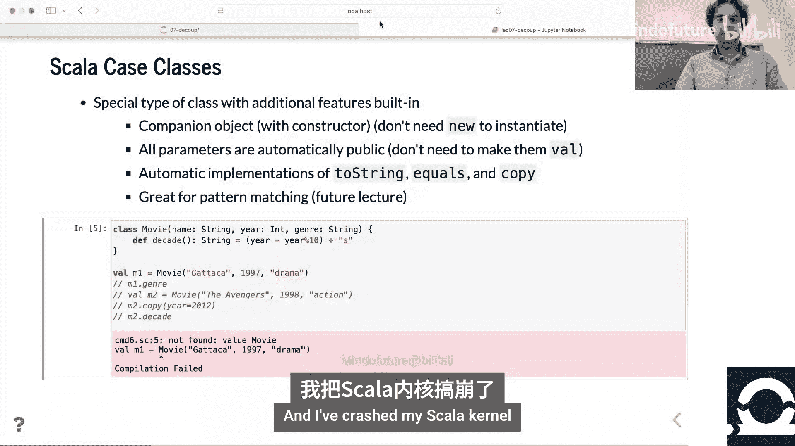
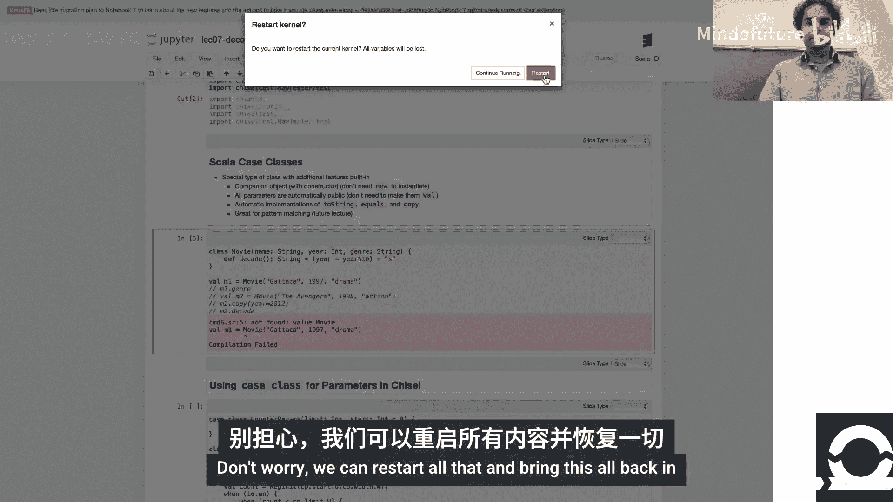
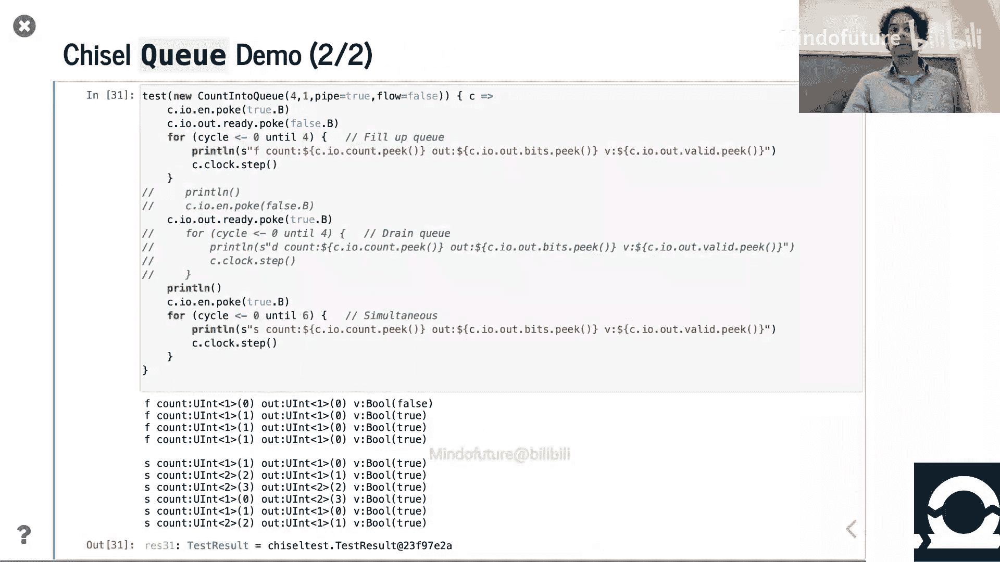

# 敏捷硬件设计：第7讲：解耦

在本节课中，我们将要学习硬件设计中的一个核心概念：解耦。我们将探讨如何让设计中的不同组件能够更灵活、独立地交互，从而提高设计的可重用性和效率。首先，我们会介绍Scala中的case class，这是一种封装参数的便捷方式。然后，我们将深入理解Chisel中的解耦接口，特别是就绪-有效协议，并学习如何使用Chisel标准库中的队列来构建解耦系统。

## 使用Case Class封装参数





在深入解耦之前，我们先来看一个能简化代码组织的Scala特性：case class。这是一种特殊的类，它使得封装一组相关参数变得非常简单。

以下是case class的一些关键特性：
*   **自动生成方法**：无需使用`new`关键字即可实例化，并且自动提供了`toString`、`equals`和`hashCode`方法的实现。
*   **方便的字段访问**：可以直接通过名称访问字段。
*   **`copy`方法**：可以方便地创建现有实例的副本，并仅修改指定的字段。

例如，我们可以定义一个表示电影的case class：
```scala
case class Movie(name: String, year: Int, genre: String)
val m1 = Movie("The Avengers", 2012, "Action")
println(m1.name) // 输出: The Avengers
val m2 = m1.copy(year = 2015) // 创建一个年份不同的新实例
```

在硬件生成器中，case class非常适合用来封装配置参数。例如，一个计数器的参数可以这样封装：
```scala
case class CounterParams(max: Int, start: Int = 0) {
  val width = log2Ceil(max + 1) // 根据最大值计算所需的位宽
}
```
这样，生成器代码可以更清晰、更健壮，所有相关参数和计算逻辑都集中在一个地方，成为“单一事实来源”。

## 理解就绪-有效协议

上一节我们介绍了如何更好地组织代码参数，本节中我们来看看组件间通信的核心协议。当设计变得复杂，包含许多交互组件时，我们需要一种机制让它们不必在每个周期都紧密同步。这就是解耦的目标。

解耦的核心是一种称为**就绪-有效**的握手协议。它涉及两个组件：生产者（发送数据）和消费者（接收数据）。

该协议使用两根关键信号线：
*   **valid**：由生产者驱动。当`valid`为真时，表示生产者当前在`bits`信号线上提供了有效数据。
*   **ready**：由消费者驱动。当`ready`为真时，表示消费者当前可以接收数据。

**数据实际传输发生的时刻，是当同一个时钟上升沿采样到`valid`和`ready`同时为真时**。我们称这一刻为“握手成功”或“触发”。

这种协议的优势在于：
*   **生产者可以暂停**：当没有数据要发送时，它可以置`valid`为假。
*   **消费者可以施加反压**：当无法处理数据时，它可以置`ready`为假，迫使生产者等待。

这实现了组件间的**分布式**协调，对于构建大型、复杂系统至关重要，因为它避免了将所有控制逻辑集中在一处的瓶颈。

## 在Chisel中使用解耦接口

理解了协议原理后，我们来看看如何在Chisel中方便地使用它。Chisel标准库内置了对解耦通信的支持，让我们无需手动实现这些信号。

Chisel提供了两种主要的包装器：
*   **Valid**：仅包含`valid`和`bits`。这类似于Scala的`Option`类型，表示“可能存在的值”。消费者必须接收数据，生产者无法感知消费者是否就绪。
*   **Decoupled**：包含`valid`、`ready`和`bits`。这是完整的双向握手接口。

定义一个解耦输出端口非常简单：
```scala
val io = IO(new Bundle {
  val out = Decoupled(UInt(8.W)) // 一个8位宽的解耦输出端口
})
```
在模块内部，`io.out`将自动拥有`valid`、`ready`和`bits`字段。

**方向性**：`Decoupled()`默认表示数据从本模块输出（`valid`是输出，`ready`是输入）。如果需要接收解耦输入，则使用`Flipped(Decoupled(...))`。

为了编写更简洁的代码，Chisel为`Decoupled`接口提供了一些辅助方法：
*   `io.out.fire()`: 当`valid && ready`为真时返回真，表示握手成功。
*   `io.out.enq(data)`: 等同于同时设置`bits := data`和`valid := true`。
*   `io.out.noenq()`: 等同于设置`valid := false`。

## 避免组合环路

在使用就绪-有效信号时，一个需要警惕的陷阱是意外引入**组合环路**。组合环路是指信号不经过任何寄存器而直接形成反馈路径。

例如，一个错误的加法器：`io.out := io.out + 1.U`。这会导致输出直接反馈到输入，产生不可预测的行为。

在就绪-有效协议中，如果`ready`信号的生成逻辑依赖于`valid`信号，或者反之，就可能创建组合环路。例如，消费者逻辑是“仅当`valid`为真时，我才置`ready`为真”，而生产者的`valid`逻辑又依赖于消费者的`ready`，这就构成了环路。

**最佳实践是确保模块内`ready`和`valid`信号的生成逻辑，尽可能只依赖于该模块自身的内部状态，而不直接依赖于对端的握手信号**。Chisel编译器通常会检测并报告组合环路错误。

## 使用队列进行缓冲

纯粹的端到端解耦接口要求生产者和消费者严格同步握手。为了提供更大的灵活性，我们可以在它们之间插入一个**队列**。

队列的作用类似于现实生活中的排队：
*   生产者只要队列未满，就可以将数据放入（`enq`），而无需立即等待消费者。
*   消费者只要队列非空，就可以从队列取出（`deq`）数据，而无需立即等待生产者。
*   队列缓冲了生产速度和消费速度之间的短期波动。

在Chisel中，我们可以直接实例化标准库中的队列：
```scala
import chisel3.util.Queue
val queue = Module(new Queue(UInt(8.W), entries = 4)) // 4个条目的8位宽队列
io.in <> queue.io.enq // 连接输入到队列的入队端口
queue.io.deq <> io.out // 连接队列的出队端口到输出
```
`Queue`模块本身具有`Decoupled`类型的`enq`（入队）和`deq`（出队）端口。

队列有两个常用的可选参数，可以优化行为：
*   **pipe (管道)**：当设置为`true`时，即使队列已满，但如果同一周期也在进行出队操作，则也允许入队。这提高了吞吐量，但可能增加关键路径或引入组合逻辑需谨慎。
*   **flow (流水)**：当设置为`true`时，如果队列为空，且入队和出队在同一周期发生，数据将直接“绕过”队列存储单元，从输入传到输出，减少了一拍延迟。

## 实战示例：带队列的计数器

让我们通过一个例子将所学知识串联起来。我们将构建一个模块，包含一个计数器，其输出通过一个队列发送。

以下是模块的核心逻辑：
1.  计数器在使能信号`enable`和队列入队端口就绪`io.nq.ready`同时为真时递增。
2.  计数器的值被送入队列的入队端口。
3.  队列的出队端口连接到模块的输出。

```scala
class QueuedCounter(maxVal: Int, queueEntries: Int) extends Module {
  val io = IO(new Bundle {
    val enable = Input(Bool())
    val count = Output(UInt()) // 用于调试的计数器值
    val out = Decoupled(UInt()) // 模块的解耦输出
  })

  val counter = Counter(maxVal)
  val queue = Module(new Queue(UInt(counter.width.W), entries = queueEntries))

  // 计数器在使能且队列可接收时递增
  when(io.enable && queue.io.enq.ready) {
    counter.inc()
  }

  // 将计数器值入队到队列
  queue.io.enq.enq(counter.value)

  // 将队列输出连接到模块输出
  queue.io.deq <> io.out

  io.count := counter.value
}
```
在测试中，我们可以模拟不同的场景：
*   **填充阶段**：使能`enable`，但让输出`ready`为假。计数器值会填入队列。
*   **排空阶段**：关闭`enable`，但让输出`ready`为真。队列中的数据会被消费。
*   **同时进行**：使能`enable`且输出`ready`为真。计数和消费同时进行，队列起到平滑流量的作用。

通过调整队列深度以及`pipe`和`flow`参数，可以观察系统行为的变化。

## 总结



本节课中我们一起学习了硬件设计中的解耦技术。我们从使用Scala **case class** 更好地封装参数开始，然后深入探讨了**就绪-有效握手协议**的原理，这是实现组件间异步通信的基础。我们学习了如何在Chisel中通过**`Decoupled`** 和**`Valid`** 接口方便地应用该协议，并警惕了**组合环路**这一常见陷阱。最后，我们引入了**队列**作为关键的缓冲元件，它能够解耦生产者和消费者的速度，并演示了如何使用Chisel标准库的`Queue`模块以及其`pipe`和`flow`参数来优化设计。掌握这些概念对于构建模块化、可重用且高效的大型数字系统至关重要。