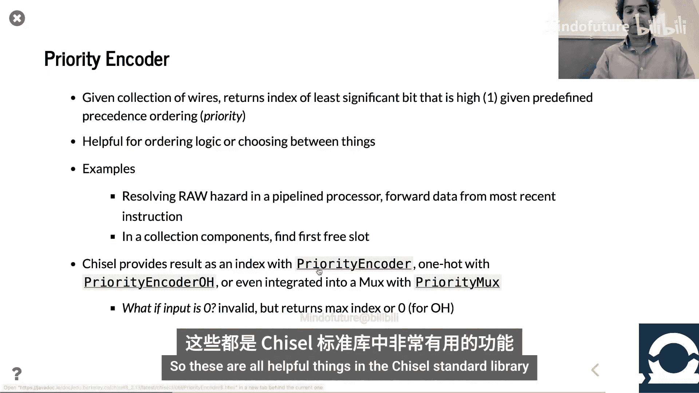
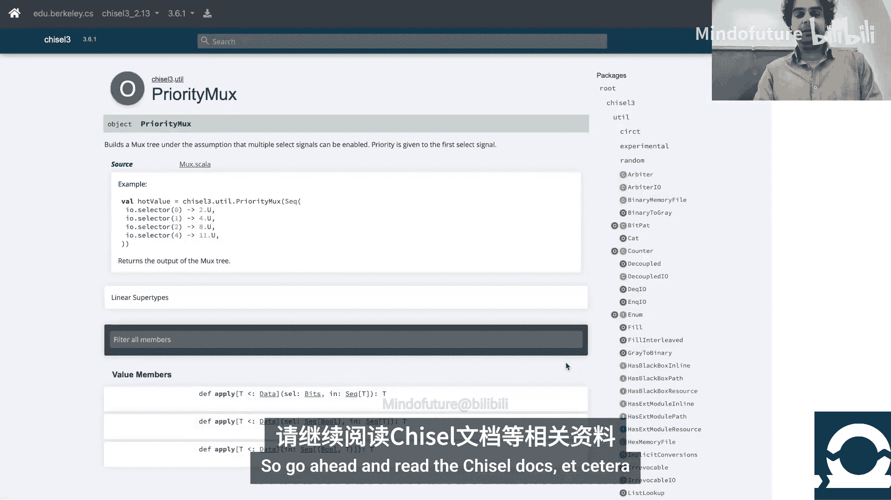
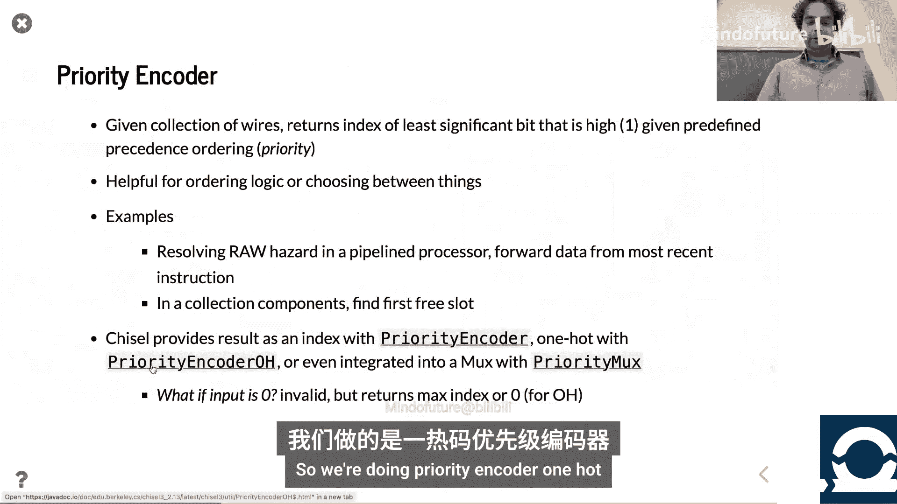
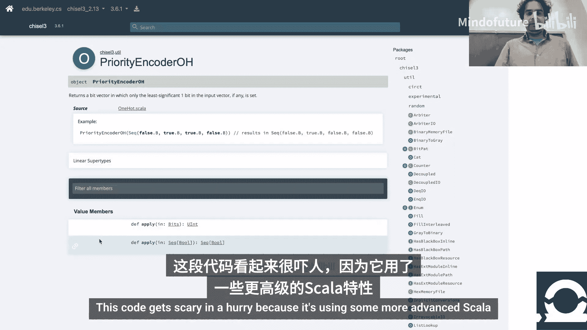
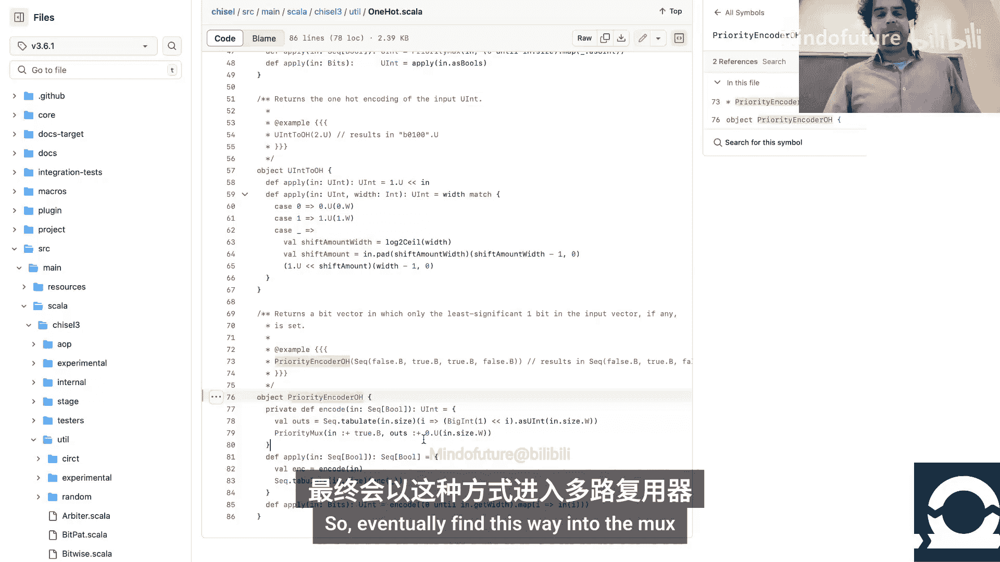
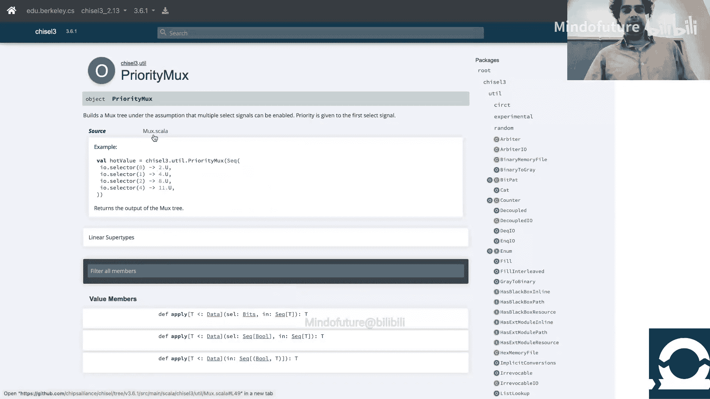
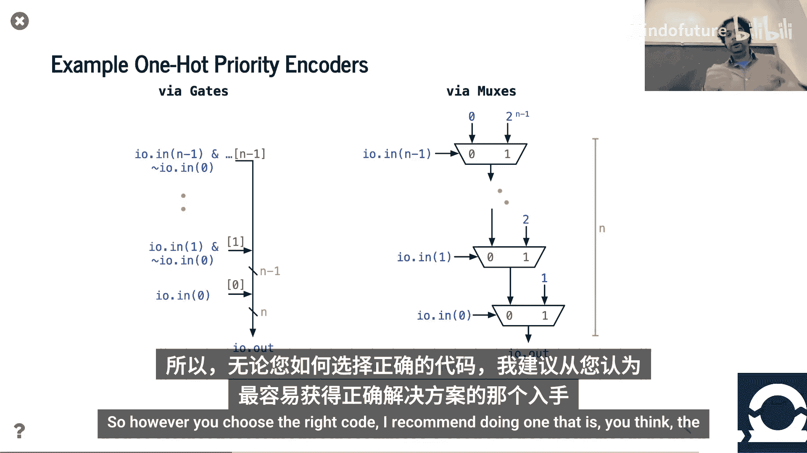
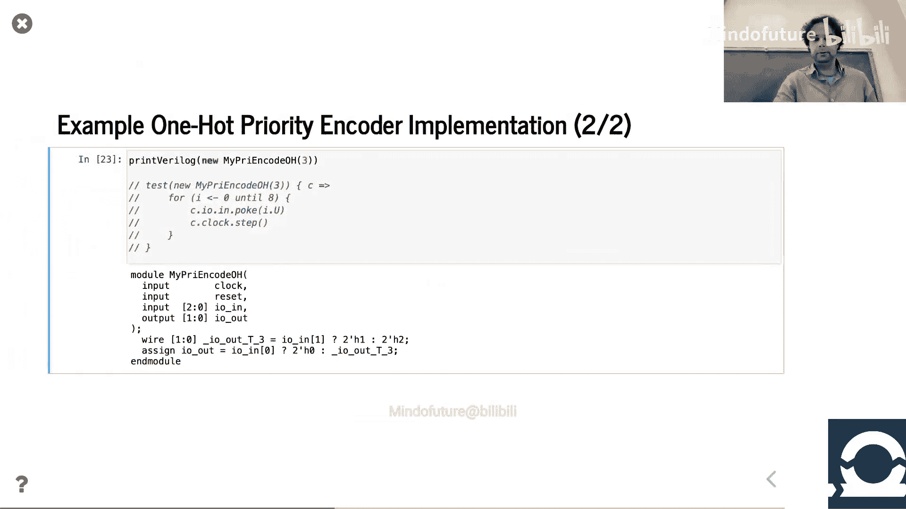

# 【加州大学】敏捷硬件设计-CSE228A-｜-Agile-Hardware-Design-Spring-2025-p11-P21_第8讲-仲裁_第1部分共2节--BV1M6ivBzESw_p11-

Hello and welcome to Lec8。So as you can see from the pilot where we were talking about deco coupling。

 we talked about cues， we talked about us decoupd interface， ready valid signalling。

 all that good stuff。Now we're going to use that abstraction to build up yet again more abstractions in this case。

 arbitration， that is when you have multiple harder resources needing accessing the same thing。

 how do you moderate that， that's arbitration。So there's a number of ways to deal that。

The most common way is something called an arbiter。

We will get there in the second half of this lecture， so now of course in real time D in two days。

 but in this initial starting point。😡，We're going to talk about some。

Pliminaries were use to get to that point， so how do we actually build an arbiter。

 how do we go about applying an arbor Wilson called crossbars with a pretty cool example of how to apply it。

We're going to get there first by talking about some of these initial things which are not only useful hard components。

 but they also demonstrate more of his parametertriized hard generation technique covering in this course。

Sorry after the old notebook。hOkay， then first off。One hot encoding。

 This is a common pattern in hardware design， where。If you have and things normally。You can。

Use log n bits to。Represent that value， however， for one hot encoder。

 you have some number of wires and exactly one was on at a time right， in other words， one is true。

The rest are false。So kind of comparing， you know， 10 encoding versus， you know， more conventional。

 you know， binary encoding。This is going to be essentially more wires， right。

 you know what could be done with2 Tn one hot wires can be done with just N wires。

Ure coding so why are we're doing this， we're doing this because having things one hot makes a lot of other laundry building easier。

And so for modest values of n， we often use a one hot encoding because it's easy to do things。

The only see very common pattern is we'll have some collections of objects and hardware。

I only want to you know modify one， select one， enable one， etc cetera。

 So what' are some examples of this？😡，Imagine you're building a processor and you have a register file。

 create your registers you know for your ISA。😡，When instruction is trying to write to register。

 it's only right to exactly what registered right， so you only want one register to get the right signal one。

 the rest are going to be zeros， right。😡，嗯。Or insteads have an S3M memory。

You're only going to be writing one row， that's the word line， right？Da's going to also have only。

One of those is true and that's often referred to as a decoder and that's around where。

 it also it takes in the row number and it turns not only that wire。And。

So suddenly thats kind of arbitrary format， why we're doing all this， he said。

It can make a lot of other logic easier and best yet if you're kind of deliberate in your design process。

You can set up such that you kind of go into this one hot encoding and you stay in  one hoting。

 you aren't kind of paying the cost of converting in and out of it。

 You just kind of roll one hot encoding throughout。 And so you yes， to me a lot of wires。

 But these wires aren't going very far。 The cat was optimized that well。

 And it's actually very kind of distributed。 Very nice to sign。嗯。

So let's see how we actually go about doing this。So let's say I want to blow my own when not encoded that if I want to take。

A。Number in。In binary and then turn into a10 encoding， right so。啊You can see。

How this comes together wherever my input width is， let's say let's say it's four。

If I have four bits， let's go group that from 0 to 15， right to the 4 minus1。啊。That's 16 things。

 It's actually going to need 16 wires。To do that one hot。 And that's what this is out with is。

 So you see already our input was apple for different things， sure。

We're going to go ahead for a simplicity require input with to be。Greater than0。 Yeah。

 that makes sense。 Alright， how that truth implement today today， I chose to do this with。Recursion。

 right， so how does this work？You can see what we're going to do is we're gonna kind of concatenate things together。

 So you look at the base cases。What does the recursion end？Where is the called asion here？

If the index I'm working with is less than the out with。Great， or out with minus one technically。

 I will kind of keep reccursively calling eventually index will equal out with minus one。

 which can space case and then done。What I'm doing along the way， along the way what I'm doing。

You've been catnating。The result of this recursive function call。With a comparison， right。

 in other words， hey， is the input equal to。This index。So you think about this， right。

 if I have to say a four bit input， 16 output wires， I'm basically making 16 comparators， right。

 was the input zero， if so。This Apple wire is now one。 If it was the input1， If so， now do this。

 right。 And so the incannation is basically just。All these things coming together is。

A lot of components for this。I'll go ahead and declare it。And now if I go to the next slide。

I can go ahead and print it out。 And for just2 bits， it's not so crazy。 right， I can basically see。

 oh wait， you know。嗯。For a two bit input。Two is the two number output myths， right？

And so you can see it is okay， it's so four bits， right？You seel kind of comes together， right？

Ill out。I a variety of things， it's the least significant bed this is the very de concatednation。

Is true if IO is equal to  zero。 Otherwise it's T4。 When is T4 in cnation of。Is it know。

 equal to one？Or is it equal to two？Or this other thing， What is this other thing。

 it was equal to three。It's the structure you're hoping for。

Its a little bit of both ways of getting there。U。Alternatively， if you actually want to go ahead and。

Run this。啊。We see it behaves as expected。Now do I have a diagram next slide， no I don't this works。

Cool， let's。Now。For curiosity's sake。Great， that works。 Oops， I don't mean to go that far。

 I'm going to go that oops just there。Like a lot of things in Chisel。

 there's a standard library version。Right。😊，So。We can do that before we do that。

 I' going go ahead and turn on this printf。But the printf turned on。

 the test case is not going to print stuff out when it runs， so might it makes a little bit more。

Interesting。Yeah， if you can see， for example， it puts 0，1，2 or 3。

 And this is not putting the leading zeros in the output。

 you can see how it gets turned into one hot encoding。So we can see how this gets turned out。 Okay。

0 is the leastning a bit，1，2，3。Okay。But now。I'm curious。

 how did the standard library choose implement this。

So you can find out let's use stay library versions， you can see it's just you went to one hot。

 there's a helper for that。I can comment out my code。And so yeah。

 this function is not going to be called just going to attach that， great。Stard Library does this。

 how do I do it drum roll？Really clever。Right， so if you're look at this， you're like， ge。

 that's the lost you wrote， professor， yes it is So wrote to say library is a lot more clever well how this work。

 It's a dynamic shift， right in other words。😊，Whatever the input is。It's going to。

Seent it one to that， so the input is zero。😡，It's going to shift1 over by 0 bit。

 So it's going to be the lowest bit。 right， if his input is1，2 by  one， so。Daace iss a Dan shift。Now。

Uh， you'd be right to say， wait a second。How expensive is a dynamic shift？

Actually not that cheap right， figure out that name a ship is a lot of ways of hardware tools to do it。

Um，However， my design， you know， we were talking two to the n comparators。

 so is NA shift cheaper than two to the n comparators， probably。

So I would trust the CAd tools with that。 Yeah， so this is an example of the original way of doing it why I did the convolut away。

 I did the convol way for yet more experience doing。啊。

recursion and hopefully it's lesson and you know what for same library components。

 someone have spent a lot of time thinking about those and they're probably be more efficient and you have to know why that's not going better for you and so okay cool。

😡，Questions。Let's keep on。So that was what I'm uncoing， right。

 idea idea of taking some sort of number and turning into a bus of wire where exactly one bit of wire is true。

Mely we following up with a priority encoder， right， and the reason why is we'll see that both。

If prior to encoder using one hot encoding for output。

This would be a really helpful tool for us to developer order for later in the lecture。 But for now。

 let's talk about product encoders。 What they are is given a collection of wires。

Is going to tell us the index of。The least significant bit or you can imagine a being of something bit。

 in other words。Given a bus of wires， I want to know the first location that's true。

From either direction depending on how you're facing the problem。And that ordering in a bits。

 you can't think of it as a priority， right it be。For most。

 they have least significant or least the most， whatever it is that gives an notion of priority we want to find。

That bit， right？Just comes up a lot， right， so imagine inside cyber apro。

If you have a five stage pipeline， classic may like 120。

And let's say you're doing forwarding data right from different instructions， right。

 you have like a register tube being red。Wriinten by one instruction and read by another instruction。

 So yours logic narrative text。 Oh， yeah， I'm reading Reg too。

And earlier instruction still in the pipeline as writers to actually should forward that value。Okay。

 well， what if there are two instructions in the pipeline？Writing words through two， right， you know。

 which ones should you take， You should take the the the old the newer one right if you wanted the more fresh value first through two。

 And so there's a press in a stare， as' a priority。Another scenario you might want is， for example。

 is so you have collection of components and they can be full or empty and you want to find the first free slot。

The order may not matter so much， but you need to pick a slot and particularler and using prior in one way to kind of have a distinct answer。

 He had like four thoughts available， and you've got to pick one of them。

You mean priority there's a way to have a definite answer your heart tell， you know what？

Do that thing， right？And so。Once again， chill will revised logic for priority encoder。

 You can have priority encode for one hot output with prior encoder zero ratio for 1 hot。

 very commonly， use a priority encoder to select between things that even combines it together。

With a mus。 these are all， you know， helpful things。

In the Chisel Sta Library， so go ahead and read the Chisle docs。

E cetera。Now one common question comes up for a priority decor is， okay， if I have multiple bits。

A from multi bit wire committed priority encoder。 And， you know， at least one of those bits is true。

 I can find the index at the lowest or highest whenever my rules are， according to priority， however。

 if。I have that bus of wires coming into my encoder。

 much of these wires coming in and they're all zero。😡，What is the correct behavior？

There's no universal standard across the universe for this。嗯。And depending on。

The scenario that can either be declared to be an invalid input。

 you've now violated the requirement that the inputs at least be one the input be non zero or to implementation。

 it may return the maximum index。嗯。So you can see it's kind of various。

 So that's a scenario where if occurs in your design。

 hopefully you aren't depending on the output encoder at that moment。Okay。

So if you're to go ahead and build these。Here are two ideas， right？嗯。The first idea。

Although the wire is like simple， they're actually are an gates kind of in here that， you know。

 you can blame annotation， these are hand drawn figures， maybe make quite so clear。

So you can imagine。You know。あ。When for should， you know， bid 0 be the one to see。啊。

So I'm going to phrase that this product curve， first of all。

 is using a one out output we talked about a second ago， but one knot means。

So if the bit zero of the output。It's true。Not only is that going to be the only bit that's true。

 it's also going to be saying of the inputs。嗯。😊，That bit was also true right so yeah。

 you can see that here if the input in zero is true。

Then that one' going to be true let's say that's not true。Then。So and， you know and not in zero。

 well if in one is true and guess what and in one is the one。

 So this notation here is concatednation， right to basically， you know。

 one bit at a time kind of feeding into this bus originally is you know by here it's end bits up here it's just one bit and kind of you know slowly adding one bit on at a time。

And if this angate kind of grows arbitrarily， right， it could be。

Up to here it could be n minus1 input， so we basically saying is this last bit true and everything else false。

 then yes's the one。So that press is kind of encoded by this end gate growing in size。

So that's one approach to solving this problem。Another approach you might take is with Muxus， right。

 and so you know what， hey， if the lowest bid is true。That's one。So yeah， this is true。

 selects the one way。 it's true。 If it's false， that depends on this cascade of Muxes right So you kind of see that based on where they are in this cascade of Muxes。

You can kind of take precede that's that prior to kind of pulling rank。

Those two different topologies。 And once again， I'm kind of showing us to give you more examples of。

Ficking of a circuit， these are parametermatized and arbitrary apologies and go ahead and try write these in chisel so write these and chisel the next slide was forwarded down to pause for any questions on the structure or purpose so far。

😡，Okay， let's try it these in chisel。You can see a few different ways doing this， right？😊。

So we're doing both of these with recursion。Well Power functional programming in future weeks。

How can we go about doing this？With gaze is the one on the left from before。you know， okay。

 so we go ahead and call the with gates recursive function， with gates calls the self and eventually。

 you know， this if condition is false and it stops themselves that's the base case。So。

What does it do Well， you can see it cancates。The recursive call。With。

Whateverever the current index is。Theated and the expression。So what is the expression。

 The expressions originally one。 So that's gonna be。

True anything anyone want is that thing that kind of was initially a no op， but。

mAs this kind of builds up， you can kind of see that when we call recursively。

We're going to keep passing things on， in other words。Keep growing this Orin， and this is， you know。

 in 0 is the expression that we pass it on neggate it， right， So not in 0 and this。 And then。

It's going to be not in one and kind of so the sequence of ends for us。Um， yeah， that's going to。

 you know， totally work。If I want to go ahead and look at the their， we can do that。嗯。Yeah。

 you can see， hey， if the lowest bid is true， we're done。If not， it's this combination， which is。

Is this one true and oh， what is this， It's over here。The very is hard to read very quickly but。

Inceptally there， right？嗯。And if I wanted to。Thats it out， we can。Before I do that。

 I'm going to turn the printf back on。I turn the print off off for printing the very log as it makes the very very complicated for no reason。

And we see how the priority encoder work well。The zero case says weird anyway， so we can forget that。

 But if one is true， we get one。 if2 is true， we get2。Now， if both one and， you know，0 and1 are true。

 which one do you get， well， the0 bit has higher priority， the zero locations， so that one wins。

Same thing kind of counting up， right， okay？These are two are both vius。 And then finally。

 that bit wins。 However， if any other bits are on。They're going to take precedence， right。

 This is about priority encoding in practice。Cool， so that was。During the gates， now， if I wanted to。

Go ahead， and。Do that with Muxs。The max1， maybe this is more clear， right， you kind of see， okay。

 as long as you know， we're going through thecursive steps。I build a much， which， you know。

Is based on that input coming in if it's true？I'm going to give the output in this case。

 we're kind of computing that literal on right here。 Otherwise it's going to be this recursive thing。

 you know， building up。This tree of Mux， right？Okay。Let's go ahead， and。

Look at the very look for that， which。You know， sir。Sream boxes those for the three levels。

Checks out。Questions。Okay， well then。Now， of course， we should figure out。

What is the Chiilton Library going to do？I really guess。I showed two ways of doing it。

 so it could be one of those two ways， it could be a third way。How would you do it？

Can we dynamic shift our way out of this？They're going to do with case。O。Gates， let's see。

I forget every year。 So it's always fun for me to find out， oh， it might be mux。 So soul check。

 you random to make sure I didn't。Refresh that。It's boxes。And let's say we were doubting of me。

 Let's go look at how they wrote their amongst code， so we're doing priority encoder one hot。

This Coke is scary in a hurry， because。

You some more advanced scholar features， but other than that。Uh， so you're like， okay。

 proud encoder one hot， that soundsocish enough， what happens？Well。

 actually under the hood is calling priority mus。So the generator implementer was clever。嗯。Underhood。

 and so。What is pretty much， well， it's going to take your one house object my coding work here。

Imventally find its way into the mus。

If we go and look at that Mux code， it's probably also be scary。

But let's do it anyways。Priority month。啊。This is the companion。Object right， so where is the class？

Oh， never mind， there is no class， this object has an apply method。

If you're training to something called Se Uils， this is so deep inside the chain of the library。

So there's something called Seutails， which is sort of for a sequence， basically。This is， you know。

Too hard for to explain and also too hard for me understand sometimes what this like。

 This is just like we ranks this plus code and you try and read STL code from behind the scenes。

 It also scary。 We all understand if SL vector does。

 We don't always know how to control S vector makes sense， right？

 This is kind of like that where we've directly gone someplace really deep into the library where Yeah the code's a little scary。

What does that mean for you with a person writing？Your own freaking， you know， hardware。啊。

Man complexity， right， ideally， if you have complexity。

Is contained inside your module and not exposed to users， right in our case。The。

 the mistake here wasn't that we used their code。 The mistake was we decided to see how it works。

 right， It， It did this job， right， It gave us， you know。The functionality we wanted。

Right the problem was that we went't poking around so they actually encapsulate the complexity we poking。

嗯。Yeah， it's， it's worth kind of being aware of that my general advice is that for most of the time。

 for most harder components。Really trying to sweat every last objectgate it's not worth it。

Get the thing working that's kind of ad philosophy covered in this course， right。

 get your design working， get it passing test benches。

 get other running through the entire tool flow。Then yeah， if you see， oh wait。

 my design is too flow， too much area， too much power。

Go in and optimize that and you can do that with。Profiling， right。

 rather than just attacking random parts of design for no reason。 you can see from those tools。

 where is the time in the critical path going， Where is the area going。

 Where is the power going and be more deliberate about that。 So however you choose the right code。

 I recommend doing one that is you think the easiest to get to correct solutions。

 So maybe you like gateates， Maybe like Muxes。 Maybe you find you this more intuitive。

 I didn both today with acursion。 you can imagine it is a for loop but ava。

 you can imagine doing some functional program which haven't covered yet。

There choices， yeah。Yes。U。I don't know。 in the shorthand， no， but answer is no， is another version。

 But for example， if I just did this， right， I just did the not one hot inness。

They're probably going to break some stuff， but。Aful mu us still。So yeah， amongst of the colon。

 Mu is one of these things where。They can seem expensive at first glancecing hardware。

 but they actually aren't the worst thing。The reason why is some very clever cattool can do lot amongst this。

 so it looks like a。Much of bucks says a sequence like I just showed you。

They recognize this pattern do something be more clever。嗯。Other times there's some really simple。

Har Po actually buildMs extremely cheaply if you're ever willing to do dynamic logic？

Some things things aren't always the worst。 If you're FPJ person。

 maybe you've been trained to be afraid of Muxes and you should be， because yeah， and FJ is Mues or。

Much more with the they for Asic， but I wouldn't。You off a cliff to avoid thees。Cool， okay。

 I think we're about at like a stopping point。 Yes， we are。 Let's stop there。 Okay。

 stay tuned for part 2。

