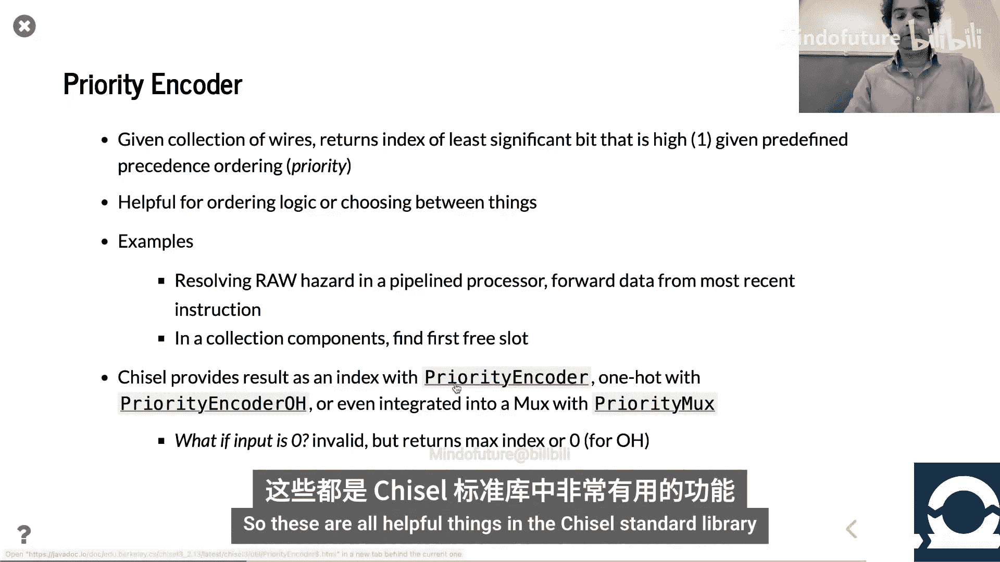
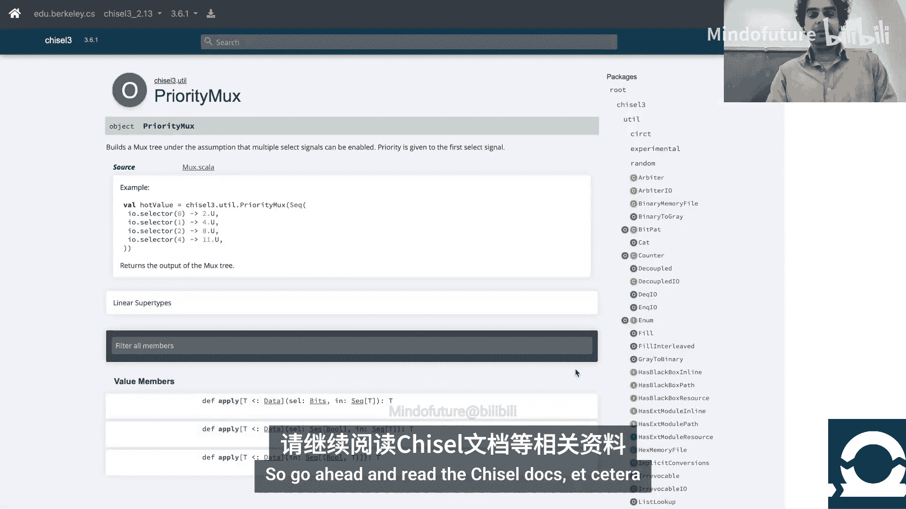
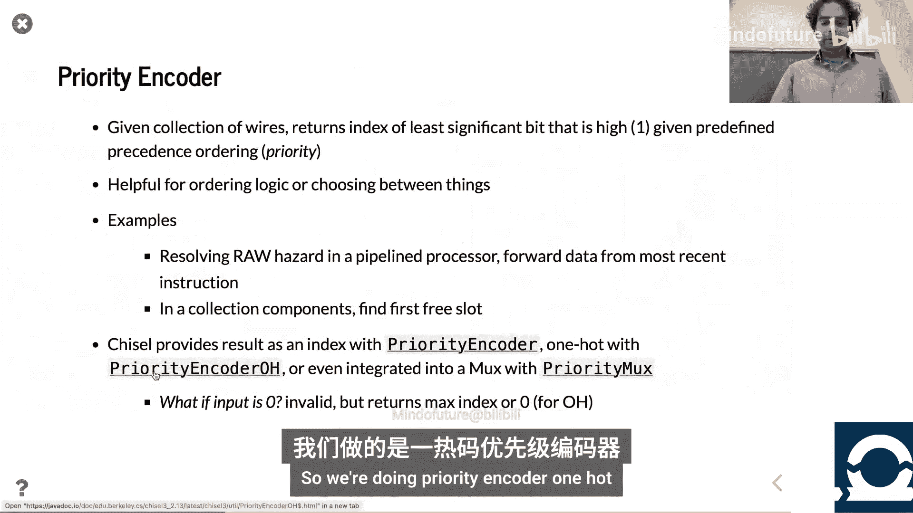
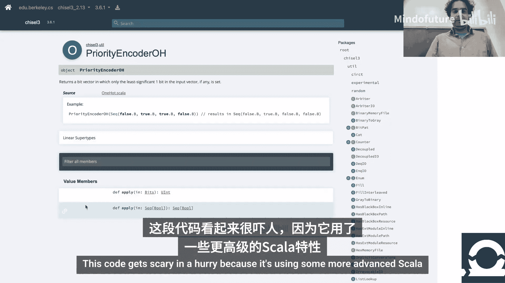
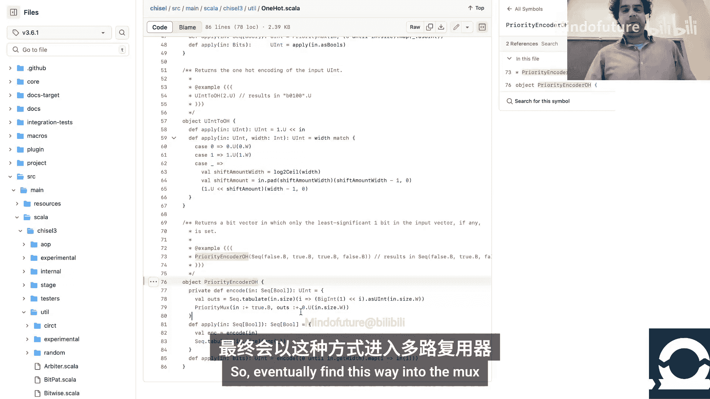
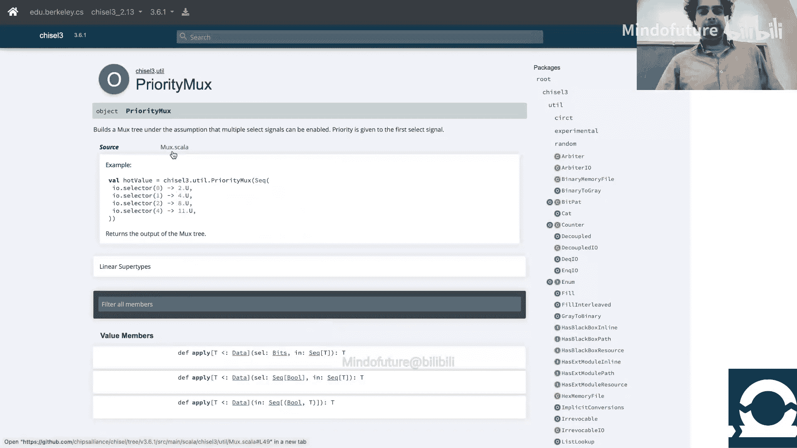
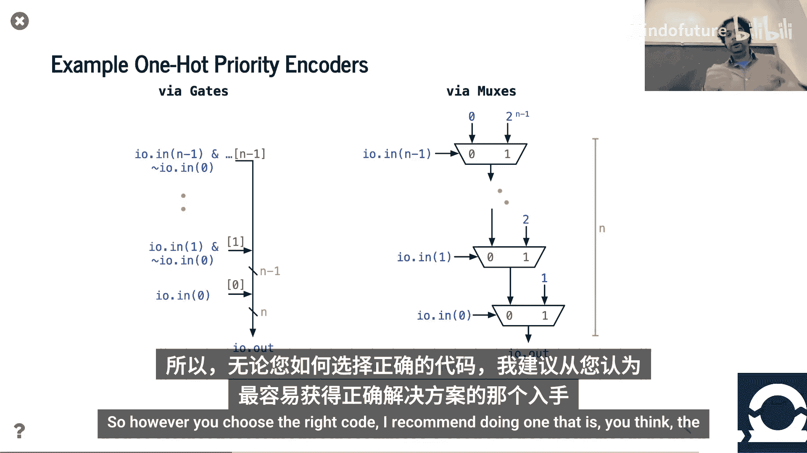
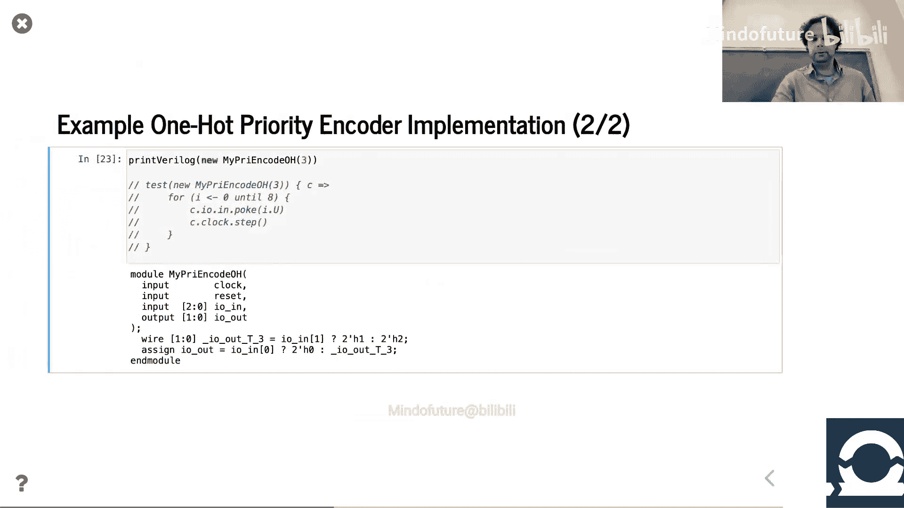

# 敏捷硬件设计：8：仲裁（第一部分）

在本节课中，我们将学习硬件设计中的仲裁概念。我们将从一些基础组件开始，包括独热编码和优先级编码器，这些是构建仲裁器的重要基石。

上一讲我们讨论了去耦、队列和就绪-有效信号接口。本节中，我们将利用这些抽象来构建更高级的抽象——仲裁。当多个硬件资源需要访问同一事物时，如何协调这种访问就是仲裁。

## 独热编码 🎯

独热编码是硬件设计中的一种常见模式。通常，我们可以用 `log n` 位来表示 `n` 个值。但在独热编码中，我们使用 `n` 根线，并且在同一时刻，只有一根线为真（1），其余所有线都为假（0）。

与传统的二进制编码相比，独热编码需要更多的连线。那么为什么我们还要使用它呢？原因在于，独热编码可以使许多其他逻辑的构建变得更加简单。对于中等大小的 `n`，我们经常使用独热编码，因为它易于操作。

一个常见的场景是，我们有一组硬件对象，我们只想修改、选择或启用其中的一个。

以下是独热编码的一些例子：
*   想象你在构建一个处理器，其中有一个寄存器文件。当一条指令试图写入寄存器时，它只写入一个特定的寄存器。因此，你只希望一个寄存器收到写使能信号（1），其余寄存器收到0。
*   或者，对于一个SRAM存储器，你每次只写入一行，这就是字线。同样，只有一根字线为真。这通常被称为解码器，它将行号转换为只有对应线为真的信号。

如果我们在设计过程中有意识地使用独热编码，并保持在整个流程中都使用它，而不是频繁地在二进制和独热码之间转换，就可以避免转换开销。虽然这需要更多连线，但这些连线通常不会传输很远，CAD工具可以很好地优化，并且这种设计实际上非常分布式，易于布局。

### 如何实现独热编码

假设我们想实现一个模块，将二进制输入转换为独热编码输出。

输入宽度为 `inWidth`，例如4位。4位可以表示0到15（`2^4 - 1`）共16个值。因此，输出需要16根线来实现独热编码。所以输出宽度 `outWidth` 是 `2^inWidth`。

我们要求输入宽度大于0。

以下是一种使用递归的实现方法：
```scala
def toOneHot(in: UInt, outWidth: Int): UInt = {
  require(in.getWidth > 0)
  def helper(idx: Int): UInt = {
    if (idx == outWidth - 1) {
      (in === idx.U).asUInt
    } else {
      Cat(helper(idx + 1), (in === idx.U).asUInt)
    }
  }
  helper(0)
}
```
其工作原理是：递归函数 `helper` 遍历从0到 `outWidth-1` 的所有索引。在每一步，它检查输入 `in` 是否等于当前索引 `idx`。如果是，则对应输出位为1。最终，所有比较结果被连接起来，形成一个独热编码的向量。这本质上相当于为每个可能的输入值（0到15）创建了一个比较器。

对于2位输入，输出是4位独热码。例如，输入 `0` (`b00`) 对应输出 `0001`，输入 `1` (`b01`) 对应输出 `0010`，以此类推。



在Chisel标准库中，已经提供了更高效的实现：
```scala
import chisel3.util.UIntToOH
val oneHotOut = UIntToOH(binaryIn)
```
标准库的实现通常更巧妙，例如使用动态移位：`1.U << binaryIn`。虽然动态移位在硬件中并非零成本，但相比于 `2^n` 个比较器，它通常更高效。对于标准库组件，开发人员已经投入了大量时间进行优化，因此通常可以信任其效率。



## 优先级编码器 🔝

接下来我们讨论优先级编码器。它将是我们后续构建仲裁器的有用工具。

优先级编码器的作用是：给定一组信号线（一个总线），它会告诉我们第一个为真的位所在的位置（索引）。这个“第一个”可以从最高有效位或最低有效位开始，这取决于你如何定义优先级。这种排序赋予了位次优先级的概念。

这在硬件中很常见。例如：
*   在经典的五级流水线处理器中，如果有多条指令正在写回同一个寄存器，而后续指令需要读取该寄存器，就需要进行数据前递。如果有多个写操作，你应该选择最新的值。这就存在一个优先级顺序。
*   另一个场景是，你有一组组件，它们可能处于“满”或“空”状态，你需要找到第一个空闲槽。虽然顺序可能不重要，但你需要一个确定的答案，优先级编码器提供了一种确定性的选择方式。

在Chisel标准库中，有 `PriorityEncoder` 和 `PriorityEncoderOH`（输出为独热码）等模块。优先级编码器常与多路选择器结合使用。

一个常见的问题是：如果输入到编码器的所有位都是0（没有位为真），正确的行为是什么？对此并没有统一标准。在某些设计中，这可能被视为无效输入；在另一些实现中，它可能返回最大索引值。在你的设计中，如果遇到这种情况，最好确保不依赖此时编码器的输出。

### 如何构建优先级编码器

以下是两种构建优先级编码器的思路：

**第一种思路：使用与门链**
这种方法使用一个由与门构成的链。输出是独热码。对于输出位 `i` 为真，不仅要求输入位 `i` 为真，还要求所有优先级高于 `i` 的位（例如索引更小的位）都为假。这可以通过一个逐渐增大的与门链来实现，检查 `input(i)` 为真，且所有 `j < i` 的 `input(j)` 为假。





**第二种思路：使用多路选择器链**
这种方法使用一系列级联的多路选择器。从最高优先级位（例如位0）开始检查。如果该位为真，则选择对应的输出值。如果为假，则检查下一个优先级位，依此类推。这本质上是一个优先级多路选择器。





在Chisel中，我们可以用递归来实现这两种结构。

**使用与门链的实现示例：**
```scala
def priorityEncoderGate(in: Vec[Bool]): UInt = {
  val n = in.size
  def helper(idx: Int, expr: Bool): UInt = {
    if (idx >= n) {
      0.U
    } else {
      val bit = in(idx) && expr
      Cat(helper(idx + 1, expr && !in(idx)), bit.asUInt)
    }
  }
  helper(0, true.B)
}
```
递归函数 `helper` 遍历输入位。`expr` 初始为真，它累积表示“之前所有更高优先级的位都为假”。当前输出位是输入位 `in(idx)` 和 `expr` 的与。然后递归调用时，`expr` 更新为 `expr && !in(idx)`，以确保后续位只有在所有更高优先级位都为假时才可能输出。

**使用多路选择器链的实现示例：**
```scala
def priorityEncoderMux(in: Vec[Bool]): UInt = {
  val n = in.size
  def helper(idx: Int): UInt = {
    if (idx >= n - 1) {
      n.U // 默认值，当没有位为真时返回
    } else {
      Mux(in(idx), idx.U, helper(idx + 1))
    }
  }
  helper(0)
}
```
递归函数 `helper` 检查当前位 `in(idx)`。如果为真，则返回当前索引 `idx`。如果为假，则递归检查下一个位。当到达最后一位时，返回一个默认值（例如 `n`，表示无效）。

Chisel标准库中的 `PriorityEncoder` 和 `PriorityEncoderOH` 内部实现可能使用了类似多路选择器链或其他优化方法。库代码可能看起来很复杂，因为它封装了实现细节并进行了优化。对于大多数设计，建议首先使用标准库组件以获得正确功能。如果后续性能分析（如时序、面积、功耗）发现瓶颈，再针对性地进行优化。



关于多路选择器的成本：在ASIC中，多路选择器并不总是非常昂贵。CAD工具可以识别某些多路选择器模式并进行优化。在FPGA中，多路选择器资源可能更需关注，但也不应过度避免使用它们而增加设计复杂性。



本节课中我们一起学习了硬件仲裁的基础知识，重点介绍了独热编码和优先级编码器的概念与实现。独热编码通过确保单线有效简化了选择逻辑，而优先级编码器则为解决资源争用提供了确定性的选择机制。这些组件是构建复杂仲裁器（如下一部分将介绍的交叉开关）的核心模块。请继续关注第二部分，我们将利用这些基础来构建完整的仲裁系统。